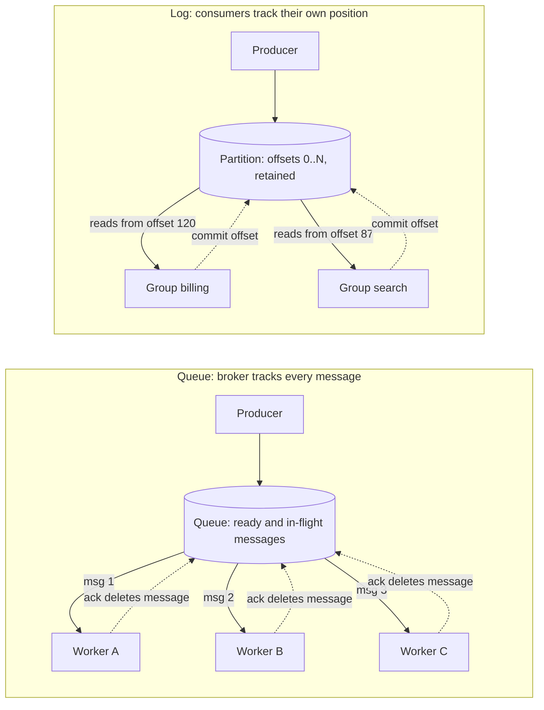
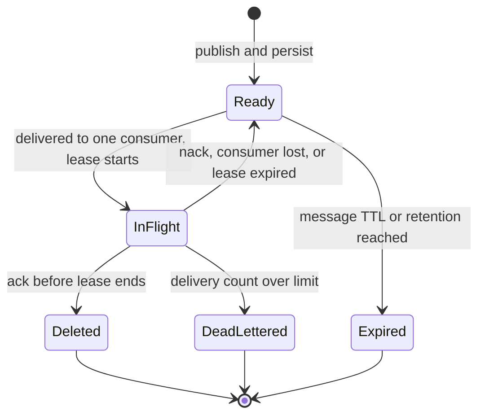
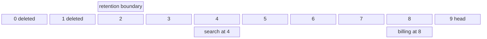
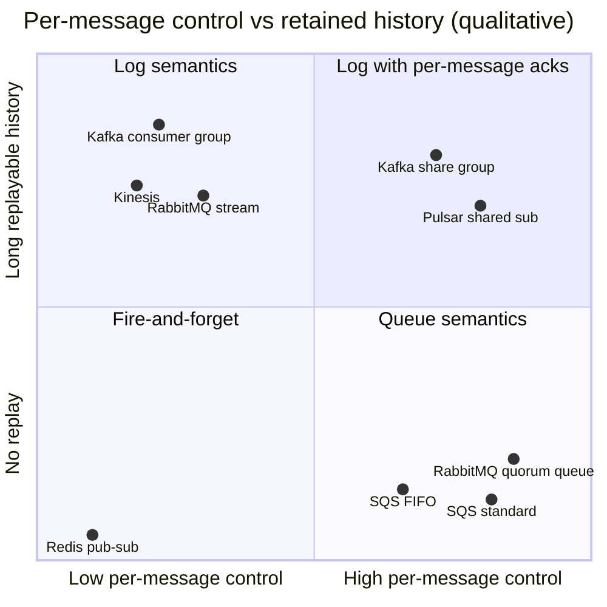
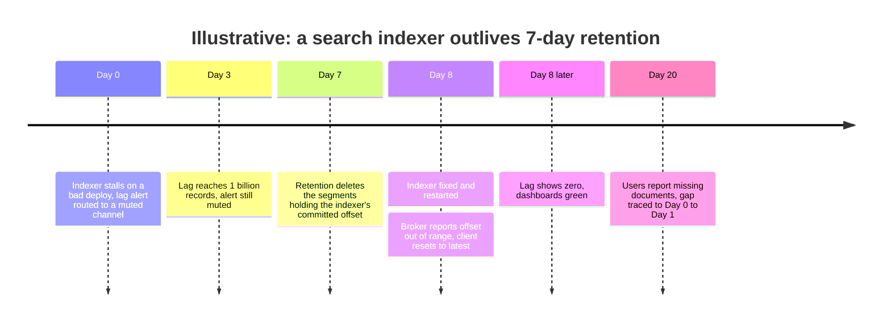

Mesaj kuyruğu da event stream de bir üreticinin (producer) işi ya da olguları bir broker'a bırakıp tüketiciyi (consumer) beklemeden devam etmesini sağlar. İkisi, neyin tüketildiğini kimin hatırladığı konusunda ayrışır. Kuyruk her mesaj için teslim durumunu tutar: broker hangi mesajların beklediğini, hangilerinin bir tüketiciye kiralandığını (lease) ve hangilerinin onaylandığını (ack) bilir; onaylanan mesaj silinir. Log ise (event streaming'in arkasındaki depolama yapısı) okumanın değiştirmediği, yalnızca sona ekleme yapılan (append-only), sıralı bir kayıt dizisi tutar. Her tüketici kendi konumunu bir tamsayı offset olarak hatırlar; kayıtlar ancak bir saklama (retention) politikası onları kaldırdığında, okunmuş olup olmadıklarından bağımsız olarak yok olur.

Diğer bütün farklar bu seçimden doğar. Mesaj başına durum tutmak, kuyruğun herhangi bir mesajı boştaki herhangi bir tüketiciye vermesini, bir mesajı komşularına dokunmadan yeniden denemesini ve tüketici eklemeyi serbestçe yapmasını sağlar; bedeli sıralama, geçmiş ve mesaj sayısıyla orantılı broker işidir. Partition başına tek bir imleç (cursor) tutmak ise log'un birçok bağımsız okuyucuya tek kopyadan hizmet vermesini, partition içinde sırayı korumasını ve geçmişi istendiğinde yeniden oynatmasını (replay) sağlar; bedeli partition sayısıyla sınırlanan paralellik ve head-of-line blocking'dir: kayıt 43 hâlâ çözülmemişken tüketici kayıt 45'i onaylayamaz. Asıl denge, mesaj başına kontrol ve esnek paralellik ile sıralı, yeniden oynatılabilir ve ucuza paylaşılan geçmiş arasındadır.

İkisi de aynı temel nedenle vardır. Senkron bir çağrı, çağıranın erişilebilirliğini ve gecikmesini çağrılanınkine bağlar; araya kalıcı bir broker koymak, tüketici yavaşken, çökmüşken ya da deploy edilirken üreticinin başarıyla devam etmesini sağlar. Çağrı tabanlı alternatif [senkron protokoller](/distributed-systems/tr/communication/synchronous-protocols/) bölümünde ele alınır. Bu sayfa iki broker modelini karşılaştırır; belirli sistemlerin iç yapısı [Kafka Mimarisi](/distributed-systems/tr/communication/async-messaging/kafka-architecture/), [RabbitMQ](/distributed-systems/tr/communication/async-messaging/rabbitmq/) ve [Pulsar ve Kafka](/distributed-systems/tr/communication/async-messaging/pulsar-vs-kafka/) sayfalarına, genel bir veri altyapısı fikri olarak log ise [Commit Log Soyutlaması](/distributed-systems/tr/data-processing/hybrid-architectures/commit-log-abstraction/) sayfasına aittir.


*İki broker modeli. Kuyrukta mesajlar worker'lar arasında dağıtılır ve onaylanınca kaldırılır; log'da her grup aynı kayıtları okur ve yalnızca bir konum saklar.*

Kuyrukta üç worker üç farklı mesaj alır; dördüncü bir worker eklemek kapasiteyi hemen artırır ve hiçbir worker başka bir worker'ın onayladığı mesajı görmez. Log'da iki grup aynı kayıtları farklı konumlardan okur ve birbirini etkilemez: search grubu billing'in 33 kayıt gerisindedir ve bu gecikme broker'a, zaten saklaması gereken byte'lar dışında hiçbir maliyet getirmez. Kesikli oklar temel asimetriyi gösterir. Kuyruktaki bir onay tek bir mesaja atıfta bulunur ve o mesajın broker'daki durumunu değiştirir; log'daki bir commit ise bir konuma atıfta bulunur ve ondan önceki her şeyin bittiğini beyan eder.

## Kuyruk Modeli: Lease'ler, Onaylar ve Rakip Tüketiciler

Bir kuyruk broker'ı mesajı kabul eder, kalıcı olarak yazar ve hazır kümesine (ready set) koyar. Bir tüketici iş istediğinde broker hazır bir mesaj seçer, onu o tüketiciye bağlı uçuştaki (in-flight) duruma taşır ve bir lease başlatır. Tüketici lease bitmeden onay verirse broker mesajı siler. Tüketici mesajı reddederse, bağlantısı koparsa ya da lease'in süresini doldurursa broker mesajı hazır kümesine, muhtemelen başka bir tüketiciye gitmek üzere geri koyar. Birden fazla tüketicinin tek bir kanaldan iş alması ve her mesajın bunlardan yalnızca birine gitmesi desenine rakip tüketiciler (competing consumers) denir.


*Bir kuyruk broker'ında tek bir mesajın yaşam döngüsü. Lease, SQS'te bir visibility timeout, RabbitMQ'da ise açık bir channel ile bir onay zaman aşımıdır.*

Bu makinenin iki ayrıntısı garantilerini belirler. Birincisi, `InFlight` durumundan `Ready` durumuna geçişi broker'ın tüketiciden haber alamaması tetikler ve broker yavaş bir tüketiciyi ölü bir tüketiciden ayırt edemez; bu, [Hata Modelleri](/distributed-systems/tr/foundations/system-models/failure-models/) sayfasında anlatılan çökme ile gecikmeyi ayırt etmenin genel imkânsızlığıdır. İşi bitirmiş ama lease dolduğunda henüz onay vermemiş bir tüketicinin mesajı bir başkası tarafından ikinci kez işlenir. İkincisi, `DeadLettered` durumuna geçiş, her denemede başarısız olan bir mesajın tek çıkışıdır; bu geçiş olmasa tüketicisini çökerten bir mesaj sonsuza kadar `InFlight` döngüsünde kalır.

### Kuyruk Neyi Garanti Eder, Neyi Etmez

Kalıcı bir kuyruğun koruduğu invariant şudur: kabul edilen her mesaj ya bir tüketici tarafından onaylanır, ya bir dead-letter hedefine taşınır ya da açık bir politika ile süresi dolar. Tüketiciler yalnızca ortada yokken hiçbir şey sessizce düşürülmez. Gerekçe kısadır. Bir mesaj broker'dan yalnızca üç terminal geçişle ayrılır; silme bir onay gerektirir; terminal olmayan her durum ya bir tüketici bekler (`Ready`) ya da zaman aşımında geri döner (`InFlight`). Broker'ın kendi depolaması kalıcı ve replike olduğu sürece bir mesaj tüketici hatasıyla kaybolamaz, yalnızca gecikir. Bu invariant'ın bedeli at-least-once teslimdir, çünkü lease'in dolması tamamlanmış olabilecek işi yeniden teslim eder. Uygulamaların bunu fiilen tek seferlik işlemeye (effectively-once) nasıl dönüştürdüğü [Teslim Semantiği](/distributed-systems/tr/communication/async-messaging/delivery-semantics/) sayfasının konusudur.

Kuyruk, mesajları sırayla saklasa bile işleme sırasını garanti etmez. Tek tüketiciyle sıra, ilk yeniden teslimde kaybolur: mesaj 7 zaman aşımına uğrar, mesaj 8 onaylanır ve mesaj 7 ondan sonra işlenir. N tüketiciyle sıra hemen kaybolur: mesaj 7 ve 8 iki worker'a gider ve hangisi önce biterse etkisini önce yazar. FIFO kuyruk tamamlanma sırasını değil, teslim sırasını kısıtlar. Kuyruk üzerinde sıralı işleme sunan sistemler bunu sıralama anahtarı başına eşzamanlılığı kısıtlayarak yapar: SQS FIFO kuyruğunda aynı message group ID'ye sahip mesajlar birer birer verilir ve gruptaki bir sonraki mesaj, uçuştaki mesaj silindikten ya da visibility timeout'u dolduktan sonra erişilebilir olur. Bu, grup başına sırayı geri getirir ve her grubu seri bir şeride dönüştürür; log'un partition başına dayattığı kısıtın tam olarak aynısı.

Kuyruk geçmiş tutmaz. Onaylanan mesaj gider; yeni bir tüketici, düzeltilmiş bir hata ya da bir denetim onu tekrar göremez. Kuyruk mesajları paylaşmaz da: aynı mesaja üç servis ihtiyaç duyuyorsa broker, her biri kendi mesaj başına durumunu taşıyan üç kuyruğa birer kopya yönlendirmek zorundadır.

:::caution[On tüketicili bir FIFO kuyruk sıralı işleme değildir]
Mesajları sırayla saklamak ve sırayla teslim etmek, on paralel worker'ın onları hangi sırayla bitireceği hakkında hiçbir şey söylemez. Tüketici durum değişiklikleri uyguluyorsa (fiyatı ayarla, durumu güncelle), aynı varlık için iki güncelleme ters sırada uygulanabilir ve eski değer kazanır. Ya bir varlığa ait tüm mesajları tek bir seri şeritten geçirin (message group, tek bir tüketiciye consistent-hash yönlendirmesi ya da bir log partition'ı) ya da her güncellemenin bir sürüm taşımasını sağlayıp eski sürümleri yazma anında reddedin.
:::

### Akış Kontrolü ve Broker'ın Maliyet Profili

Tüketiciler bir mesaj alıp işleyip tekrar istemez; round trip maliyeti baskın hâle gelirdi. Broker'lar bir tüketicinin sınırlı sayıda onaylanmamış teslimatı elinde tutmasına izin verir: RabbitMQ'da `basic.qos` ile ayarlanan prefetch sayısı ya da bir SQS receive çağrısının batch boyutu. Bu sınır, kuyruğun yerleşik backpressure'ıdır. Çok yüksek bir prefetch, diğerleri boşta beklerken mesajları yavaş bir tüketicinin üzerine yığar; çok düşük bir prefetch ise tüketicileri ağ round trip'lerini beklemeye mahkûm eder.

Her mesaj broker'a iş çıkarır: geldiğinde bir indeks kaydı, teslimde bir durum değişikliği, onayda bir diğeri ve bir silme; her biri kalıcı olarak yazılmalı, replike kuyruklarda ise bir quorum tarafından kabul edilmelidir. Bu yüzden broker throughput'u yalnızca saniyedeki byte ile değil, saniyedeki onay sayısıyla ölçeklenir ve büyük bir birikim (backlog) tutan kuyruk tüm bu mesaj başına durumu canlı tutar. Klasik kuyruk broker'ları çoğu zaman boşa yakın olan kuyruklar için tasarlanmıştır; derin bir birikim onları bellekte çalışan hızlı yoldan sayfalamaya (paging), sonunda da üreticileri kısan kaynak alarmlarına iter. Bu hata modu aşağıda ele alınır.

## Log Modeli: Offset'ler, Retention ve Partition'lı Sıra

Bir log broker'ı her kaydı bir partition'ın sonuna ekler ve ona bir sonraki offset'i, monoton artan bir tamsayıyı atar. Kayıtlar bir kez yazıldıktan sonra değişmez. Topic, yazma ve okumaların makineler arasında ölçeklenmesi için partition'lara bölünür; üretici partition'ı bir anahtarın hash'iyle seçer, böylece aynı anahtara sahip tüm kayıtlar üreticinin gönderdiği sırayla aynı partition'a düşer. Retention her topic için zamana ya da boyuta göre ayarlanır ve sınırdan eski segment'ler, okunmuş olsun olmasın, bütün hâlinde silinir. Compacted topic'ler bunun yerine anahtar başına en son kaydı tutar; bu, [Log Compaction](/distributed-systems/tr/data-processing/hybrid-architectures/log-compaction/) sayfasında anlatılır.

Tüketiciler gruplar hâlinde örgütlenir. Bir grup içinde her partition tam olarak bir tüketiciye atanır; bu tüketici kayıtları offset sırasıyla okur ve işleyeceği bir sonraki kaydın offset'ini periyodik olarak commit eder. Grubun tüm tüketim durumu partition başına bir tamsayıdır. Aynı topic'i okuyan ikinci bir grubun kendi tamsayıları vardır ve birinci grup için görünmezdir.


*Offset dizisi olarak tek bir partition. Retention sınırından önceki segment'ler gitmiştir; her consumer group saklanan aralığın içine bakan bir işaretçiden ibarettir.*

Bu yerleşimde üç özellik görünür. Tüketim yıkıcı değildir: offset 8'deki billing ile offset 4'teki search aynı byte'ları okur ve search yeniden işlemek için offset 2'ye geri alınabilir. Bir tüketicinin maliyeti bir işaretçi artı kullandığı okuma bant genişliğidir; onuncu bir grup broker'a hiçbir yazma amplifikasyonu getirmez. Retention sınırı ise iki işaretçiden bağımsız ilerler: search sınır offset 4'ü geçecek kadar geride kalırsa, işlemediği kayıtlar silinir; bu hata, hata modları bölümünde incelenir.

### Partition'lı Log'lar Sırayı Neden Korur ve Paralelliği Neden Sınırlar

Log'un sıralama garantisi partition başınadır: aynı partition'da A kaydı B kaydından önce eklendiyse, ikisini de işleyen her tüketici A'yı B'den önce görür. Gerekçe üç olguya dayanır. Partition leader'ı offset'leri ekleme sırasına göre atar, yani offset dizisi sıranın kendisidir. Bir grupta her partition'ın en fazla bir aktif tüketicisi vardır, dolayısıyla tek bir partition'dan iki kaydın eşzamanlı işlenmesi olmaz. Tüketici tek tek kayıtları değil bir konumu commit eder; çökmeden sonra son commit edilen offset'ten devam eder ve ondan sonraki her şeyi sırayla yeniden okur. Anahtar başına sıra, anahtar tek bir partition'a eşlendiği için korunur; partition'lar arası sıra tanımlı değildir ve buna ihtiyaç duyan bir tasarım ya yanlış anahtarı seçmiştir ya da tek bir partition'a ihtiyaç duyar.

Aynı üç olgu paralelliği de sınırlar. Bir grup en fazla topic'in partition sayısı kadar aktif tüketiciye sahip olabilir; fazlası boşta bekler. Bu yüzden partition sayısı önceden verilen bir kapasite kararıdır ve sonradan artırmak anahtarları yeni partition'lara yeniden eşler, bu da geçiş sırasında anahtar başına sırayı bozar. Kümülatif commit ayrıca head-of-line blocking üretir: commit edilen offset yalnızca tamamı bitmiş kayıtların ötesine ilerleyebilir. Kayıt 43 yavaşsa ya da başarısız oluyorsa, kayıt 44 ve 45 işlenebilir ama commit edilemez ve bir çökmeden sonra yeniden işlenir.

```mermaid
sequenceDiagram
    autonumber
    participant B as Broker
    participant C as Consumer
    participant D as Downstream
    rect rgb(40, 60, 40)
    Note over B,D: Queue: per-message acknowledgement
    B->>C: Deliver m43, m44, m45
    C->>D: Process m44 and m45, ok
    C->>B: Ack m44, ack m45
    C->>D: Process m43, fails
    C->>B: Nack m43, it returns to the ready set alone
    end
    rect rgb(70, 40, 40)
    Note over B,D: Log: cumulative offset commit
    B->>C: Fetch offsets 43 to 45
    C->>D: Process 43, fails
    Note over C: Cannot commit past 42 while 43 is unresolved
    alt Retry 43 in place
        C->>D: Retry 43 until it succeeds, partition stalls
    else Skip 43
        C->>B: Commit 46, record 43 is lost unless copied elsewhere
    end
    end
```


*Aynı başarısız mesaj, mesaj başına onay altında ve kümülatif offset altında. Yalnızca log, partition'ı durdurmak ile kaydı terk etmek arasında bir seçim dayatır.*

Adım 1-5, kuyruğun kötü bir mesajı neden ucuza ele aldığını gösterir: hata mesaj 43'e yalıtılmıştır, komşuları zaten gitmişken o tek başına yeniden teslim edilir. Adım 6-9 log'un ikilemini gösterir. Tüketici kayıt 43'ü yerinde yeniden deneyebilir; bu, yeniden deneme sürdüğü müddetçe partition'daki her anahtarı durdurur. Ya da onun ötesine commit edebilir; bu da tüketici kaydı önce bir retry topic'ine ya da dead-letter topic'ine kopyalamadıkça kaydı terk etmek demektir. Üretimdeki log tüketicileri bu kopyalamayı açıkça uygular; desenler [Dead Letter Queues ve Poison Message Yönetimi](/distributed-systems/tr/communication/async-messaging/dlq-poison-messages/) sayfasında ele alınır. Broker üçüncü bir seçenek sunmaz, çünkü tek bir tamsayı "43 hariç 45'e kadar her şey" ifadesini temsil edemez.

### Log'u Yüksek Hacimde Çalıştırmak Neden Ucuzdur

Bir log broker'ı mesaj başına neredeyse hiç iş yapmaz. Eklemeler bir segment dosyasının sonuna sıralı yazmalardır; okumalar, head'e yakın tüketiciler için işletim sisteminin page cache'inden karşılanan bitişik byte aralıklarının sıralı okumalarıdır ve broker hiçbir kaydı tek tek güncellemez ya da silmez. Retention bütün segment dosyalarını siler. Broker'ın consumer group başına değişebilir durumu partition başına bir offset'tir ve kayıt başına değil, birkaç saniyede bir commit edilir. Log'un günlerce veri saklayıp mesaj başına defter tutmadan birçok gruba hizmet verebilmesinin nedeni budur; depolama düzeyindeki mekanizmalar [Disk Tabanlı Kalıcılık ve Sıfır Kopyalama Optimizasyonu](/distributed-systems/tr/case-studies/apache-kafka/disk-persistence-zero-copy/) sayfasında ele alınır.

## Sayısal Örnek: Tek Sipariş Akışı, İki Tasarım

Bir sipariş servisinin ortalama saniyede 4.000, tepe noktasında saniyede 12.000 sipariş event'i yayımladığını ve ortalama kayıt boyutunun 2 KB olduğunu varsayalım. Bunlara üç tüketici ihtiyaç duyuyor: bir depo API'sini çağıran ve mesaj başına ortalama 25 ms süren bir fulfillment worker'ı, bir arama indeksleyicisi ve bir analitik yükleyici. Tüm sayılar örnek amaçlıdır.

**Fulfillment için eşzamanlılık.** [Little Yasası](/distributed-systems/tr/resilience/flow-control/queueing-theory-littles-law/)'na göre aynı anda işlenmekte olan mesaj sayısı, varış hızı çarpı işleme süresine eşittir: tepe noktasında, herhangi bir pay bırakmadan önce `12,000 * 0.025 = 300` eşzamanlı mesaj. Kuyrukla bu 300 worker yuvasıdır (örneğin her biri 10 eşzamanlı handler'a sahip 30 instance) ve her yuva her mesajı alabildiği için autoscaler saniyeler içinde yuva ekleyebilir. Partition başına tek bir uçuştaki kayıtla çalışan bir log'da ise fulfillment, tepe noktası gelmeden önce seçilmiş en az 300 partition'a ihtiyaç duyar; replikasyon faktörü 3 ile bu, tek bir topic için 900 partition replikası eder. Bir partition içinde birden fazla anahtarı eşzamanlı işlemek partition sayısını düşürür, ama o zaman tüketici kayıt başına tamamlanmayı kendisi izlemeli ve yalnızca bitmemiş en düşük offset'i commit etmelidir; yani istemci tarafında bir kuyruğu yeniden inşa eder.

**Tek bir yavaş mesaj.** Her 100.000 depo çağrısından birinin zaman aşımına uğramadan önce 30 saniye askıda kaldığını varsayalım. Kuyrukla 300 yuvadan biri 30 saniye meşgul olur; bu, diğer siparişlere hiçbir etkisi olmayan %0.3'lük bir kapasite kaybıdır. Log'da ise o kaydın partition'ı 30 saniye boyunca ilerlemez. Tepe noktasında 300 partition'ın her biri saniyede `12,000 / 300 = 40` kayıt alır; dolayısıyla askıdaki kaydın arkasında 1.200 kayıt birikir ve o partition'a hash'lenen her sipariş 30 saniyeye kadar gecikir. 100.000 mesajda bir askıda kalma ve saniyede 12.000 mesajla yaklaşık her 8 saniyede bir yeni bir askıda kalma başlar; yani herhangi bir anda kabaca dört partition durmuş durumdadır. Log'un fulfillment için uç gecikmesi (tail latency) ortalama kaydı değil, partition başına en yavaş kaydı yansıtır.

**Üç tüketiciye fan-out.** Kuyruklarla broker her event'i üç kuyruğa yönlendirir ve event başına üç teslim ile üç onay gerçekleştirir: tepe noktasında saniyede 36.000 onay ve her birikimin üç kopyası. Log'la event bir kez yazılır, üç kez okunur: çoğu page cache'ten karşılanan `12,000 * 2 KB * 3 = 72 MB/s` okuma bant genişliği ve partition başına üç offset'lik tüketici durumu.

**Retention ve yeniden oynatma.** 7 gün saklayan bir log `4,000 * 2 KB * 86,400 * 7`, yani yaklaşık 4.8 TB, üç replikayla yaklaşık 14.5 TB depolar. Kararlı durumdaki bir kuyruk neredeyse hiçbir şey depolamaz; ama analitik yükleyici iki saat kapalı kalırsa kuyruğunda `4,000 * 7,200 = 28.8 million` mesaj, yani klasik bir broker'ın indekslemesi ve sayfalaması gereken yaklaşık 58 GB'lık mesaj başına durum birikir. Şimdi arama indeksleyicisindeki bir hatanın son 6 saatteki dokümanları bozduğunu varsayalım. Log'la indeksleyicinin offset'leri 6 saat öncesine geri alınır ve `4,000 * 21,600 = 86.4 million` kaydı yeniden işler; saniyede 20.000 kayıtlık bir yetişme hızıyla bu 72 dakika sürer ve sipariş servisinin hiçbir katkısını gerektirmez. Kuyruklarla bu mesajlar onaylandıklarında silinmiştir ve kurtarma, sipariş veritabanından toplu bir yeniden dışa aktarım gerektirir.

Örnek bir kazanan seçmez. Fulfillment, sipariş başına sıra dışında bir sıralama gereksinimi olmayan ve uzun uçlu (long-tail) bir gecikme dağılımına sahip mesaj başına iştir; bu, kuyruğun şeklidir. Arama ve analitik, yeniden oynatmadan fayda gören, paylaşılan bir geçmişin bağımsız okuyucularıdır; bu da log'un şeklidir. Üretimde yaygın cevap, event'leri bir kez log'a yazmak ve fulfillment'a bunun üzerinde kuyruk semantiği vermektir: ya log üzerinde kayıt başına onay sunan bir broker özelliğiyle (sıradaki bölümde ele alınıyor) ya da log'u tüketip işi kuyruğa koyan küçük bir dağıtıcıyla (dispatcher).

## Gerçek Sistemler İki Model Arasında Nerede Durur

İki model uç noktalardır ve güncel broker'ların çoğu ikisinden de bir şeyler sunar. Herhangi bir sistem hakkında sorulacak yararlı soru, hangi durumu mesaj başına, hangisini tüketici başına tuttuğudur.

Amazon SQS saf bir kuyruktur. Standart kuyruk sırasız at-least-once teslim sunar ve dokümantasyonu, bir mesajın visibility timeout içinde bile birden fazla kez teslim edilebileceğini belirtir. Visibility timeout varsayılan olarak 30 saniyedir ve tüketici tarafından uzatılabilir, ancak bir mesaj ilk alınışından itibaren 12 saatten fazla görünmez kalamaz; standart kuyruk yaklaşık 120.000 uçuştaki mesaja izin verir, bu sınırdan sonra receive çağrıları yeni mesaj döndürmez. FIFO kuyruklar, yukarıda anlatıldığı gibi message group ID başına sıralı ve birer birer teslim ekler.

RabbitMQ'nun klasik ve quorum kuyrukları kuyruktur; quorum kuyruklar mesaj başına durumu Raft ile replike eder. RabbitMQ 4.0'dan bu yana quorum kuyruklar varsayılan olarak 20 denemelik bir teslim sınırı uygular; bu sınırdan sonra bir dead-letter exchange yapılandırılmışsa mesaj dead-letter'a gönderilir, değilse düşürülür. Bu, sonsuz yeniden teslime güvenen uygulamalar için geriye uyumsuz bir değişikliktir. Broker ayrıca bir onay zaman aşımı olan `consumer_timeout`'u uygular; varsayılanı 3.8.17'den beri 30 dakikadır ve bundan uzun süre tutulan bir teslim, broker'ın channel'ı precondition-failed hatasıyla kapatmasına yol açar. 3.9'da eklenen RabbitMQ stream'leri ise aynı broker içinde offset tabanlı, yıkıcı olmayan okumalara sahip ayrı bir append-only log türüdür.

Apache Kafka, offset commit eden consumer group'lara sahip partition'lı bir log'dur. Kafka 4.2'de üretime hazır ilan edilen share group'lar (KIP-932, "Queues for Kafka"), aynı partition'ların üzerine kuyruk semantiği ekler: bir partition'daki kayıtlar aynı anda birden fazla tüketiciye verilebilir, her kayıt süreli bir kilit altında edinilir (acquire) ve tüketiciler kayıtları tek tek onaylar (kabul, yeniden teslim için serbest bırakma ya da reddetme); teslim denemelerinin sayısı sınırlıdır. Share group'lar, partition sayısıyla sınırlı olmayan tüketici sayıları karşılığında partition başına sıralamadan vazgeçer. Alttaki log değişmez; dolayısıyla bir topic aynı anda hem sıradan consumer group'lara hem share group'lara hizmet verebilir.

Apache Pulsar her topic'i bir log olarak depolar ve tüketim modelini subscription başına uygular. Exclusive ve Failover subscription'lar bir log tüketicisi gibi davranır: partition başına sırayla okuyan tek bir aktif okuyucu. Shared subscription'lar mesajları tek tek onaylı biçimde tüketiciler arasında dağıtır, yani bir kuyruk gibi davranır; Key_Shared ise tüketiciler arasında dağıtırken her anahtarı tek bir tüketicide tutar. Pulsar her subscription'ın cursor'ında tek tek onayları izlediği için, her subscription tarafından onaylanan veri, bir retention politikası onu daha uzun tutmadıkça silinmeye uygun hâle gelir; onaylanmamış veri ise bir backlog quota ya da mesaj TTL'i devreye girene kadar kalır. Mimari sonuçlar [Pulsar ve Kafka](/distributed-systems/tr/communication/async-messaging/pulsar-vs-kafka/) sayfasında karşılaştırılır.

Amazon Kinesis Data Streams, partition yerine shard'lara sahip bir log'dur. Provisioned modda her shard saniyede 1 MB'a ya da 1.000 kayda kadar yazma kabul eder ve saniyede 2 MB'a kadar okuma sunar; retention 24 saatten 365 güne kadar yapılandırılabilir. Shard başına okuma sınırı, bir shard'ın tüketicilerini artırmanın, adanmış throughput'lu (enhanced fan-out) tüketiciler kullanılmadıkça o shard'ın okuma bant genişliğini bölmesi demektir; bu, Kafka'nın partition başına dayatmadığı doğrudan bir fan-out maliyetidir.


*Ölçüm değil, nitel konumlar. Yatay eksen: bir mesajın bağımsız olarak onaylanıp onaylanamadığı, yeniden denenip denenemediği ya da dead-letter'a gönderilip gönderilemediği. Dikey eksen: tüketilen verinin yeniden okunup okunamadığı.*

Grafik, çoğu zaman tek bir "kuyruk mu Kafka mı" kararında birleştirilen şeyleri ayırır. Sağa gitmek her mesajın bağımsız ele alınmasını satın alır; yukarı gitmek yeniden oynatma ve ucuz fan-out satın alır. Redis pub/sub gibi depolamasız düz publish-subscribe ikisine de sahip değildir: bağlantısı kopan abone mesajları kaçırır; bu yüzden yalnızca bir bildirim kanalı olarak yer alır, asla bir kayıt sistemi (system of record) olarak değil. Broker'lar sağ üst çeyreğe doğru yakınsıyor, ama orada duran bir sistem de üzerine kurulduğu modelin maliyetlerini ödemeye devam eder: share group'lar Kafka'nın retention ve partition modelini, Pulsar Shared subscription'ları ise mesaj başına onay takibini miras alır.

| Özellik | Mesaj kuyruğu | Partition'lı log | Mesaj başına onaylı log (share group, Pulsar Shared) |
|---|---|---|---|
| Tüketim durumu | Mesaj başına, broker'da | Grup başına, partition başına bir offset | Offset aralığı artı kayıt başına edinim durumu |
| Okumanın etkisi | Onay mesajı siler | Yok; retention zamana ya da boyuta göre siler | Log için yok; onay kaydın teslim durumunu sonlandırır |
| Sıralama | Paralel tüketicilerde yok; FIFO gruplarında grup başına | Partition başına, dolayısıyla anahtar başına | Korunmaz |
| Azami paralellik | Tüketici sayısı | Partition sayısı | Partition'larla sınırlı değil |
| Başarısız mesaj | Tek başına yeniden denenir, sonra dead-letter'a gider | Partition'ı durdurur ya da kenara kopyalanmalıdır | Tek tek serbest bırakılır ya da reddedilir |
| Yeniden oynatma | Onaydan sonra mümkün değil | Retention içinde offset'i geri almak | Alttaki log üzerinden mümkün |
| Fan-out maliyeti | Tüketici başına bir kuyruk ve tam mesaj başına durum | Consumer group başına bir offset | Grup başına teslim durumu |
| Broker maliyet sürücüsü | Saniyedeki mesaj ve onay, birikim boyutu | Saniyedeki byte, saklanan byte | İkisi birden |
| Ne zaman tercih edilmeli | İşleme süresi düzensiz bağımsız görevler, esnek worker'lar, paylaşılan geçmiş yok | Birden fazla servisin tükettiği sıralı olgular, yeniden oynatma, stream processing | Event log zaten var ve bir tüketici görev tarzı dağıtım istiyor |

## Davranışı Belirleyen Yapılandırma

Az sayıda ayar, her modelin tasarlandığı gibi davranıp davranmadığını belirler. Her yeni kuyruk, topic ve tüketicide gözden geçirilmeye değerler.

| Ayar | Sistem | Varsayılan | Etki ve ayar önerisi |
|---|---|---|---|
| Visibility timeout | SQS | 30 sn; ilk alınıştan itibaren en fazla 12 sa | Ortalamayı değil, uç (tail) işleme süresini aşmalı; saatlere ayarlamak yerine uzun süren handler içinden uzatın |
| Message retention period | SQS | 4 gün; en fazla 14 gün | Bir birikimin tüketici kesintisinden ne kadar süre sağ çıkacağı |
| Prefetch sayısı (`basic.qos`) | RabbitMQ | İstemci ayarlamadıkça sınırsız | Tüketici başına onaylanmamış teslimleri sınırlar; handler eşzamanlılığına yakın ayarlayın |
| `consumer_timeout` | RabbitMQ | 30 dk | Bir teslimin channel kapatılmadan önce onaysız kalabileceği azami süre |
| Teslim sınırı | RabbitMQ quorum kuyruk | 20 (4.0'dan beri) | Dead-letter'a göndermeden ya da düşürmeden önceki deneme sayısı; her zaman bir dead-letter exchange ile eşleştirin |
| `retention.ms` | Kafka topic | 7 gün | Herhangi bir tüketicinin ne kadar geride kalabileceğinin ve yeniden oynatmanın ne kadar geriye gidebileceğinin üst sınırı |
| `max.poll.interval.ms` | Kafka consumer | 300.000 ms | Tüketici grubundan çıkarılıp partition'ları yeniden atanmadan önce iki poll arasındaki en uzun süre |
| `auto.offset.reset` | Kafka consumer | `latest` | Geçerli bir commit edilmiş offset'i olmayan grubun nereden başlayacağı; `latest` daha eski her şeyi atlar |

Log'da yeniden oynatma üreticinin bir özelliği değil, commit edilmiş offset'ler üzerinde bir operasyonel işlemdir. Sayısal örnekteki arama indeksleyicisi hatası için sıfırlama, grup durdurulmuşken yapılır:

```shell
# Inspect per-partition lag (LOG-END-OFFSET minus CURRENT-OFFSET) for the group
kafka-consumer-groups.sh --bootstrap-server kafka:9092 --describe --group search-indexer
# Move the group's offsets back to a point in time; omit --execute to preview
kafka-consumer-groups.sh --bootstrap-server kafka:9092 --group search-indexer \
  --topic orders --reset-offsets --to-datetime 2026-11-05T06:00:00.000 --execute
```

Grubun üyeleri aktifken sıfırlama başarısız olur; bu bir güvenlik özelliğidir, çünkü çalışan bir tüketicinin altında offset'leri değiştirmek onun bir sonraki commit'iyle ezilirdi. Yeniden oynatma ayrıca tüketicinin ürettiği her yan etkiyi yeniden gönderir; dolayısıyla yalnızca yazmaları idempotent olan ya da yeniden inşa edilmekte olan bir depoya yazan tüketiciler için güvenlidir.

:::tip[Gecikmeyi mesaj sayısıyla değil, zamanla ölçün]
50.000 kayıtlık bir gecikme saniyede 20.000 kayıt alan bir topic'te zararsız, saniyede 50 kayıt alan bir topic'te ise alarm vericidir. En eski işlenmemiş mesajın yaşına göre alarm kurun (SQS `ApproximateAgeOfOldestMessage` sunar; Kafka için commit edilmiş offset ile log sonu arasındaki zaman damgası farkını hesaplayın) ve bunu kuyruklar için işleme hedefiyle, log'lar için retention süresiyle karşılaştırın. Mesaj cinsinden gecikme bir kapasite sinyalidir; zaman cinsinden gecikme ise kaçırılan teslim tarihlerini ve veri kaybını öngören sinyaldir.
:::

## Hata Modları ve İmzaları

İki model farklı durum tuttuğu için farklı biçimlerde bozulur. Kuyruk hataları genellikle mükerrer işleme ve broker aşırı yüküdür; log hataları ise genellikle duran partition'lar ve sessizce atlanan veridir.

### İşleme Süresinden Kısa Lease

Tetikleyici: bir kuyruk tüketicisinin işleme süresi, genellikle bir downstream bağımlılık yavaşladıktan sonra, visibility timeout'u ya da onay penceresini aşar. Belirtiler: mesajlar iki ya da daha fazla kez işlenir, yararlı iş düşerken throughput sağlıklı görünür ve downstream tam en yavaş olduğu anda daha fazla yük alır. Tespit: mesaj başına alınma sayısının (SQS `ApproximateReceiveCount`, RabbitMQ'nun redelivered bayrağı) 1'in üzerine çıkması, uçuştaki mesaj sayısının sınırına yaklaşması, downstream'de mükerrer anahtar hataları. Hafifletme: uzun handler'ların içinden lease'i uzatmak, zaman aşımını uç (tail) işleme süresine göre ayarlamak ve handler'ları idempotent yapmak. Yavaşlığın yeniden teslime, yeniden teslimin daha fazla yavaşlığa yol açtığı bu amplifikasyon döngüsü bir [retry fırtınası](/distributed-systems/tr/resilience/flow-control/retry-storms-metastable-failures/) biçimidir.

### Poison Message

Tetikleyici: hatalı biçimlendirilmiş bir payload ya da bir tüketici hatasını tetikleyen bir mesaj gibi, deterministik olarak başarısız olan bir mesaj. Kuyrukta, teslim sınırı onu dead-letter'a gönderene kadar yeniden teslim edilir; sınır yoksa bir worker'ı süresiz meşgul eder, RabbitMQ 4.0 quorum kuyruklarında dead-letter hedefi yoksa 20 denemeden sonra düşürülür. Log'da ise partition'ını durdurur: diğer tüm partition'lar sıfırda kalırken tek bir partition'da gecikme büyür ve o partition'daki her anahtar durur. Tespit: topic geneli değil, partition başına gecikme; aynı offset'i tekrarlayan tüketici hata log'ları. Hafifletme: sınırlı yeniden denemelerin ardından kaydı bir dead-letter topic'ine kopyalayıp ötesine commit etmek. Ele alma desenleri [Dead Letter Queues ve Poison Message Yönetimi](/distributed-systems/tr/communication/async-messaging/dlq-poison-messages/) sayfasında anlatılır.

### Retention'ın Geride Kalan Tüketiciyi Yakalaması

Tetikleyici: bir log tüketicisi uzun bir kesinti, duran bir partition ya da yavaş bir backfill yüzünden retention süresinden daha fazla geride kalır. Belirtiler: başta hiçbiri. Tüketici devam ettiğinde commit edilmiş offset'i silinmiş bir segment'i gösterir, broker offset'i aralık dışı (out of range) olarak bildirir ve istemci `auto.offset.reset`'i uygular: `latest` ile head'e atlar ve işlenmemiş kayıtlar atlanır; `earliest` ile saklanan en eski kayıttan başlar.


*Gerçek bir olay değil, varsayımsal bir zaman çizelgesi. Kayıp 7. günde yaşanır, 20. günde görünür hâle gelir.*

Bu hatanın tehlikeli özelliği, kurtarma adımının başarı gibi görünmesidir. Sıfırlamadan sonra gecikme sıfırdır ve tüketici sağlıklıdır, çünkü hiç işlemediği kayıtlar artık topic'te mevcut değildir. Broker'da hiçbir şey bir grubun veri atladığını kaydetmez; tek kanıt, offset sıfırlaması hakkındaki bir istemci log satırıdır. Bir kuyruk, retention'ı birikimi kapsadığı sürece bu şekilde bozulamaz, çünkü tüketilmemiş mesajlar kuyruğun kendi retention sınırına kadar yaşa göre silinmez; ancak bu sınır kısadır (SQS'te en fazla 14 gün) ve bu yüzden aynı şekilde izlenmelidir.

:::danger[Gecikme retention'ı aştığında sessiz kayıp]
Bir consumer group'un zaman cinsinden gecikmesi topic'in retention'ını aşabiliyorsa, broker'da hiçbir hata olmadan veri kaybı mümkündür. Gecikme yaşının retention'a oranına göre alarm kurun (örneğin %25 ve %50'de), tüketici log'larındaki her offset-out-of-range sıfırlamasında alarm verin ve verisi atlanmaması gereken tüketiciler için `auto.offset.reset` değerini `none` yapın; böylece tüketici bir konum seçmek yerine yüksek sesle başarısız olur. Kurtarma, üreticinin doğruluk kaynağını (source of truth) gerektirir; log'da artık o kayıtlar yoktur.
:::

### Kuyruk Broker'ında Birikim Baskısı

Tetikleyici: üreticiler devam ederken tüketiciler durur ya da yavaşlar ve bir kuyruk broker'ı boyutlandırıldığından çok daha büyük bir birikim tutar. Belirtiler: broker belleği ve diski büyür, broker'daki tüm kuyrukların gecikmesi artar; RabbitMQ bellek ya da disk alarm eşiğini aştığında yayımlayan bağlantıları bloke eder ve ilgisiz kuyruklardaki üreticiler de durur. Tespit: kuyruk derinliği ve büyüme hızı, alarm eşiğine göre broker belleği, üreticilerdeki blocked-connection bildirimleri. Hafifletme: açık bir taşma politikasıyla kuyruk başına uzunluk sınırları, ilgisiz iş yükleri için ayrı broker'lar ya da virtual host'lar ve bloke edilen yayımların üretici tarafında ele alınması. Üreticileri kısan bir broker, kaynağa ulaşan [geri baskıdır](/distributed-systems/tr/resilience/flow-control/backpressure/) ve doğru davranıştır; hata, bu baskının takılan tüketiciyle hiçbir ilgisi olmayan üreticilere ulaşmasıdır. Bu, [kaskad hatanın](/distributed-systems/tr/foundations/system-models/cascading-failure/) paylaşılan kaynak desenidir. Log'lar aynı birikimi bozulmadan tolere eder, çünkü geride kalan bir tüketici yalnızca daha eski bir okuma konumudur.

### Batch Ortasında Gruptan Çıkarılan Tüketici

Tetikleyici: bir log tüketicisi tek bir kayıt batch'ini işlemek için `max.poll.interval.ms`'den uzun süre harcar. Belirtiler: group coordinator onu çıkarır, partition'ları yeniden atanır, batch başka bir üye tarafından son commit edilmiş offset'ten yeniden işlenir; o üye de aralığı aşarsa grup ilerleme kaydetmeden rebalance'lar arasında döner. Tespit: rebalance hızı, aynı offset'lerin tekrar tekrar işlenmesi, gruptan ayrıldıktan sonra başarısız commit bildiren tüketici log'ları. Hafifletme: daha küçük batch'ler, kayıt başına sınırlı işleme süresi ya da uzun işin poll döngüsünün dışına taşınması. Rebalance protokolleri ve hata senaryoları [Consumer Group Yeniden Dengeleme](/distributed-systems/tr/case-studies/apache-kafka/consumer-group-rebalancing/) sayfasında ele alınır.

### Hata İmzalarının Özeti

| Hata | Model | Dışarıdan belirti | Tespit sinyali | Hafifletme |
|---|---|---|---|---|
| İşleme süresinden kısa lease | Kuyruk | Mükerrer etkiler, artan downstream yükü | 1'in üzerinde alınma sayısı, sınıra yakın uçuştaki mesaj | Lease uzatma, idempotent handler'lar |
| Poison message | İkisi de | Kuyruk: worker döngüye girer; log: bir partition durur | Partition başına gecikme, hatalarda aynı offset | Sınırlı yeniden deneme, dead-letter hedefi |
| Retention'ın gecikmeyi yakalaması | Log | Çok sonra fark edilen eksik veri | Retention'a göre gecikme yaşı, offset sıfırlama log satırları | Gecikme yaşı alarmları, `auto.offset.reset` `none` |
| Birikim baskısı | Kuyruk | İlgisiz üreticiler bloke olur | Kuyruk derinliği, broker bellek alarmı | Uzunluk sınırları, iş yükü izolasyonu |
| Batch ortasında çıkarılan tüketici | Log | Rebalance döngüsü, ilerleme yok | Rebalance hızı, tekrarlanan offset'ler | Daha küçük batch'ler, sınırlı işleme süresi |
| Olmayan bir sıralamanın varsayılması | Kuyruk | Eski değerler yenilerini ezer | Sürüm çakışmaları, sırasız denetim izi | Anahtar başına seri şeritler ya da sürümlü yazmalar |
| Sıcak anahtar | Log | Bir partition çok geride, diğerleri boşta | Partition başına throughput ve gecikme | Daha iyi anahtar, anahtar bölme; bkz. [Çarpıklık ve Sıcak Noktalar](/distributed-systems/tr/data-management/data-partitioning/skew-hot-spots/) |

## Modeller Arasında Seçim

Mesajlar bağımsız iş birimleriyse, işleme süresi mesajdan mesaja büyük farklılık gösteriyorsa, worker havuzunun yükle birlikte büyüyüp küçülmesi gerekiyorsa ve başarısız bir mesajın başka hiçbir mesajı etkilemeden yeniden denenmesi ya da kenara ayrılması gerekiyorsa kuyruk kullanın. Arka plan işleri, e-posta ve bildirim gönderimi, görüntü ya da doküman işleme ve yavaş üçüncü taraf API çağrıları bu şekle uyar. Mesaj türü başına tek bir tüketici olduğunda ve veriyi yeniden okuma gereksinimi bulunmadığında kuyruk, işletilmesi daha basit sistemdir.

Birden fazla servis aynı mesajlara ihtiyaç duyuyorsa kuyruk kullanmayın, çünkü her biri kendi kopyasına ve kendi mesaj başına durumuna ihtiyaç duyar. Yeni tüketiciler kendilerinden önceki geçmişe ihtiyaç duyacaksa; varlık başına sıra önemliyse ve tasarım her varlık için açıkça bir seri şerit oluşturmamışsa; ya da uzun süreler boyunca büyük bir birikim tutması beklenen bir tampon olarak da kullanmayın, çünkü klasik kuyruk broker'ları bunu kötü ele alır.

Mesajlar birden fazla bağımsız tüketicinin okuduğu olgulardan oluşuyorsa (bir sipariş verildi, bir satır değişti), anahtar başına sıra önemliyse, tüketicilerin bir hatadan sonra yeniden oynatabilmesi ya da geçmişten yeni bir okuma modeli kurabilmesi gerekiyorsa ve throughput, mesaj başına broker defter tutmanın darboğaz hâline geleceği kadar yüksekse log kullanın. Stream processor'ları beslemek, [değişiklik verisi yakalama](/distributed-systems/tr/data-processing/hybrid-architectures/change-data-capture/) ve türetilmiş depolar inşa etmek bu şekle uyar; event'ler log'a genellikle bir [outbox](/distributed-systems/tr/coordination/distributed-transactions/outbox-pattern/) ya da CDC üzerinden ulaşır, böylece veritabanı yazması ile event birbirinden ayrışamaz.

Uzun ya da çok değişken işleme sürelerine sahip görev dağıtımı için düz bir log consumer group'u kullanmayın, çünkü head-of-line blocking her yavaş kaydı duran bir partition'a dönüştürür ve partition sayısı worker havuzunu sınırlar. Bir dead-letter yolu inşa etmeden mesaj başına yeniden deneme ve gecikme gerektiren iş yükleri için de, partition, retention ve offset yönetimi kararlarının karşılığında bir fayda getirmeden operasyonel maliyet eklediği düşük hacimli, tek tüketicili işler için de kullanmayın. Hiçbir tüketici bir yeniden oynatmayı atlatacak kadar idempotent değilken, yeniden oynatma "işe yarayabilir" diye log seçmeyin.

Tek bir akışta iki şekil birden varsa, iki broker'a çift yazma yapmak yerine bir kez log'a yazın ve kuyruk semantiğini ondan türetin: broker sunuyorsa log üzerinde kayıt başına onay kullanın ya da log'u sırayla tüketip görevleri kuyruğa koyan bir dağıtıcı kullanın; böylece log, olup bitenin tek kaydı olarak kalır.

:::note[Komşu kavramlarla sınırlar]
Publish-subscribe depolamayı değil fan-out'u tanımlar: iki model de fan-out yapabilir; kuyruk birkaç kuyruğa kopyalayarak, log ise birkaç grupla. Event streaming, event sourcing değildir: stream servisler arasında event taşır, [event sourcing](/distributed-systems/tr/microservice-patterns/event-sourcing-cqrs/event-sourcing/) ise bir varlığın event geçmişini onun doğruluk kaynağı yapar ve bu geçmiş bir log broker'ında yaşayabilir de, yaşamayabilir de. Teslim garantileri (at-least-once, exactly-once) üretici, broker ve tüketicinin birlikte sahip olduğu özelliklerdir ve [Teslim Semantiği](/distributed-systems/tr/communication/async-messaging/delivery-semantics/) sayfasında ele alınır; iki model de tek başına exactly-once işleme sağlamaz.
:::

## İleri Okuma

- Jay Kreps, Neha Narkhede, and Jun Rao, *Kafka: A Distributed Messaging System for Log Processing*, NetDB Workshop, 2011.
- Jay Kreps, *The Log: What Every Software Engineer Should Know About Real-Time Data's Unifying Abstraction*, LinkedIn Engineering blog, 2013.
- Gregor Hohpe and Bobby Woolf, *Enterprise Integration Patterns*, Addison-Wesley, 2003 (Competing Consumers, Message Channel, Dead Letter Channel).
- Martin Kleppmann, *Designing Data-Intensive Applications*, O'Reilly, 2017 (Chapter 11, Stream Processing).
- Apache Kafka, *KIP-932: Queues for Kafka*, Apache Software Foundation Kafka Improvement Proposals.
- Amazon Web Services, *Amazon SQS Developer Guide*: visibility timeout and FIFO message groups.
