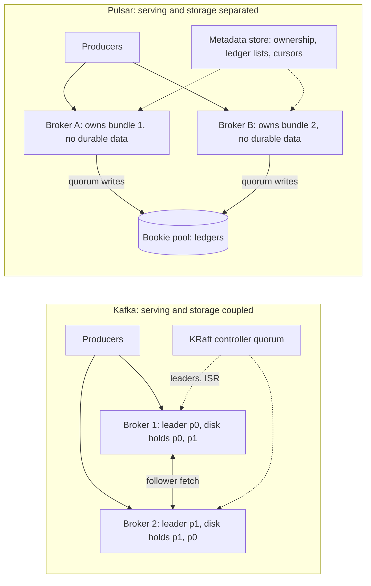
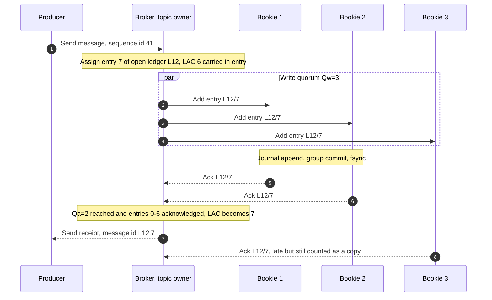
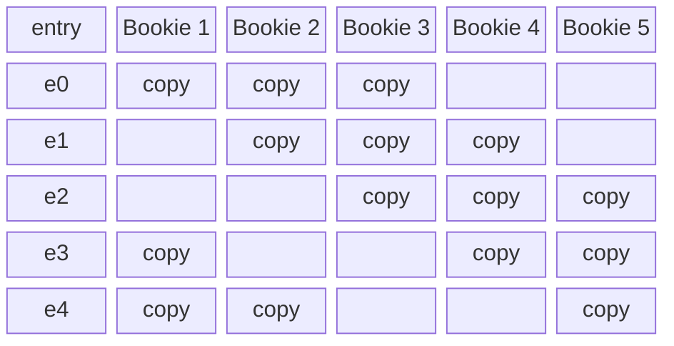
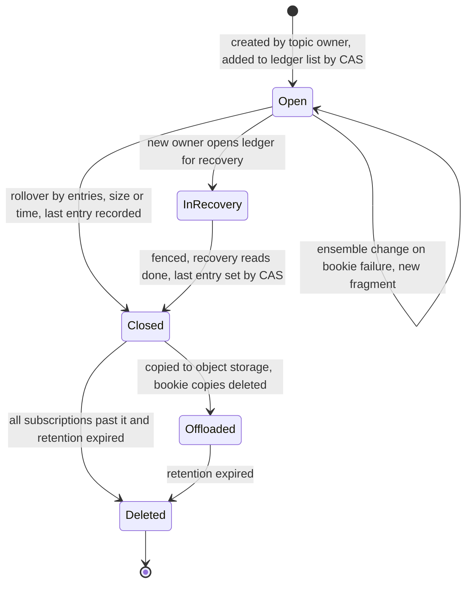

Apache Kafka ve Apache Pulsar'ın ikisi de sıralı, replike edilmiş, partition'lara bölünmüş bir log sunar; ikisi de anahtar başına sıralama, yeniden oynatma (replay) ve çok sayıda consumer group'a fan-out sağlar. Farkları, bir partition'ın baytlarının nerede durduğu ve bunların sahibinin kim olduğudur. Kafka'da bir partition, birkaç broker'ın diskinde duran segment dosyalarından oluşan bir dizindir ve partition'ın leader'ı olan broker hem istemcilere hizmet verir hem de veriyi saklar. Pulsar'da bir topic'e hizmet veren broker kalıcı hiçbir şey saklamaz: topic'in mesajlarını, bookie adı verilen depolama node'larından oluşan ayrı bir Apache BookKeeper cluster'ındaki ledger'lara ekler ve herhangi bir broker, ledger listesini bir metadata store'dan okuyarak topic'i devralabilir.

Asıl denge, veri yerelliği ile taşınabilirlik arasındadır. Kafka'daki bağlılık şu anlama gelir: bir consumer'ın okuduğu baytlar konuştuğu broker'ın diskindedir, yazma yolunda yalnızca broker'lar yer alır ve işletilecek tek bir cluster vardır; karşılığında bir partition'ı taşımak verisini kopyalamak demektir ve kaybedilen bir broker, log'daki payının tamamı yeni bir makineye aktarılarak yerine konur. Pulsar'daki ayrım şu anlama gelir: topic sahipliği veri kopyalanmadan saniyeler içinde taşınır, depolama ve sunum birbirinden bağımsız ölçeklenir ve arızalanan bir depolama node'u çok sayıda eş tarafından paralel olarak onarılır; karşılığında her yazma ve her soğuk okuma ek bir ağ adımından geçer, consumer'lar kendi zone'larındaki bir replikadan okuyamaz ve kurulum, arıza modları birbirini etkileyen üç dağıtık sistemden (broker'lar, bookie'ler ve bir metadata store) oluşur.

İkinci fark tüketim modelidir. Kafka her consumer group için partition başına tek bir commit edilmiş offset tutar. Pulsar ise her subscription için bireysel onayları (acknowledgement) kaydeden bir cursor tutar; tek bir topic'in hem log tarzı hem kuyruk tarzı consumer'lara hizmet verebilmesini sağlayan budur ve onaylanmamış tek bir mesajın depolamayı kilitleyebilmesinin nedeni de yine budur. Kafka'nın iç yapısı (ISR replikasyonu, high watermark, consumer offset'leri) [Kafka Mimarisi](/distributed-systems/tr/communication/async-messaging/kafka-architecture/) sayfasında anlatılır ve burada yalnızca referans verilir; kuyruk ile log arasındaki genel ayrım [Mesaj Kuyruğu ve Event Streaming](/distributed-systems/tr/communication/async-messaging/message-queue-vs-event-streaming/) sayfasındadır. Pulsar'ın mekanizmalarının bu el kitabında başka bir kanonik sayfası yoktur; aşağıda eksiksiz açıklanırlar.


*Her iki sistemde bir partition'ın baytlarının bulunduğu yer. Düz oklar veri, noktalı oklar metadata taşır.*

Kafka yarısında bir partition'ın verisi ve sunum sorumluluğu aynı makinelerdedir: p0'ın leader'ı p0'a hizmet verir, çünkü p0'ın log'unu tutar; bunu değiştirmek, yeni leader'ın zaten bir replikaya sahip olmasını gerektirir. Pulsar yarısında bir broker yalnızca metadata store'a kaydedilmiş bir sahiplik iddiası ve bir bellek cache'i tutar; kalıcı log bookie havuzuna dağılmıştır. Bu sayfadaki her şey bu ayrımdan çıkar: sahipliğin nereye taşınabileceği, bir yazmanın neyi beklediği, arızaların nasıl onarıldığı ve hangi bileşenin darboğaz olduğu.

## İki Sahiplik Modeli: Saklayan Broker'lar ve Hizmet Veren Broker'lar

Bir Kafka partition'ının, oluşturulurken ya da açık bir yeniden atamayla (reassignment) seçilen sabit bir replika kümesi vardır ve leader'ı her zaman bu replikalardan biridir. Bir partition'ı yeni broker'lara yeniden atamak, saklanan verisini canlı trafiği korumak için throttle edilerek onlara kopyalar; kopyalama bitene kadar partition eski replikalarıyla çalışır. Kafka bir broker kaybedildiğinde otomatik olarak yeniden replike etmez: leadership saniyeler içinde in-sync bir follower'a geçer, ancak partition, broker geri dönene ya da bir operatör (veya Cruise Control gibi harici bir araç) onu yeniden atayana kadar eksik replikalı (under-replicated) kalır. Kafka 3.9'dan beri tiered storage kapanmış segment'leri object storage'a taşır; bu da bir yeniden atamanın kopyalaması gereken yerel veriyi her partition'ın son kısmına indirir.

Bir Pulsar topic'i bir managed ledger'dır: her biri append-only bir entry dizisi olan BookKeeper ledger'larının sıralı bir listesi; bu liste topic'in cursor'larıyla birlikte metadata olarak saklanır. Listede yalnızca son ledger yazmaya açıktır; öncekiler kapanmış ve değişmezdir. Topic'in sahibi olan broker onun tek yazarıdır. Yeni devraldığı bir topic'e hizmet vermek için broker ledger listesini okur, önceki sahibin bıraktığı son ledger'ı kurtarıp kapatır, yeni bir ledger oluşturur, bunu metadata üzerinde bir compare-and-swap (CAS) ile listeye ekler ve yazma kabul etmeye başlar. Hiçbir mesaj baytı yer değiştirmez.

### Namespace Bundle'ları Üzerinden Topic Sahipliği

Pulsar topic'leri tenant'lar ve namespace'ler altında düzenler; bir namespace'in topic adı hash uzayı, her biri bir hash aralığını kapsayan belirli sayıda bundle'a bölünür. Broker'lar tek tek topic'lere değil, bundle'ların tamamına sahip olur; bir topic, adının hash'inin düştüğü bundle'a aittir ve partition'lı bir topic'in her partition'ı bağımsız olarak hash'lenen ayrı bir iç topic'tir. Bir istemci herhangi bir broker'a bağlanır, topic için bir lookup yapar ve topic'in bundle'ına hangi broker'ın sahip olduğunu öğrenir; sahibi yoksa bir sahip atanır.

Bundle'ları broker'lar arasında load manager taşır. Broker yükünü (CPU, bellek, ağ, mesaj hızı) periyodik olarak karşılaştırır, aşırı yüklü broker'lardan bundle'ları unload ederek yeniden atanmalarını sağlar ve topic sayısı, oturum, mesaj hızı veya bant genişliği eşiklerini aşan bundle'ları böler; bölünmeler kalıcıdır ve bundle'lar yeniden birleştirilmez. Unload işlemi topic'leri kapatır; bu da producer ve consumer'ların yeniden bağlanıp topic'i tekrar lookup etmesine yol açar. Pulsar iki load manager gerçekleştirimiyle gelir: uzun süredir varsayılan olan modular olanı ve Pulsar 3.0 ile gelen extensible olanı; ikincisi hedef broker'ı önceden atar, böylece yönlendirmeyi destekleyen istemciler yeni bir lookup yapmadan yeniden bağlanabilir.

Dolayısıyla yerleşim birimi Kafka'dakinden daha kaba, ama taşınması daha ucuzdur. Kafka her partition replikasını açıkça yerleştirir ve baytları kopyalayarak taşır; Pulsar topic adlarının hash aralıklarını yerleştirir ve bir iddiayı devrederek taşır. Bu kabalığın bedeli şudur: tek bir sıcak topic, bir split olmadan bundle komşularından bağımsız taşınamaz ve bir topic'in throughput'u yine ona sahip olan tek broker ile sınırlıdır, çünkü o broker topic'in tek yazarı ve consumer'larının tek sunucusudur.

## Depolama Yolu: Ledger'lar, Quorum'lar ve Fencing

### Ensemble, Write Quorum ve Ack Quorum

Her ledger, `E >= Qw >= Qa` koşulunu sağlaması gereken üç parametreyle oluşturulur. Ensemble boyutu `E`, ledger'ın yazdığı bookie sayısıdır. Write quorum `Qw`, her entry'nin yazıldığı bookie sayısıdır. Ack quorum `Qa` ise bir entry'nin yazılmış sayılması için bunlardan kaçının onaylaması gerektiğidir. Broker her entry'yi kendi `Qw` bookie'sine paralel olarak gönderir ve bunlardan `Qa` tanesi onayladığında, ayrıca ledger'ın daha önceki her entry'si de onaylanmışsa, producer'a onay verir.


*`E=3`, `Qw=3`, `Qa=2` ile tek bir yazma. Last add confirmed (LAC), onaylandığı bilinen en yüksek entry'dir; her yeni entry güncel LAC değerini bookie'lere taşır.*

2-4. adımlar, producer'ın isteği ile onayı arasındaki tek ağ round trip'idir ve broker `Qw` bookie'den en hızlı `Qa` tanesini bekler; dolayısıyla yavaş tek bir bookie, Kafka'da en yavaş in-sync follower'ın yaptığı gibi commit gecikmesini belirlemez. 7. adım log'u sıralı kılan koşuldur: entry 7, zaten `Qa` onayı almış olsa bile, entry 6 hâlâ beklemedeyken onaylanmaz. 9. adım `Qa < Qw` seçiminin bedelini gösterir: üçüncü kopya, producer'a yazmanın başarılı olduğu söylendikten sonra gelir; yani kısa bir pencere boyunca onaylanmış bir entry tam olarak `Qa` bookie'de bulunur. BookKeeper protokolü ortaya çıkan garantiyi, onaylanmış bir entry kaybedilmeden `Qa - 1` bookie arızasının tolere edilmesi olarak ifade eder.

Write quorum'daki bir bookie yanıt vermeyi bıraktığında broker ledger'ı durdurmaz. Arızalı bookie'yi ensemble'da değiştirir, ilk onaylanmamış entry'den başlayan yeni bir ledger fragment'ı açar, değişikliği ledger metadata'sı üzerinde bir CAS ile kaydeder ve bekleyen entry'leri yerine gelen bookie'ye yeniden gönderir. Yeni entry'ler hemen tam `Qw` kopyaya kavuşur. Bu, Kafka'dan önemli bir erişilebilirlik farkıdır: Kafka'da arızalanan bir follower in-sync replika kümesini küçültür, o geri dönene kadar yeni yazmalar daha az kopyaya sahip olur ve `min.insync.replicas` daha fazla küçülmeyi reddedilen yazmalara çevirir.

### Striping ve Yerleşim

`E > Qw` olduğunda entry'ler stripe edilir: entry `n`'in write quorum'u, `n mod E` indeksinden başlayan `Qw` ardışık ensemble üyesidir. Striping, tek bir topic'in yazma yükünü ve depolamasını kopya sayısından daha fazla bookie'ye yayar.


*`E=5`, `Qw=3` ile tek bir fragment'taki entry yerleşimi. Her bookie her beş entry'den üçünü saklar.*

Bu desenin iki sonucu vardır. Her bookie ledger'ın entry'lerinin tamamı yerine %60'ını saklar ve yazar; böylece tek bir sıcak topic üç bookie'nin sağlayabileceğinden fazla disk bant genişliği kullanabilir. Ancak hiçbir bookie ardışık bir aralık tutmaz; dolayısıyla sıralı bir catch-up okuması birkaç bookie'den veri çekip sırayı yeniden kurmak zorundadır ve log'un sıralı okuma avantajının çoğu kaybolur. Bu nedenle birçok kurulum `E`'yi `Qw`'ye eşit tutar ve yayılımı, her ledger'ın kendi ensemble'ını seçmesi sayesinde topic'ler arasında elde eder. Ensemble'ları yerleşim politikaları seçer: rack-aware ve region-aware politikalar her write quorum'un üyelerini farklı rack'lere ya da zone'lara koyar; `Qa - 1` bookie arızasını zone arızasına dönüştüren budur.

### Bir Bookie'nin İçi: Önce Journal

Bir bookie bir entry'yi ancak kendi diskinde kalıcı hâle geldikten sonra onaylar. Yaygın DbLedgerStorage yapılandırmasında gelen entry bellekteki bir write cache'e konur ve genellikle ayrı bir cihazda duran sıralı bir write-ahead log olan journal'a eklenir. Bir journal thread'i entry'leri toplu hâle getirir (group commit; en fazla birkaç milisaniye ya da bir boyut eşiğinden sonra flush edilir) ve ayrı bir thread journal dosyası üzerinde `fsync` çağırır; onaylar ancak bu `fsync` tamamlandıktan sonra gönderilir. Daha sonra write cache ledger ve entry'ye göre sıralanır ve ledger disklerindeki entry log dosyalarına flush edilir; her entry'nin nereye düştüğünü RocksDB'de tutulan bir entry konum index'i kaydeder. Periyodik bir checkpoint, journal'ın ne kadarının entry log'lara güvenle yansıdığını kaydeder ve eski journal dosyaları silinir. Aynı ayrım okumalar için de geçerlidir: catch-up okuması index ve bir read cache üzerinden ledger disklerinden yapılır, asla journal cihazından değil; bu sayede günlerce geçmişi yeniden oynatan bir consumer, yazma gecikmesini belirleyen cihaz için journal ile yarışmaz.

Bu, Kafka'dan tam olarak ilişkili arızalar açısından önemli olan noktada ayrılır. Kafka bir `acks=all` yazmasını, kayıt her in-sync replikanın page cache'ine girdiği anda onaylar ve dayanıklılık için `fsync` yerine replikasyona güvenir; bu konu [Disk Tabanlı Kalıcılık ve Sıfır Kopyalama Optimizasyonu](/distributed-systems/tr/case-studies/apache-kafka/disk-persistence-zero-copy/) sayfasında ele alınır. Bir bookie'nin onayı ise entry'nin o makinenin elektrik kesintisinden sağ çıkacağı anlamına gelir. Pulsar bunun bedelini her group commit'teki bir `fsync` ile öder; bookie journal'larının düşük gecikmeli cihazlara konmasının nedeni budur. Kafka yazma başına hiçbir şey ödemez, ancak tüm replikalar write-back'ten önce elektriğini kaybederse onaylanmış veriyi kaybeder.

Broker tarafında da buna karşılık gelen bir cache vardır. Topic'in sahibi son yazılan entry'leri managed-ledger cache'inde tutar; böylece log'un ucundan okuyan consumer'lara bookie'lere hiç dokunmadan broker belleğinden hizmet verilir. Cache'in gerisine düşen consumer'lar bookie'lere catch-up okumalarına neden olur; bu da Kafka'nın, veri leader'ın page cache'indeyken kaçındığı ek bir ağ adımıdır.

### Ledger Yaşam Döngüsü ve Tek Yazar Garantisi

BookKeeper leader seçimi yapmaz. Bir ledger'ın en fazla bir yazarı olmasını ve her okuyucunun aynı entry'leri aynı sırayla görmesini garanti eder; ilk özelliği, topic'e sahip olduğuna yalnızca tek bir broker'ın inandığına güvenerek değil, fencing ile zorlar.


*Bir managed ledger içindeki tek bir ledger'ın durumları. Bir topic'in yalnızca en yeni ledger'ı açık olabilir.*

Bir managed ledger, mevcut ledger bir entry sayısına, bir boyut sınırına ya da bir azami yaşa ulaştığında, bir asgari yaş koşuluna bağlı olarak yeni bir ledger'a geçer (rollover); yapılandırma referansı varsayılanları 50.000 entry, 10 dakika asgari ve 240 dakika azami süre olarak listeler. Saklama politikasını mümkün kılan rollover'dır, çünkü depolama yalnızca ledger'ların tamamı silinerek geri kazanılır; rollover aynı zamanda bir metadata yazmasıdır, yani metadata store erişilemezken bir topic rollover yapamaz. Kapanmış ledger'lar Pulsar'ın tiered storage'ı ile object storage'a offload edilebilir; bundan sonra o aralığın okumaları object store'dan karşılanır.

InRecovery yolu, sahipliğin güvenle değişmesini sağlar. Yeni sahip ledger'ın metadata'sını IN_RECOVERY olarak işaretler, son fragment'ın bookie'lerine bir fence isteği gönderir ve yeterli sayıda bookie'nin fenced durumunu kalıcı hâle getirmesini bekler; fence edilmiş bir bookie eski yazarın sonraki her ekleme isteğini LedgerFenced hatasıyla reddeder. Ardından bookie'lere en yüksek LAC değerlerini sorar, oradan itibaren entry entry ileri doğru okur, bulduğu her entry'yi tam bir write quorum'a yeniden replike eder ve okunacak başka entry kalmadığında son entry ID'sini metadata'ya bir CAS ile yazarak ledger'ı kapatır. Ancak bundan sonra yeni bir ledger oluşturur ve yazma kabul eder.

### Fencing Neden Doğrudur

Kanıtlanması gereken garanti şudur: sahipliği kaybetmiş ama bunu bilmeyen bir broker, örneğin uzun bir garbage collection duraklamasından çıkan bir broker, yeni sahip ledger'ın nerede bittiğine karar verdikten sonra yeni bir entry'yi onaylatamaz. Bir entry yalnızca `Qw` bookie'lik write quorum'undan `Qa` onay alarak onaylanır. Yeni sahip her write quorum'un `Qw - Qa + 1` bookie'sinden fence onayı bekler. Herhangi bir write quorum'da en fazla `Qa - 1` bookie fence edilmemiş kalır; dolayısıyla eski yazar herhangi bir yeni entry için en fazla `Qa - 1` onay toplayabilir, bu da hiçbir zaman yetmez. Fence edilmiş bookie'leri bir ensemble değişikliğiyle atlatma girişimleri de başarısız olur, çünkü ledger metadata'sı üzerindeki CAS durumu OPEN yerine IN_RECOVERY olarak bulur.

İkinci yarıyı recovery okuması sağlar. Bir producer'a onaylanmış her entry, quorum'unun `Qa` bookie'sinde bulunur ve yeni sahip o quorum'un `Qw - Qa + 1` bookie'sinden yanıt almıştır; dolayısıyla bunlardan en az biri entry'yi tutar. Okunacak bir şey kalmayana kadar ileri okumak, bu yüzden onaylanmış her entry'yi ve belki bazı onaylanmamış entry'leri bulur; onaylanmamış olanlar yeniden replike edilir ve log'un parçası olur. Böyle bir entry'de zaman aşımına uğrayıp onu yeniden gönderen bir producer, producer sequence ID'leri üzerinden broker tarafı tekilleştirme (deduplication) etkin değilse bir kopya oluşturur. Eşzamanlı kurtarmalar aynı sonuca yakınsar, çünkü CLOSED durumuna yalnızca tek bir CAS başarıyla geçebilir. Aynı yapı managed ledger düzeyinde de geçerlidir: ledger listesi yalnızca CAS ile güncellenir, dolayısıyla iki broker bir topic'e aynı anda yeni bir ledger ekleyemez.

:::note[Sahiplik tavsiye niteliğindedir; zorlayan fencing'dir]
Metadata store'daki bundle sahipliği istemcilere hangi broker ile konuşacaklarını söyler, ancak bayat bir sahip bookie'lere açık bağlantılarını hâlâ tutuyor olabilir. Doğruluk, bayat sahibin durumu fark etmesine değil, bookie'lerin onu reddetmesine dayanır. Bu, [Split-Brain Problemi ve Fencing Tokens](/distributed-systems/tr/coordination/consensus-algorithms/split-brain-fencing/) sayfasındaki fencing token fikrinin bizzat depolama katmanında uygulanmış hâlidir. Kafka aynı etkiyi, [Kafka Mimarisi](/distributed-systems/tr/communication/async-messaging/kafka-architecture/) sayfasında anlatıldığı gibi, follower'lar ve controller tarafından denetlenen leader epoch'larıyla elde eder.
:::

## Tüketim: Offset'ler ve Cursor'lar ile Subscription'lar

Bir Kafka consumer group'unun durumu, partition başına commit edilmiş tek bir offset'tir (işlenecek bir sonraki kayıt) ve kayıt başına hiçbir şey tutulmaz. Pulsar her topic'te her subscription için bir cursor saklar. Cursor'ın bir mark-delete pozisyonu vardır; bunun altındaki her mesaj onaylanmıştır. Üstünde ise bireysel olarak onaylanmış aralıklardan oluşan bir küme, yani sırasız onaylamanın bıraktığı boşluklar bulunur. Cursor BookKeeper'da kendi ledger'ında kalıcı hâle getirilir ve metadata store'dan referans verilir.

Subscription türü, bir subscription'ın mesajları nasıl dağıttığını belirler. Exclusive ve Failover tek bir aktif consumer'a izin verir ve sıralı teslim eder; bu, partition başına Kafka'nın consumer group modelidir. Shared, bireysel onayla birlikte istenen sayıda consumer'a round-robin teslim eder: log'un üzerinde bir kuyruk. Key_Shared çok sayıda consumer'a teslim ederken her anahtarı aynı anda tek bir consumer'da tutar; consumer'lar katılıp ayrıldığında, sahipliği taşınan anahtarların mesajlarını, o anahtarların önceki mesajları onaylanana kadar bekletmek zorundadır. Pulsar 4.0 bu mekanizmayı (PIP-379), consumer değişiklikleri sırasındaki gereksiz bloklamayı kaldıracak şekilde yeniden düzenledi; ancak temel kısıt yerinde duruyor: bir anahtar için hiçbir mesajı onaylamayan bir consumer, o anahtarın sonraki mesajlarını bloklar. Bu türlerin kuyruklar ve Kafka share group'larıyla karşılaştırması [Mesaj Kuyruğu ve Event Streaming](/distributed-systems/tr/communication/async-messaging/message-queue-vs-event-streaming/) sayfasındadır.

Mesaj başına onaylama, tüketimi depolamaya Kafka modelinde olmayan bir şekilde bağlar. Kafka segment'leri, herhangi bir grubun onları okuyup okumadığına bakmadan zamana ya da boyuta göre siler. Pulsar ise bir saklama (retention) politikası yoksa, her subscription'ın mark-delete pozisyonu son entry'sini geçtiğinde bir ledger'ı siler; saklama politikası onaylanmış veriyi daha uzun tutar, backlog quota bir topic'in tutabileceği onaylanmamış veri miktarını sınırlar ve message TTL mesajları belirli bir süre sonra otomatik olarak onaylar. Bir ledger ancak tamamen herhangi bir subscription'ın en eski mark-delete pozisyonunun altında kaldığında silinebilir; bu yüzden en yavaş subscription'ın en eski onaylanmamış mesajı, üzerinde ne kadar onaylanmış veri olursa olsun, topic'in ne kadar depolama kullandığını belirler.

Bireysel olarak onaylanmış aralıkların da bir boyut sınırı vardır. Broker cursor başına en fazla `managedLedgerMaxUnackedRangesToPersist` aralığı (varsayılan 10.000) kalıcı hâle getirir; bunun ötesindeki boşluklar yalnızca bellekte izlenir ve broker çökerse içlerindeki mesajlar yeniden teslim edilir. Geniş ölçüde sırasız onaylayan iş yükleri, tipik olarak birkaç takılı mesajı olan Shared veya Key_Shared subscription'lar, bu sınıra ulaşır ve bir broker yeniden başlatmasını bir kopya mesaj patlamasına dönüştürür. PIP-381, etkin sınırı yükseltmek için büyük cursor durumunu birden fazla entry'ye bölmeyi önerir.

:::tip[Backlog sayısına değil, en eski onaylanmamış mesaja alarm kurun]
Backlog'u 20 mesaj olan bir Pulsar subscription'ı, bu 20 mesajdan biri mark-delete pozisyonunda duran bir poison message ise bir haftalık ledger'ı kilitleyebilir. İmza şudur: topic depolaması (`pulsar_storage_size`) tırmanırken `pulsar_subscription_back_log` küçük kalır. Her subscription'ın mark-delete pozisyonunun yaşını izleyin ve tekrar tekrar başarısız olan mesajları [Dead Letter Queues ve Poison Message Yönetimi](/distributed-systems/tr/communication/async-messaging/dlq-poison-messages/) sayfasında anlatıldığı gibi bir dead-letter topic'e yönlendirin.
:::

## Sayısal Örnek: Aynı İş Yükü, İki Mimari

[Kafka Mimarisi](/distributed-systems/tr/communication/async-messaging/kafka-architecture/) sayfasındaki boyutlandırma örneğinin iş yükünü alalım: tepe noktada 50 MB/s, ortalamada 20 MB/s produce trafiği, üç günlük saklama, üç consumer group, üç availability zone ve her baytın zone başına bir kopya olmak üzere üç kopyası. Saklanan benzersiz veri 5.18 TB, kopyalarla birlikte 15.6 TB'tır. Kafka cluster'ında 9 broker vardır. Pulsar cluster'ında 6 broker ve 9 bookie (zone başına üç) bulunur; `E=3`, `Qw=3`, `Qa=2` ve zone-aware yerleşim kullanılır. Tüm sayılar örnek amaçlıdır.

**Zone'lar arası trafik.** Kafka için önceki örnek, consumer'lar leader'lardan okuduğunda tepe noktada 233 MB/s, consumer'lar kendi zone'larındaki bir follower'dan okuduğunda 133 MB/s sonucunu çıkarmıştı. Pulsar'da producer'lar sahip broker'a rastgele bir zone'dan ulaşır, yani 50 MB/s'nin üçte ikisi, 33 MB/s, zone'lar arasında geçer. Broker üç kopya yazar ve bunlardan en fazla biri kendi zone'undadır; dolayısıyla en az 100 MB/s zone'lar arasında geçer. Üç consumer group sahip broker'dan 150 MB/s okur ve bunun üçte ikisi, 100 MB/s, zone'lar arasında geçer. Toplam yaklaşık 233 MB/s'dir ve follower'dan okumanın bir karşılığı yoktur, çünkü consumer'lara yalnızca topic'in sahibi hizmet verir. Bu okuma ağırlıklı yapı için Pulsar'ın tasarımı, follower'dan okuması etkin bir Kafka cluster'ına göre yaklaşık %75 daha fazla zone'lar arası trafiğe mal olur.

**Bir broker'ı kaybetmek.** Bir Kafka broker'ı 15.6 / 9 = 1.73 TB tutar. Arızalandığında partition'larının leadership'i saniyeler içinde taşınır ve partition'lar iki in-sync replikayla çalışır. Makine kalıcı olarak kaybedilmişse, yerine gelen broker 1.73 TB çekmek zorundadır; 150 MB/s'lik bir replikasyon throttle'ıyla bu yaklaşık 11.500 saniye, yani üç saatten biraz fazla sürer ve bu süre boyunca o partition'lar `min.insync.replicas=2` seviyesindedir; aralarındaki bir arıza daha yazmaları bloklar. Bir Pulsar broker arızası ise hiç veri içermez: bundle'ları yeniden atanır ve her topic bir ledger kurtarma ile bir ledger oluşturma bedeli öder. Maliyet metadata store'a ve istemcilere kayar: arızalanan broker'da örneğin 4.000 topic varsa ve topic başına üç metadata yazması gerekiyorsa (ledger durumunu recovery'ye almak, ledger'ı kapatmak, yeni ledger'ı listeye eklemek), store kısa bir patlama içinde 12.000 yazmayı ve yeniden bağlanan her istemcinin lookup'ını karşılar.

**Bir bookie'yi kaybetmek.** Bir bookie de 1.73 TB tutar, ancak ledger'larının diğer kopyaları diğer bookie'lere dağılmıştır; bu yüzden BookKeeper'ın autorecovery mekanizması eksik fragment'ları aynı anda çok sayıda kaynaktan kopyalar. Zone-aware yerleşim ise hedefleri daraltır: zone başına bir kopyayı korumak için yerine konan kopyalar, arızalı bookie'nin zone'undaki hayatta kalan iki bookie'ye gitmelidir. Her biri 100 MB/s ile veri alırsa kurtarma 200 MB/s hızla ilerler ve yaklaşık 8.650 saniye, 2.4 saat sürer. Çoktan çoğa (many-to-many) kurtarma avantajı gerçektir, ancak zone başına node sayısıyla sınırlıdır. Zone başına 10 olmak üzere 30 bookie ile her biri 0.52 TB tutar ve 100 MB/s hızındaki dokuz hedef işi 10 dakikanın altında bitirir; 30 broker'lı bir Kafka cluster'ı ise 0.52 TB'ı yine tek bir yedek broker'a yeniden kurar, bu da 150 MB/s ile yaklaşık bir saat sürer.

```mermaid
gantt
    title Illustrative recovery after permanently losing one of nine storage nodes
    dateFormat HH:mm
    axisFormat %H:%M
    section Kafka broker lost
    Leaders move to followers : k1, 00:00, 1m
    Under-replicated, waiting for operator : k2, after k1, 30m
    Replacement copies 1.73 TB at 150 MB/s : k3, after k2, 192m
    section Pulsar bookie lost
    New writes switch ensembles : p1, 00:00, 1m
    Autorecovery to two bookies in zone : p2, after p1, 144m
    section Pulsar broker lost
    Bundles reassigned, ledgers recovered : b1, 00:00, 2m
```


*Dokuz node'lu örnek için kurtarma pencereleri. Hızlar, 30 dakikalık operatör gecikmesi ve süreler örnek amaçlı varsayımlardır.*

Grafik bir kazanan değil, üç farklı biçim gösterir. Kafka'nın penceresi en uzunudur, çünkü bir insan adımı ve tek hedefli bir kopyalama içerir ve tüm bu süre boyunca etkilenen partition'ların yedek replikası yoktur. Pulsar'ın bookie kurtarması operatör olmadan başlar ve yeni yazmalar hemen üç kopyaya kavuşur, ancak küçük, zone-aware bir cluster'da kopyalamanın kendisi çok daha hızlı değildir. Pulsar'ın broker arızası en kısa penceredir, çünkü kopyalanacak bir şey yoktur; riski, aşağıda incelenen metadata ve yeniden bağlanma patlamasıdır. Ayrıca Kafka'nın tiered storage'ı, yalnızca son segment'leri yerel tutarak, Kafka'nın kopyalama adımını saklanan verinin ne kadarı object store'da duruyorsa o oranda kısaltır.

## Production'daki Dengeler

| Boyut | Kafka | Pulsar | Ne zaman tercih edilmeli |
|---|---|---|---|
| Depolama birimi | Her replika broker'da bir partition dizini | Bir bookie havuzuna stripe edilen ya da yayılan ledger'lar | Daha az hareketli parça için Kafka; depolama ve sunum ayrı ölçeklenmeliyse Pulsar |
| Commit kuralı | Her ISR üyesinde kayıt var, page cache, `fsync` yok | `Qw` bookie'den `Qa` tanesi journal `fsync` sonrası onaylar | İlişkili elektrik kesintisi tehdit modelindeyse Pulsar; yazma başına `fsync` maliyeti daha önemliyse Kafka |
| Yükü taşımak | Yeniden atama saklanan veriyi kopyalar | Bundle unload sahipliği devreder, kopya yok | Sık yeniden dengeleme ve esnek broker sayısı için Pulsar |
| Depolama node'u kaybı | Operatör ya da araç yeniden atayana kadar eksik replikalı | Yeni yazmalar için ensemble değişikliği, otomatik yeniden replikasyon | Zone başına çok node'lu büyük cluster'lar için Pulsar |
| Yerel zone'dan okuma | Consumer'lar için follower'dan okuma | Consumer'lara yalnızca topic sahibi hizmet verir | Zone'lar arası okuma trafiği maliyete hâkimse Kafka |
| Consumer durumu | Grup başına, partition başına offset | Mark-delete pozisyonu ve ack aralıkları olan cursor | Tek topic'te karma kuyruk ve stream tüketimi için Pulsar |
| Saklama bağlılığı | Zaman veya boyut, consumer'lardan bağımsız | Onaylanmamış veri quota veya TTL'e kadar tutulur | Yavaş consumer'lar depolamayı asla etkilememeliyse Kafka |
| Multi-tenancy | Düz topic ad alanında quota ve ACL'ler | Tenant'lar, namespace'ler, namespace başına politika ve izolasyon | Tek cluster'da çok sayıda ekip için Pulsar |
| Geo-replikasyon | MirrorMaker 2 veya üretici araçları, offset çevirisi | Namespace başına yerleşik, asenkron | Replikasyon bir namespace politikası olmalıysa Pulsar |
| Ekosistem | Kafka protokolü fiilî standart | Kendi protokolü; Kafka protokolü adaptörleri mevcut | İstemciler, connector'lar ve stream işlemciler zaten Kafka uyumluysa Kafka |

Satırlar birbirini etkiler. Pulsar'ın daha ucuz yük taşıması ve otomatik onarımı en çok, operatörün aksi hâlde sürekli partition yeniden ataması yapacağı büyük, multi-tenant cluster'larda değer kazanır. Kafka'nın daha basit kurulumu ve zone içi okumaları ise tek bir ekibe ait birkaç yüksek hacimli pipeline için en değerlidir. Commit kuralı satırı genellikle her iki yönde de abartılır: Pulsar'ın `fsync`'i yalnızca tüm kopyaları aynı anda düşüren arızalarda önem taşır, Kafka'nın page cache onayı ise tam olarak zone'lar birbirinden bağımsız arızalandığı sürece güvenlidir.

İki tasarım birbirine yaklaşıyor. Kafka'nın tiered storage'ı saklanan baytların çoğunu broker disklerinden çıkardı ve Mart 2026'da kabul edilen KIP-1150, doğrudan object storage'a yazan diskless topic'leri tanımlıyor; bu yazı itibarıyla gerçekleştirim önerileri (KIP-1163 ve KIP-1164) hâlâ tartışma aşamasındaydı ve özellik bir Apache Kafka sürümünün parçası değil. Ekim 2026'da yayımlanan LTS sürüm hattı Pulsar 5.0, yeni cluster'lar için metadata store olarak Oxia'yı öneriyor ve çalışma zamanında anahtar aralıklarını bölüp birleştirirken anahtar başına sırayı koruyan yeni bir topic türü olan scalable topic'leri, yeni bir Java istemci API'si üzerinden sunuyor. Her iki değişiklik de her tasarımın sahip olduğu aynı zayıflığı hedefliyor: Kafka'da veri taşımanın maliyeti, Pulsar'da sabit partition sayısı ve metadata store ölçeklemesi.

### Dayanıklılığı ve Saklamayı Belirleyen Yapılandırma

| Parametre | Kapsam | Varsayılan | Etki ve ayar önerisi |
|---|---|---|---|
| Ensemble, write quorum, ack quorum | Namespace persistence politikası veya broker varsayılanları | Dağıtılan config dosyaları arasında farklı; Helm chart 1 kullanmıştır | Bir zone kaybından sağ çıkması gereken veri için zone-aware yerleşimle `E=3`, `Qw=3`, `Qa=2` |
| `managedLedgerMaxEntriesPerLedger` | Broker | 50.000 | Entry sayısına göre rollover; küçük ledger'lar saklamayı daha ince taneli yapar ama metadata yazması ekler |
| Asgari ve azami ledger rollover süresi | Broker | 10 ve 240 dakika | Ledger yaşını sınırlar; düşük trafikli topic'ler süreye göre rollover yapar |
| `managedLedgerMaxUnackedRangesToPersist` | Broker | 10.000 | Bunun ötesindeki ack boşlukları broker çöküşünde kaybolur ve yeniden teslim edilir |
| `backlogQuotaDefaultRetentionPolicy` | Broker veya namespace | `producer_request_hold` | Quota'ya ulaşıldığında ne olacağı: producer'ları beklet, başarısız et ya da en eski backlog'u at |
| `maxUnackedMessagesPerConsumer` | Broker | 50.000 | Bu kadar onaylanmamış mesaj tutan bir consumer'a dağıtımı durdurur |
| Saklama politikası | Namespace | Onaylanmış veri saklanmaz | Replay için onaylanmış veriyi tutma boyutu ve süresi |
| Message TTL | Namespace | Kapalı | Eski mesajları otomatik onaylar; depolamayı sınırlar, işi sessizce düşürür |

Persistence ve quota politikaları namespace başına ayarlanır; Pulsar'ın multi-tenancy modeli onları buraya koyar:

```shell
# Three copies across zones; producer acknowledged after two journal fsyncs
pulsar-admin namespaces set-persistence \
    --bookkeeper-ensemble 3 --bookkeeper-write-quorum 3 \
    --bookkeeper-ack-quorum 2 --ml-mark-delete-max-rate 0 \
    payments/orders
# Keep 7 days of acknowledged data for replay
pulsar-admin namespaces set-retention --size 2T --time 7d payments/orders
# Cap unacknowledged backlog; hold producers instead of dropping data
pulsar-admin namespaces set-backlog-quota --limit 500G \
    --policy producer_request_hold payments/orders
```

:::caution[Kurulum yönteminizin quorum varsayılanlarını kontrol edin]
Pulsar'ın standalone yapılandırması ve, en azından 2025'teki bir değişiklik önerisine kadar, resmî Helm chart ensemble, write quorum ve ack quorum değerlerini 1 olarak ayarlar. Bu şekilde kurulan bir cluster her yazmayı tek bir bookie'den onaylar ve o bookie'nin diskini kaybetmek veri kaybettirir; bu sırada her dashboard sağlıklı, çok bookie'li bir cluster gösterir. Yeniden üretemeyeceğiniz veri taşıyan her namespace'te persistence politikasını açıkça ayarlayın ve `pulsar-admin namespaces get-persistence` ile doğrulayın.
:::

## Arıza Modları ve İmzaları

Kafka'nın kendi arıza modları, yani `acks=1` altında kaybolan yazmalar, `min.insync.replicas` altında reddedilen yazmalar, sıcak partition'lar ve offset'lerin süresinin dolması, [Kafka Mimarisi](/distributed-systems/tr/communication/async-messaging/kafka-architecture/) sayfasında ele alınır. Aşağıdaki arızalar ya Pulsar'ın ayrık tasarımına özgüdür ya da iki sistemin farklı biçimde arızalandığı noktalardır.

### Duraklamadan Sonra Zombi Broker

Tetikleyici: bir topic'in sahibi, garbage collection duraklaması, metadata store'dan ağ bölünmesi ya da donmuş bir VM nedeniyle, metadata oturumunun süresi dolacak ve bundle başka bir broker'a atanacak kadar uzun süre takılır. Belirtiler: eski sahibe bağlı producer'lar gönderme zaman aşımları görür ve sonra yeniden bağlanır; eski sahibin log'ları LedgerFenced hatalarını ve topic kapanışlarını gösterir. Onaylanmış hiçbir mesaj kaybolmaz ve iki yazar entry'leri iç içe geçirmez.

```mermaid
sequenceDiagram
    autonumber
    participant A as Broker A, old owner
    participant M as Metadata store
    participant B as Broker B, new owner
    participant K as Bookies of ledger L12
    Note over A: GC pause, session to metadata store expires
    M->>B: Bundle assigned to B
    B->>M: Set L12 to IN_RECOVERY by CAS
    B->>K: Fence L12
    K-->>B: Fenced, from Qw - Qa + 1 bookies per quorum
    B->>K: Read LAC, recover entries forward
    B->>M: Close L12 at last entry, add L13 by CAS
    rect rgb(70, 40, 40)
    Note over A: Pause ends, A still believes it owns the topic
    A->>K: Add entry L12/90
    K-->>A: LedgerFenced
    A->>M: Ensemble change for L12
    M-->>A: CAS fails, ledger not OPEN
    end
    Note over A: A closes the topic, clients reconnect to B
```


*Bundle'ı taşındıktan sonra kaldığı yerden devam eden bayat bir sahip. Split-brain yazmalarını eski sahibin farkındalığı değil, fence edilmiş bookie'ler engeller.*

3-7. adımlar önceki bölümdeki kurtarma protokolüdür ve broker A uyanmadan tamamlanır. 8-11. adımlarda broker A yazmanın iki yolunu da dener: doğrudan, ki fence edilmiş bookie'ler bunu reddeder; ve fence edilmiş bookie'leri bir ensemble değişikliğiyle atlatarak, ki metadata CAS'ı bunu reddeder. Fencing olmasaydı 8. ve 9. adımlar, broker B'nin daha önceki bir entry'de kapandığını ilan ettiği bir ledger'a entry 90'ı eklerdi ve okuyucular log'un içeriği konusunda anlaşamazdı. Tespit: broker log'larındaki LedgerFenced ve topic-fenced mesajları, load manager log'larındaki bundle sahipliği değişiklikleri ve metadata oturum süresi dolmaları. Önlem: broker heap'ini ve garbage collector'ı duraklamalar metadata oturum zaman aşımının çok altında kalacak şekilde boyutlandırın ve tek bir broker'da tekrarlayan fencing'i şanssızlık değil sağlıksızlık işareti olarak ele alın. 8. adımda zaman aşımına uğrayan bir producer broker B'ye karşı yeniden dener; ilk deneme aslında 6. adımda kurtarılmışsa, producer adı ve sequence ID'si üzerinden yapılan broker tarafı tekilleştirme bir kopyayı engeller.

### Metadata Store'un Bozulması

Tetikleyici: metadata store (ZooKeeper ya da yeni cluster'larda Oxia), log cihazındaki disk gecikmesi, bir oturum fırtınası ya da quorum'unun kaybı nedeniyle yavaşlar veya erişilemez hâle gelir. Belirtiler: mevcut topic'ler açık ledger'ları üzerinde produce ve consume etmeye devam eder, bu da sorunu gizleyebilir; ledger rollover'ları, topic yüklemeleri, bundle yeniden atamaları, cursor ledger geçişleri ve yeni subscription'lar başarısız olur ya da takılır; bu sırada yaşanan herhangi bir broker arızası, başka hiçbir broker topic'leri devralamadığı için o broker'ın topic'lerini erişilemez bırakır. Tespit: metadata store istek gecikmesi ve oturum süresi dolma sayıları, ledger oluşturma sırasında broker hataları, yükleme durumunda takılan topic'ler. Önlem: metadata store için ayrılmış düşük gecikmeli depolama, bundle unload hızına sınırlar ve bir broker arızasının patlaması için kapasite planlaması; sayısal örnekte bu yaklaşık 12.000 yazmadır. Kafka'nın KRaft controller quorum'una benzer bir bağımlılığı vardır, [KRaft Modu](/distributed-systems/tr/case-studies/apache-kafka/kraft-mode/) sayfasında ele alınır; ancak Kafka'nın controller'ları segment rollover'larının ya da consumer ilerlemesinin yolunda değildir.

### Tek Bir Onaylanmamış Mesajın Kilitlediği Depolama

Tetikleyici: bireysel onay kullanan bir subscription bir mesajı onaylanmamış bırakır; tipik olarak handler'ını çökerten bir poison message ya da takılı bir consumer'ın tuttuğu bir Key_Shared anahtarı. Belirtiler: backlog sayısı küçük kalırken topic depolaması istikrarlı biçimde büyür; o topic'in ledger'larını tutan bookie'lerin diskleri dolar; sonunda backlog quota devreye girer ve politikaya göre producer'ları bekletir ya da backlog'u atar. Tespit: `pulsar_subscription_back_log` sabitken yükselen `pulsar_storage_size`, ilerlemeyen bir mark-delete pozisyonu, 1 değerindeki `pulsar_subscription_blocked_on_unacked_messages`, artan `pulsar_subscription_msg_rate_redeliver`. Önlem: sınırlı yeniden teslim sayısı ve bir dead-letter topic ile negatif onay (negative acknowledgement), takılabilecek consumer'lar için bir onay zaman aşımı ve diske göre değil alarma göre boyutlandırılmış bir backlog quota. Hizmetten kaldırılmış bir consumer'a ait olduğunda, aktif olmayan subscription'ı silmek anında çözümdür; çok ekipli cluster'larda yaygın bir nedendir.

### Read-Only Bookie'ler ya da Bir Ensemble İçin Yetersiz Bookie

Tetikleyici: bookie diskleri kullanım eşiğini aşar ve bookie read-only olur, ya da birkaç bookie arızalanır ve yerleşim politikası zone kısıtını sağlayan `E` adet yazılabilir bookie bulamaz. Belirtiler: ledger oluşturma ve ensemble değişiklikleri başarısız olur; dolayısıyla topic'ler rollover yapamaz ve bir bookie arızasından kurtulamaz; producer'lar tek bir partition'da değil, aynı anda çok sayıda topic'te gönderme hataları görür. Tespit: read-only bookie'ler için 0 değerindeki `bookie_SERVER_STATUS`, zone başına yazılabilir bookie sayısı, yetersiz bookie bildiren broker hataları. Önlem: zone başına yazılabilir bookie payına alarm kurun, zone başına `E`'nin zone sayısına bölümünün ötesinde en az bir yedek yazılabilir bookie tutun ve diskler dolmadan bookie ekleyin; yeni bookie'ler eski verinin hiçbir yeniden dengelemesi olmadan yeni ledger'ları hemen alır.

:::danger[Qa=1, tek bir diskte duran veriyi onaylar]
`Qa=1` ile producer, `Qw` 3 olsa bile entry tek bir bookie'ye ulaştığında onay alır. Diğer kopyalar yazılmadan o bookie'nin diski arızalanırsa ya da broker aynı anda çöktüğü için diğer yazmalar hiç teslim edilmediyse, onaylanmış entry gider ve recovery okumaları ledger'ı sessizce onun öncesinde kapatır. Kaybı kabul edilemeyen her veri için `Qa >= 2` kullanın; zone-aware yerleşimle onaylanmış bir yazmanın bir zone kaybından sağ çıkmasını sağlayan budur.
:::

### Geo-Replikasyon Gecikmesi ve Failover Kopyaları

Tetikleyici: bölgeler arası bant genişliği düşer ya da uzak bir cluster erişilemez olur. Pulsar geo-replikasyonu asenkrondur: her uzak cluster için her yerel topic'te bir replicator, yani bir cursor ile uzak topic'e yazan bir producer bulunur ve mesajlar yerel producer'a replikasyondan önce onaylanır. Belirtiler: büyüyen bir replikasyon backlog'u (bu da her yavaş subscription gibi yerel depolamayı kilitler); consumer'lar diğer bölgeye failover edildikten sonra, son snapshot aralığına kadar olan mesajların ve sırasız onaylanmış her mesajın yeniden işlenmesi. Replicated subscription'lar yalnızca mark-delete pozisyonunu periyodik snapshot işaretleriyle senkronize eder (PIP-33'e göre varsayılan olarak yaklaşık bir saniyede bir) ve katılan cluster'lardan herhangi biri erişilemezken yeni snapshot almayı bırakır. Tespit: topic ve uzak cluster başına `pulsar_replication_backlog`. Önlem: [En Az Bir Kez, En Fazla Bir Kez ve Tam Olarak Bir Kez Semantiği](/distributed-systems/tr/communication/async-messaging/delivery-semantics/) sayfasında anlatıldığı gibi idempotent consumer'lar ve replikasyon cursor'larını hesaba katan bir backlog quota. MirrorMaker 2 ile Kafka'da aynı asenkron kayıp penceresi ve kendine özgü bir offset çevirisi gecikmesi vardır; senkron, gerilmiş (stretched) bir kurulum olmadan iki sistem de bölgeler arası onaylanmış bir yazma sunmaz.

### Arıza İmzalarının Özeti

| Arıza | Sistem | Dışarıdan belirti | Tespit sinyali | Önlem |
|---|---|---|---|---|
| Zombi sahip | Pulsar | Gönderme zaman aşımları, yeniden bağlanmalar, kayıp yok | Broker log'larında LedgerFenced, sahiplik değişiklikleri | Duraklamasız broker ayarı, tekilleştirme |
| Metadata store bozulması | Pulsar | Trafik sağlıklı, ama rollover ya da failover yok | Metadata gecikmesi, ledger oluşturma hataları | Ayrılmış depolama, unload hız sınırları |
| Kilitlenmiş depolama | Pulsar | Depolama büyür, backlog küçük | `pulsar_storage_size` ile `pulsar_subscription_back_log` karşılaştırması | Dead-letter topic, ack zaman aşımı, quota |
| Çöküşte kaybolan ack boşlukları | Pulsar | Broker yeniden başlatmasından sonra kopya patlaması | 10.000'e yaklaşan unacked aralıklar | Takılı mesajları düzeltmek, daha büyük cursor durumu |
| Yetersiz yazılabilir bookie | Pulsar | Çok sayıda topic'te hatalar | `bookie_SERVER_STATUS`, zone başına yazılabilir bookie | Zone başına yedek bookie, disk alarmları |
| Replikasyon gecikmesi | İkisi de | Uzak bölge geride, failover'da kopyalar | `pulsar_replication_backlog`, MirrorMaker 2 gecikmesi | İdempotent consumer'lar, bant genişliği payı |
| Yavaş yeniden replikasyon | Kafka | Broker kaybından sonra uzun eksik replika penceresi | Zaman içinde `UnderReplicatedPartitions` | Throttle edilmiş yeniden atama, tiered storage |

## İkisi Arasında Seçim

Pulsar'ı şu durumlarda seçin: cluster, topic'lerinin politikayla izole edilmesi gereken çok sayıda tenant'a ya da ekibe hizmet veriyorsa; broker kapasitesi sık değişmek zorundaysa ve yük taşımak veri taşımak anlamına gelemiyorsa; aynı event'lerin hem sıralı bir stream olarak hem de mesaj başına yeniden denemeli bir iş kuyruğu olarak tüketilmesi gerekiyorsa; geo-replikasyon ayrı bir sistem değil bir namespace ayarı olmalıysa; ya da dayanıklılık gereksinimi ilişkili elektrik kesintisini kapsıyor ve yazma başına bir `fsync` kabul edilebiliyorsa. Cluster büyüdükçe bu koşullar Pulsar'ı daha güçlü biçimde öne çıkarır: sayısal örnekteki çoktan çoğa kurtarma ve sahiplik taşınabilirliği, dokuz node ile değil, zone başına çok sayıda node ile karşılığını verir.

Pulsar'ı, tek bir ekibe ait az sayıda yüksek throughput'lu pipeline için seçmeyin; ek metadata store ve bookie katmanı, ihtiyaç duyulmayan bir taşınabilirlik satın almadan operasyonel yüzeyi büyütür. Zone'lar arası okuma trafiği baskın maliyetse ve consumer'lar producer'lardan sayıca fazlaysa seçmeyin, çünkü okumalara yalnızca topic sahibi hizmet verir. Çevredeki ekosistem (connector'lar, stream işlemciler, istemci kütüphaneleri, kurumun zaten kullandığı yönetilen hizmetler) Kafka protokolünü konuşuyorsa seçmeyin, çünkü protokol adaptörleri kendi uyumluluk sınırları olan bir çeviri katmanı ekler. Ve Shared veya Key_Shared subscription'ları bir dead-letter politikası olmadan benimsemeyin; mesaj başına onaylama, takılan tek bir mesajı sınırsız depolamaya dönüştürür.

Kafka'yı şu durumlarda seçin: iş yükü, log'un ucundan birkaç consumer group tarafından okunan, kararlı partition anahtarlarına sahip bir olgular akışıysa ve partition başına offset'ler doğru ilerleme birimiyse; ekip üç dağıtık sistem yerine bir tanesini tercih ediyorsa; follower'dan okuma ve zone-aware yerleşim zone'lar arası maliyeti belirleyici faktör hâline getiriyorsa. Partition'ların sık taşınması gerekiyorsa, örneğin tenant yükü sürekli değişen paylaşımlı bir platformda, tiered storage yerel veriyi yeniden atamayı ucuzlatacak kadar küçük tutmadıkça Kafka'yı seçmeyin. Share group'ları olmayan sürümlerde iş kuyruğu semantiği için ona güvenmeyin. Hangi sistem seçilirse seçilsin, önemli olan operasyonel bilgi arıza yollarındadır: Kafka'da ISR ve `min.insync.replicas`, Pulsar'da fencing, quorum'lar ve cursor saklaması.

Her iki sistemin üzerinde stream işleme [Akış İşleme](/distributed-systems/tr/data-processing/stream-processing/) sayfasında, log'un genel bir entegrasyon soyutlaması olarak ele alınışı ise [Commit Log Soyutlaması](/distributed-systems/tr/data-processing/hybrid-architectures/commit-log-abstraction/) sayfasında anlatılır.

## İleri Okuma

- Flavio P. Junqueira, Ivan Kelly, and Benjamin Reed, *Durability with BookKeeper*, ACM SIGOPS Operating Systems Review, 2013.
- Apache BookKeeper, *The BookKeeper Protocol*, Apache Software Foundation documentation.
- Apache Pulsar, *Architecture Overview* and *Load Balance across Brokers*, Apache Software Foundation documentation.
- Apache Pulsar, *PIP-33: Replicated Subscriptions*, Apache Software Foundation Pulsar Improvement Proposals.
- Jack Vanlightly, *Apache BookKeeper Internals* (series), Splunk MaaS engineering blog, 2021.
- Apache Kafka, *KIP-1150: Diskless Topics*, Apache Software Foundation Kafka Improvement Proposals.
