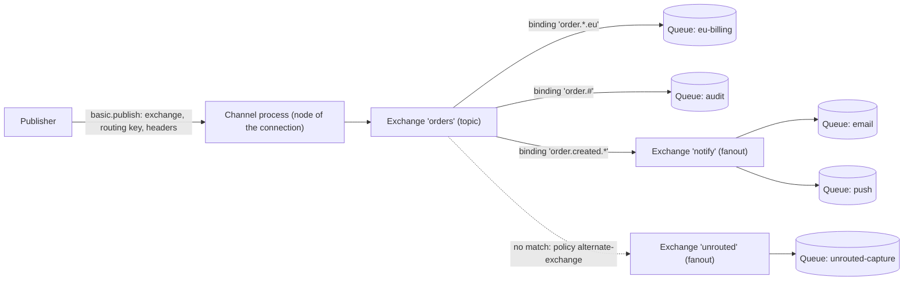
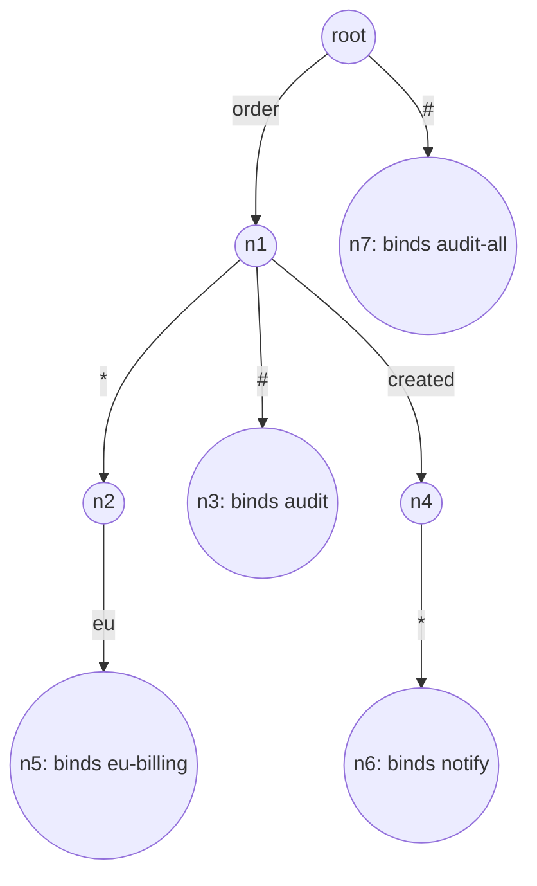
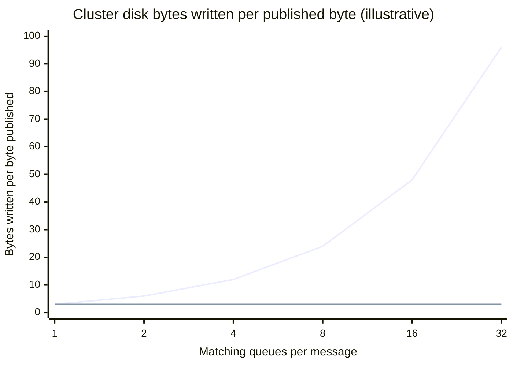
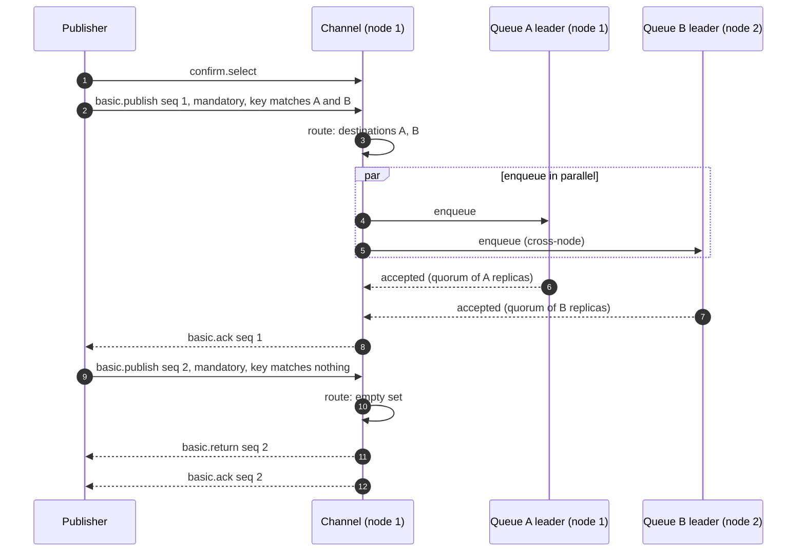
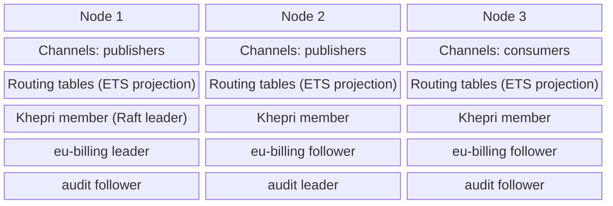
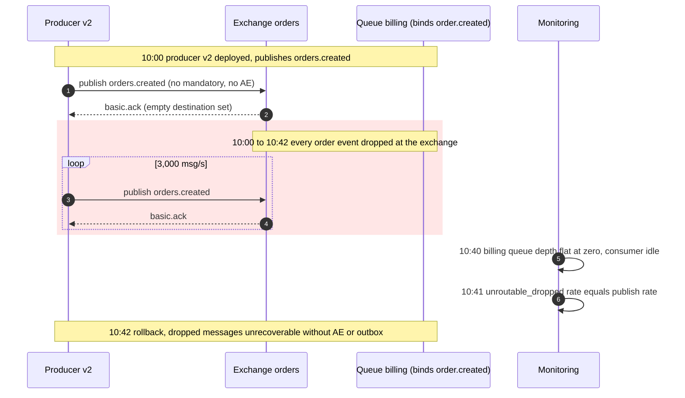

RabbitMQ'da publisher hiçbir zaman doğrudan bir queue'ya yazmaz. Bir mesajı, bir routing key'i ve isteğe bağlı header'ları bir exchange'e verir; hangi queue'ların kopya alacağına exchange, binding'leri değerlendirerek karar verir. Binding'ler, exchange'i queue'lara (ya da başka exchange'lere) bağlayan ve tüketici tarafının tanımladığı kurallardır. Exchange hiçbir şey saklamaz: yönlendirme, yayımlanan her mesaj için bir kez çalıştırılan ve mesajın routing key'i ile header'larını bir hedef kümesine eşleyen bir fonksiyondur. Modelin bütün amacı bu dolaylılıktır: üreticiler bir iş olayını adlandırır (`order.created.eu`), tüketiciler kendi queue'larını bağlayarak ilgilendikleri alt kümeye abone olur ve iki taraf da karşı tarafta kaç kişi olduğunu bilmez. Bu sayfa, RabbitMQ'nun uyguladığı ve genişlettiği AMQP 0-9-1 modelinin bu yönlendirme katmanını ele alır; queue'ların lease ve acknowledgement davranışı [Mesaj Kuyruğu ve Event Streaming](/distributed-systems/tr/communication/async-messaging/message-queue-vs-event-streaming/) sayfasında incelenir.

Asıl denge, yönlendirmenin yazma anında, broker'ın içinde ve hedef başına yapılmasıdır. Mesajın eşleştiği her queue kendi kopyasını alır ve bu kopya bağımsız olarak kalıcılaştırılır ve replike edilir; dolayısıyla fan-out disk yazmalarını, replikasyon trafiğini ve belleği eşleşen queue sayısıyla çarpar. Karşılığında her tüketici yalnızca abone olduğu mesajları alır, her aboneliğin kendi birikimi (backlog) ve kendi hata izolasyonu olur ve filtreleme mantığı her tüketicide değil, broker'ın topolojisinde yaşar. Kafka gibi partition'lı bir log tam tersini seçer: tek bir kopya yazılır, her tüketici akışın tamamını okuyup filtreler ve bedeli okuma anında öder. İkinci bedel, topolojinin cluster genelindeki bir metadata deposunda tutulan paylaşılan, değişebilen bir durum olmasıdır; ayrıca routing key'i hiçbir binding ile eşleşmeyen bir mesaj, varsayılan olarak publisher'a hiçbir hata ulaşmadan atılır.

Sayfanın geri kalanı modelden kenarlarına doğru ilerler: tek bir mesajın channel'dan queue'lara nasıl gittiği ve hedef kümesinin neden bu şekilde hesaplandığı, her exchange türünün içeride nasıl eşleştirme yaptığı ve bunun maliyeti, publisher'ın sonuç hakkında neler öğrenebileceği, topolojinin bir cluster'da nasıl davrandığı ve yönlendirme katmanının hangi hataları ürettiği.

## Yönlendirme Yolu: Channel, Exchange, Binding'ler, Queue'lar

İstemci bir node'a TCP bağlantısı açar ve bunun üzerinden channel'ları çoklar (multiplex); her channel o node üzerinde ayrı bir Erlang process'idir. İstemci `basic.publish` çağrısını bir exchange adı, en fazla 255 baytlık bir routing key ve mesaj özellikleriyle yaptığında yönlendirmeyi channel process'inin kendisi yapar: exchange'i bulur, exchange türünün yönlendirme fonksiyonundan hedefleri ister ve ardından mesajı her hedefin queue türüne teslim eder. Exchange bir process değildir ve mailbox'ı yoktur; metadata deposundaki bir kayıt ile bir yönlendirme fonksiyonundan ibarettir. Bir exchange'in bir queue gibi "aşırı yüklenememesinin" ve yönlendirme maliyetinin belirli bir exchange'de değil, publisher'ların bağlı olduğu node'larda CPU olarak görünmesinin nedeni budur.


*Queue binding'leri olan bir topic exchange, bir fanout exchange'e giden exchange-to-exchange binding ve yalnızca hiçbir şeyle eşleşmeyen mesajları alan bir alternate exchange.*

`orders` exchange'ine `order.created.eu` routing key'iyle yayımlanan bir mesaj, topic exchange'in üç binding'inin üçüyle de eşleşir. Hedef kümesi, herhangi bir queue'ya dokunulmadan önce bütün olarak hesaplanır: doğrudan `eu-billing` ve `audit`, exchange-to-exchange binding üzerinden de `email` ve `push`. Alternate exchange'e yalnızca kaynak exchange hiç hedef üretmediğinde başvurulur; bu yüzden bu mesaj `unrouted-capture`'a hiç ulaşmaz. `invoice.paid` routing key'li bir mesaj ise `orders` içinde hiçbir şeyle eşleşmez ve alternate exchange'e gider; oradaki fanout onu capture queue'suna teslim eder. Exchange-to-exchange binding'ler RabbitMQ'nun AMQP 0-9-1'e eklediği bir uzantıdır ve mesajı yeniden yayımlamaz: mesaj, kaynak exchange'in ve ondan erişilebilen tüm exchange'lerin binding'leri birleştirilerek bir kez yönlendirilir.

### Hedef Kümesinin Hesaplanması

Yönlendirme algoritması, exchange'ler üzerinde bir iş listesi (worklist) dolaşımıdır. Publisher'ın adını verdiği exchange ile başlar, türünden hedefleri ister ve sonucu ayırır: queue'lar hedef kümesine girer, exchange'ler ise daha önce ziyaret edilmedilerse iş listesine geri eklenir. Bir exchange hiçbir şey üretmediyse ve yapılandırılmış bir alternate exchange'i varsa, alternate exchange iş listesine eklenir. Dolaşım, iş listesi boşaldığında biter.

```text
route(exchange X, message M):
  work = [X]; seen = {X}; queues = {}          # queues is a set
  while work not empty:
    E = pop(work)
    dests = E.type.route(E, M)                 # type-specific match
    if dests is empty and E has alternate-exchange A:
      dests = [A]
    for d in dests:
      if d is a queue:     queues.add(d)       # duplicates collapse
      elif d not in seen:  seen.add(d); work.push(d)
  return queues                                # empty set = unroutable
```

Bu yapıdan üç özellik çıkar ve her biri, uygulamaların çoğu zaman farkında olmadan dayandığı bir garantidir. Birincisi, bir mesaj, o queue'ya kaç binding ya da yol çıkarsa çıksın, publish başına queue başına en fazla bir kez kuyruğa alınır: bir topic exchange'e hem `order.*` hem `order.#` ile bağlı bir queue, `order.created` için iki değil tek kopya alır, çünkü hedef bir kümedir. İkincisi, exchange-to-exchange binding'lerdeki döngüler ve alternate exchange zincirleri sonlanır, çünkü ziyaret edilmiş bir exchange bir daha genişletilmez. Üçüncüsü, "yönlendirilemez" (unroutable) sonucu kesin olarak, tüm dolaşımın ardından boş bir hedef kümesi olarak tanımlanır; `mandatory` bayrağının ve unroutable metriklerinin raporladığı şey tam olarak budur.

Yönlendirmenin neyi garanti etmediği de aynı derecede önemlidir. Queue'lar arasında atomik değildir: hedef kümesi, yönlendirme tablolarının tek bir anlık görüntüsünden atomik olarak hesaplanır, ancak her queue'ya ekleme ayrı bir queue process'inin yaptığı ayrı bir işlemdir; bir queue mesajı reddederken (örneğin uzunluk sınırı `reject-publish` taşma davranışını kullandığı için) diğerleri kabul edebilir. Queue'lar arasında sıra garanti etmez: tek bir channel üzerinden yayımlanıp aynı queue'ya yönlendirilen iki mesaj o queue'ya yayımlanma sırasıyla ulaşır, ancak `audit` ile `eu-billing`'in onları hangi sırayla gördüğü arasında hiçbir ilişki yoktur. Ve hiçbir şey saklamaz: yayımlandığı anda hiçbir binding ile eşleşmeyen bir mesaj, bir saniye sonra ortaya çıkacak bir binding için tutulmaz.

### Routing Key'ler, CC ve BCC

Routing key, publisher'ın seçtiği tek ve kısa bir string'dir; ancak RabbitMQ, AMQP 0-9-1'de `CC` ve `BCC` header'ları aracılığıyla mesaj başına ek routing key'ler kabul eder. Bu uzantının adı sender-selected distribution'dır. Yönlendirme her anahtar için bir kez çalışır ve sonuçları aynı hedef kümesinde birleştirir; böylece örtüşen anahtarlar da queue başına en fazla bir kopya üretir. `BCC` header'ı teslimattan önce kaldırılır, böylece tüketiciler diğer alıcıları görmez. AMQP 1.0 üzerinde aynı etki `x-cc` message annotation'ı ile elde edilir.

## Exchange Türleri ve Her Birinin Eşleştirme Biçimi

Exchange türü, eşleştirme fonksiyonunun kendisidir. Seçim; semantik (bir binding'in ne anlama geldiği), yönlendirme maliyeti (işin binding sayısıyla nasıl büyüdüğü) ve hangi hataların kolayca yapılabildiği açısından önemlidir. RabbitMQ 4.x, dört AMQP türünü (direct, fanout, topic, headers), default exchange'i ve birkaç uzantı türünü içerir; plugin'ler daha fazlasını ekleyebilir.

### Direct ve Default Exchange

Direct exchange, binding key'i routing key'e tam olarak eşit olan her queue'ya teslim eder. İçeride bu, node-yerel yönlendirme tablolarında (exchange, routing key) çifti üzerinden yapılan anahtarlı bir aramadır; bu yüzden maliyeti exchange üzerindeki binding sayısıyla büyümez. Birden fazla queue aynı anahtarla bağlanabilir ve bu durumda her biri bir kopya alır; tek bir queue da birden fazla mesaj sınıfını almak için birden fazla anahtarla bağlanabilir.

Default exchange, istemcilerin isimsiz bir direct exchange olarak gördüğü özel bir durumdur. Her queue'ya, kendi adı routing key olarak kullanılarak bunun üzerinden erişilebilir; tutorial'ların "bir queue'ya yayımlamasını" mümkün kılan budur. Güncel sürümlerde gerçek bir exchange değildir: yönlendirme, hiçbir binding tablosuna bakmadan routing key'i doğrudan bir queue adına çözer, açıkça bind ya da unbind edilemez ve alternate exchange desteklemez. Default exchange'e var olmayan bir queue'nun adıyla yayımlamak yönlendirilemez bir publish'tir ve `mandatory` ayarlanmadıkça sessizce atılır. Onu kullanmak publisher'ı queue adlarına bağlar; exchange'lerin ortadan kaldırmak için var olduğu bağımlılık tam olarak budur.

### Fanout

Fanout exchange, routing key'i yok sayar ve bağlı her hedefe teslim eder. Yönlendirme, exchange'in tüm binding listesini okur; dolayısıyla iş, hedef sayısıyla orantılıdır. Bu sayı aynı zamanda oluşturulan kopya sayısı olduğu için yönlendirme maliyeti hiçbir zaman kuyruğa ekleme maliyetinin önüne geçmez. RabbitMQ 4.2 sürüm notları, fanout yönlendirmesinde yapılan bir optimizasyonla fanout üzerinden yayımlanan mesajlarda uçtan uca throughput'un %42'ye kadar arttığını bildirir; iyileştirme yönlendirme adımına aittir, aşağıda ele alınan kopya başına depolama maliyetine değil.

### Topic: Trie Üzerinden Segment Eşleştirme

Topic exchange, routing key'i noktalarla ayrılmış bir segment dizisi olarak ele alır. Binding key, segmentler üzerinde bir kalıptır: `*` tam olarak bir segmentle, `#` ise sıfır ya da daha fazla segmentle eşleşir. `order.*.eu`, `order.created.eu` ile eşleşir ama `order.eu` ya da `order.created.eu.retry` ile eşleşmez; `order.#` ise `order`, `order.created` ve `order.created.eu.retry` ile eşleşir; tek başına `#` binding'i her şeyle eşleşir ve o binding'i bir fanout'a dönüştürür. Segmentler tam string olarak karşılaştırılır; bir segmentin içinde önek ya da düzenli ifade (regular expression) eşleştirmesi yoktur.

Her binding kalıbını her mesaja karşı değerlendirmek, yönlendirme maliyetini binding sayısıyla doğrusal hâle getirirdi. RabbitMQ bunun yerine bir topic exchange'in tüm binding kalıplarını kenarları segment olan bir trie içinde saklar; `*` ve `#` sıradan kenar etiketleridir ve eşleştirme bu trie'yi dolaşarak yapılır. Khepri metadata deposunu kullanan 4.x sürümlerinde trie, metadata deposundan her node'a yansıtılan (projection) iki bellek içi ETS (Erlang Term Storage) tablosunda tutulur: biri (exchange, ebeveyn node, segment) anahtarlı kenarlar için, diğeri her node'a bağlı binding'ler için.


*`order.*.eu`, `order.#`, `order.created.*` ve `#` binding'leri için topic trie. `order.created.eu` eşleştirilirken her seviyede literal, `*` ve `#` kenarları paralel olarak izlenir.*

`order.created.eu` eşleştirmesi kökte üç aday kenarla başlar: literal `order`, `*` (burada yok) ve `#`. `#` kenarı `n7`'ye gider ve `#` kalan tüm segmentleri yutabildiği için orası hemen eşleşir. Literal kenar `n1`'e gider; orada bir sonraki segment olan `created` için yine üç aday vardır: `n4`'e giden literal kenar, `n2`'ye giden `*` kenarı ve `created.eu`'yu yutabildiği için eşleşen, `n3`'e giden `#` kenarı. `n4`'ten `*` kenarı `eu`'yu tüketip `n6`'ya ulaşır; `n2`'den ise literal `eu` kenarı `n5`'e ulaşır. Sonuç, tek bir dolaşımda toplanan dört hedeftir ve bu dolaşımın maliyeti exchange'in başka yerlerinde kaç binding olduğuna değil, routing key'in derinliğine ve trie'nin dallanmasına bağlıdır. `invoice.` altındaki on bin binding, `order.created.eu` yönlendirilirken hiçbir maliyet getirmez, çünkü dolaşım o alt ağaca hiç girmez.

Maliyetin saklandığı yer `#` kenarıdır. Bir `#` sıfır, bir ya da çok sayıda segment yutabildiği için dolaşım her bölme noktasını denemek zorundadır. Bir yol üzerinde tek `#` varken deneme sayısı routing key uzunluğuyla doğrusaldır; iki ya da daha fazla `#` olduğunda aynı (trie node'u, kalan segmentler) durumuna birçok farklı bölmeyle ulaşılabilir ve tekrar sayısı anahtar uzunluğuyla kombinatoryal olarak büyür. RabbitMQ kaynak kodu bunu, dolaşım iki `#` kenarı aldıktan sonra ziyaret edilen durumları memoize ederek çözer; RabbitMQ 4.4.0 ise ek olarak ikiden fazla `#` joker karakteri içeren topic binding key'lerini reddeder. 4.3'te kabul edilen `#.error.#.payment.#` gibi bir binding key 4.4'te bağlanamaz; bu, bir yükseltme öncesinde çalıştırılmaya değer bir uyumluluk kontrolüdür.

### Headers

Headers exchange, routing key'i yok sayar ve mesaj header'ları üzerinden eşleştirme yapar. Her binding, header adları ve değerlerinden oluşan bir tablo ile bir `x-match` argümanı taşır: `all` (varsayılan) listelenen her header'ın verilen değerle bulunmasını, `any` ise en az birinin bulunmasını gerektirir. Adı `x-` ile başlayan header'lar bu iki modda yok sayılır; `all-with-x` ve `any-with-x` varyantları bunları da hesaba katar. Değeri void olan bir binding girdisi yalnızca header'ın varlığına göre eşleşir.

Bunun için bir index yoktur. Yönlendirme, eşleştirme fonksiyonunu exchange üzerindeki her binding'e karşı değerlendirir; dolayısıyla mesaj başına maliyet binding sayısıyla doğrusaldır. Beş binding'li bir headers exchange ucuzdur; genel amaçlı bir içerik tabanlı yönlendirici olarak kullanılan binlerce binding'li bir headers exchange ise her publish'te binding sayısıyla orantılı channel process CPU'su harcar. Headers exchange'ler şema kaymasına (schema drift) da davetiye çıkarır: bir üreticinin yeniden adlandırdığı bir header sessizce eşleşmeyi bırakır ve broker'da "bunu isteyen abone yok" ile "header yanlış yazılmış" durumlarını birbirinden ayıran hiçbir şey yoktur.

### Hash ve Yerellik Exchange'leri

Üç uzantı türü, tüm eşleşmelere değil, bağlı queue'lardan tam olarak birine yönlendirir; bu da bir queue kümesini tek bir mantıksal akışın partition'larına dönüştürür.

Consistent hash exchange (`x-consistent-hash`; RabbitMQ ile birlikte gelen ve etkinleştirilmesi gereken `rabbitmq_consistent_hash_exchange` plugin'inden), routing key'i ya da belirlenen bir header'ı veya mesaj özelliğini bir halka üzerine hash'ler; bu halkada bağlı her queue, binding key'inde sayı olarak verilen binding ağırlığı kadar bucket'a sahiptir. Topoloji değişmediği sürece aynı anahtara sahip mesajlar her zaman aynı queue'ya ulaşır; bir queue eklemek ya da çıkarmak yalnızca etkilenen bucket'lardaki anahtarları taşır. Halkanın nasıl kurulduğu [Consistent Hashing](/distributed-systems/tr/data-management/data-partitioning/consistent-hashing/) sayfasının konusudur. Belgelenmiş iki uyarı vardır: halka bellekte tutulur ve bir node açıldığında binding'lerden yeniden kurulur; queue'ların göreli konumlarının bir yeniden başlatmadan sonra korunacağı garanti edilmez, dolayısıyla belirli bir anahtar sonrasında farklı bir queue'ya gidebilir. Ayrıca dağılım mesajlar üzerinde değil anahtarlar üzerindedir; az sayıda anahtar bazı queue'ları boş bırakabilir.

Modulus hash exchange (`x-modulus-hash`), routing key'in hash'inin binding sayısına göre modunu alır. 4.4.0 sürümünde sharding plugin'inden çekirdeğe taşındı ve aynı sürüm, değişmeyen bir topoloji için yönlendirmesini yeniden başlatmalar arasında kararlı hâle getirdi. Binding sayısını değiştirmek neredeyse her anahtarı yeniden eşler; bu yüzden yeniden boyutlandırmadan çok kararlı yerleşimin önemli olduğu sabit bir partition sayısına uygundur.

Local random exchange (`x-local-random`, 4.0'da eklendi), routing key'leri tamamen yok sayarak publisher bağlantısıyla aynı node üzerindeki bağlı queue'lardan rastgele seçilen birine teslim eder. Düşük publish gecikmesinin önemli olduğu request-reply iş yükleri için vardır: istek hiçbir zaman cluster içinde başka bir node'a geçmez. Hata modu doğrudan tanımından çıkar: yerel olarak bağlı hiçbir queue'su olmayan bir node'da yayımlanan mesaj atılır. Bu yüzden her node'da en az bir tüketici gerekir ve cluster'ın önündeki load balancer'lar onu doğru kullanmayı zorlaştırır.

### Hesaplamalı Örnek: Yazma Anındaki Fan-Out'un Maliyeti

Bir sipariş servisinin, üç node'lu bir cluster'daki bir topic exchange'e saniyede 2 KB'lık 3.000 mesaj yayımladığını varsayalım. Yirmi beş tüketici servis kendi quorum queue'larını bağlıyor ve ortalama bir mesaj bunların altısıyla eşleşiyor (örnek amaçlı sayılar). Her biri üç replikalı quorum queue'lar varsayalım; her queue aldığı her mesajın kendi kopyasını kendi log'una ekler, dolayısıyla mesaj başına maliyet altı queue çarpı üç replikadır.

Cluster genelindeki disk yazmaları 3.000 × 6 × 3 × 2 KB, yani yaklaşık 108 MB/s'dir; queue leader'ları eşit dağılmışsa node başına kabaca 36 MB/s eder. Node'lar arasındaki replikasyon trafiği leader'dan follower'lara giden paydır: 3.000 × 6 × 2 × 2 KB, yaklaşık 72 MB/s. Publisher'ın kendi ağ trafiği ise yalnızca 6 MB/s'dir. Broker, publisher'ın gönderdiği her bayt için on sekiz bayt yazar.

Bunu, yirmi beş servisin tamamının okuduğu ve ihtiyaç duymadığını attığı tek bir replike log akışıyla karşılaştıralım. Disk yazmaları 3.000 × 3 × 2 KB, yaklaşık 18 MB/s'ye düşer; ancak okuma çıkışı (egress) 25 × 6 MB/s, yani 150 MB/s olur ve bunun kabaca dörtte üçü okuyucunun hemen attığı veridir. Genel olarak iki tasarımdan biri daha ucuz değildir: yönlendirmeli tasarım bedeli yazma anında eşleşen abonelik başına, log ise okuma anında tüketici başına öder. Hangi faturanın daha küçük olduğuna fan-out derecesi ve tüketici sayısı karar verir.


*Üst çizgi: her biri üç replikalı quorum queue'lara yönlendirilen kopyalar. Alt çizgi: kaç tüketicinin okuduğundan bağımsız olarak, üç replikayla bir kez yazılan tek bir log.*

Üst çizgi doğrusaldır, çünkü quorum queue'lar arasında hiçbir şey paylaşılmaz: her birinin kendi Raft log'u, kendi replikasyonu ve kendi snapshot takvimi vardır. Düz çizgi ise maliyetini bu grafiğin göstermediği okuma tarafında saklar. Classic queue'lar ikisinin arasına yalnızca büyük mesajlarda düşer: gömme eşiğinde (embedding threshold; header'lar dahil, varsayılan 4.096 bayt) ya da üzerinde olan mesajlar virtual host başına paylaşılan bir mesaj deposuna gider ve onu alan her classic queue tarafından referansla tutulur; daha küçük mesajlar ise her queue'nun kendi deposuna gömülür. Altı classic queue'ya fan-out edilen 2 KB'lık bir mesaj yine altı kez yazılır.

Fan-out gecikmeyi de değiştirir. Yönlendirilmiş bir mesaj için publisher confirm, ancak her hedef queue mesajı kabul ettikten sonra gönderilir; dolayısıyla confirm altı queue'nun en yavaşını bekler. Her queue'nun belirli bir mesajda yavaş kabul etme olasılığı bağımsız olarak %1 ise, altı yönlü bir mesajın en az bir yavaş queue'ya denk gelme olasılığı 1 − 0,99⁶, yani yaklaşık %5,9'dur: publisher'ın p99 confirm gecikmesini, tek bir queue'nun kabaca p99,8'i belirler.

## Publisher Ne Öğrenir: Mandatory, Alternate Exchange'ler ve Confirm'ler

Yönlendirmenin publisher'ı ilgilendiren üç olası sonucu vardır: mesaj tüm hedeflere ulaştı, mesaj hiçbir hedefe ulaşmadı ya da bazı hedeflere ulaşıp diğerleri tarafından reddedildi. AMQP 0-9-1 bunları gözlemlemek için birbirinden bağımsız üç mekanizma sunar ve hiçbirini kullanmayan bir publisher hiçbir şey öğrenmez.

`basic.publish` üzerindeki `mandatory` bayrağı, hedef kümesi boş olduğunda broker'dan mesajı `basic.return` ile geri göndermesini ister. Alternate exchange üzerinden teslim edilen bir mesaj yönlendirilmiş sayılır, dolayısıyla geri gönderilmez. Alternate exchange'ler kararı topolojiye taşır: `alternate-exchange` policy'si ya da argümanı olan bir exchange, yönlendiremediği her mesajı o exchange'e iletir; o da genellikle bir capture queue'suna fan-out yapar. Channel başına `confirm.select` ile etkinleştirilen publisher confirm'ler ise broker'ın her publish'i bir sıra numarası taşıyan ve isteğe bağlı olarak birden fazla mesajı birden kapsayan `basic.ack` ya da `basic.nack` ile onaylamasını sağlar.


*Publisher confirm ile mandatory birlikte. Yönlendirilmiş bir mesaj ancak her hedef queue kabul ettikten sonra onaylanır; yönlendirilemeyen bir mandatory mesaj önce geri gönderilir, sonra onaylanır.*

4 ile 8 arasındaki adımlar, yönlendirilmiş mesajlardaki confirm'lerin neden her hedefe bir round trip'e mal olduğunu gösterir: channel her queue'nun kabulünü bekler; bu bir quorum queue için replikalarının çoğunluğunun girdiye sahip olması, kalıcı (persistent) bir mesajın durable bir classic queue'ya gitmesi durumunda ise mesajın diske yazılmış olması demektir. Queue B'nin leader'ı node 2'de yaşar; bu yüzden publisher node 1'e bağlı olsa bile bu ekleme ağı geçer. 10 ile 12 arasındaki adımlar ise tuzaktır: yönlendirilemeyen bir mesaj da onaylanır, çünkü broker onunla işini bitirmiştir ve onay yalnızca "broker bu mesajla işini bitirdi" anlamına gelir, "mesaj saklandı" anlamına değil. Hiçbir şeyin saklanmadığını publisher'a yalnızca öncesindeki `basic.return` söyler. Confirm'leri etkinleştirip `mandatory`'yi etkinleştirmeyen ve alternate exchange'i olmayan bir publisher, eşleşen binding'i olmayan bir topolojiye yayımladığı her mesaj için temiz bir `basic.ack` alır.

Üçüncü sonuç olan kısmi yönlendirme, `basic.nack` olarak ortaya çıkar. Uzunluk sınırı `reject-publish` taşma davranışını kullanan bir queue mesajı reddeder; node'u erişilemez olan bir hedef classic queue da mesajı kabul edemez. Her iki durum da, diğer hedef queue'lar mesajı çoktan almış olsa bile publish'in tamamı için negatif bir onay üretir. Bir nack'e mesajı yeniden yayımlayarak yanıt veren publisher, ilk denemeyi kabul etmiş her queue'da kopya (duplicate) oluşturur. RabbitMQ tüketicilerinin idempotent olması gerektiğinin somut nedenlerinden biri budur; genel argüman [En Az Bir Kez, En Fazla Bir Kez ve Tam Olarak Bir Kez Semantiği](/distributed-systems/tr/communication/async-messaging/delivery-semantics/) sayfasında, anahtara dayalı tekilleştirme ise [Idempotency ve Güvenli HTTP Metotları](/distributed-systems/tr/communication/api-gateway/idempotency/) sayfasında ele alınır.

| Durum | Bayrak yok | `mandatory` | Alternate exchange | Confirm'ler |
|---|---|---|---|---|
| Tüm hedeflere yönlendirildi | Sessiz başarı | Sessiz başarı | Başvurulmaz | Tüm queue'lar kabul ettikten sonra `basic.ack` |
| Hiçbir binding eşleşmiyor | Sessizce atılır, unroutable dropped olarak sayılır | `basic.return` | Alternate exchange'in queue'larına teslim edilir; yönlendirilmiş sayılır | `basic.ack` (mandatory ise return'den sonra) |
| Exchange mevcut değil | Channel 404 NOT_FOUND ile kapatılır | Aynı | Aynı | Aynı; o channel'daki onaylanmamış publish'ler başarısız sayılmalıdır |
| Bir hedef reddediyor (`reject-publish`, classic queue erişilemez) | Sessiz; diğer queue'lar kopyalarını tutar | Geri gönderilmez (yönlendirilmiştir) | Başvurulmaz | `basic.nack`; diğer queue'lar mesajı tutuyor olabilir |

:::danger[Yönlendirilemeyen mesajlar atılır ve confirm'ler bunu göstermez]
Varsayılan bayraklarla, routing key'i hiçbir binding ile eşleşmeyen bir mesaj exchange'de hiçbir hata, hiçbir log satırı olmadan ve pozitif bir publisher confirm ile silinir. Bu; bir tüketicinin binding'ini henüz tanımlamadığı her deploy'da, her routing key yeniden adlandırmasında ve topolojisi elle oluşturulmuş her ortamda veri kaybı demektir. `mandatory` ile yayımlayıp return'leri işleyin ya da her iş exchange'ine durable bir queue'ya yakalayan bir alternate exchange verin; her iki durumda da unroutable sayaçları üzerinde alarm kurun.
:::

RabbitMQ 4.0'dan beri yerel olarak desteklenen AMQP 1.0 üzerinde aynı sonuçlar teslimat durumlarına eşlenir: hiçbir queue'ya yönlendirilemeyen bir mesaj `released` sonucuyla kapatılır (settle edilir); bir queue tarafından reddedilme ise hata bilgisinde queue adı ve bir neden içeren `rejected` sonucunu üretir. Bu, AMQP 0-9-1'in tek `basic.nack`'inden daha kesin bir bilgidir.

## Cluster İçinde Topoloji: Metadata, Yerleşim ve Yerellik

Exchange'ler, binding'ler, queue tanımları, policy'ler ve kullanıcılar cluster metadata'sıdır ve her node'a replike edilir. RabbitMQ 4.2'ye kadar varsayılan depo, Erlang'ın yerleşik dağıtık veritabanı Mnesia idi; Raft tabanlı bir depo olan Khepri 4.0'da tam destek kazandı ve 4.2'de yeni kurulumlar için varsayılan oldu. RabbitMQ ekibi, `khepri_db` feature flag'inin sonraki bir sürümde zorunlu hâle gelmesini beklediğini belirtiyor. Khepri her topoloji değişikliğini, node'ların çoğunluğu tarafından commit edilen bir komut olarak uygular; bu, [Raft](/distributed-systems/tr/coordination/consensus-algorithms/raft/) sayfasında anlatılan uzlaşma mekanizmasının aynısıdır. Her node, commit edilmiş durumu yönlendirmenin okuduğu yerel ETS tablolarına yansıtır.


*Her node yönlendirme tablolarının tam bir kopyasını tutar; her queue'nun bir leader'ı vardır ve replikaları node'lara dağıtılmıştır. Yönlendirme yereldir, kuyruğa ekleme değildir.*

Diyagram, hata altında farklı davranan iki tür durumu birbirinden ayırır. Yönlendirme tabloları her node'da bulunur; bu yüzden node 3 üzerindeki bir channel, bir mesajı başka hiçbir node'a sormadan yönlendirir. Yönlendirmenin maliyeti publisher'ın node'unda CPU'dur ve hiçbir ağ round trip'i gerektirmez. Queue'ların ise yerleşimi vardır: her quorum queue'nun bir node üzerinde bir leader'ı vardır ve node 1 üzerindeki bir channel `audit`'e yönlendirdiğinde mesajı node 2'ye göndermek zorundadır. Publisher'lar bir load balancer ile tüm node'lara dağıtıldığında, üç node'lu bir cluster'da kuyruğa eklemelerin kabaca üçte ikisi ağı geçer ve bu da hesaplamalı örnekte bulunan replikasyon trafiğine eklenir. Topoloji değişiklikleri ise ters yolu izler: her `queue.declare`, `queue.bind` ve `queue.unbind`, onaylanmadan önce çoğunluk tarafından commit edilmesi gereken bir metadata deposu yazmasıdır. Bu yüzden binding değişiklikleri publish'lerden kat kat pahalıdır ve sınırlarını mesaj throughput'u değil, metadata deposunun commit hızı belirler.

Hatalar sırasında bunun iki sonucu önemlidir. Bir node çoğunlukla bağlantısını kaybederse artık topolojiyi değiştiremez; bağlanırken queue ya da binding tanımlayan istemciler, mevcut tablolarla yönlendirme sürse bile o node'da başarısız olur. Ayrıca sistemin iki ayrı replikasyon alanı vardır: topoloji donmuşken bir quorum queue erişilebilir olabilir ya da topoloji yazılabilirken belirli bir queue quorum'unu kaybetmiş olabilir. Queue replikasyonu [Raft](/distributed-systems/tr/coordination/consensus-algorithms/raft/) sayfasında, RabbitMQ'nun ağ bölünmesi (partition) yönetimi ise [split-brain ve fencing](/distributed-systems/tr/coordination/consensus-algorithms/split-brain-fencing/) bağlamında ele alınır; classic queue'lar için eski leader-follower replikasyonu olan classic mirrored queue'lar 4.0'da kaldırıldı.

### Cluster'lar Arası Yönlendirme

Binding'ler yalnızca tek bir cluster içinde yönlendirir. İki plugin yönlendirmeyi cluster'lar ya da veri merkezleri arasına genişletir ve ikisi de asenkrondur. Exchange federation, upstream cluster'da upstream exchange'e downstream exchange'in binding'leriyle bağlı bir queue oluşturur; binding'ler bağlantı üzerinden yayılır. Mesajlar yalnızca downstream'de birinin bağlı olduğu routing key'ler için akar ve `max-hops` ayarı, halka ya da mesh topolojilerinde bir mesajın bağlantılar arasında kaç kez kopyalanabileceğini sınırlar. Shovel plugin'i ise mesajları bir kaynak queue'dan bir hedef exchange'e ya da queue'ya taşıyan, yapılandırılmış bir tüketici-publisher çiftidir. İkisi de bağlantı boyunca at-least-once teslimatı devralır ve yeniden bağlanmada mesajları çoğaltabilir; hiçbiri iki cluster'ı tek bir yönlendirme alanına dönüştürmez ve hiçbiri replike bir log'un bölgeler arası sıralama ya da failover semantiğini sağlamaz.

## Exchange Türleri ve Alternatifler Arasındaki Production Dengeleri

Exchange türü seçimi, bilginin nerede yaşadığına dair bir seçimdir. Direct ya da topic exchange, publisher'ın anlamı routing key'e kodlamasını ve tüketicilerin buna göre bağlanmasını gerektirir; headers exchange bu anlamı header'lara taşır ve bedelini yönlendirme anında öder; hash exchange'ler abonelik semantiğini partition'lamayla takas eder; log ise tüm filtrelemeyi tüketiciye taşır.

| Mekanizma | Mesaj başına eşleştirme maliyeti | Semantik | Ana risk | Ne zaman tercih edilmeli |
|---|---|---|---|---|
| Direct exchange | Anahtarlı arama, binding sayısından bağımsız | Tam anahtar eşitliği, anahtar başına istenen sayıda queue | Anahtarlar, senkron tutulması gereken paralel bir enum'a dönüşür | Kapalı bir mesaj sınıfı kümesiyle iş kuyrukları ve komut yönlendirme |
| Fanout exchange | Bağlı hedef sayısıyla orantılı | Her bağlı queue her mesajı alır | Yazma çarpanı abone sayısına eşittir | Küçük ve bilinen bir abone kümesine yayın, cache invalidation, instance başına bildirimler |
| Topic exchange | Anahtar derinliği ve dallanmayla sınırlı trie dolaşımı | `*` ve `#` ile segment kalıpları | Anahtar yapısı herkese açık bir sözleşmeye dönüşür; uzun anahtarlar üzerindeki `#` kalıpları daha pahalıdır | Tüketicilerin varlık, eylem ve bölgeye göre seçim yaptığı olay dağıtımı |
| Headers exchange | Binding sayısıyla doğrusal | Header kümeleri üzerinde eşitlik ya da varlık | Ölçekte CPU; yeniden adlandırılan header'larda sessiz uyumsuzluk | Bir anahtarın kodlayamayacağı çok öznitelikli eşleştirme gerektiren az sayıda binding |
| Consistent hash / modulus hash | Hash artı halka ya da mod araması | Anahtar başına tam olarak bir queue | Sıcak anahtarlar; yeniden başlatmada (consistent hash) ya da yeniden boyutlandırmada (modulus) anahtar yeniden eşleme | Stream'in seçenek olmadığı durumlarda paralel tüketicilerle anahtar başına sıralama |
| Local random | Yerel binding'ler arasında rastgele seçim | Tek yerel queue, anahtar yok | Yerel queue'su olmayan node'da mesaj atılır | Her node'da tüketicisi olan RPC istek dağıtımı |
| Tüketici tarafında filtrelemeli stream ya da log | Broker'da yok | Her tüketici her şeyi okur | Okuma çarpanı, her istemcide filtreleme | Yüksek fan-out, replay, verinin çoğunu okuyan çok sayıda tüketici ([Kafka Mimarisi](/distributed-systems/tr/communication/async-messaging/kafka-architecture/)) |

RabbitMQ stream'leri ve super stream'ler, yönlendirme modelini yeniden kullandıkları için burada bir notu hak eder. Stream bir queue türüdür, dolayısıyla herhangi bir exchange'e bağlanabilir; super stream ise partition stream'lerinin farklı anahtarlarla bağlandığı bir direct exchange'dir ve partition'ı seçmek için mesaj anahtarını stream istemcisi hash'ler. Exchange yine yönlendirir, ancak her mesaj birçok queue yerine tek bir partition log'una düşer; bu da fan-out maliyetini abone başına olmaktan çıkarıp partition başına hâle getirir. Pulsar'ın tek bir topic üzerinde hem queue hem log semantiği sunan subscription türleri [Pulsar ve Kafka](/distributed-systems/tr/communication/async-messaging/pulsar-vs-kafka/) sayfasında karşılaştırılır.

### Yönlendirme Davranışını Belirleyen Yapılandırma

Yönlendirme davranışının çoğu, tanımlama (declaration) argümanlarıyla ya da policy'lerle belirlenir. Policy'ler, broker'ın uyguladığı, isimli ve kalıpla eşleşen ayarlardır; hiçbir şeyi yeniden tanımlamadan çalışma anında değiştirilebilirler. Argümanlar ise tanımlama anında sabitlenir ve varlığı silip yeniden oluşturmadan değiştirilemez. İkisi aynı anahtarı ayarladığında argüman kazanır; RabbitMQ'nun alternate exchange'ler, dead-letter hedefleri ve uzunluk sınırları için policy'leri önermesinin nedeni budur.

| Ayar | Nerede | Etki | Öneri |
|---|---|---|---|
| `alternate-exchange` | Exchange policy'si ya da argümanı | Exchange'in yönlendiremediği mesajları alır; yönlendirilene ya da bir döngü tespit edilene kadar zincirlenir | Her iş exchange'inde policy ile ayarlayın; durable bir capture queue'su bağlayın |
| `mandatory` | Publish başına | Hedef kümesi boşsa `basic.return` | Sessiz kaybı tolere edemeyen publisher'larda bir return handler ile kullanın |
| `confirm.select` | Channel başına | Tüm hedefler kabul ettikten sonra publish başına ack ya da nack | İş verisi için her zaman açık; bekleyen confirm'leri sınırlı bir pencereyle izleyin |
| `x-overflow` / `overflow` | Queue argümanı ya da policy | `drop-head` (varsayılan) en eskiyi atar; `reject-publish` yeni publish'leri nack'ler | `reject-publish`, fan-out yapan publisher'lar için dolu bir queue'yu kısmi yönlendirmeye çevirir |
| `dead-letter-exchange` | Queue policy'si ya da argümanı | Reddedilen, süresi dolan ya da sınırı aşan mesajları bir exchange'e yeniden yayımlar | 4.0 quorum queue teslimat sınırıyla eşleştirin; kalıplar [DLQ yönetimi](/distributed-systems/tr/communication/async-messaging/dlq-poison-messages/) sayfasında |
| Binding ağırlığı | Consistent hash binding key'i | Queue başına halkadaki bucket sayısı | Queue'ların tüketici kapasiteleri eşit değilse hariç, ağırlıkları 1'de eşit tutun |
| Durable ve transient | Exchange ve queue tanımı | Transient varlıklar yeniden başlatmadan sağ çıkmaz | Durable kullanın; transient varlık desteğinin 4.x serisinde kaldırılması planlanıyor |

```shell
# Alternate exchange for every exchange whose name starts with "biz."
rabbitmqctl set_policy --apply-to exchanges --priority 10 \
  biz-ae '^biz\.' '{"alternate-exchange":"biz.unrouted"}'
rabbitmqctl set_policy --apply-to queues --priority 10 \
  biz-dlx '^biz\.' '{"dead-letter-exchange":"biz.dlx"}'
# Inspect bindings and spot exchanges with no destinations at all
rabbitmqctl list_bindings source_name destination_name routing_key
rabbitmqctl list_exchanges name type policy
```

Bir varlığa aynı anda yalnızca bir policy uygulanır: eşleşenler arasında önceliği en yüksek olan. Bu yüzden örtüşen iki policy'nin anahtarları birleşmez; hem bir dead-letter policy'si hem de bir uzunluk sınırı policy'si ile eşleşen bir queue, iki anahtarı da taşıyan tek bir policy yoksa bunlardan yalnızca birini alır. Policy değişiklikleri mevcut varlıklara yeniden tanımlama gerekmeden uygulanır; bu da onları, bir olay (incident) sırasında değişmesi gerekebilecek yönlendirme davranışı için güvenli yer yapar.

:::caution[Uygulamaların tanımladığı topoloji kayar]
Her tüketicinin açılışta kendi queue'sunu ve binding'lerini tanımlamasına izin vermek kullanışlıdır, ama binding kümesini o anda hangi servisin hangi sürümünün çalıştığının bir fonksiyonu hâline getirir. Geri alınmış (rollback) bir tüketici, ölü bir queue'nun büyümeye devam etmesine yol açan bir binding bırakabilir; henüz başlamamış yeni bir tüketici ise onun mesajlarının atılması demektir. İş exchange'lerini, alternate exchange'leri ve uzun ömürlü queue'ları sürüm kontrolündeki tanımlardan ya da altyapı kodundan oluşturun; uygulamaların yalnızca kendilerine ait olan ve kendilerinin kaldırdığı şeyleri tanımlamasına izin verin.
:::

## Yönlendirme Katmanının Hata Modları

Yönlendirme hataları sessizdir. Broker sağlıklıdır, queue'lar boşalmaktadır ve var olması gereken mesajlar yoktur. Aşağıdaki her hatanın kendine özgü bir tetikleyicisi ve üzerine alarm kurulabilecek bir imzası vardır.

### Deploy ya da Anahtar Yeniden Adlandırma Sırasında Sessiz Kayıp

Tetikleyici: Bir üretici, hiçbir binding ile eşleşmeyen bir routing key yayımlamaya başlar; genellikle üretici, yeni anahtarı bağlayan tüketiciden önce deploy edildiği için ya da bir anahtar binding'ler güncellenmeden yeniden adlandırıldığı için (`order.created`'dan `orders.created`'a). Belirtiler: her bileşen başarı raporlarken aşağı akıştaki veri eksiktir; publisher confirm'ler pozitiftir. Tespit: Prometheus plugin'inden `rabbitmq_global_messages_unroutable_dropped_total` ve `rabbitmq_global_messages_unroutable_returned_total`, yönetim arayüzündeki unroutable oranları ve exchange başına gelen publish oranı ile yönlendirilen çıkış oranının karşılaştırılması. Önlem: her iş exchange'inde alternate exchange, return handler ile `mandatory` ve üreticiler yeni anahtarlar yaymadan önce binding'leri oluşturan bir deploy sıralaması. Kurtarma: alternate exchange'in capture queue'sundan doğru exchange'e bir shovel ile replay ya da varsa üreticinin [transactional outbox](/distributed-systems/tr/coordination/distributed-transactions/outbox-pattern/)'ından replay; ikisi de yoksa mesajlar kaybolmuştur.


*Bir routing key yeniden adlandırmasının örnek zaman çizelgesi. Publisher her mesaj için pozitif bir confirm görür; kaybı yalnızca unroutable sayacı ve boşta bekleyen bir tüketici ortaya çıkarır.*

2. adım, hatanın görünmez hâle geldiği andır: broker saklamadığı bir mesajı onaylar ve üreticinin retry ve alarm mantığı bunu başarı olarak değerlendirir. Gölgeli pencere, biri bir yokluğu fark edene kadar sürer; bu yüzden işe yarayan alarm hatalar üzerine değil, bir iş exchange'i için unroutable oranının sıfırdan farklı olması üzerine kurulur. Bir alternate exchange ile aynı 42 dakika, düzeltmeden sonra doğru binding'e replay edilebilecek her mesajı tutan bir capture queue'su üretmiş olurdu.

### Metadata Deposunu Aşırı Yükleyen Topoloji Çalkantısı

Tetikleyici: Çok sayıda istemci aynı anda queue tanımlar ve bağlar; genellikle fanout bildirimleri için tüketici instance'ı başına auto-delete ya da exclusive queue'lar söz konusudur ve bir ağ kesintisi ya da broker yeniden başlatması hepsinin bağlantısını koparır. Her yeniden bağlanma bir `queue.declare` ve bir ya da daha fazla `queue.bind` çağrısı yapar; her biri çoğunluk tarafından commit edilen bir metadata yazmasıdır. Belirtiler: tanımlamalar zaman aşımına uğrar, istemciler yeniden dener ve yeniden bağlanır, bağlantı ve channel churn oranları sıçrar ve node'lar metadata değişikliklerini uygulamakla meşgul olduğu için başka açılardan sağlıklı queue'lardaki publish'ler yavaşlar. Tespit: bağlantı ve channel churn oranları, queue tanımlama ve silme oranları ve metadata deposu komut gecikmesi. Önlem: jitter'lı yeniden bağlanma backoff'u ([üstel geri çekilme ve jitter ile yeniden deneme](/distributed-systems/tr/resilience/protection-patterns/retry-exponential-backoff/)), birkaç yüzden fazla instance'ı olan her şey için bağlantı başına queue yerine uzun ömürlü isimli queue'lar ve instance başına fanout queue'ları yerine tüketici başına offset'li bir stream. Yavaş tanımlamaların zaman aşımlarına, zaman aşımlarının da daha fazla tanımlamaya yol açtığı geri besleme döngüsü bir [retry storm](/distributed-systems/tr/resilience/flow-control/retry-storms-metastable-failures/)'dur.

### Kaynak Alarmlarını Tetikleyen Yazma Çarpanı

Tetikleyici: Yüksek hacimli bir exchange'e eklenen bir fanout ya da geniş bir topic binding'i (`#`) veya queue'su kopya almaya devam ederken bir abonenin tüketicisinin durması. Belirtiler: o queue'nun replikalarını barındıran node'larda disk ve bellek büyür; bir node bellek ya da boş disk alarm eşiğini aştığında RabbitMQ, yalnızca birikimi besleyeni değil, cluster'daki tüm publish yapan bağlantıları bloklar. Tespit: queue başına derinlik ve büyüme hızı, queue başına gelen publish ile teslim oranları, alarm durumu ve bloklanmış bağlantı sayıları. Önlem: tüketicileri kaybolabilecek queue'larda açık bir taşma policy'siyle uzunluk sınırları, her yeni `#` ya da fanout binding'inin exchange'in publish oranına karşı gözden geçirilmesi ve yüksek fan-out trafiğinin kendi virtual host'una ya da cluster'ına ayrılması. Bir birikimin ilgisiz üreticileri durdurması, bir [cascading failure](/distributed-systems/tr/foundations/system-models/cascading-failure/)'ın paylaşılan kaynak desenidir; broker'ın publisher'ları bloklaması ise kendi başına doğru bir [backpressure](/distributed-systems/tr/resilience/flow-control/backpressure/)'dır, yalnızca yanlış üreticilere ulaşmaktadır.

### Kısmi Yönlendirme ve Retry'da Kopyalar

Tetikleyici: Çok queue'lu bir yönlendirmenin hedeflerinden biri, uzunluk sınırı `reject-publish` kullandığı için ya da node'u erişilemez olduğu için publish'i reddeder. Belirtiler: publisher `basic.nack` alır ve yeniden dener; ilk denemeyi kabul eden queue'lar mesajı iki kez alır. Kalıcı retry'larda dolu queue reddetmeye devam ederken sağlıklı queue'larda çok sayıda kopya birikir. Tespit: publisher channel'larındaki nack oranı, yayımlanan mesaj sayısı ile hedef başına mesaj sayısı arasındaki uyumsuzluk ve tüketicilerde duplicate-key hataları. Önlem: üreticinin belirlediği bir mesaj ID'sine göre idempotent tüketiciler ve taşması diğer aboneleri etkilememesi gereken queue'larda `drop-head` ya da dead-lettering. Diğer aboneleri asla bloklamaması gereken bir queue, paylaşılan bir exchange üzerinde `reject-publish` kullanmamalıdır.

### Hash Exchange'in Arkasındaki Sıcak Queue

Tetikleyici: Bir consistent hash ya da modulus hash exchange'inde anahtar çarpıklığı; örneğin trafiğin büyük bir payını üreten tek bir tenant. Belirtiler: bir queue'nun derinliği ve tüketicisinin gecikmesi (lag) büyürken diğerleri boştadır; queue eklemek işe yaramaz, çünkü sıcak anahtar hâlâ tek bir queue'ya eşlenir. Tespit: tek bir hash exchange altındaki queue başına publish oranları ve en büyük queue ile medyan queue arasındaki oran. Önlem: sıralama izin veriyorsa daha ince taneli bir anahtar üzerinden hash'lemek ya da sıcak anahtarı açıkça bölmek; genel ele alış [Çarpıklık ve Hot-Spot Problemleri](/distributed-systems/tr/data-management/data-partitioning/skew-hot-spots/) sayfasındadır. Örnek olarak, saniyede 3.000 mesajın %30'unu üreten bir tenant, 10 queue da olsa 100 queue da olsa tek bir queue'ya saniyede 900 mesaj gönderir.

### Publisher Node'larında Yönlendirme CPU'su

Tetikleyici: Yüzlerce ya da binlerce binding'li headers exchange'ler veya uzun routing key'lere karşı birden fazla `#` joker karakterli topic kalıpları. Belirtiler: queue'lar sağlıklıyken publisher bağlantılarını barındıran node'larda yüksek CPU, artan publish gecikmesi ve Erlang runtime'ında en çok reduction harcayanlar arasında channel process'leri. Tespit: bağlantı yerleşimine göre ayrılmış node başına CPU, publish gecikmesi ve channel process'lerini sıcak gösteren `rabbitmq-diagnostics observer` ya da runtime profiling. Önlem: büyük headers exchange'leri topic anahtarları ya da birden fazla exchange ile değiştirmek, gereksiz `#` kalıplarını birleştirmek ve yükseltmeden önce 4.4'ün iki `#` sınırını kontrol etmek.

| Hata | Birincil sinyal | İlk eylem |
|---|---|---|
| Sessiz kayıp | Sıfırın üzerinde unroutable dropped ya da returned oranı | Alternate exchange ile yakala, binding'i ya da anahtarı düzelt, replay et |
| Topoloji çalkantısı | Tanımlama ve channel churn sıçramaları, declare zaman aşımları | Jitter'lı yeniden bağlanmalar; instance başına queue'ları değiştir |
| Yazma çarpanı | Bir queue'nun derinlik büyümesi, bellek ya da disk alarmı | Uzunluk sınırı, geniş binding'i kaldır, vhost'u izole et |
| Kısmi yönlendirme | Publisher nack oranı, aşağı akışta kopyalar | Idempotent tüketiciler, taşma policy'sini değiştir |
| Sıcak queue | En büyük ile medyan queue oranı | Daha ince hash anahtarı, sıcak anahtarı böl |
| Yönlendirme CPU'su | Publisher node'larında channel CPU'su, publish gecikmesi | Headers binding'lerini ve `#` kalıplarını azalt |

:::tip[Topolojiyi kod gibi test edin]
Sessiz kayba karşı en ucuz koruma, bir üreticinin yaydığı her routing key'den birer mesajı `mandatory` ayarlıyken gerçek tanımlara karşı yayımlayan ve herhangi bir `basic.return`'de başarısız olan bir testtir. Bunu CI'da sürüm kontrolündeki tanımlardan başlatılan bir broker'a karşı, her deploy'dan sonra da bir smoke test olarak çalıştırın. Yeniden adlandırılmış anahtarları, eksik binding'leri ve header adlarındaki yazım hatalarını production'dan önce yakalar; daha geniş teknikler [Olay Güdümlü Sistemleri Test Etmek](/distributed-systems/tr/deployment/distributed-testing/testing-event-driven/) sayfasındadır.
:::

## Exchange Yönlendirmesi Ne Zaman Doğru Araçtır

Exchange yönlendirmesi, abonelerin bir mesaj akışının farklı alt kümelerini istediği ve bu alt kümelerin, organizasyonun bir sözleşme olarak ele almaya razı olduğu bir routing key yapısıyla tanımlanabildiği durumlarda uygundur. En iyi olduğu alanlar şunlardır: görev dağıtımı ve komut yönlendirme (rakip tüketicileri besleyen direct exchange'ler), her biri kendi birikimi ve hata izolasyonuyla filtrelenmiş bir görünüm isteyen orta sayıda abone servise olay dağıtımı (topic exchange'ler) ve küçük, bilinen bir tüketici kümesine yayın (fanout). Yönlendirme adımının ardından mesaj başına acknowledgement, dead-lettering ve öncelik gerektiğinde de iyi bir seçimdir; bunlar log'ların aynı biçimde sunmadığı queue özellikleridir.

Açıkça tanımlanabilen birkaç durumda ise yanlış araçtır. Aynı verinin, her biri verinin çoğunu okuyan çok sayıda tüketiciye ulaşması gerektiğinde, yazma anındaki fan-out depolamayı ve replikasyonu abone sayısıyla çarpar ve tüketici tarafında filtrelemeli bir log daha ucuzdur. Tüketiciler replay'e ihtiyaç duyduğunda, geçmiş olayları görmesi gereken yeni bir abone eklemek yalnızca yönlendirmeyle imkânsızdır, çünkü exchange hiçbir şey saklamaz; bir stream ya da log gerekir. Filtreleme birkaç header alanının ötesinde mesaj içeriğine bağlı olduğunda, çok sayıda binding'li bir headers exchange yavaş bir içerik yönlendiricisine dönüşür; bunun yerine tüketicide ya da bir stream işlemcisinde filtreleyin. Gereksinim, ölçeklenmiş tüketiciler arasında katı anahtar başına sıralama olduğunda ve partition sayısı değişecekse, consistent hash exchange'ler yeniden başlatmada, modulus hash ise yeniden boyutlandırmada anahtarları yeniden eşler; bu yüzden partition'lı bir log ya da super stream daha iyi bir temeldir. Yönlendirmenin bölgeler arasında tek bir mantıksal alan olarak çalışması gerektiğinde, federation ve shovel'lar global bir topoloji değil, yeniden bağlanmada kopyalar üretebilen asenkron kopyalar verir.

İki olumsuz durum mekanizmadan çok disiplinle ilgilidir. İş mesajlarını default exchange üzerinden yönlendirmeyin: publisher'ları queue adlarına bağlar ve alternate exchange'e sahip olamaz. Ve bir mesajın saklandığını bilmek için yalnızca publisher confirm'e güvenmeyin; `mandatory` ya da alternate exchange olmadan, onaylanmış bir mesaj hiçbir queue'ya ulaşmamış olabilir.

:::note[Bu sayfanın kapsamadıkları]
Queue lease'leri, prefetch ve acknowledgement zaman aşımları [Mesaj Kuyruğu ve Event Streaming](/distributed-systems/tr/communication/async-messaging/message-queue-vs-event-streaming/) sayfasındadır. Dead-letter exchange'ler üzerine kurulu retry ve park etme stratejileri [Dead Letter Queues ve Poison Message Yönetimi](/distributed-systems/tr/communication/async-messaging/dlq-poison-messages/) sayfasındadır. Bir zamanlama mekanizması olarak öncelik kuyrukları [Öncelik Kuyrukları](/distributed-systems/tr/resilience/flow-control/priority-queues/) sayfasındadır.
:::

## İleri Okuma

- Broadcom / RabbitMQ ekibi, *Exchanges*, *Alternate Exchanges* ve *Publishers* kılavuzları, RabbitMQ dokümantasyonu, 4.x serisi.
- Broadcom / RabbitMQ ekibi, *Consistent Hash Exchange Type* (plugin README'si) ile *Modulus Hash Exchange* ve *Local Random Exchange* kılavuzları, RabbitMQ dokümantasyonu, 4.x serisi.
- Broadcom / RabbitMQ ekibi, *RabbitMQ 4.4.0 Release Notes*, rabbitmq-server deposu, 2026.
- Broadcom / RabbitMQ ekibi, *The Roadmap for Making Khepri the Default Metadata Store in RabbitMQ*, RabbitMQ blog, 2025.
- AMQP Working Group, *AMQP 0-9-1 Specification*, 2008.
- Alvaro Videla ve Jason J. W. Williams, *RabbitMQ in Action*, Manning, 2012.
