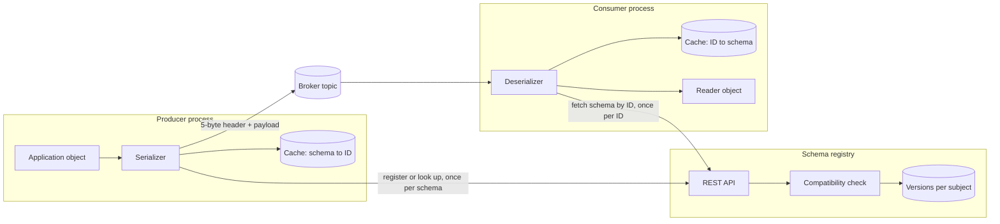
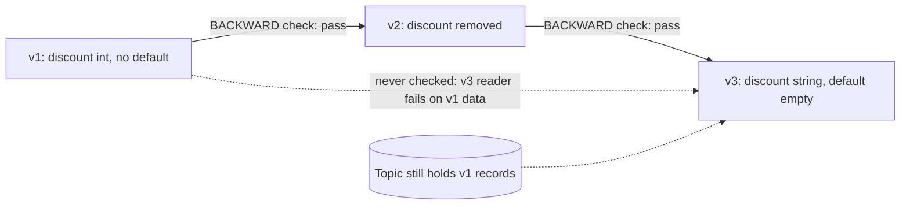
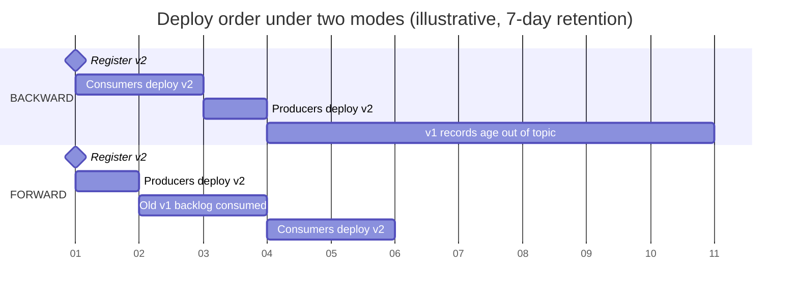
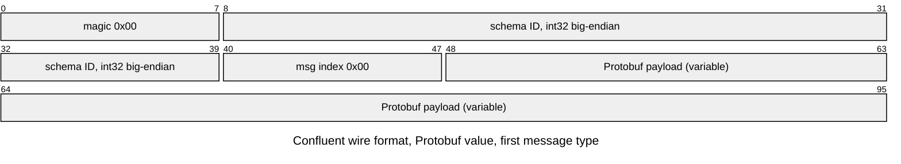
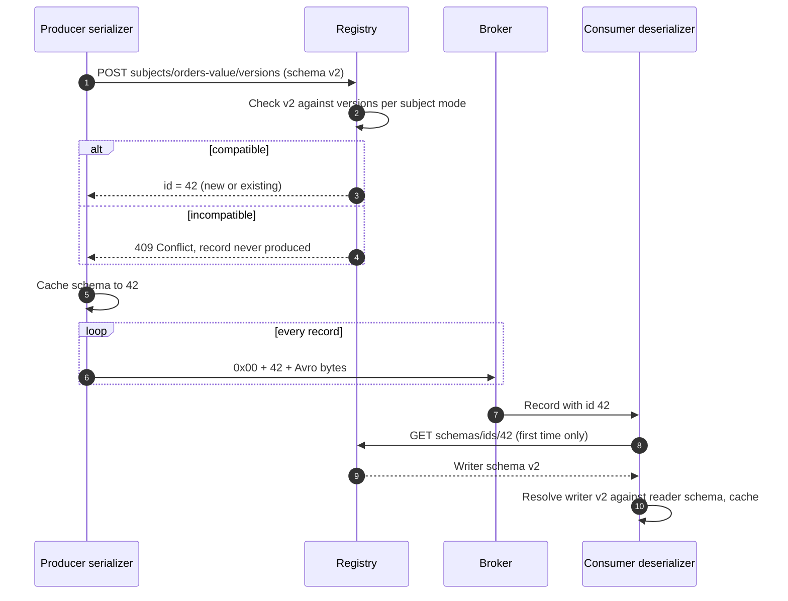

Şema evrimi, eski yapıyla yazılmış veri hâlâ dururken ve eski yapıya göre derlenmiş programlar hâlâ çalışırken serileştirilmiş verinin yapısını değiştirme disiplinidir. Bir mesajlaşma sisteminde bu iki koşul kalıcı olarak geçerlidir: bir topic kayıtları günlerce ya da süresiz tutar, producer'lar ve consumer'lar birbirinden bağımsız takvimlerle deploy edilir ve topic'in başına geri saran bir consumer, topic'in şimdiye kadar taşıdığı her yapıyı okur. Schema registry ise her mesaj şemasının her sürümünü saklayan, her sürüme producer'ların her kayda gömdüğü kompakt bir tanımlayıcı atayan ve kendisinden önceki sürümlere karşı beyan edilmiş bir uyumluluk kuralını ihlal eden yeni bir sürümü kabul etmeyen bir servistir.

Bu mekanizma olmadan ikili (binary) bir format saatli bir bombadır, metin tabanlı bir format ise yavaş bir sızıntı. Avro gibi kompakt bir ikili kodlama alan adı taşımaz; bir kaydı hangi şemanın ürettiğini tam olarak bilmeyen bir okuyucu onu hiç çözemez. JSON gibi kendini tanımlayan (self-describing) bir format her yerde çözülür, ama yeniden adlandırılmış bir alanın ya da birimi değişmiş bir değerin, producer'ın hiç duymadığı consumer'lara sessizce geçmesine izin verir. İstek-yanıt API'sinde bir kırılma, çağıranın isteğini anında başarısız kılar; broker üzerinde ise kayıt kabul edilir, saklanır, replike edilir ve daha sonra bir consumer'ın içinde, her yeniden teslimde tekrar tekrar başarısız olur.

Asıl denge, değişim özgürlüğü ile deploy bağımsızlığı arasındadır. Her uyumluluk modu, hangi okuyucunun hangi yazıcıyı okuyabileceğine dair bir sözdür ve söz ne kadar güçlüyse o kadar az değişikliğe izin verilir: producer ile consumer'ın herhangi bir sırayla deploy edilmesine ve herhangi bir geçmişin replay edilmesine izin veren mod, opsiyonel alan eklemek ve çıkarmaktan pek fazlasına izin vermez. Registry bu kuralları gelenek olmaktan çıkarıp her producer'ın serileştirme anında geçtiği bir kapıya dönüştürür; bedeli veri yolunda yeni bir runtime bağımlılığı ve kaybı tüm geçmiş kayıtları okunamaz hâle getirebilecek merkezî bir depodur. Protocol Buffers'ın wire seviyesindeki kodlama kuralları [gRPC ve Protocol Buffers](/distributed-systems/tr/communication/synchronous-protocols/grpc-protocol-buffers/) sayfasında, kırıcı değişikliklerin genel sınıflandırması [API Versiyonlama Stratejileri](/distributed-systems/tr/communication/synchronous-protocols/api-versioning/) sayfasında, kayıt sistemi (system of record) olarak saklanan olayların versiyonlanması ise [Olay Versiyonlama ve Şema Evrimi](/distributed-systems/tr/microservice-patterns/event-sourcing-cqrs/event-versioning/) sayfasında ele alınır.


*Registry veri yolunun üzerinde değil, yanında durur. Kayıtlar yalnızca bir şema ID'si taşır; şemalar process başına bir kez taşınır ve iki cache de kararlı durumu registry'den bağımsız kılar.*

Bu topolojinin iki özelliği, bu sayfadaki operasyonel davranışın büyük kısmını belirler. Broker hiçbir zaman bir şema görmez: ilk beş baytı tesadüfen bir şemayı adlandıran opak baytlar saklar. Dolayısıyla uyumluluğu istemciler uygular ve serializer'ı atlayan bir istemci kuralı da atlamış olur. İkincisi, registry'ye kayıt başına değil şema başına danışılır: bir producer yazdığı şemanın ID'sini, bir consumer da gördüğü ID'lerin arkasındaki şemaları öğrendikten sonra ikisi de registry kesintisi boyunca çalışmaya devam eder. Registry arızalarının yük altında değil, deploy ve yeniden başlatmalarda ortaya çıkmasının nedeni budur.

## Uyumluluk İlişkisi: Kim Kimi Okuyabilmeli

Uyumluluk, belirli rollerdeki iki şema arasındaki bir ilişkidir: bir şema baytları yazmıştır (yazıcının şeması, writer's schema), bir diğeri onları yorumlamak için kullanılır (okuyucunun şeması, reader's schema). Soru her zaman şudur: `R` şemasına göre derlenmiş bir okuyucu, `W` şemasıyla yazılmış veriyi hatasız ve ihtiyaç duyduğu bilgiyi kaybetmeden çözebilir mi? Bir registry'nin sunduğu her mod, hangi `(R, W)` çiftlerinin bu ilişkiyi sağlaması gerektiğine dair bir ifadedir; her deploy sırası kuralı da production'da gerçekten hangi çiftlerin karşılaşacağından türer.

### Okuyucu-Yazıcı Çiftleri Olarak Backward, Forward ve Full

Backward (geriye dönük) uyumluluk, yeni şemanın eski şemayla yazılmış veriyi okuyabilmesi demektir: `R = new, W = old`. Bu, topic'te eski kayıtlar dururken yükseltilen bir consumer'ın ihtiyaç duyduğu özelliktir ve Confluent Schema Registry'deki varsayılan moddur. Backward uyumlu değişiklikler, beklediği alan yokken ya da eski bir alan varken yeni okuyucunun sindirebileceği değişikliklerdir: bir alanı silmek (yeni okuyucu onu atlar) ve varsayılan değeri olan bir alan eklemek (yeni okuyucu eski kayıtlar için varsayılanı doldurur). Varsayılanı olmayan bir alan eklemek backward uyumlu değildir, çünkü yeni okuyucunun oraya koyacak bir şeyi yoktur.

Forward (ileriye dönük) uyumluluk bunun ayna görüntüsüdür: eski şema, yeni şemayla yazılmış veriyi okuyabilir, `R = old, W = new`. Bu, bir producer yeni yapıyı yazmaya başladığında henüz yükseltilmemiş bir consumer'ın ihtiyaç duyduğu özelliktir. Forward uyumlu değişiklikler bir alan eklemek (eski okuyucu onu atlar) ve eski şemada varsayılanı olan bir alanı silmektir (eski okuyucu onu doldurur). Full uyumluluk iki yönü birden şart koşar; geriye esasen iki işlem kalır: varsayılanı olan bir alan eklemek ve varsayılanı olan bir alanı silmek.

Deploy sırası doğrudan buradan çıkar. Backward uyumlulukta yalnızca `new reads old` garanti edilir; dolayısıyla herhangi bir producer yeni şemayı yazmadan önce her consumer'ın yeni şemayla çalışıyor olması gerekir: önce consumer'lar, sonra producer'lar. Forward uyumlulukta yalnızca `old reads new` garanti edilir; producer'lar önce geçebilir, consumer'lar sonra. Ancak eski producer'ın yazdığı kayıtlar henüz okunmamışken yükseltilen bir consumer kapsam dışındadır, çünkü `new reads old` hiç kontrol edilmemiştir. Full uyumlulukta her iki sıra da çalışır. Aynı akıl yürütme senkron API'lerde "önce okuyucular, sonra yazıcılar" olarak karşımıza çıkar; broker üzerinde okuyucu kümesi, sahiplerini producer ekibinin hiç tanımadığı consumer group'lar dahil her consumer group'u içerir.

### Geçişlilik (Transitivity) ve Retention Penceresi

Registry yeni bir sürümü önceki sürümlere karşı kontrol eder ve düz modlar onu yalnızca en son sürüme karşı kontrol eder. Uyumluluk geçişli bir ilişki olsaydı bu zararsız olurdu, ama değildir. Sürüm 1'inde varsayılanı olmayan `int` tipinde bir `discount` alanı bulunan bir Avro kaydını düşünün. Sürüm 2 bu alanı siler; bu backward uyumludur, çünkü sürüm 2 okuyucusu eski verideki alanı atlar. Sürüm 3, `discount` alanını varsayılanı `""` olan bir `string` olarak geri ekler; bu da sürüm 2'ye karşı backward uyumludur, çünkü sürüm 2 verisinde alan yoktur ve varsayılan devreye girer. Her kontrol geçti; ama sürüm 1 verisiyle karşılaşan bir sürüm 3 okuyucusu, iki şemada da `discount` adlı, tipleri `int` ve `string` olan bir alan bulur, Avro bu dönüşümü yapamaz ve okuma başarısız olur.


*Uyumlu iki adım, uyumlu bir çift oluşturacak şekilde birleşmez. Kesikli kenarı yalnızca transitive bir mod kontrol eder.*

Can yakan kesikli kenardır ve yalnızca sürüm 1 verisi hâlâ birileri tarafından okunabiliyorsa önemlidir. Transitive bir moda ihtiyaç duymanın kesin koşulu da budur: güncel bir okuyucunun verisiyle hâlâ karşılaşabileceği en eski şema. Retention'ı yedi gün olan ve şema değişikliklerinin birkaç haftada bir yapıldığı bir topic nadiren ikiden fazla sürüm barındırır ve düz mod genellikle yeterlidir, ama bu garanti değildir. Compacted bir topic'te, süresiz retention'lı bir topic'te, bir event store'da ya da topic'i uzun ömürlü dosyalara aktaran bir data lake'te ise şimdiye kadar kaydedilmiş her sürüm hâlâ okunabilir durumdadır ve offset sıfırdan bir replay'i güvenli kılan yalnızca `BACKWARD_TRANSITIVE` ya da `FULL_TRANSITIVE` olur. Transitive modlar adayı kayıtlı her sürüme karşı kontrol eder ve yukarıdaki açığı da böylece kapatır.

Yaygın yapılandırma için doğruluk argümanı kısadır. Subject'in `BACKWARD_TRANSITIVE` kullandığını ve ekiplerin önce-consumer kuralına uyduğunu varsayalım. Bir producer `n` sürümünü yazmaya ancak her consumer en az `n` sürümüyle okuduktan sonra başlar. Topic'teki her kayıt, en yeni producer sürümünden büyük olmayan, dolayısıyla her canlı okuyucunun `m` sürümünden de büyük olmayan bir `k` sürümüyle yazılmıştır. Transitive kontrol, `m` sürümü kaydedilirken `m`'nin kendisinden küçük her `k`'yi okuyabildiğini garanti etmiştir. Böylece hiçbir şey registry'yi atlamadığı sürece, her canlı okuyucu offset'i ne olursa olsun saklanan her kaydı çözebilir; aşağıdaki hata modlarının ihlal ettiği varsayım da tam olarak budur.

| Mod | Yeni sürüm neye karşı kontrol edilir | İzin verilen değişiklikler (Avro terimleriyle) | Deploy sırası | Ne zaman tercih edilmeli |
|---|---|---|---|---|
| `BACKWARD` | En son sürüm | Alan silmek; varsayılanlı alan eklemek | Önce consumer'lar, sonra producer'lar | Kısa retention, hızlı deploy eden ekiplere ait consumer'lar |
| `BACKWARD_TRANSITIVE` | Tüm sürümler | Aynısı, her sürüme karşı | Önce consumer'lar, sonra producer'lar | Compacted ya da uzun retention'lı topic'ler, replay'ler, Protobuf subject'leri |
| `FORWARD` | En son sürüm | Alan eklemek; varsayılanı olan alanları silmek | Önce producer'lar, eski veri tüketildikten sonra consumer'lar | Önce yükseltilemeyen çok sayıda yavaş consumer'a sahip tek bir producer |
| `FORWARD_TRANSITIVE` | Tüm sürümler | Aynısı, her sürüme karşı | Önce producer'lar, sonra consumer'lar | Hiç yükseltilmeyen eski okuyucuların okuduğu arşiv verisi |
| `FULL` | En son sürüm | Varsayılanı olan alanları eklemek ya da silmek | Herhangi bir sıra | Kısa retention ile bağımsız deploy eden ekipler |
| `FULL_TRANSITIVE` | Tüm sürümler | Aynısı, her sürüme karşı | Herhangi bir sıra | Bilinmeyen consumer'ların okuduğu paylaşılan, uzun ömürlü topic'ler |
| `NONE` | Hiçbir şey | Her şey | Koordineli geçiş | Yalnızca geliştirme subject'leri; ya da bilinçli bir yeni-topic göçü |

Tablo bir asimetriyi gizler. Forward modlar producer ekibinin değişimi önceden kestirmesini gerektirir: bir alan ancak eklendiği anda varsayılan değer verilmişse ileride kaldırılabilir. Backward modlar yazıcıdan önceden hiçbir şey istemez ve yükü okuyucunun şemasına yükler. Çoğu kurumun backward ailesinden bir modda karar kılıp sıralama kuralını release sürecine itmesinin ve kendi changelog ve repartition topic'lerini en yeni şemayla okuyan Kafka Streams uygulamalarının yalnızca backward ve full ailelerini desteklediğinin belgelenmesinin nedeni budur.


*Aynı değişikliğin iki farklı modla yayına alınması. Karışık sürümlerin bir arada bulunduğu pencereyi deploy süresi değil, retention ve lag belirler.*

İki bölümü iki farklı yükümlülük olarak okuyun. `BACKWARD` altında producer'ın geçişi en yavaş consumer ekibine bağlıdır ve risk ancak son sürüm 1 kaydı yedi gün sonra topic'ten düştüğünde sona erer; bu pencere içinde geri saran bir consumer hâlâ sürüm 1 verisiyle karşılaşır ve hâlâ kapsam içindedir. `FORWARD` altında producer'lar hemen geçer, ama tüketilmemiş sürüm 1 kayıtları dururken bir consumer sürüm 2'ye geçmemelidir, çünkü sürüm 2'nin sürüm 1'i okuyabildiğini hiçbir şey kontrol etmemiştir. Consumer lag'i dakikalarla ölçülüyorsa bu kısıt görünmezdir; bir gün geride kalan ya da baştan replay eden bir consumer group varsa sorunun ta kendisidir.

## Her Format Şema Uyumsuzluğunu Nasıl Çözer

Bir registry'nin uyumluluk denetleyicisi, formatın decoder'ının runtime'da ne yapacağının statik bir simülasyonudur; dolayısıyla modlar farklı formatlar için farklı anlamlar taşır. Belirleyici fark, decoder'ın okurken yazıcının şemasına sahip olup olmadığıdır.

### Avro: İki Şemayla Birlikte Çözümleme

Avro'nun ikili kodlaması alan adı, tag ya da tip işareti içermez. Bir kayıt, alanlarının değerlerinin şema sırasıyla art arda eklenmesinden ibarettir: bir `long` ZigZag varint'tir, bir `string` önce uzunluk sonra UTF-8 baytlarıdır, bir union önce varint bir dal indeksi sonra o dalın değeridir. Baytlar, onları yazan şemanın tam kendisi olmadan hiç ayrıştırılamaz. Avro'nun yazıcı şemasını taşımanın bir yolundan ayrılamamasının nedeni budur: bir container dosyası başlığında, single-object encoding'de bir parmak izi (fingerprint) olarak ya da bir registry ID'si olarak.

İki şema elde olduğunda Avro spesifikasyonu bir çözümleme (resolution) prosedürü tanımlar. Decoder baytları tüketmek için yazıcının şemasını, değer üretmek için okuyucunun şemasını dolaşır. Alanlar ada göre ya da okuyucu şemasının beyan ettiği bir alias'a göre eşleştirilir. Okuyucuda bulunmayan bir yazıcı alanı çözülür ve atılır. Yazıcıda bulunmayan bir okuyucu alanı beyan edilmiş varsayılan değerini alır; varsayılan yoksa çözümleme başarısız olur. Sayısal tipler `int`'ten `long`'a, `float`'a, `double`'a doğru yükseltilebilir (promotion); `string` ile `bytes` birbirinin yerine geçebilir. Okuyucunun bilmediği bir yazıcı enum sembolü, okuyucu enum'unun beyan ettiği varsayılan sembole çözülür; bu özellik Avro 1.9 ile eklenmiştir ve varsayılan yoksa çözümleme başarısız olur. Union'lar okuyucu şemasına karşı dal dal çözülür.

Çözümleme ada göre yapıldığı için alan sırası uyumluluk açısından önemsizdir; bir alanı yeniden adlandırmak, iki adı bir alias köprülemediği sürece bir silme artı bir eklemedir; varsayılan değer ise okuyucu şemasının bir özelliğidir ve yalnızca yazıcıda alan yoksa kullanılır. Opsiyonel alanların bir anahtar kelimesi yoktur; `null` ile bir union'dırlar ve gelenek olarak `null` önce yazılır ki varsayılan `null` olabilsin, çünkü bir Avro union'ının varsayılanı ilk dalıyla eşleşmek zorundadır.

```json
{
  "type": "record", "name": "OrderPlaced", "namespace": "shop.events",
  "fields": [
    {"name": "order_id", "type": "string"},
    {"name": "amount_cents", "type": "long"},
    {"name": "currency", "type": "string", "default": "EUR"},
    {"name": "coupon", "type": ["null", "string"], "default": null},
    {"name": "total", "aliases": ["grand_total"], "type": "long", "default": 0},
    {"name": "channel", "default": "UNKNOWN",
     "type": {"type": "enum", "name": "Channel",
              "symbols": ["UNKNOWN", "WEB", "APP"], "default": "UNKNOWN"}}
  ]
}
```

Bu ikinci sürümde eklenen her alan bir varsayılan taşır; bu yüzden şema backward uyumlu kalır: `currency` gerçek bir değere, `coupon` `null`'a düşer, `total` alias'ı sayesinde `grand_total` olarak yazılmış eski veriyle eşleşir, `channel` ise farklı işler gören iki varsayılana sahiptir. Alan varsayılanı, yazıcıda `channel` alanı hiç yoksa devreye girer; enum varsayılanı ise yazıcıda alan varken, bu okuyucunun bilmediği gelecekteki bir `KIOSK` gibi bir sembol yazılmışsa devreye girer. Enum varsayılanı olmasaydı, producer tarafında sembol eklemek hâlâ bu sürümde olan her okuyucu için forward uyumsuz olurdu.

### Protobuf: Yazıcı Şeması Olmadan Alan Numarasına Göre Çözümleme

Protobuf decoder'ları yazıcının şemasını hiç kullanmaz. Wire üzerindeki her kayıt bir alan numarası ve bir wire tipi taşır; okuyucu bilmediği numaraları atlar, beklediği ama bulamadığı numaralar için varsayılanları doldurur. Kodlama ve uyumluluk sözleşmesi [gRPC ve Protocol Buffers](/distributed-systems/tr/communication/synchronous-protocols/grpc-protocol-buffers/) sayfasında açıklanır. Registry açısından üç sonuç önemlidir. Adlar wire üzerinde bulunmadığından bir alanı yeniden adlandırmak wire uyumludur; bir numarayı yeniden kullanmak ise sessizce veri bozar. Proto3'te zorunlu alan yoktur; dolayısıyla alan eklemek ve çıkarmak wire seviyesinde iki yönde de uyumludur. Bu yüzden registry'nin denetleyicisi decoder'ın fark edemeyeceği şeylere odaklanır: değişen alan numaraları, uyumsuz tip değişiklikleri, bir `oneof` içine taşınan ya da dışına çıkarılan alanlar ve kaldırılan mesaj tipleri.

Son madde Protobuf'un registry'de Avro'dan ayrıldığı yerdir. Tek bir sürüm olarak kaydedilen bir `.proto` şeması birden fazla mesaj tipi tanımlayabilir ve bir kayıt, başlığındaki bir mesaj indeksiyle hangisini taşıdığını belirtir. Daha eski bir şema sürümündeki bir consumer, sonradan eklenmiş bir mesaj tipine işaret eden bir kayıt aldığında onu hiç çözemez. Confluent, mesaj tipi eklemenin forward uyumlu olmamasının, forward modların bunu yasaklamasının ve Protobuf subject'leri için önerilen modun `BACKWARD_TRANSITIVE` olmasının nedeni olarak bunu belgeler. Dosya, paket, wire-artı-JSON ve yalnızca-wire katılık seviyelerinde kural setleri sunan Buf'ın `buf breaking` komutu gibi kırıcı değişiklik linter'ları, aynı analizi bir şema registry'ye ulaşmadan önce sürekli entegrasyonda uygular.

### JSON Schema: Açık ve Kapalı İçerik Modelleri

JSON payload'ları kendini tanımlar; dolayısıyla bir okuyucu baytları her zaman ayrıştırabilir. Soru, payload'ın hâlâ okuyucunun doğrulama şemasını sağlayıp sağlamadığıdır. Bu da içerik modeline bağlıdır. `additionalProperties`'e izin veren bir şema (JSON Schema varsayılanı) açıktır: bilinmeyen özellikler doğrulamadan geçer. Bunları yasaklayan bir şema kapalıdır. Kapalı bir producer şemasına özellik eklemek, kapalı şeması bu özelliği listelemeyen her okuyucuyu kırar. Açık bir şemadan özellik çıkarmak ise, eski bir yazıcının payload'ının yeni okuyucunun tip kontrolünü, yeni şemanın artık tanımlamadığı ama gelecekteki bir sürümün başka bir tiple yeniden kullanabileceği bir özellik adı üzerinden geçememesine yol açabilir. Bu yüzden Confluent'in denetleyicisi açık ve kapalı modelleri ayırır ve gevşek (lenient) ile katı (strict) bir politika sunar; JSON Schema'nın fiilî kuralları Avro'nunkilerden daha az sezgiseldir. Okunabilirliği için JSON Schema'yı seçen ekipler, içerik modelini varsayılandan miras almak yerine her şemada açıkça belirlemeyi beklemelidir.

## Veri Yolundaki Registry

Registry'nin işi üç probleme ayrılır: bir depolama problemi (her sürüm, sonsuza kadar, kararlı tanımlayıcılarla), bir kapı problemi (uyumsuz sürümleri herhangi bir kayıt onları kullanmadan reddetmek) ve bir dağıtım problemi (saniyede milyonlarca kaydın bir şemayı taşımadan ona referans verebilmesi).

### Wire Formatı ve Şema Kimliği

Kafka ekosistemindeki çoğu registry ve serializer'ın da konuştuğu Confluent wire formatı, serileştirilmiş her key ya da value'nun önüne değeri sıfır olan bir magic bayt ve dört baytlık big-endian bir şema ID'si ekler. Protobuf için ardından, `.proto` dosyasındaki hangi mesaj tipinin kullanıldığını belirten bir mesaj indeksi dizisi gelir; sonra formatın normal ikili kodlamasıyla payload gelir.


*Bir Protobuf payload'ından önce altı baytlık çerçeve. Avro ve JSON Schema payload'larında mesaj indeksi alanı yoktur ve payload 5. bayttan başlar.*

Mesaj indeksi dizisi, önce eleman sayısı sonra indeksler olmak üzere her biri ZigZag varint olarak kodlanır; bu yüzden `[1]` yolu `02 02` olarak kodlanır. Ezici çoğunlukla görülen `[0]` durumu, yani dosyadaki ilk üst seviye mesaj, tek bir `00` baytına indirgenir. Şema ID'sini registry, şema ilk kez kaydedildiğinde atar ve ID subject'i değil şema metnini tanımlar: aynı şemayı ikinci bir subject altında kaydetmek mevcut ID'yi döndürür. Dolayısıyla ID'ler yalnızca tek bir registry'ye göre anlamlıdır ve aşağıdaki en yıkıcı hata modunun kökü budur. AWS Glue Schema Registry, bir şema sürüm ID'si (bir UUID) ve bir sıkıştırma bayrağı taşıyan farklı bir başlık kullanır. Avro'nun kendi single-object encoding'i ise iki baytlık `C3 01` işaretinin ardından şemanın sekiz baytlık CRC-64-AVRO parmak izini kullanır; bu, şemayı içeriğiyle tanımlar ve bir arama tablosuna ihtiyaç duyar ama bir ID dağıtıcısına ihtiyaç duymaz.

### Kayıt, Arama ve Önbellekleme

Varsayılan ayarlarla yapılandırılmış bir serializer, şemayı uygulamanın sınıfından türetir, hedef subject altında registry'ye ID'sini sorar ve şema yeniyse onu kaydeder; registry uyumluluk kontrolünü kayıt sırasında çalıştırır. Consumer'lar ID'leri ilk gördüklerinde çözer. İki taraf da süresiz önbelleğe alır, çünkü bir şema ID'sinin içeriği asla değişmez.


*Kayıt ve çözümleme. Registry 1-4 ve 9-10. adımlara process başına şema başına bir kez katılır; 6. adımdaki döngü ona hiç dokunmaz.*

Kapının tamamı 3. adımdadır: uyumsuz bir şema, onu taşıyan tek bir kayıt bile oluşmadan reddedilir. Böylece producer consumer'lar için zehir üretmek yerine ilk gönderiminde, gürültülü ve erken biçimde başarısız olur. 11. adım okuyucu şemasının önem kazandığı yerdir. Consumer, kaydın ID'sinden elde ettiği yazıcı şemasını kendi derlenmiş okuyucu şemasına karşı, formatın çözümleme kurallarına göre çözer. Üretilmiş bir sınıf yerine generic bir kayda deserialize edecek şekilde yapılandırılmış bir consumer, yazıcının şemasını okuyucu şeması olarak kullanır ve çözümlemeyi hiç çalıştırmaz; bu da uyumluluk sorunlarını, tipli bir consumer aynı veriyle karşılaşana kadar gizler.

İlk gönderimde kayıt yapma varsayılanı (Confluent serializer'larında `auto.register.schemas=true`) geliştirmede kullanışlı, production'da tehlikelidir. Yanlış cluster'a yönlendirilmiş bir geliştirici dizüstü bilgisayarı da dahil olmak üzere herhangi bir producer build'inin bir subject yaratmasına ya da bir sürüm eklemesine izin verir ve uyumluluk kontrolünün pull request'te değil deploy anında çalışması anlamına gelir. Production yapılandırmasında otomatik kayıt kapatılır, şemalar uyumluluk endpoint'i onayladıktan sonra sürekli entegrasyondan kaydedilir ve serializer'lar `use.latest.version=true` ile yapılandırılır; böylece sınıftan türetilen bir şema yerine kayıtlı en son sürümü arayıp kullanırlar. Bu, iki farklı build'in aynı mantıksal yapıdan biraz farklı şema metni türetmesinden doğan uyumsuzluğu önler. Şema normalizasyonu (`normalize.schemas`), Avro ve Protobuf için kozmetik farkları arama öncesinde kanonik hâle getirerek boşluk ya da sıralama değişiklikleri yüzünden yeni ID'ler oluşmasını engeller.

### Subject'ler ve Adlandırma Stratejileri

Uyumluluk bir subject içinde kontrol edilir; subject, registry'nin tek bir evrilen şema olarak ele aldığı adlandırılmış sürüm dizisidir. Varsayılan `TopicNameStrategy`, subject'i topic'ten türetir: `orders-value` ve `orders-key`. Bu, bir kayıt tipini bir topic'e bağlar; tek bir varlığın değişikliklerini taşıyan bir topic için tam doğrudur, ama göreli sıraları önemli olan bir sipariş aggregate'inin tüm olayları gibi bilinçli olarak birden fazla olay tipini sırayla taşıyan bir topic için yanlıştır. `RecordNameStrategy`, kaydın tam nitelikli adını subject olarak kullanır; böylece `shop.events.OrderPlaced` onu taşıyan her topic genelinde tek bir birim olarak evrilir. `TopicRecordNameStrategy` ikisini birleştirir: birden fazla tip bir topic'i paylaşırken her biri kendi içinde bağımsız evrilir. Strateji istemci tarafında bir ayardır; dolayısıyla farklı yapılandırılmış bir producer ile consumer farklı subject'lere danışır ve stratejisi değişen bir producer, kontrol edilecek geçmişi olmayan yepyeni bir subject başlatır.

:::tip[Şema değişikliklerini ilk gönderimde değil, pull request'te denetleyin]
Registry'nin uyumluluk endpoint'ini ya da eşdeğer bir çevrimdışı denetleyiciyi, producer'ın pipeline'ında production registry'sine karşı çalıştırın ve runtime kimlik bilgilerine registry üzerinde yalnızca okuma yetkisi verin. Böylece reddedilen bir şema, zaten trafik alan bir deploy yerine bir insanın izlediği bir build'i başarısız kılar ve hiçbir runtime process'i incelemeyi atlamış bir sürümü ekleyemez.
:::

### Depolama, Seçim ve Registry'nin Kendi Erişilebilirliği

Confluent Schema Registry durumunu varsayılan adı `_schemas` olan compacted bir Kafka topic'inde saklar; her instance başlangıçta bu topic'i belleğe replay eder ve okumaları bellekten sunar. Yazmalar, Kafka'nın group protokolüyle seçilen tek bir primary üzerinden geçer; secondary'ler kayıt isteklerini ona iletir. ZooKeeper tabanlı seçim Confluent Platform 7.0 ile kaldırılmıştır. Sonuç, net bir erişilebilirlik ayrımıdır: ID ile okumalar ve zaten kayıtlı şemaların aranması, herhangi bir instance ayakta olduğu sürece çalışır; yeni kayıtlar ise primary'ye ihtiyaç duyar. Belgelenmiş çok veri merkezli yerleşimde pasif sitedeki instance'lar `leader.eligibility=false` ile yapılandırılır ve yazmaları siteler arası iletir; bu nedenle aktif sitenin kaybı, bir operatör pasif tarafı terfi ettirene kadar şema kaydını dondurur.

Diğer registry'ler aynı istemci sözleşmesini koruyarak farklı depolama tercihleri yapar. Apicurio Registry artifact'ları bir SQL veritabanında ya da Kafka'da saklayabilir ve kendi API'sinin yanında Confluent uyumlu bir API sunar. Redpanda, Confluent uyumlu bir registry'yi broker'ın içine gömer. AWS Glue Schema Registry, kendi uyumluluk adlarına (backward transitive için `BACKWARD_ALL` ve yeni sürümleri engelleyen bir `DISABLED` modu) ve hesap başına bölge başına 10.000 şema sürümü şeklinde belgelenmiş katı bir sınıra sahip, yönetilen bölgesel bir servistir. Yapısal olarak en farklı tasarım Apache Pulsar'ınkidir: şemalar broker tarafından topic ile birlikte saklanır ve bir producer ya da consumer bir şemayla bağlandığında uyumluluk kontrolünü broker'ın kendisi çalıştırır; böylece uygulama istemcinin iş birliğine bağlı kalmaz. Pulsar'ın varsayılanları da farklıdır: Avro ve JSON için `FULL`, diğer tipler için `ALWAYS_INCOMPATIBLE`. Bu, yanında `BACKWARD` varsayılanlı Kafka tarzı bir registry çalıştıran ekipleri şaşırtır.

### Hesaplamalı Örnek: Ek Yük, Registry Yükü ve Replay Ufku

Saniyede 50.000 kayıt taşıyan, ortalama Avro payload'ı 400 bayt, JSON metni olarak yazıcı şeması 2 KB olan bir orders topic'i ve 30 servise dağılmış 1.200 consumer pod'undan oluşan bir filo varsayalım. Tüm sayılar örnek amaçlıdır.

Şemayı her kayıtta taşımak, her 400 baytlık payload'a 2.048 bayt ekler ve topic'in hacmini yaklaşık 6,1 katına çıkarır: replikasyondan önce 20 MB/s yerine `50,000 * 2,448`, yani kabaca 122 MB/s. Registry başlığı ise 5 bayt, yani 250 KB/s tutar; payload'ın %1,25'i. İkili formatların bir registry ile kullanılmasının nedeni zarafet değil bu orandır: küçük kayıtlarda kendini tanımlayan şemalar verinin kendisinden daha pahalıdır.

Registry yükü kayıtlarla değil, process'ler ve şemalarla ölçeklenir. Her consumer pod'unun okuduğu topic'lerde toplam 15 farklı şema ID'si görülmüşse, tüm filonun soğuk bir yeniden başlatması en fazla `1,200 * 15 = 18,000` ID araması yapar ve her biri registry'nin belleğinden sunulur; topic ise 18.000 kaydı saniyenin üçte biri kadar bir sürede üretir. Producer'lar instance başına şema başına bir arama ekler. Tam bir eşzamanlı yeniden başlatma bile, üç instance'lı bir registry'nin kaldırabileceği on binlerce küçük okumadan oluşan bir patlamadır; arıza senaryosu throughput değil, aşağıda incelenen, bu patlama sırasında registry'ye ulaşılamamasıdır.

Modu replay ufku belirler. Ekibin yaklaşık üç haftada bir şema değişikliği yayınladığını varsayalım. Yedi günlük retention ile iki değişikliğin aynı retention penceresine düşme olasılığı düşüktür; bir okuyucu bir önceki sürümünden daha eski veriyle nadiren karşılaşır ve `BACKWARD` genellikle yeterlidir. Şimdi topic'in ayrıca üç yıllık dosya tutan bir object storage data lake'ine aktarıldığını ve bir analitik işinin tüm geçmişi güncel şemayla okuduğunu varsayalım. Üç haftada bir değişiklikle üç yıl yaklaşık 52 sürüm demektir ve bu iş, sürüm 52'nin 51 öncülünün hepsini okuyabilmesine ihtiyaç duyar; bu garantiyi yalnızca `BACKWARD_TRANSITIVE` verir. 52 sürüme karşı transitive bir kontrol, kayıt anında 52 şema karşılaştırmasına, yani milisaniyeler düzeyinde CPU'ya mal olur; alternatifi ise uyumsuz adımdan önce yazılmış ilk dosyada başarısız olan bir pipeline'dır.

## Registry'lerin ve Kodlamaların Karşılaştırması

Format seçimi ile registry seçimi, sonuçları birbirine bağlı iki ayrı karardır: format decoder'ın neye tahammül edebileceğini, registry ise bunu kimin ve ne zaman uygulayacağını belirler.

| Format | Wire üzerinde alan kimliği | Çözmek için yazıcı şeması gerekir mi | Yeniden adlandırma | Tipik evrim tehlikesi | Ne zaman tercih edilmeli |
|---|---|---|---|---|---|
| Avro | Yazıcı şemasındaki konum | Evet, her zaman | Okuyucu şemasında alias | Varsayılansız eklenen alan; enum varsayılanı olmayan enum sembolü | Kafka merkezli veri pipeline'ları, data lake'ler, generic kayıt okuyan analitik |
| Protobuf | Alan numarası | Hayır | Wire üzerinde serbest | Yeniden kullanılan alan numarası; forward modda eklenen mesaj tipi | Zaten gRPC kullanan servisler; çok dilli kod üretimi; iç içe tipler |
| JSON Schema | Metindeki alan adı | Hayır | Kırıcı | Kapalı içerik modeli; yeniden kullanılan özellik adında tip değişikliği | Düşük hacimli topic'ler, harici consumer'lar, insanların incelediği payload'lar |
| Şemasız düz JSON | Metindeki alan adı | Hayır | Kırıcı | Her şey, sessizce | Prototipler; paylaşılan topic'lerde asla |

| Registry | Kontrol nerede çalışır | Uygulama noktası | Dikkat çeken davranış | Ne zaman tercih edilmeli |
|---|---|---|---|---|
| Confluent Schema Registry | Registry'de, kayıt sırasında | İstemci serializer'ı; Confluent Server'da opsiyonel broker tarafı ID doğrulaması | Kafka topic'i üzerinde tek primary; `BACKWARD` varsayılanı; subject başına modlar | Referans uygulamayı ve araçlarını isteyen Kafka ortamları |
| Apicurio Registry | Registry'de, yapılandırılmış kurallarla | İstemci serializer'ı | SQL ya da Kafka depolama; Confluent uyumlu API | Kendi barındırılan, açık kaynak ortamlar; karışık artifact tipleri |
| AWS Glue Schema Registry | Yönetilen servis | İstemci SerDe kütüphanesi | UUID sürüm ID'leri; bölgesel kotalar | AWS'ye özgü stream'ler (MSK, Kinesis) |
| Pulsar yerleşik şeması | Broker'da, bağlantı anında | Broker | Şema topic ile birlikte saklanır; tipe bağlı varsayılanlar | Uygulamanın istemcilere dayanmaması gereken Pulsar topic'leri |

Confluent Server ayrıca, her kayda gömülü şema ID'sinin topic'in subject'i için kayıtlı olduğunu broker üzerinde doğrulayabilir ve serializer'ı atlayan istemcilerden gelen kayıtları reddedebilir. Kontrol payload'ı değil ID'yi doğrular: baytları ID'nin işaret ettiği şemayla eşleşmeyen bir kayıt yine geçer; dolayısıyla broker tarafı doğrulama atlama yolunu kapatmaz, yalnızca daraltır.

Önemli olan yapılandırma küçüktür. Her subject, global varsayılanı miras almak yerine açık bir mod taşımalı ve pipeline, aday bir şemayı herhangi bir şey onu kaydetmeden önce test etmelidir:

```shell
# Pin the mode on the subject instead of relying on the global default
curl -s -X PUT -H "Content-Type: application/vnd.schemaregistry.v1+json" \
  --data '{"compatibility": "BACKWARD_TRANSITIVE"}' \
  https://registry.internal/config/orders-value
# CI: test a candidate against the subject before registering it
jq -n --rawfile s order_placed.avsc '{schema: $s}' |
  curl -s -X POST -H "Content-Type: application/vnd.schemaregistry.v1+json" \
    --data @- "https://registry.internal/compatibility/subjects/orders-value/versions/latest?verbose=true"
# -> {"is_compatible": false, "messages": ["...reader field discount has no default..."]}
```

`versions/latest` adlı endpoint yalnızca en son sürüme karşı kontrol eder; transitive bir subject modunda pipeline'ın registry'nin uygulayacağı ilişkinin aynısını değerlendirmesi için tüm sürümlere karşı test edin (yeni sürümlerdeki `versions` endpoint'i ya da her sürümle yüklenmiş çevrimdışı bir denetleyici). Production etkisi olan diğer ayarlar, daha önce ele alınan serializer bayraklarıdır: otomatik kayıt kapalı, kayıtlı en son sürümün kullanımı açık, Avro ve Protobuf için normalizasyon açık ve subject adlandırma stratejisi bir topic'in her producer ve consumer'ında aynı ayarlanmış.

## Hata Modları ve İmzaları

Şema arızalarının karakteristik bir biçimi vardır: deterministiktirler, belirli bir andan sonra yazılan her kaydı vururlar ve yeniden teslim onları düzeltemez. Bir kuyrukta dead letter queue'yu doldururlar; partition'lı bir log'da hata durumunda duran bir consumer, partition'ını okunamayan ilk kaydın arkasında kilitler.

### Yan Kapıdan Kaydedilen Uyumsuz Şema

Tetikleyici: `NONE` modundaki bir subject, subject adlandırma stratejisi değişen (geçmişi olmayan yeni bir subject yaratan) bir producer, soft-delete edilip yeniden yaratılan bir subject ya da acil bir değişikliği geçirmek için modu geçici olarak gevşeten bir operatör. Registry, mevcut consumer'ların çözümleyemeyeceği bir şemayı kabul eder. Belirtiler: producer'ın deploy anından itibaren topic'in tüm consumer'larında deserialization istisnaları; başarısız her kayıtta aynı şema ID'si. Tespit: consumer başına deserialization hata sayaçları, dead letter girişi, tüm partition'larda aynı anda yükselen consumer lag'i, bir mod değişikliğini ya da yeni bir subject'i gösteren registry denetim log'ları. Hafifletme: producer'ı geri alın; zaten yazılmış kayıtlar topic'te kalır, dolayısıyla consumer'ların ya bu kayıtları işleyebilen bir okuyucu şemasına ya da etkilenen ID aralığı için bir atla-ve-dead-letter yoluna ihtiyacı vardır. Önleme: politika ile uygulanan subject başına modlar, `NONE`'a yapılan her mod değişikliğinde alarm ve yalnızca pipeline'ın yazabildiği bir registry yetki modeli.

### Transitive Olmayan Açıktan Replay

Tetikleyici: retention'ı ya da downstream kopyaları birden fazla şema değişikliğinden uzun yaşayan bir topic'te düz `BACKWARD` modu ve ardından bir replay. Belirtiler: canlı consumer sağlıklıdır; yeni bir consumer group, bir yeniden işleme işi ya da eski bir offset'ten başlayan kurtarılmış bir servis, belirli bir tarihsel noktada başarısız olur.

```mermaid
sequenceDiagram
    autonumber
    participant CI as Producer CI
    participant R as Registry (BACKWARD)
    participant T as Compacted topic
    participant L as Live consumer v3
    participant J as Rebuild job v3
    CI->>R: Register v2 (drops discount), checked vs v1
    R-->>CI: Compatible
    CI->>R: Register v3 (discount as string), checked vs v2 only
    R-->>CI: Compatible
    T->>L: New records written with v3, decode fine
    Note over T: Compaction keeps latest record per key, many still v1
    J->>T: Rebuild read model from offset 0
    T->>J: Record written with v1, discount int
    rect rgb(70, 40, 40)
    J->>J: Resolve v1 against v3: int vs string, error
    Note over J,T: Every retry fails at the same offset, rebuild blocked
    end
```


*Hiçbir kontrolün bildirmediği bir replay arızası. 1-4. adımlar dürüstçe geçti; 8. adımdaki uyumsuz çift hiç karşılaştırılmadı.*

5. adımdaki canlı consumer geçmiş hakkında hiçbir şey kanıtlamaz. Bu arızanın felaket kurtarma ve read model yeniden inşası sırasında, yani bir consumer'ın bloke olmayı en az kaldırabileceği anda ortaya çıkmasının nedeni budur. Önceden tespit: topic'i compacted ya da arşivlenmiş olan her subject üzerinde transitive bir uyumluluk kontrolü çalıştıran ve başarısız olan her çift için alarm üreten periyodik bir iş. Hafifletme: iki sürümü de çözebilen bir okuyucu şeması (örnekte `discount`'u yeniden kaldıran ve yeni bir alan adı getiren bir sürüm 4) ya da eski kayıtları yeniden yazan tek seferlik bir upcasting işi. Subject'i sonradan `BACKWARD_TRANSITIVE`'e geçirmek, uyumsuz sürüm aşılana kadar kendisi başarısız olur; bu, registry'nin açığı doğru biçimde raporlamasıdır.

:::caution[Varsayılan mod replay'i kapsamaz]
`BACKWARD` her yeni sürümü yalnızca kendisinden öncekine karşı kontrol eder. Compacted, uzun retention'lı ya da bir data lake'i besleyen bir topic, yakın tarihli hiçbir kontrolün güncel okuyucuyla karşılaştırmadığı veriyi barındırabilir. Bu tür subject'lerde baştan `BACKWARD_TRANSITIVE` ya da `FULL_TRANSITIVE` ayarlayın; sonradan geçmek, zaten var olan açıkları onarmaya sizi zorlar.
:::

### Başlangıçta ya da Deploy Sırasında Ulaşılamayan Registry

Tetikleyici: rolling deploy ya da otomatik ölçekleme sırasında bir registry kesintisi, süresi dolmuş kimlik bilgileri, bir network policy değişikliği ya da bir DNS arızası. Çalışan process'ler cache'leriyle çalışmaya devam eder. Belirtiler: yeni başlayan producer'lar ilk gönderimde, yeni başlayan consumer'lar önbelleğe almadıkları her şema ID'sinin ilk kaydında başarısız olur; çözemediği bir ID'ye denk gelen bir consumer ya partition'ı durdurur ya da hata işleyicisi gevşekse tamamen geçerli kayıtları dead letter'a gönderir. Tespit: istemci tarafından ölçülen registry istek hata oranı ve gecikmesi, tipe göre serializer istisna sayıları, başlangıçtan hemen sonra readiness'i geçemeyen pod'lar. Hafifletme: registry'yi zone'lara dağılmış birden fazla instance'a sahip sıfırıncı katman bir bağımlılık olarak ele alın, readiness'i servisin ihtiyaç duyduğu şemaların çözülmesine bağlayın, consumer'ları geçici bir arama hatasında dead letter'a göndermek yerine duracak şekilde yapılandırın ve deploy'ları bir registry kesintisinin rollout'u yarıda bırakmak yerine durduracağı şekilde aşamalandırın.

### Başka Bir Şey İfade Eden Şema ID'leri

Tetikleyici: kayıtlar, registry'leri ID'leri birbirinden bağımsız atamış cluster'lar arasında kopyalanır; bir registry depolama topic'inden değil şema dosyalarından yeniden kurulur ya da iki ortam bir topic aynasını paylaşır ama registry'yi paylaşmaz. Kaynak cluster'da ID 42 bir şemayı adlandırır; hedefte başka bir şemayı ya da hiçbir şeyi.

:::danger[Bir kayıt, onu numaralandıran registry olmadan okunamaz]
Her kayıttaki dört bayt, tek bir registry'nin geçmişine bir indekstir. O geçmiş kaybolursa ya da aynı şemaları farklı numaralandırmış bir registry ile değiştirilirse, saklanan her kayıt ya çözülemez ya da daha kötüsü yanlış şemayla çözülür. Avro özellikle açıktır, çünkü baytları alan kimliği taşımaz; benzer biçimli yanlış bir şema makul görünen çöp üretebilir. Depolama topic'inin yedeğini alın, onu tanımladığı veriyle birlikte replike edin ve registry'ler arası taşımada ID'leri koruyan import modunu kullanın.
:::

Belirtiler, deserialization hatalarından bir cluster taşıması ya da failover sonrasında consumer'larda sessizce yanlış değerlere kadar uzanır. Tespit: hedef topic'teki kayıtların referans verdiği şema ID kümelerini hedef registry ile karşılaştırın ve her ID'nin arkasındaki şemanın parmak izini iki registry'de de çıkarın. Kurtarma: orijinal registry durumunu geri yükleyin ya da kayıt başlıklarını bir eşleme işiyle yeniden yazın; consumer tarafında bir çözüm yoktur.

### Tüm Kontrollerden Geçen Anlamsal Kırılmalar

Birim, saat dilimi ya da anlam değişikliği tipi korur ve her uyumluluk modundan geçer; AsyncAPI sayfası bunu [AsyncAPI: Asenkron Sözleşmeleri Belgelemek](/distributed-systems/tr/communication/async-messaging/asyncapi/) bölümünde ele alır ve registry burada yardımcı olamaz. Buna karşı yapısal araç, uyumsuz bir değişikliğe karşı kullanılanla aynıdır: yeni bir alan ya da yeni bir olay tipi ekleyin, geçiş sırasında ikisini de doldurun ve eskisini ancak consumer'lar geçtikten sonra kaldırın.

### Hata İmzalarının Özeti

| Arıza | Dışarıdan görünen belirti | Tespit sinyali | Hafifletme |
|---|---|---|---|
| Yan kapıdan kayıt | Tek bir deploy'dan itibaren tüm consumer'lar başarısız | Şema ID'sine göre deserialization hataları; mod değişikliği denetimi | Producer'ı geri alma, okuyucu şeması ya da atlama yolu, modları kilitleme |
| Transitive olmayan açık | Canlı consumer'lar sağlam, replay eski bir offset'te başarısız | Compacted subject'ler üzerinde periyodik transitive kontrol | Köprü okuyucu sürümü ya da upcasting işi, transitive mod |
| Ulaşılamayan registry | Yeni pod'lar başarısız, çalışanlar sağlam | İstemci tarafı registry hataları, başlangıç sonrası readiness hataları | HA registry, şema çözümlemeye bağlı readiness, rollout'ları durdurma |
| Registry'ler arası ID uyumsuzluğu | Taşıma ya da failover sonrası hatalar veya yanlış değerler | Registry'ler arası ID kümesi ve parmak izi karşılaştırması | Depolama topic'ini replike etme, ID'leri koruyarak import |
| Adlandırma stratejisi uyumsuzluğu | Producer sorunsuz kaydeder, consumer hiçbir şey çözemez ya da yanlış geçmişi kontrol eder | Beklenmedik yeni subject'ler; consumer'ı olmayan subject'ler | Topic başına tek strateji, paylaşılan istemci yapılandırmasıyla zorunlu |
| Anlamsal kırılma | Makul görünen ama yanlış değerler | İş metriklerinde anomaliler | Yeni alan ya da olay tipi, çift yazmalı geçiş |

Bu modların herhangi birinin ürettiği zehirli kayıtlar [Dead Letter Queues ve Poison Message Yönetimi](/distributed-systems/tr/communication/async-messaging/dlq-poison-messages/) sayfasındaki mekanizmalarla ele alınır; registry'nin rolü bu kayıtların hiç üretilmemesini sağlamaktır.

## Mod, Format ve Registry Çalıştırıp Çalıştırmama Seçimi

Bir topic ekipler ya da servisler arasında paylaşılıyor ve ikili bir format taşıyorsa bir schema registry kullanın; yazıcının şeması olmadan çözülemeyen Avro için onu zorunlu sayın. Her subject'i varsayılan olarak `BACKWARD_TRANSITIVE` ile ve önce consumer'ların deploy edildiği bir düzenle başlatın: garantisi replay'den sağ çıkan mod budur, yazıcılardan önceden kestirim istemez ve asıl bedeli olan sıralama kuralı, release trenlerinin zaten işleyiş biçimine oturur. Bir platformun herkese açık olay akışı gibi koordine olamayacağınız ekiplerin tükettiği topic'ler için `FULL_TRANSITIVE` seçin; bunun karşılığında şemaların artık yalnızca opsiyonel alanlarla büyüyüp küçülebileceğini kabul edin. Forward ailesinden bir modu yalnızca, önce yükseltilemeyen consumer'ların önüne geçmesi gereken tek bir producer varsa ve ileride kaldırılabilecek her alana varsayılan verilmişse seçin.

Ana consumer'lar generic kayıt okuyan ve şema taşıyan dosyalardan yararlanan veri pipeline'ları ve analitik motorlarıysa Avro'yu seçin; aynı tipler zaten gRPC servislerinden akıyorsa ve diller arası kod üretimi generic işlemeden daha önemliyse Protobuf'u seçin; okunabilirliğin boyuttan ağır bastığı düşük hacimli ya da harici olarak tüketilen topic'ler için JSON Schema'yı seçin ve içerik modelini açıkça belirleyin.

Tamamen tek bir deploy biriminin içinde yaşayan topic'ler için, örneğin tek bir servisin aynı build ile yazıp okuduğu dahilî bir changelog için registry'ye güvenmeyin; orada versiyonlanmış kod yeterlidir. Paylaşılan bir topic'te kırıcı değişiklikler için `NONE`'u kaçış kapısı olarak kullanmayın: kırıcı bir değişiklik, consumer'lar geçene kadar producer'ların ikisine birden yazdığı yeni bir topic'e ya da yeni bir subject'e aittir; [Sıfır Kesintili Veritabanı Migration'ları](/distributed-systems/tr/deployment/deployment-patterns/zero-downtime-db-migrations/) sayfasındaki göç desenleri stream'lere de aynen uygulanır. Registry'yi sözleşme görünürlüğünün yerine koymayın: subject'leri ve sürümleri bilir, onları kimin tükettiğini bilmez; bu boşluğu [AsyncAPI](/distributed-systems/tr/communication/async-messaging/asyncapi/) ve [Tüketici Güdümlü Sözleşme Testi](/distributed-systems/tr/communication/api-gateway/contract-testing/) doldurur. Ve olayları kayıt sistemi olan event-sourced bir depoya stream uyumluluk modlarını uygulamayın; oradaki araçlar upcasting ve versiyonlanmış olay tipleridir ve [Olay Versiyonlama ve Şema Evrimi](/distributed-systems/tr/microservice-patterns/event-sourcing-cqrs/event-versioning/) sayfasında ele alınır.

:::note[Teslim garantileri ve şemalar birbirinden bağımsızdır]
Registry neyin teslim edildiğini değil, yalnızca neyin okunabildiğini değiştirir. Tekrarlar, sıralama ve tam olarak bir kez işleme [En Az Bir Kez, En Fazla Bir Kez ve Tam Olarak Bir Kez Semantiği](/distributed-systems/tr/communication/async-messaging/delivery-semantics/) sayfasında ele alınır; bir şema değişikliği onlarla yalnızca bir kaydı çözemeyen bir consumer onu bloke ettiğinde ya da dead letter'a gönderdiğinde etkileşir.
:::

## İleri Okuma

- Apache Software Foundation, *Apache Avro Specification* (schema resolution ve single-object encoding bölümleri), Apache Avro proje dokümantasyonu.
- Confluent, *Schema Evolution and Compatibility for Schema Registry on Confluent Platform*, Confluent dokümantasyonu.
- Martin Kleppmann, *Designing Data-Intensive Applications*, O'Reilly Media, 2017 (4. bölüm, Encoding and Evolution).
- Martin Kleppmann, *Schema evolution in Avro, Protocol Buffers and Thrift*, blog yazısı, 2012.
- Google, *Protocol Buffers Language Guide* ve *Proto Best Practices*, protobuf.dev.
- Apache Software Foundation, *Pulsar Schema: Schema Evolution and Compatibility*, Apache Pulsar dokümantasyonu.
