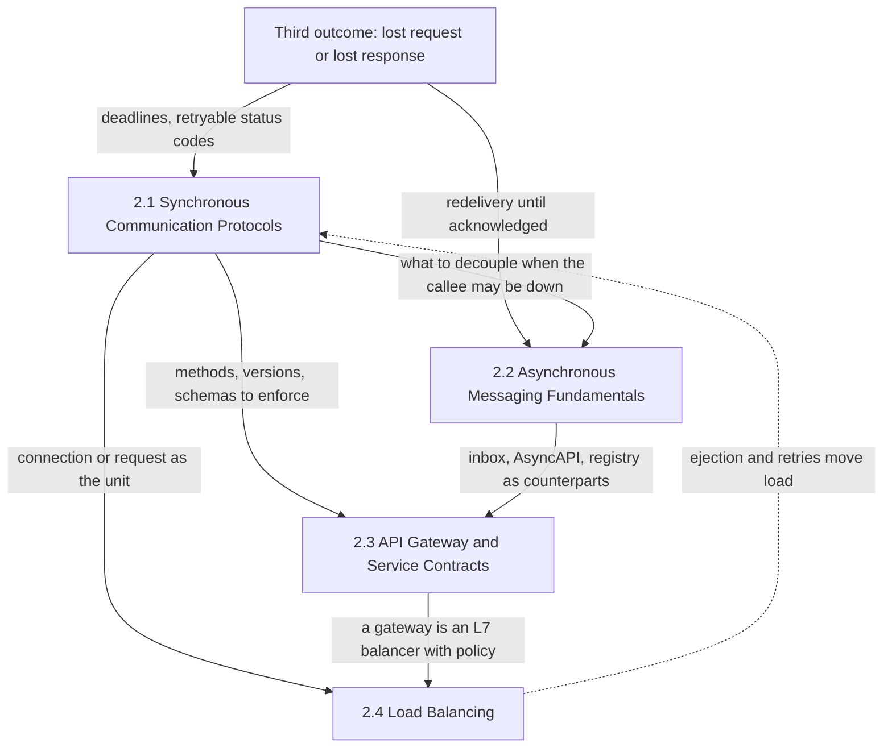
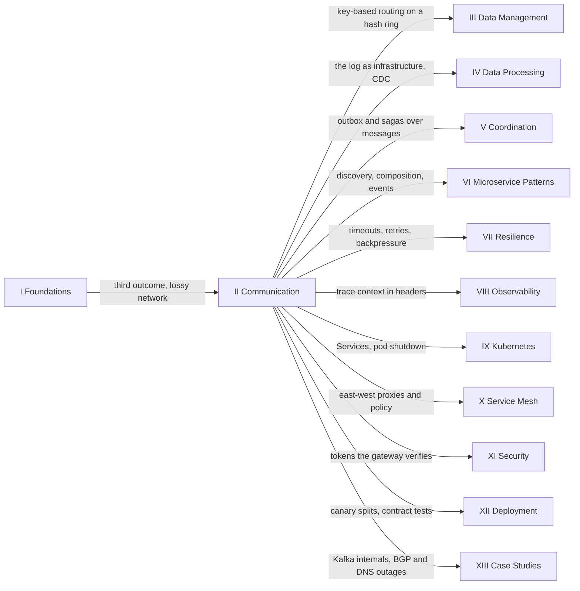

İki servis arasındaki her etkileşim, bir ağ üzerindeki bir mesajdır; ağ bu mesajı kaybedebilir, geciktirebilir, sırasını bozabilir ya da gönderen beklemeyi bıraktıktan sonra teslim edebilir. El kitabının bu bölümü, bu mesajların nasıl biçimlendirildiğini ve taşındığını konu alır: çağıranın beklediği istek-cevap (request-response) çağrıları, kimse beklemesin diye bir broker'a bırakılan mesajlar, bir isteği takım sınırını geçerken yöneten sözleşmeler ve politikalar ve her iş biriminin hangi replikaya gideceği seçimi. Temellerden hemen sonra gelir, çünkü temellerin kısıtlarının ilk kez bir wire formatı, bir status kodu ve bir yapılandırma dosyası olan kararlara dönüştüğü yer burasıdır.

Bölümün tamamını biçimlendiren kısıt, temellerin tanımladığı uzak çağrının üçüncü sonucudur: cevap gelmediğinde çağıran, isteğin mi kaybolduğunu, isteğin çalışıp cevabın mı kaybolduğunu, yoksa hâlâ mı çalıştığını ayırt edemez. Her alt bölüm bu belirsizliğe kendi kavram dağarcığıyla cevap verir. Senkron bir protokol bir deadline ve yeniden denemenin güvenli olup olmadığını söyleyen bir status kodu taşır. Bir broker, consumer onay verene kadar yeniden teslim eder ve böylece kaybı çoğaltmaya (duplication) dönüştürür. Bir gateway sözleşmesi, yeniden denenen bir yazmanın tekrar çalışmak yerine ilk sonucu döndürmesini sağlar. Hatalı bir backend'i devreden çıkaran bir balancer, yeniden denemenin nereye düşeceğine karar verir. Bu yüzden bölümün büyük kısmı dört kez kurulan tek bir argümandır: yeniden denemelerden kaçınılamaz, öyleyse etkiler tekrarlanmaya karşı güvenli olmalıdır ve bu güvenliğin garantisi, etkinin commit edildiği yerde yaşamalıdır.

Bölümden geçen gerilim, bağlaşıklık (coupling) ile görünürlük arasındadır. Çağıran beklediğinde, çağrılanın gecikmesi ve hataları anında çağıranın gecikmesi ve hataları olur: hatalar bağımsızsa, her biri zamanın %99,9'unda erişilebilir olan beş servisten geçen bir istek (örnek değerler) en fazla yaklaşık %99,5 oranında başarılı olur; yavaş tek bir bağımlılık da zincirin tepesine kadar thread'leri ve bağlantıları tutar. Buna karşılık her hata anlık, kaynağı belli ve ona yol açan mühendisin gözü önündedir. Bağlaşıklığı gevşeten her mekanizma bir şeyi gizler: broker, çöken bir consumer'ı saatlerce birikene kadar kimsenin görmediği bir backlog'a dönüştürür; paylaşılan bir gateway, yetkili kontrolle karıştırılması kolay ucuz bir kontrol çalıştırır; bir balancer ise her zaman kısmi ve gecikmiş olan sağlık ve yük bilgisine göre hareket eder. Dört alt bölüm, bağlaşıklığın ne kadarının kaldırılacağına ve karşılığında hangi görünürlüğün yeniden kurulması gerektiğine karar vermek için gereken kavram dağarcığını verir.

## Tek Bir Uzak Etkileşimin Etrafındaki Dört Alt Bölüm

Bölüm, etkileşimden dışarıya doğru sıralanmıştır. İlk iki alt bölüm, bir etkileşimin alabileceği iki biçimdir; üçüncüsü istek-cevap arayüzlerinin etrafına, istemcilere ve diğer takımlara açılabilmeleri için bir sınır çizer; dördüncüsü ise birbirinin yerine geçebilen birçok replikadan hangisinin her isteğe ya da bağlantıya hizmet edeceğine karar verir. Aralarındaki bağımlılıklar katı bir zincir değildir; diyagram, bir alt bölümün çıktısının nerede diğerinin girdisi olduğunu gösterir.

*Bölümdeki dört alt bölümün birbirine nasıl bağlı olduğu. Numarasız kutu, ilk iki alt bölümün zıt yollarla cevap verdiği, temellerden gelen kısıttır; kesikli ok, yük dengeleme kararlarının yönlendirdikleri çağrıların gecikme ve hata davranışına geri beslendiğini gösterir.*

Diyagram ilk iki alt bölümü ardışık adımlar olarak değil, kardeşler olarak gösterir. İkisi de üçüncü sonuca cevap verir: senkron protokoller çağıranı bekletir ve hatayı cevabın içinde okunabilir kılar; mesajlaşma ise beklemeyi sona erdirir ve hatayı yeniden teslim olarak kalıcı hale getirir. Aralarındaki ok, bölümde en sık karşılaşılan tasarım kararıdır: hangi iş, çağrılanın ayakta olmasına bağlı olmamalıdır? Gateway alt bölümü ikisini de tüketir. Senkron alt bölümün metotlarını, versiyonlama kurallarını ve şemalarını uygular; idempotency key'i ve API tanımları ise mesajlaşma alt bölümündeki tekrarları ayıklayan consumer'ın ve AsyncAPI dokümanlarının istek-cevap dünyasındaki karşılıklarıdır. Yük dengeleme senkron alt bölüme bağlıdır, çünkü multiplex edilen ve uzun ömürlü bağlantılar bir balancer'ın neyi gözlemleyebildiğini değiştirir; gateway alt bölümüne de bağlıdır, çünkü gateway'in kendisi bir L7 balancer'dır. Kesikli ok döngüyü kapatır: backend'leri devreden çıkaran ya da hata durumunda yeniden deneyen bir balancer, yönlendirdiği çağrıların yükünü ve gecikmesini bizzat değiştirir; bir yönlendirme kararı kaskad bir hataya böyle dönüşür.

## Her Alt Bölümün Ortaya Koyduğu

[Senkron İletişim Protokolleri](/distributed-systems/tr/communication/synchronous-protocols/), istek-cevap sözleşmesinin ağ üzerinden nasıl taşındığını ve yol üzerindeki kimin ona göre davranabileceğini ortaya koyar. Yedi konusu REST ve HTTP semantiğinden başlayıp HTTP/2 ve HTTP/3 taşıma katmanlarından, gRPC'den ve onun streaming modlarından, GraphQL'den ve WebSocket ile Server-Sent Events üzerinden tarayıcılara push'tan geçerek, consumer'ları güncellemeye zorlanamayan bir sözleşmenin versiyonlanmasına uzanır. Ana ekseni görünürlük ile verimlilik arasındadır: HTTP'nin tek tip kavram dağarcığıyla ifade edilen bir mesaj, servisi hiç görmemiş aracılar tarafından cache'lenebilir, yeniden denenebilir ve dengelenebilir; binary, multiplex edilmiş, şema öncelikli bir mesaj ise daha ucuz ve daha katıdır, ama bu işleri uç noktalara geri verir. İkinci bir eksen, yani bir çağrının ne kadar yaşadığı, milisaniyelik istekleri istemci başına state tutan stream'lerden ayırır.

[Asenkron Mesajlaşma Temelleri](/distributed-systems/tr/communication/async-messaging/), işin ve olguların bağımsız takvimlerle çalışan, çöken ve deploy edilen programlar arasında nasıl taşındığını ortaya koyar. Sekiz konusu iki broker modelini (her mesajı takip eden kuyrukları ve her consumer'ın kendi konumunu tutmasına izin veren log'ları), üç gerçek broker'ı, hiçbir broker'ın tek başına sağlamadığı uçtan uca teslim semantiğini, bir mesajın zaman içinde taşıdığı sözleşmeleri ve hiçbir yeniden denemenin kurtaramayacağı zehirli mesajı (poison message) kapsar. Tekrar tekrar varılan sonuç şudur: kayıplı bir ağ üzerinde exactly-once teslim imkânsızdır, ama exactly-once etki imkânsız değildir; o, at-least-once teslim ile etkiyle aynı transaction içinde commit edilen tekrar ayıklamanın (deduplication) birleşimiyle kurulur.

[API Gateway ve Servis Sözleşmeleri](/distributed-systems/tr/communication/api-gateway/), bir istek-cevap API'sinin takım ve organizasyon sınırları ötesine açılmasının nasıl güvenli hale getirildiğini ortaya koyar. Altı konusu giriş katmanı (gateway ve Frontend için Backend, BFF), sözleşme (OpenAPI tanımları ve tüketici güdümlü sözleşme testleri) ve güvenlik kuralları (idempotency ve rate limiting) olarak üçe ayrılır. Kuralı şudur: her politika en ucuz biçimde paylaşılan kenarda uygulanır, ama yalnızca verinin sahibi olan servisin içinde yetkilidir; hata modlarının çoğu da kenardaki kontrol garanti yerine konduğunda başlar.

[Yük Dengeleme](/distributed-systems/tr/communication/load-balancing/), bir replika kümesinin tek bir servis gibi davranmasının nasıl sağlandığını ortaya koyar. Beş konusu seçimi karar birimine (L4'te bağlantı başına ya da L7'de istek başına), seçim fonksiyonuna, balancer'ın yerleşimine (ayrı bir katman ya da her çağıran), istemcinin ilk ulaştığı lokasyona (DNS tabanlı küresel yönlendirme ya da anycast) ve uygunluğa (bazıları hata verirken ve diğerleri boşaltılırken hangi backend'lerin seçilebileceğine) ayırır. Gerilimi, bilgi ile o bilginin maliyeti ve bayatlığı arasındadır; karakteristik hatası ise tepki verdiği hatayı büyüten bir balancer'dır.

| Alt bölüm | Sahip olduğu karar | Sonraki bölümlerin ondan devraldığı |
|---|---|---|
| [2.1 Senkron İletişim Protokolleri](/distributed-systems/tr/communication/synchronous-protocols/) | Bir çağrının nasıl çerçevelendiği, kimin ona göre davranabileceği, ne kadar yaşadığı, sözleşmesinin nasıl değiştiği | Timeout ve retry politikalarının üzerinde çalıştığı deadline'lar ve status kodları, proxy'lerin yönettiği bağlantı ömürleri, trace bağlamını taşıyan header'lar |
| [2.2 Asenkron Mesajlaşma Temelleri](/distributed-systems/tr/communication/async-messaging/) | Neyin tüketildiğini kimin hatırladığı, bir etkinin kaç kez gerçekleştiği, bir mesajın neyi içerebileceği | Veri altyapısı olarak log, outbox ve saga'ların altındaki mesajlaşma, kayıt sistemi (system of record) olarak event'ler, akış kontrolünün boşalttığı backlog'lar |
| [2.3 API Gateway ve Servis Sözleşmeleri](/distributed-systems/tr/communication/api-gateway/) | Kimin, ne sıklıkla, hangi sözleşmeye karşı çağırabileceği ve tekrarlanan bir isteğin ne yaptığı | Token doğrulama ve yetkilendirme, rate limiting algoritmaları ve load shedding, deployment pipeline'larındaki sözleşme kontrolleri |
| [2.4 Yük Dengeleme](/distributed-systems/tr/communication/load-balancing/) | Her iş birimini hangi lokasyonun, replikanın ya da backend'in aldığı | Servis keşfinden gelen endpoint listeleri, Kubernetes Service'leri ve pod kapanışı, mesh trafik politikası, sürümler için ağırlıklı trafik kaydırma |

## Bölümün Varsaydıkları ve Fikirlerinin Geri Döndüğü Yerler

Bölüm yalnızca temelleri varsayar. [Dağıtık Hesaplamanın 8 Yanılgısı](/distributed-systems/tr/foundations/monoliths-to-distributed/eight-fallacies/) ve [Ağ Güvenilirliği, Bant Genişliği Sınırları ve Topoloji Değişiklikleri](/distributed-systems/tr/foundations/monoliths-to-distributed/network-reliability/), her protokolün tepki verdiği ağ gerçeklerini sağlar: gecikme sıfır değildir, bant genişliği sınırlıdır, paketler kaybolur ve rotalar canlı bağlantıların altında değişir. [Stateful ve Stateless Servisler](/distributed-systems/tr/foundations/monoliths-to-distributed/stateful-vs-stateless/), yük dengelemenin neden yalnızca replikalar birbirinin yerine geçebildiğinde bedava olduğunu ve uzun ömürlü bağlantılardan oluşan bir katmanın, kodu stateless olsa bile neden stateful olduğunu açıklar. [Hata Modelleri](/distributed-systems/tr/foundations/system-models/failure-models/), her onay ve yeniden teslim kararının ardındaki crash-recovery process'lerini ve kayıplı bağlantıları tanımlar; [Kaskad Hata Analizi](/distributed-systems/tr/foundations/system-models/cascading-failure/), senkron bağlaşıklığın ve yeniden denemelerin aşırı yük altında neye dönüştüğünü gösterir; [Dağıtık ID Üretimi](/distributed-systems/tr/foundations/time-and-ordering/distributed-id-generation/) ise idempotency key'lerinin ve mesaj tekrar ayıklamanın dayandığı tanımlayıcıların olağan kaynağıdır.

Sonraki bölümlerin neredeyse hepsi mesaj gönderir, bir API sunar ya da trafik yönlendirir; harita başlıca tüketicileri gösterir.

*Bölümün el kitabındaki yeri. Tek gelen ok önkoşulunu gösterir; giden her ok, sonraki bir bölümün buradan neyi aldığını adlandırır.*

Okların bir kısmı, bu bölümün dayandığı ama sahibi olmadığı mekanizmaları işaret eder; bu yüzden bu bölümün sayfaları onları açıklamak yerine özetler ve bağlantı verir: consistent hashing kullanan balancer'ların ardındaki hash ring'i veri yönetimine, gateway kotalarının ardındaki sayma algoritmaları dayanıklılığa, Kafka'nın iç yapısı vaka çalışmalarına, endpoint listelerini üreten registry'ler ise mikroservis desenlerine aittir.

[Dayanıklılık & Üretim Mühendisliği](/distributed-systems/tr/resilience/) en ağır tüketicidir, çünkü bölümün hata sinyallerini politikaya dönüştürür. [Zaman Aşımları](/distributed-systems/tr/resilience/protection-patterns/timeouts/) ve [Üstel Geri Çekilme ve Jitter ile Yeniden Deneme](/distributed-systems/tr/resilience/protection-patterns/retry-exponential-backoff/), çağıranın bir deadline ve yeniden denenebilir bir status ile ne yapacağına karar verir; [Geri Baskı](/distributed-systems/tr/resilience/flow-control/backpressure/) hem HTTP/2 stream'lerinin akış kontrolü pencerelerini hem de bir broker'ın backlog'unu genelleştirir; [Rate Limiting](/distributed-systems/tr/resilience/flow-control/rate-limiting/) gateway kotalarının ardındaki algoritmaların sahibidir; [Retry Fırtınaları ve Metastabil Hatalar](/distributed-systems/tr/resilience/flow-control/retry-storms-metastable-failures/) ise bu bölümdeki sayfaların çoğunun uyardığı olaydır. [Mikroservis Mimari Desenleri](/distributed-systems/tr/microservice-patterns/), bölümü servis sınırları düzeyinde uygular: [Servis Keşfi](/distributed-systems/tr/microservice-patterns/service-discovery/) balancer'ların tükettiği endpoint listelerini besler, [API Bileşimi](/distributed-systems/tr/microservice-patterns/data-management-patterns/api-composition/) bir BFF'in tek bir istemci için yaptığı join'lerin sahibidir, [Event Sourcing ve CQRS](/distributed-systems/tr/microservice-patterns/event-sourcing-cqrs/) mesajları kayıt sistemine dönüştürür, [Dağıtık Monolit](/distributed-systems/tr/microservice-patterns/service-decomposition/distributed-monolith/) ise servisler arasında bütçelenmemiş senkron bağlaşıklığın neye yol açtığını anlatır.

Veri odaklı bölümler özellikle mesajlaşma alt bölümünün üzerine kurulur. [Koordinasyon & Mutabakat](/distributed-systems/tr/coordination/) içinde [Outbox Deseni](/distributed-systems/tr/coordination/distributed-transactions/outbox-pattern/), teslim semantiğinin consumer tarafında çözdüğü dual write problemini producer tarafında çözer; [SAGA Deseni](/distributed-systems/tr/coordination/distributed-transactions/saga-pattern/) ise birden fazla servise yayılan işi mesajlar üzerinden koordine eder. [Veri İşleme Mimarileri](/distributed-systems/tr/data-processing/), aynı log'ları [Commit Log Soyutlaması](/distributed-systems/tr/data-processing/hybrid-architectures/commit-log-abstraction/) ve [Değişiklik Verisi Yakalama (CDC)](/distributed-systems/tr/data-processing/hybrid-architectures/change-data-capture/) sayfalarında veri altyapısı olarak ele alır; [Veri Yönetimi & Tutarlılık](/distributed-systems/tr/data-management/) ise [Consistent Hashing ve Sanal Düğümler](/distributed-systems/tr/data-management/data-partitioning/consistent-hashing/) konusunun sahibidir.

Platform bölümleri, bu mekanizmaların yapılandırıldığı ve çalıştırıldığı yerlerdir. [Servis Ağı Neden Var](/distributed-systems/tr/service-mesh/service-mesh-architecture/why-service-mesh/) ve [Envoy Proxy](/distributed-systems/tr/service-mesh/service-mesh-architecture/envoy-proxy/), doğu-batı (east-west) trafiğinin timeout'larını, yeniden denemelerini ve yük dengelemesini proxy'lere taşır; kuzey-güney (north-south) trafiği ise gateway alt bölümü yönetir. [Kubernetes Ağı](/distributed-systems/tr/kubernetes/runtime-and-operations/kubernetes-networking/) ve [Graceful Termination ve PodDisruptionBudgets](/distributed-systems/tr/kubernetes/runtime-and-operations/graceful-termination-pdb/), uygunluk ve boşaltmanın platform tarafıdır; [JWT](/distributed-systems/tr/security/authentication-authorization/jwt/) ve [OAuth 2.0 & OIDC](/distributed-systems/tr/security/authentication-authorization/oauth2-oidc/) bir gateway'in doğruladığı token'ları tanımlar; [Dağıtık İzleme](/distributed-systems/tr/observability/logs-metrics-traces/distributed-tracing/) ise bu bölümün header'larında taşınan bağlama dayanır. [Canary Sürümü](/distributed-systems/tr/deployment/deployment-patterns/canary-release/) L7 ağırlıklı trafik bölmelerine dayanır. Vaka çalışmaları arasında [Mesajlaşma Platformu: Apache Kafka](/distributed-systems/tr/case-studies/apache-kafka/) mesajlaşma alt bölümünün broker modelinin altına iner; [Meta 2021: BGP, DNS ve Kontrol Düzlemi Merkezileşmesi](/distributed-systems/tr/case-studies/famous-outages/meta-2021-bgp-dns/) ise DNS sunucularının kendi anycast duyurularını geri çektiği, kamuya açık vakadır.

## Bölüm Nasıl Okunmalı

İlk okumada dört alt bölümü sidebar sırasıyla okuyun. Senkron alt bölüm ilk sıradadır, çünkü sonraki her alt bölüm onun HTTP metotlarını, status kodlarını ve multiplex edilen bağlantılarını yeniden açıklamadan kullanır. Mesajlaşma, gateway alt bölümünden önce okunmalıdır; çünkü gateway alt bölümünün idempotency ve sözleşme sayfaları, tekrarları ayıklayan consumer'ın, AsyncAPI'nin ve schema registry'nin karşılıkları olarak yazılmıştır. Yük dengeleme en sondadır, çünkü hem ilk alt bölümün uzun ömürlü bağlantılarını hem de üçüncüsünün gateway'ini varsayar. Her alt bölüme genel bakış sayfası kendi okuma sırasını ve kestirmelerini verir.

Bölüm içinden geçen üç yol yaygın durumlara uyar. Yeni bir servisin arayüzlerini tasarlayan bir mühendis, senkron alt bölümden REST ve gRPC'yi, ardından hangi etkileşimlerin beklememesi gerektiğine karar vermek için kuyruk ile event streaming karşılaştırmasını ve teslim semantiği konularını, son olarak da gateway alt bölümünden idempotency ve OpenAPI'yi okumalıdır. Kenar (edge) ve servisten servise trafikten sorumlu bir platform mühendisi HTTP/2 ve HTTP/3'ü, gateway desenini, ardından L4 ile L7 karşılaştırmasını, istemci taraflı ve sunucu taraflı yük dengelemeyi ve sağlık durumuna duyarlı yönlendirmeyi okumalıdır; çünkü bağlantı ömrü ve kararların nerede verildiği bunların hepsinden geçer. Bir olayın ortasındaki mühendis belirtiden başlamalıdır: tekrarlanan etkiler idempotency ve teslim semantiğine, tek bir kaydın arkasında takılı kalan bir partition dead-letter konusuna, bir producer deploy'undan sonra hata veren consumer'lar şema evrimine, birkaç backend'e yapışıp kalan yük L4 ile L7 karşılaştırmasına, her rollout'ta çıkan hatalar ise sağlık durumuna duyarlı yönlendirme ve bağlantı boşaltmaya götürür.

Olay yollarının alt bölüm sınırlarını aşması tesadüf değildir. Çift tahsil edilen bir ödeme tipik olarak bir protokolün belirlediği bir timeout'u, bir proxy'nin eklediği bir yeniden denemeyi ve bir balancer'ın ikinci deneme için seçtiği farklı bir backend'i bir araya getirir; düzeltme ise bu katmanların hiçbirine ait değildir: ödemenin commit edildiği yere aittir.
