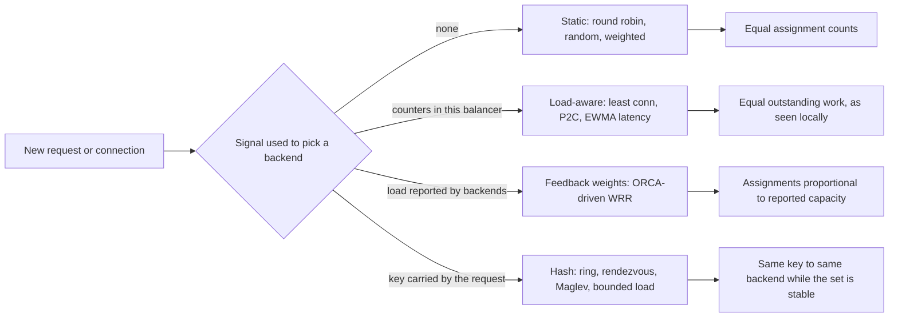
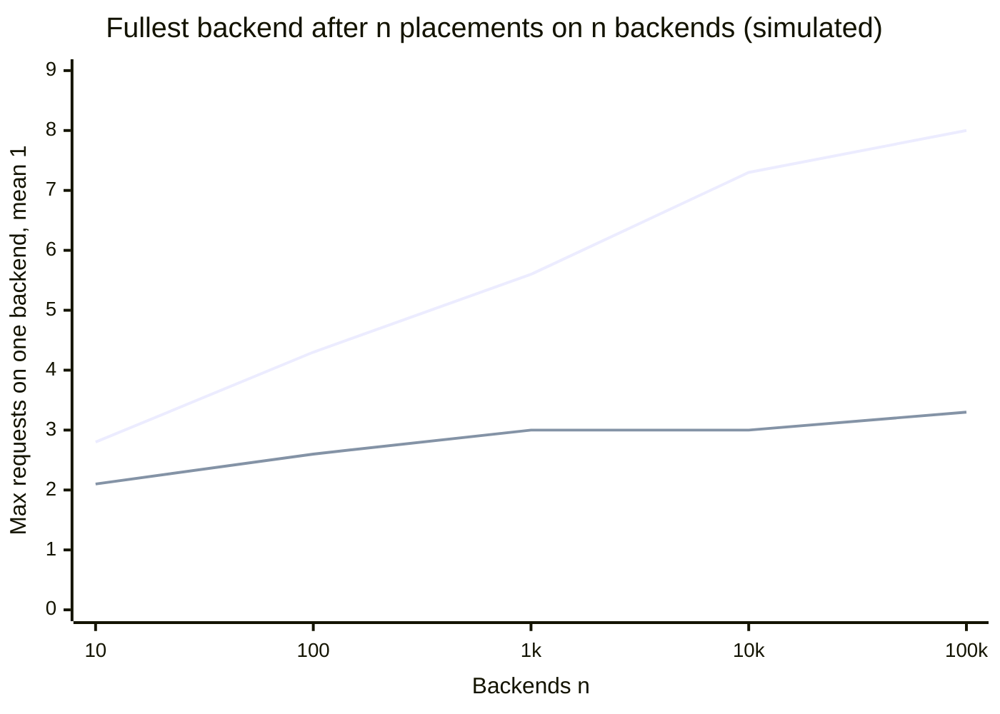
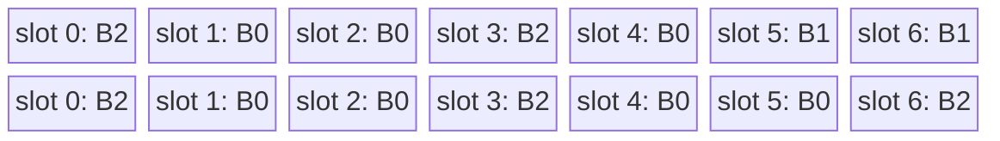
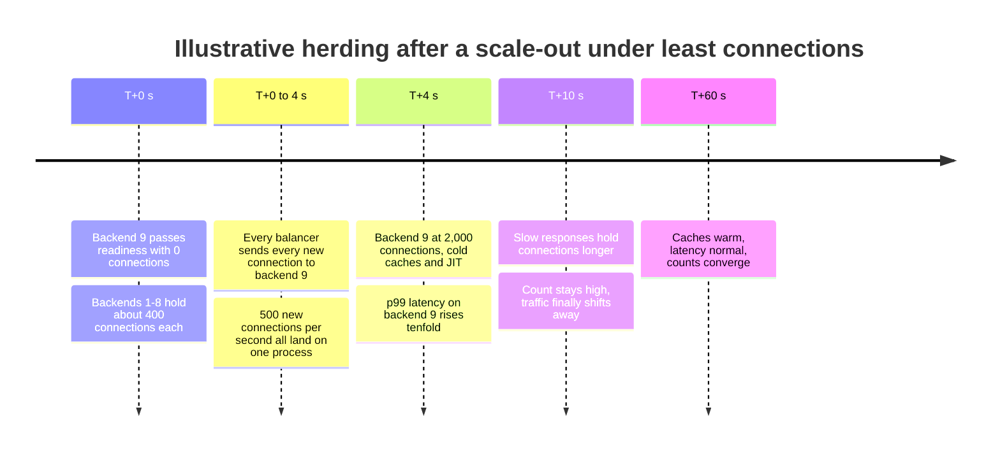
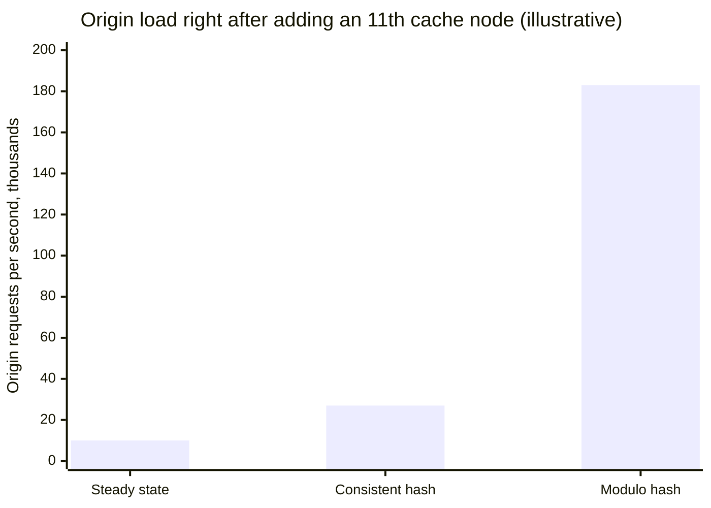

Yük dengeleme algoritması, birbirinin yerine geçebilen backend'lerden oluşan bir küme ve bir iş birimi (yeni bir bağlantı ya da yeni bir istek) verildiğinde bu işi alacak backend'i döndüren fonksiyondur. Böyle bir fonksiyon olmadan bir replika filosu, her replikaya tesadüfen düşen trafik payı kadar işe yarar; filonun kapasitesini üyelerinin toplamı değil, en yüklü üyesi belirler. Her algoritma aynı soruyu farklı bir bilgiyle yanıtlar: round robin hiçbir bilgi kullanmaz, en az bağlantı (least connections) yük dengeleyicinin kendi tuttuğu sayaçları kullanır, geri beslemeli ağırlık şemaları backend'lerin raporladığı yükü kullanır, hash tabanlı şemalar ise isteğin taşıdığı bir anahtarı kullanır.

Asıl denge, bilgi ile o bilginin maliyeti ve doğruluğu arasındadır. Hiçbir sinyal kullanmayan bir yük dengeleyici ucuzdur, state tutmaz, kaç örneği çalışırsa çalışsın hepsinde aynı davranır ve yavaşlamış bir backend'e karşı kördür. Yüke tepki veren bir yük dengeleyici yükü ölçmek zorundadır ve ölçtüğü şey yereldir (bir yük dengeleyici yalnızca kendi gönderdiği istekleri görür), gecikmelidir (sayaç ancak iş geldikten sonra değişir) ve hata tarafından yanıltılabilir (anında hata veren bir backend boşta görünür). Bir anahtarı hash'leyen yük dengeleyici ise yerellik kazanmak için dengeden bilerek vazgeçer: aynı kullanıcı, aynı cache anahtarı ya da aynı flow aynı backend'e düşer; bu da cache'leri sıcak, oturumları yerinde tutar, ama sıcak bir anahtarın tüm isteklerini tek bir makineye gönderir.

Dengelenen birim de algoritma kadar önemlidir. Bir L4 yük dengeleyici bağlantı başına bir kez, bir L7 proxy ise istek başına bir kez seçim yapar; bağlantılar uzun ömürlü olduğunda aynı algoritma bu iki durumda çok farklı yük üretir. Bu ayrım [L4 ve L7 Yük Dengeleme](/distributed-systems/tr/communication/load-balancing/l4-vs-l7/) sayfasında ele alınır. Seçim mantığının nerede çalıştığı, merkezi bir proxy'de mi yoksa her istemcinin içinde mi, [İstemci Taraflı ve Sunucu Taraflı Yük Dengeleme](/distributed-systems/tr/communication/load-balancing/client-vs-server-side/) sayfasında; sağlıksız backend'lerin herhangi bir algoritma çalışmadan önce aday kümeden nasıl çıkarıldığı ise [Sağlık Durumuna Duyarlı Yönlendirme ve Bağlantı Boşaltma](/distributed-systems/tr/communication/load-balancing/health-aware-routing/) sayfasında anlatılır. Bu sayfa seçim fonksiyonunun kendisini ele alır.


*Tükettikleri sinyale göre sınıflandırılmış dört seçim fonksiyonu ailesi ve her ailenin gerçekte eşitlediği tek özellik.*

Sağ sütun garantinin kendisidir ve dört kutunun hiçbirinde "eşit yük" yazmaz. Round robin her backend'in kaç birim aldığını eşitler; bu ancak her birimin maliyeti aynıysa yükü eşitlemek anlamına gelir. Yüke duyarlı algoritmalar, tek bir yük dengeleyicinin gözlediği bekleyen işi eşitler; bu da yalnızca o yük dengeleyici trafiğin büyük bir payını gönderiyorsa küresel dengeye yaklaşır. Geri beslemeli ağırlıklar backend'lerin raporladığına göre eşitler ve raporlar ne kadar taze ve dürüstse o kadar iyidir. Hash tek başına hiçbir şeyi eşitlemez; hash altındaki denge, düzgün dağılmış anahtarların istatistiksel bir yan etkisidir ve anahtarlar çarpıklaştığı anda kaybolur. Bir algoritma seçmek, belirli bir iş yükü için bu yaklaşıklıklardan hangisinin en zararsız biçimde bozulduğunu seçmektir.

## Statik Seçim: Sıralama, Rastgelelik ve Ağırlıklar

Round robin, backend listesi için tek bir indeks tutar ve her seçimde onu bir ilerletir: önce `i` numaralı backend, sonra `i + 1`, listenin sonunda başa döner. Garantisi kesin ama dardır: tek bir yük dengeleyicideki ardışık `N` seçimin oluşturduğu her pencerede, `N` sağlıklı backend'in her biri tam olarak bir kez seçilir. Backend'ler hakkında hiçbir bilgiye ihtiyaç duymaz, liste ister on ister on bin elemanlı olsun aynı kararı verir ve NGINX, HAProxy, Envoy ile gRPC'nin `round_robin` policy'sinde varsayılandır. Düzgün rastgele seçim, paylaşılan bir indeks ve sıralama olmadan aynı beklenen payı verir; bedeli varyanstır: 10 backend arasında 100 seçimde round robin her birine tam 10 verirken, rastgele seçim her birine standart sapması 3 olan binom dağılımlı bir sayı verir.

İstekler maliyet açısından farklılaştığı anda ikisi de yük hakkında hiçbir şey garanti etmez. Yüz istekten biri, sıradan bir isteğin 200 katı maliyetli bir dışa aktarma (export) işiyse, round robin bu işleri beklenen değer olarak eşit dağıtır ama zaman içinde eşit dağıtmaz; bir saniyede üç tane alan backend doyuma ulaşırken komşuları boşta bekler. Aynı körlük heterojen donanım, uzun bir garbage collection duraklaması ve bozulmakta olan yerel bir disk için de geçerlidir: her backend, bir health check onu çıkarana kadar aynı payı almaya devam eder.

Round robin, çok sayıda yük dengeleyici onu bağımsız olarak çalıştırdığında, rastgele seçimin bozulmadığı bir biçimde bozulur. Her yük dengeleyici kendi indeksini tutar; hepsi indeks 0'dan başlarsa (bir deployment sonrası tüm istemciler yeniden bağlanır ya da bir konfigürasyon güncellemesi her proxy'nin listesini aynı sırayla yeniden kurar), ilk seçimlerinin hepsi backend 0'a, ikinci seçimlerinin hepsi backend 1'e düşer ve filo listede ilerleyen senkronize bir yük dalgası görür. Olgun istemci kütüphaneleri bu nedenle başlangıç konumunu rastgele seçer (örneğin grpc-go'nun `round_robin`'i rastgele bir indeksten başlar); bunu yapmayan kendi yazılmış bir yük dengeleyici, yeniden başlatmalardan sonra görülen "sıcak ilk backend" sorununun yaygın bir kaynağıdır.

### Ağırlıklı Sıralama ve Pürüzsüzlük Problemi

Ağırlıklar eşit olmayan kapasiteyi ifade eder: ağırlığı 5 olan bir backend, ağırlığı 1 olandan beş kat fazla trafik almalıdır. Saf uygulama her backend'i sıralamada `w` kez tekrarlar; böylece `a`, `b`, `c` backend'leri için `{5, 1, 1}` ağırlıkları `a a a a a b c` üretir. Uzun vadeli pay doğrudur, ama `a` art arda beş istek alır; ağırlıklar büyükse (100 ve 1), ağır backend hafif olan hiçbir şey almadan önce yüz isteklik bir patlama alır. Kısa istekler için bu patlama zararsızdır; bağlantı açan ya da cache ısıtan istekler için ise bir yük sıçramasıdır.

NGINX bu yaklaşımı 2012'de, commit mesajının smooth weighted round robin (pürüzsüz ağırlıklı round robin) olarak adlandırdığı bir algoritmayla değiştirdi. Her backend sıfırdan başlayan bir `current` değeri tutar. Her seçimde her backend'in `current` değeri kendi ağırlığı kadar artırılır, `current` değeri en büyük olan backend seçilir ve seçilen backend'in `current` değeri toplam ağırlık kadar azaltılır. Tablo, toplamı 7 olan `{5, 1, 1}` ağırlıklarının izini gösterir.

| Adım | Seçimden önce `current` (a, b, c) | Seçilen | Seçimden sonra `current` (a, b, c) |
|---|---|---|---|
| 1 | 5, 1, 1 | a | -2, 1, 1 |
| 2 | 3, 2, 2 | a | -4, 2, 2 |
| 3 | 1, 3, 3 | b | 1, -4, 3 |
| 4 | 6, -3, 4 | a | -1, -3, 4 |
| 5 | 4, -2, 5 | c | 4, -2, -2 |
| 6 | 9, -1, -1 | a | 2, -1, -1 |
| 7 | 7, 0, 0 | a | 0, 0, 0 |

Çıktı, NGINX commit'inde aktarılan `a a b a c a a` dizisidir ve yedi adımın sonunda her `current` yeniden sıfırdır. Doğruluğun sezgisi bir korunum argümanıdır: her adım tüm backend'lere toplamda `W` kadar ekler ve birinden `W` çıkarır; dolayısıyla tüm `current` değerlerinin toplamı her zaman sıfırdır ve `current` değeri yükselen bir backend seçilip yeniden aşağı itilir. Her `W` seçimlik döngüde her backend tam olarak ağırlığı kadar seçilir ve başka bir backend'in `current` değeri yükselmeye devam ederken hiçbir backend art arda çok kez seçilemez. Envoy aynı hedefe farklı bir yapıyla ulaşır: ağırlıklı host'ları her host için bir son tarihe (deadline) göre zamanlar (bir sonraki sırası, ağırlığının tersiyle aralıklandırılır) ve her zaman en erken son tarihi seçer; bu da patlama yerine araya serpiştirme üretir.

### Değişen Ağırlıklar: Slow Start ve Backend'in Raporladığı Yük

Statik ağırlıklar, konfigürasyon anındaki kapasite varsayımını kodlar. İki mekanizma onları dinamik hâle getirir. Birincisi slow start'tır (yavaş başlangıç): kümeye yeni katılmış ya da health check'ten yeni geçmiş bir backend, ağırlığının bir kesriyle başlar ve bu kesir bir pencere boyunca büyür; çünkü taze bir process'in cache'leri soğuktur, JIT derleyicisi ısınmamıştır ve connection pool'ları boştur. Envoy etkin ağırlığı `weight * max(min_weight_percent, time_factor ^ (1 / aggression))` olarak hesaplar; burada `time_factor`, `slow_start_window` süresinin geçen kesridir ve `min_weight_percent` varsayılan olarak %10'dur. Envoy bunu round robin, least request ve istemci taraflı weighted round robin için destekler. NGINX Plus bir sunucu üzerinde ağırlığı sıfırdan yükselten `slow_start` sunar; açık kaynak modülde bunun karşılığı yoktur.

İkinci mekanizma, backend'lerin yüklerini raporlamasına izin vermek ve ağırlıkları bu raporlardan türetmektir. gRPC'nin `weighted_round_robin` policy'si ve Envoy'un istemci taraflı weighted round robin'i ORCA (Open Request Cost Aggregation) raporlarını tüketir; bu raporlarda her backend kendi kullanım oranını, saniyedeki sorgu sayısını ve saniyedeki hata sayısını ya her yanıtla birlikte ya da ayrı bir stream üzerinden döndürür. Ağırlık `qps / (utilization + (eps / qps) * error_utilization_penalty)` formülüyle hesaplanır: birim CPU başına çok istek sunan bir backend daha fazla trafik alır, hataları artan bir backend ise verimli görünse bile cezalandırılır. Envoy'un varsayılanlarını bilmek önemlidir, çünkü her biri bir kararlılık kararıdır: bir backend'in raporladığı ağırlık ilk 10 saniye boyunca yok sayılır (`blackout_period`), böylece erken gelen iyimser raporlar bir trafik seli çekmez; 3 dakikadan eski ağırlıklar (`weight_expiration_period`) atılır; geçerli ağırlığı olmayan bir backend'e sıfır ya da sonsuz yerine diğerlerinin medyan ağırlığı verilir.

## Yüke Duyarlı Seçim: En Az Bağlantı, İki Seçenek ve Gecikme

En az bağlantı algoritması her backend için bu yük dengeleyicinin o backend'e o anda açık tuttuğu bağlantı (L4) ya da istek (L7) sayısını tutar ve bir sonraki birimi sayacı en küçük olan backend'e gönderir. Eşitlikler sıralamayla ya da rastgele bozulur. Sayaç iş gönderildiğinde artar, yanıt tamamlandığında azalır; yani bu yük dengeleyicinin bakış açısından bekleyen işin doğrudan ölçümüdür.

Bunun neden doğru büyüklük olduğu [Little Yasası](/distributed-systems/tr/resilience/flow-control/queueing-theory-littles-law/)'ndan çıkar: bir sistemdeki ortalama istek sayısı, varış hızıyla her isteğin sistemde geçirdiği ortalama sürenin çarpımına eşittir, `L = lambda * W`. Yavaşlayan bir backend her isteği daha uzun tutar; aynı varış hızında bekleyen istek sayısı artar ve en az bağlantı algoritması sayılar yeniden eşitlenene kadar ona daha az gönderir. Algoritmanın kapasiteyi, ağırlıkları ya da istek maliyetini bilmesi gerekmez; yavaş bir backend, pahalı bir istek ve bir garbage collection duraklaması aynı sayaç üzerinden görünür hâle gelir. En az bağlantının uzun ya da değişken süreli işler için standart seçim olmasının nedeni budur: HAProxy, LDAP ya da SQL gibi çok uzun oturumların beklendiği yerlerde `leastconn` önerir; Envoy'un varsayılan yüke duyarlı policy'sinin adı ise `LEAST_REQUEST`'tir, çünkü L7'de birim istektir.

:::tip[Eşit bekleyen iş, eşit kullanım oranı demektir]
Her backend kabaca üstel servis süreli tek sunuculu bir kuyruk gibi davranıyorsa (M/M/1, bir yaklaşıklık), `rho` kullanım oranında sistemdeki beklenen istek sayısı `rho / (1 - rho)` olur. Dolayısıyla bekleyen istekleri eşitlemek kullanım oranlarını eşitler; bu da doğru ağırlıkların üreteceği dağılımın ta kendisidir. Least request dengelemesi, donanım nesilleri arasındaki kapasite farklarını ağırlıklar söylenmeden keşfeder ve bir backend bozulduğunda keşfetmeye devam eder. Yaklaşıklık, kuyruklanmayı doyuma ulaşana kadar gizleyen çok sayıda paralel worker'a sahip backend'lerde bozulur.
:::

En az bağlantı algoritmasının üç yapısal zayıflığı vardır. Birincisi, görüşünün yerel olmasıdır. Bir yük dengeleyici yalnızca kendi gönderdiği istekleri sayar; çok sayıda bağımsız yük dengeleyici olduğunda her biri, her backend'in gerçek yükünün küçük ve gürültülü bir dilimini görür; bu problem aşağıdaki çalışılmış örnekte sayısallaştırılır. İkincisi sürü davranışıdır (herding): her yük dengeleyici küresel minimumu seçtiğinde hepsi aynı anda aynı backend'i seçer; bu genellikle sıfır bağlantıyla yeni katılmış bir backend'dir. Üçüncüsü, sayacın bir backend'in istekleri ne kadar süre tuttuğunu ölçmesi, onları doğru sunup sunmadığını ölçmemesidir: her isteği bir milisaniyede başarısız kılan bir backend, filodaki en küçük sayaca sahiptir. Bu iki hata modu, hata modları bölümünde izlenir.

### İki Rastgele Seçeneğin Gücü

İki seçeneğin gücü (power of two choices, P2C), düzgün rastgele iki backend örnekler ve isteği bekleyen isteği daha az olana gönderir. En az bağlantının ucuz bir yaklaşıklığı gibi görünür, ama önemli bir açıdan ondan daha iyidir. Teori, top ve kutu (balls-into-bins) probleminden gelir: `n` topu `n` kutuya düzgün rastgele yerleştirmek en dolu kutuda yaklaşık `ln n / ln ln n` top bırakır; `d` rastgele kutudan daha az dolu olanı seçmek ise en dolu kutuda yaklaşık `ln ln n / ln d` artı bir sabit kadar top bırakır. Bu üstel iyileşmeyi Azar, Broder, Karlin ve Upfal ortaya koymuş, Mitzenmacher de yük dengeleme için geliştirmiştir. İşin neredeyse tamamını ikinci örnek yapar: bir seçenekten ikiye geçmek büyümeyi neredeyse logaritmikten çift logaritmiğe indirirken, ikiden üçe geçmek yalnızca sabiti değiştirir.


*Üst çizgi: düzgün rastgele seçim. Alt çizgi: iki seçeneğin gücü. Her nokta, tekrarlanan simülasyon koşularındaki ortalama maksimumdur (10 backend'te 2.000 koşudan 100.000 backend'te 3 koşuya kadar); ortalama yük her zaman 1'dir.*

İki eğrinin şekli P2C'nin lehine olan argümandır. On backend'te fark küçüktür, ama filo büyüdükçe rastgele seçim eğrisi tırmanmaya devam eder: 10.000 düğümlü bir filoda en yüklü backend ortalamanın yedi katını alırken iki seçenekte yaklaşık üç katta kalır. Mükemmel bilgiye sahip tek bir yük dengeleyicide tüm küme üzerinde en az bağlantı daha da iyi sonuç verir; ama production'da önemli olan P2C'nin ikinci özelliğidir: bilgi eski ya da yerel olduğunda zarifçe bozulur. Mitzenmacher'in eski bilgi üzerine analizi, çok sayıda dağıtıcı (dispatcher) gecikmeli bir yük anlık görüntüsüne göre hareket ettiğinde her zaman en az yüklü sunucuyu seçmenin en kötü strateji olduğunu gösterdi: anlık görüntü yenilenene kadar her dağıtıcı aynı sunucuya gönderir. Rastgele iki aday arasından seçmek ise bu kararları yayar ve optimuma yakın kalır. Rastgele bir çift, aynı anda her yük dengeleyici için yeni katılmış ve yükü sıfır olan backend'i nadiren içerir; bu yüzden P2C sürü davranışı göstermez.

P2C, bugün çoğu modern proxy'de varsayılan yüke duyarlı algoritmadır. Envoy'un `LEAST_REQUEST`'i varsayılan olarak 2 olan `choice_count` kadar host örnekler ve tüm ağırlıklar eşitse aktif isteği en az olanı seçer. Ağırlıklar farklıysa, ağırlıkları seçim anında `weight / (active_requests + 1) ^ active_request_bias` olarak yeniden hesaplanan ağırlıklı bir zamanlamaya geçer; `active_request_bias` varsayılan olarak 1.0'dır. 0 değeri onu yeniden weighted round robin'e çevirir ve dokümantasyon bu modda meşgul bir host'un istek almayı hiç bırakmadığı, yalnızca daha az aldığı konusunda uyarır. NGINX, açıkça birden fazla yük dengeleyicinin aynı backend'leri paylaştığı kurulumları hedefleyen `random two least_conn` seçeneğini 1.15.1 sürümünde kazandı. HAProxy, çekiliş sayısı yapılandırılabilen bir `random` algoritması sunar; Finagle ise P2C'yi standart en az yüklü (least-loaded) yük dengeleyicisi olarak sunar.

### Yük Sinyali Olarak Gecikme

Bekleyen istekler kuyruklanmayı yakalar, ama kuyruklanma olmadan her istekte yavaş olan bir backend'i, örneğin bozulmuş bir host üzerinde çalışanı yakalamaz. Gecikmeye duyarlı yük dengeleyiciler backend'leri gözlenen yanıt süresine göre puanlar. Finagle'ın Peak EWMA'sı her backend için round-trip süresinin üstel ağırlıklı hareketli ortalamasını (EWMA) tutar; bu ortalama yavaş bir yanıtta hemen yükselir ve yavaşça söner. Bu değeri bekleyen istek sayısının bir fazlasıyla çarpar ve iki rastgele aday arasından maliyeti düşük olanı seçer. Linkerd de aynı tasarımı benimsedi. Linkerd'ün yayımladığı deneyde (medyan gecikmesi 167 ms olan 11 backend, bunlardan biri 30 saniye boyunca 2 saniyeye yavaşlatılmış, saniyede 1.000 istek altında) round robin 95. persentilin üzerinde bozuldu, least loaded 99. persentile kadar, Peak EWMA ise 99.9. persentile kadar hızlı kaldı. NGINX'in `least_time`'ı (NGINX Plus'ta ve 1.31.0'dan beri açık kaynakta) ortalama yanıt süresini aktif bağlantılarla birleştirir; süre ilk byte'a ya da son byte'a kadar ölçülür.

Gecikme daha güçlü ve daha tehlikeli bir sinyaldir. Gürültülüdür, istek karışımına bağlıdır (ağır istekleri tesadüfen almış bir backend yavaş görünür) ve ne yanıt verdiğine bakmaksızın hızlı yanıt veren backend'leri ödüllendirir. Gecikmeye duyarlı bir yük dengeleyici hataları pahalı yanıtlar olarak ele almak zorundadır; aksi hâlde aşağıdaki kara delik hata modunu daha da güçlü biçimde devralır.

### Çalışılmış Örnek: On İki Backend, İki Donanım Nesli

12 backend'li bir servis varsayalım: 9'u her biri saniyede 1.000 istek taşıyabilen yeni bir instance tipinde, 3'ü saniyede 600 istek taşıyabilen eski bir tipte. Tepe yük saniyede 9.000 istektir. Toplam kapasite `9 * 1,000 + 3 * 600 = 10,800` olduğundan filo bir bütün olarak %83 kullanım oranında çalışır. Bu örnekteki tüm sayılar açıklama amaçlıdır.

Round robin her backend'e saniyede 750 istek gönderir. Yeni backend'ler %75 kullanım oranında çalışır; eskiler ise 600'lük kapasiteye karşı 750 istek alır, yani %125 kullanım oranı; kuyrukları timeout'lar ve retry'lar devreye girene kadar sınırsızca büyür. Filo, ortalama %83 kullanım oranında, üç üyesi %125'te olduğu için bozulur.

5 ve 3 statik ağırlıkları, doğru oldukları sürece bunu çözer. Toplam ağırlık `9 * 5 + 3 * 3 = 54` olduğundan her ağırlık birimi saniyede `9,000 / 54 = 166.7` istek taşır: her yeni backend'e 833, her eski backend'e 500 istek, her yerde %83 kullanım oranı. Ağırlıklar yalnızca kapasite oranı 5'e 3 kaldıkça doğrudur. Eski backend'lerden biri gürültülü bir komşu yüzünden throughput'unun üçte birini kaybederse yeniden aşırı yüklenir ve yük dengeleyicideki hiçbir şey bunu fark etmez.

Least request dengelemesi aynı dağılıma oran söylenmeden ulaşır. Yukarıdaki ipucundaki M/M/1 yaklaşıklığıyla, eşit bekleyen istek sayıları eşit kullanım oranı anlamına gelir; filo her backend'te %83'e ve her birinde yaklaşık `0.83 / 0.17 = 5` bekleyen isteğe oturur. Gecikmeler farklıdır: sistemde beklenen süre `1 / (mu - lambda)`, yeni bir backend'te `1 / (1,000 - 833)` yani yaklaşık 6 ms, eski bir backend'te `1 / (600 - 500)` = 10 ms'dir. Yük dengeleyici gecikmeyi değil yükü eşitler; amaç hiçbir şeyi aşırı yüklememekse doğru hedef de budur.

Şimdi dengeleme mantığını, her biri saniyede 450 istek gönderen 20 istemci taraflı yük dengeleyiciye yerleştirelim. Her backend'te toplamda hâlâ yaklaşık 5 bekleyen istek vardır, ama her yük dengeleyici yalnızca kendi payını, yaklaşık `5 / 20 = 0.25` görür. Belirli bir yük dengeleyicinin belirli bir backend için tuttuğu sayaç çoğu zaman 0, bazen 1, nadiren 2'dir ve bu sayaç artık %83'teki eski bir backend'i %125'tekinden ayırt edemez. 12 backend üzerinde tam en az bağlantı, çok sayıdaki sıfır arasında bir eşitlik bozmaya dönüşür; bu da kılık değiştirmiş round robin ya da rastgele seçimdir. P2C biraz daha iyisini yapar, çünkü 0'a karşı 1 değerindeki bir sayaç kararı hâlâ değiştirir; ama sinyali aynı derecede zayıftır. Çoğu service mesh ve gRPC istemcisi bu rejimde çalışır ve backend'in raporladığı yükün (yukarıdaki ORCA tabanlı ağırlıklar) ve her istemcinin yalnızca birkaç backend'le konuştuğu, böylece her birinin trafiğinin büyük bir payını gönderdiği alt kümelemenin (subsetting) var olma nedeni budur. Birincisi yerel sayaçların yerine backend'in kendi görüşünü koyar; ikincisi yerel görüşü bir anlam taşıyacak kadar büyütür.

## Hash Tabanlı Affinity: Modulo, Ring, Rendezvous ve Maglev

Hash, backend'i isteğin içindeki bir anahtardan (kullanıcı kimliği, cache anahtarı, URL, bağlantının 5-tuple'ı) seçer; böylece aynı anahtar her zaman aynı backend'e ulaşır. Nedenleri yerellik ve süreklilik: bir cache katmanı her nesneyi her düğümde değil yalnızca bir kez tutar, bir backend kullanıcı başına state'i bellekte tutar ve bir L4 yük dengeleyici filosu, paketler farklı bir yük dengeleyici örneğine gelse bile bir flow'un tüm paketlerini aynı backend'e gönderir. Garanti koşulludur: backend kümesi değişmediği sürece aynı anahtar, aynı backend. Hash denge hakkında hiçbir şey garanti etmez ve saf biçiminde küme değiştiğinde ne olacağı hakkında da hiçbir şey garanti etmez.

Saf biçim `hash(key) mod N`'dir. Düzgün anahtarlar için iyi dengeler ve `N`'deki ilk değişiklikte bozulur. `N` 10'dan 11'e çıktığında bir anahtar backend'ini yalnızca `hash mod 10`, `hash mod 11`'e eşitse korur; bu her 110 kalandan yalnızca 10'u için geçerlidir, dolayısıyla anahtarların %91'i yer değiştirir. Bir cache katmanı için bu neredeyse tamamen soğuk bir başlangıçtır; bir L4 yük dengeleyici için ise neredeyse her bağlantıyı sıfırlar. Consistent hashing, her backend'in hash uzayında sınırları kaç başka backend olduğuna bağlı olmayan bölgelere sahip olmasını sağlayarak yer değiştirmeyi teorik minimum olan anahtarların yaklaşık `1 / N`'ine indirir. Ring yapısı, sanal düğümler ve kaç sanal düğüm gerektiğini belirleyen varyans analizi [Consistent Hashing ve Sanal Düğümler](/distributed-systems/tr/data-management/data-partitioning/consistent-hashing/) sayfasında kanonik olarak ele alınır; dengeleme açısından önemli olan, uygulamaların arama maliyeti, denge ve kesinti açısından nasıl farklılaştığıdır.

Bir proxy'deki ring hash, her backend'i ring üzerinde birçok noktaya yerleştirir ve bir isteği, isteğin hash'inden saat yönünde ilk backend noktasına eşler. Envoy'un `RING_HASH`'i, `minimum_ring_size` (varsayılan 1.024 giriş) ile `maximum_ring_size` (varsayılan ve üst sınır 8M) arasında bir ring kurar, varsayılan olarak xxHash kullanır ve her host'u ağırlığıyla orantılı yerleştirir. Dokümantasyon iki boyutun da açıkça ayarlanmasını ve host başına minimum ve maksimum hash gauge'larının izlenmesini önerir; çünkü çok sayıda host içeren küçük bir ring, bazı host'lara uzayın gözle görülür biçimde daha büyük bir kısmını verir. NGINX'in `hash $key consistent`'i memcached istemcilerinden gelen ketama şemasını kullanır. Arama, ring üzerinde ikili aramadır ve bellek nokta sayısıyla büyür.

Highest random weight (HRW) olarak da bilinen rendezvous hashing'in ring'e ihtiyacı yoktur. Her istek için her backend'e `score = hash(key, backend)` hesaplar ve en yüksek puanı seçer. Bir backend çıkarıldığında yalnızca en yüksek puanın o backend'e ait olduğu anahtarlar yer değiştirir ve her biri ikinci en yüksek puanlı backend'ine gider; bu yüzden kesinti tam olarak minimaldir ve denge için sanal düğüm gerekmez. Bedeli arama başına `O(N)` hash hesabıdır; onlarca backend için kabul edilebilir, yüzlerce backend arasında saniyede milyonlarca paket ileten bir L4 veri düzlemi için fazla yavaştır.

### Maglev: Sabit Boyutlu Arama Tablosu

Google'ın Maglev yük dengeleyicisi, hat hızında ve neredeyse kusursuz dengeyle hash araması gerektiriyordu ve bunun için biraz daha fazla kesintiyi kabul etti. Ring'in yerine, her girişi bir backend'i adlandıran sabit asal boyutlu `M` (Envoy'un uygulamasında 65.537) bir arama tablosu koyar; bir isteğin hash'inin `M`'ye göre modu tabloyu sabit zamanda indeksler. Yapım süreci her backend'e tablo slot'ları üzerinde kendine ait bir tercih sırası verir ve tabloyu backend'lerin sırayla slot sahiplenmesiyle doldurur.

```text
for each backend i:
    offset[i] = h1(name[i]) mod M
    skip[i]   = h2(name[i]) mod (M - 1) + 1      # never 0, coprime with prime M
    # preference list: (offset + j * skip) mod M, for j = 0 .. M-1
next[i] = 0 for all i;  table[*] = empty;  filled = 0
loop:
    for each backend i in turn:
        repeat: c = (offset[i] + next[i] * skip[i]) mod M;  next[i] += 1
        until table[c] is empty
        table[c] = i;  filled += 1
        if filled == M: done
```

`M` asal olduğu ve `skip` 1 ile `M - 1` arasında bulunduğu için her tercih listesi her slot'u tam bir kez ziyaret eder; dolayısıyla bir backend her zaman boş bir slot bulabilir. Backend'ler slot'ları katı bir sırayla sahiplendiği için her backend ya `floor(M / N)` ya da `ceil(M / N)` girişle sonuçlanır: hash değerleri nasıl düşerse düşsün backend'ler arasındaki denge neredeyse kusursuzdur; ring hash bunu ancak çok sayıda sanal düğümle, istatistiksel olarak sağlar. Ağırlıklar, ağır bir backend'in tur başına daha sık sahiplenmesine izin verilerek uygulanır.

Küçük bir örnek süreci somutlaştırır. `M = 7` ve açıklama amaçlı değerlere sahip üç backend alalım: offset 2 ve skip 3 ile B0 (tercihler 2, 5, 1, 4, 0, 3, 6), offset 5 ve skip 1 ile B1 (5, 6, 0, 1, 2, 3, 4) ve offset 2 ve skip 5 ile B2 (2, 0, 5, 3, 1, 6, 4). Birinci turda B0 slot 2'yi, B1 slot 5'i alır; B2 ilk tercihini dolu bulur ve slot 0'ı alır. İkinci turda B0 5'i dolu bulur ve 1'i alır, B1 6'yı alır, B2 de 5'i atlayıp 3'ü alır. Üçüncü turda B0 4'ü alır ve tablo dolar.


*Üst satır: M = 7 ile üç backend için Maglev tablosu. Alt satır: B1 çıkarıldıktan sonra yeniden kurulan tablo. Yalnızca B1'in iki slot'u sahip değiştirir.*

B1 çıkarılıp tablo yeniden kurulduğunda B0 ve B2, B1'in rekabeti olmadan tercih listelerini yeniden oynar; bu örnekte daha önce sahip oldukları her slot onlarda kalır, B1'in iki slot'u ise B0 ve B2'ye geçer. Hedeflenen davranış budur, ama genel olarak garanti edilmez: bir backend'i çıkarmak, kalanların çekişmeli slot'lara ulaşma sırasını değiştirir; bu yüzden kalan backend'lere ait birkaç slot da el değiştirebilir. Envoy'un dokümantasyonu kendi ring hash'iyle karşılaştırarak bu dengeyi sayısallaştırır: Maglev tablosunu yaklaşık 10 kat daha hızlı kurar ve yaklaşık 5 kat daha hızlı seçim yapar (256K girişli bir ring'e kıyasla), host'lar çıkarıldığında ise kabaca iki kat fazla anahtar taşır. Dokümantasyon katı bir sınır konusunda da uyarır: host sayısı tablo girişlerinden fazlaysa, ağırlıkları ne olursa olsun bazı host'lar hiç giriş alamaz. Bir L4 filosu için fazladan kesinti, [L4 ve L7 Yük Dengeleme](/distributed-systems/tr/communication/load-balancing/l4-vs-l7/) sayfasında anlatılan bağlantı tablosuyla karşılanır; bir cache katmanı için ise her değişiklikte birkaç fazladan miss demektir.

### Sınırlı Yük: Denge İçin Biraz Affinity'den Vazgeçmek

Hash anahtarları dengeler, trafiği değil. Bir anahtar tüm isteklerin %5'ini taşıyorsa, ona sahip olan backend en az %5 artı diğer her şeyden kendi payını taşır; backend eklemek işe yaramaz, çünkü o anahtarın hâlâ tek bir sahibi vardır. Mirrokni, Thorup ve Zadimoghaddam'ın ortaya koyduğu sınırlı yüklü consistent hashing (consistent hashing with bounded loads), her backend için `ceil(c * average load)` kadar bir kapasite belirler; burada `c`, 1'den büyük bir denge katsayısıdır. Bir istek, kapasitesi dolmadıkça hash'lendiği backend'e gider; doluysa ring boyunca yeri olan bir sonraki backend'e geçer. Garanti, hiçbir backend'in ortalamanın `c` katını aşmaması ve backend değişikliği başına yer değiştiren anahtarların beklenen sayısının `c`'nin bir fonksiyonuyla sınırlı kalmasıdır; böylece şema consistent hashing'in kararlılığının büyük kısmını korur.

Vimeo'nun HAProxy 1.7.0'da `hash-balance-factor` seçeneği olarak yayımlanan uygulaması, en bilinen production kullanımıdır. Vimeo, tek tek sunucuları saniyede 400 ila 500 Mbit giden trafikte tepe yapan memcached katmanının, değişiklikten sonra sunucu başına rahatça 100 Mbit/s'nin altında kaldığını ve yanıt sürelerinin değişmediğini bildirdi; yazar 1.25 ile 2 arasındaki katsayıları önerdi. Envoy aynı fikri consistent hashing konfigürasyonunda `hash_balance_factor` olarak sunar (minimum 100, yani ortalamanın 1.0 katı; tipik değerler 120 ila 200); bunun yanında yeri olan bir backend'i linear probing ile bulduğu, yani yoğun çarpıklık altında `O(N)` bir adım olduğu uyarısını yapar. Denge açıktır: sınırlı yük, sıcak bir anahtarı aşırı yüklenmiş bir backend olmaktan çıkarıp istekleri iki ya da üç backend'e yayılan bir anahtara dönüştürür; bu bir cache için tam olarak istenen, affinity'nin doğruluk için gerektiği durumlarda ise tam olarak istenmeyen şeydir.

:::caution[Kaynak IP kötü bir hash anahtarıdır]
İstemci IP'si üzerinden hash'lemek (NGINX `ip_hash`, HAProxy `balance source`) her istemcinin bir IP'si olduğunu varsayar. Bir kurumsal NAT'ın, bir mobil operatörün carrier-grade NAT'ının ya da başka bir proxy katmanının arkasında binlerce kullanıcı tek bir adresi paylaşır ve tek bir backend'e düşer; IPv6 gizlilik adresleri ise tek bir kullanıcıyı birçok backend'e böler. NGINX'in `ip_hash`'i bir IPv4 adresinin yalnızca ilk üç oktetini hash'ler; yani bütün bir /24 aynı backend'i paylaşır. Affinity önemliyse uygulama düzeyinde bir tanımlayıcı (bir cookie, bir kullanıcı ya da tenant header'ı) üzerinden hash'leyin ve ağ kimliğine dayalı affinity'nin yaklaşık olduğunu kabul edin.
:::

## Algoritmaların Production'da Karşılaştırılması

Tablo, aileleri neye ihtiyaç duyduklarına, neyi eşitlediklerine ve production sonuçlarının çoğunu belirleyen iki koşulda nasıl davrandıklarına göre karşılaştırır: çok sayıda bağımsız yük dengeleyici ve backend kümesindeki bir değişiklik.

| Algoritma | Seçim başına maliyet | Gereken state | Eşitlediği | Çok sayıda yük dengeleyiciyle | Backend kümesi değiştiğinde | Ne zaman tercih edilmeli |
|---|---|---|---|---|---|---|
| Round robin | `O(1)` | Tek indeks | Atama sayısı | Başlangıçlar rastgeleyse etkilenmez | Kaybedilecek affinity yok | Düzgün istek maliyeti, homojen backend'ler ya da backend'leri kendisi dengeleyen bir ön katman |
| Ağırlıklı RR (smooth ya da deadline) | `O(1)` ila `O(log N)` | Ağırlıklar, zamanlama | Ağırlıkla orantılı sayı | Etkilenmez | Kaybedilecek affinity yok | Bilinen, kararlı kapasite farkları |
| En az bağlantı (tam tarama) | `O(N)` ya da heap | Backend başına sayaç | Yerel bekleyen iş | Minimumda sürü oluşur, sinyal incelir | Kaybedilecek affinity yok | Bir ya da az sayıda yük dengeleyici, uzun ya da değişken maliyetli iş |
| P2C least request | `O(1)` | Backend başına sayaç | Yaklaşık olarak yerel bekleyen iş | Zarifçe bozulur, sürü oluşmaz | Kaybedilecek affinity yok | L7 istek dengelemesi için varsayılan, özellikle istemci taraflı |
| P2C ile Peak EWMA gecikme | `O(1)` | Gecikme ortalaması ve sayaç | Beklenen tamamlanma süresi | Sinyal yerel ama hızlı tepki verir | Kaybedilecek affinity yok | Kuyruklanma olmadan yavaşlayan backend'ler; tail latency hedefleri |
| ORCA ağırlıklı RR | Ağırlık güncellemelerinden sonra `O(1)` | Raporlanan kullanım oranı, qps, hatalar | Raporlanan maliyet | Çalışır: sinyal backend'den gelir | Kaybedilecek affinity yok | Çok sayıda istemci taraflı yük dengeleyici, heterojen ya da gürültülü backend'ler |
| Ring hash | `V` ring noktası için `O(log V)` | Ring | Anahtarlar, istatistiksel olarak | Konfigürasyon aynıysa her yerde özdeş | Anahtarların yaklaşık `1 / N`'i yer değiştirir | Orta sayıda backend ile L7'de cache ve affinity |
| Rendezvous (HRW) | `O(N)` | Backend listesi | Anahtarlar, istatistiksel olarak | Her yerde özdeş | Tam olarak minimal yer değiştirme | Minimal yer değiştirmenin arama maliyetinden önemli olduğu küçük kümeler |
| Maglev | `O(1)` | `M` girişli tablo | Tablo slot'ları, neredeyse tam olarak | Her yerde özdeş | Minimalden biraz fazla | L4 veri düzlemleri ve yüksek hızlı L7 hash'leme |
| Sınırlı yüklü hash | Hash artı probing | Ring ya da tablo, yük sayıları | Ortalamanın `c` katıyla sınırlanmış yük | Sayılar her yük dengeleyicide yereldir | Sıcak anahtarlar komşulara taşar | Affinity'nin bir optimizasyon olduğu, anahtarları çarpık cache'ler |

"Çok sayıda yük dengeleyiciyle" sütunu bir disiplini ve bir inceliği gizler. Hash tabanlı şemalar, yalnızca her yük dengeleyici aynı backend listesine, sırasına ve ağırlıklarına sahipse yük dengeleyiciler arasında özdeş kalır. Sınırlı yüklü hash her yük dengeleyicinin kendi sayılarını sınırlar; dolayısıyla her biri `c = 1.25` uygulayan 20 yük dengeleyicide küresel sınır ancak her biri aynı anahtar dağılımını görüyorsa geçerlidir.

### Yaygın Uygulamalarda Varsayılanlar ve Konfigürasyon

Varsayılanlar önemlidir, çünkü çoğu kurulum onları hiç değiştirmez. NGINX, HAProxy, Envoy ve gRPC'nin `round_robin` policy'si, bir dengeleme policy'si seçildiğinde round robin'i varsayılan olarak kullanır; ama gRPC kanalının varsayılanı, tek bir adrese bağlanıp her şeyi oraya gönderen `pick_first`'tür. Birden fazla adresi olan bir DNS adına yönlendirilmiş bir gRPC istemcisi, bir policy yapılandırılmadıkça hiçbir şeyi dengelemez; bu, HTTP/1.1'den gRPC'ye geçerken sık karşılaşılan bir sürprizdir. kube-proxy'nin IPVS modunun arkasındaki Linux IPVS round robin, ağırlıklı ve düz least connection, kaynak ve hedef hash'leme ve Maglev tarzı bir zamanlayıcı sunar; kube-proxy'nin varsayılanı round robin'dir.

NGINX'te varsayılan olmayan en kullanışlı iki konfigürasyon şöyle görünür.

```text
upstream api {
    zone api 64k;              # shared counters across worker processes
    random two least_conn;     # P2C on active connections (since 1.15.1)
    server 10.0.1.10:8080 weight=5;
    server 10.0.1.11:8080 weight=5;
    server 10.0.2.20:8080 weight=3;   # older instance type
}
upstream object_cache {
    hash $request_uri consistent;     # ketama ring, about 1/N keys move on change
    server 10.0.3.10:11211;
    server 10.0.3.11:11211;
}
```

`zone` satırı göründüğünden daha önemlidir. O satır olmadan her NGINX worker process'i kendi bağlantı sayaçlarını ve kendi round robin konumunu tutar; dolayısıyla sekiz worker'lı bir sunucu sekiz bağımsız yük dengeleyicidir. NGINX'in kendi rehberi, bu durumda en az bağlantı algoritmasının düşük yükte beklenmedik davrandığı konusunda uyarır. Aynı çoğalma, thread başına state tutan her çok thread'li proxy için de geçerlidir; bu, çalışılmış örnekteki yerel görüş probleminin tek bir makinenin içinde ortaya çıkmasıdır.

## Seçim Algoritmalarının Hata Modları

Her algoritma güvendiği sinyal boyunca bozulur. Round robin hiçbir şeye güvenmeyerek, yüke duyarlı algoritmalar hatanın çarpıtabileceği sayaçlara güvenerek, hash ise anahtarların ve backend listelerinin kararlı olduğuna güvenerek bozulur.

### Hızlı Hata Kara Deliği

Tetikleyici: bir backend her isteği hızla başarısız kılmaya başlar, örneğin veritabanı connection pool'u bozulduğu için 503 döndürür, ama liveness check'ini geçmeye devam eder. Belirtiler: istemcilerin gördüğü hata oranı, tek bir backend'in adil payının açıklayabileceğinden çok daha yüksektir ve backend başına istek sayıları bozuk backend'in komşularından daha fazla trafik aldığını gösterir.

```mermaid
sequenceDiagram
    autonumber
    participant C as Clients
    participant LB as Least-request balancer
    participant B1 as B1 to B9 healthy
    participant BX as B10 broken
    C->>LB: 1,000 req/s
    LB->>B1: Requests, 50 ms each
    LB->>BX: Requests, fail in 1 ms with 503
    Note over LB: Outstanding on B1-B9 about 5 each, on B10 about 0
    LB->>BX: Every pick that sees B10 chooses it
    BX-->>LB: 503 in 1 ms
    LB-->>C: Errors returned or retried
    C->>LB: Retries add load, B10 still looks idle
    rect rgb(70, 40, 40)
    Note over LB,BX: Full least-conn sends most traffic to B10, P2C about doubles its share
    end
```


*Hızla hata veren bir backend, en az yüklü backend gibi görünür. Sayılar ve gecikmeler açıklama amaçlıdır.*

Problemin tamamı 3. adımdan sonraki nottadır: sağlıklı backend'lere giden istekler 50 ms sürer, dolayısıyla her biri birkaç bekleyen istek tutar; bozuk backend'e giden istekler ise bir milisaniyede tamamlanır, yani sayacı neredeyse her zaman sıfırdır. 4. adımda tam en az bağlantı taraması, sayacı kesin olarak en düşük olduğunda onu seçer; bu da neredeyse her zamandır. P2C hasarı sınırlar ama ortadan kaldırmaz: bozuk backend 10 backend arasında rastgele bir çiftte `1 - (9/10)^2 = 19%` olasılıkla yer alır ve yer aldığı neredeyse her çifti kazanır; böylece isteklerin %10'u yerine yaklaşık %19'unu alır. 6. ve 7. adımlardaki hatalar ve retry'lar döngüyü besler; bu süreç [Retry Fırtınaları ve Metastabil Hatalar](/distributed-systems/tr/resilience/flow-control/retry-storms-metastable-failures/) sayfasında anlatılır. Hataları yok sayan gecikmeye duyarlı bir yük dengeleyici daha da kötüdür, çünkü bozuk backend aynı zamanda en iyi gecikmeye sahiptir.

Tespit: backend başına hata oranı ile backend başına istek payı birlikte izlenir; hata oranı yükselirken payı da yükselen bir backend bu hata modunun imzasıdır. Envoy'da host başına yanıt kodu istatistikleri ve outlier detection ejection olayları; NGINX ve HAProxy'de sunucu başına yanıt kodu sayaçları. Azaltma: ardışık hatalarda ya da hata oranı sapmasında bir backend'i dışarı atan outlier detection ([Sağlık Durumuna Duyarlı Yönlendirme ve Bağlantı Boşaltma](/distributed-systems/tr/communication/load-balancing/health-aware-routing/) sayfasında ele alınır); ORCA'nın hata cezası gibi hataya duyarlı ağırlıklandırma; ve gecikme tabanlı puanlamada başarısız bir yanıtı yavaş bir yanıt olarak saymak. Backend dışarı atıldığı anda toparlanma gerçekleşir; kök neden, bozulan bağımlılığı sınamayan bir readiness check'tir.

:::caution[Health check dengeleme algoritmasının bir parçasıdır]
Bu sayfadaki her algoritma, health check katmanının uygun olduğunu söylediği backend'ler arasından seçim yapar. Yüke duyarlı algoritmalar, bozuk olduğu için hızlı olan bir backend'i aktif olarak tercih eder; bu yüzden zayıf bir readiness check, en az bağlantı ya da EWMA altında round robin altında olduğundan daha pahalıya mal olur. Round robin'den yüke duyarlı bir policy'ye geçerken outlier detection'ı aynı değişiklikte gözden geçirin.
:::

### Yeni Bir Backend'te Soğuk Başlangıç Sürüsü

Tetikleyici: tam en az bağlantı ile dengelenen uzun ömürlü bağlantılardan oluşan bir havuza (WebSocket'ler, veritabanı proxy'leri, gRPC stream'leri) yeni bir backend katılır, özellikle de aynı anda birden fazla yük dengeleyici tarafından. Mevcut her backend yüzlerce bağlantı tutarken yeni gelen sıfır bağlantı tutar; bu yüzden her yük dengeleyicideki her yeni bağlantı, sayısı yetişene kadar yeni gelene gider.


*En az bağlantı sürü davranışının şeklini gösteren varsayımsal bir zaman çizelgesi; gerçek bir olay değildir.*

Yeni gelen backend, filonun yeni bağlantı hızının tamamını, onu sunmaya en az hazır olduğu pencerede alır. Sayaç yükün kendisi değil bir vekili olduğundan, yük dengeleyici soğuk bir process üzerindeki 2.000 yeni oturumun ısınmış bir process üzerindeki 400 yerleşik oturumdan çok daha pahalı olduğunu göremez. Tespit: backend başına bağlantı kurulma hızı ve backend'in yaşına göre gecikmesi. Azaltma: tam tarama yerine P2C, yeni gelenin yeni bağlantılardaki payını tamamı yerine yaklaşık `2 / N` ile sınırlar; slow start, yeni gelenin etkin ağırlığını bir pencere boyunca yükseltir; uzun ömürlü bağlantılar için ise mevcut bağlantıların yeniden dengelenmediğini kabul edip onları bir maksimum bağlantı yaşıyla periyodik olarak yenilemek.

### Hash'li Cache Katmanlarında Yeniden Eşleme Fırtınası

Tetikleyici: hash ile dengelenen bir cache katmanının backend kümesi bir scale-out, bir değiştirme ya da bir düğümü içeri dışarı oynatan (flapping) bir health check yüzünden değişir. %95 hit oranıyla saniyede 200.000 isteğe hizmet eden bir katman varsayalım; origin saniyede 10.000 istek görür (açıklama amaçlı). Modulo hash altında 10 düğümden 11'e çıkmak anahtarların %91'ini yerinden eder; bu anahtarlar artık miss olur ve origin kısa süreliğine yaklaşık `200,000 * 0.95 * 0.91 + 10,000`, yani saniyede kabaca 183.000 istek görür; bu normal yükünün 18 katıdır. Consistent hashing altında anahtarların yaklaşık %9'u yer değiştirir ve origin yaklaşık `200,000 * 0.95 * 0.09 + 10,000`, yani kabaca 27.000 istek görür; bu da yeni düğüm doldukça sönen 2,7 katlık bir sıçramadır.


*Yeni yerleşim ısınmadan önce, değişikliğin hemen ardından origin trafiği. Trafik ve hit oranı varsayımdır.*

Grafik, rutin bir scale-out'un bir olaya dönüşüp dönüşmeyeceğine cache boyutunun değil hash fonksiyonunun karar verdiğini gösterir. Consistent hash çubuğu bile gerçek bir sıçramadır ve flapping yapan bir düğüm bunu her geçişte tekrarlar: düğüm her ayrıldığında anahtarları komşulara taşınır, her döndüğünde de soğuk olarak geri gelir. Tespit: düğüm başına ve toplam cache hit oranı, origin istek hızı ve backend kümesi değişiklik olaylarının aynı zaman çizelgesinde izlenmesi. Azaltma: stateful her katman için modulo değil, consistent ya da Maglev hash; bir düğümün üyeliği değişmeden önce birkaç kontrolü geçmesini ya da birkaçında başarısız olmasını gerektiren health check histerezisi; düğümleri teker teker eklemek; ve origin için istek birleştirme (request coalescing) ile [Cache Stampede ve Thundering Herd](/distributed-systems/tr/data-management/distributed-caching/cache-stampede/) sayfasındaki korumalar.

### Hash Altında Sıcak Anahtarlar

Tetikleyici: bir anahtar (ünlü bir profil, viral bir video, tek bir tenant) trafiğin orantısız bir payını alır. Belirtiler: filo ortalaması sağlıklıyken tek bir backend doyuma ulaşmıştır ve scale-out işe yaramaz. Tespit: backend başına kullanım oranı yayılımı (maksimumun medyana oranı) ve örneklemeden elde edilen anahtar başına istek hızları. Azaltma: affinity'nin bir optimizasyon olduğu yerde sınırlı yüklü hash; sıcak anahtarları birkaç backend'e replike etmek ya da katmanın önünde cache'lemek; affinity'nin zorunlu olduğu yerde ise anahtarın kendisini bölmek. Bu problemin tek bir sahibi olması gereken veriye ilişkin bölümleme tarafı [Çarpıklık ve Hot-Spot Problemleri](/distributed-systems/tr/data-management/data-partitioning/skew-hot-spots/) sayfasında ele alınır.

### Yük Dengeleyiciler Arasında Tutarsız Görüşler

Tetikleyici: bir konfigürasyon rollout'u ya da service discovery güncellemesi yük dengeleyicilere farklı zamanlarda ulaşır; böylece backend listesi, sırası ya da ağırlıklar konusunda farklı görüşlere sahip olurlar. Round robin ya da P2C altında etki hafif bir dengesizliktir. Hash altında ise affinity sessizce bozulur: bir kullanıcının istekleri hangi yük dengeleyicinin işlediğine bağlı olarak backend'ler arasında gidip gelir, bellekteki oturumlar kaybolmuş gibi görünür ve hit oranları düşer. ORCA ağırlıkları altında bozuk bir raporlama yolu her backend'i medyan ağırlıkta bırakır; bu da yüke duyarlı bir sistemi hiçbir alarm çalmadan yeniden round robin'e çevirir. Tespit: yük dengeleyiciler arasında backend listelerini ve konfigürasyon sürümlerini karşılaştırmak ve taze yük raporu olmayan backend'lerin payı için alarm kurmak. Azaltma: sürüm damgalı konfigürasyon, control plane'de yakınsama kontrolleri ve "eksik ağırlıklar" durumunu izlenen bir durum olarak ele almak.

### Hata İmzalarının Özeti

| Hata | Etkilenen algoritmalar | Dışarıdan görünen belirti | Tespit sinyali | Azaltma |
|---|---|---|---|---|
| Hızlı hata kara deliği | En az bağlantı, P2C, EWMA | Tek bir backend'in adil payının üzerinde hata oranı | Tek bir backend'te hata oranıyla birlikte yükselen istek payı | Outlier ejection, hataya duyarlı ağırlıklar |
| Soğuk başlangıç sürüsü | Tam en az bağlantı | Scale-out'un hemen ardından yeni backend yavaş | Backend başına bağlantı hızı ve yaşı | P2C, slow start, maksimum bağlantı yaşı |
| Senkronize sıralama | Çok sayıda yük dengeleyicide round robin | Yeniden başlatma ya da güncellemelerden sonra tek bir backend sıcak | Konfigürasyon değişiklikleriyle hizalı backend başına yük sıçramaları | Rastgele başlangıç indeksi |
| Yeniden eşleme fırtınası | Modulo, flapping üyeli her hash | Hit oranı çöküşü, origin aşırı yükü | Üyelik olaylarına karşı hit oranı ve origin hızı | Consistent ya da Maglev hash, histerezis |
| Sıcak anahtar | Tüm hash tabanlılar | Ortalama sağlıklıyken tek backend doymuş | Maksimum-medyan kullanım oranı, anahtar örneklemesi | Sınırlı yük, replikasyon, cache |
| Ayrışan görüşler | Hash ve ağırlıklı | Kaybolan affinity, nedensiz dengesiz yük | Konfigürasyon sürüm kayması, eski ağırlık raporları | Sürümlü konfigürasyon, yakınsama alarmları |
| İnce yerel sinyal | Çok istemcili en az bağlantı, P2C | Yüke duyarlı policy rastgele gibi davranır | Yük dengeleyici başına backend başına bekleyen iş 0'a yakın | Backend'in raporladığı yük, alt kümeleme |

## Algoritma Seçimi

Karar, iş yükünün üç özelliğinden çıkar: isteklerin maliyetinin değişip değişmediği, backend'teki bir şeyin aynı anahtarı ikinci kez sunmayı ucuzlatıp ucuzlatmadığı ve her backend'i kaç bağımsız yük dengeleyicinin paylaştığı.

İstekler kısa ve düzgünse, backend'ler homojense ve asıl dengelemeyi bir alt katman yapıyorsa round robin ya da rastgele seçimi kullanın; L7 proxy'lere trafik yayan çoğu L4 ön katmanı bu tanıma uyar. Kapasite bilinen, kararlı oranlarda farklılaşıyorsa ağırlıklı round robin kullanın ve backend'lerin soğuk cache'i ya da JIT ısınması olduğu her durumda slow start ekleyin. Hiçbirini ağır kuyruklu maliyet dağılımına sahip işler ya da bağımsız biçimde bozulan backend'ler için kullanmayın, çünkü ikisi de bunu asla fark etmez.

L7 istek dengelemesinde, proxy'lerde de istemcilerde de varsayılan olarak bekleyen istekler üzerinde P2C kullanın; çünkü yavaşlığa tepki verir, sürü oluşturmaz ve maliyeti `O(1)`'dir. Hedef tail latency ise ve backend'ler kuyruklanma olmadan yavaşlayabiliyorsa Peak EWMA'yı ya da gecikmeye duyarlı başka bir varyantı tercih edin, ama yalnızca hatalar pahalı sayılıyorsa. Her backend'i yüzlerce istemci taraflı yük dengeleyici paylaşıyorsa ve yerel sayaçlar hiçbir bilgi taşımıyorsa ya da backend'ler yalnızca kendilerinin ölçebileceği biçimlerde farklılaşıyorsa backend'in raporladığı ağırlıkları (ORCA) kullanın. Çok sayıda bağımsız yük dengeleyici arasında tam en az bağlantı kullanmayın ve hiçbir yüke duyarlı algoritmayı outlier detection olmadan devreye almayın.

Hash'i yalnızca aynı-anahtar-aynı-backend gerçek bir şey kazandırıyorsa kullanın: bir cache hit'i, bellekteki oturum state'i ya da L4'te flow sürekliliği. Yüksek hızlı veri düzlemlerinde Maglev, L7'de ring hash ya da rendezvous kullanın; anahtarlar çarpıklaşabiliyorsa ve affinity bir gereklilik değil bir optimizasyonsa sınırlı yükü kullanın. Stateful hiçbir şey için modulo hash kullanmayın, istemciler NAT arkasındaysa kaynak IP'yi anahtar olarak kullanmayın ve anahtar başına tek yazar gibi doğruluk açısından kritik sahipliği hash ile uygulamayın; yük dengeleyiciler üyelik değişiklikleri sırasında farklı görüşlere sahip olabilir ve sahiplik, bir proxy'deki hash yerine [Kiralama Tabanlı Kilitleme](/distributed-systems/tr/coordination/distributed-locking/lease-based-locking/) ve [Fencing Tokens](/distributed-systems/tr/coordination/distributed-locking/fencing-tokens/) sayfalarında anlatılan lease'lere ve fencing'e ihtiyaç duyar. Genel olarak oturum affinity'si failover'ı ve scale-in'i zayıflatır; state'i servis katmanının dışında tutma alternatifi [Stateful ve Stateless Servisler](/distributed-systems/tr/foundations/monoliths-to-distributed/stateful-vs-stateless/) sayfasında tartışılır.

:::note[Algoritma, yerleşim ve uygunluk ayrı kararlardır]
Seçim fonksiyonu üç katmandan biridir. Hangi backend'lerin uygun olduğuna health check'ler ve outlier detection karar verir; fonksiyonun nerede çalıştığına, dolayısıyla her backend'in trafiğinin ne kadarını gördüğüne istemci taraflı ya da sunucu taraflı mimari karar verir; fonksiyonun kendisi ise yalnızca uygun kümeyi sıralar. Çoğu dengeleme olayı iki katman arasındaki bir etkileşime dayanır; örneğin bir hatayı kaçıran uygunluk kontrolüne güvenen yüke duyarlı bir fonksiyon.
:::

## İleri Okuma

- Michael Mitzenmacher, *The Power of Two Choices in Randomized Load Balancing*, IEEE Transactions on Parallel and Distributed Systems, 2001.
- Michael Mitzenmacher, *How Useful Is Old Information?*, IEEE Transactions on Parallel and Distributed Systems, 2000.
- David Karger, Eric Lehman, Tom Leighton, Rina Panigrahy, Matthew Levine, and Daniel Lewin, *Consistent Hashing and Random Trees: Distributed Caching Protocols for Relieving Hot Spots on the World Wide Web*, ACM STOC, 1997.
- David G. Thaler and Chinya V. Ravishankar, *Using Name-Based Mappings to Increase Hit Rates*, IEEE/ACM Transactions on Networking, 1998.
- Daniel E. Eisenbud et al., *Maglev: A Fast and Reliable Software Network Load Balancer*, USENIX NSDI, 2016.
- Vahab Mirrokni, Mikkel Thorup, and Morteza Zadimoghaddam, *Consistent Hashing with Bounded Loads*, ACM-SIAM SODA, 2018.
