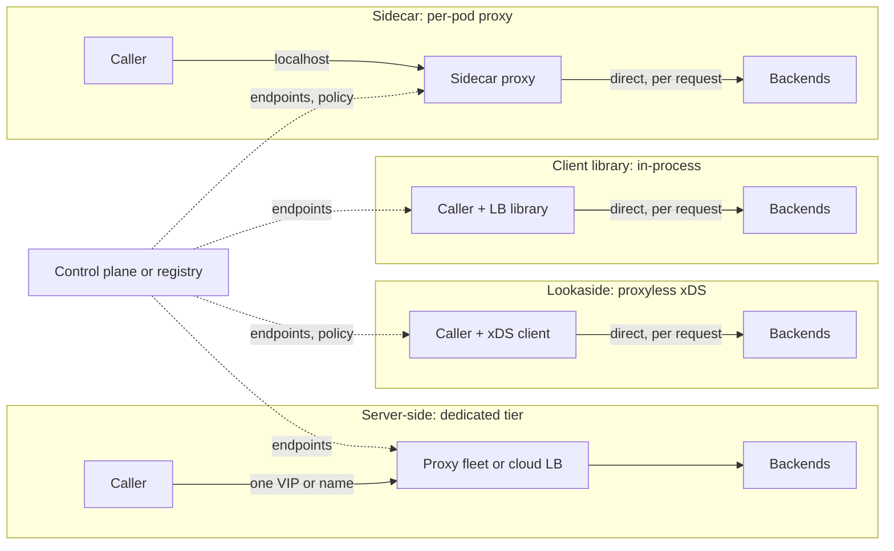
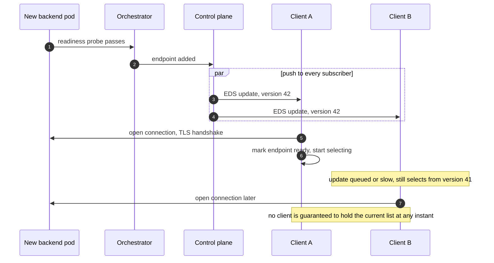
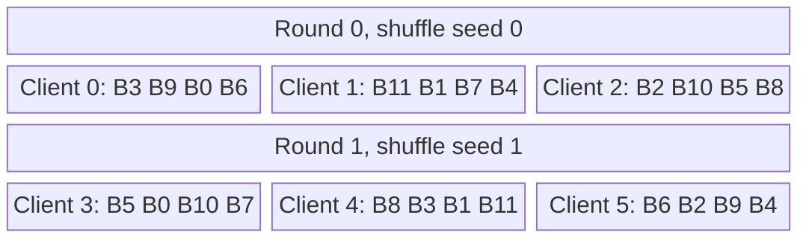
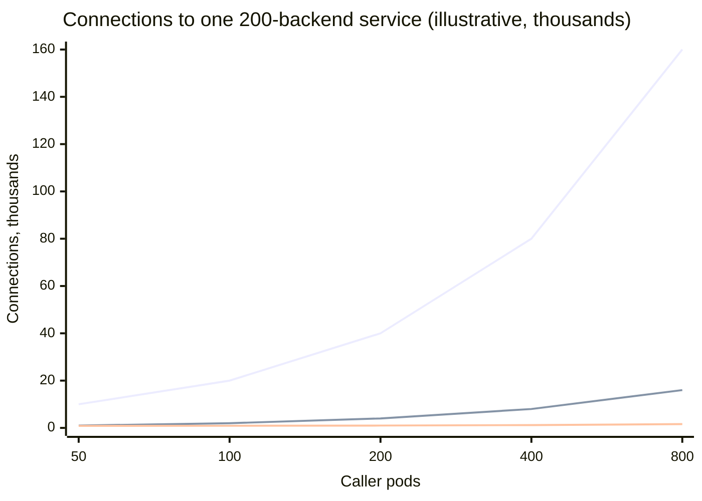
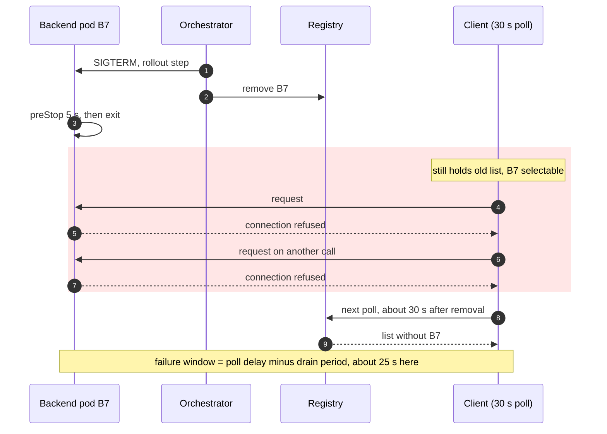

Sunucu taraflı yük dengeleme, dengeleme kararını çağıranlarla backend'ler arasında duran ayrı bir katmana koyar: bir donanım cihazı, bir bulut yük dengeleyicisi ya da Envoy, HAProxy veya NGINX gibi proxy'lerden oluşan bir filo. Çağıranlar tek bir sabit isme ya da sanal IP'ye (VIP) istek gönderir ve arkadaki backend'ler hakkında hiçbir şey bilmez. İstemci taraflı yük dengeleme ise kararı çağıranın içine taşır: çağıran süreçteki bir kütüphane ya da onunla aynı yerde çalışan bir proxy, backend endpoint'lerinin tam listesini tutar ve her istek için birini kendisi seçer. İki model de aynı üç işi yapar: güncel bir endpoint kümesi tutmak, bunlardan hangisinin sağlıklı ve ne kadar yüklü olduğunu izlemek ve bu küme üzerinde bir seçim fonksiyonu çalıştırmak. Farkları, bu işlerin nerede yapıldığında ve ortaya çıkan state'in kaç kopyası bulunduğundadır.

Bu seçimin çözdüğü sorun, her saniye değişen bir state'in sahipliğidir. Bir backend filosu büyür, küçülür, deploy edilir ve hata verir; birinin güncel üyeliği ve güncel sağlık durumunu bilmesi, birinin de bu bilgiyi her isteğe uygulaması gerekir. Sunucu taraflı modelde bu bilgi birkaç yük dengeleyici örneğinde durur; bu örnekler tüm trafiğin büyük bir payını görür ve tek bir ekip tarafından güncellenebilir. İstemci taraflı modelde ise bilgi her çağırana kopyalanır: yüzlerce ya da binlerce kopya, her biri yalnızca kendi trafiğini görür ve her biri asenkron olarak güncellenir.

Asıl denge, bir ek hop ile paylaşılan bir hata alanı ile kopyalanmış state ve istemci başına körlük arasındadır. Sunucu taraflı bir katman bir ağ hop'u ve onun gecikmesini, kapasitesi planlanması gereken bir katmanı ve çöktüğünde tüm çağıranları aynı anda etkileyen bir bileşeni ekler; karşılığında çağıranları basit tutar, yüke duyarlı kararları anlamlı kılacak kadar trafik görür ve davranışını tek bir deployment ile değiştirir. İstemci taraflı dengeleme hop'u kaldırır ve her isteğin, çağıranın kendi gördüğü gecikme ve hatalarla tek tek dengelenmesine izin verir; karşılığında her istemcinin bir control plane tarafından taşınan güncel bir endpoint listesine ihtiyacı vardır, her istemci çok sayıda backend'e bağlantı açar, her istemci her hatayı kendi başına keşfetmek zorundadır ve dengeleme mantığı her çağıranın sürüm döngüsünün içine gömülür.

Yerleşim kararı, sık sık onunla karıştırılan üç komşu konudan ayrıdır. Seçim fonksiyonunun kendisi (round robin, least request, iki rastgele seçenek, hashing) [Algoritmalar](/distributed-systems/tr/communication/load-balancing/algorithms/) sayfasında; yük dengeleyicinin bağlantıları mı yoksa istekleri mi gördüğü [L4 ve L7 Yük Dengeleme](/distributed-systems/tr/communication/load-balancing/l4-vs-l7/) sayfasında; bir çağıranın bir servisin var olduğunu ve nerede çalıştığını nasıl öğrendiği, yani registry ve sorgu protokolü ise [İstemci Taraflı Keşif](/distributed-systems/tr/microservice-patterns/service-discovery/client-side-discovery/) ve [Sunucu Taraflı Keşif](/distributed-systems/tr/microservice-patterns/service-discovery/server-side-discovery/) sayfalarında ele alınır. Bu sayfa kararın nerede çalıştığını ve bu yerleşimin bedelini anlatır.

## Kararın Çalışabileceği Beş Yer

İkili isim bir yelpazeyi gizler. Bu yelpaze boyunca değişen şey, seçim fonksiyonunu çalıştıran süreç ve o sürecin endpoint listesini aldığı kaynaktır.


*Yerleşimlerden dördü ve endpoint listelerinin geldiği yer. Düz oklar istekleri, kesikli oklar üyelik state'ini taşır. Beşinci yerleşim olan node'a yerel L4 yönlendirici aşağıda anlatılıyor.*

Diyagram temel asimetriyi görünür kılar. Sunucu taraflı grupta control plane bir avuç yük dengeleyici örneğini besler ve çağıranın tek bağımlılığı bir adrestir. Diğer üç grubun her birinde kesikli ok her çağıran sürece ya da her çağıran pod'a dağılır; dolayısıyla endpoint listesine abone olanların sayısı istemci sayısına eşittir ve her biri listenin bayatlayabileceği bir yerdir. İstek yolunda durum tersidir: sunucu taraflı grupta istek başına iki ağ ayağı, diğerlerinde bir ayak vardır.

**Ayrı katman (sunucu taraflı).** Bir bulut yük dengeleyicisi, bir cihaz ya da bir proxy filosu çağıranın bağlantısını sonlandırır ve isteği bir backend'e iletir. Çağıran tek bir ismi çözer; bu isim genellikle katmanın kendi birkaç adresine karşılık gelir. Kontrolünüzde olmayan çağıranlar için tek mümkün yerleşim budur: tarayıcılar, mobil uygulamalar, partner sistemler. TLS sonlandırmanın ve politikaların yaşadığı uçta (edge) da doğal yerleşim budur; bkz. [API Gateway Deseni](/distributed-systems/tr/communication/api-gateway/api-gateway-pattern/).

**İstemci kütüphanesi (süreç içi).** Çağıran, servisi tüm endpoint'lerine çözen, onlara bağlantı açan ve istek başına seçim yapan bir dengeleme kütüphanesini kullanır. Netflix'in Eureka ile birlikte kullandığı Ribbon, Twitter'ın Finagle'ı ve gRPC'nin yerleşik politikaları kanonik örneklerdir. Kütüphane her isteğin gecikmesini ve sonucunu ek hop olmadan doğrudan görür, ama her dil için ayrı bir kopyası vardır ve davranışı ancak çağıran yeniden derlenip deploy edildiğinde değişir.

**Sidecar proxy (istemci taraflı yerleşim, süreç dışı).** Her çağıranın yanında, genellikle aynı pod'da bir proxy çalışır ve çağıran düz metni localhost'a gönderir. Endpoint listesini proxy tutar ve istek başına dengeler; yani karar yine çağıranın makinesinde ve çağıranın trafiğiyle verilir, ama mantık dilden bağımsızdır ve uygulamadan ayrı güncellenir. Linkerd ve Istio'nun Envoy sidecar'ları böyle çalışır; genel desen ve bedeli [Sidecar Deseni](/distributed-systems/tr/microservice-patterns/structural-patterns/sidecar-pattern/) ve [Paylaşılan Kütüphane ve Sidecar](/distributed-systems/tr/microservice-patterns/structural-patterns/shared-library-vs-sidecar/) sayfalarında ele alınır. Localhost hop'u bir ağ round trip'i değil, pod başına bellek ve CPU maliyeti getirir.

**Lookaside ya da proxyless (istemci taraflı yerleşim, merkezi konfigürasyon).** İstemci kütüphanesi bir control plane protokolü konuşur ve yalnızca endpoint'leri değil politikayı da alır: ağırlıklar, lokalite öncelikleri, outlier ayarları. gRPC'nin özgün lookaside tasarımı `grpclb`'de istemciye sunucu listesini ayrı bir dengeleyici sunucu verir; gRPC dokümantasyonu bunu artık deprecated olarak işaretliyor ve yerine xDS'i öneriyor. xDS, Envoy'un konfigürasyon için kullandığı protokol ailesidir ve hedef `xds:///` şemasını kullandığında gRPC istemcileri onu doğrudan tüketir. Istio, 1.11 sürümünde (2021) deneysel proxyless gRPC desteği ekledi. Bu yerleşim, kütüphanenin tek hop'unu korurken politika kararlarını yeniden merkezi bir sahibe taşır.

**Node'a yerel L4 yönlendirici.** Kubernetes `kube-proxy`, her node'da iptables, IPVS ya da nftables kuralları programlar; böylece bir ClusterIP'ye açılan bağlantılar çağıranın node'unda bir pod adresine çevrilir. Yerleşimi istemci taraflıdır, çünkü karar ağ hop'u olmadan çağıranın makinesinde verilir; ama semantiği bir L4 yük dengeleyicinin semantiğidir: bağlantı başına tek karar, çekirdek tarafından verilir ve isteklere dair hiçbir görünürlük yoktur. HTTP/2 ve gRPC sayfalarının, uzun ömürlü çoklanmış bağlantılar için ClusterIP'nin neredeyse hiçbir şeyi dengelemediğini söylemesinin nedeni budur.

### Karar Taşındığında Neler Değişir

Algoritmadan bağımsız olarak yerleşimden üç özellik doğar.

Birincisi, tek bir yük dengeleyicinin her backend'in trafiğinden gördüğü paydır. Bir filoya hizmet eden dört proxy'lik bir katmanda her proxy her backend'in isteklerinin dörtte birini görür; 400 çağırandan birindeki bir istemci kütüphanesi ise dört yüzde birini görür. Yüke duyarlı algoritmalar bu paya bağımlıdır, çünkü kullandıkları sinyal (bekleyen istekler, son gecikme, son hatalar) yük dengeleyicinin kendi trafiğinden hesaplanır. [Algoritmalar sayfası](/distributed-systems/tr/communication/load-balancing/algorithms/), her yük dengeleyicinin payı küçüldüğünde least request'in nasıl rastgele seçime dönüştüğünü adım adım gösterir.

İkincisi, üyelik state'inin kopya sayısıdır. Yük dengeleyici örneği başına bir kopya tutarlılık için doğru, erişilebilirlik için yanlış sayıdır, çünkü bu birkaç örnek paylaşılan bir hata alanıdır. İstemci başına bir kopya, paylaşılan hata alanını istek yolundan çıkarır; ama "güncel endpoint listesi"ni tek bir sürecin değil, bir control plane push'unun özelliği hâline getirir.

Üçüncüsü, davranışı kimin ve ne kadar hızlı değiştirebileceğidir. Bir proxy katmanını sahibi, çoğu zaman deployment gerekmeden yeniden yapılandırır. Bir sidecar filosu her pod rolling olarak yenilenerek güncellenir. Bir kütüphane ise ancak onu çağıran her servis yeni sürüm çıkardığında değişir; yüzlerce servisi olan bir organizasyonda bu aylar sürebilir ve nadiren deploy edilen servisler için hiç tamamlanmaz.

## İstemci Taraflı Mekanizma: Endpoint'ler, Sağlık ve Bağlantılar

Kararı her istemciye taşımak, sunucu taraflı modelin aynı ölçekte ihtiyaç duymadığı üç mekanizma doğurur: endpoint listesini her istemciye dağıtmak, hatayı her istemcinin kendi gözlemlerinden tespit etmek ve her istemci her backend'le konuştuğunda bağlantı sayısını denetim altında tutmak.

### Endpoint Yayılımı ve Güvenlik Penceresi

İstemci taraflı bir yük dengeleyici, ancak isteği karşılayamayacak bir endpoint'i hiç seçmezse doğru çalışır; bunu da kendi listesinden asla garanti edemez, çünkü liste, tarif ettiği değişiklikten bir süre sonra gelmiş bir kopyadır. Bu yüzden garanti iki taraftan kurulur: control plane değişiklikleri er ya da geç teslim eder, backend'ler de yayılım gecikmesi boyunca bayat bir seçimin zararsız kalacağı şekilde davranır.


*xDS gibi push tabanlı bir control plane altında bir backend'in eklenmesi. Çıkarma da aynı yolu izler; bayatlığın tehlikeli hâle geldiği yer orasıdır.*

1-4. adımlar bir registry tasarımcısının denetimindeki kısımdır: readiness kabulü kapılar, control plane da sürümlü bir güncelleme push'lar. 5. ve 6. adımlar, bir güncellemeyi almanın endpoint'i kullanılabilir yapmadığını gösterir; istemcinin hâlâ bağlanması, TLS handshake'ini tamamlaması ve gRPC'nin terimleriyle subchannel'ı READY durumuna getirmesi gerekir, seçim fonksiyonu ancak ondan sonra onu dikkate alır. 7. adım genel durumdur: istemciler güncellemeleri farklı zamanlarda uygular, dolayısıyla bir pencere boyunca istemci filosu üyelik konusunda anlaşamaz. Ekleme için bu zararsızdır; yeni backend, istemciler onu keşfettikçe kademeli olarak trafik alır. Çıkarma için değildir. Bir backend registry'den çıkarıldığı anda hizmet vermeyi bırakırsa, çıkarmayı henüz uygulamamış her istemci ona istek göndermeye devam eder ve bu istekler connection refused ya da reset ile başarısız olur.

Çıkarmayı güvenli kılan kural doğrudan buradan çıkar: ayrılan bir backend, herhangi bir istemciye olan en uzun yayılım gecikmesinden daha uzun süre hizmet vermeye devam etmeli ya da istekleri, istemcinin başka bir yerde yeniden deneyeceği garanti olan bir şekilde reddetmelidir. Google'ın SRE kitabı, bir görevin hâlâ hizmet verdiği ama istemcilerden kendisine iş göndermemelerini istediği bu duruma "lame duck" der; Kubernetes aynı fikri readiness'tan çıkarma ve ardından gelen bir sonlandırma süresiyle (termination grace period) uygular. Boşaltmanın mekaniği [Sağlık Durumuna Duyarlı Yönlendirme ve Bağlantı Boşaltma](/distributed-systems/tr/communication/load-balancing/health-aware-routing/) sayfasında ele alınır; burada önemli olan, istemci taraflı yerleşimin yayılım gecikmesini daha uzun ve daha değişken hâle getirmesidir, çünkü bu gecikme birkaç proxy'ye değil, N istemcinin en yavaşına olan gecikmedir.

Bu gecikmenin büyüklüğü, yolun push mu yoksa polling ile mi işlediğine ve yol üzerinde kaç cache bulunduğuna bağlıdır. Spring Cloud Netflix yığınında Eureka istemcisi registry'yi varsayılan olarak 30 saniyede bir çeker, Eureka sunucusu okumaları 30 saniyede bir yenilenen bir yanıt cache'inden sunar, Ribbon da sunucu listesini Eureka istemcisinden 30 saniyede bir yenilerdi; varsayılanları tartışan bakımcılar, yeni bir örneğin trafik almaya başlaması için en kötü durumda yaklaşık iki dakika tahmin ediyor ve aynı zincir çıkarmayı da geciktiriyor; bu yığın [İstemci Taraflı Keşif](/distributed-systems/tr/microservice-patterns/service-discovery/client-side-discovery/) sayfasında anlatılır. Kaydını hiç silmeden çöken bir örnek, lease'i dolana kadar registry'de kalır; bu süre varsayılan olarak 90 saniyedir. xDS push tabanlıdır ve tipik olarak saniyeler içinde yakınsar, ama gecikmesi abone sayısı ve her push'un boyutuyla birlikte büyür; Istio bu dağılımı `pilot_proxy_convergence_time` metriğiyle dışa açar. DNS tabanlı istemci dengelemenin kendi varyantı vardır: gRPC resolver'ları esas olarak bir bağlantı hata verdiğinde ya da kapandığında yeniden çözümleme yapar, dolayısıyla bir ölçek büyütme, bir şey bağlantıyı kapatana kadar mevcut istemcilere görünmez kalabilir.

:::tip[Kapanış gecikmesini alışkanlıktan değil, ölçülen yayılımdan boyutlandırın]
Alışılmış birkaç saniyelik `preStop` beklemesi, ancak en yavaş istemci çıkarmaları bu süre içinde uyguluyorsa doğrudur. Yayılımın kuyruğunu (control plane yakınsaması artı istemci tarafındaki yenileme ve cache aralıkları) ölçün, lame duck süresini onun yüksek persentilinin üzerine koyun ve kuyruk uzadığında alarm verin. Üst üste binmiş cache'lere sahip polling tabanlı registry'ler dakikalarla ölçülen bir lame duck süresi gerektirir ve bu süre rollout'un toplam süresine hâkim olur.
:::

### Her İstemcinin Bakış Açısından Pasif Sağlık

Merkezi bir proxy backend'leri aktif olarak yoklayabilir ve ilettiği her yanıtı da görür. İstemci taraflı bir yük dengeleyici ise genellikle pasif tespite dayanır: bir endpoint'i kendi isteklerinde hata ya da zaman aşımı gözlemledikten sonra dışarı atar; Envoy bu mekanizmaya outlier detection der. İstemciden yapılan pasif tespitin gerçek bir gücü vardır: istemcinin fiilen kullandığı yolu ölçer. Bir availability zone'dan erişilebilen ama diğerinden erişilemeyen bir backend ya da binde bir flow'u düşüren bir ağ yolu, merkezi bir health check'e görünmez, ondan zarar gören istemcilere ise görünür.

Zayıflığı, her istemcinin her hatayı kendi başına yeniden keşfetmek zorunda olmasıdır. Dışarı atma kuralı art arda beş hata ise, N istemcinin her biri durmadan önce bozuk bir backend'e beş istek göndermek zorundadır; filo en az `5 * N` başarısız istek öder ve bunları her istemcinin o backend'e tesadüfen trafik gönderdiği hızda öder. Bir backend'e iki saniyede bir istek gönderen bir istemcinin onu dışarı atması on saniye sürer. Twitter mühendisleri bunu Finagle'ın yük dengeleyicisini yeniden tasarlamalarının gerekçelerinden biri olarak gösteriyor: tam örgü (full mesh) bir yapıda her istemci aynı hataları bağımsız olarak tespit etmek zorundadır, health checking ve circuit breaking de pahalı ve yavaş hâle gelir. Aşağıdaki çalışılmış örnek buna sayı koyar.

Her istemciden aktif health checking ise ters problemi taşır. Her backend'i her istemciden birkaç saniyede bir yoklamak saniyede `N * M / interval` yoklama demektir; birkaç yüz istemci ve backend'de bu, backend yükünün ölçülebilir bir payı hâline gelir. Bu, bağlantı sayısından sonra, büyük istemci taraflı kurulumların her istemcinin konuştuğu backend sayısını sınırlamasının ikinci nedenidir.

### Bağlantı Yayılımı ve Deterministik Subsetting

İstek başına dengeleme yapan bir istemcinin, seçebileceği her backend'e açık bir bağlantısı olması gerekir. N istemci ve M backend ile tam örgü `N * M` bağlantı tutar. Her biri iki uçta da soket tamponları ve TLS state'i için bellek, dosya tanımlayıcıları, keepalive trafiği ve sağlık bağlantı başına kontrol ediliyorsa periyodik yoklamalar ister. SRE kitabının bunu sınırlama gerekçesi, her bağlantının iki uçta da bir miktar bellek ve CPU tüketmesidir; bağlantı başına maliyet küçüktür, büyük bir filodaki çarpımı küçük değildir.

Subsetting her istemciye k backend'lik bir alt küme verir ve dengelemeyi yalnızca onun içinde yapar. Alt kümenin üç koşulu sağlaması gerekir: her backend kabaca aynı sayıda istemci almalı, alt kümeler bir backend'deki hatanın yükünü pek çok başka backend'e yayacak kadar farklı olmalı ve üyelik değişmedikçe bir istemcinin alt kümesi değişmemelidir. Alt kümeleri rastgele seçmek ilk koşulu sağlamaz. SRE kitabının 300 istemci ve 300 backend'li örneğinde 30'luk rastgele alt kümeler, en az yüklü backend'e ortalama bağlantı sayısının %50'sini, en çok yüklüye %150'sini bırakır; 90'lık alt kümelerde aralık ancak %63 ile %121'e daralır. Varyans, bağımsız seçimlerin binom dağılımından gelir ve alt küme boyutuyla yalnızca yavaşça küçülür.

SRE kitabında anlatılan deterministik subsetting, varyansı yapı gereği ortadan kaldırır. İstemcilere 0, 1, 2 diye giden yoğun (boşluksuz) tamsayı kimlikler verilir. Tur başına `subset_count = M / k` alt küme ile istemciler, ardışık `subset_count` kimlikten oluşan turlara gruplanır. Bir turdaki her istemci aynı sıralı backend listesini aynı seed ile, yani tur numarasıyla karıştırır; böylece hepsi haberleşmeden aynı permütasyonu hesaplar. Permütasyon k backend'lik `subset_count` ayrık dilime bölünür ve turdaki her istemci `client_id % subset_count` konumundaki dilimi alır.


*12 backend, alt küme boyutu 4 ve 6 istemciyle deterministik subsetting. Her turun permütasyonu temsilîdir; önemli olan, her turun 12 backend'in tamamını bölümlemesidir.*

Doğruluk argümanı bir sayma argümanıdır. Bir tur içinde dilimler ayrıktır ve birlikte M backend'in tamamını kapsar; dolayısıyla tamamlanmış bir tur her backend'e tam olarak bir istemci ekler. Tam turlar oluşturan C istemciyle her backend tam olarak `C / subset_count` istemci alır; bu da ortalama olan `C * k / M`'ye eşittir. Eksik kalan son tur bazı backend'lere en fazla bir istemci daha ekleyebilir, bu yüzden dengesizlik filo boyutundan bağımsız olarak bir bağlantıyla sınırlıdır. Diyagramda 12 backend'in her biri tam iki kez görünür.

Tur başına yeniden karıştırma ikinci koşulu sağlayan şeydir. Her tur aynı permütasyonu kullansaydı istemci 0 ile istemci 3 aynı dört backend'i tutardı; B6 çöktüğünde yükü yalnızca B3, B9 ve B0'a düşer, bu gruptaki ikinci bir hata da etkiyi katlardı. Tur başına farklı bir permütasyonla B6'nın istemcileri istemci 0 (kalan backend'leri B3, B9, B0) ve istemci 5'tir (B2, B9, B4); böylece açıkta kalan yük üç yerine beş ayakta kalan backend'e, büyük bir filoda ise neredeyse tüm backend'lere yayılır.

Deterministik subsetting'in üç yapısal bedeli vardır. Birincisi, her istemcinin kararlı, yoğun bir kimliği ve toplam istemci sayısını bilmesini gerektirir; bir orkestratör bunu varsayılan olarak sağlamaz. Deterministik subsetting politikası için hazırlanan taslak gRPC önerisi (gRFC A68), incelemede tam da bu itirazla karşılaştı: istemci indekslerini bir control plane üzerinden atamak ve korumak ölçekte zordur. İkincisi, her istemcinin birebir aynı sıralı backend listesini tutmasını gerektirir; yoksa farklı istemcilerin dilimleri çakışır ve boşluk bırakır, dolayısıyla önceki bölümdeki yayılım farkı doğrudan yük farkına dönüşür. Üçüncüsü, M'deki bir değişiklik `subset_count`'u değiştirir; bu da neredeyse her istemcinin turunu ve dilimini yeniden atar, yani bir yeniden boyutlandırma filo çapında bir yeniden bağlanmayı tetikler. Google'ın Rocksteadier subsetting üzerine sonraki makalesi, otomatik ölçekleme backend'leri sık sık yeniden boyutlandırmaya başladığında bu dalgalanmanın (churn) ciddi bir soruna dönüştüğünü anlatıyor ve tur başına karıştırmayı, düşük tutarsızlıklı (low-discrepancy) bir diziyle bir ring üzerine yerleştirmeyle değiştiriyor; böylece bir backend eklemek az sayıda alt kümeyi değiştiriyor.

Twitter benzer bir tasarıma ulaştı. Finagle'ın random aperture yük dengeleyicisi her istemciye boyutu bir geri besleme denetleyicisiyle belirlenen rastgele bir alt küme veriyordu ve binom argümanının öngördüğü bantlı yükü üretiyordu. Deterministic aperture ise istemcileri ve backend'leri iki ring üzerine eşit aralıklarla yerleştirir, her istemciye backend'lerden bitişik bir yay verir, bir backend'in iki istemci tarafından paylaşıldığında her birine kısmen sayılması için kesirli çakışmalara izin verir ve yay içinde iki rastgele seçenek (power of two choices) çalıştırır. Twitter, temsilî bir serviste yükün göreli standart sapmasında %78'lik ve bağlantı sayısında yaklaşık 280.000'den yaklaşık 25.000'e, yani %91'lik bir azalma bildirdi ve bunu varsayılan yük dengeleyicisi yaptı.

:::note[Envoy'un "subset load balancer"ı farklı bir mekanizmadır]
Envoy'un subset load balancer'ı endpoint'leri metadata'ya (sürüm, zone, canary etiketi) göre bölümler; böylece bir route örneğin yalnızca `version=v2` host'larını seçebilir. Bu bir yönlendirme özelliğidir, [Trafik Yönetimi](/distributed-systems/tr/service-mesh/service-mesh-architecture/traffic-management/) altında ele alınır ve bağlantı yayılımını azaltmaz. Bu sayfadaki subsetting ise her istemcinin kaç backend'e bağlandığını sınırlar.
:::

### Çalışılmış Örnek: 400 Çağıran, 200 Backend

Bir gRPC servisi için 400 çağıran pod ve 200 backend pod olduğunu varsayalım. Her çağıran saniyede 100 istek gönderiyor; backend'ler toplamda saniyede 40.000, her biri 200 istek alıyor ve ortalama servis süresi 20 ms. Bu örnekteki tüm sayılar temsilîdir.

**Tam örgü, istemci taraflı.** Her çağıran 200, her backend 400 bağlantı tutar; toplam 80.000 bağlantı. Her çağıran her backend'e saniyede `100 / 200 = 0.5` istek gönderir ve Little Yasası'na göre o backend'e doğru ortalama bekleyen istek sayısı `0.5 * 0.02 = 0.01`'dir. Backend'in gerçek yükü 4 bekleyen istektir; tek tek istemcilerin hiçbiri bunun neredeyse hiçbirini görmez. Her istemci ayrıca her endpoint'i 5 saniyede bir yoklarsa filo saniyede `80.000 / 5 = 16.000` yoklama gönderir, backend başına saniyede 80. Bir backend her isteği hatayla yanıtlamaya başladığında, art arda beş hata kuralıyla her istemcinin onu dışarı atması için beş istek gerekir; saniyede 0,5 istekle bu yaklaşık 10 saniye sürer. Bu 10 saniye boyunca backend olağan saniyede 200 isteğini almaya devam eder, dolayısıyla yaklaşık 2.000 istek başarısız olur; bu, o penceredeki tüm trafiğin %0,5'idir.

**20'lik deterministik alt kümeler.** Burada `subset_count = 200 / 20 = 10` olur ve 400 çağıran 40 tam tur oluşturur; dolayısıyla her backend tam olarak 40 istemci alır. Bağlantılar `400 * 20 = 8.000`'e, yoklamalar saniyede 1.600'e, backend başına 8'e düşer. Her istemci artık her backend'ine saniyede 5 istek gönderir ve ortalama 0,1 bekleyen isteği vardır: hâlâ zayıf, ama on kat güçlü. Dışarı atma yaklaşık bir saniye sürer ve yaklaşık 200 istek başarısız olur. Subsetting, her istemcinin on kat daha az backend görmesini sağlayarak her istemcinin her backend'e dair görüşünü on kat büyütmüştür.

**Sunucu taraflı katman.** Her biri saniyede 10.000 istek ileten ve her backend'e bir bağlantı tutan dört proxy örneği varsayalım. Her proxy her backend'e saniyede 50 istek gönderir ve ortalama 1 bekleyen isteği vardır; bu kullanılabilir bir sinyaldir. Beş hatadan sonra dışarı atma proxy başına yaklaşık 0,1 saniye sürer ve filo genelinde yaklaşık 20 istek başarısız olur. Upstream bağlantılar worker thread başına `4 * 200 = 800`'dür (Envoy bağlantıları worker başına havuzlar, bu yüzden thread sayısıyla çarpın); buna her çağırandan katmana giden bir ya da birkaç bağlantı eklenir. Bedel hop'tur: medyanda istek başına 0,3 ms eklendiğini varsayın; bu, 20 ms'lik bir çağrının %1,5'i, kuyrukta daha fazlasıdır; bir de saniyede 40.000 istek artı bir örneğin kaybı için kapasitesi planlanmış bir katman gerekir.


*Üst çizgi: tam örgü istemci taraflı dengeleme, `N * 200`. Orta çizgi: 20'lik deterministik alt kümeler, `N * 20`. Alt çizgi: dört proxy, çağıran başına bir bağlantı artı 800 upstream.*

Üç çizgi, dışarı atma sürelerinin farklı olmasıyla aynı nedenle farklı hızlarda büyür. Tam örgü iki filonun çarpımıyla, subsetting çağıran sayısı çarpı bir sabitle, proxy katmanı ise neredeyse hiç büyümez. Proxy katmanı trafiği yoğunlaştırdığı için bağlantı sayısında ve sinyal gücünde kazanır; istemci taraflı dengeleme yoğunlaştırmadığı için gecikmede ve hata yalıtımında kazanır. Subsetting, istek yolunu doğrudan tutarken bilinçli olarak yoğunlaştırmaya doğru yarı yola dönmektir.

## Yerleşimler Arasındaki Ödünleşimler

Aşağıdaki karşılaştırma yerleşimle ilgilidir; her satır, algoritmalar sayfasındaki seçim fonksiyonlarından herhangi birini çalıştırabilir.

| Yerleşim | Ek ağ hop'u | Yük dengeleyici başına sinyal | Endpoint listesi kopyaları | Değişiklik ve güncelleme yolu | Başlıca paylaşılan hata | Ne zaman tercih edilmeli |
|---|---|---|---|---|---|---|
| Ayrı katman (bulut LB, proxy filosu) | Var | Güçlü: her backend'in büyük bir payı | Az | Tek bir katmanı yeniden yapılandır ya da deploy et | Katman kesintisi ya da doygunluğu tüm çağıranları etkiler | Güvenilmeyen ya da dış çağıranlar, edge politikası, heterojen çağıranlar, az sayıda istemci |
| İstemci kütüphanesi | Yok | Subsetting olmadan zayıf | Çağıran süreç başına bir | Her çağıranı her dil için yeniden derle ve deploy et | Tüm çağıranlara giden kütüphane hatası ya da kötü konfigürasyon | Az sayıda dil, gecikmeye kritik çağrılar, tüm çağıranları kontrol eden organizasyonlar |
| Sidecar proxy | Yalnızca localhost | Subsetting olmadan zayıf | Pod başına bir | Uygulama sürümünden bağımsız olarak her pod'u yenile | Filo çapında push'lanan kötü proxy sürümü ya da konfigürasyonu | Çok sayıda dil, tek tip politika, zaten gereken mTLS |
| Proxyless xDS | Yok | Subsetting olmadan zayıf | Çağıran süreç başına bir | Politika merkezde, mekanizma kütüphanede | Tümüne push'lanan control plane yanlış konfigürasyonu | Pod başına proxy olmadan mesh politikası isteyen gRPC ağırlıklı filolar |
| Node'a yerel L4 (kube-proxy) | Yok | Yok (çekirdek, bağlantı başına) | Node başına bir | Küme ağı güncellemesi | Endpoint değişikliklerinden sonra kural senkronizasyon gecikmesi | Kısa ömürlü bağlantılar, L7 desteği olmayan protokoller |

Tablonun "başlıca paylaşılan hata" sütunu, bu tartışmada en sık gözden kaçan noktayı içerir. İstemci taraflı yerleşim, yük dengeleyici katmanını istek yolundaki paylaşılan bir hata olmaktan çıkarır; ama paylaşılan hatayı ortadan kaldırmaz, onu control plane'e ve sürüm artefaktına taşır. Kötü bir endpoint push'u, bir kütüphane regresyonu ya da bağlantı havuzu hatası taşıyan bir sidecar sürümü her istemciye ulaşır; sonuç, herhangi bir proxy kesintisi kadar geniş, ama hatalı bileşen her çağırana dağılmış olduğu için geri alınması daha zor, korelasyonlu bir hatadır.

### Gecikme ve Kapasite

Sunucu taraflı hop, veri merkezi içinde bir ek ağ round trip'ine, proxy'de ayrıştırma ve genellikle ikinci bir TLS oturumu için CPU'ya ve yüksek kullanımda proxy'nin kendi kuyruklanmasına mal olur. Çağrıları onlarca milisaniye süren bir servis için medyan maliyet küçüktür; her biri kendi proxy katmanından geçen ince taneli çağrılardan oluşan bir zincirde ise birikir ve proxy'nin kuyruk gecikmesi her hop'un kuyruğuna eklenir. Sidecar, ağ hop'unu iki localhost geçişiyle değiştirir ve proxy'nin CPU ve belleğini her pod'a yükler. Istio'nun deneysel proxyless modu için 2021'de tek bir benchmark yükü altında yaptığı ölçümler bu pod başına maliyetin ölçeğini gösteriyor: istemci tarafında Envoy sidecar'ı yaklaşık 320 milicore ve 67 MiB, proxyless ajan ise 1 milicore'un altında ve yaklaşık 25 MiB kullandı; gRPC'nin kendi işi uygulama container'ına taşındı. Bu rakamlar benchmark'ın istek hızına bağlıdır ve yalnızca büyüklük mertebesi olarak işe yarar.

### Güven ve Politika Uygulama

İstemci taraflı bir yük dengeleyici işbirliğine dayanır: yönlendirmeyi, ağırlıkları ve retry bütçelerini yalnızca istemci bunları yapan kodu çalıştırdığı için uygular. Bu, tek bir güven alanı içindeki servisler için kabul edilebilir; kötü niyetli ya da sadece yanlış yapılandırılmış olabilecek herhangi bir çağıran için kabul edilemez. Dış trafik için rate limit'ler, kimlik doğrulama ve kabul denetimi, [Gateway Düzeyinde Throttling ve Rate Limiting](/distributed-systems/tr/communication/api-gateway/throttling-rate-limiting/) sayfasında anlatıldığı gibi sunucu taraflı bir katmanda yer alır. İlgili bir kısıt da şudur: sunucu taraflı bir katman başarısız bir isteği çağıran fark etmeden başka bir backend'de yeniden deneyebilir; istemci taraflı bir yük dengeleyici ise bunu ancak çağıranın kütüphanesi retry'ları uyguluyorsa yapabilir, üstelik [Retry Fırtınaları ve Metastabil Hatalar](/distributed-systems/tr/resilience/flow-control/retry-storms-metastable-failures/) sayfasında anlatılan büyütme riskleriyle birlikte.

### Gerçek Sistemler Çizgiyi Nereye Çekiyor

Büyük kurulumların çoğu yerleşimleri katman katman birleştirir. Dış trafik, istemciler güvenilmez ve bilinmez olduğu için her ikisi de sunucu taraflı olan bir L4 katmanı ve bir L7 edge üzerinden gelir. İçeride servisler arası trafik istemci taraflı yerleşimi kullanır: Google RPC yığınında subsetting ile, Twitter Finagle'da deterministic aperture ile, mesh'ler sidecar'larla, gRPC filoları xDS ile. Netflix'in özgün yığını Eureka'yı Ribbon kütüphanesiyle eşleştiriyordu; Spring Cloud, 2020.0 sürüm treninde Ribbon'ı Spring Cloud LoadBalancer lehine kaldırdı. Bu, istemci taraflı bir kütüphanenin bir dengeleme mekanizmasını tek bir framework'ün yaşam döngüsüne ne kadar bağladığının bir göstergesidir. Sidecar'sız tasarımlar kararın bir kısmını yeniden paylaşılan bir bileşene doğru taşır: Istio'nun ambient modu node başına ve servis başına proxy'ler kullanır; bkz. [Sidecarless Mesh](/distributed-systems/tr/service-mesh/service-mesh-architecture/sidecarless-ambient-mesh/).

## İstemci Taraflı Bir Yük Dengeleyiciyi Yapılandırmak

Production'da davranışı belirleyen parametreler, isimleri farklı olsa da kütüphanelerde, sidecar'larda ve proxyless istemcilerde aynıdır.

| Parametre | Nerede yaşar | Etkisi | Öneri |
|---|---|---|---|
| Endpoint kaynağı ve yenileme | Resolver, registry istemcisi, xDS | Eklemeler ve çıkarmalar için yayılım gecikmesi | Push'u tercih edin (xDS, watch API'leri); polling'de yol üzerindeki her cache aralığını toplayın |
| Dengeleme politikası | İstemci konfigürasyonu ya da service config | Hangi seçim fonksiyonunun çalıştığı | gRPC varsayılan olarak dengeleme yapmayan `pick_first`'ü kullanır; politikayı açıkça belirleyin |
| Alt küme boyutu | Kütüphane ya da control plane | Bağlantılar, backend başına sinyal, hata yayılımı | Yedeklilik ve eşzamanlılık için yeterince büyük, her istemcinin her backend'i sık görmesi için yeterince küçük |
| Outlier dışarı atma eşikleri | İstemci ya da sidecar | Kötü bir endpoint trafik almayı bırakmadan önceki süre ve başarısız istekler | Filo hızına göre değil, istemcinin her backend'e gönderdiği istek hızına göre ayarlayın |
| Sunucuda azami bağlantı yaşı | Backend | İstemcilerin yeniden çözümleyip yeniden dengelemesi için yeniden bağlanmaya zorlar | Yeniden bağlanmalar dakikalara yayılsın diye jitter ile ayarlayın |
| Lame duck ya da boşaltma süresi | Backend kapanış yolu | Bayat istemcilerin hâlâ başarılı olduğu pencere | Yayılım gecikmesinin yüksek persentilinin üzerinde |
| Fail-static davranışı | İstemci ve control plane istemcisi | Control plane'e erişilemediğinde ya da boş bir küme döndüğünde ne olduğu | Bilinen son iyi kümeyi koruyun; boş bir kümeyi asla bir koruma olmadan uygulamayın |

En yaygın gRPC yanlış yapılandırması varsayılanın kendisidir: birkaç adresi olan bir isim üzerinde oluşturulan bir channel `pick_first` kullanır, tek bir adrese bağlanır ve her şeyi oraya gönderir. İstemci taraflı dengelemeyi açmak bir service config değişikliğidir.

```json
{
  "loadBalancingConfig": [
    { "round_robin": {} }
  ]
}
```

Tüm pod adreslerine çözümlenen bir `dns:///` hedefiyle, örneğin bir Kubernetes headless Service ile, bu ayar channel'ın her adres için bir subchannel açmasını ve istekleri READY olanlar arasında döndürmesini sağlar. İstemcinin yeni pod'ları yeniden çözümleme yapana kadar fark etmesini ise sağlamaz; yukarıdaki tablodaki sunucu taraflı azami bağlantı yaşının aynı değişikliğe ait olmasının nedeni budur.

## Her Yerleşimin Hata Modları

İstemci taraflı ve sunucu taraflı yerleşim farklı biçimlerde bozulur. Sunucu taraflı hatalar yoğunlaşmış ve gürültülüdür; istemci taraflı hatalar dağınıktır, paylaşılan artefaktlar üzerinden korelasyonludur ve çoğu zaman yalnızca toplamda görünür.

### Ölçek Küçültme ve Rollout Sırasında Bayat Endpoint'ler

Tetikleyici: backend'ler, çıkarmalar her istemciye ulaşmadan daha hızlı sonlanır; tipik olarak bir rolling deployment ya da ölçek küçültme sırasında. Belirtiler: deployment adımlarıyla hizalı connection refused, reset ya da gRPC `UNAVAILABLE` patlamaları; bunlar pek çok çağırana ince ince yayılır, böylece hiçbir çağıran tek başına bozuk görünmez; deployment başına hata oranı, pod'ların ne kadar hızlı sonlandığıyla korelasyon gösterir.


*Polling tabanlı bir registry ile varsayımsal bir rollout adımı: backend'in boşaltma süresi, istemcinin yenileme aralığından kısa.*

Gölgeli blok, pod'un dinlemeyi bıraktığı 3. adım ile istemcinin çıkarmayı nihayet öğrendiği 8. adım arasındaki penceredir. İstemcinin bu pencerede B7'ye yönlendirdiği her istek başarısız olur; outlier detection ile istemci B7'yi daha erken dışarı atabilir, ama ancak dışarı atma bütçesi kadar hatayı harcadıktan sonra. Bir rollout'taki her istemci ve her pod ile çarpıldığında bu, her rollout adımıyla birlikte yükselip düşen bir hata oranı üretir. Tespit: deployment adımı başına hatalar, control plane'in yakınsama süresi (Istio'da `pilot_proxy_convergence_time`) ve Envoy'da istemciler arasında orkestratörün endpoint sayısıyla karşılaştırılan küme başına `membership_total` ve `membership_healthy` gauge'ları. Azaltma: yayılım kuyruğundan uzun lame duck süreleri, push tabanlı endpoint teslimi ve hiç gönderilmemiş istekler için istemci retry'ları; bu retry'lar her idempotency kuralı altında güvenlidir. Kurtarma, yayılım tamamlandığında kendiliğinden olur; çözüm müdahale değil, konfigürasyondur.

### Control Plane Kesintisi ve Boş Liste Tehlikesi

Tetikleyici: registry ya da control plane erişilemez hâle gelir, boş state ile yeniden başlar ya da bir hata veya onu besleyen sistemin kısmi kesintisi yüzünden boş veya kırpılmış bir endpoint kümesi yayımlar. Belirtiler: istemciler bilinen son kümeyi koruyorsa, üyelik değişip yayılmayana kadar görünür hiçbir şey olmaz. İstemciler boş kümeyi uygularsa, servisin tüm çağıranları "no healthy upstream" ya da `UNAVAILABLE` hatalarıyla aynı anda başarısız olur.

Doğru istemci davranışı fail-static'tir: kaynağa erişilemediğinde bilinen son iyi kümeyi kullanmaya devam etmek ve kümenin ani çöküşüne şüpheyle yaklaşmak. Envoy, xDS bağlantısını kaybettiğinde son kabul ettiği konfigürasyonu korur. Eureka'nın sunucu taraflı self-preservation modu, yenilemeler beklenen yenilemelerin bir eşiğinin altına düştüğünde lease'leri sona erdirmeyi durdurur; gerekçe, bir ağ probleminin toplu bir ölümden daha olası olmasıdır. gRPC, bir control plane hatası çalışan konfigürasyonu silmesin diye, istemcinin xDS sunucusundan gelen kaynak silmelerini yok saymasına izin veren bir bootstrap seçeneği (gRFC A53) ekledi. Tespit: control plane'in yalnızca girdisindeki değil çıktısındaki endpoint sayısı düşüşleri için ve istemcilerden gelen control plane bağlantı hataları için alarmlar.

:::caution[Boş bir endpoint kümesi neredeyse hiçbir zaman doğru değildir]
Bir servis nadiren tüm örneklerini aynı anda kaybeder; sıfır örnek bildiren bir registry ya da control plane'in yanılıyor olması, haklı olmasından çok daha olasıdır. İstemciler ve control plane'ler boş olmayan bir endpoint kümesini, bir doğrulama yolu olmadan, boş bir kümeyle ya da belirli bir oranın üzerinde küçülen bir kümeyle değiştirmeyi reddetmelidir. Çok az host sağlıklı göründüğünde tüm host'lara yönlendiren Envoy panic threshold'u, aynı ilkenin üyeliğe değil sağlığa uygulanmış hâlidir.
:::

### Yeniden Bağlanma Fırtınaları

Tetikleyici: çok sayıda istemci aynı anda yeniden bağlanır; bir cluster'ı yeniden oluşturan bir control plane push'undan, bir backend yeniden başlatmasından, bağlantıları sıfırlayan bir ağ kesintisinden sonra ya da sunucu taraflı azami bağlantı yaşının jitter'ı olmadığında. Belirtiler: TLS handshake'lerinden kaynaklanan backend CPU sıçramaları, handshake'ler kuyruklanırken bağlantı zaman aşımları ve en kötü durumda yeniden bağlanmalar yüzünden aşırı yüklenip yeniden başlatılan, bu da bir sonraki dalgayı tetikleyen bir backend. Tam örgüde fırtınanın boyutu, istemci sayısı çarpı etkilenen backend sayısıdır. Tespit: backend başına saniyedeki yeni bağlantılar, TLS handshake hızı ve her ikisinin control plane push'larıyla korelasyonu. Azaltma: her istemci yeniden bağlanmasında ve bağlantı yaşında jitter, yeniden bağlanmada üstel backoff, herhangi bir backend'in kaç istemcisi olacağını sınırlamak için subsetting ve endpoint'leri cluster'ları yeniden oluşturmak yerine artımlı olarak güncelleyen control plane'ler.

### Korelasyonlu Kütüphane ya da Sidecar Regresyonu

Tetikleyici: dengeleme kütüphanesinin ya da sidecar'ın yeni bir sürümü veya control plane üzerinden push'lanan yeni bir politika bir kusur içerir: bir bağlantı havuzu sızıntısı, ağırlıkları yok sayan bir politika, geçerli bir güncellemeyi reddeden bir parser. Belirtiler: birbiriyle ilgisiz pek çok serviste aynı anda ortaya çıkan, herhangi bir servisin deployment'ını değil paylaşılan artefaktın rollout'unu izleyen bir bozulma. Tespit, metriklerin kütüphane ya da proxy sürümüyle etiketlenmesini gerektirir; böylece hata ve gecikme sürüme göre gruplanabilir. Azaltma: dengeleme bileşeninin kendisini uygulamalardan ayrı olarak canary'den geçirmek; sürüm dağılımını görünür tutmak; kütüphaneler için nadiren deploy edilen servislerin uzun kuyruğunun uzun süre eski sürümlerle çalışacağını kabul etmek ve control plane'i hâlâ kullanımda olan tüm sürümlere karşı test etmek. Bir sidecar ya da control plane değişikliği için kurtarma, sahibinin yapacağı bir geri almadır; bir kütüphane için ise etkilenen her çağıranın yeniden deploy edilmesidir. Çok sayıda servisi olan organizasyonların dengeleme mantığını uygulama binary'sinin dışına taşımasının nedeni budur.

### Merkezi Bir Katmanın Doygunluğu ve Paylaşılan Kaderi

Tetikleyici: sunucu taraflı katmanın kapasitesi tükenir ya da örnek kaybeder veya bir konfigürasyon push'u onu bozar. Belirtiler: backend'leri sağlıklı olanlar da dahil, katmanın arkasındaki her servis için gecikme ve hatalar artar. Tespit: katmanın kendi CPU'su, aktif bağlantıları ve kuyruklanması, backend gecikmesiyle karşılaştırılarak; katmanda ölçülen gecikme ile backend'de ölçülen gecikme arasındaki fark katmanı işaret eder. Azaltma: zirvede bir örneğin kaybını kaldıracak kapasite, tek bir sıcak route'un katmanı herkes için doyurmasını engelleyen route başına limitler ve katmanın hata alanını tüm platformdan küçük tutmak için katmanı servis gruplarına göre shard'lamak. L7'ye özgü aşırı yük davranışı [L4 ve L7 Yük Dengeleme](/distributed-systems/tr/communication/load-balancing/l4-vs-l7/) sayfasında ele alınır.

### Yerleşime Göre Hata İmzaları

| Hata | Yerleşim | Dışarıdan belirti | Tespit sinyali | Azaltma |
|---|---|---|---|---|
| Bayat endpoint'ler | İstemci taraflı, hepsi | Rollout adımlarıyla hizalı hata patlamaları | Yakınsama süresi, istemciler arası endpoint sayısı farkı | Yayılım kuyruğunun üzerinde lame duck, push teslimi |
| Boş endpoint kümesi | İstemci taraflı, hepsi | Tüm çağıranlar aynı anda başarısız | Control plane çıktısında endpoint sayısı düşüşü | Fail-static, silme korumaları |
| Yeniden bağlanma fırtınası | Tam örgü istemci taraflı | Handshake CPU sıçraması, bağlantı zaman aşımları | Backend başına saniyedeki yeni bağlantılar | Jitter, backoff, subsetting |
| Alt küme dengesizliği | Subsetting | Trafik değişmeden bazı backend'ler daha sıcak | Backend başına istemciler, azami/medyan yük | Yoğun ve kararlı istemci kimlikleri, tutarlı listeler |
| Paylaşılan artefakt regresyonu | Kütüphane, sidecar, proxyless | Pek çok servis birlikte bozulur | Kütüphane ya da proxy sürümüne göre gruplanmış metrikler | Yük dengeleyiciyi canary'den geçirmek, sürüm görünürlüğü |
| Katman doygunluğu | Sunucu taraflı | Katmanın arkasındaki tüm servisler yavaş | Katman CPU'su ve kuyruklanması ile backend gecikmesi | Pay bırakmak, route başına limitler, katmanı shard'lamak |

## Kararın Nerede Çalışacağını Seçmek

Karar dört sorudan çıkar: çağıranları kim kontrol ediyor, kaç çağıran ve kaç backend var, çağıranlar kaç farklı dilde yazılmış ve bir ek hop çağrıya göre ne kadar pahalı.

Çağıranlar dışarıdaysa, güvenilmiyorsa ya da sürümleri sizin denetiminizde değilse; kimlik doğrulama, rate limiting ya da istek dönüştürme gibi politikaların rica edilmesi değil uygulanması gerekiyorsa; çağıranlar az ve heterojense, yani istemci taraflı altyapının her biri için ayrı ayrı kurulması gerekecekse; ve çağrı, bir milisaniyenin kesrinin önemsiz kalacağı kadar pahalıysa sunucu taraflı bir katman kullanın. Yoğunlaşmış bir yük dengeleyicinin güçlü yük sinyaline ihtiyaç duyduğunuzda ve istemci filosu, her istemcinin her backend'i yalnızca nadiren göreceği kadar büyük olduğunda da onu kullanın.

Sahibi olduğunuz servisler arasındaki yüksek hızlı, gecikmeye duyarlı trafik için, çağıranlar işlettiğiniz bir control plane'den endpoint güncellemeleri alabiliyorsa istemci taraflı yerleşimi kullanın. Filo çok sayıda dile yayılıyorsa ya da mTLS ve telemetri zaten gerekiyorsa bir sidecar'ı veya node düzeyinde bir proxy'yi tercih edin; filo büyük ölçüde tek bir RPC framework'üyse ve pod başına proxy maliyeti önemliyse bir kütüphaneyi ya da proxyless xDS'i tercih edin. Çağıranların ve backend'lerin çarpımı bağlantı sayısını, health check yükünü ya da dışarı atma süresini bir soruna dönüştürdüğünde subsetting ekleyin; çalışılmış örnek bunun her birinden birkaç yüz olduğunda gerçekleştiğini gösteriyor.

Endpoint kaynağı üst üste binmiş cache'lere sahip polling tabanlı bir registry ise ve backend'ler dakikalarca boşaltma yapamıyorsa istemci taraflı dengeleme kullanmayın; bayat endpoint penceresi hata bütçenize hâkim olur. Onu, limitleri yok sayabilecek çağıranlara limit uygulamak için kullanmayın. Kararlı, yoğun istemci kimliklerinin bir kaynağı ve tüm istemcilerin aynı backend listesini tuttuğunu garanti etmenin bir yolu olmadan deterministik subsetting'i benimsemeyin; subsetting şeması yeniden boyutlandırmadaki dalgalanmayı sınırlamıyorsa sık otomatik ölçeklenen backend filolarında da kullanmayın. İki servis de sizin denetiminizdeyken ve çağrı zinciri derinken, aralarına yalnızca dengeleme için sunucu taraflı bir katman koymayın; her katman zincirdeki her çağrıya bir hop, bir kapasite planı ve paylaşılan bir hata alanı ekler.

:::caution[Tek yolda iki yük dengeleyici]
Bir ClusterIP'ye ya da bir yük dengeleyici adresine istek gönderen istemci taraflı bir yük dengeleyici tek bir endpoint arasında dengeleme yapıyordur; asıl kararı o adresin arkasındaki şey verir. Tersi de olur: sunucu taraflı bir katmanın önünde istek başına dengeleme yapan bir sidecar, katmanın yük görüşünü anlamsız kılar. Her hop için kararın hangi katmana ait olduğuna karar verin, gerçek endpoint listesini ona verin ve diğer katmanların trafiği olduğu gibi geçirmesini sağlayın.
:::

## İleri Okuma

- Betsy Beyer, Chris Jones, Jennifer Petoff ve Niall Richard Murphy (ed.), *Site Reliability Engineering: How Google Runs Production Systems*, O'Reilly, 2016, 20. bölüm, "Load Balancing in the Datacenter".
- Peter Ward, Paul Wankadia ve Kavita Guliani, *Reinventing Backend Subsetting at Google*, ACM Queue 20(5), 2022.
- Twitter Engineering, *Deterministic Aperture: A Distributed, Load Balancing Algorithm*, blog.twitter.com, 2019.
- Mark D. Roth, *gRFC A27: xDS-Based Global Load Balancing*, gRPC öneri deposu.
- Envoy Project, *xDS REST and gRPC Protocol*, Envoy dokümantasyonu (sürekli güncellenir).
- Istio Project, *gRPC Proxyless Service Mesh*, istio.io blogu, 2021.
