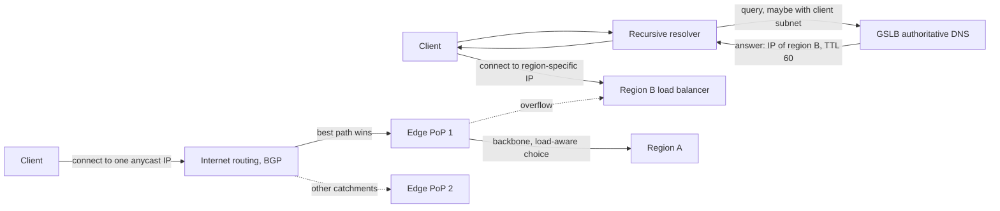
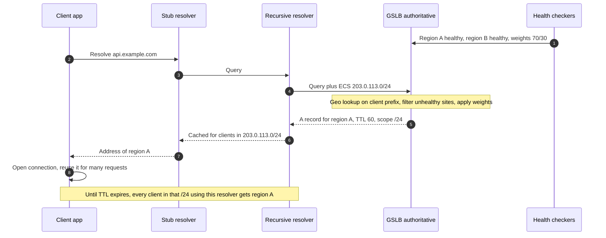
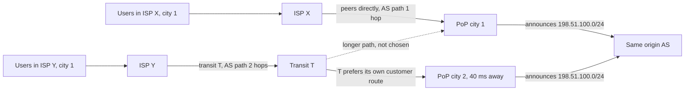
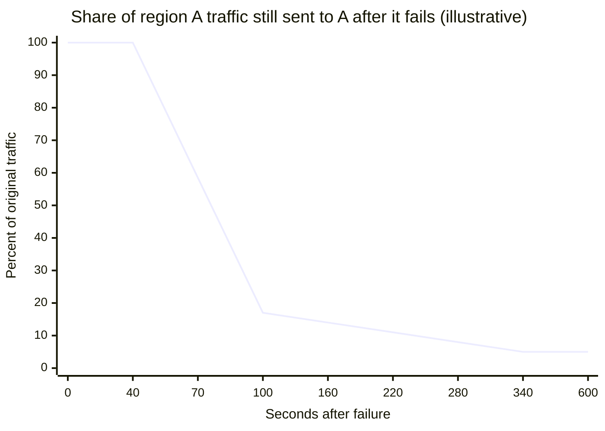
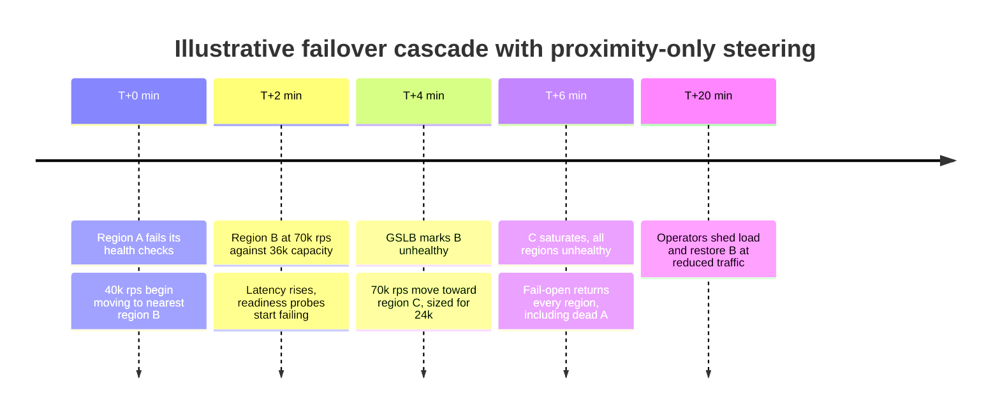
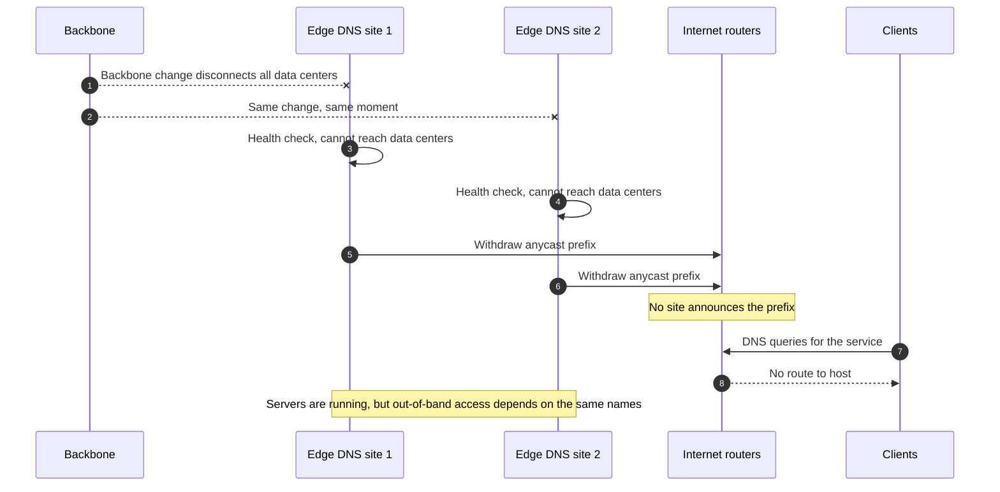

Küresel sunucu yük dengeleme (Global Server Load Balancing, GSLB), aynı servis birden fazla yerde çalışırken bir istemcinin trafiğini hangi sitenin, yani hangi bölgenin, veri merkezinin ya da erişim noktasının (point of presence, PoP) alacağını seçer. Tek bir site içindeki yük dengeleme, aynı ağı ve aynı hata alanını paylaşan makineler arasından bir backend seçer; GSLB ise birbirinden onlarca milisaniye uzakta duran, gücü ve ağı bağımsız, çoğu zaman verisi de farklı olan siteler arasından seçim yapar. Bu alanda iki mekanizma baskındır. DNS tabanlı GSLB'de authoritative (yetkili) isim sunucusu her sorguya; sorgunun nereden geliyor göründüğüne, hangi sitelerin sağlıklı olduğuna ve her sitenin ne kadar yük alması gerektiğine göre farklı bir adres döner. Anycast ise aynı IP prefix'ini BGP (Border Gateway Protocol) üzerinden tüm sitelerden duyurur ve her paketi, internetin yönlendirme sisteminin yol seçiminin tercih ettiği siteye teslim etmesine bırakır.

İkisi de yoksa çok bölgeli bir kurulum, önünde elle düzenlenen bir DNS kaydı bulunan tek bölgeli servislerden ibarettir. Virginia'da barındırılan bir servise bağlanan Singapur'daki kullanıcılar her TCP ve TLS el sıkışmasında Pasifik'i aşan bir round trip öder; bölgesel bir kesinti de bir operatör kaydı değiştirene ve resolver önbellekleri dolana kadar sürer. Dolayısıyla GSLB'nin çözdüğü problem iki yönlüdür: yakınlık, yani her istemciyi ağ açısından yakın bir siteye göndermek; ve hayatta kalma, yani arızalı ya da aşırı yüklü bir siteyi, erişilebilirlik hedefi açısından anlam taşıyacak kadar hızlı biçimde her istemcinin yolundan çıkarmak.

Asıl denge, kontrol ile tepki hızı ve şeffaflık arasındadır. DNS tabanlı GSLB her çözümleme (resolution) için açık bir karar verir: kapasiteyi hesaba katabilir, yeni çözümlemelerin tam %5'ini canary bölgesine kaydırabilir ve bir yargı alanının kullanıcılarını o yargı alanında tutabilir. Ama kararı istemci için değil resolver için verir, cevabı bazı önbelleklerin uymadığı bir TTL (time to live) boyunca önbellekte kalır ve zaten açık olan bir bağlantıya hiç dokunmaz; bu yüzden bir failover'ın tamamlanması dakikalar alır ve arkasında uzun bir kuyruk bırakır. Anycast ise ağın kendisinde tepki verir: bir rotayı geri çekmek (withdraw), istemci iş birliği gerektirmeden trafiği saniyeler ile birkaç dakika içinde başka yere taşır ve bir trafik seli, her site tarafından kendi catchment'ı (erişim havzası) oranında karşılanır. Ama istemcinin ulaştığı siteyi gecikme ya da yük hakkında hiçbir şey bilmeyen BGP politikası seçer ve operatör trafiği ancak kaba biçimde, neyi kime duyurduğunu değiştirerek yönlendirebilir. Üretim edge'leri genellikle ikisini birleştirir: en yakın edge'e ulaşmak için anycast, arkasında ise açık ve yüke duyarlı bir karar.


*Bir site seçmenin iki yolu. Üstte: DNS tabanlı GSLB her çözümleme için karar verir ve unicast bir adres döner. Altta: anycast edge'i BGP'nin seçmesine bırakır; edge de bölgeyi yükü tam olarak bilerek seçer.*

Üst yolda karar, istemci herhangi bir bağlantı açmadan önce bir kez verilir ve kararın birimi resolver'dır: önbellekteki cevabın süresi dolana kadar istemcinin yaptığı her şey, bu arada B bölgesine ne olursa olsun, B bölgesine gider. Alt yolda ise istemcinin seçimine dair hiçbir şey önceden sabitlenmez. Anycast adrese giden her paket, o anki BGP en iyi yolunu izleyerek bir edge PoP'a ulaşır; bağlantıyı sonlandıran edge de her isteği sağlıklı ve kapasitesi olan herhangi bir bölgeye gönderebilir. Anycast yüzünden kaybedilen kontrolün büyük kısmı bu ikinci adımda geri kazanılır; küresel bulut yük dengeleyicilerinin bu biçimde kurulmasının nedeni de budur.

## DNS Tabanlı GSLB: Her Çözümlemede Karar

DNS tabanlı GSLB, bir servisin host adı için authoritative isim sunucusunu bir karar motoruna dönüştürür. Girdileri kaynak adresten konuma bir eşleme, her sitenin sağlık durumu, yönetimsel ağırlıklar ya da kapasite ve daha gelişmiş sistemlerde gerçek istemcilerden gelen gecikme ölçümleridir. Çıktısı, bir TTL ile birlikte bir ya da daha fazla A veya AAAA kaydıdır. Mekanizmanın tamamı, sunucunun sorgu anında neyi bilebildiğine ve cevabının ondan sonra ne kadar yaşadığına dayanır.

### Stub Resolver'dan Authoritative Cevaba

İstemci uygulaması GSLB'yi doğrudan sorgulamaz. İşletim sisteminin stub resolver'ı ismi, genellikle istemcinin ISP'si, kurumu ya da genel bir hizmet tarafından işletilen recursive resolver'a iletir; recursive resolver da delegasyon zincirini izleyerek zonun authoritative sunucularına ulaşır. Bu yüzden authoritative sunucu istemcinin değil, recursive resolver'ın adresini görür. İstemci ile resolver yakınsa, örneğin aynı metropol alanındaki bir ISP resolver'ı söz konusuysa, resolver'ın konumu iyi bir vekildir. Yakın değillerse GSLB yanlış yer için optimizasyon yapar.

2016'da RFC 7871 ile tanımlanan EDNS Client Subnet (ECS), bu açığın bir kısmını kapatır. ECS'yi destekleyen bir resolver, sorguya istemci adresinin kırpılmış bir prefix'ini ekler; RFC, açığa çıkan bilgiyi sınırlamak için IPv4'te 24 bite, IPv6'da 56 bite kırpmayı önerir. Authoritative sunucu kararı istemcinin prefix'ine göre verir ve resolver'a, cevabın hangi istemci adresi aralığı için yeniden kullanılabileceğini söyleyen bir scope prefix uzunluğu döner. ECS'ye uyan bir resolver bu durumda cevabı isim başına değil scope başına önbelleğe almak zorundadır; bu da önbellek girdilerini ve yukarı yönde gönderdiği sorgu yükünü katlar.


*Tek bir DNS tabanlı GSLB kararı. Cevap bir kez hesaplanır, ardından TTL dolana kadar resolver'ın o scope'tan hizmet verdiği her istemci tarafından yeniden kullanılır.*

1. adım her sorgudan bağımsız çalışır: sağlık durumu ve ağırlıklar GSLB'nin içindeki durumdur ve health checker'ların takvimine göre yenilenir. Operatörün politikasının uygulandığı tek an 4. ve 5. adımlardır; 6. adımdan itibaren cevap resolver'ın önbelleğine aittir. 8. adım DNS'in hiç ulaşamadığı kısımdır: uygulama bir bağlantı açar ve HTTP/2 ya da gRPC istemcileri bu bağlantıyı dakikalarca, hatta saatlerce tutarak GSLB'nin şu an ne cevap vereceğinden bağımsız olarak her isteği A bölgesine gönderebilir. TTL'i düşürmek 5. adım ile resolver'ın bir sonraki sorgusu arasındaki süreyi kısaltır; 8. adımda açılan bağlantıya ise hiçbir etkisi yoktur.

### Cevap Neyi Garanti Eder, Neyi Etmez

DNS tabanlı GSLB'nin sağladığı invariant dardır: authoritative sunucuya ulaşan her çözümleme, o anda GSLB'nin sağlık ve politika görüşüne göre uygun olan bir siteyle cevaplanır. İstemcinin seçilen siteye yakın olduğunu garanti etmez, çünkü kullanılan konum resolver'ın konumu ya da kırpılmış bir prefix'tir. İstemcinin sağlıklı bir site kullandığını garanti etmez, çünkü cevap, dayandığı sağlık durumundan daha uzun yaşar. Bir yük dağılımını garanti etmez, çünkü büyük bir resolver'a verilen tek bir cevap binlerce istemci tarafından paylaşılır ve ağırlıklar kullanıcılara ya da isteklere değil çözümlemelere uygulanır. TTL'i de garanti etmez: TTL önbelleklere verilen bir talimattır ve bazı önbellekler onu uzatır.

Doğruluk argümanı bir vaat değil, bir sınırdır. Bir site sağlıksız olarak işaretlenip bu durum tüm authoritative sunuculara ulaştığında, hiçbir yeni çözümleme o siteyi döndürmez. TTL'lere uyan her önbellek bir TTL içinde onu döndürmeyi bırakır. Bundan sonra arızalı siteye trafik göndermeye devam eden istemci kümesi tam olarak üç grubun birleşimidir: TTL'leri sabit bir alt sınıra çeken (clamp) ya da yok sayan önbellekler, adresleri kendileri önbelleğe alan uygulamalar ve değişiklikten önce açılıp henüz kapanmamış bağlantılar. İlk ikisi operatörün kontrolü dışındadır; üçüncüsünü ise bağlantı ömrünü kapatabilen ya da sınırlayabilen sunucu kontrol eder. Garanti ancak sağlık sinyali doğruysa geçerlidir; bu da aşağıdaki hata modlarının konusudur.

### Resolver Granülerliği ve Genel Resolver'lar

Resolver başına karar vermenin bedeli, resolver'ı uzakta olan istemciler için en büyüktür. Chen, Sitaraman ve Torres bunu Akamai'de ölçmüş ve genel (public) resolver'lar için istemci ile resolver arasındaki medyan mesafeyi tüm istemcilerdeki 162 mile karşılık 1.028 mil olarak raporlamıştır; genel resolver'lar dünya genelinde istemci talebinin yaklaşık %8'ini taşıyordu. Eşlemenin resolver adresleri yerine istemci subnet'lerine göre yapılmasına geçilmesi, genel resolver kullanan istemcilerde eşleme mesafesini sekiz kat azaltmış, round-trip süresini ve indirme süresini yaklaşık yarıya indirmiş ve ilk bayta kadar geçen sürede %30 iyileşme sağlamıştır. Bedeli ise Akamai'nin authoritative sunucularına giden DNS sorgularının yaklaşık sekiz kat artmasıdır.

Genel resolver'lar ne gönderdikleri konusunda farklılık gösterir. Google Public DNS, ECS'yi destekleyen authoritative sunuculara ECS gönderir; Cloudflare'in 1.1.1.1'i ise bir gizlilik tercihi olarak ECS göndermez. ECS göndermeyen bir resolver'ın istemcilerine hizmet veren GSLB, resolver'ın anycast sitesinin adresini görür; bu site genellikle istemciye yakındır, ama her zaman değil ve istemcinin ISP'si düzeyindeki bir granülerlikte de değil. Dolayısıyla karar, ancak servisin önündeki resolver nüfusu kadar iyidir ve bu, GSLB'nin değil kullanıcı tabanının bir özelliğidir.

Granülerlik, bir ağırlığın ne kadar ince uygulanabileceğini de sınırlar. Örnek olarak, bir tüketici servisine hizmet veren en büyük on resolver'ın trafiğin %40'ını taşıdığını varsayalım. Canary bölgesine verilen %1'lik ağırlık bu durumda çözümleme başına uygulanır ve bu büyük resolver'lardan birine verilen tek bir çözümleme, bir TTL boyunca kullanıcıların %1'inden çok daha büyük bir payını taşıyabilir. Ağırlıklı DNS, çok sayıda çözümleme ve çok sayıda resolver üzerinden toplamda doğrudur; kısa pencerelerdeki küçük yüzdeler için ise gürültülüdür. Hassas canary'ler, [Canary Sürümü](/distributed-systems/tr/deployment/deployment-patterns/canary-release/) sayfasında anlatıldığı gibi bir layer 7 proxy'nin arkasına aittir.

## Anycast: Siteyi BGP'nin Seçmesi

Anycast tek bir adresi birden çok siteye atar. Her site, aynı prefix'i, örneğin bir `/24`'ü, aynı origin AS'den (autonomous system, otonom sistem) duyuran bir BGP konuşmacısı çalıştırır. İnternette bu prefix'e giden birden fazla yol öğrenen her router, BGP karar süreciyle seçtiği tek bir en iyi yolu tutar: önce router'ın operatörünün belirlediği local preference (tipik olarak ticari nedenlerle müşteriler, peer'lardan; peer'lar da transit sağlayıcılardan önce gelir), sonra daha kısa AS yolu, ardından origin tipi ve MED (multi-exit discriminator), son olarak da router'ın kendi ağındaki en yakın çıkış; buna sıklıkla hot-potato yönlendirme denir. Paketleri belirli bir siteye ulaşan istemciler kümesi o sitenin catchment'ıdır.

Bu süreçte hiçbir şey gecikmeyi ya da yükü ölçmez. Bir siteye ulaşılır, çünkü bir dizi operatörün tercihleri onun yolunu en iyi olarak sıralamıştır. Bu durum yakınlıkla ilişkilidir, çünkü yakın ağların yolları genellikle daha kısa ve daha ucuzdur; ama ilişki iki yönde de bozulabilir. Prefix'e giden en iyi yolu Amsterdam'dan giren bir taşıyıcıdan transit satın alan Frankfurt'taki bir ISP, Frankfurt'ta bir PoP olsa bile kullanıcılarını Amsterdam'a gönderir; başka bir kıtadaki bir peering anlaşması da uzak bir siteyi yakın olandan daha yakın gösterebilir.


*Anycast catchment'larını mesafe değil yol seçimi belirler. ISP Y'nin kullanıcıları uzaktaki PoP'a ulaşır, çünkü transit sağlayıcılarının politikası o yolu tercih eder. Topoloji temsilidir.*

İki ISP de aynı şehre hizmet veriyor, ama kullanıcıları 40 ms uzaklıktaki farklı sitelere düşüyor. ISP X, 1. şehirdeki operatörle doğrudan peer olur ve tek hop'luk bir yol alır. ISP Y ise transit sağlayıcı T'ye bağımlıdır ve T, AS yolu uzunluğuna bakılmadan önce kendi local preference'ını uygular; örneğin 2. şehirdeki ücret ödeyen bir müşteriden öğrenilen rotayı 1. şehirdeki bir peering rotasına tercih eder. Operatör bunu kendi ağının içinden göremez; yalnızca 2. şehirdeki PoP'un beklemediği trafik aldığını görür. Calder ve arkadaşları bu etkiyi Microsoft'un Bing CDN'inde ölçmüş; anycast'in genellikle iyi performans gösterdiğini, ama istemcilerin yaklaşık %20'sinin optimal olmayan bir front end'e yönlendirildiğini ve geçmişe dayalı bir tahmin şemasının bu istemcilerin performansını iyileştirebildiğini bulmuştur.

### Failover'ın Temel Aracı Olarak Geri Çekme

Bir site, duyurusunu geri çekerek anycast kümesinden ayrılır. Geri çekilen yolu seçmiş olan router'lar, başka bir siteyi işaret eden bir sonraki en iyi yola döner ve değişikliği yayar. Sağlık durumu yönlendirmeye, BGP konuşmacısının davranışı koşula bağlanarak bağlanır: yerel bir health checker, prefix'i yalnızca sitenin servisi sağlıklıyken duyurur ve kontrol başarısız olduğunda geri çeker. Bu, bir betikle sürülen ExaBGP ya da BIRD gibi araçlarla veya dengeleyiciyle entegre bir yönlendirme daemon'ıyla yapılır.

Garanti şudur: ağ yakınsadıktan (converge) sonra, prefix'e giden hiçbir paket onu duyurmayan bir siteye ulaşmaz. Yakınsama süresi; yerel tespitin, geri çekmenin her AS içindeki yayılımının (router'lar duyuru zamanlayıcıları uygular ve yerleşmeden önce birkaç alternatif yolu deneyebilir; bu davranışa path hunting denir) ve her router'daki iletim tablosu güncellemesinin toplamıdır. Yakınsama tipik olarak saniyeler ile birkaç dakika arasında sürer ve operatörün kendi edge'inin ötesinde onun kontrolünde değildir. Bu süre boyunca bazı paketler hâlâ geri çekilmiş siteye giden eski yolları izler ve düşürülür ya da kısa süreliğine döngüye girer.

Geri çekme ayrıca kabadır. Siteyi her istemci için bütünüyle çıkarır; bu yüzden yalnızca aşırı yüklenmiş bir site yükü ancak bazı komşulardan duyurusunu geri çekerek, yolu daha az çekici kılmak için kendi AS'sini yola birkaç kez ekleyerek (prepending) ya da duyuruları komşulardan tercihi düşürmelerini veya yayılımı sınırlamalarını isteyen BGP community'leriyle etiketleyerek atabilir. Bunların her biri başka ağların catchment'larının tamamı üzerinde etkili olur ve operatör sonuçları ancak sonradan ölçebilir. Bir sitenin trafiğinin %10'unu yalnızca yönlendirmeyle hassas biçimde taşımak mümkün değildir.

### Anycast Üzerinde Durum Tutan Protokoller

Anycast'in asıl yuvası DNS'tir. UDP üzerinden bir DNS sorgusu her yönde tek bir pakettir; bu yüzden iki sorgu arasında yönlendirme değişirse, ikinci sorgu yalnızca başka bir siteye gider ve o site de aynı şekilde cevap verir. DNS kökü bunu kullanır: 13 kök sunucu kimliğine binin çok üzerinde anycast instance'ı hizmet verir. TCP ve QUIC ise farklıdır, çünkü bir bağlantının durumu yalnızca onu kabul eden sitede vardır. Catchment bağlantının ortasında değişirse, sonraki paketler bağlantıdan hiç haberi olmayan bir siteye ulaşır ve bir reset (TCP) ya da yapılandırmaya göre stateless reset veya sessizlik (QUIC) ile karşılaşır. Bu, bir site içindeki ECMP rehash'inin yol açtığı arızanın aynısıdır ve [Ağ Güvenilirliği, Bant Genişliği Sınırları ve Topoloji Değişiklikleri](/distributed-systems/tr/foundations/monoliths-to-distributed/network-reliability/) sayfasında anlatılır.

Büyük CDN'ler ve bulut edge'leri üretimde TCP ve TLS'i anycast üzerinden çalıştırır; bu, internet rotalarının tipik bir web bağlantısının ömrüne kıyasla nadiren değiştiğinin kanıtıdır. Maruziyet bağlantı ömrüyle ölçeklenir: 200 ms'lik bir istek neredeyse hiç etkilenmez, altı saat açık tutulan bir WebSocket ise o altı saat içindeki her yönlendirme olayını yaşar. Bu yüzden anycast üzerindeki uzun ömürlü bağlantı iş yükleri, zaten ihtiyaç duydukları yeniden bağlanma mantığına ya da ilk anycast temasından sonra verilen bir unicast adrese ihtiyaç duyar.

:::note[Siteler arasında anycast, site içinde ECMP]
Tek bir site içinde de birçok dengeleyici instance'ı aynı sanal IP'yi duyurur ve router'lar akışları hash'leyerek bunlar arasında dağıtır. Bu ECMP'dir (equal-cost multi-path): tek bir yönlendirme alanı içinde eşit maliyetli yollar arasında yapılan bir iletim seçimidir ve akış yakınlığı (flow affinity) problemiyle birlikte [L4 ve L7 Yük Dengeleme](/distributed-systems/tr/communication/load-balancing/l4-vs-l7/) sayfasında ele alınır. Bu sayfadaki anlamıyla anycast ise farklı siteler arasında, alanlar arası BGP politikasıyla yapılan seçimdir; ikisi sıklıkla birlikte görülür, her anycast sitesinin arkasında ECMP bulunur.
:::

### Önde Anycast, Arkada Açık Seçim

Anycast bir edge'i iyi, bir bölgeyi kötü seçtiği için bulut küresel yük dengeleyicileri istemciyi anycast edge'de sonlandırır ve bölgesel seçimi, yükün ve sağlığın tam olarak bilindiği orada yapar. Google Cloud'un global external Application Load Balancer'ı, Google'ın edge'inde duyurulan tek bir IP adresi sunar; bağlantılar en yakın Google Front End'de (GFE) sonlanır ve küresel bir kontrol düzlemi her backend'in kapasitesini ve sağlığını tüm GFE'lere iletir. İstekler, kapasitesi olan en yakın bölgeye gider; yakınlık GFE'den ölçülen round-trip süresidir. Bir bölge, backend'lerinde yapılandırılmış hizmet kapasitesine ulaştığında trafik bir sonraki en yakın bölgeye taşar; Google'ın dokümantasyonu bu davranışa waterfall by region der. Bir bölgedeki backend'lerin yarısından fazlası sağlıksız olduğunda GFE'ler trafiğin bir kısmını önden taşırmaya başlar. AWS Global Accelerator, AWS edge lokasyonlarından duyurulan iki statik anycast IPv4 adresi sağlar; trafik AWS ağına istemciye yakın bir noktadan girer ve yakınlık ile sağlığa göre seçilen bölgelerdeki endpoint grup'larına taşınır. Endpoint grup başına, varsayılanı %100 olan bir traffic dial, normalde o bölgeye gidecek trafiğin payını azaltır.

Microsoft'un Flavel ve arkadaşları tarafından NSDI 2015'te anlatılan FastRoute'u, BGP'ye dokunmadan yük farkındalığı eklemenin farklı bir yolunu gösterir. Proxy'ler ile DNS sunucuları aynı yerde konumlanır ve düğümler, her biri kendi anycast adresine sahip katmanlar hâlinde düzenlenir. Aşırı yüklenmiş bir düğümün yanındaki DNS sunucusu, sorguların bir kısmına üst katmanın anycast adresini işaret eden bir CNAME (canonical name, kanonik isim takma adı) ile cevap verir; üst katman, kapasitenin fazladan sağlanmasının daha ucuz olduğu yerlerdedir. Tasarım, bir istemcinin DNS sorgusunun ve sonraki trafiğinin genellikle aynı düğüme düştüğünü varsayar; böylece bir düğümün vermesi gereken tek karar "ben değil" olur. Yalnızca yeni çözümlemeleri kaydırdığı için mevcut oturumlar bozulmaz. Makale, şemanın iki yılı aşkın süredir çalıştığını ve haftada birkaç kez yaşanan aşırı yüklenmeleri elle yönlendirme ya da DNS değişikliği yapmadan karşıladığını raporlar.

## Çalışılmış Örnek: Her Mekanizmada Bir Bölgeyi Kaybetmek

Üç bölgede çalışan ve tepe noktasında saniyede 90.000 istek alan bir servis varsayalım: A bölgesinde 40.000, B'de 30.000, C'de 20.000. Bu bölümdeki tüm sayılar temsilidir; belirli bir ürünün davranışını değil, aritmetiğin biçimini göstermek için seçilmiştir.

### DNS Failover: Dakikalar Nereye Gidiyor

A bölgesi sıfır anında tamamen çöker. GSLB her bölgeyi 10 saniyede bir yoklar ve art arda üç başarısızlıktan sonra bölgeyi sağlıksız işaretler; dolayısıyla tespit 30 saniyeye kadar sürer. Yeni durumun tüm authoritative sunuculara ulaşması için 10 saniye daha varsayalım. 40. saniyeye kadar her yeni çözümleme hâlâ A bölgesini döndürür. Kaydın TTL'i 60 saniyedir. Resolver nüfusunun şöyle davrandığını varsayalım: A bölgesinin trafiğinin %80'i TTL'e uyan resolver'lardan, %15'i TTL'leri en az 300 saniyeye çeken resolver'lardan, %5'i ise adresi uygulama içinde önbelleğe alan ya da aynı IP'yi 30 dakika boyunca yeniden denemeye devam eden bir bağlantı tutan istemcilerden gelir.

TTL'e uyan önbellekler için, değişiklik anında bir girdinin kalan ömrü 0 ile 60 saniye arasında düzgün dağılmıştır; bu yüzden onların trafiği 40 ile 100. saniyeler arasında doğrusal olarak sıfıra iner. TTL'i sınırlayan önbellekler 40 ile 340. saniyeler arasında doğrusal olarak boşalır. Yapışkan %5 ise yerinde kalır.


*İlk 40 saniyeyi tespit ve yayılım alır; TTL'e uyan önbellekler sonraki 60 saniyede boşalır; TTL'i sınırlayan önbellekler ve yapışkan istemciler kuyruğu oluşturur.*

Eğrinin üç bölümü vardır ve her birinin sahibi farklıdır. Düz tepe, GSLB'nin tespit ve yayın süresidir ve yoklama aralığı ile başarısızlık eşiği tarafından belirlenir. Dik düşüş TTL'dir; operatörün kontrolündedir ama bedeli sorgu hacmiyle ödenir. Kuyruk ise istemci nüfusudur ve kimsenin kontrolünde değildir. Eğrinin integrali başarısız istek hacmini verir: %100'de 40 saniye, artı TTL'e uyan önbelleklerden 24 kesir-saniye (0,8 çarpı 60'ın yarısı), artı sınırlayan önbelleklerden 22,5 (0,15 çarpı 300'ün yarısı), artı 40 ile 340. saniyeler arasındaki yapışkan istemcilerden 15; toplam A bölgesinin tam trafiğinin yaklaşık 101,5 saniyesi. Saniyede 40.000 istekle bu, istemci yeniden denemelerinden önce kabaca 4 milyon başarısız istek eder ve yapışkan istemciler grafiğin ötesinde saniyede 2.000 istekle başarısız olmaya devam eder.

TTL'i 30 saniyeye indirmek bu 101,5 saniyenin 12'sini, yani yaklaşık %12'sini kaldırır ve TTL'e uyan resolver'ların sorgu hızını ikiye katlar. Her 5 saniyede bir yoklayarak tespiti 15 saniyeye indirmek 15 saniye kazandırır. 37,5 saniyelik kuyruğa ise ikisi de dokunmaz. Kısa bir TTL'in maliyet tarafını tahmin etmek kolaydır: örnek olarak 200.000 resolver önbelleği ismi tutuyorsa, 60 saniyelik bir TTL authoritative sunucularda saniyede yaklaşık 3.300 sorgu üretir. ECS ise önbellek sayısını, her resolver'ın hizmet verdiği farklı istemci prefix'lerinin sayısıyla çarpar; Akamai'nin sekiz katlık sorgu artışı olarak ölçtüğü etki budur.

### Anycast Failover

Anycast'te A bölgesinin edge'i, yerel health checker'ı birer saniye arayla üç yoklamada başarısız olduğunda, yani yaklaşık 3 saniyede rotasını geri çeker. Etkilenen trafiğin %90'ının geri çekmeden sonraki 15 saniye içinde kabaca düzgün biçimde başka bir siteye yakınsadığını, kalan %10'un ise bazı ağlardaki path hunting nedeniyle gecikerek 90 saniye içinde yakınsadığını varsayalım. Başarısız hacim yaklaşık 3 saniye artı 6,75 (0,9 çarpı 15'in yarısı) artı 4,5'tir (0,1 çarpı 90'ın yarısı); yani A bölgesinin trafiğinin kabaca 14 saniyesi ya da 570.000 istek. Bu, DNS durumunun yaklaşık yedide biridir ve istemci önbelleklerinden gelen bir kuyruk yoktur. A bölgesine açık TCP bağlantıları iki durumda da kaybedilir; anycast onlar için bir kurtarma sağlamaz, ama yeniden bağlanmanın hemen canlı bir siteye ulaşmasını sağlar.

### Trafik Nereye Gidiyor

İki mekanizma da A bölgesinin saniyedeki 40.000 isteğini bir yere taşır. Yakınlık bunun tamamını bir sonraki en yakın bölge olan B'ye gönderirse, B saniyede 70.000 istek alır. B, kendi tepe yükü artı %20 pay ile 36.000 için kapasitelendirilmişse artık kapasitesinin neredeyse iki katındadır ve çöker; bir sonraki kayma da saniyede 110.000 isteği C'ye doğru taşır. Yalnızca yakınlığa dayalı yönlendirmeyle herhangi bir bölgenin kaybına dayanmak, her bölgenin kendi yükü artı kendisine düşen her bölgenin tam yükü için kapasitelendirilmesini gerektirir. Hayatta kalan iki bölgeye kapasiteye duyarlı taşma (spillover) ile bu gereksinim eşit paylaşıma iner: iki bölge üzerinden 90.000, yani her birine 45.000. Eşit bölgeler için bu, normal yükün `1 / (n - 1)`'i kadar paya karşılık gelir: üç bölge için %50, beş bölge için %25. Bu sayılardan hangisinin geçerli olduğunu yalnızca kapasite planı değil, yönlendirme mekanizması da belirler.

## Küresel Yönlendirme Mekanizmalarının Karşılaştırılması

| Mekanizma | Kim karar verir | Ne görür | Site arızasına tepki | Yük kontrolü | Ne zaman tercih edilmeli |
|---|---|---|---|---|---|
| DNS GSLB, resolver tabanlı | Authoritative DNS, çözümleme başına | Resolver adresi, site sağlığı, ağırlıklar | Tespit artı TTL artı istemcinin kontrol ettiği kuyruk, dakikalar | Toplamda ince, resolver başına kaba | Coğrafi ya da yargı alanı kuralları gerektiren ve dakikalarca süren failover'a tahammül edebilen çok bölgeli servisler |
| ECS veya RUM haritalı DNS GSLB | Authoritative DNS, çözümleme ve istemci prefix'i başına | İstemci prefix'i, ölçülen gecikme | Yukarıdakiyle aynı | Aynı, daha ince coğrafya | İstemcileri resolver'larından uzakta olan içerik ve medya servisleri |
| Saf anycast | Diğer ağlardaki BGP yol seçimi | Gecikme ya da yük hakkında hiçbir şey | Geri çekme artı yakınsama, saniyeler ile dakikalar | Kaba: prepending, community'ler, seçici duyuru | DNS, durumsuz UDP servisleri, DDoS emme |
| Anycast edge artı yüke duyarlı backbone | Edge proxy, istek başına | Backend sağlığı ve kapasitesinin tamamı | Edge'de hızlı, arkasında istek başına | İnce, kapasite tabanlı taşma | Tek bir küresel adres isteyen ve kendi edge ağını işletmeyen HTTP servisleri |
| DNS ile yük atan katmanlı anycast | Aynı yerdeki DNS, çözümleme başına | Yalnızca yerel yük | Yeni çözümlemeler için hızlı | Olasılıksal, üst katmana doğru | BGP değişikliği olmadan aşırı yük kontrolüne ihtiyaç duyan, kendi anycast CDN'ini işleten operatörler |
| İstemci taraflı yönlendirme | İstemci uygulaması | Kendi ölçümleri, sunucunun verdiği liste | İstemcinin yeniden denemesi kadar hızlı | İstemci başına, uygulama kontrolü gerektirir | Mobil ve masaüstü uygulamalar, bölge listesi taşıyabilen iç istemciler |

Tablodaki iki satır, diğerlerinden farklı soruları cevaplar. Bir uygulamanın bölgesel endpoint'lerin bir listesini alıp aralarında kendisi ölçüm ve failover yaptığı istemci taraflı yönlendirme, hem DNS önbelleklerini hem BGP'yi devre dışı bırakır ve istemciyi operatör dağıtıyorsa en hızlı seçenektir; mekaniği, bölgelere uygulanmış [İstemci Taraflı ve Sunucu Taraflı Yük Dengeleme](/distributed-systems/tr/communication/load-balancing/client-vs-server-side/) mekaniğidir. Anycast edge satırı ise problemi çözmez, yerini değiştirir: istemcinin hangi PoP'a ulaşacağına hâlâ edge sağlayıcısının yönlendirmesi karar verir ve arkasındaki bölgesel seçim, sağlayıcının kontrol düzleminin doğru çalışmasına bağlıdır.

### Gecikme, Maliyet ve Etki Alanı

DNS tabanlı GSLB veri yoluna hop eklemez; ilk bağlantının bedeli, çoğu zaman zaten önbellekte olan bir DNS çözümlemesidir. Arkasında bir backbone bulunan anycast edge bir proxy hop'u ekler, ama genellikle toplam gecikmeyi düşürür; çünkü TCP ve TLS el sıkışmaları yakın bir PoP'ta tamamlanır ve uzun bacak sıcak, yönetilen bir bağlantı üzerinden gider. Edge'in bedeli, her bölgenin ortak bir bağımlılığı hâline gelmesidir: edge'deki bir yapılandırma hatası tüm kullanıcılara aynı anda ulaşır ve birden fazla bölge çalıştırarak satın alınan bölgesel izolasyonun bir kısmı geri verilir. DNS GSLB'de aynı özellik bir katman aşağıda vardır, çünkü bozuk bir authoritative yapılandırma da tüm kullanıcılara ulaşır; ama hızlı değil bayat biçimde başarısız olur: resolver'lar süresi dolana kadar son iyi cevabı döndürmeye devam eder.

## Kararın ve Sağlık Sinyalinin Yapılandırılması

DNS tabanlı GSLB'de yoklama aralığı ve başarısızlık eşiği tespit süresini belirler. Örneğin AWS Route 53, 10 ya da 30 saniyelik health check aralıkları sunar, sonuçları koordine edilmeyen birkaç lokasyondaki health checker'ları kullanır ve checker'ların %18'inden fazlası sağlıklı raporladığında bir endpoint'i sağlıklı kabul eder; dokümantasyonu bu eşiğin birden fazla bölgedeki checker'ların uzlaşmasını gerektirecek şekilde seçildiğini söyler. TTL, kurala uyan önbelleklerin boşalma süresini ve sorgu yükünü belirler. Yönlendirme politikası neyin optimize edileceğini belirler: coğrafya, ölçülen gecikme, ağırlıklar ya da sıralı failover. Kayıt tipi de önemlidir: birden fazla adres döndüren bir GSLB, istemcilerin yeni bir çözümleme yapmadan bunlar arasında failover yapmasına izin verir; bedeli yükün daha az hassas dağıtılmasıdır.

Her adayın sağlıksız göründüğü durumdaki davranış bilinçli bir dikkati hak eder. Route 53, bir gruptaki hiçbir kayıt sağlıklı değilse bir şey döndürmek zorunda olduğu için hepsini sağlıklı kabul ettiğini ve birini yönlendirme politikasına göre seçtiğini belgeler. Bu fail-open kuralı, sağlık sinyalinin tamamen kesilmesinin her bölgenin tamamen kesilmesinden daha olası olduğu yaygın durum için doğrudur; kontroller doğruysa ve geri dönüş hedefi hizmet veremiyorsa ise tehlikelidir.

:::caution[Fail-open ve sıfır ağırlıklı kayıtlar]
Her şey sağlıksız göründüğünde tüm kayıtları döndüren bir GSLB, aynı kayıt kümesinde duruyorsa bilerek boşalttığınız bir bölgeye trafik gönderir. Route 53 ayrıca sıfır ağırlıklı kayıtları yalnızca sıfırdan büyük ağırlıklı tüm kayıtlar sağlıksız olduğunda dikkate alır; bu yüzden ağırlığı sıfırda bırakılmış boşaltılmış bir bölge, failover'ın hedefi hâline gelir. Boşaltılan bölgeleri kayıt kümesinden çıkarın ya da döndürülebilecek her kaydın gerçekten hizmet verebildiğinden emin olun.
:::

Anycast'te parametreler yönlendirmeyle ilgilidir. Duyurulan prefix'in her yerde kabul edilecek kadar kısa olması gerekir; pratikte bu, birçok ağ daha uzun prefix'leri filtrelediği için IPv4'te `/24`'ten, IPv6'da `/48`'den daha spesifik olmaması anlamına gelir. Prefix, origin AS'yi ve duyurulanla eşleşen bir maksimum uzunluğu adlandıran, RPKI (Resource Public Key Infrastructure) içindeki bir Route Origin Authorization (ROA) ile kapsanmalıdır; böylece origin doğrulaması yapan ağlar sızan daha spesifik prefix'leri reddeder. Sağlıktan rotaya bağlantı histerezis gerektirir: bir site birkaç ardışık başarısızlıktan sonra geri çekmeli ve ancak daha uzun bir başarı süresinden sonra yeniden duyurmalıdır, çünkü her flap internet genelinde yayılır ve diğer ağlarda route flap damping ile cezalandırılabilir. Health check de yerel sürecin yalnızca canlı olduğunu değil, sitenin hizmet vermek için ihtiyaç duyduğu şeyi test etmelidir; aşağıda anlatılan ilişkili geri çekmenin dersi budur.

Belirli bir istemciye hangi sitenin hizmet verdiğini teşhis etmek, iki mekanizmayı da işletmenin yarısıdır. Aşağıdaki komutlar, bir GSLB'nin belirli bir istemci prefix'i için ne cevap verdiğini ve bir sorguyu hangi anycast instance'ının cevapladığını inceler.

```shell
# What does the GSLB answer for clients in a given /24? (ECS query, needs server support)
dig +subnet=203.0.113.0/24 api.example.com @ns1.example-gslb.net
# Which resolver address and ECS prefix does Google Public DNS forward on your behalf?
dig +short TXT o-o.myaddr.l.google.com @8.8.8.8
# Which anycast instance of a resolver or server answered (if it supports the query)?
dig +short CH TXT id.server @1.1.1.1
# Remaining TTL in a resolver's cache: run twice and watch the TTL column decrease
dig +noall +answer api.example.com @192.0.2.53
```

İlk komut, bir istemci nüfusuna ne söylendiğini yeniden üretir; "bu ISP'deki kullanıcılar yanlış bölgeye gidiyor" sorununu o ISP'nin dışından ayıklamanın tek yolu budur. İkinci ve üçüncü komut gizli aracıları ortaya çıkarır. Sonuncusu, bir resolver'ın TTL'inin yapılandırılmış değerden geriye mi saydığını yoksa onun üstünden mi başladığını gösterir; TTL sınırlamasının dışarıdan tespit edilme yolu budur.

:::tip[Catchment'ları gerçek istemcilerden ölçün]
Ne GSLB'nin coğrafi veritabanı ne de anycast yönlendirme tablosu, kullanıcıların gerçekte nereye düştüğünü ya da bunun ne kadar sürdüğünü söyler. İstemcilerin, örneklenmiş bir beacon içinde kendilerine hizmet veren siteyi (bir yanıt başlığı) ve bağlantı kurulum süresini raporlamasını sağlayın; bunu istemci ağına (ASN) ve bölgeye göre toplayın. Bu haritadaki bir kayma çoğu zaman bir route leak'in, bir peering değişikliğinin ya da bir resolver taşımasının ilk sinyalidir ve herhangi bir toplam gecikme metriği kıpırdamadan saatler önce görünür.
:::

## Küresel Yönlendirmenin Hata Modları

### DNS Failover Sonrasındaki Uzun Kuyruk

Tetikleyici: bir bölge çöker ve GSLB onu çıkarır, ama bazı istemciler onun adreslerini kullanmaya devam eder. Belirtiler: GSLB bölgeyi sağlıksız gösterdikten dakikalar sonra bile hatalar sürer ve belirli ISP'lerde, kurumsal ağlarda ya da uygulama sürümlerinde yoğunlaşır. Tespit: arızalı bölgenin adreslerine hâlâ ulaşan istekler ya da bağlantı denemeleri (bölgenin herhangi bir parçası hâlâ paket kabul ediyorsa), ASN'ye ve resolver'a göre gruplanmış istemci tarafı hata raporları ve etkilenen ağların yeniden sorgu yapmadığını gösteren GSLB sorgu günlüğü. Hafifletme: TTL'i failover hedefinin içinde tutmak, kalıcı bağlantıların yeniden çözümleme yapması için sunucu tarafında bağlantı ömrünü sınırlamak, istemcilerin bağlantı hatasında aynı adresi yeniden denemek yerine yeniden çözümleme yapmasını sağlamak ve [Dağıtık Hesaplamanın 8 Yanılgısı](/distributed-systems/tr/foundations/monoliths-to-distributed/eight-fallacies/) sayfasında anlatılan JVM adres önbelleği gibi uygulama düzeyindeki DNS önbelleğe almayı düzeltmek. Toparlanma pasiftir: önbelleklerin süresi doldukça kuyruk boşalır.

### Bölgeler Arası Failover Kaskadı

Tetikleyici: bir bölge çöker ya da boşaltılır ve yönlendirme, trafiğini onu karşılayacak kapasitesi olmayan en yakın hayatta kalan bölgeye gönderir. Belirtiler: ilk arızadan dakikalar sonra ikinci bölgenin gecikmesi ve hata oranı yükselir, ardından health check'leri başarısız olur ve GSLB birleşik yükü üçüncü bölgeye taşır. Tespit: bölge başına istek hızının kapasiteyle karşılaştırılması, GSLB'nin sağlık durumuyla birlikte çizilmesi; bir başka bölgenin sağlıksız işaretlendiği anda trafiği ikiye katlanan bir bölge bu durumun imzasıdır.


*Varsayımsal bir kaskad; gerçek bir olay değildir. Her adım, yönlendirme sisteminin yapılandırıldığı gibi çalışmasıdır.*

Bu zaman çizelgesindeki her ok doğru bir yerel karardır: A sağlıksızdır, B en yakındır, B sağlıksız hâle gelir, sıradaki C'dir. Küresel sonuç ise tek bölgelik bir arızanın küresel bir kesintiye dönüşmesidir; bu, [Hata Yayılımı: Kaskad Hata Analizi](/distributed-systems/tr/foundations/system-models/cascading-failure/) sayfasındaki olgunun çok bölgeli biçimidir. T+6'daki fail-open kuralı, ölü bölgeyi yeniden döndürerek durumu kötüleştirir. Hafifletme: çalışılmış örnekteki kapasite hesabına göre kapasite sağlamak, yalnızca yakınlığa göre değil kapasiteye göre yönlendirmek (bir edge'de kapasite tabanlı taşma ya da GSLB'de kapasiteden yeniden hesaplanan ağırlıklar) ve aşırı yüklenen bölgelerin health check'lerde başarısız olmak yerine fazla istekleri [Yük Atma](/distributed-systems/tr/resilience/flow-control/load-shedding/) ile erkenden reddetmesine izin vermek. Health check'ler "canlı ama dolu" durumunu "ölü" durumundan farklı raporlamalıdır ki yönlendirme yükün tamamını taşımak yerine onu yaysın.

### İlişkili Geri Çekme: Her Site Sağlıksız Olduğuna Karar Verir

Tetikleyici: her anycast sitesi aynı sağlık sinyalini kullanır ve bu sinyal tüm sitelere ortak bir nedenle başarısız olur. Belirtiler: prefix internetten kaybolur ve sunucuların çoğu çalışıyor olsa bile servis erişilemez hâle gelir. Tespit: prefix'in tüm gözlem noktalarından geri çekildiğini gösteren harici BGP izleme ve her sitede trafiğin aynı anda sıfıra düşmesi.


*İlişkili geri çekme. Her sitenin kuralı yerel olarak doğrudur; birlikte ise servisi internetten çıkarırlar.*

4 Ekim 2021'deki Facebook kesintisinin mekanizması budur. Backbone bakımı sırasında çalıştırılan bir komut Facebook'un veri merkezlerinin bağlantısını kesti; Facebook'un mühendislik postmortem'i, DNS sunucularının veri merkezlerine ulaşamadıklarında BGP duyurularını devre dışı bıraktığını, çünkü bunun sağlıksız bir ağ bağlantısının işareti olduğunu açıklar. Her DNS sitesi kuralı aynı anda uyguladı (5. ve 6. adımlar) ve isimler dünya genelinde çözümlenemez hâle geldi; toparlanmanın nasıl yavaşladığı da dahil olmak üzere olayın tamamı [Meta 2021: BGP, DNS ve Kontrol Düzlemi Merkezileşmesi](/distributed-systems/tr/case-studies/famous-outages/meta-2021-bgp-dns/) sayfasında ele alınır. Hafifletme: bir geri çekme kuralı küresel bir korumaya ihtiyaç duyar; örneğin bir site ancak yeterli sayıda başka site hâlâ duyuru yapıyorsa geri çekebilir ya da kapsayıcı bir rotayı koşulsuz duyuran bir yedek site kümesi bulunur. Bant dışı (out-of-band) erişim de isimlerin servis edilmesine bağlı olmamalıdır.

### Route Leak'ler ve Hijack'ler

Tetikleyici: başka bir ağ, hata ya da kasıt sonucu, operatörün prefix'ini ya da onun daha spesifik parçalarını duyurur ve diğerleri bu duyuruyu kabul eder. Router'lar diğer tüm kriterlerden önce eşleşen en spesifik prefix'i tercih ettiği için, sızan daha spesifik bir prefix yayıldığı her yerde meşru anycast duyurusunu geçersiz kılar. Belirtiler: ağa göre gruplanmış bir kullanıcı payı bağlantıyı kaybeder ya da yüksek gecikme görür; her site ise sağlıklı görünür ve yalnızca daha az trafik alır. 24 Haziran 2019'da DQE Communications'taki bir BGP optimizer'ı, aralarında Cloudflare'inkilerin de bulunduğu prefix'ler için daha spesifik rotalar üretti; rotalar Allegheny Technologies'e sızdı ve Verizon tarafından yayıldı. Cloudflare en kötü anda küresel trafiğinin yaklaşık %15'ini kaybettiğini raporladı. Tespit: prefix'leriniz için beklenmeyen origin'leri ya da daha spesifik prefix'leri arayan harici BGP izleme ve yukarıdaki ipucunda anlatılan ASN başına catchment haritası. Hafifletme: origin doğrulaması yapan ağların daha spesifik prefix'leri reddetmesi için maksimum uzunluğu duyurulan uzunluğa eşit RPKI ROA'ları, oturumlarda prefix filtreleri ve max-prefix sınırları ve bir sızıntının sizin duyurunuzdan daha spesifik olamaması için kabul edilebilir en spesifik prefix'i kendiniz duyurmak.

### Yanıltıcı Sağlık Sinyalleri

Tetikleyici: GSLB'nin kontrolleri, kullanıcıların ihtiyaç duyduğundan başka bir şeyi test eder: bölgenin arkasındaki veritabanı çökmüşken statik bir health endpoint'i ya da checker'ların lokasyonlarından kullanıcıların yollarından farklı bir yol. Belirtiler: ya kullanıcılar başarısız olurken bölge rotasyonda kalır (yanlış sağlıklı) ya da checker'ların kendi ağındaki bir problem nedeniyle bir bölge çıkarılır (yanlış sağlıksız); bazen de bölge rotasyona girip çıkarak flap eder. Tespit: bölge başına sağlık durumu ile kullanıcı tarafı başarı oranı arasındaki uyuşmazlık. Hafifletme: [Sağlık Kontrol Endpoint Deseni](/distributed-systems/tr/microservice-patterns/service-discovery/health-check-endpoint/) sayfasında tartışıldığı gibi bölgenin kritik bağımlılıklarını çalıştıran kontroller, checker lokasyonları arasında quorum ve durum değişikliklerinde histerezis. Bir sitenin dengeleyicisinin tek tek backend'leri çıkarmak için sağlığı nasıl kullandığı [Sağlık Durumuna Duyarlı Yönlendirme ve Bağlantı Boşaltma](/distributed-systems/tr/communication/load-balancing/health-aware-routing/) sayfasının konusudur.

### Yönlendirme Bir İstemciyi Taşıdıktan Sonra Ayrışan Yazmalar

Tetikleyici: yönlendirme istemcileri başka bir bölgeye taşır ve iki bölge de aynı veri için yazma kabul eder. Belirtiler: taşınmadan sonra kaybolan güncellemeler, yinelenen siparişler ve çakışan durum; bunlar daha sonra mutabakat (reconciliation) sırasında fark edilir.

:::danger[Trafiği yönlendirmek veri primary'sini taşımaz]
Bir GSLB failover'ı istekleri taşır, veritabanı liderliğini değil. Primary'si A bölgesinde olan veri için B bölgesi yazma kabul etmeye başlarsa ve A ölmemiş de bölünmüş (partitioned) durumdaysa, iki bölge de aynı kayıtları yazar: veri katmanında split brain. Bir bölgenin sahibi olmadığı veri için yazma almasına izin vermeden önce, veri katmanı [Failover ve Lider Seçimi](/distributed-systems/tr/data-management/replication/failover-leader-election/) sayfasında anlatıldığı gibi fencing ile failover yapmış olmalı ya da veri, [Çok Liderli Replikasyon](/distributed-systems/tr/data-management/replication/multi-leader-replication/) sayfasındaki gibi eşzamanlı yazarlar için tasarlanmış olmalıdır.
:::

Aynı taşınma, bölge başına saklanan istek düzeyindeki tekilleştirmeyi de bozar: bir zaman aşımından sonra gönderilen istemci yeniden denemesi, idempotency kayıtları ilk denemeyi hiç görmemiş başka bir bölgeye düşebilir; bu durum [Idempotency](/distributed-systems/tr/communication/api-gateway/idempotency/) sayfasında incelenir.

### Hata İmzalarının Özeti

| Hata | Mekanizma | Dışarıdan belirti | Tespit sinyali | Hafifletme |
|---|---|---|---|---|
| Failover kuyruğu | DNS | Bölge çıkarıldıktan sonra hatalar sürer | ASN ve resolver'a göre hatalar, yeniden sorgu yok | Daha kısa TTL, maksimum bağlantı ömrü, hatada yeniden çözümleme |
| Failover kaskadı | İkisi de | Bir bölgenin kesintisi küresele dönüşür | Failover anında bölge başına trafik ile kapasite | Kapasite tabanlı taşma, pay, yük atma |
| İlişkili geri çekme | Anycast | Prefix her yerden kaybolur, sunucular çalışır | Harici BGP görünümü, tüm sitelerde trafik sıfır | Geri çekmede küresel koruma, kapsayıcı rota |
| Route leak ya da hijack | Anycast | Bazı ağlardaki kullanıcılar erişemez | Beklenmeyen origin'ler ya da daha spesifik prefix'ler | Maksimum uzunluklu RPKI ROA'ları, filtreleme |
| Yanıltıcı sağlık | İkisi de | Sağlıklı bölge çıkarılır ya da ölü bölge tutulur | Sağlık durumu ile kullanıcı başarı oranı | Bağımlılığa duyarlı kontroller, checker quorum'u, histerezis |
| Catchment kayması | Anycast | Bazı ISP'lerde gecikme artar, hata yok | İstemci beacon'larından ASN başına site haritası | Peering değişiklikleri, prepending, community'ler |
| Ayrışan yazmalar | İkisi de | Çakışan ya da yinelenen kayıtlar | Mutabakat, çakışma sayaçları | Fencing'li veri failover'ı, çok liderli tasarım |

## Küresel Yönlendirme Tasarımı Seçmek

Servis birkaç bölgede çalışıyorsa, istemcinin konumuna bağlı kurallara (veri yerleşimi, lisanslama, bölgesel fiyatlandırma) ihtiyaç duyuyorsa ve erişilebilirlik hedefi dakikalarla ölçülen ve kuyruk bırakan failover'lara tahammül edebiliyorsa DNS tabanlı GSLB kullanın. İstemcilerini kontrol etmeyen ve bir edge ağı işletmeyen servisler için doğru varsayılan budur. İstemcilerin anlamlı bir payı uzak resolver'lar kullanıyorsa, ECS'ye duyarlı authoritative sunucular ve gerçek kullanıcı gecikme haritalarıyla onu daha hassas hâle getirin.

Servis DNS ya da başka bir kısa, durumsuz UDP alışverişi olduğunda; volümetrik saldırıları emmesi gerektiğinde, çünkü anycast bir seli tek bir siteye yığmak yerine her sitenin catchment'ına yayar; ya da operatör kendi edge ağını işletiyor ve saniyeler içinde failover istiyorsa anycast kullanın. Bağlantılar kısa olduğunda ya da istemciler temiz biçimde yeniden bağlandığında TCP servisleri için de anycast kullanın.

Servis HTTP tabanlıysa, tek ve kararlı bir küresel adres istiyorsa ve hem hızlı failover'a hem kapasiteye duyarlı taşmaya ihtiyaç duyuyorsa, kendiniz kurun ya da satın alın, yüke duyarlı backbone yönlendirmesine sahip bir anycast edge kullanın. Büyük bulutlardaki genel HTTP servisleri için varsayılan budur ve bedeli, yapılandırma hataları tüm bölgelere aynı anda ulaşan ortak bir edge'dir.

Saniyelerle ölçülen bir hedef için DNS GSLB'yi hızlı failover mekanizması olarak kullanmayın; istemcinin kontrol ettiği kuyruk mühendislikle ortadan kaldırılamaz. %1'lik bir canary gibi hassas trafik bölmeleri için DNS ağırlıklarını kullanmayın; layer 7 bölme kullanın. Yeniden bağlanma mantığı olmayan uzun ömürlü, durum tutan oturumlar için, bir edge proxy olmadan site başına hassas yük kontrolü gerektiren iş yükleri için ya da bir `/24` veya `/48` ve onu işletecek yönlendirme uzmanlığını edinemiyorsanız anycast kullanmayın; çünkü anycast yanlış yapılandırmaları, göremediğiniz başka insanların ağlarında başarısız olur. Ve veri katmanı birden fazla bölgeden hizmet veremeden küresel yönlendirmeyi hiç devreye almayın: istekleri onlara doğru hizmet veremeyecek bir bölgeye yönlendirmek, bölgesel bir kesintiyi veri bozulmasına çevirir.

## İleri Okuma

- C. Contavalli, W. van der Gaast, D. Lawrence, and W. Kumari, *Client Subnet in DNS Queries*, RFC 7871, IETF, 2016.
- J. Abley and K. Lindqvist, *Operation of Anycast Services*, RFC 4786, IETF, 2006.
- Fangfei Chen, Ramesh K. Sitaraman, and Marcelo Torres, *End-User Mapping: Next Generation Request Routing for Content Delivery*, ACM SIGCOMM, 2015.
- Matt Calder, Ashley Flavel, Ethan Katz-Bassett, Ratul Mahajan, and Jitendra Padhye, *Analyzing the Performance of an Anycast CDN*, ACM Internet Measurement Conference (IMC), 2015.
- Ashley Flavel et al., *FastRoute: A Scalable Load-Aware Anycast Routing Architecture for Modern CDNs*, USENIX NSDI, 2015.
- Santosh Janardhan, *More details about the October 4 outage*, Engineering at Meta, 2021.
