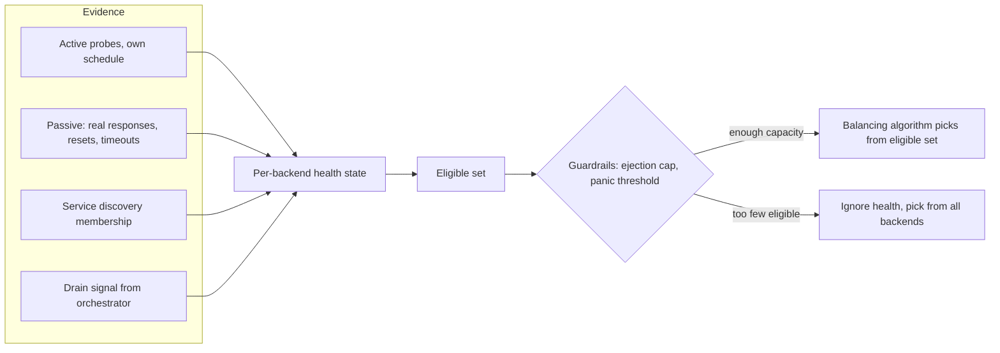
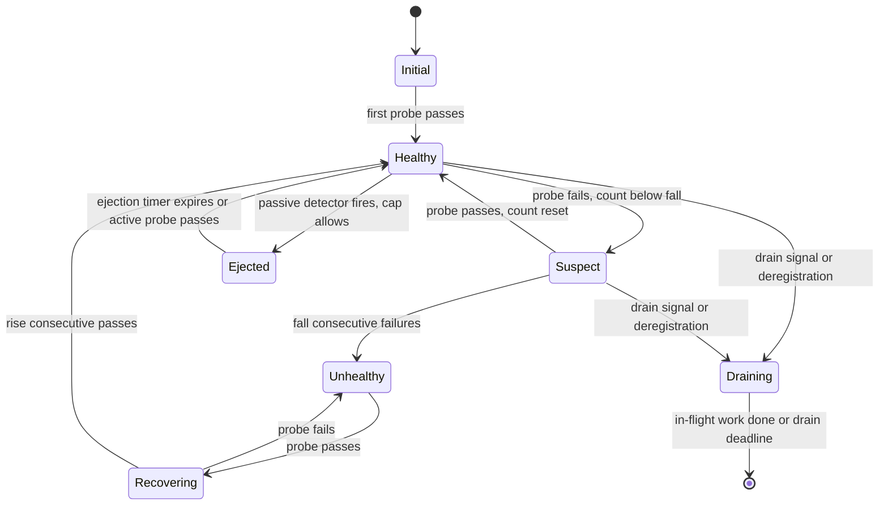
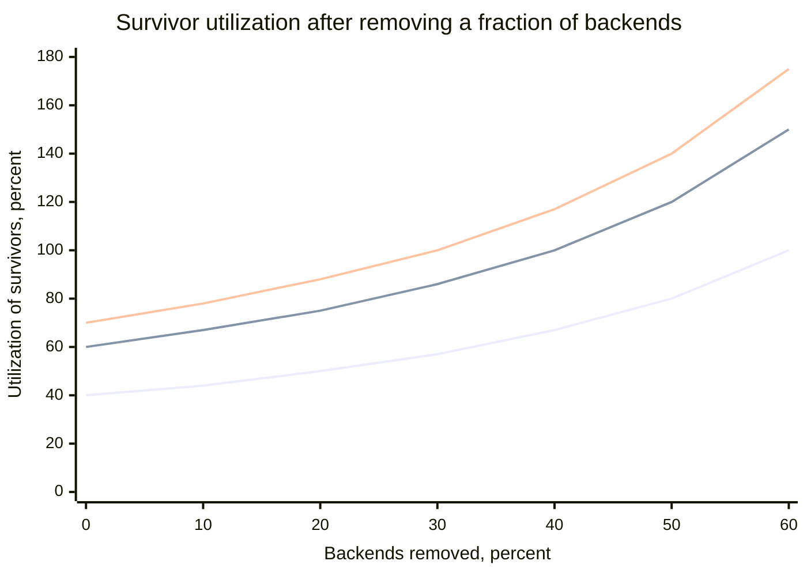
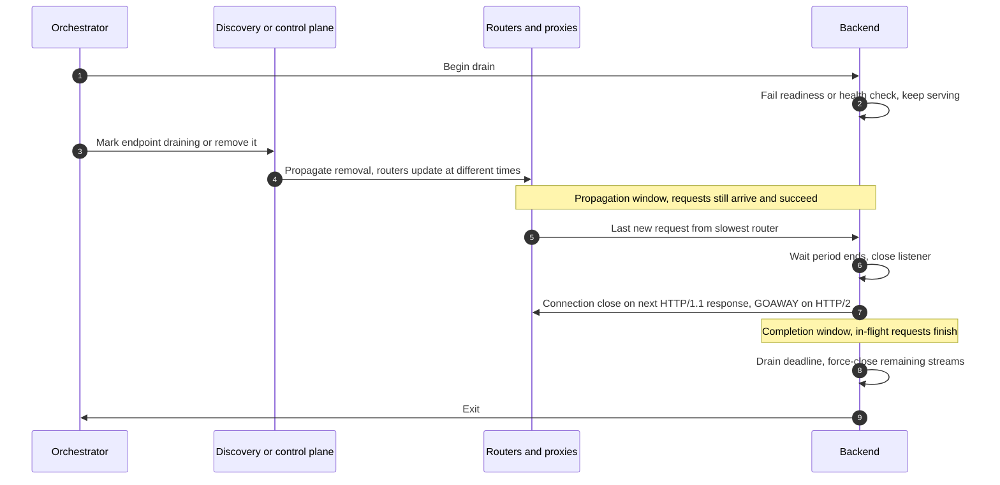
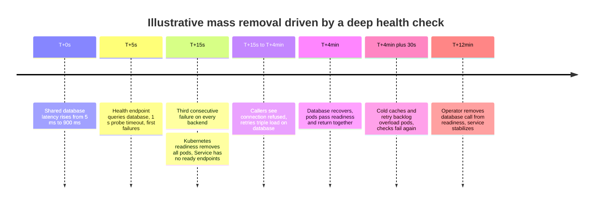

Sağlık durumuna duyarlı yönlendirme (health-aware routing), yük dengeleyicinin herhangi bir dengeleme algoritması çalışmadan önce hangi backend'lerin seçilebilir olduğuna karar veren kısmıdır. Her backend için bir sağlık durumu tutar ve bu durumu iki tür kanıtla besler: dengeleyicinin kendi takvimiyle gönderdiği aktif probe'lar ve ilettiği gerçek isteklerin pasif gözlemi. Bağlantı boşaltma (connection draining) ise planlı çıkarmadaki karşılığıdır: bir backend'i, hâlihazırda işlediği istekleri ya da bazı yönlendiriciler haberi henüz almadığı için hâlâ ona doğru yolda olan istekleri başarısız kılmadan rotasyondan çıkaran bir protokoldür. İkisi birlikte tek bir soruyu, sıradaki isteği hangi backend'in alabileceğini, birbirinden çok farklı iki koşulda yanıtlar: uyarı vermeden bozulan bir backend ve bilerek ayrılan bir backend.

Sağlık kontrolünün temel ödünleşimi, tespit hızı ile yanlış çıkarma arasındadır. Tek bir başarısız probe'dan ya da tek bir 5xx yanıttan sonra backend'i dışarı atan bir dengeleyici, çöken bir süreçten milisaniyeler içinde uzaklaşır; ama bir garbage collection duraklaması, kaybolan bir probe paketi ya da kısa bir aşırı yük tek bir kötü örnek ürettiğinde sağlıklı backend'leri de çıkarır. Eşikler ve histerezis yanlış çıkarmaları bastırır, bedeli daha yavaş tespittir. Doğru ya da yanlış her çıkarma, backend'in yükünü hayatta kalanlara taşır; dolayısıyla fazla hevesli bir sağlık sistemi kısmi bir arızayı tam bir kesintiye çevirebilir. Olgun her uygulamanın ikinci bir koruma katmanı taşımasının nedeni budur: bir ejection sınırı ve bir panic ya da fail-open eşiği. Bu katman, sağlık görünümüne güvenmek fazla kapasiteyi devreden çıkaracaksa, sağlıksız sanılan backend'lere bilerek trafik gönderir.

Boşaltmanın temel ödünleşimi ise eksiksizlik ile hız arasındadır. Her istemcinin çıkarmayı öğrenmesini, sürmekte olan her isteğin ve uzun ömürlü her bağlantının bitmesini bekleyen bir boşaltma hiçbir isteği başarısız kılmaz, ama bir deploy'u her parti için dakikalarca tutabilir; fazla kısa bir boşaltma ise her rollout'u, tıpkı bir kesinti gibi görünen bir reset ve 502 hatası patlamasına çevirir.

Bu sayfa her iki mekanizmanın dengeleyici tarafının sahibidir. Bir sağlık endpoint'inin neyi kontrol etmesi gerektiği [Sağlık Kontrol Endpoint Deseni](/distributed-systems/tr/microservice-patterns/service-discovery/health-check-endpoint/) sayfasında, Kubernetes probe semantiği [Liveness ve Readiness](/distributed-systems/tr/resilience/failure-detection/liveness-vs-readiness/) sayfasında, pod kapanış yaşam döngüsü [Graceful Termination ve PodDisruptionBudgets](/distributed-systems/tr/kubernetes/runtime-and-operations/graceful-termination-pdb/) sayfasında, sorunun sıradaki isteği göndermek değil bir düğümün hayatta olup olmadığı olduğu küme üyeliği için hata tespiti ise [Heartbeats ve Zaman Aşımı Yapılandırması](/distributed-systems/tr/resilience/failure-detection/heartbeats-timeouts/) sayfasında ele alınır.


*Sağlık katmanı dengeleme algoritmasının önünde durur. Dört tür kanıt backend başına tek bir durumu besler; koruma mekanizmaları bu duruma güvenilip güvenilmeyeceğine karar verir.*

Akış şeması çoğu zaman birbirine karıştırılan üç şeyi ayırır. Soldaki kanıtlar neyi görebildikleri bakımından farklıdır: probe'lar trafik yokken de vardır, pasif gözlem gerçek istek yolunu ancak trafik akarken görür, service discovery bir backend'in var olması gerekip gerekmediğini söyler, boşaltma sinyali ise ayrıldığını bildirir. Sağlık durumu hafızası olan bir özettir; eşikler ve ejection zamanlayıcıları burada yaşar. Koruma mekanizması tek tek backend'ler üzerinde değil tüm küme üzerinde verilen bir politika kararıdır ve sezgiye ters olan dalı sağdakidir: çok fazla backend sağlıksız göründüğünde dengeleyici kendi sağlık görünümüne inanmayı bırakır. Sonda çalışan seçim fonksiyonu, yeni seçilebilir hâle gelen backend'ler için slow start dahil, [Yük Dengeleme Algoritmaları](/distributed-systems/tr/communication/load-balancing/algorithms/) sayfasında anlatılır.

## Sağlık Görünümünü Kurmak: Aktif Probe'lar ve Pasif Outlier Tespiti

Bir dengeleyici sağlığı doğrudan gözlemleyemez. Örnekleri gözlemler: başarılı olan ya da zaman aşımına uğrayan bir probe, 503 taşıyan bir yanıt, reddedilen bir bağlantı. Sağlık durumu bu örneklerden kurulan bir tahmindir; tasarım kararları da hangi örneklerin alınacağı, harekete geçmeden önce kaç kötü örnek isteneceği ve geri dönüşün nasıl olacağıdır.

### Aktif Probe: Aralıklar, Eşikler ve Histerezis

Aktif bir sağlık denetleyicisi her backend'e her `interval` süresinde bir probe gönderir. Probe bir TCP bağlantısı (yalnızca porttaki bir şeyin bağlantı kabul ettiğini kanıtlar), beklenen durum koduyla bir sağlık yoluna yapılan HTTP isteği, adlandırılmış bir servis için `SERVING` ya da `NOT_SERVING` dönen standart `grpc.health.v1.Health` servisine gRPC çağrısı ya da Redis `PING` gibi protokole özgü bir alışveriş olabilir. `timeout` içinde tamamlanmayan probe başarısız sayılır. Denetleyici backend başına iki sayaç tutar: sağlıklı bir backend `unhealthy_threshold` ardışık başarısızlıktan sonra sağlıksız olur (HAProxy buna `fall` der), sağlıksız bir backend ise `healthy_threshold` ardışık başarıdan sonra yeniden sağlıklı olur (`rise`).

İki eşik arasındaki asimetri histerezistir ve maliyetler asimetrik olduğu için vardır. Hâlâ bozuk olan bir backend'i geri almak ona tam pay trafik gönderir ve istekleri başarısız kılar; iyileşmiş bir backend'i birkaç aralık daha dışarıda tutmak ise yalnızca biraz kapasiteye mal olur. Bu yüzden çoğu uygulama geri dönmek için ayrılmaktan daha fazla ardışık sonuç ister. AWS Application Load Balancer target group'ları varsayılan olarak 30 saniyelik aralık ve 5 saniyelik timeout ile 2 başarısızlık ve 5 başarı kullanır; HAProxy varsayılanları `fall 3`, `rise 2` ve `inter 2s`'dir. Envoy her iki eşiğin açıkça verilmesini ister ve iki kısayolu belgeler: başlangıçta tek bir başarılı kontrol host'u sağlıklı saymaya yeter, 503 alan bir HTTP kontrolü ise eşiği yok sayarak host'u hemen sağlıksız işaretler. Bu ikincisi, boşaltmaya başlayan bir backend'e kendi kontrollerini bilerek başarısız kılma yolu verir.

Bu parametrelerden iki özellik çıkar. Çöken bir backend için tespit süresi, bir sonraki probe'a kadar geçen süre artı kalan başarısızlıklarla sınırlıdır: `(unhealthy_threshold - 1) * interval` ile `unhealthy_threshold * interval` arasında, arıza reddedilen bağlantı değil de bir kara delikse buna `timeout` eklenir. İkinci özellik bunun ayna görüntüsüdür ve yanlış çıkarmayı önleyen odur: takılan bir backend (uzun bir garbage collection duraklaması, doymuş bir disk) ancak takılma kabaca `(unhealthy_threshold - 1) * interval + timeout` süresini aşarsa çıkarılır, çünkü daha kısa takılmalar eşikten daha az ardışık probe'u başarısız kılar. Eşik seçmek, gürültü saymaya razı olduğunuz en uzun takılmayı seçmektir.

Kötü ölçeklenen maliyet probe yüküdür. Her denetleyici her backend'i yokladığı için `N` denetleyici ve `M` backend, filo genelinde saniyede `N * M / interval` probe ve her backend'de saniyede `N / interval` probe üretir. Beş saniyede bir yoklayan dört merkezi proxy her backend'e saniyede 0,8 probe ekler, bu hiçtir. Aynısını yapan beş yüz sidecar ise her backend'e saniyede 100 probe ekler; sağlık endpoint'i bir veritabanına dokunuyorsa sağlık sistemi veritabanı yükünün anlamlı bir payına dönüşür. Bu yüzden büyük mesh'ler aktif kontrolleri merkezileştirir: control plane ya da ayrı bir denetleyici bir kez yoklar ve sonucu service discovery'nin parçası olarak dağıtır; Envoy'un health check filtresi de bir backend'in kendi sağlık yanıtını önbelleğe alarak birçok çağıranın probe'unun her birinin uygulamaya ulaşmasını engelleyebilir. Probe takvimindeki jitter (Envoy'da `interval_jitter` ve `initial_jitter`), bir yeniden başlatmadan sonra tüm denetleyicilerin aynı anda yoklamasını önler.

Aktif kontrollerin yapısal bir kör noktası vardır: isteğin yolunu değil probe'un yolunu test ederler. Bağlantı havuzu tükendiği için gerçek endpoint'leri başarısız olurken sağlık endpoint'i 200 dönen bir backend ya da probe'u çalışan bir ağ yolundan, istemci trafiği ise paket düşüren bir yoldan gelen bir backend her kontrolü geçer. Gözlemcinin görüşü ile kullanıcının görüşü arasındaki bu boşluğa Huang ve arkadaşları gray failure (gri arıza) der ve istek yönlendirmede yalnızca aktif probe'un yetmemesinin nedeni budur.

### Pasif Tespit: Canlı Trafikten Outlier Ejection

Pasif sağlık kontrolü, dengeleyicinin zaten ilettiği yanıtları kullanır. Envoy bu mekanizmaya outlier detection (aykırı değer tespiti) der ve belgelenmiş dedektörleri tasarım alanını iyi gösterir.

Ardışık hata dedektörü host başına ardışık başarısızlıkları sayar ve sayı eşiğe ulaştığında host'u dışarı atar: `consecutive_5xx` (varsayılan 5) her 5xx yanıtı ve bağlantı reset'leri, zaman aşımları gibi yerel olarak üretilen başarısızlıkları sayar; `consecutive_gateway_failure` yalnızca 502, 503 ve 504'ü sayar ve varsayılan olarak uygulanmaz. `split_external_local_origin_errors` açıkken proxy'nin kendisinin gözlemlediği başarısızlıklar (bağlantı kurulamaması, reset'ler, zaman aşımları) upstream'in döndüğü hatalardan ayrı sayılır; böylece hatalı girdi için doğru biçimde 500 dönen bir backend, bağlantıları reddeden bir backend'le karıştırılmaz. Başarı oranı dedektörü her `interval`'da (varsayılan 10 saniye) çalışır, en az `success_rate_request_volume` istek (varsayılan 100) almış host'lar için aralık boyunca başarı oranını hesaplar ve en az `success_rate_minimum_hosts` host (varsayılan 5) bu koşulu sağladıysa, oranı küme genelinde `mean - (success_rate_stdev_factor / 1000) * stdev` değerinin altına düşen host'ları dışarı atar (varsayılan çarpan 1900, yani 1,9 standart sapma). Başarısızlık yüzdesi dedektörü, başarısızlık oranı mutlak bir eşiği (varsayılan %85) aşan host'ları dışarı atar, ama `enforcing_failure_percentage` varsayılan değeri olan 0'dan yükseltilmedikçe uygulanmaz.

Göreli dedektörün mutlak olanlarda bulunmayan bir özelliği vardır: başarısızları değil aykırıları dışarı atar. Paylaşılan bir bağımlılık bozulduğu ya da tüm küme aşırı yüklendiği için tüm host'ların başarı oranı birlikte düşerse ortalama da onlarla birlikte düşer, standart sapma küçük kalır ve kimse dışarı atılmaz. Bu tam olarak doğru davranıştır, çünkü tekdüze bir arızada host atmak yalnızca yükü yoğunlaştırır. Ardışık hata dedektöründe böyle bir koruma yoktur: tekdüze aşırı yük altında her host 5xx dizileri üretir ve her host dışarı atılmaya aday olur; bir sonraki bölümde anlatılan sınırın var olma nedeni budur.

Dışarı atılan bir host, `base_ejection_time` (varsayılan 30 saniye) çarpı atılma sayısı kadar dışarıda kalır; bu süre `max_ejection_time` (varsayılan 300 saniye) ile sınırlanır. Zamanlayıcı dolunca host deneme süresi olmadan rotasyona döner: pasif tespitin bekleyebileceği olumlu bir sinyal yoktur, bu yüzden geri alma zamana göre yapılır ve hatalar sürerse host yeniden atılır, çarpan her tekrarda büyür. Aktif kontroller de çalışıyorsa, başarılı bir aktif kontrol varsayılan olarak host'u erkenden geri alır (`successful_active_health_check_uneject_host`).

Başka uygulamalar başka seçimler yapar. Açık kaynak NGINX'te yalnızca pasif kontrol vardır: `fail_timeout` (varsayılan 10 saniye) içinde `max_fails` başarısızlık (varsayılan 1) bir sunucuyu `fail_timeout` boyunca kullanılamaz işaretler; neyin başarısızlık sayılacağını `proxy_next_upstream` belirler, dolayısıyla yapılandırılmadıkça bir backend'in 500 yanıtları başarısızlık sayılmaz; aktif `health_check` bir NGINX Plus özelliğidir. HAProxy, `observe layer4` ya da `observe layer7` ile canlı trafiği aktif kontrol durumuna besleyebilir: `error-limit` hatadan (varsayılan 10) sonra, varsayılanı `fail-check` olan `on-error` eylemi başarısız bir kontrol sayılır ve sunucuyu daha hızlı kontrol aralığına geçirir. xDS kullanan gRPC gibi istemci taraflı dengeleyiciler outlier tespitini her istemcinin içinde çalıştırır ve bu, maliyet profilini değiştirir; `N` istemcinin her arızayı yeniden keşfetmesinin aritmetiği [İstemci Taraflı ve Sunucu Taraflı Yük Dengeleme](/distributed-systems/tr/communication/load-balancing/client-vs-server-side/) sayfasında hesaplanır.

:::note[Outlier tespiti bir circuit breaker değildir]
İkisi de hatalara tepki verir, ama farklı ayrıntı düzeyinde. Outlier tespiti bir host'u bir dengeleyicinin seçilebilir kümesinden çıkarır ve servisin trafiğini diğerlerine göndermeyi sürdürür. Bir [circuit breaker](/distributed-systems/tr/resilience/protection-patterns/circuit-breaker/) ise çağıranın bütün bir bağımlılığı çağırmasını durdurur ve hemen başarısız olur ya da fallback'e düşer. Envoy'un küme başına `circuit_breakers` ayarları ise üçüncü bir şeydir: bağlantılar, bekleyen istekler ve retry'lar üzerindeki eşzamanlılık sınırları; ikisinden çok bir [bulkhead](/distributed-systems/tr/resilience/protection-patterns/bulkhead-pattern/)'e yakındır.
:::

### İki Sinyal İçin Tek Durum Makinesi

İki kanıt kaynağı birbirinin yedeği değil tamamlayıcısıdır. Aktif probe'lar trafik yokken de sinyal üretir; bu, yeni katılan backend'ler, düşük trafikli servisler ve bir arızadan sonra geri alma için önemlidir. Pasif tespit ise gerçek istek yolunu görür ve trafik yüksekken birkaç istek içinde tepki verir. İkisini birleştirmek, bir backend'in rotasyondan farklı nedenlerle çıkabileceği ve her birinin kendi dönüş yolu olduğu anlamına gelir.


*Aktif probe'u, pasif ejection'ı ve planlı çıkarmayı birleştiren backend başına sağlık durumu. Yeni istekleri yalnızca Healthy ve Suspect alır.*

Diyagram üç tasarım kararını görünür kılar. Birincisi, Suspect hâlâ trafik alır: tek bir başarısız probe bir kanıttır, hüküm değildir ve backend'i bu noktada çıkarmak eşiği anlamsızlaştırır. İkincisi, iki dönüş yolu farklıdır. Unhealthy, Recovering üzerinden döner ve `rise` ardışık probe'u geçmek zorundadır; bu kanıta dayalı geri almadır. Ejected ise bir zamanlayıcıyla döner; bu zamana dayalı geri almadır, çünkü trafiği olmayan bir backend pasif kanıt üretmez. Atılmanın nedeni sürüyorsa backend ilk isteklerinde yeniden başarısız olur ve daha uzun süre için atılır. Üçüncüsü, Draining ayrı bir durumdur, Unhealthy'nin bir türü değildir: boşaltılan bir backend sürmekte olan işleri tamamlamayı sürdürmeli ve bir pencere boyunca boşaltmayı henüz görmemiş yönlendiricilerden gelen istekleri kabul etmeye devam etmelidir. Envoy'un discovery API'si bu ayrımı ayrı bir `DRAINING` sağlık durumu olarak kodlar; ama dengeleyicisi yeni istekler için onu `UNHEALTHY` gibi ele alır.

Service discovery dördüncü bir boyut ekler. Envoy, bunu sağlık kontrolleriyle birleştirmek için sonunda tutarlı (eventually consistent) bir kural belgeler: discovery'nin hâlâ listelediği ama kontrolleri geçemeyen bir host'a trafik gönderilmez, çünkü sağlık verisinin daha doğru olduğu varsayılır; discovery'den kaybolan ama kontrolleri hâlâ geçen bir host trafik almaya devam eder, çünkü discovery servisi yanılıyor olabilir; bir host ancak hem discovery'de yokken hem de kontrolleri geçemezken silinir. Kural, bozuk bir control plane'in bir kümeyi boşaltmasına karşı korur ve boşaltma açısından bir sonucu vardır: küme `ignore_health_on_host_removal` ayarını kullanmıyorsa, sağlık kontrolleri geçtiği sürece bir backend'i discovery'den çıkarmak ona giden trafiği durdurmaya yetmez; Envoy'un admin arayüzü bu tür host'ları `pending_dynamic_removal` olarak gösterir. Ayrılmak isteyen bir backend kontrollerini başarısız kılmalı ya da açıkça draining olarak işaretlenmelidir.

## Koruma Mekanizmaları: Ejection Sınırları, Panic Modu ve Fail-Open

Sağlık durumu, tek bir backend'in trafik alıp almaması gerektiğini yanıtlar. Geri kalan backend'lerin onun alacağı trafiği karşılayıp karşılayamayacağını yanıtlamaz ve her çıkarma yükü onlara kaydırır. Backend'ler `u` kullanımında çalışıyorsa ve bunların `f` kesri çıkarılırsa, hayatta kalanlar `u / (1 - f)` kullanımında çalışır. Çıkarmaların nedeni aşırı yükün kendisiyse bu kayma pozitif bir geri besleme döngüsüdür: aşırı yük hatalara, hatalar ejection'lara, ejection'lar hayatta kalanların yükünün artmasına, bu da daha fazla hataya yol açar. Bu döngü, [Kaskad Hata Analizi](/distributed-systems/tr/foundations/system-models/cascading-failure/) sayfasında incelenen yayılma mekanizmalarından biridir.


*Başlangıç kullanımı %40, %60 ve %70 (aşağıdan yukarıya) için hayatta kalanların kullanımı `u / (1 - f)`. Yükün hayatta kalanlara eşit dağıldığı varsayımıyla saf aritmetik.*

Eğriler hiperboldür, dolayısıyla pay sezginin önerdiğinden daha hızlı erir. %60 kullanımdaki bir filo backend'lerinin %40'ını kaybettiğinde doyuma ulaşır, ama %30'unu kaybettiğinde %85'lik güvenli tavanı aşar; %70'teki bir filo %30 çıkarmada doyar. Doğru koruma bu yüzden evrensel bir sabite değil, filonun taşıdığı boş kapasiteye bağlıdır.

Bu eğri üzerinde iki koruma mekanizması etkilidir. Ejection sınırı, pasif tespitin kümenin ne kadarını çıkarabileceğini sınırlar: Envoy'un `max_ejection_percent` değeri varsayılan olarak %10'dur, yani outlier tespiti tek başına host'ların onda birinden fazlasını asla çıkaramaz ve bir dedektörü tetikleyen sonraki host'lar rotasyonda kalır. Sınır yalnızca pasif ejection'a uygulanır; aktif sağlık kontrolü başarısızlıkları sınırlanmaz. Panic eşiği ise toplam üzerinde etkilidir: Envoy normalde yalnızca kullanılabilir host'lara yönlendirir, ama bir öncelik seviyesindeki kullanılabilir host oranı `healthy_panic_threshold` (varsayılan %50) altına düştüğünde sağlığı yok sayar ve tüm host'lar arasında dengeler. Eşiği 0'a ayarlamak panic modunu kapatır; bu durumda her host sağlıksızsa Envoy host seçimini başarısız kılar ve 503 "no healthy upstream" döner. AWS yük dengeleyicileri aynı fikri iki biçimde ifade eder: tüm etkin zone'lardaki her hedef sağlıksız olduğunda ALB fail-open olur; `target_group_health.unhealthy_state_routing.minimum_healthy_targets` target group özelliği (count, varsayılan 1, ya da percentage, varsayılan kapalı) ise fail-open noktasını yükselterek onu yapılandırılabilir bir panic eşiğine dönüştürür.

Bilinen kötü backend'lere yönlendirmenin neden doğru olabileceği bir kapasite argümanıdır. Paylaşılan bir bağımlılık yavaşladığı için backend'lerin %40'ının kontrollerini geçemediğini ve bunların bazı istekleri hâlâ başarıyla yanıtladığını varsayın. Yalnızca geçen %60'a yönlendirmek hayatta kalanları doyumun ötesine iter; orada üzerlerindeki her istek yavaşlar ve birçoğu başarısız olur. Hepsine yönlendirmek kötü backend'lerin bir kısmından hata döndürür, ama iyileri doyumun altında tutar. Panic modu, kalan kapasiteyi yok etmemek karşılığında sınırlı bir hata oranını kabul eder; sağlık sinyalinin kendisi yanlış olduğunda (gerçek istekleri etkilemeyen bir nedenle başarısız olan bir kontrol) da kötü sinyale rağmen servisi ayakta tutan odur. Koruma mekanizmaları ters yönde de yanılabilir: başarısız backend'ler kara delikse panic modu gerçek trafiği onlara gönderir. Bu yüzden panic modu sessiz bir geri çekilme değil, görünür bir alarm olmalıdır.

Her yönlendirme katmanında panic modu yoktur. EndpointSlice'lardan kurulan bir Kubernetes Service trafiği yalnızca hazır (ready) endpoint'lere gönderir; tüm pod'lar aynı anda readiness'ı geçemezse Service'in hazır endpoint'i kalmaz ve bağlantılar başarısız olur. Kubernetes 1.28'den beri kube-proxy, tüm endpoint'ler sonlanırken hâlâ hazır olan terminating pod'lara yönlendirir; bu rollout'ları korur, ama hazır olmayan pod'lara geri çekilme yoktur. Readiness probe'una konan bir bağımlılık kontrolü bu yüzden tüm Service genelinde kapalı hata verir (fail closed).

:::caution[Yük atma ile consecutive-5xx ejection kendini koruyan backend'leri çıkarır]
Yükü doğru biçimde atan bir backend fazla istekleri hızlıca 503 ile yanıtlar. Ardışık 5xx dedektörü bunu başarısızlık olarak okur ve backend'i dışarı atar; bu, trafiğini diğerlerine taşır, onlar da yük atmaya başlar ve sınıra ulaşılana kadar sırayla atılırlar. Aşırı yüke yatkın servislerde göreli başarı oranı dedektörünü kullanın, ejection sınırını filonun gerçekte taşıdığı boş kapasitenin altında tutun ve yük atma sinyalinin ayırt edilmesi gerekiyorsa backend'lerin dedektörün yok saymak üzere yapılandırıldığı bir durum kodu ya da header ile yük atmasını sağlayın. Sunucu tarafı için [Yük Atma](/distributed-systems/tr/resilience/flow-control/load-shedding/) sayfasına bakın.
:::

### Çalışılmış Örnek: Tespit Süresi, Yanlış Ejection'lar ve Hayatta Kalanların Yükü

Saniyede 8.000 istek sunan, 4 merkezi L7 proxy'nin arkasında 20 backend'den oluşan bir servis varsayın: backend başına saniyede 400 istek, her proxy'den her backend'e saniyede 100 istek. Backend'ler %60 kullanımda çalışıyor ve operatör %85'i güvenli tavan kabul ediyor. Aktif kontroller 1 saniyelik timeout ve `unhealthy_threshold` 3 ile 5 saniyede bir çalışıyor. Tüm sayılar örnek amaçlıdır.

Bir backend süreci çöküyor ve portu bağlantıları reddediyor. Belirli bir proxy'den gelen ilk başarısız probe 0 ile 5 saniye sonra ulaşır ve üçüncü başarısızlıktan önce iki aralık daha geçmelidir; dolayısıyla aktif tespit 10 ile 15 saniye, ortalama 12,5 saniye sürer. Burada pasif tespit çok daha hızlıdır: `consecutive_5xx` 5 iken her proxy saniyede 100 istekle 50 milisaniyede beş reddedilen bağlantı görür ve ardışık hata ejection'ı analiz aralığını beklemeden sayıya ulaşılır ulaşılmaz tetiklenir. Filo ölü backend'e yaklaşık 20 istek gönderir (proxy başına 5) ve reddedilen bağlantıları başka bir host'ta yeniden deneyen bir retry politikası bunları bile istemcilere görünmez kılar. Pasif tespit olmasaydı 12,5 saniyelik aktif pencere ona yaklaşık 5.000 istek gönderirdi.

Şimdi backend bir kara deliğe dönüşüyor: paketler düşürülüyor, dolayısıyla her istek ancak 1 saniyelik timeout'u dolduğunda başarısız oluyor. İlk saniyede her proxy, hepsi asılı kalan 100 istek gönderir; beşinci zaman aşımı yaklaşık 1,05 saniyede gelir ve o ana kadar proxy başına yaklaşık 105, toplamda yaklaşık 420 istek takılı kalmıştır; her biri tam bir saniye boyunca proxy'nin bekleyen istek sınırında bir yer işgal eder. Yavaş başarısızlıkların pasif tespiti bir timeout'luk trafiğe mal olur; bir kara deliğin etki alanını ejection eşiğinin değil istek timeout'unun belirlemesinin nedeni budur. Timeout'un nasıl ayarlanacağı [Zaman Aşımları](/distributed-systems/tr/resilience/protection-patterns/timeouts/) sayfasında anlatılır.

Madalyonun öbür yüzü yanlış ejection'dır. Tek bir probe'un 0,001 olasılıkla yersiz yere başarısız olduğunu (kaybolan bir paket, kısa bir zamanlama gecikmesi) ve başarısızlıkların bağımsız olduğunu varsayın. Her backend 5 saniyede 4 probe, yani saniyede 0,8 probe alır; eşik 1 olsaydı filonun 20 backend'i, bir proxy tarafından yaklaşık her 62 saniyede bir yanlış çıkarma görürdü. Eşik 3 iken art arda üç bağımsız yersiz başarısızlığın olasılığı `10^-9` olur ve yanlış çıkarmalar pratikte ortadan kalkar. Kırılan varsayım bağımsızlıktır: 12 saniyelik bir garbage collection duraklaması her proxy'den gelen üç ardışık probe'u aynı anda başarısız kılar. Takılma formülü sınırı verir, `(3 - 1) * 5 + 1 = 11` saniye: 11 saniyeden kısa duraklamalar emilir, daha uzunları backend'i dört proxy'den aynı anda çıkarır; bu da tartışmaya açık biçimde doğrudur, çünkü ona giden istekler de aynı süre beklerdi.

Son olarak koruma mekanizmaları. `k` backend'i çıkarmak hayatta kalanları `0.6 * 20 / (20 - k)` kullanımına taşır. %85 tavanı `20 - k >= 14.1` koşulunu, yani en fazla 5 backend'i, filonun %25'ini verir. Envoy'un %10'luk varsayılan ejection sınırı (2 backend) bu filo için temkinlidir; %50'lik varsayılan panic eşiği ise fazlasıyla gevşektir: 10 sağlıklı backend'de hayatta kalanlar %120'de olur, yani panic modu devreye girmeden çok önce filo aşırı yüklenir. Bu filo için kapasite argümanıyla uyumlu panic eşiği `0.6 / 0.85` civarı, yaklaşık %71'dir ve kullanım hedefleri her değiştiğinde yeniden hesaplanmalıdır.

## Bağlantı Boşaltma: İstekleri Başarısız Kılmadan Bir Backend'i Çıkarmak

Planlı çıkarma arızadan farklıdır, çünkü backend ayrıldığını bilir ve iş birliği yapabilir. Doğru bir boşaltmanın verdiği garanti şudur: backend'e ulaşan hiçbir istek reddedilmez ve backend'in kabul ettiği hiçbir istek belirtilen bir son tarihten önce terk edilmez. Uzun ömürlü bağlantıların hayatta kalacağını garanti etmez; bunlar düzenli biçimde kapatılır ve istemci yeniden bağlanır. Çökmelerde de işe yaramaz; orada backend'in iş birliği yapacak zamanı yoktur ve hasarı yalnızca retry'lar ve hızlı tespit sınırlar.

İki gecikme problemi önemsiz olmaktan çıkarır. Birincisi yayılmadır: bir backend çıkarılmak üzere işaretlendiğinde ona trafik gönderebilecek her yönlendirici, yani merkezi proxy'ler, sidecar'lar, istemci kütüphaneleri, her düğümdeki kube-proxy kuralları, bunu farklı bir anda öğrenir ve sonuncusu öğrenene kadar yeni istekler gelmeye devam eder. İkincisi tamamlanmadır: sürmekte olan istekler ve üzerinden daha sonra istek gelecek bağlantılar bitebilmelidir.


*Doğru bir boşaltma. Backend yayılma penceresi boyunca yeni bağlantıları kabul etmeyi sürdürür ve ancak en yavaş yönlendirici güncellendikten sonra durur.*

Adım 1 ile 5 yayılma penceresidir ve belirleyici ayrıntı adım 2'dedir: backend sağlık sinyalini başarısız kılar ama hizmet vermeyi bırakmaz. Adım 4'ü henüz işlememiş her yönlendirici ona istek göndermeye devam eder ve bu istekler başarılı olur. Adım 6, bu pencerenin aşması gereken andır: backend dinleyen soketini ancak son yönlendirici onu seçmeyi bıraktıktan sonra kapatabilir. Adım 7 ve 8 tamamlanma penceresidir. Dinleyiciyi kapatmak yetmez, çünkü yönlendiriciler ve istemciler üzerinden hâlâ yeni istek gelebilecek kalıcı bağlantılar tutar; backend onlara durmalarını söylemeli, sonra sürmekte olanı beklemelidir. Adım 9 tüm prosedürü sınırlar, çünkü bazı bağlantılar (stream'ler, WebSocket'ler, takılmış bir istek) kendiliğinden asla bitmez.

### İki Pencere Neden Yeterlidir

Doğruluk argümanının iki pencereye karşılık gelen iki parçası vardır. Çıkarma sırasında bir istek yalnızca üç biçimde başarısız olabilir: dinleyici kapandıktan sonra gelir, backend'in istek yoldayken tek taraflı kapattığı kalıcı bir bağlantı üzerinden gelir ya da süreç çıkarken işlenmektedir. Birincisi, dinleyiciyi kapatmadan önceki bekleme herhangi bir yönlendiriciye olan en büyük yayılma gecikmesini aşarsa dışlanır, çünkü o noktada hiçbir yönlendirici backend'i yeni bağlantılar için seçmez. İkincisi, kalıcı bağlantıları tek taraflı değil iş birliğiyle kapatarak dışlanır: HTTP/1.1'de backend her bağlantıdaki bir sonraki yanıta `Connection: close` ekler ve istemci bu bağlantı üzerinden başka bir şey göndermez; HTTP/2'de backend GOAWAY gönderir ve bunun last-stream-id alanı istemciye hangi stream'lerin işlenmediğini ve başka yerde yeniden denenmesinin güvenli olduğunu tam olarak söyler; bu mekanizma [HTTP/2, HTTP/3 ve QUIC](/distributed-systems/tr/communication/synchronous-protocols/http2-http3-quic/) sayfasında açıklanır. Üçüncüsü, boşaltma son tarihi servisin izin verdiği en uzun isteği aşarsa dışlanır; bu da ancak böyle bir sınır varsa işe yarar.

Argüman bağımlılıkları açıkça ortaya koyar. Boşaltma yalnızca ölçülmüş bir yayılma kuyruğuna ve sınırlı bir istek süresine göre doğrudur. Alışkanlıkla seçilmiş sabit bir sleep ikisi hakkında da bir tahmini kodlar. Üst üste önbellekleri olan ve yoklamayla çalışan (polled) bir registry'nin yayılma kuyruğu, [İstemci Taraflı ve Sunucu Taraflı Yük Dengeleme](/distributed-systems/tr/communication/load-balancing/client-vs-server-side/) sayfasında ölçüldüğü gibi dakikalar sürebilir; sınırsız streaming RPC'leri olan bir servisin ise hiç tamamlanma sınırı yoktur, bu yüzden boşaltması zorla kapatma ve düzgün biçimde yeniden bağlanan bir istemciyle bitmelidir.

Boşta duran bir HTTP/1.1 bağlantısında `Connection: close` gönderilecek bir sonraki yanıt yoktur. Backend onu doğrudan kapatırsa istemcinin tam o anda gönderdiği istek kapalı bir sokete ulaşır ve istemci işlenip işlenmediğini bilemez; bu, idle timeout'lar yanlış sıralandığında 502 üreten ve [L4 ve L7 Yük Dengeleme](/distributed-systems/tr/communication/load-balancing/l4-vs-l7/) sayfasında ele alınan yarışın aynısıdır. Idempotent istekler güvenle yeniden denenebilir; diğerleri denenemez. Sunucular boşta duran bağlantıları önce, yani yönlendiricilerin yeni istek göndermeyi zaten bıraktığı pencerede kapatarak yarışı daraltır ama ortadan kaldırmaz. HTTP/2 onu ortadan kaldırır; bu, proxy'lerle backend'ler arasında HTTP/2 kullanmak için pratik bir argümandır.

Bu sırayı uygulayan kapanış handler'ı kısadır; içeriği adımların sırasıdır.

```text
on SIGTERM:
  health.set(NOT_SERVING)          # fail checks, keep serving traffic
  sleep(propagation_tail)          # measured, not guessed
  listener.stop_accepting()
  for conn in open_connections:
    conn.close_after_current()     # Connection: close or GOAWAY
  wait_until(all_requests_done or now() > drain_deadline)
  force_close_remaining()          # streams, websockets, stuck requests
  flush_telemetry_and_exit()
```

Kubernetes'te orkestratör iki tarafa aynı anda sinyal gönderir: bir pod'u silmek hem EndpointSlice'lardan çıkarmayı hem de pod'un kapanışını paralel olarak başlatır; bu yüzden yayılma beklemesi pod'un içinde, tipik olarak SIGTERM teslim edilmeden önce uyuyan bir `preStop` hook'u olarak yer almalı ve tüm sıra `terminationGracePeriodSeconds` (varsayılan 30 saniye) içine sığmalıdır. Mekanizma [Graceful Termination ve PodDisruptionBudgets](/distributed-systems/tr/kubernetes/runtime-and-operations/graceful-termination-pdb/) sayfasında anlatılır.

### Dengeleyicide ve Proxy'de Boşaltma

Dengeleyiciler aynı iki pencereyi diğer taraftan uygular ve varsayılanları bir mertebe farklıdır. Bir AWS target group'u kaydı silinen hedefi `draining` durumuna alır ve `unused` durumuna geçirmeden önce `deregistration_delay.timeout_seconds` kadar bekler; aralık 0 ile 3.600, varsayılan 300 saniyedir. Bu süre boyunca ALB sürmekte olan isteklerin tamamlanmasına izin verir ve hedefe yeni istek göndermez. Network Load Balancer ise varsayılan olarak mevcut bağlantıların gecikme boyunca sürmesine izin verir ve sonrasında da açık bırakır; `deregistration_delay.connection_termination.enabled` özelliği onları gecikmenin sonunda kapattırır (yalnızca yeni UDP target group'larında varsayılanı true'dur). 300 saniyelik varsayılan, en uzun isteği iki saniye süren servislere de uygulandığından, ALB arkasındaki bir rolling deploy'un yavaş olmasının en yaygın nedenidir.

HAProxy, `drain` ile `maint` durumlarını ayırır. Drain durumuna alınan bir sunucu (runtime API'de `set server ... state drain` ile ya da drain bildiren bir agent check ile) persistence ile ona bağlı istemciler dışında yeni bağlantı almaz ve mevcut bağlantıları sürer; `maint` onu tamamen hizmet dışı bırakır. Envoy, discovery durumu `DRAINING` olan bir endpoint'i yeni istekler için kullanılamaz sayar; çıkarılan örnek Envoy'un kendisi olduğunda ise listener boşaltması HTTP/1 yanıtlarına `Connection: close` ekler, HTTP/2 bağlantılarına GOAWAY gönderir. Varsayılan kademeli (gradual) stratejide bir yanıtın bağlantısını kapatma olasılığı boşaltma süresinin (`--drain-time-s`) ilk yarısında 0'dan 1'e doğrusal olarak artar ve sürenin üçte ikisinden sonra hâlâ açık olan bağlantılar kalan sürede rastgele bir anda kapatılır. Yaymanın amacı yeniden bağlanma yüküdür: her bağlantıyı aynı anda kapatmak her istemciyi aynı anda yeniden bağlatır; bu, uzun ömürlü bağlantılar için [WebSocket ve Server-Sent Events](/distributed-systems/tr/communication/synchronous-protocols/websocket-sse/) sayfasında anlatılan fırtınadır.

Boşaltmanın tersi de gerekir: yeni geri alınmış bir backend hemen tam pay almamalıdır. Bu rampa, yani slow start, seçim fonksiyonuna aittir ve [Yük Dengeleme Algoritmaları](/distributed-systems/tr/communication/load-balancing/algorithms/) sayfasında anlatılır.

### Çalışılmış Örnek: Bir Boşaltmayı Boyutlandırmak

20 backend'li servisle devam edelim; servis artık IP modunda bir ALB arkasında Kubernetes üzerinde çalışıyor. Ölçülmüş değerleri şöyle varsayın: endpoint çıkarması ALB'ye ve küme içi proxy'lere %99,9'luk dilimde 4 saniye içinde ulaşıyor, normal istekler 2 saniye içinde bitiyor ve bir dosya yükleme endpoint'i 25 saniyeye kadar izin veriyor. Aşağıdaki örnek sayılar bu varsayımlardan çıkar.

`preStop` sleep'i yayılma kuyruğunu payla aşmalıdır, örneğin 8 saniye. Tamamlanma penceresi izin verilen en uzun isteği, 25 saniyeyi, birkaç saniyelik payla kapsamalıdır; dolayısıyla boşaltma son tarihi sleep'ten yaklaşık 30 saniye sonradır ve `terminationGracePeriodSeconds` en az 40 olmalıdır. Target group'un deregistration gecikmesi 300 değil, uygulamanın boşaltmasıyla uyumlu olarak yaklaşık 40 saniye olmalıdır. Partide 5 pod ve 4 parti ile boşaltma rollout'a varsayılan gecikmedeki 20 dakika yerine yaklaşık 2,7 dakika ekler. Yükleme endpoint'ine 10 dakika izin verilseydi doğru yanıt her deploy'da her pod için 10 dakikalık bir boşaltma olmazdı; yeniden başlatılabilir (resumable) yüklemeler olurdu, böylece kısa bir son tarihte zorla kapatma bir istemciye on dakikalık iş değil tek bir retry kaybettirirdi.

## Uygulamaların Karşılaştırması ve Önemli Ayarlar

Mekanizmalar her yerde aynıdır; varsayılanlar, pasif sinyal ve fail-open davranışı ise değildir.

| Uygulama | Aktif kontroller | Pasif tespit | Fazla sayıda sağlıksız olduğunda | Boşaltma mekanizması | Ne zaman tercih edilmeli |
|---|---|---|---|---|---|
| Envoy | HTTP, gRPC, TCP, Redis, Thrift; eşikler açıkça verilir | Outlier detection: ardışık, başarı oranı, başarısızlık yüzdesi | Panic eşiği, varsayılan %50; ejection sınırı %10 | Discovery'den `DRAINING` durumu; GOAWAY ve `Connection: close` ile listener boşaltma | Sağlık politikasının küme başına ayarlanması gereken mesh ya da edge |
| HAProxy | TCP, HTTP, agent check; `inter 2s`, `rise 2`, `fall 3` | Kontrol durumunu besleyen `observe` ve `error-limit` | Otomatik panic yok; yapılandırıldıysa backup sunucular | Runtime API ya da agent ile `drain` ve `maint` durumları | Operatörün her sunucuyu denetlediği merkezi proxy katmanı |
| Açık kaynak NGINX | Yok (yalnızca NGINX Plus) | `max_fails` ve `fail_timeout`; başarısızlıkları `proxy_next_upstream` tanımlar | Panic modu yok; her sunucu başarısız işaretlendiğinde istekler "no live upstreams" hatasıyla başarısız olur | Worker'ların graceful reload'u; sunucu başına drain NGINX Plus'ta | Pasif işaretlemenin yettiği basit katmanlar |
| AWS ALB / NLB | HTTP, HTTPS, gRPC, TCP; ALB 30 sn, 2 düşüş, 5 dönüş | Weighted random ile ALB anomaly mitigation (isteğe bağlı) | Hepsi sağlıksızken fail-open; yapılandırılabilir asgari sağlıklı hedef | Deregistration gecikmesi, varsayılan 300 sn | Yönetilen edge; gecikmeyi ve eşikleri target group başına ayarlayın |
| Kubernetes Service | Pod başına kubelet readiness probe'ları | kube-proxy'de yok | Hazır olmayan pod'lara geri çekilme yok; hepsi sonlanırken terminating ama hazır olanlar kullanılır | EndpointSlice `terminating` ve `serving` koşulları | Küme içi L4; pasif tespit için bir proxy ile eşleyin |

Tablo bir sinyal sahipliği seçimini gizler. Envoy, HAProxy ve ALB'de dengeleyici sağlığa kendi bakış noktasından karar verir, dolayısıyla iki dengeleyici aynı backend hakkında farklı düşünebilir; Kubernetes'te ise readiness'a backend'in düğümündeki kubelet karar verir ve her kube-proxy bu tek hükmü izler. Bu, anlaşmazlığı önler ama pod'u çağıranların ağ yolundan değil kendi düğümünden test eder.

Her iki sinyal türünü birleştiren, kesin bozuk host kanıtı olan yerel kökenli başarısızlıkları yük atma olabilecek uygulama 5xx'lerinden ayıran ve korumalarını çalışılmış örnekteki boş kapasiteden boyutlandıran bir Envoy kümesi:

```yaml
health_checks:
- timeout: 1s
  interval: 5s
  interval_jitter: 1s
  unhealthy_threshold: 3        # absorbs stalls shorter than ~11 s
  healthy_threshold: 2
  http_health_check: { path: /healthz/ready }
outlier_detection:
  split_external_local_origin_errors: true
  consecutive_local_origin_failure: 5   # resets, refused, timeouts
  consecutive_5xx: 0                    # do not eject on app 5xx (shedding)
  enforcing_success_rate: 100           # relative detector for app errors
  success_rate_stdev_factor: 1900
  base_ejection_time: 30s
  max_ejection_percent: 25              # from headroom: 1 - 0.6 / 0.85
common_lb_config:
  healthy_panic_threshold: { value: 70.0 }
```

:::tip[Yalnızca hatalara değil, koruma mekanizmalarına da alarm kurun]
Ejection sayıları, sınır yüzünden bastırılan ejection'lar ve panic modunda geçen süre, filo çapındaki bir sorunun öncü göstergeleridir. Envoy'da bunlar `outlier_detection.ejections_active` ve `outlier_detection.ejections_overflow` küme istatistikleri ile `lb_healthy_panic` sayacıdır. Panic moduna giren bir küme, sağlık sisteminin anlaşmazlığı üzerinden hizmet vermektedir ve hata oranı hâlâ kabul edilebilir görünse bile bu birini uyandırmalıdır.
:::

## Üretimdeki Hata Modları

### İlişkili Sağlık Sinyalleriyle Toplu Çıkarma

Tetikleyici: paylaşılan bir şeye bağlı bir sağlık kontrolü; örneğin sağlık endpoint'inde bir veritabanı sorgusu, yük altındaki gecikmeden kısa timeout'lu bir kontrol ya da aşağı akıştaki bir servis yavaşladığında başarısız olan bir kontrol. Paylaşılan şey bozulduğunda her backend kontrollerini aynı anda geçemez. Belirtiler: servis tek bir kontrol aralığında kısmen bozulmuştan tamamen çökmüşe geçer; loglarda "no healthy upstream" ya da bağlantı reddi görülürken backend'lerin kendi istek logları hizmet verdiklerini gösterir. Tespit: zaman içinde sağlıksız işaretlenen backend oranı ve sağlık kontrolü başarısızlıkları ile bir bağımlılığın gecikmesi arasındaki korelasyon. Azaltma: yalnızca örneğin kendisinin düzeltebileceği şeyi test eden sağlık kontrolleri, boş kapasiteden boyutlandırılmış panic eşikleri ve yönlendirme katmanının desteklediği yerde fail-open varsayılanları. Kurtarma çoğu zaman sağlık sisteminin kendisi tarafından engellenir: backend'ler geri gelir, tüm yükü bir anda alır ve yeniden başarısız olur.


*Varsayımsal bir olay; süreler örnek amaçlıdır. Arıza backend'lerde değil sağlık sistemindedir.*

Zaman çizelgesi, yönlendirme katmanının kontrol kadar önemli olduğunu gösterir. Panic eşiği olan bir dengeleyicinin arkasında T+15s adımı tüm backend'lere yönlendirmeyi sürdürürdü ve veritabanı yavaşlığı redler yerine yavaş yanıtlar üretirdi. Panic modu olmayan bir Kubernetes Service'in arkasında ise aynı kontrol tam bir kesinti üretir. T+4min artı 30 saniyedeki ikinci arıza, [Retry Fırtınaları ve Metastabil Hatalar](/distributed-systems/tr/resilience/flow-control/retry-storms-metastable-failures/) sayfasındaki metastabil örüntüdür: tetikleyici ortadan kalkmıştır, ama eşzamanlı geri alma ve retry birikimi sistemi çökmüş hâlde tutar.

### Flapping (Sürekli Girip Çıkma)

Tetikleyici: 1 değerinde eşikler, histerezis yokluğu ya da probe'ların aralıklı başarısız olduğu kadar sınırına yakın çalışan bir backend. Belirtiler: bir backend her birkaç aralıkta bir rotasyona girip çıkar; her geri alma ona tam pay yük göndererek onu yeniden sınırın ötesine iter. Tespit: backend başına saatlik sağlık durumu geçişleri (HAProxy her UP ve DOWN geçişini loglar; Envoy sağlık kontrolü başarısızlığı ve ejection olayları yayar) ve diğer backend'lerde aynı periyotla salınan yük. Azaltma: `unhealthy_threshold`'dan büyük bir `healthy_threshold`, geri almada slow start ve Envoy'un ejection çarpanıyla otomatik uyguladığı büyüyen ejection süreleri. Yük altında girip çıkan bir backend genellikle yetersiz boyutlandırılmıştır ve çözüm sağlık ayarı değil kapasitedir.

### Gray Failure: Probe'lar Geçer, İstekler Başarısız Olur

Tetikleyici: probe ve istek farklı yollardan geçer. Sağlık endpoint'i ayrı bir thread pool'dan, ayrı bir porttan ya da bozuk bağımlılığı atlayan bir kod yolundan sunulur ya da denetleyiciden gelen ağ yolu istemcininkinden farklıdır. Belirtiler: hâlâ sağlıklı görünen bir backend'den yükselen hatalar. Tespit: çağıranlar tarafındaki backend başına hata oranının sağlık durumuyla karşılaştırılması; hata oranı yüksek ve durumu sağlıklı olan her backend bir gray failure'dır. Azaltma: tanımı gereği istek yolunu ölçen pasif tespit ve gerçek trafikle aynı havuzlarda ve listener'larda çalışan sağlık endpoint'leri. Yüke duyarlı algoritmalar altında arıza büyür, çünkü hızlı başarısız olan bir backend boşta görünür ve daha fazla trafik çeker; bu, [Yük Dengeleme Algoritmaları](/distributed-systems/tr/communication/load-balancing/algorithms/) sayfasında incelenen kara delik etkisidir.

### Boşaltma Yarışı: Her Deploy'da Hatalar

Tetikleyici: backend, her yönlendirici onu çıkarmadan önce bağlantı kabul etmeyi bırakır; en sık rastlanan biçimi, endpoint çıkarması hâlâ yayılırken SIGTERM'e hemen çıkarak yanıt veren bir pod'dur. Belirtiler: her deploy partisiyle hizalanmış, birkaç saniye süren ve istekler hiçbir canlı sürece ulaşmadığı için backend'in kendi loglarında görünmeyen bir 502, 503 ya da bağlantı reset'i patlaması.

```mermaid
sequenceDiagram
    autonumber
    participant API as Kubernetes API
    participant K as Kubelet
    participant P as Pod
    participant EC as Endpoint controller
    participant LB as Proxy or kube-proxy
    participant C as Caller
    API->>K: Pod deleted
    API->>EC: Pod deleted
    par Shutdown and removal race
        K->>P: SIGTERM, no preStop hook
        P->>P: Server stops, listener closed in 50 ms
    and
        EC->>LB: EndpointSlice update, arrives after 2 s
    end
    rect rgb(70, 40, 40)
    C->>LB: Request
    LB->>P: Forward to removed pod
    P-->>LB: Connection refused
    LB-->>C: 502 or 503
    end
    Note over LB,C: Window lasts until the slowest proxy applies the update
```


*Yayılma beklemesi olmayan bir deploy. Pod'un kapanışı endpoint çıkarmasıyla yarışı kazanır. Süreler örnek amaçlıdır.*

Adım 3 ile 5 paralel çalışır ve onları hiçbir şey sıraya koymaz. Pod onlarca milisaniyede çıkar; adım 5'teki güncelleme son proxy'ye control plane ne kadar sürerse o kadar sonra ulaşır. Gölgeli bloktaki, adım 6 ile 9 arasındaki her istek başarısız olur ve bir retry politikası ancak retry farklı bir pod'a düşerse ve istek yeniden denenmeye uygunsa işe yarar. Tespit: upstream yanıt bayrağına göre ayrılmış deploy partisi başına hata oranı (Envoy'da upstream bağlantı başarısızlığı için `UF`, upstream bağlantı sonlandırması için `UC`). Azaltma: ölçülmüş yayılma kuyruğundan uzun bir `preStop` sleep'i, yukarıdaki boşaltma sırasını izleyen bir kapanış handler'ı ve idempotent istekler için bağlantı başarısızlığında retry. Her partiden sonra kurtarma kendiliğindendir; bu arızanın çoğu zaman düzeltilmeden kalmasının nedeni de budur: her deploy küçük, kendiliğinden geçen bir hata sıçraması üretir.

### Hiç Bitmeyen ya da Bir Anda Biten Boşaltmalar

Tetikleyici: azami yaşı olmayan uzun ömürlü bağlantılar (WebSocket'ler, gRPC stream'leri, veritabanı proxy'leri) ya da servisin ihtiyacından çok daha uzun bir dengeleyici gecikmesi. Belirtiler: ilk durumda eski pod'lar grace period dolana kadar Terminating'de kalır, sonra öldürülür ve kalan her bağlantı aynı anda kapanır, böylece istemciler eşzamanlı yeniden bağlanır; ikinci durumda rolling deploy'lar onlarca dakika sürer ve boşaltılan örnekler kapasiteden sayıldığı için bu süre boyunca kapasite azalır. Tespit: örnek başına boşaltma başlangıcından çıkışa kadar geçen süre, zorla kapatmada kalan bağlantılar ve her partiden sonraki yeniden bağlanma oranı. Azaltma: uzun ömürlü bağlantıların sürekli yeniden dengelenmesi için jitter'lı sınırlı bir azami bağlantı yaşı, boşaltma penceresinde kademeli kapatma ve ölçülmüş istek sürelerinden boyutlandırılmış deregistration gecikmeleri.

### Denetleyici Aşırı Yükü

Tetikleyici: her çağırandan her backend'e aktif kontroller ya da gerçek iş yapan bir sağlık endpoint'i, yani daha önce hesaplanan `N / interval` yükü. Belirtiler: çağıran eklemek trafik eklemeden backend CPU'sunu artırır ve istek loglarına sağlık istekleri hâkim olur. Tespit: backend başına probe oranının gerçek trafikle karşılaştırılması. Azaltma: discovery üzerinden dağıtılan merkezi kontrol, backend tarafında sağlık kontrolü önbelleği ve subsetting.

| Arıza | Belirti | Tespit | Azaltma |
|---|---|---|---|
| Toplu çıkarma | Kısmi bozulma tek aralıkta tam kesintiye döner | Sağlıksız backend oranı; bağımlılık gecikmesiyle korelasyon | Yüzeysel kontroller, boş kapasiteden panic eşiği, fail-open yönlendirme |
| Flapping | Backend rotasyona girip çıkar, yük salınır | Saatlik sağlık geçişleri | Histerezis, slow start, büyüyen ejection süreleri |
| Gray failure | Sağlıklı görünen bir backend hata verir | Çağıran tarafı hata oranı ile sağlık durumu | Pasif tespit, istek yolunda probe'lar |
| Boşaltma yarışı | Her deploy partisinde hata patlaması | Parti başına hatalar, upstream bağlantı başarısızlığı bayrakları | Kapatmadan önce yayılma beklemesi, sıralı kapanış |
| Bitmeyen ya da ani boşaltmalar | Yavaş deploy'lar ya da yeniden bağlanma fırtınaları | Boşaltma süresi, zorla kapatmadaki bağlantılar | Jitter'lı azami bağlantı yaşı, boyutlandırılmış deregistration gecikmesi |
| Yük atan backend'lerin atılması | Yük altında filoya yayılan ejection'lar | Ejection sayısı ile 503 oranı | Başarı oranı dedektörü, yük atma durumunu yok sayma, boş kapasiteden sınır |
| Denetleyici aşırı yükü | Sağlık trafiği gerçek trafiğe yaklaşır | Backend başına probe oranı | Merkezi kontroller, önbellek, subsetting |

## Sağlık Durumuna Duyarlı Yönlendirme Ne Zaman Yardım Eder, Ne Zaman Zarar Verir

Aktif sağlık kontrollerini, bir dengeleyicinin trafik almıyor olabilecek backend'ler hakkında karar vermesi gereken her yerde kullanın: yeni eklenen backend'ler, düşük trafikli servisler, arızadan sonra geri alma ve uygulama yanıtlarını göremeyen L4 katmanları. Kontrolleri yüzeysel tutun, örneğin kendisinin denetlediği şeyi test etsinler ve eşikleri gürültü saymaya razı olduğunuz en uzun takılmadan `(unhealthy_threshold - 1) * interval + timeout` ile belirleyin. Büyük bir mesh'te aktif kontrolleri her istemciden çalıştırmayın; merkezileştirin ve sonucu dağıtın. Bağımlılık herkes için başarısız olduğunda yönlendirme katmanı fail-open olmayacaksa, bir sağlık kontrolünü paylaşılan bir aşağı akış bağımlılığına bağlamayın.

Pasif outlier tespitini, backend başına saniyeler içinde sinyal üretecek kadar trafiği olan her L7 proxy'de ve istemci taraflı dengeleyicide kullanın; istek yolundaki gray failure'ları gören tek mekanizma odur. Yük atan ya da hatalı girdi için hata dönen servislerde ham ardışık 5xx sayıları yerine yerel kökenli başarısızlıkları ve göreli başarı oranı dedektörünü tercih edin. Her dengeleyici bir backend'e dakikada yalnızca birkaç istek gönderiyorsa pasif tespite güvenmeyin: dedektör asgari hacmine ulaşamaz ve her çağıran aynı arıza için ayrı ayrı bedel öder. Ejection sınırını ve panic eşiğini filonun boş kapasitesiyle karşılaştırmadan varsayılanlarda bırakmayın: doğru değerler sınır için `1 - u / u_safe`, panic eşiği için yaklaşık `u / u_safe`'dir ve kullanım hedefleri değiştiğinde yeniden hesaplanmalıdır.

Bağlantı boşaltmayı her planlı çıkarmada kullanın: deploy'lar, ölçek küçültme, düğüm bakımı ve dengeleyici örneğinin değiştirilmesi. Yayılma beklemesini discovery yakınsamasının ölçülmüş kuyruğundan, tamamlanma penceresini servisin izin verdiği en uzun istekten, dengeleyicinin deregistration gecikmesini de varsayılanından değil aynı sayılardan boyutlandırın. Boşaltmayı çökmeleri kapsayacak hâle getirmeye çalışmayın; çöken bir süreç iş birliği yapamaz ve oradaki savunmalar hızlı pasif tespit, idempotent isteklerin retry'ı ve kaybedilen örneği emecek kadar kapasitedir. Uzun ömürlü bağlantılar için sınırsız bir boşaltma kullanmayın; bağlantı yaşını sınırlayın, kademeli kapatın ve istemcilerin jitter ile yeniden bağlanmasını sağlayın.

## İleri Okuma

- Envoy Project, *Health checking*, *Outlier detection*, *Panic threshold* ve *Draining*, Envoy mimari genel bakış dokümantasyonu, güncel sürüm.
- Peng Huang, Chuanxiong Guo, Lidong Zhou, Jacob R. Lorch, Yingnong Dang, Murali Chintalapati ve Randolph Yao, *Gray Failure: The Achilles' Heel of Cloud-Scale Systems*, USENIX HotOS, 2017.
- Betsy Beyer, Chris Jones, Jennifer Petoff ve Niall Richard Murphy (ed.), *Site Reliability Engineering*, O'Reilly, 2016, "Load Balancing in the Datacenter" ve "Addressing Cascading Failures" bölümleri.
- Martin Thomson ve Cory Benfield (ed.), *HTTP/2*, RFC 9113, IETF, 2022, GOAWAY ve graceful shutdown üzerine 6.8. bölüm.
- Amazon Web Services, *Health checks for Application Load Balancer target groups* ve *Target group attributes*, Elastic Load Balancing dokümantasyonu.
- Kubernetes Project, *KEP-1669: Proxy Terminating Endpoints*, Kubernetes Enhancement Proposals, 1.28'de stable.
