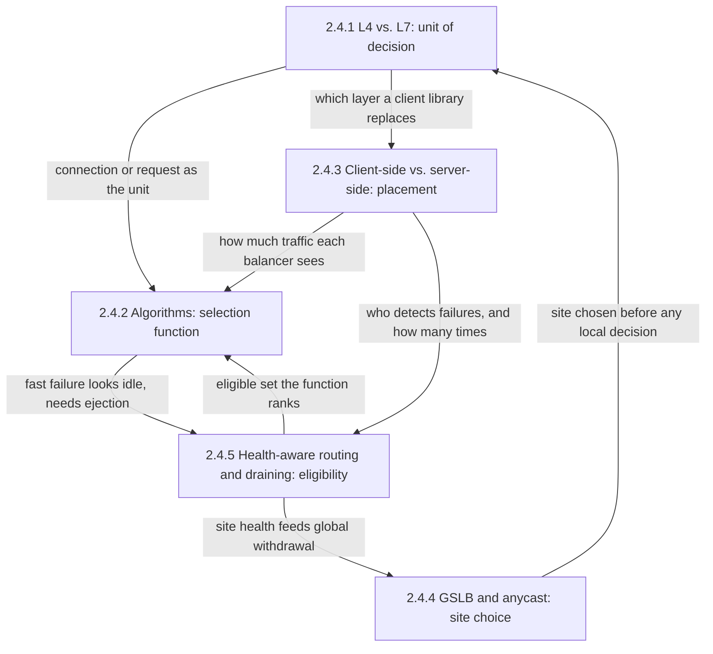
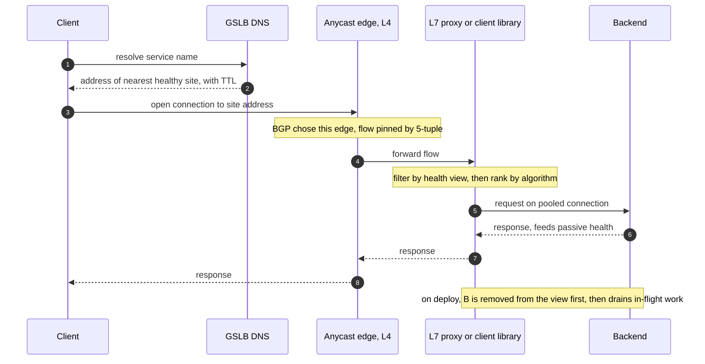
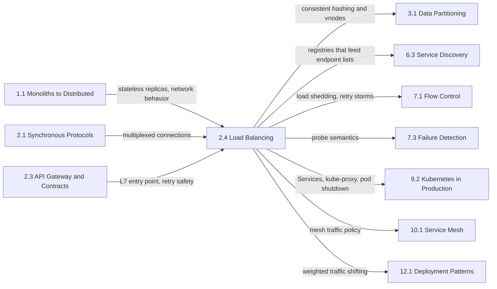

Yük dengeleyici, birçok replikayı tek bir servis gibi gösterir. Çağıranlar tek bir isme ya da sanal IP'ye istek gönderir, iş arkasındaki üyelere dağılır, çöken ya da ayrılan üyeler iş almayı bırakır. Yük dengeleyici olmadan bir filonun kapasitesini replikaların toplamı değil, en çok yük alan replika belirler; [Ölçekleme İkilemi](/distributed-systems/tr/foundations/monoliths-to-distributed/scaling-dilemma/) sayfasından itibaren yatay ölçeklenen her tasarım, bu işi bir şeyin yaptığını varsayar.

Bu bölümün ele aldığı tek problem, her iş birimi için onu hangi replikanın alacağını seçmektir. Bu seçim aslında her biri kendi sayfasına sahip beş ayrı karardır: birim (paket başlıklarından bağlantı başına bir kez mi, protokol ayrıştırıldıktan sonra istek başına bir kez mi), adayları sıralayan fonksiyon (rotasyon, yüke duyarlı seçim ya da bir anahtarın hash'lenmesi), konum (ayrı bir katman mı, her çağıranın kendisi mi), site (istemcinin önce hangi region'a ya da varlık noktasına, yani PoP'a ulaştığı) ve uygunluk (bazıları çökmekte, bazıları bilerek ayrılmaktayken hangi backend'lerin seçilebileceği).

Beşinin hepsinden geçen gerilim, bilgi ile bu bilginin maliyeti ve bayatlığı arasındadır. Daha fazla bilgi kullanan bir karar, durağan durumda daha iyidir: her isteği gören bir L7 proxy tek bir HTTP/2 bağlantısının stream'lerini dağıtabilir, bekleyen istekleri izleyen bir dengeleyici yavaşlayan bir backend'i fark eder, kendi dengelemesini yapan bir istemci kendi gecikmesini görür, istemcinin alt ağını bilen bir DNS sunucusu onu yakındaki bir region'a yollar. Ama her bilginin bir bedeli vardır; bir ayrıştırma hop'u, bin çağırana kopyalanan bir endpoint listesi ya da operatörün kontrol edemediği bir TTL boyunca cache'lenen bir DNS yanıtı. Üstelik bilgi her zaman kısmi ve gecikmelidir: her dengeleyici yalnızca kendi trafiğini görür ve her sağlık sinyali geçmişi anlatır.

Birinciden doğan ikinci gerilim, bölümün hata modlarının çoğunu üretir: bilgisine tepki veren bir dengeleyici, tepki verdiği hatayı büyütebilir. Anında hata dönen bir backend, yüke duyarlı bir algoritmaya boşta görünür ve daha fazla trafik çeker. Backend'leri dışarı atan bir sağlık denetleyicisi onların yükünü hayatta kalanlara aktarır; onlar da bu kez kendi kontrollerinden kalabilir. Küresel yönlendirmeden çıkarılan bir region, trafiğini kendi tepe yüküne göre boyutlandırılmış komşularına gönderir. Her sayfa, mekanizmasını bu geri beslemeyi durduran korumayla birlikte ele alır.

## Tek Adresin Arkasındaki Beş Karar: Konular Nasıl Birbirine Bağlanır

Kök, katman sayfasıdır, çünkü karar birimi diğer her şeyi sınırlar: istek düzeyinde görünürlük varsayan hiçbir şey L4'te yoktur. Oklar, bir sayfanın çıktısının nerede diğerinin girdisi olduğunu gösterir.

*Bölümdeki konular arasındaki bağımlılıklar. Her ok, bir sayfanın işaret ettiği sayfaya ne devrettiğini ya da ondan ne beklediğini adlandırır.*

Bölümün akıl yürütmesinin büyük kısmını üç ok taşır. Konumdan algoritmalara giden ok, aynı fonksiyonun bir proxy katmanında ve bir istemci kütüphanesinde neden farklı davrandığını açıklar: kararı yüzlerce çağırana yaymak, her birinin yük sinyalini en az bağlantı (least connections) rastgele seçime dönüşene kadar inceltir. Algoritmalardan sağlık durumuna duyarlı yönlendirmeye geri dönen ok, kara delik hatasıdır: her isteğe anında hata dönen bir backend en az bekleyen isteğe ve en düşük gecikmeye sahiptir; bu yüzden yüke duyarlı bir fonksiyon, outlier detection onu dışarı atana kadar ona daha fazla trafik gönderir. Sağlık durumuna duyarlı yönlendirmeden GSLB'ye giden ok ise site yönlendirmesinin bir üst düzeydeki aynı uygunluk kararı olduğunu ve aynı tehlikeyi taşıdığını gösterir: her site ortak bir bağımlılık yüzünden kontrolden kaldığında, küresel yönlendirme hepsini birden devreden çıkarır.

## Her Konunun Yanıtladığı Soru

[L4 ve L7 Yük Dengeleme: Transport ve Uygulama Katmanı](/distributed-systems/tr/communication/load-balancing/l4-vs-l7/), dengeleyicinin kararı transport başlıklarından bağlantı başına mı, yoksa protokolü sonlandırıp ayrıştırdıktan sonra istek başına mı verdiğini ve her seçimin CPU, bant genişliği, istemci kimliği, zaman aşımları ve güvenlik açısından neye mal olduğunu yanıtlar. HTTP/2 ya da gRPC yükü birkaç backend'e yığıldığında veya idle timeout sınırlarında 502 hataları belirdiğinde açın.

[Algoritmalar: Round Robin, En Az Bağlantı, Ağırlıklı, Consistent Hashing](/distributed-systems/tr/communication/load-balancing/algorithms/), uygun kümeden bir backend'in nasıl seçildiğini, her algoritma ailesinin gerçekte neyi eşitlediğini ve her backend'i çok sayıda dengeleyici paylaştığında her birinin dayandığı sinyalin neden zayıfladığını yanıtlar. Eşit kapasiteli backend'ler eşit olmayan kullanım oranlarında çalıştığında, yeni eklenen bir backend ezildiğinde ya da bir cache katmanı üyelik değişikliğinden sonra isabet oranını kaybettiğinde açın.

[İstemci Taraflı ve Sunucu Taraflı Yük Dengeleme](/distributed-systems/tr/communication/load-balancing/client-vs-server-side/), kararın nerede çalıştığını, yani ayrı bir katmanda mı, bir kütüphanede mi, bir sidecar'da mı, bir control plane'den beslenen proxyless bir istemcide mi yoksa node'a yerel bir yönlendiricide mi verildiğini ve bu konumun endpoint listesini kimin tuttuğunu, hataların ne kadar hızlı fark edildiğini ve kaç bağlantının var olduğunu nasıl belirlediğini yanıtlar. Servisler arası trafiğin bir proxy katmanına ihtiyaç duyup duymadığına karar verirken, bağlantı sayısı çağıranlarla backend'lerin çarpımıyla büyürken ya da çağıranlar kaldırılmış endpoint'leri hâlâ tuttuğu için her scale-in'den sonra hatalar çıktığında açın.

[Küresel Sunucu Yük Dengeleme (GSLB) ve Anycast](/distributed-systems/tr/communication/load-balancing/gslb-anycast/), bir istemcinin birkaç region ya da PoP'tan birine nasıl yönlendirildiğini, DNS tabanlı yönlendirmenin ve BGP anycast'in bir isteğin nereye düşeceği konusunda neyi garanti ettiğini ve bir site çöktükten sonra her birinin trafiği ne kadar hızlı taşıdığını yanıtlar. Bir servis birden fazla region'da çalıştığında ya da DNS'ten çıkarılmış bir region'a trafik gelmeye devam ettiğinde açın.

[Sağlık Durumuna Duyarlı Yönlendirme ve Bağlantı Boşaltma](/distributed-systems/tr/communication/load-balancing/health-aware-routing/), herhangi bir algoritma çalışmadan önce hangi backend'lerin uygun olduğunu, aktif probe'ların ve pasif outlier detection'ın bu görünümü nasıl kurduğunu, ejection üst sınırlarının ve panic eşiklerinin bu görünümün çok fazla kapasiteyi devreden çıkarmasını nasıl engellediğini ve bir backend'in elindeki ya da yoldaki istekleri başarısız kılmadan nasıl ayrıldığını yanıtlar. Deploy'lar reset ya da 502 patlamaları ürettiğinde, tek bir yavaş bağımlılık bir filonun kendini dışarı atmasına yol açtığında ya da deregistration delay ve sonlandırma grace period'ları boyutlandırılırken açın.

| Konu | Yanıtladığı soru | Ne zaman açılmalı |
|---|---|---|
| [L4 ve L7](/distributed-systems/tr/communication/load-balancing/l4-vs-l7/) | Karar bağlantı başına mı, istek başına mı veriliyor? | Uzun ömürlü bağlantılara sabitlenmiş yük, idle timeout kaynaklı 502'ler, uç katmanın seçimi |
| [Algoritmalar](/distributed-systems/tr/communication/load-balancing/algorithms/) | Bu iş birimini hangi uygun backend alır? | Dengesiz kullanım, ezilen yeni backend'ler, üyelik değişikliğinde cache yeniden eşlemeleri |
| [İstemci taraflı ve sunucu taraflı](/distributed-systems/tr/communication/load-balancing/client-vs-server-side/) | Karar nerede çalışır ve endpoint listesini kim tutar? | Proxy katmanı ya da kütüphane seçimi, bağlantı yayılımı, scale-in sonrası bayat endpoint'ler |
| [GSLB ve anycast](/distributed-systems/tr/communication/load-balancing/gslb-anycast/) | İstemci hangi siteye ulaşır? | Çok region'lu dağıtım, bölgesel failover hedefleri, DNS değişikliği sonrası trafik kuyruğu |
| [Sağlık durumuna duyarlı yönlendirme ve boşaltma](/distributed-systems/tr/communication/load-balancing/health-aware-routing/) | Hangi backend'ler seçilebilir ve biri güvenle nasıl ayrılır? | Her deploy'da hatalar, toplu ejection, boşaltma ve grace period boyutlandırma |

Bölüm, tek bir isteğin izini sürerek de okunabilir: her kararın sahibi hangi sayfadır ve o karar bilgisini nereden alır?

*Beş karardan geçen tek bir istek. 1. ve 2. adımlar ile edge seçimi GSLB sayfasına, flow'un sabitlenmesi ve 5. adımda yeniden başlatılan istek katman sayfasına, proxy'nin merkezi bir katman mı yoksa istemcinin içindeki kod mu olduğu konum sayfasına, 5. adımdan önceki sıralama algoritmalar sayfasına; 5. adımdan önceki filtre, 6. adımdaki pasif sinyal ve boşaltma ise sağlık sayfasına aittir.*

Dizinin iki özelliği, sayfaların işi nasıl paylaştığını açıklar. Her karar, daha önce, başka biri tarafından, başka bir an hakkında toplanmış bilgiyi kullanır: 2. adımdaki DNS yanıtı, 3. adım onu kullandığında dakikalar öncesine ait olabilir; 5. adımdan önce uygulanan sağlık görünümü, zaten gözlemlenmiş hataları anlatır; 6. adımda üretilen pasif sinyal yalnızca bir sonraki isteği iyileştirir. Ayrıca her karar, çoğu zaman farklı bir ekibe ait farklı bir bileşen tarafından verilir. Bölümün en yaygın yanlış yapılandırması olan tek yolda iki dengeleyici bu yüzden ortaya çıkar: tek bir sanal IP arasında dengeleme yapan bir istemci kütüphanesi ya da istek başına dengeleme yaparak arkasındaki katmanın gördüğü yükü anlamsızlaştıran bir sidecar.

## Okuma Sırası ve Gerekçesi

İlk okumada bölümü sidebar sırasıyla okuyun. Katman sayfası önce gelir, çünkü karar birimini tanımlar ve sonraki her sayfanın yeniden açıklamadan kullandığı kavramları tanıtır: flow'lar, bağlantı sabitlenmesi, iki bağlantılı zaman aşımları ve HTTP/2'nin bağlantı düzeyindeki dengelemeyi neden boşa çıkardığı. Algoritmalar onu izler, çünkü konum ve sağlık sayfaları, okurun zaten bildiğini varsaydıkları bir seçim fonksiyonu üzerindeki etkilerini anlatır. Konum üçüncü sıradadır; bir proxy katmanında işleyen bir algoritmanın bin istemcinin içinde neden başarısız olabileceğini ve her istemcinin hataları neden kendi başına tespit etmek zorunda olduğunu açıklar. GSLB ve anycast aynı soruları site düzeyine taşır. Sağlık durumuna duyarlı yönlendirme en sona kalır, çünkü korumaları dört sayfanın hepsine dayanır: birim neyin gözlemlenebileceğine, algoritma tespit edilmemiş bir hatanın neyi çekeceğine, konum ise kaç tespit edicinin var olacağına karar verir.

Üç kısayol makuldür. Yeni bir servisin önüne dengeleyici koyan bir mühendis katman sayfasını, ardından algoritmaları, ardından sağlık durumuna duyarlı yönlendirmeyi okumalıdır. Bir mesh ya da gRPC filosu içinde servisler arası trafik işleten bir mühendis konumla başlamalı, ardından zayıf sinyal analizi için algoritmaları, pasif tespit için sağlık sayfasını okumalıdır. Rollout'ları ya da bölgesel failover'ları hata üreten bir mühendis, boşaltma yarışı ve toplu ejection hataları için doğrudan sağlık durumuna duyarlı yönlendirmeye, ardından DNS değişikliği sonrasındaki uzun kuyruk ve region'lar arası failover çığı için GSLB ve anycast'e gitmelidir.

## Bölümün El Kitabındaki Yeri

Ön koşullar önceki iki bölümden gelir. [Stateful ve Stateless Servisler](/distributed-systems/tr/foundations/monoliths-to-distributed/stateful-vs-stateless/), dengelemenin neden yalnızca replikalar birbirinin yerine geçebildiğinde bedava olduğunu açıklar. [Ağ Güvenilirliği, Bant Genişliği Sınırları ve Topoloji Değişiklikleri](/distributed-systems/tr/foundations/monoliths-to-distributed/network-reliability/), L4 flow affinity'sinin ve anycast'in dayandığı, ECMP yeniden hash'lemesi dahil ağ davranışını ele alır. [HTTP/2 ve HTTP/3](/distributed-systems/tr/communication/synchronous-protocols/http2-http3-quic/) ile [gRPC ve Protocol Buffers](/distributed-systems/tr/communication/synchronous-protocols/grpc-protocol-buffers/), L4 ile L7 arasındaki kararı önemli kılan multiplex edilmiş, uzun ömürlü bağlantıları anlatır. Önceki bölüm, [API Gateway ve Servis Sözleşmeleri](/distributed-systems/tr/communication/api-gateway/), bu bölümün önünde durur: gateway, üzerine politika eklenmiş bir L7 dengeleyicidir ve retry'ları yalnızca [Idempotency ve Güvenli HTTP Metotları](/distributed-systems/tr/communication/api-gateway/idempotency/) sayfasındaki kurallar altında güvenlidir.

*Solda ön koşullar, sağda bu bölümün dayandığı mekanizmaların sahibi olan bölümler. Her ok, devredilen şeyi adlandırır.*

Bölümün kullandığı birçok mekanizmanın kanonik sayfası başka yerdedir. [Consistent Hashing ve Sanal Düğümler](/distributed-systems/tr/data-management/data-partitioning/consistent-hashing/), algoritmalar sayfasının istek yönlendirmesine uyguladığı ring ve sanal düğüm mekaniğinin sahibidir. [İstemci Taraflı Keşif](/distributed-systems/tr/microservice-patterns/service-discovery/client-side-discovery/) ve [Sunucu Taraflı Keşif](/distributed-systems/tr/microservice-patterns/service-discovery/server-side-discovery/), dengeleyicinin tükettiği endpoint listelerini üreten registry'lerin ve sorgu protokollerinin, [Sağlık Kontrol Endpoint Deseni](/distributed-systems/tr/microservice-patterns/service-discovery/health-check-endpoint/) ise bir sağlık endpoint'inin neyi test etmesi gerektiğinin sahibidir. [Liveness ve Readiness](/distributed-systems/tr/resilience/failure-detection/liveness-vs-readiness/), [Kubernetes Ağı](/distributed-systems/tr/kubernetes/runtime-and-operations/kubernetes-networking/) ve [Graceful Termination ve PodDisruptionBudgets](/distributed-systems/tr/kubernetes/runtime-and-operations/graceful-termination-pdb/), uygunluğun ve boşaltmanın platform tarafını anlatır. [Trafik Yönetimi](/distributed-systems/tr/service-mesh/service-mesh-architecture/traffic-management/), bir mesh'in bu bölümün açıkladığı dengeleme, retry ve outlier ayarlarını nasıl yapılandırdığını gösterir; [Canary Sürümü](/distributed-systems/tr/deployment/deployment-patterns/canary-release/) ise DNS ağırlıklarının sağlayamadığı hassas trafik kaydırma için L7 ağırlıklı bölmeleri kullanır.

İki sınır sık sık bulanıklaşır. Dengeleyici yükü dağıtır, ama toplam talebi kapasitesini aşan bir filoyu korumaz; bu [Yük Atma](/distributed-systems/tr/resilience/flow-control/load-shedding/) sayfasının işidir ve dengeleyicilerle proxy'lerin hata altında eklediği retry'lar [Retry Fırtınaları ve Metastabil Hatalar](/distributed-systems/tr/resilience/flow-control/retry-storms-metastable-failures/) sayfasında incelenir. Ayrıca trafiği siteler arasında taşımak veriyi taşımak değildir: istemcileri veritabanı yazılarını kabul edemeyen bir region'a yönlendirmek, failover'ı [Failover ve Lider Seçimi](/distributed-systems/tr/data-management/replication/failover-leader-election/) sayfasının sahibi olduğu bir tutarlılık problemine çevirir. Ejection'ın ve geri çekmenin kısmi bir hatayı nasıl tam bir hataya dönüştürdüğü genel biçimiyle [Kaskad Hata Analizi](/distributed-systems/tr/foundations/system-models/cascading-failure/) sayfasında incelenir; [Meta 2021: BGP, DNS ve Kontrol Düzlemi Merkezileşmesi](/distributed-systems/tr/case-studies/famous-outages/meta-2021-bgp-dns/) ise DNS sunucularının kendi anycast duyurularını geri çektiği kamuya açık vakadır.
