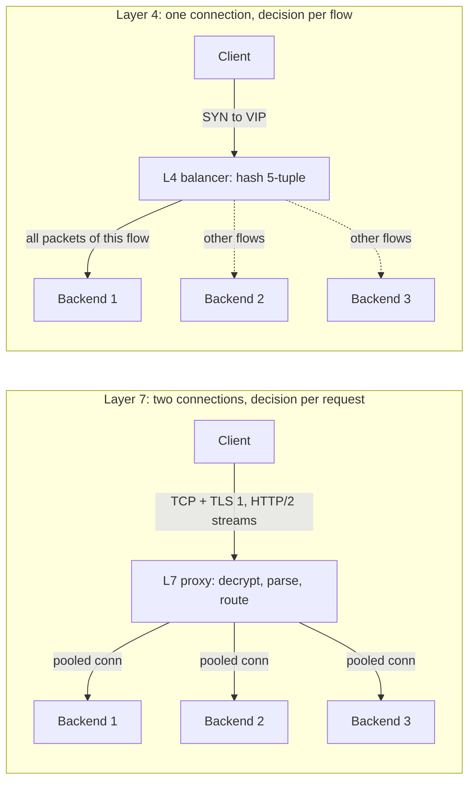
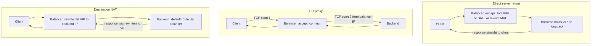
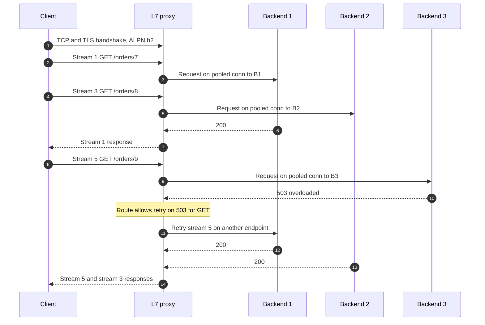
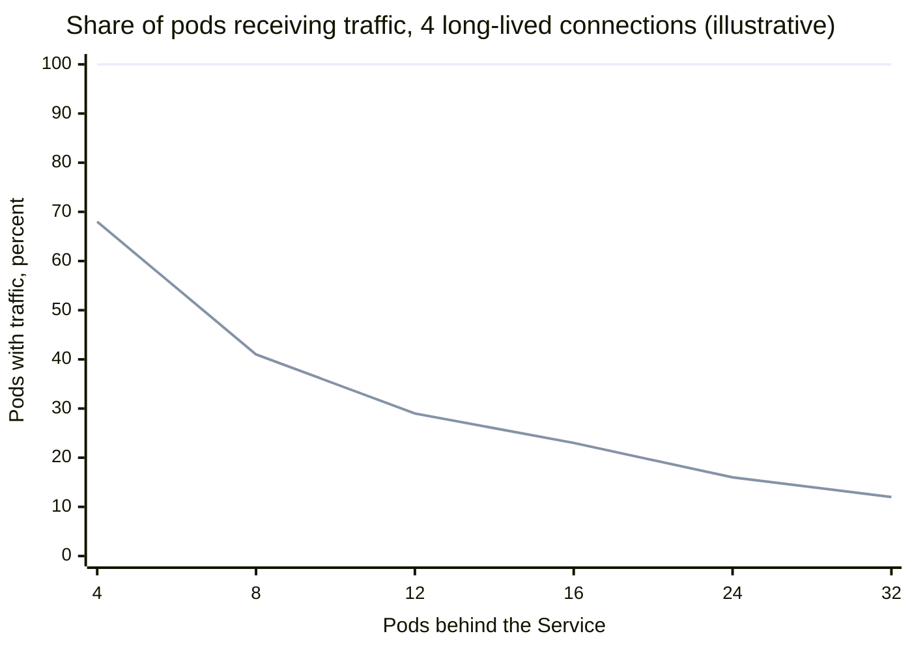
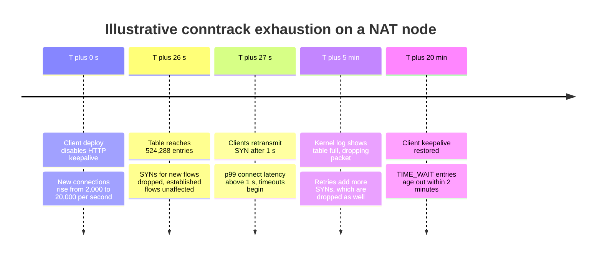

Katman 4 (L4) yük dengeleyici, backend'i transport seviyesindeki bilgilerden seçer: kaynak ve hedef IP adresleri, port'lar ve protokol, yani 5-tuple. Bu seçimi bir kez, bir flow'un ilk paketi geldiğinde yapar; ardından flow'un sonraki tüm paketlerini payload'u okumadan aynı backend'e gönderir. Katman 7 (L7) yük dengeleyici ise istemcinin transport bağlantısını sonlandırır, genellikle TLS'i de sonlandırır, uygulama protokolünü ayrıştırır ve her istek için ayrı bir backend seçer; isteği proxy'nin kendi açtığı bir bağlantı üzerinden iletir. "Katman" OSI modelindeki transport katmanını (4) ve uygulama katmanını (7) ifade eder; pratikte ise yalnızca paketlerin nerede kopyalandığını değil, kararın hangi bilgiyi kullandığını ve ne sıklıkla verildiğini anlatır.

İkisinin çözdüğü problem aynıdır: birbirinin yerine geçebilen backend'lerden oluşan bir filo tek bir adres gibi görünmeli, trafik bu backend'lere yayılmalı ve arızalı üyeler iş almayı bırakmalıdır. Ancak problemi farklı ayrıntı düzeylerinde çözerler. L4 bağlantıları dengeler; L7 istekleri dengeler. Bu sayfadaki her şey bu farktan çıkar. HTTP/2 ve gRPC gibi binlerce isteği tek bir uzun ömürlü bağlantı üzerinden gönderen bir protokol, bir L4 cihazından neredeyse hiç dengeleme almaz. Proxy'nin ayrıştıramadığı bir protokol, örneğin bir veritabanı wire protokolü ya da özel bir ikili akış, bir L7 cihazından ek yük dışında hiçbir şey almaz.

Asıl denge, görünürlük ile maliyet ve şeffaflık arasındadır. L4 yük dengeleyici paket iletir: byte başına işi küçüktür, kernel'de ya da kernel-bypass bir veri düzleminde hat hızında çalışabilir, TCP veya UDP üzerindeki her protokolle çalışır ve uçtan uca şifrelemeyi bozmaz. Karşılığında kördür: path'e göre yönlendiremez, başarısız bir isteği yeniden deneyemez, bir 503'ü göremez, tek bir bağlantının isteklerini yayamaz. L7 proxy her isteği görür; her birini yönlendirebilir, yeniden deneyebilir, yeniden yazabilir, kimlik doğrulamasından geçirebilir ve ölçebilir. Ama tam bir protokol uç noktasına dönüşür: TLS anahtarlarını tutar, her istemci yolu için iki bağlantı yönetir, her istekte ayrıştırma ve şifrelemeye CPU harcar, gecikmeye bir hop ekler ve protokolü backend'in ayrıştırdığı şekliyle birebir ayrıştırmak zorundadır; aksi hâlde bir güvenlik açığı doğar. Dengeleme algoritmaları [Algoritmalar](/distributed-systems/tr/communication/load-balancing/algorithms/) sayfasında, dengeleme mantığının nerede çalıştığı [İstemci Taraflı ve Sunucu Taraflı Yük Dengeleme](/distributed-systems/tr/communication/load-balancing/client-vs-server-side/) sayfasında, backend'lerin havuza nasıl girip çıktığı ise [Sağlık Durumuna Duyarlı Yönlendirme ve Bağlantı Boşaltma](/distributed-systems/tr/communication/load-balancing/health-aware-routing/) sayfasında ele alınır.


*Her iki tür yük dengeleyicinin arkasındaki aynı üç backend. Düz oklar tek bir istemcinin trafiğini, kesikli oklar diğer istemcilerin flow'larını taşır.*

L4 tarafında istemcinin TCP bağlantısı backend'e değişmeden ulaşır; yük dengeleyici o backend'i SYN geldiğinde seçmiştir ve istemcinin tüm oturumu, üzerindeki her istekle birlikte, oraya düşer. L7 tarafında istemcinin bağlantısı proxy'de biter. Proxy her HTTP/2 stream'ini ayrı bir istek olarak okur ve tek bir istemciden gelen ardışık üç isteği, açık tuttuğu bağlantılar üzerinden üç farklı backend'e gönderebilir. Bedel resimde de görünür: L7 proxy her iki yöndeki her byte'ın ortasındadır ve ömürleri, zaman aşımları ve hataları artık örtüşmeyen iki bağımsız bağlantıyı yönetir.

## Her Katmanın Garanti Ettiği ve Göremediği

L4'ün değişmezi flow affinity'dir (flow bağlılığı): bir transport flow'una ait her paket, flow'un ömrü boyunca aynı backend'e ulaşır. Bunu bozmak TCP için ölümcüldür, çünkü hiç kabul etmediği bir bağlantıya ait akış ortasındaki bir segmenti alan backend reset ile yanıt verir. Bir L4 yük dengeleyicinin içindeki her şey, değişim altında bu değişmezi korumak için vardır: bağlantı tabloları, consistent hashing ve durum replikasyonu. L4; yükün flow dışında herhangi bir birimde dengelendiğini, bağlantı kabul eden bir backend'in uygulama seviyesinde sağlıklı olduğunu ya da bir backend'de başarısız olan isteğin başka birinde deneneceğini garanti etmez. TCP el sıkışması iletildikten sonra yük dengeleyici, backend'in 200 mü yoksa 500 mü döndüğünden habersizdir.

L7'nin değişmezi, yanıt eşleştirmeli istek bazında yönlendirmedir: her istek yönlendirme kurallarıyla eşleştirilir, aynı anda yalnızca bir backend'e gönderilir ve yanıtı istemciye geldiği bağlantı ve stream üzerinden döner. Proxy her iki bağlantının da sahibi olduğu için L4'ün sağlayamadığı şeyleri ekleyebilir: başka bir backend'de yeniden deneme, route bazında zaman aşımları, canary'ler için header tabanlı yönlendirme, yanıt kodlarına dayalı outlier ejection ve istek seviyesinde metrikler ile trace'ler. L7; affinity yapılandırılmadıkça aynı istemciden gelen iki isteğin aynı backend'e ulaşacağını, yeniden denenen bir isteğin daha önce bir kez çalıştırılmamış olduğunu (backend commit ettikten sonra oluşan bir zaman aşımı yine de bir kopyadır; bu [Idempotency ve Güvenli HTTP Metotları](/distributed-systems/tr/communication/api-gateway/idempotency/) sayfasının konusudur) ya da backend'in istek byte'larını proxy ile tamamen aynı biçimde yorumlayacağını garanti etmez.

İkisinin arasında işe yarar bir ara durum vardır. Bir proxy, istenen host adını Server Name Indication (SNI) eklentisinde, önerilen uygulama protokollerini ise Application-Layer Protocol Negotiation (ALPN) eklentisinde taşıyan TLS ClientHello mesajını okuyabilir, backend'i buna göre seçebilir ve ardından şifreli byte'ları dokunmadan iletebilir. Buna SNI yönlendirmeli TLS passthrough denir: karar uygulamaya yakın tek bir bilgiyi kullanır, ancak proxy hiçbir zaman şifre çözmediği için yine bütün bağlantıları dengeler.

:::note[TCP'yi sonlandırmak bir yük dengeleyiciyi katman 7 yapmaz]
`mode tcp` ile çalışan HAProxy, Envoy'un TCP proxy filtresi ve NGINX'in `stream` modülü istemcinin TCP bağlantısını sonlandırır ve backend'e yeni bir bağlantı açar; yine de kararı bağlantı başına bir kez, adreslerden ve port'lardan verdikleri için karar ayrıntı düzeyi bakımından L4 yük dengeleyicilerdir. Operasyonel olarak önemli olan ayrım, cihazın istek sınırlarını anlayıp anlamadığıdır. Tam proxy bir L4 yük dengeleyici de bir bağlantıdaki tüm istekleri tek bir backend'e sabitler.
:::

## Katman 4 Veri Yolu: Flow'lar, Tablolar ve Dönüş Yolu

Bir L4 yük dengeleyici sanal bir IP adresi (VIP) duyurur. VIP'ye bir paket geldiğinde, paketin 5-tuple'ını bir bağlantı tablosunda arar. Eşleşme varsa daha önce seçilmiş backend bulunur; eşleşme yoksa (TCP için bu yalnızca SYN'de olmalıdır) yapılandırılmış algoritmayla backend seçilir ve seçim tabloya eklenir. Paket ardından üç iletim yönteminden biriyle backend'e teslim edilir ve yöntem, cihazın neredeyse tüm operasyonel özelliklerini belirler: yanıt byte'larını kimin taşıdığını, backend'in istemci adresini görüp görmediğini, yük dengeleyicinin dönüş yolunda durmak zorunda olup olmadığını ve MTU'nun ne olacağını.


*Üç L4 iletim yöntemi. Yük dengeleyiciyi yanıt yolunun dışında tutan yalnızca direct server return'dür.*

Hedef NAT'ta (DNAT) yük dengeleyici hedef adresi VIP'den seçilen backend'e çevirir, checksum'ları düzeltir ve paketi iletir. Yanıt, kaynak adresi yeniden VIP'ye çevrilebilsin diye yük dengeleyici üzerinden geri dönmek zorundadır; aksi hâlde istemci hiç iletişim kurmadığı bir adresten SYN-ACK alır ve onu atar. Bu durum yük dengeleyiciyi backend'in istemciye giden rotası olmaya, ya da ek olarak kaynak NAT (SNAT) yapmaya zorlar; ikinci durumda backend istemcinin değil yük dengeleyicinin adresini görür. NAT modundaki Linux Virtual Server (IPVS) ve bir ClusterIP Service'i iptables ya da nftables kurallarıyla gerçekleyen Kubernetes kube-proxy birer DNAT yük dengeleyicidir; kube-proxy her node'da çalıştığı için yük dengeleyici dağıtıktır ve dönüş yolu node'un kendisidir.

Tam proxy yönteminde yük dengeleyici istemciyle TCP el sıkışmasını tamamlar, backend'e kendi bağlantısını açar ve iki soket arasında byte kopyalar. Veri kernel'in soket katmanını iki kez geçtiği için byte başına maliyeti başlık yeniden yazmaktan yüksektir; ancak backend'i istemci tarafındaki TCP davranışından yalıtır: yeniden iletimler, küçük pencereler ve yavaş okuyan istemciler yük dengeleyicinin buffer'larında emilir. Backend her zaman yük dengeleyicinin adresini görür.

Direct server return'de (DSR) yük dengeleyici iç pakete hiç dokunmaz. Ya yalnızca hedef MAC adresini değiştirir (bu, backend'in aynı katman 2 segmentinde olmasını gerektirir) ya da paketi backend'e adreslenmiş bir dış IP başlığıyla kapsüller (IP-in-IP veya GRE). Backend'de VIP bir loopback arayüzünde tanımlıdır; bu sayede iç paketi kendisine adreslenmiş kabul eder ve yanıtı kaynağı VIP olacak şekilde doğrudan istemciye gönderir. Yük dengeleyiciden yalnızca istek yönü geçer. Yanıtların isteklerden kat kat büyük olduğu tipik web ve video trafiğinde bu, yük dengeleyicinin bant genişliğinin büyük kısmını ortadan kaldırır. Google'ın Maglev'i GRE ile kapsüller ve trafik servis uç noktalarından doğrudan döner; Facebook'un Katran'ı ise kernel'in ağ yığınından önce, ağ sürücüsünde çalışan bir XDP (eXpress Data Path) programından IP-in-IP ile iletir ve backend'leri trafiği yine doğrudan döndürür. IPVS her iki DSR türünü de direct-routing ve tunneling modları olarak destekler.

### Yük Dengeleyici Filosu Boyunca Bir Flow'u Tek Backend'de Tutmak

Tek bir yük dengeleyici makinesi hem tek hata noktası hem de bir bant genişliği tavanıdır; bu yüzden üretimdeki L4 katmanları aynı VIP'nin arkasında birden fazla özdeş instance çalıştırır. Router'lar paketleri bunlara equal-cost multipath (ECMP) ile yayar: her instance VIP'yi BGP (Border Gateway Protocol) üzerinden aynı maliyetle duyurur ve router her paketin başlığını hash'leyerek birini seçer. Instance kümesi sabit kaldıkça bir flow'un her paketi aynı instance'a hash'lenir ve o instance'ın bağlantı tablosu flow affinity'yi korur.

Zorluk değişimdedir. Bir instance eklendiğinde, çıkarıldığında ya da arızalandığında router'ın hash'i bazı flow'ları, tablosunda onlara ait kayıt olmayan başka bir instance'a taşır. O instance backend'i round robin gibi sıradan bir algoritmayla seçseydi, akış ortasındaki bir paket için farklı bir backend seçer ve bağlantı resetlenirdi; bu akış [Ağ Güvenilirliği, Bant Genişliği Sınırları ve Topoloji Değişiklikleri](/distributed-systems/tr/foundations/monoliths-to-distributed/network-reliability/) sayfasında çizilmiştir. Bu yüzden Maglev ve Katran yeni bir flow'un backend'ini durumlu bir algoritmayla değil, 5-tuple'ın consistent hash'iyle seçer. Aynı backend listesine sahip her instance aynı flow için aynı sonucu hesaplar; böylece instance'lar arasında taşınan bir flow yine özgün backend'ine düşer. Bağlantı tablosuna yalnızca kalan durum için, yani backend kümesindeki bir değişiklik için ihtiyaç duyulur: bir backend eklendiğinde hash mevcut flow'ların küçük bir kısmını ona eşler ve bu flow'ları zaten taşıyan instance'taki tablo onları özgün backend'lerinde tutar. Katran'ın tarifi bu iş bölümünü açıkça ortaya koyar: LRU bağlantı tablosu, bellek baskısı altında devre dışı bırakılabilen bir performans optimizasyonudur; flow'ların çoğu için doğruluğu consistent hash taşır.

Doğruluk argümanında bir boşluk vardır ve adını koymak gerekir. Bir flow ya yük dengeleyici kümesindeki bir değişikliği (hash aynı sonucu verir) ya da backend kümesindeki bir değişikliği (tablo hatırlar) atlatır; ikisini aynı anda atlatamaz. Backend'inin hash slotu taşındığı pencerede yeni bir instance'a geçen bir flow, ne bir tablo kaydı ne de eski seçimle uyuşan bir hash bulur. İki olayın çakışması gerektiği ve hash slotların yalnızca küçük bir kısmını taşıdığı için bu tür flow'lar nadirdir, ama sıfır değildir; Maglev makalesinin garantisini "hiç kesinti yok" olarak değil "asgari kesinti" olarak sunmasının nedeni budur. Maglev'in lookup tablosunu nasıl kurduğu dâhil hash şemasının kendisi [Algoritmalar](/distributed-systems/tr/communication/load-balancing/algorithms/) ve [Consistent Hashing ve Sanal Düğümler](/distributed-systems/tr/data-management/data-partitioning/consistent-hashing/) sayfalarına aittir.

### İstemci Adresine Ne Olur

Backend'ler erişim kontrolü, rate limiting, loglama ve kötüye kullanımla mücadele için istemcinin adresine ihtiyaç duyar. DSR ve saf DNAT adresi korur, çünkü iç paket onu hâlâ taşır. SNAT ve tam proxy'ler adresi yük dengeleyicinin adresiyle değiştirir. Kubernetes bu dengeyi doğrudan gösterir: `externalTrafficPolicy: Cluster` ayarlı bir LoadBalancer ya da NodePort Service, bir node'a gelen paketi başka bir node'daki pod'a iletebilir ve yanıt ilk node üzerinden dönsün diye SNAT uygular; `externalTrafficPolicy: Local` ise yalnızca paketi alan node'daki pod'lara teslim eder ve istemcinin adresini korur, bunun bedeli de pod'lar node'lara dengesiz dağıldığında yükün dengesizleşmesidir.

Bir L4 proxy adresi IP katmanında gizlemek zorundaysa onu, HAProxy tarafından tanımlanan PROXY protokolüyle bant içinde taşıyabilir: sürüm 1, proxy'lenen akışın ilk byte'ından önce insan tarafından okunabilir tek bir metin satırı; sürüm 2 ise isteğe bağlı type-length-value alanları içeren ikili bir başlık ekler. Backend'in bunu beklemek üzere yapılandırılması gerekir ve beklenti simetrik olmalıdır. Başlığı bekleyen bir backend, başlıksız bir bağlantı aldığında (örneğin doğrudan gönderilen bir sağlık kontrolü) bağlantıyı reddeder ya da yanlış ayrıştırır; beklemeyen bir backend ise başlığı uygulama verisinin başlangıcı sayar. Bir L7 proxy aynı bilgiyi `X-Forwarded-For` ya da standartlaştırılmış `Forwarded` (RFC 7239) gibi HTTP header'larında taşır; backend bu header'lara yalnızca kendi proxy'si tarafından eklendiklerinde güvenmeli, istemciden geldiklerinde asla güvenmemelidir.

## Katman 7 Veri Yolu: Sonlandır, Ayrıştır, Yönlendir, Yeniden Başlat

Bir L7 proxy her isteği sabit bir pipeline'dan geçirir. TCP bağlantısını kabul eder, elindeki sertifikayla TLS el sıkışmasını tamamlar ve uygulama protokolünü ALPN ile müzakere eder. Bir codec byte akışını isteklere böler: HTTP/1.1'de header'ları, ardından `Content-Length` ya da chunked encoding ile sınırlanan gövdeyi okuyarak; HTTP/2 ve HTTP/3'te frame'leri stream'lere ayırarak. Proxy isteği route'larla (host, path, header'lar, metot) eşleştirir; route'lar bir backend grubu seçer (Envoy'da cluster, HAProxy'de backend denir). Bir dengeleme algoritması bu istek için grubun bir uç noktasını seçer. Proxy o uç noktaya giden boşta bir upstream bağlantıyı havuzundan alır ya da yenisini açar, header'ları yeniden yazar (`X-Forwarded-For` ve bir istek kimliği ekler, hop-by-hop header'ları kaldırır) ve isteği, yapılandırmaya göre gövdeyi akıtarak ya da buffer'layarak iletir. Yanıt geldiğinde proxy durum kodunu ve süreyi kaydeder ve yanıtı istemcinin stream'ine yazar. Route önceliği ve kimlik doğrulama gibi uç politikaları [API Gateway Deseni](/distributed-systems/tr/communication/api-gateway/api-gateway-pattern/) sayfasının konusudur; bu sayfa pipeline'ın dengelemeye ne yaptığıyla ilgilenir.


*Üç istek taşıyan tek bir istemci bağlantısı. Proxy her stream için bir uç nokta seçer ve isteklerden birini farklı bir uç noktada yeniden dener.*

2-5. adımlar L4'ün sağlayamadığı özelliği gösterir: aynı istemci bağlantısındaki iki istek farklı backend'lere gider; böylece tek bir HTTP/2 bağlantısı açan istemci bile yükünü yayar. 10-12. adımlar ikinci özelliği gösterir: proxy, bir L4 cihazının hiçbir zaman göremeyeceği 503'ü gördü ve istemci fark etmeden isteği başka yere taşıdı. Yanıtlar istek sırasına göre değil tamamlanma sırasına göre döner: stream 3 ve 5 hâlâ yoldayken stream 1'in yanıtı 7. adımda geri gider, çünkü HTTP/2 stream'leri birbirinden bağımsızdır. 11. adımdaki yeniden deneme yalnızca route onu GET ile sınırladığı için güvenlidir; bir 503 ya da reset üzerine POST'ları yeniden deneyen bir proxy bir yazmayı iki kez çalıştırabilir, her katmanda yeniden deneyen bir proxy filosu ise aşırı yük sırasında yükü katlar; bu durum [Retry Fırtınaları ve Metastabil Hatalar](/distributed-systems/tr/resilience/flow-control/retry-storms-metastable-failures/) sayfasında anlatılır.

İstek bazında dengeleme yalnızca istekler bağımsız olduğunda, yani her backend her isteğe hizmet verebildiğinde doğrudur. Bir backend bellekteki bir oturum ya da sıcak kalması gereken yerel bir cache gibi istemci başına durum tutuyorsa, proxy cookie ya da bir header'ın hash'iyle affinity kurmak zorunda kalır; bu da L7'nin ortadan kaldırması beklenen kaba ayrıntı düzeyini geri getirir. Bu ödünleşim [Stateful ve Stateless Servisler](/distributed-systems/tr/foundations/monoliths-to-distributed/stateful-vs-stateless/) sayfasında ele alınır. Uzun ömürlü stream'lerin de benzer bir sınırı vardır: proxy backend'i stream açılırken seçer ve bir daha seçmez; dolayısıyla saatlerce süren bir gRPC stream'i tam olarak bir TCP bağlantısı kadar kaba dengelenir. Bkz. [gRPC Streaming](/distributed-systems/tr/communication/synchronous-protocols/grpc-streaming/). Bir WebSocket upgrade'i, L7 proxy'yi o bağlantının geri kalanı için bir L4 tüneline dönüştürür.

### İki Bağlantı, İki Ayrı Ömür

Proxy, istemciye giden bir downstream bağlantının ve her uç noktaya giden bir upstream bağlantı havuzunun sahibidir; bunlar birbirinden bağımsızdır. Upstream istek hâlâ çalışırken istemci bağlantıyı kapatabilir, proxy tam yeniden kullanmak üzereyken backend havuzdaki boşta bir bağlantıyı kapatabilir ve her tarafın kendi idle timeout'u, keepalive'ı ve azami ömrü vardır. L7'yi karşılanabilir kılan connection pooling'dir: upstream bağlantıları yeniden kullanmak her istekten bir TCP ve çoğu zaman bir TLS el sıkışmasını çıkarır. HTTP/1.1 upstream'lerde havuzdaki her bağlantı aynı anda tek bir istek taşır, dolayısıyla havuz boyutu uç nokta başına upstream eşzamanlılığını sınırlar; HTTP/2 upstream'lerde tek bir bağlantı çok sayıda stream taşır ve sınır uç noktanın stream limiti olur.

Buradan çıkan sıralama kuralı, L7 kurulumlarında en sık ihlal edilen ayardır: bir istek yolu boyunca her hop, boştaki bağlantıları önündeki hop'tan daha uzun süre açık tutmalıdır. Proxy boştaki bir upstream bağlantıyı backend'den önce kapatmalıdır ki backend'in kapatmakta olduğu bir bağlantı üzerinden asla istek göndermesin. İstemci de aynı nedenle proxy'den önce kapatmalıdır. Sıra ters olduğunda hata, hiçbir yük testinin yeniden üretemediği düşük ve sabit bir 502 oranı olarak ortaya çıkar; aşağıda hata modları altında incelenir.

### Uyuşması Gereken İki Ayrıştırıcı

Bir L7 proxy'den geçen istek iki kez ayrıştırılır: bir kez proxy, bir kez de backend tarafından. Bir isteğin nerede bitip sonrakinin nerede başladığı konusunda anlaşamazlarsa, bir saldırgan ilk isteğin gövdesine ikinci, gizli bir istek yerleştirebilir. Klasik örnek, hem `Content-Length` hem de `Transfer-Encoding: chunked` taşıyan ya da bunlardan birinin bozuk bir varyantını içeren HTTP/1.1 isteğidir: proxy isteği sınırlamak için birini, backend diğerini kullanır ve havuzdaki bir upstream bağlantıda kalan byte'lar backend tarafından bir sonraki isteğin başlangıcı olarak okunur; bu istek daha sonra başka bir kullanıcının bağlantısına atfedilebilir. Buna HTTP request smuggling ya da desync denir. RFC 9112, iki header'ı birlikte taşıyan bir mesajın `Transfer-Encoding` öncelikli olacak şekilde işlenmesini ve potansiyel bir saldırı olarak ele alınmasını şart koşar; ancak zincirdeki her ayrıştırıcının bunu aynı biçimde uygulaması gerekir. AWS Application Load Balancer (ALB) uyumsuz istekleri sınıflandırır ve varsayılan `defensive` desync mitigation modunda ciddi gördüklerini engeller; Envoy ve HAProxy gibi olgun proxy'ler de birçok belirsiz framing'i reddeder ya da normalleştirir, ancak tam davranış sürüme ve ayarlara bağlıdır ve kullanılan sürüm için doğrulanması gerekir. Uçtan uca HTTP/2 belirsizliği ortadan kaldırır, çünkü frame'ler açık uzunluk taşır; fakat istemciden gelen HTTP/2'yi backend'e doğru HTTP/1.1'e düşürmek belirsizliği geri getirir.

:::caution[Bir ayrıştırıcı tuhaflığını kullanıcılar arası saldırıya çeviren upstream bağlantı yeniden kullanımıdır]
Smuggling için zehirlenecek paylaşılan bir upstream bağlantı gerekir: gizli istek, daha sonra başka istemcilerin trafiğini taşıyacak havuzdaki bir bağlantıda bir sonraki istek olarak okunur. Proxy ve backend HTTP ayrıştırıcılarını katı tutun, desteklendiği yerde backend'e HTTP/2 tercih edin, iki framing header'ını birlikte taşıyan istekleri uçta reddedin ve ayrıştırmayı gevşeten bir proxy yükseltmesini performans değişikliği olarak değil, güvenlik değişikliği olarak ele alın.
:::

## Üretimde Maliyet, Kapasite ve Yapılandırma

İki katman doğruluktan çok maliyetin nereye düştüğü konusunda ayrışır. Tablo yaygın biçimleri karşılaştırır.

| Biçim | Karar birimi | Gördüğü | Yük dengeleyiciden geçen byte'lar | Backend'deki istemci adresi | Ne zaman tercih edilmeli |
|---|---|---|---|---|---|
| L4 DNAT (IPVS NAT, kube-proxy) | Flow | 5-tuple | Her iki yön | Yük dengeleyici dönüş rotasıysa korunur, değilse SNAT | Küme içi servis VIP'leri, HTTP dışı protokoller, basit topolojiler |
| L4 DSR (Maglev, Katran, IPVS DR veya tunnel) | Flow | 5-tuple | Yalnızca istekler | Korunur | Çok yüksek bant genişlikli, yanıt ağırlıklı trafik için ön katman |
| L4 tam proxy (HAProxy `mode tcp`, Envoy TCP proxy, NGINX `stream`) | Bağlantı | 5-tuple, yorumlanmayan byte'lar | Her iki yön, soketler üzerinden | Kaybolur; geri getirmek için PROXY protokolü | Veritabanları, mesaj broker'ları, TLS passthrough, protokolden bağımsız uçlar |
| SNI yönlendirmeli TLS passthrough | Bağlantı | 5-tuple, SNI, ALPN | Her iki yön, hâlâ şifreli | PROXY protokolü yoksa kaybolur | Anahtarın backend'de kalması gereken çok kiracılı TLS |
| L7 proxy (Envoy, NGINX `http`, HAProxy `mode http`, ALB) | İstek veya stream | İsteğin ve yanıtın tamamı | Her iki yön, çözülüp yeniden şifrelenmiş | `X-Forwarded-For` veya `Forwarded` ile | HTTP ve gRPC yönlendirme, istek bazında dengeleme, yeniden denemeler, istek metrikleri |

Büyük kurulumlar birini seçmez; ikisini üst üste koyar. Maglev, Google'ın L7 ön uç proxy'lerinin önünde durur; Facebook'un Katran duyurusu da L4 katmanından L7 yük dengeleyicilere akan trafiği anlatır. L4 katmanı yalnızca kendisinin ucuza yapabildiği işi yapar: paketleri hat hızında karşılar, ECMP ve consistent hashing ile çok sayıda L7 instance'ına yayar ve L7 instance'larının VIP değişmeden eklenip boşaltılmasına izin verir. L7 katmanı da yalnızca kendisinin yapabildiği işi yapar: TLS'i sonlandırır, istek bazında yönlendirir ve istek bazında ölçer. Küme içinde aynı bileşim, bir L7 ingress proxy'sinin ya da gateway'in önünde kube-proxy'nin L4 Service'i olarak görünür; bu karşılaştırma [Ingress ve Gateway API](/distributed-systems/tr/service-mesh/network-policies-mtls/ingress-vs-gateway-api/) sayfasındadır. Service mesh'ler ise L7 proxy'yi her workload'ın yanına taşır; bu [Servis Ağı Neden Var](/distributed-systems/tr/service-mesh/service-mesh-architecture/why-service-mesh/) sayfasında anlatılır.

### Hesaplı Örnek: Tek Bir gRPC Servisi, Üç Kısıt

12 pod'lu dâhilî bir gRPC servisi olduğunu ve bu servisi, her biri servisin ClusterIP'sine tek bir HTTP/2 kanalı tutan 4 gateway instance'ının çağırdığını varsayalım. Gateway'ler toplamda saniyede 40.000 istek, kanal başına 10.000 istek gönderiyor. Bu örnekteki tüm sayılar temsilîdir.

Bir L4 DNAT yük dengeleyici olan kube-proxy'nin arkasında her kanal tek bir TCP bağlantısıdır ve bağlantı anında seçilen tek bir pod'a düşer. 4 bağlantı 12 pod'a düzgün rastgele atandığında, trafik alan pod sayısının beklenen değeri `12 * (1 - (11/12)^4)`, yani yaklaşık 3,5'tir. Kabaca 8,5 pod boşta kalır ve meşgul her pod, hedeflenen 3.333 yerine en az saniyede 10.000 istek işler. Bir pod'un iki bağlantı, dolayısıyla saniyede 20.000 istek alma olasılığı `1 - (12 * 11 * 10 * 9) / 12^4`, yani yaklaşık %43'tür. Autoscaling işe yaramaz: 24 pod'da beklenen meşgul pod sayısı 3,76'dır, çünkü mevcut hiçbir bağlantı yer değiştirmez.


*Üst çizgi: istek bazında L7 dengeleme her pod'a ulaşır. Alt çizgi: dört bağlantının L4 ile dengelenmesi; n pod için beklenen pay `(1 - (1 - 1/n)^4)`.*

Ekipleri şaşırtan alt eğridir: pod eklemek, meşgul pod'ların yükünü azaltmadan filonun kullanım oranını düşürür. [HTTP/2 sayfası](/distributed-systems/tr/communication/synchronous-protocols/http2-http3-quic/) genel mekanizmayı bağlantı yoğunlaşması (connection concentration) olarak anlatır, [gRPC sayfası](/distributed-systems/tr/communication/synchronous-protocols/grpc-protocol-buffers/) ise çıkış yollarını listeler. Buradaki soru, L7'ye geçmenin neye mal olduğudur.

Yoldaki bir L7 proxy saniyede 40.000 isteği ayrıştırıp yeniden şifrelemek zorundadır. Her iki tarafta TLS ile core başına saniyede 15.000 proxy'lenmiş HTTP/2 isteği şeklinde ölçülmüş bir kapasite varsayalım; bu durumda katmanın yaklaşık 2,7 core'luk sürekli işe ihtiyacı vardır ve üç instance'a dağılmış 6 core, zirvede bir instance kaybını karşılayacak payı bırakır. Havuzlanmış upstream bağlantılarla her proxy hop'unun medyanda 0,3 ms eklediğini varsayalım. Sunucu süresi 5 ms olan bir çağrı için bu %6'dır; her biri kendi L7 hop'unun arkasında duran beş servisten oluşan bir çağrı zincirinde bedel beş kez ödenir. Seçim yapmadan önce ölçülmesi gereken sayılar bunlardır; proxy hop'u olmayan alternatif ise istemci taraflı dengelemedir.

Bant genişliği, başka bir servis için cevabı değiştirir. 800 byte'lık istekler ve 50 KB'lık yanıtlarla saniyede 100.000 istek alan bir indirme ön ucu varsayalım. İstekler 80 MB/s, yani yaklaşık 0,64 Gbit/s eder; yanıtlar 5 GB/s, yani yaklaşık 40 Gbit/s. Bir DNAT ya da tam proxy L4 yük dengeleyici 40,6 Gbit/s taşır. Bir DSR yük dengeleyici ise yanıtlar onu atladığı için 0,64 Gbit/s, yani bunun yaklaşık %1,6'sını taşır. Bir L7 proxy 40,6 Gbit/s'nin tamamını taşır ve ayrıca 40 Gbit/s'lik yanıtı şifreler. Her istek nihayetinde L7 proxy'ler tarafından işlense bile büyük uç ağların en dış katmanının DSR L4 olmasının nedeni bu asimetridir: L7 katmanı istek işine göre, L4 katmanı ise yalnızca istek paketlerine göre boyutlandırılır.

### Davranışı Belirleyen Yapılandırma

Aynı proxy yazılımı her iki katman olarak da çalışabildiği için seçimin yapıldığı yer yapılandırmadır. HAProxy ikisini birkaç satırda gösterir.

```text
frontend db_in
    mode tcp                       # L4: one decision per connection
    bind :5432
    default_backend pg
backend pg
    mode tcp
    server pg1 10.0.0.11:5432 check send-proxy-v2   # pass client address in band
frontend web_in
    mode http                      # L7: one decision per request
    bind :443 ssl crt /etc/haproxy/site.pem alpn h2,http/1.1
    timeout client 30s             # must exceed the client's idle close
    default_backend api
backend api
    mode http
    balance leastconn
    option forwardfor              # adds X-Forwarded-For
    http-reuse safe                # reuse idle upstream connections
    timeout server 30s
    server api1 10.0.1.11:8080 check
```

Üretimde en çok önem taşıyan parametreler, yapılandırma yüzeyinin düşündürdüğünden azdır.

| Parametre | Katman | Etkisi | Öneri |
|---|---|---|---|
| Hop başına idle timeout | Her ikisi | Trafiksiz bağlantıları kapatır | Her hop önündekinden uzun; en uzunu backend |
| Bağlantı tablosu boyutu ve zaman aşımları | L4 (conntrack, IPVS, Katran LRU) | İzlenen flow sayısını sınırlar | Saniyedeki yeni bağlantı sayısı çarpı kayıt başına en uzun zaman aşımına göre boyutlandırın |
| Azami bağlantı ömrü | L7 ve backend'ler | Uzun ömürlü istemcileri yeniden bağlanıp dengelenmeye zorlar | Yeniden bağlanmalar senkronize olmasın diye jitter ile ayarlayın; GOAWAY ile kapatın |
| Upstream havuz boyutu ve stream limiti | L7 | Uç nokta başına eşzamanlılığı sınırlar | İstemci sayısından değil, backend'in eşzamanlılık limitinden türetin |
| MSS clamping veya backend MTU | L4 DSR ve tüneller | Aşırı büyük kapsüllenmiş paketleri önler | MTU'yu kapsülleme ek yükü kadar düşürün ya da SYN'de MSS'i kırpın |
| PROXY protokolü veya yönlendirme header'ları | Her ikisi | İstemci adresini geri getirir | İki tarafta birlikte etkinleştirin; yalnızca kendi proxy'nize güvenin |

Bulut servisleri bunların bir kısmını sizin yerinize sabitler. AWS, ALB bağlantı idle timeout'unu varsayılan 60 saniye ve 1 ile 4.000 saniye arasında ayarlanabilir olarak belgeler ve uygulamanın idle timeout'unun yük dengeleyicininkinden büyük olmasını önerir; Network Load Balancer'ın TCP idle timeout'u ise varsayılan 350 saniyedir, Eylül 2024'ten beri 60 ile 6.000 saniye arasında ayarlanabilir ve süre dolduğunda NLB flow'u düşürüp sonraki paketlere reset ile yanıt verir. Linux'ta kube-proxy node'un conntrack tablosunu core başına 32.768 kayıt, en az 131.072 kayıt olarak boyutlandırır ve kurulu bağlantı zaman aşımını kernel'in varsayılanı olan beş gün yerine 24 saate ayarlar.

## Her İki Katmandaki Hata Modları

L4 hataları ağ arızası gibi görünür: transport seviyesinde reset'ler, zaman aşımları ve takılan el sıkışmaları; uygulama loglarında ise hiçbir şey yoktur. L7 hataları uygulama arızası gibi görünür: uygulamanın hiç döndürmediği, proxy'nin onun adına ürettiği 502 ve 503'ler.

### Uzun Ömürlü Bağlantılarda Yükün Sabitlenmesi

Tetikleyici: bir L4 yük dengeleyicinin arkasındaki multiplex edilen ya da kalıcı bağlantılar veya yeniden bağlanma olmadan yapılan bir scale-out. Belirtiler: birkaç backend yüksek CPU'da, diğerleri boşta; yeni pod'lar trafik almıyor; autoscaler kapasite eklerken gecikme artıyor. Tespit: backend başına saniyedeki istek sayısını backend başına aktif bağlantı sayısıyla karşılaştırın; ilkindeki çarpıklık ikincisini birebir izliyorsa sorun sabitlenmedir. Hafifletme: L7'de ya da istemcide istek bazında dengeleme veya istemcilerin dakikalar içinde yeniden bağlanması için sunucu tarafında jitter'lı bir azami bağlantı ömrü. Kurtarma: çağıranların rolling restart'ı yükü hemen yeniden dengeler, bedeli bir yeniden bağlanma patlamasıdır; bunu zamana yayın.

### 502 Üreten Idle Timeout Yarışı

Tetikleyici: bir backend, keepalive bağlantılarını önündeki L7 proxy'den daha erken kapatır. Örneğin Node.js `server.keepAliveTimeout` değerini varsayılan olarak 5 saniyeye ayarlar, bir ALB ise upstream bağlantıları 60 saniyeye kadar boşta tutar. Proxy, havuzdaki bir bağlantıyı tam da backend'in onu kapattığı anda kullanılabilir sayar.

```mermaid
sequenceDiagram
    autonumber
    participant C as Client
    participant P as L7 proxy, idle 60s
    participant B as Backend, keepalive 5s
    C->>P: Request A
    P->>B: Request A on pooled conn
    B-->>P: 200
    P-->>C: 200
    Note over P,B: Connection idle for 5 s
    rect rgb(70, 40, 40)
    B->>P: FIN, backend closes idle conn
    C->>P: Request B arrives at the same moment
    P->>B: Request B sent on the closing conn
    B-->>P: RST, socket already closed
    end
    P-->>C: 502 Bad Gateway
```


*Proxy yeniden kullanırken backend tarafından kapatılan havuzdaki bir bağlantı. Pencere FIN'in yol alma süresi kadardır; bu yüzden hata oranı düşüktür ve boşta kalma aralıklarından sonraki trafikle orantılıdır.*

5-7. adımlardaki yarış penceresi yalnızca FIN'in proxy'ye ulaşıp işlenmesi kadar sürer; bu yüzden 502 oranı küçüktür (çoğu zaman yüzde birin altında), bağlantıların gerçekten boşta kaldığı düşük trafikli uç noktalarda yoğunlaşır ve bağlantıları hiç boşta bırakmayan yük testlerinde görünmez. Tespit: backend'in değil proxy'nin ürettiği 502'ler (hedef 5xx'leri yerine ALB'de `HTTPCode_ELB_502_Count`; Envoy access log'larında upstream bağlantı sonlanmasını gösteren `UC` response flag'i), yeniden kullanılan bağlantılarda oluşmaları ve backend loglarında karşılık gelen bir hata olmaması. Hafifletme: backend'in keepalive timeout'unu proxy'nin idle timeout'undan uzun yapın ya da proxy'nin upstream idle timeout'unu backend'inkinin altına çekin (Envoy bunu cluster bazında destekler); proxy'nin, yanıtın ilk byte'ından önce gelen bir reset'te idempotent istekleri yeniden denemesine izin verin. Sıra düzeltildiği anda kurtarma tamamlanır.

### Bağlantı Tablosunun Tükenmesi

Tetikleyici: bir L4 yük dengeleyici ya da NAT yapan bir node, tablosunun alabileceğinden fazla flow izler; bunun tipik nedeni, ardında kayıt bırakan çok sayıda kısa ömürlü bağlantıdır. Kapanan bir TCP bağlantısı Linux conntrack'te varsayılan olarak 120 saniye TIME_WAIT durumunda kalır. kube-proxy varsayılanlarıyla 524.288 kayıtlık tablo limiti olan 16 core'lu bir node'un saniyede 20.000 yeni kısa bağlantı aldığını varsayalım (temsilî): kararlı durumda yalnızca TIME_WAIT için yaklaşık 2,4 milyon kayıt gerekir ve tablo boştan yaklaşık 26 saniyede dolar. Belirtiler: kurulu bağlantılar çalışmaya devam ederken yeni bağlantılar SYN'de zaman aşımına uğrar; yeni bağlantıların gecikmesi istemcinin SYN yeniden iletim aralığı kadar sıçrar. Tespit: `nf_conntrack: table full, dropping packet` kernel log satırı ve node exporter metriklerinden `node_nf_conntrack_entries` değerinin `node_nf_conntrack_entries_limit` değerine yaklaşması.


*Varsayımsal bir akış, gerçek bir olay değildir. Tetikleyici yük dengeleyicideki değil, istemci davranışındaki bir değişikliktir.*

Zaman çizelgesi arızanın neden yanlış okunduğunu gösterir: yük dengeleyicinin yapılandırması değişmemiştir, CPU düşüktür ve kurulu bağlantılar sağlıklıdır. Neden, yeni bağlantı hızının her kaydın tabloda kalma süresiyle çarpımıdır. Hafifletme: istemcilerde bağlantı yeniden kullanımını geri getirin, tablo limitini yükseltin (kayıt başına bellek küçüktür), ağın izin verdiği yerde TIME_WAIT izleme zaman aşımını kısaltın ya da NAT gerektirmeyen trafiği izlemenin dışında bırakın. Bu amaçla tasarlanmış yük dengeleyiciler sorunu farklı biçimde sınırlar: Katran'ın LRU tablosu eski kayıtları çıkarır ve consistent hash'e geri düşer; bu da yeni flow'ları düşürmek yerine birkaç flow'un affinity'sini zayıflatır.

### Proxy'lerde Kaynak Port Tükenmesi

Tetikleyici: bir tam proxy ya da L7 proxy, tek bir kaynak adresten tek bir backend adres ve port'una yeniden kullanım olmadan upstream bağlantılar açar. Bir TCP bağlantısı 4-tuple'ıyla tanımlanır; kaynak adres ve hedef sabitken yalnızca ephemeral port değişir: Linux'un varsayılan 32768-60999 aralığı 28.232 port verir. Bağlantıyı önce proxy kapatıyorsa her port 60 saniye TIME_WAIT'te tutulur; dolayısıyla o tek backend'e sürdürülebilir yeni bağlantı hızı saniyede yaklaşık 470'tir. Belirtiler: proxy loglarında `EADDRNOTAVAIL` ya da "cannot assign requested address" hataları ve birkaç backend'e giden trafikle birlikte artan upstream bağlantı hataları. Tespit: hedef başına TIME_WAIT'teki soketler (`ss -tan state time-wait`), upstream bağlantı açma hızı. Hafifletme: bir ince ayar değil asıl çözüm olan upstream connection pooling; daha fazla kaynak adres ya da daha fazla backend port'u; kernel ve yol destekliyorsa giden bağlantılar için kernel'in TIME_WAIT yeniden kullanımını etkinleştirmek.

### Kapsülleme Kaynaklı MTU Kara Delikleri

Tetikleyici: DSR ya da tünel modundaki L4 dengeleme, zaten yol MTU'sunun tamamını kullanan paketlere bir dış başlık ekler (IP-in-IP için 20 byte, temel GRE için 24 byte). Aşırı büyük kapsüllenmiş paketler parçalanır ya da düşürülür; ICMP "fragmentation needed" mesajı filtrelenir ya da yanlış yere yönlendirilirse gönderen paketi küçültmesi gerektiğini hiç öğrenmez. Belirtiler: küçük istekler başarılı olur, büyükleri takılır. Büyük sertifika zincirli TLS el sıkışmaları durur, yüklemeler sabit bir boyutta kesilir. Tespit: yalnızca tam boyutlu segmentlerin yeniden iletildiğini gösteren paket yakalamaları ve yükle değil istek boyutuyla ilişkili hatalar. Hafifletme: SYN'de TCP maximum segment size (MSS) değerini kırpın, tünel arayüzlerinde MTU'yu düşürün ya da kapsüllenmiş paketler sığsın diye fabric MTU'sunu yükseltin.

:::tip[Uygulamada hata ayıklamadan önce bir 5xx'i kimin ürettiğine göre sınıflandırın]
L7'de olay süresinin çoğu, hatayı hiç döndürmemiş bir uygulamada hata ayıklarken kaybedilir. Ciddi her proxy kendi yanıtlarını backend'inkilerden ayırır: ALB `ELB` ve `Target` metriklerini ayrı raporlar, Envoy access log'ları ise `UH` (sağlıklı upstream yok), `UF` (upstream bağlantı hatası), `UC` (upstream bağlantı sonlanması) ve `UT` (upstream zaman aşımı) gibi response flag'leri taşır. Hatayı üreteni dashboard'da durum kodunun yanına koyun.
:::

### Hata İmzalarının Özeti

| Hata | Katman | Dışarıdan görünen belirti | Tespit sinyali | Hafifletme |
|---|---|---|---|---|
| Yükün sabitlenmesi | L4 | Çarpık backend yükü, boşta yeni pod'lar | Backend başına istekler ve bağlantılar | L7 veya istemci taraflı dengeleme, azami bağlantı ömrü |
| Idle timeout yarışı | L7 | Boşta kalma aralıklarından sonra düşük ve sabit 502 oranı | Proxy kaynaklı 502'ler, `UC` flag'i, backend hatası yok | Backend idle'ı proxy'ninkinden uzun; reset'te idempotent istekleri yeniden deneme |
| Conntrack tükenmesi | L4 NAT | Yeni bağlantılar zaman aşımına uğrar, eskiler sorunsuz | `table full` logu, limite yaklaşan kayıtlar | Bağlantı yeniden kullanımı, daha büyük tablo, daha kısa TIME_WAIT izleme |
| Kaynak port tükenmesi | L4 tam proxy, L7 | Birkaç backend'e bağlantı hataları | Hedef başına TIME_WAIT soketleri | Upstream pooling, daha fazla kaynak adres |
| MTU kara deliği | L4 DSR, tüneller | Büyük istekler takılır, küçükler başarılı | Yeniden iletilen tam boyutlu segmentler | MSS clamping, tünel MTU'su |
| Request smuggling | L7 | Yanıtlar veya işlemler yanlış kullanıcıya atfedilir | Ayrıştırıcı reddetmeleri, desync sınıflandırma metrikleri | Katı ayrıştırma, upstream'de HTTP/2, çift framing'i reddetme |
| Yük dengeleyici filosunun yeniden hash'lenmesi | L4 | Yük dengeleyici değişikliklerinde reset patlamaları | ECMP değişiklikleriyle ilişkili RST'ler | Consistent hashing ile bağlantı tabloları |

Bir L4 ya da L7 instance'ını, önce ona yeni flow göndermeyi kesip mevcut olanların bitmesini beklemeden çıkarmak, plansız bir arızayla aynı reset patlamalarını üretir; prosedür [Sağlık Durumuna Duyarlı Yönlendirme ve Bağlantı Boşaltma](/distributed-systems/tr/communication/load-balancing/health-aware-routing/) sayfasında ele alınır.

## Katmanı Seçmek

Karar üç sorudan çıkar: tek bir bağlantıda kaç istek taşınıyor, yük dengeleyici düz metni görebilir mi ve yük dengeleyici kaç byte taşımak zorunda.

L4'ü şu durumlarda seçin: protokol HTTP değilse ya da yük dengeleyici onu ayrıştıramıyorsa (PostgreSQL, MySQL, MQTT, SMTP, ham TCP veya UDP servisleri); şifreleme istemci ile backend arasında uçtan uca kalmak zorundaysa, örneğin backend istemcileri karşılıklı TLS ile doğruluyor ve hiçbir proxy anahtarları tutamıyorsa; trafik bant genişliği ağırlıklı ve yanıt baskınsa, ki bu durumda DSR yük dengeleyicinin yükünün çoğunu kaldırır; bağlantılar çok sayıda, kısa ve kabaca eşit maliyetliyse, böylece bağlantıları dengelemek işi dengelemeye yaklaşır; ve görevi paketleri proxy'lere yaymak ve onların ölçeklenmesini atlatmak olan, bir L7 filosunun önündeki en dış katman olarak.

Az sayıda uzun ömürlü istemciden gelen HTTP/2 veya gRPC trafiği için tek başına L4'ü seçmeyin, çünkü yükü sabitler; path, header ya da metoda göre yönlendirme gerektiğinde; başarısız isteklerin başka bir backend'de yeniden denenmesi gerektiğinde; ya da bir service level objective'i karşılamak için istek seviyesinde metrikler gerektiğinde de seçmeyin. Uygulama sağlığı TCP sağlığından farklı olan backend'leri gizlemek için L4 kullanmayın: bağlantıları kabul edip her isteğe 500 dönen bir backend, uygulama seviyesinde bir sağlık kontrolü onu çıkarmadıkça L4 havuzunda kalır.

L7'yi şu durumlarda seçin: trafik HTTP, HTTP/2, HTTP/3 veya gRPC ise ve istekler bağımsızsa; [Trafik Yönetimi](/distributed-systems/tr/service-mesh/service-mesh-architecture/traffic-management/) sayfasında anlatılan canary, header tabanlı ya da ağırlıklı yönlendirme gerekiyorsa; uç noktanın TLS'i sonlandırıp politika uygulaması gerekiyorsa; ve alarmların temeli istek bazında gecikme ve hata metrikleriyse.

L7'yi şu durumlarda seçmeyin: çok küçük ve çok sık çağrılarda olduğu gibi eklenen hop'un gecikmesi ya da CPU'su servisin kendi maliyetine baskın geliyorsa; proxy'nin, uyumluluk gereği uçtan uca şifreli kalması gereken trafiği çözmesi gerekiyorsa; yolda zaten bir L7 hop'u varsa ve ikincisi yalnızca bir zaman aşımı ve yeniden deneme katmanı daha ekleyecekse; ya da istemciler sizin denetiminizdeyse ve istek bazında dengelemeyi kendileri yapabiliyorsa, ki bu, [İstemci Taraflı ve Sunucu Taraflı Yük Dengeleme](/distributed-systems/tr/communication/load-balancing/client-vs-server-side/) sayfasında tartışıldığı gibi hop'u tamamen ortadan kaldırır. Bölgeler arası küresel dağıtım, her iki katmanın üstünde verilen ayrı bir karardır ve [Küresel Sunucu Yük Dengeleme (GSLB) ve Anycast](/distributed-systems/tr/communication/load-balancing/gslb-anycast/) sayfasında ele alınır.

:::caution[L7 katmanını ortalama trafiğe göre değil, en kötü hop'una göre boyutlandırın]
Bir L7 proxy aşırı yük altında bir L4 ileticiden farklı biçimde çöker: istekleri buffer'lar, upstream bağlantıları tutar ve işi kuyruğa alır; bu yüzden doyduğunda gecikme yalnızca sıcak route için değil, hizmet verdiği her route için tırmanır. Onu zirvede, her iki tarafta TLS ile istek başına planlayın, bir instance kaybına yer bırakın ve ona kendi limitlerini verin; önündeki bir L4 katmanı L7 aşırı yükünü atamaz, çünkü istekleri göremez.
:::

## İleri Okuma

- Daniel E. Eisenbud et al., *Maglev: A Fast and Reliable Software Network Load Balancer*, USENIX NSDI, 2016.
- Facebook Engineering, *Open-sourcing Katran, a scalable network load balancer*, engineering.fb.com, 2018.
- Willy Tarreau, *The PROXY protocol, Versions 1 and 2*, HAProxy Technologies (specification, continuously revised).
- Roy T. Fielding, Mark Nottingham, and Julian Reschke (eds.), *RFC 9112: HTTP/1.1*, IETF, 2022 (message framing and request smuggling considerations).
- Envoy Project, *Life of a Request*, Envoy documentation (continuously revised).
- Wensong Zhang, *Linux Virtual Server for Scalable Network Services*, Ottawa Linux Symposium, 2000.
