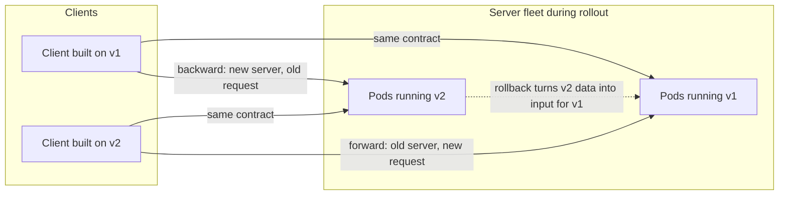
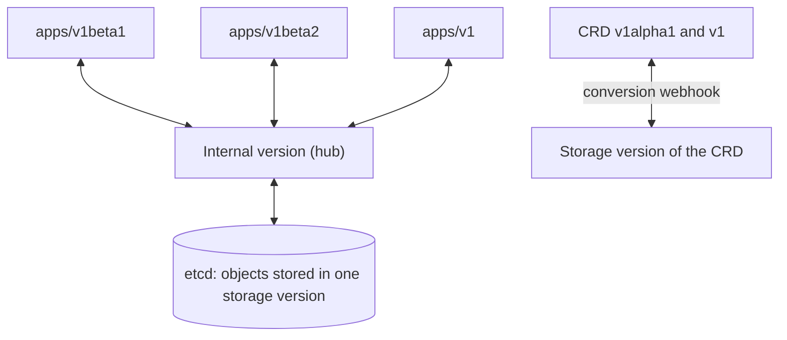
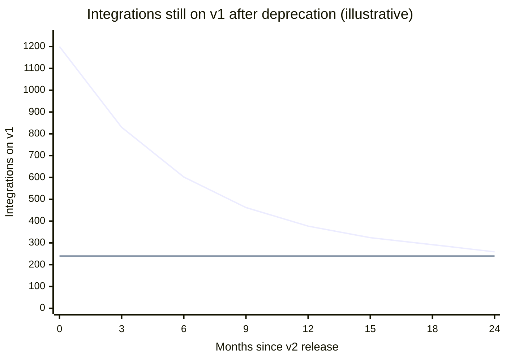
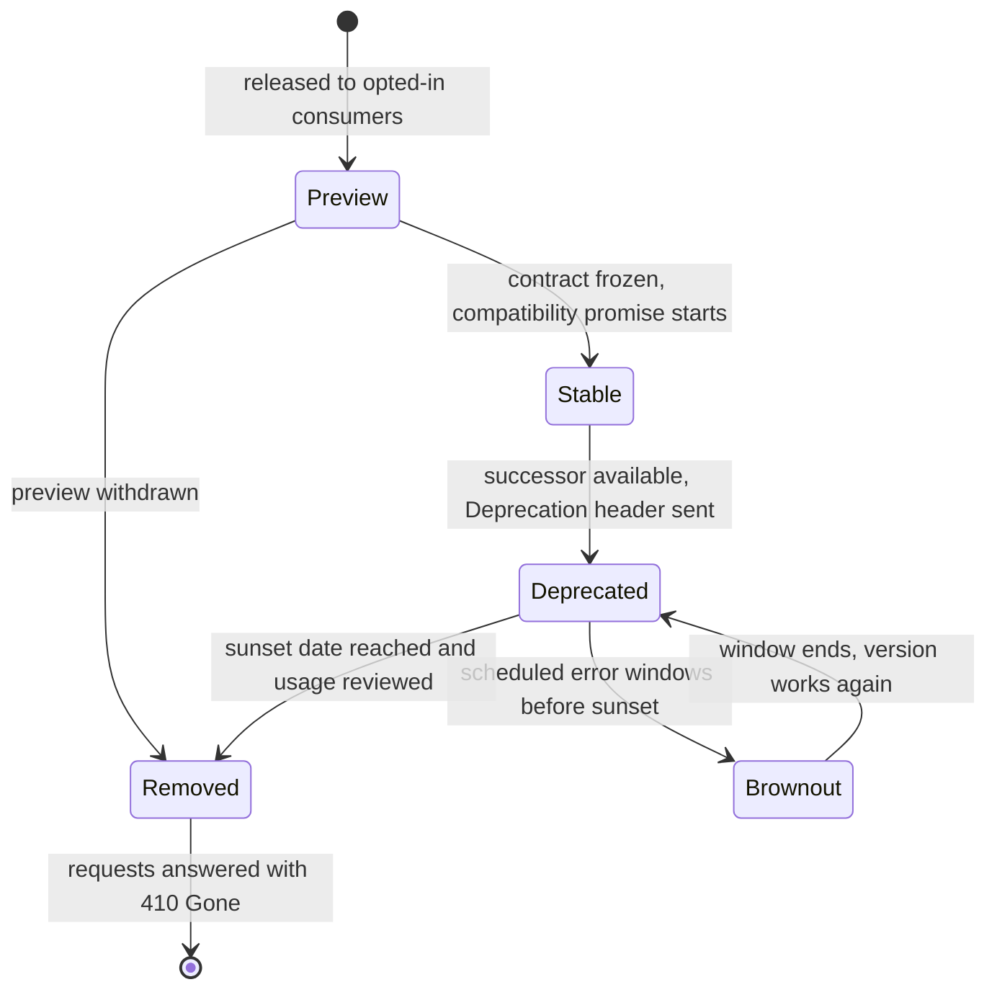

Bir API versiyonu, bir sağlayıcı ile onun kontrol etmediği tüketiciler arasındaki tek bir sözleşmenin adıdır. Versiyonlama ise şu soruları yanıtlayan kurallar bütünüdür: sözleşmedeki bir değişiklik ne zaman yeni bir ad gerektirir, bir istek yazıldığı sözleşmeyi nasıl seçer, sağlayıcı eski adlar altında ne kadar süre yanıt vermeye devam eder ve eski adlar nasıl emekliye ayrılır. Bu mekanizma, sağlayıcı ile tüketicilerin farklı takvimlerle deploy etmesi nedeniyle vardır: iki yıl önce kurulmuş bir mobil binary, bir iş ortağının gece çalışan batch job'ı ve başka bir ekibin sahip olduğu bir servis, hepsi üzerine inşa edildikleri sözleşmenin şeklinde istek göndermeye devam eder ve sağlayıcı tarafındaki hiçbir şey onları güncelleyemez.

Asıl denge, değişimin bedelini kimin ve ne zaman ödediğidir. Her kırıcı (breaking) değişiklik tüketicilere geçiş işi çıkarır; ayakta tutulan her versiyon ise sağlayıcıya kod yolları, testler, dokümantasyon, güvenlik yamaları ve cache kapasitesi olarak mal olur ve bu maliyet versiyonun yaşadığı süreyle çarpılır. Hiçbir şeyi kırmayan bir sağlayıcı, biriken uyumluluk kodu olarak sürekli öder; sık kıran bir sağlayıcı ise maliyeti tüketicilere yükler ve ayak uyduramayanları kaybeder. Versiyonlama bu maliyeti ortadan kaldırmaz; onu görünür ve planlanabilir kılar. En ucuz versiyon hiç oluşturulmamış olandır, çünkü çoğu değişiklik uyumlu yapılabilir; versiyon tanımlayıcısı uyumlu yapılamayan değişiklikler için bir kaçış kapısıdır.

Bu sayfa HTTP ve gRPC üzerindeki senkron istek-yanıt API'lerini ele alır. Protobuf'un wire düzeyindeki uyumluluk kuralları [gRPC ve Protocol Buffers](/distributed-systems/tr/communication/synchronous-protocols/grpc-protocol-buffers/) sayfasında, serileştirilmiş şemalar için registry tarafından uygulanan uyumluluk modları [Şema Evrimi ve Schema Registry](/distributed-systems/tr/communication/async-messaging/schema-evolution-registry/) sayfasında, saklanan event'lerin versiyonlanması [Olay Versiyonlama ve Şema Evrimi](/distributed-systems/tr/microservice-patterns/event-sourcing-cqrs/event-versioning/) sayfasında, uyumlu bir rollout'un veritabanı tarafı ise [Sıfır Kesintili Veritabanı Migrations](/distributed-systems/tr/deployment/deployment-patterns/zero-downtime-db-migrations/) sayfasında anlatılır.

## Bir Değişikliği Kırıcı Yapan Nedir

Bir değişiklik, ondan önce çalışan bir tüketici kendisi hiçbir şey değiştirmediği hâlde değişiklikten sonra hata veriyor ya da yanlış davranıyorsa kırıcıdır. "Hata vermek" iki durumu kapsar: bariz olanı, daha önce başarılı olan bir isteğin artık hata dönmesidir; tehlikeli olanı ise isteğin hâlâ başarılı olması ama artık başka bir anlam taşımasıdır. Tanım şemaya göre değil tüketicilere göredir: aynı değişiklik bilinmeyen alanları yok sayan bir tüketici için zararsız, onları reddeden bir tüketici için ölümcül olabilir. Bu yüzden bir versiyonlama politikası, tüketicilerin neyi varsaymasına izin verildiğine dair bir modelle başlar.

### Geriye ve İleriye Uyumluluk

İki yön önemlidir ve bunları karıştırmak rollout olaylarının çoğunun kökenidir. Geriye uyumluluk (backward compatibility), yeni bir sağlayıcının eski tüketicilere hâlâ hizmet verebilmesidir: önceki sözleşmeye göre yazılmış istekler kabul edilir ve yanıtları anlaşılır. İleriye uyumluluk (forward compatibility) ise eski bir sağlayıcının yeni tüketicilerin ürettiği istekleri ya da veriyi kaldırabilmesidir: bilmediği alanları kabul eder, yok sayar ya da korur ve hiç görmediği bir değer yüzünden çökmez. Public API politikaları genellikle yalnızca birincisini vaat eder. Bir sistemin içinde ise ikincisi, iki versiyonun aynı anda çalıştığı her durumda gerekir; bu da her rolling deploy, her canary, her rollback ve her çok bölgeli sürüm demektir.


*Bir filo iki versiyon çalıştırırken var olan dört client-sunucu eşleşmesi. Versiyona göre yönlendirme yapmayan bir load balancer dördünü de üretir.*

Düz iki kenar ekiplerin test ettiği durumlardır. Çapraz kenarlar ise production'ın ürettikleridir: rolling deploy sırasında bir v2 yanıtını görmüş (ve ondan yeni bir alan ya da enum değeri öğrenmiş) bir client'ın bir sonraki isteği bir v1 pod'una yönlendirilebilir; rollback'ten sonra ise tüm v2 pod'ları gitmiştir ama yazdıkları veri kalır. Kesikli kenar en sinsi olanıdır. Bir v2 sunucusu yeni bir alanı paylaşılan bir veritabanına yazmış ya da onu geri gönderecek bir client'a döndürmüş olabilir; v1 kodu bu veriyi okuduğunda, alanın korunup korunmayacağına ya da sessizce düşürülüp düşürülmeyeceğine ileriye uyumluluk karar verir. Uyumlu bir rollout'un "önce okuyucular, sonra yazıcılar" sırasıyla yapılmasının nedeni budur: önce yeni şekli tolere eden kodu her yere deploy edin, onu üreten kodu ancak bundan sonra deploy edin; böylece yazıcının rollback'i, ayakta kalan hiçbir okuyucunun anlamadığı bir veri bırakmaz.

### Değişikliklerin Sınıflandırması

Çoğu değişiklik az sayıda sınıftan birine düşer ve yeni bir versiyon gerekip gerekmediğine sınıf karar verir. Tablo, tüketicilerin aşağıda ele alınan tolerant reader kuralına uyduğunu varsayar; sağdaki sütun, değişikliği yine de kırıcı yapan varsayımı adlandırır.

| Değişiklik | Geriye uyumlu mu? | Şu tüketicileri kırar... |
|---|---|---|
| İsteğe opsiyonel bir alan eklemek | Evet | Eski sunucular bilinmeyen alanları reddediyorsa (ileri yön) |
| Yanıta bir alan eklemek | Evet | Katı deserialize edip bilinmeyen alanları reddedenleri |
| Yanıttaki bir enum'a değer eklemek | Wire üzerinde evet | Enum üzerinde exhaustive switch yapanları ya da onu kapalı bir tipe eşleyenleri |
| Opsiyonel bir istek alanını zorunlu yapmak | Hayır | Onu hiç göndermeyenleri |
| Bir alanı silmek ya da yeniden adlandırmak | Hayır | Onu okuyan ya da gönderenleri |
| Bir alanın tipini ya da birimini değiştirmek | Hayır | Onu parse eden ya da yorumlayanları, çoğu zaman sessizce |
| Doğrulamayı sıkılaştırmak (daha kısa azami uzunluk, daha katı format) | Hayır | Önceden kabul edilen değerleri gönderenleri |
| Varsayılan bir değeri değiştirmek | Hayır | Alanı göndermeden eski varsayılana güvenenleri |
| Hata kodlarını, sayfa boyutunu, sıralamayı, rate limit'leri değiştirmek | Sözleşmeye bağlı | Eski davranışı gözlemleyip ona bağımlı olanları |

Enum satırı özel ilgiyi hak eder, çünkü public politikalar bu konuda ayrışır. GitHub'ın REST API dokümantasyonu yeni enum değerlerini eklemeli, kırıcı olmayan değişiklikler arasında sayar; protobuf rehberi açık (open) enum'ların bilinmeyen sayısal değerleri bunları ele almayabilecek uygulama koduna ittiği konusunda uyarır; exhaustive bir union tipiyle üretilmiş bir TypeScript client'ı ise her yeni değeri derleyicinin hiç görmediği bir çalışma zamanı yoluna dönüştürür. Dürüst tutum şudur: yeni bir enum değeri ancak sözleşme tüketicilere bilinmeyen değerleri beklemelerini önceden söylemiş ve onlara tanımlı bir geri dönüş davranışı vermişse uyumludur; örneğin bilinmeyen bir ödeme durumunu "beklemede, sonra tekrar kontrol et" olarak ele almak gibi.

### Hyrum Yasası ve Tolerant Reader

Belgelenmiş sözleşme, tüketicilerin bağımlı olduğu sözleşme değildir. Google'dan Hyrum Wright'ın adını taşıyan Hyrum Yasası, yeterli sayıda kullanıcı olduğunda bir arayüzün gözlemlenebilir her davranışına birilerinin bağımlı hâle geleceğini söyler: bir JSON nesnesindeki anahtarların sırası, ID'lerin hep sayısal string'ler olması, bir client'ın 2 saniyelik timeout kullanmasına izin veren gecikme, bir regular expression ile parse edilen hata mesajının birebir metni. Sağlayıcı bunları sözleşme dışı ilan edebilir; Stripe'ın dokümantasyonu tam olarak bunu yapar ve property sırasını, opak ID string'lerinin uzunluğunu ve önekini yeni bir versiyon olmadan değişebilecek şeyler arasında sayar. Bu ilan sağlayıcının yükümlülüğünü azaltır; tüketicilerin kırılmasını engellemez.

Eklemeli değişikliği güvenli kılan tüketici tarafı disiplin tolerant reader'dır (hoşgörülü okuyucu): yalnızca kullandığınız alanları okuyun, geri kalan her şeyi yok sayın ve bilinmeyen enum değerlerini tanımlı bir geri dönüş davranışıyla ele alın. Bu, robustness ilkesinin API'deki karşılığıdır ve bilinen bir bedeli vardır. RFC 9413, sınırsız hoşgörünün sapmaların birikmesine ve sonunda her implementasyonun tarihteki her hatayı kabul etmek zorunda kalmasına yol açtığını savunur. İşleyen orta yol, sözleşmenin genişletilebilir ilan ettiği şeylere (yeni alanlar, yeni enum değerleri, yeni event tipleri) karşı hoşgörülü, geri kalan her şeye (tipler, zorunlu alanlar, değer aralıkları) karşı katı olmaktır; böylece hatalar iş mantığının derinliklerinde değil, sınırda ortaya çıkar.

Bir tüketicinin bu çizginin hangi tarafından başlayacağını serializer varsayılanları belirler. Jackson'ın `ObjectMapper`'ı varsayılan olarak bilinmeyen property'lerde hata verir, Spring Boot'un otomatik yapılandırdığı mapper bunu kapatır, Go'nun `encoding/json` paketi ise aksi söylenmedikçe bilinmeyen alanları yok sayar. Aynı OpenAPI dokümanına göre yazılmış iki client bu yüzden aynı eklemeli değişikliğe zıt tepkiler verebilir; sözleşmenin hoşgörü kuralını açıkça belirtmesi ve tüketicilerin buna uyduğunun [sözleşme testleri](/distributed-systems/tr/communication/api-gateway/contract-testing/) ile doğrulanması bu nedenle gereklidir.

## Versiyon Nerede Yaşar

Bir değişiklik uyumlu yapılamadığında, istek sağlayıcıya hangi sözleşmeyi uygulayacağını söyleyen bir tanımlayıcı taşımalıdır. Bu tanımlayıcının yeri, onu kimin görebileceğine karar verir: router'lar, cache'ler, log'lar, tarayıcılar ve bir URL'yi okuyan insanlar. Her yerleşim, farklı bir aracı kümesini versiyondan haberdar eder.

### Path, Query, Header ve Media Type

URI path'indeki bir versiyon (`/v1/orders`, `/v2/orders`) URL'yi gören her bileşen tarafından görülür. Bir reverse proxy ya da [API gateway](/distributed-systems/tr/communication/api-gateway/api-gateway-pattern/), `/v2/`'yi prefix eşleşmesiyle farklı bir backend'e yönlendirebilir; CDN'ler ve tarayıcı cache'leri hiçbir yapılandırma olmadan buna göre anahtar oluşturur, access log'lar onu kaydeder ve bir geliştirici onu tarayıcıda deneyebilir. Bedeli kavramsaldır: REST bir URI'yi bir kaynağın adı olarak görür; `/v1/orders/42` ve `/v2/orders/42` aynı siparişi iki kez adlandırır ve tüketicilerin sakladığı linkler, kendilerinden daha kısa ömürlü olabilecek bir versiyon taşır. Path versiyonları ayrıca kaba taneli olmaya eğilimlidir; tüm API için tek bir numara, çünkü kimse tek bir entegrasyonda `/v1/` ve `/v3/` endpoint'lerini karıştırmak istemez. Google'ın API Improvement Proposals (AIP) rehberi major versiyonu path'in ilk segmentine ve protobuf paketinin sonuna koyar ve minor versiyonların dışarıya açılmasını tamamen yasaklar.

Query parametresindeki bir versiyon (`?api-version=2024-10-21`) path'i sabit tutar ve cache'ler ile log'lar tarafından aynı ölçüde görülür. Azure'un REST API'leri bu biçimi tarih değerli versiyonlarla kullanır ve parametreyi her çağrıda zorunlu tutar; bu da versiyonsuz bir isteğin ne anlama geldiği sorusunu ortadan kaldırır. Query parametreleri URL'ler yeniden oluşturulurken kolayca düşebilir ve bazı router'lar path'ler üzerinde, query string'lere göre daha ucuz eşleşme yapar.

Özel bir istek header'ındaki versiyon (`X-GitHub-Api-Version: 2022-11-28`, `Stripe-Version: 2024-09-30.acacia`) URL'leri temiz tutar ve bir client'ın çağrılarını tek tek taşımasına izin verir, ancak versiyonu header'ları bilinçli olarak parse etmeyen her şeyden gizler. Media type versiyonlaması ise versiyonu `Accept` header'ının içine koyar (`application/vnd.example.v2+json`); bu, HTTP content negotiation'a en yakın biçimdir: kaynak tek bir URI'yi korur ve client bir temsil (representation) ister. Aynı zamanda araçlarla en az uyumlu olanıdır, çünkü birçok client, proxy ve dokümantasyon üreteci `Accept`'i ikinci planda ele alır.

Tarihe sabitlenmiş (date-pinned) versiyonlar, bir header'ın üzerine eklenmiş bir politikadır. Stripe her hesabı, ilk API isteği anındaki en yeni versiyona sabitler; `Stripe-Version` header'ı olmayan sonraki istekler sabitlenmiş versiyona karşı çalışır ve hesap sahibi açıkça yükseltir. `2024-09-30.acacia` sürümünden bu yana Stripe her ay kırıcı değişiklik içermeyen bir versiyon yayımlar ve kırıcı değişiklikleri içeren, Basil gibi adlandırılmış bir major hattı yılda iki kez başlatır. GitHub'ın REST API'si header'da tarih adlı versiyonlar kullanır, versiyonsuz isteklere `2022-11-28` ile yanıt verir, bir versiyonu ardılı yayımlandıktan sonra 24 ay destekler ve artık desteklenmeyen bir versiyon için `410 Gone` döner.

### Versiyon Çözümleme ve Cache Anahtarı

Her istek, örtük bırakılması kolay ve yanlış yapılması tehlikeli bir çözümleme (resolution) adımından geçer: istekte açık bir versiyon varsa o; yoksa kimlik bilgisine (credential) bağlı bir versiyon (Stripe'ın hesap sabitlemesi, bir OAuth uygulamasıyla birlikte saklanan versiyon); o da yoksa bir varsayılan. Varsayılan, hata sonuçları olan bir politika kararıdır. Varsayılanın "en son" olması, her sürümün versiyonsuz her client'ı sessizce kırması demektir. "Desteklenen en eski" olması ise yeni tüketicilerin kaldırılması planlanmış bir sözleşmeyle başlaması demektir. Versiyonu ilk kullanımda kimlik bilgisine sabitlemek ya da Azure'un yaptığı gibi açık bir versiyon zorunlu tutmak belirsizliği ortadan kaldırır; bedeli zorunlu bir parametre ya da kimlik bilgisi başına tutulan durumdur.

Header tabanlı bir versiyon aynı URL için yanıtı değiştirir; dolayısıyla client ile sağlayıcı arasındaki her paylaşılan cache, header'ı cache anahtarına dahil etmelidir. HTTP'nin bunun için sunduğu mekanizma `Vary` yanıt header'ıdır: `Vary: X-API-Version` taşıyan bir yanıt, yalnızca o header'ın aynı değerini taşıyan isteklere yeniden kullanılabilir. Bu header'ı taşımayan bir yanıt bir kez saklanıp her versiyonun client'larına döndürülebilir.

:::caution[Vary olmadan header versiyonu cache'lerde versiyonları karıştırır]
Versiyon yanıt gövdesini seçiyor ama yanıtlar versiyon header'ını `Vary` içinde listelemiyorsa, bir CDN ya da paylaşılan proxy ilk getirdiği temsili saklar ve onu tüm client'lara sunar. Belirti aralıklıdır: bir v1 client'ı yalnızca cache'teki kopya bir v2 isteğinden gelmişse v2 gövdesi alır; bu yüzden hatalar cache dolum sırasını izler, edge lokasyonuna göre değişir ve purge'lerden sonra kaybolur. Header'ı `Vary`'ye ekleyin, onu edge'de normalize edin (header'ın olmaması ile varsayılan değer aynı anahtara eşlenmelidir) ya da versiyonu path'e taşıyın.
:::

Aynı etkinin bir kapasite boyutu da vardır. Her versiyon, popüler bir nesne için cache girdisi sayısını çoğaltır; tek kopya tutan bir cache artık kullanımdaki her versiyon için bir kopya tutar ve origin her süre dolumunda versiyon başına bir miss görür.

### gRPC Paketleri ve Versiyonsuz GraphQL

gRPC versiyonu protobuf paketinde taşır ve paket metot path'inin bir parçası olur: `/shop.v1.OrderService/GetOrder` ile `/shop.v2.OrderService/GetOrder` her router için farklı metotlardır; bu yüzden tek bir sunucu süreci iki servisi birden kaydedebilir ve bir proxy onları birbirinden bağımsız yönlendirebilir. Bir paketin içinde değişim eklemelidir ve protobuf'un alan kurallarına tabidir: yeni alanlar yeni numaralar alır, silinen numaralar `reserved` olarak işaretlenir ve `buf breaking` gibi bir breaking-change denetleyicisi CI'da son yayımlanmış şemaya karşı çalışır.

```proto
// file shop/v1/order_service.proto; v1 handlers delegate to v2 logic
package shop.v1;
service OrderService {
  rpc GetOrder(GetOrderRequest) returns (Order);  // /shop.v1.OrderService/GetOrder
}

// file shop/v2/order_service.proto; new major only for incompatible redesign
package shop.v2;
service OrderService {
  rpc GetOrder(GetOrderRequest) returns (Order);  // /shop.v2.OrderService/GetOrder
  rpc ListOrderEvents(ListOrderEventsRequest) returns (stream OrderEvent);
}
```

İlk servisteki yorum operasyonel açıdan asıl noktadır: yeni bir paket eski implementasyonun bir kopyası değil, aynı domain mantığı üzerinde yeni bir sözleşme olmalı; eski paket ise kendi sınırında çevrilmelidir.

[GraphQL](/distributed-systems/tr/communication/synchronous-protocols/graphql/) tam tersi bir tutum alır ve versiyon numarası olmayan tek bir graph yayımlar. Her client okuduğu alanları birebir adlandırdığı için sağlayıcı alan bazında kullanımı gözlemleyebilir, alanları `@deprecated(reason: "...")` ile işaretleyebilir ve kullanım sıfıra indiğinde kaldırabilir. Bu, API düzeyinde değil alan düzeyinde versiyonlamadır. Sağlayıcı her operasyonu görebildiğinde, ideal olarak kayıtlı trusted document'lar aracılığıyla, işe yarar; client'ları bilinmeyen public graph'larda ise başarısız olur: orada bir kaldırma işlemi REST'teki kadar kırıcıdır ve "versiyonsuz" olmak yalnızca sabitlenecek bir ad olmadığı anlamına gelir.

### Yerleşimlerin Karşılaştırılması

| Strateji | Cache'ler ve router'lar görür mü | Tanecik düzeyi | Ana bedel | Ne zaman tercih edilmeli |
|---|---|---|---|---|
| URI path'inde major versiyon | Evet, yapılandırma gerekmeden | Tüm API | Kaynak adlarının tekrarı; kaba, seyrek sıçramalar | Kırıcı sürümleri seyrek olan ve gateway routing'i basit public HTTP API'leri |
| Query parametresi | Evet | Tüm API ya da çağrı başına | Kolayca düşer; belirsiz varsayılanlardan kaçınmak için zorunlu olmalı | Sabit path ve açık tarih isteyen API'ler, Azure'daki gibi |
| Özel header, tarih değerli | Yalnızca `Vary` ile | İstek başına | Cache anahtarları, URL'lerde ve birçok log'da görünmez | Çok sayıda küçük kırıcı değişikliği ve bir çeviri katmanı olan public API'ler |
| `Accept` içinde media type | Yalnızca `Vary: Accept` ile | Temsil başına | Zayıf araç desteği, header karmaşıklığı | Zaten temsil müzakeresi yapan hypermedia API'leri |
| Kimlik bilgisine sabitlenmiş versiyon | Hayır, origin'de çözümlenir | Tüketici başına | Hesap başına durum, yükseltme araçları | Sessiz entegrasyonları asla kırmaması gereken büyük public API'ler |
| Protobuf paket versiyonu | Evet, metot path'inin parçası | Servis başına | Paket başına üretilen kod | gRPC servisleri; major'lar yalnızca yeniden tasarım için |
| Alan deprecation'lı versiyonsuz | Uygulanamaz | Alan başına | Kullanım görünürlüğü gerektirir | Tüm tüketicileri bilinen GraphQL ya da dahili API'ler |

## Tek Kod Tabanından Birçok Versiyona Hizmet Vermek

Bir versiyon tanımlayıcısı yalnızca bir sözleşme seçer; hâlâ hizmette olan her sözleşmeyi bir şeyin implement etmesi gerekir. Implementasyon stratejisi, maliyetin canlı versiyon sayısıyla nasıl büyüdüğünü belirler ve versiyonlamanın uzun vadeli masrafının büyük kısmı buradadır.

### Paralel Yığınlar ve Çeviri Katmanı

En basit implementasyon kodu kopyalamaktır: v2 bir branch ya da yeni bir deployment olur, v1 çalışmaya devam eder. Bu versiyonları tamamen izole eder ve başta hiçbir maliyeti yoktur; ancak artık her güvenlik yaması, veri modeli değişikliği ve hata düzeltmesi canlı her versiyon için ayrı ayrı yapılmalıdır ve kopyalar birbirinden uzaklaşır. Versiyonlar bir veritabanını paylaşıyorsa şemasını da paylaşırlar; dolayısıyla "izole" v1 yığını, v2 bir kolonu migrate ettiğinde yine kırılır. Paralel yığınlar bir yeniden yazım sırasında kısa bir örtüşme için makuldür; kalıcı bir strateji olarak maliyetleri hizmetteki versiyon sayısıyla doğrusal büyür.

Alternatif, head adı verilen tek bir güncel implementasyon ve sınırda her eski sözleşmeyi head'e ve head'den o sözleşmeye dönüştüren bir çeviri katmanıdır. Stripe implementasyonunu 2017'de anlatmıştır: yanıtlar her zaman güncel versiyonda oluşturulur, ardından her kırıcı değişiklik için bir tane olmak üzere bir version change modülleri listesinden geriye doğru geçirilir; her modül, değişiklik sonrasındaki şekilden değişiklik öncesindeki şekle giden kendi içinde kapalı bir dönüşümdür ve bu süreç şekil, isteğin çözümlendiği versiyonla eşleşene kadar sürer. Bu tür bir katmanda istekler ters yönde ilerler: iş mantığı onları görmeden önce head şekline yükseltilir.


*Eski, sabitlenmiş bir versiyona hizmet veren bir çeviri katmanı. Versiyon tarihleri örnek amaçlıdır.*

Diyagramdaki sıra keyfi değildir. Downgrade'ler en yeniden başlanarak uygulanır, çünkü her modül kendi değişikliğinin yayımlandığı andaki şekle göre yazılmıştır: 2024-04-10 modülü, sonraki iki modülün zaten 2024-04-10 biçimine geri getirdiği bir yanıt bekler. Bunları başka bir sırayla uygulamak, bir modüle hiç yazılmadığı bir şekli teslim etmek demektir. Noktalı kenar, şekille ilgisi olmayan değişiklikler için kaçış kapısıdır. Bir değişiklik davranışı değiştirdiyse, örneğin bir çağrının hemen tahsilat mı yaptığı yoksa yalnızca provizyon mu aldığı gibi, hiçbir yanıt yeniden yazımı bunu geri alamaz; iş mantığı o değişikliğin mevcut istek için aktif olup olmadığını sormak zorundadır. Stripe'ın makalesi bunları yan etkili (side effect) olarak işaretlenmiş modüller olarak tanımlar ve şemanın dayandığı kapsüllemeyi bozduklarını belirtir; bu yüzden mümkün olduğunca kaçınılırlar.

### Zincir Eski Sözleşmeyi Neden Korur

Çeviri katmanı, her modül için iki özellik sağlandığında doğrudur. Birincisi, downgrade'in head'in çıktısı üzerinde total olmasıdır: head'in üretebileceği her yanıt, eski versiyonda var olmayan değerler içeren yanıtlar da dahil, geçerli bir eski versiyon yanıtına eşlenir. Yeni bir enum değeri için tanımlı bir eski versiyon temsili gerekir ve bu temsil eski bir client çöktüğünde keşfedilmemeli, değişiklik tasarlanırken seçilmelidir. İkincisi, yazmaların round-trip etmesidir: bir nesneyi okuyan, tek bir alanını değiştiren ve onu geri yazan eski bir client, eski versiyonun temsil edemediği bilgiyi silmemelidir. Yazılan nesnenin yükseltilmesi ve ardından saklı head nesnesiyle birleştirilmesi, eski client'ın hiç görmediği alanlara dokunmamalıdır.

Kubernetes ikinci özelliği bir kural olarak koyar. Deprecation politikası, API nesnelerinin bir sürüm içindeki API versiyonları arasında bilgi kaybı olmadan round-trip edebilmesini şart koşar: v1 olarak yazılan, v2 olarak okunan ve tekrar v1'e dönüştürülen bir nesne orijinaliyle birebir aynı olmalıdır; v2'de eklenen bir alan da v1 üzerinden geçişte korunmalıdır, bu da v1'de karşılığı olmadığında alanı bir annotation içinde saklamak anlamına gelebilir. Kural, herhangi bir versiyonun bir client'ın read-modify-write için kullandığı versiyon olabileceği için vardır.

Her iki özellik de sağlandığında, herhangi bir eski versiyondaki istek tam olarak yazıldığı sözleşmeyi görür: total ve sıraya uyan downgrade'lerin bileşimi head çıktısını eski şekle eşler, round-trip özelliği de eski client'ın yazmalarının daha yeni durumu yok edemeyeceğini garanti eder. Bunlar olmadan katman, hata modları altında anlatılan iki biçimde başarısız olur: downgrade'in öngörmediği bir head çıktısı için çökme ya da anlamsız bir değer ve yazmada daha yeni alanların sessizce kaybı.

### Hub-and-Spoke Dönüşüm

Bitişik değişikliklerden oluşan zincirler, çok sayıda küçük tarihli versiyonu olan API'lere uyar. Az sayıda kaba versiyonu olan API'ler ise çoğu zaman bir hub üzerinden dönüştürür: her harici versiyonun dönüştürüldüğü ve geri dönüştürüldüğü tek bir dahili temsil.


*Kubernetes'te hub-and-spoke dönüşüm, apps grubunun tarihsel versiyonlarıyla gösterilmiştir: yerleşik kaynaklar dahili bir versiyon üzerinden dönüştürülür; custom resource'lar ise bir webhook aracılığıyla storage versiyonlarına ve ondan geri dönüştürülür.*

`N` harici versiyon için bir hub, olası `N * (N - 1)` doğrudan çift yerine `2N` dönüşüm fonksiyonu gerektirir ve bir versiyon eklemek yalnızca kendi çiftine dokunur. Kalıcı depo tek bir versiyon tutar, yani storage versiyonunu; Kubernetes, tercih edilen (preferred) ve storage versiyonlarının ancak hem eskiyi hem yeniyi destekleyen bir sürüm yayımlandıktan sonra ilerlemesine izin verir; böylece bir cluster saklanan nesneleri yeniden yazmadan yükseltilip geri alınabilir. Bir versiyonu API'den kaldırmak, onu depodan kaldırmakla aynı şey değildir: uzun zaman önce yazılmış nesneler yeniden yazılana kadar eski storage versiyonunda kodlanmış olarak kalır; deprecation politikasının depoya yazılmış versiyonların öylece düşürülemeyeceğini belirtmesinin ve storage migration'ın ayrı bir adım olmasının nedeni budur. Custom resource'lar aynı fikri bir conversion webhook ile uygular; erişilemeyen bir webhook, storage versiyonu dışındaki versiyonların okunmasını başarısız kılar ve bu, API sürecinin içindeki bir zincirde bulunmayan bir kesinti modudur.

### Sayısal Örnek: Public Bir v1'i Emekliye Ayırmak

v2 duyurulduğunda v1 üzerinde 1.200 tüketici entegrasyonu olan public bir REST API ve her 6 ayda bir kırıcı major sürüm, ardıl yayımlandıktan sonra ise 24 ay destek öngören bir politika varsayalım. Tüm sayılar örnek amaçlıdır.

Destek politikası canlı major sayısını sabitler: bir versiyon ardılından sonra 24 ay kaldığı için kararlı durumda aynı anda `1 + 24 / 6 = 5` versiyona hizmet verilir. Paralel yığınlarla her güvenlik yaması beş kez uygulanır; bir çeviri katmanıyla head'e bir kez uygulanır ve beş versiyonun maliyeti istek başına en fazla dört versiyon geçişinden oluşan bir zincirdir.

Geçiş bir son tarih değil, bir sönümlenme sürecidir. Entegrasyonların %80'inin (960) bakımı yapıldığını ve her ay kalan bakımlı entegrasyonların %15'inin geçiş yaptığını, %20'sinin (240) ise uykuda olduğunu varsayalım: production'da çalışıyorlar ama deprecation duyurularını izleyen kimse yok. `m` ay sonra kalan bakımlı nüfus `960 * 0.85^m` olur.


*Üst: hâlâ v1 üzerindeki tüm entegrasyonlar. Alt: duyuruların ulaşamadığı uykudaki taban. Geçiş hızı ve uykudaki pay örnek amaçlıdır.*

6 ay sonra entegrasyonların yarısı kalır; 12 ay sonra 377 (%31); 24 ay sonra bakımlı olanlar neredeyse tükenmiştir (19), ama toplam hâlâ 259'dur, çünkü eğri sıfıra değil uykudaki tabana yakınsar. 18. aydan sonra son tarihi uzatmak neredeyse hiçbir şey sağlamaz: her ek ay 10'dan az entegrasyonu taşır. Tabanı hareket ettiren şey, uykudaki entegrasyonların sahiplerine ulaşmaktır ve kimsenin izlemediği bir sisteme ulaşan tek kanal onun kendi hatalarıdır. Planlı brownout'lar, yani v1'in kasıtlı olarak hata döndüğü kısa pencereler, uykudaki bir entegrasyonu, düzeltmek için hâlâ zaman varken tüketici tarafında görünür bir olaya dönüştürür. Brownout'lar uykudaki entegrasyonların yarısının sahiplerine ulaşırsa, sunset anındaki taban 240'tan 120'ye iner; geri kalanlar ne yapılırsa yapılsın sunset'te kırılır. Sunset'in bu yüzden politikadan alınmış bir tarih değil, tüketici bazında veriyle alınmış bir karar olması gerekir.

Cache, örtüşmenin ikinci bir maliyetini ekler. Saniyede 2 kez istenen ve 60 saniyelik TTL ile cache'lenen bir nesne düşünün. Tek versiyonla bir cache TTL başına 120 istek görür ve bir kez miss yapar; isabet oranı %99.2'dir. İstekler beş versiyona eşit dağılırsa her anahtar TTL başına 24 istek görür ve isabet oranı %95.8'e düşer: client trafiği değişmediği hâlde o nesne için origin trafiği beş katına çıkar. Gerçek versiyon dağılımları en yeni versiyona doğru çarpıktır ve bu etkiyi yumuşatır; ancak eski versiyonların uzun kuyruğu her zaman, trafikleriyle değil versiyon sayısıyla orantılı bir origin kapasitesine mal olur.

## Deprecation, Sunset ve Kaldırma

Deprecation davranışta bir değişiklik değil, gelecekle ilgili bir beyandır. Deprecate edilmiş bir versiyon tam olarak eskisi gibi çalışır; değişen, tüketicilerine ne zaman çalışmayı bırakacağının ve neye geçmeleri gerektiğinin söylenmesidir. Davranışı değiştiren tek adım kaldırmadır ve ondan önceki her şey kaldırmayı olaysız kılmak için vardır.


*Bir API versiyonunun yaşam döngüsü. Brownout penceresinden dönüş dışında her geçiş önceden duyurulur.*

Preview durumu kırıcı değişikliklerin ucuz olduğu yerdir, çünkü tüketiciler sözleşmenin değişebileceğini bilerek dahil olmuşlardır; Kubernetes alpha API'leri herhangi bir sürümde kaldırılabilir ve Google'ın rehberi beta işlevselliğini kaldırmadan önce yaklaşık 180 günlük bir bildirim süresi önerir. Stable durum tam uyumluluk vaadini taşır. Örneğin Kubernetes, GA bir API versiyonunu Kubernetes'in bir major versiyonu içinde asla kaldırmaz ve deprecate edilmiş beta versiyonlarını deprecation'dan 9 ay ya da 3 minor sürüm (hangisi daha uzunsa) sonra sunmayı bırakır. Brownout döngüsü diyagramdaki tek döngüdür ve vardır, çünkü deprecation bildirimlerini insanlar okur, deprecate edilmiş versiyonları ise makineler çağırır.

Sinyal bant içinde, deprecate edilmiş bir versiyondan dönen her yanıtta verilir. RFC 9745 (2025), `Deprecation` yanıt header'ını geçmişte ya da gelecekte olabilen, structured-field biçiminde bir tarih olarak, `deprecation` link ilişkisini (link relation) ise insanlar için yazılmış geçiş dokümantasyonu olarak tanımlar. RFC 8594 (2019) ise `Sunset` header'ını, kaynağın yanıt vermeyi bırakmasının beklendiği zaman olarak tanımlar; bu zaman deprecation tarihinden önce olamaz. Kubernetes v1.19'dan bu yana deprecate edilmiş API'lere yapılan isteklerde bir `Warning` header'ı döner, bunların audit event'lerine annotation ekler ve `removed_release` etiketiyle `apiserver_requested_deprecated_apis` metriğini set eder; bu da "v1beta1'i hâlâ kim kullanıyor" sorusunu bir sorguya dönüştürür.

```text
HTTP/1.1 200 OK
Deprecation: @1767225599
Sunset: Thu, 31 Dec 2026 23:59:59 GMT
Link: <https://developer.example.com/migrate-v1-v2>; rel="deprecation"; type="text/html"
Warning: 299 - "v1 is deprecated; migrate to v2 before 2026-12-31"
```

`Deprecation` değeri structured-field biçiminde bir Unix zaman damgasıdır (burada 31 Aralık 2025 23:59:59 UTC); `Sunset` ise daha eski HTTP-date biçimini kullanır. Bu uyumsuzluk tarihseldir ve iki header da bu şekilde tanımlanmıştır. Header'lar yalnızca kodu ya da araçları onları okuyan tüketicilere ulaşır; bu yüzden tüketici bazında kullanım raporlarının ve doğrudan iletişimin yerini almaz, onları tamamlar.

:::tip[Her istekte versiyonu ve tüketici kimliğini kaydedin]
Bir versiyonu emekliye ayırmak tüketici bazında bir sorudur: hangi kimlik bilgileri, uygulamalar ya da user agent'lar onu hâlâ çağırıyor, ne sıklıkla ve hangi endpoint'lerde. Çözümlenmiş versiyonu (ham header'ı değil, varsayılan ve sabitleme uygulandıktan sonraki değeri) ve kararlı bir tüketici ID'sini, bir versiyonun yayımlandığı ilk günden itibaren istek metriklerinde ve access log'larda boyut olarak yayınlayın. Bunu bir sunset sırasında, ikisini de kaydetmemiş log'lardan yeniden kurmaya çalışmak, son tarihlerin kaymasının en yaygın nedenidir.
:::

## Versiyonlanmış API'lerde Hata Modları

Versiyonlama hataları nadiren gürültülüdür. Çoğu, okuyan client için ince biçimde yanlış bir gövdeyle `200 OK` döner ya da hiçbir isteğin açıkça dokunmadığı veriyi siler.

### Eski Versiyon Yazmalarıyla Kaybolan Alanlar

Tetikleyici: v2 bir kaynağa yeni bir alan ekler; hâlâ v1 üzerindeki bir client kaynağı okur, başka bir alanı değiştirir ve temsilin tamamını `PUT` ile geri yazar. Belirtiler: v2 üzerinden set edilen değerler hiçbir hata olmadan kaybolur; bu aralıklı olarak ve yalnızca eski client'ların da dokunduğu kaynaklarda olur. Aynı mekanizma bir v2 deploy'u geri alındığında filonun içinde de ortaya çıkar: güncelleme sırasında kapalı bir tipe deserialize edip yeniden serileştiren v1 kodu, v2'nin yazdığını düşürür.

```mermaid
sequenceDiagram
    autonumber
    participant N as Client on v2
    participant O as Client on v1
    participant A as API (head is v2)
    participant DB as Database
    N->>A: PUT /orders/42 with gift_note set
    A->>DB: Store order including gift_note
    O->>A: GET /orders/42 (v1 shape)
    A-->>O: Order without gift_note, which v1 cannot show
    O->>A: PUT /orders/42 full v1 body with new address
    rect rgb(70, 40, 40)
    Note over A,DB: Upgrade of the v1 body has no gift_note, treated as unset
    A->>DB: Replace order, gift_note erased
    end
    A-->>O: 200 OK
    N->>A: GET /orders/42
    A-->>N: gift_note is empty, no error was ever returned
```


*Eski versiyondan gelen tam bir replace işleminin, daha yeni bir versiyonun eklediği alanı silmesi.*

Kusur 6. adımdadır: çeviri katmanı bir v1 gövdesini head şekline yükseltmiş ve "alan yok, çünkü v1 onu ifade edemez" durumunu "alan açıkça temizlendi" olarak yorumlamıştır. Olaydan sonra tespit zordur; yeni versiyon alanları taşıyan kaynaklarda eski versiyon tüketicilerinden gelen yazmalara ve "tutmayan" ayarlarla ilgili kullanıcı bildirimlerine bakın. Hafifletme: eski versiyon yazmalarında, eski versiyonun temsil edemediği her alan için yükseltilmiş gövdeyi saklı nesneyle birleştirin; bu tam olarak Kubernetes'in round-trip kuralının gerektirdiği şeydir. Tam replace yerine alan semantiği açık olan `PATCH`'i tercih edin ve [REST](/distributed-systems/tr/communication/synchronous-protocols/rest/) sayfasında anlatıldığı gibi precondition zorunlu tutun; precondition'lar eşzamanlı üzerine yazmaları yakalar, ancak bunu yakalamaz, çünkü v1 client'ı en son durumu okumuştur. Kurtarma, alanı audit log'lardan ya da change data capture'dan geri yüklemek demektir.

:::danger[Eksik olmak, temizlenmiş olmakla aynı şey değildir]
"Eski versiyon isteğinde alan eksik" durumunu "alanı null yap" olarak eşleyen bir çeviri katmanı, eski client'tan gelen her yazmada veri siler, başarı döner ve hata metriklerinde hiçbir iz bırakmaz. Her yükseltme fonksiyonu, eski versiyonun ifade edemediği alanları (saklı değeri koru) eski versiyonun ifade edebildiği ama göndermediği alanlardan (o versiyonun kendi semantiğini uygula) ayırmalıdır.
:::

### Aynı Versiyon Altında Sessiz Kırılma

Tetikleyici: uyumlu olarak sınıflandırılmış bir değişiklik tüketicileri yine de kırar: yeni bir enum değeri, sıkılaştırılmış bir doğrulama kuralı, değişmiş bir sıralama, eskiden hep bulunan ama artık boş olduğunda atlanan bir alan. Belirtiler: bir sağlayıcı deploy'unun hemen ardından bir client grubu hata vermeye başlar; hatalar onların tarafındadır (deserialization hataları, ele alınmamış switch durumları), sağlayıcı tarafında ise olağandışı hiçbir şey yoktur. Tespit: sağlayıcı deploy'una göre ayrıştırılmış client hata oranları, client SDK'larındaki bilinmeyen değer sayaçları ve sürümden önce sağlayıcıya karşı çalışan tüketici güdümlü [sözleşme testleri](/distributed-systems/tr/communication/api-gateway/contract-testing/). Hafifletme: değişiklikleri ilan edilmiş hoşgörü kurallarına göre sınıflandırın, riskli eklemeli değişiklikleri yeni bir versiyonun ya da tüketici opt-in'inin arkasına alın ve onları tüketiciye göre bölümlenebilen bir [canary](/distributed-systems/tr/deployment/deployment-patterns/canary-release/) ile yayımlayın.

### Rollout ve Rollback Sırasında Versiyon Kayması

Tetikleyici: bir client ya da upstream servis, sağlayıcının her instance'ı desteklemeden önce yeni bir alan göndermeye ya da yeni bir endpoint'i çağırmaya başlar veya bir sağlayıcı rollback'i, client'ların kullanmaya başladığı desteği kaldırır. Belirtiler: eski instance'ların payına kabaca eşit bir oranda istek `400` ya da `404` ile başarısız olur ya da yeni alanlar sessizce yok sayılır; rollback'ten sonra yeni versiyonun yazdığı veri yanlış okunur. Tespit: sunucu build'ine ve client versiyonuna göre ayrıştırılmış hata oranı ve bilinmeyen alan log'larındaki sıçramalar. Hafifletme: okuyucuları yazıcılardan önce deploy edin, üreten tarafı yalnızca tüketen taraf tamamen yayıldıktan sonra açılan bir [feature flag](/distributed-systems/tr/deployment/deployment-patterns/feature-flags/) arkasında yayımlayın ve "önceki build bu build'in yazdığı her şeyi okuyabilir" koşulunu bir sürüm kapısı olarak ele alın.

### Yanlış Varsayılan Versiyon

Tetikleyici: versiyonsuz istekler "en son" versiyona çözümlenir ve yeni bir versiyon en son versiyon olur. Belirtiler: versiyonu atlayan her client aynı anda kırılır; bunlar tipik olarak script'ler, hızlı entegrasyonlar ve sabitlemeyi unutmuş SDK'lardır. Tespit: her sürümden önce izlenen, açık versiyon taşımayan isteklerin payı. Hafifletme: versiyonsuz istekleri GitHub'ın yaptığı gibi sabit bir versiyona, Stripe'ın yaptığı gibi kimlik bilgisi başına bir versiyona sabitleyin ya da versiyonsuz istekleri reddedin.

### Hata İmzalarının Özeti

| Hata | Dışarıdan belirti | Tespit sinyali | Hafifletme |
|---|---|---|---|
| Eski versiyon yazması yeni alanı siler | Değerler "tutmuyor"; hata yok | Yeni alanları olan kaynaklara eski versiyon yazmaları | Yükseltmede birleştirme; `PATCH`; round-trip testleri |
| Aynı versiyonda sessiz kırılma | Sağlayıcı deploy'undan sonra client tarafında hatalar | Sağlayıcı deploy'una göre client hataları; bilinmeyen değer sayaçları | Sözleşme testleri, tüketiciye göre bölümlenmiş canary |
| Rollout ya da rollback kayması | Eski instance payıyla orantılı hatalar | Sunucu build'ine ve client versiyonuna göre hatalar | Önce okuyucular; yazıcılarda flag'ler |
| Cache'te versiyon karışması | Edge'e göre aralıklı, yanlış şekilli gövdeler | Versiyon header'ı için `Vary` taşımayan yanıtlar | `Vary`, edge normalizasyonu, path versiyonları |
| Yanlış varsayılan versiyon | Bir sürümde toplu kırılma | Versiyonsuz isteklerin payı | Sabit ya da kimlik bilgisi başına varsayılan |
| Çeviri zincirinde boşluk | Yalnızca eski versiyonlarda hatalar ya da anlamsız değerler | Çözümlenmiş versiyon başına hata oranı | Total downgrade'ler; sabitlenmiş versiyon başına testler |
| Sunset kesintisi | Sunset tarihinde kritik bir tüketici çöker | Versiyonun tüketici bazında kullanımı | Brownout'lar, kullanıma bağlı kaldırma |

Sunset kesintisi satırı genellikle teknik değil, planlama kaynaklı bir hatadır: kaldırma, kalan tüketiciler bilinmeden yayımlanmış tarihte yapılmıştır. Yukarıdaki tüketici bazında kullanım ipucu onun tek güvenilir önlemidir.

## Strateji Seçimi

İşe tüketicilerin kim olduğundan ve sağlayıcının onları görüp onlara ulaşıp ulaşamadığından başlayın.

Tüm tüketicileri bilinen ve aynı organizasyon tarafından deploy edilebilen dahili servislerde hiç versiyonlamamayı tercih edin. Sözleşmeleri eklemeli olarak evrimleştirin, uyumluluğu şema kontrolleri ve tüketici güdümlü sözleşme testleriyle zorunlu kılın, rollout'ları önce okuyucular olacak şekilde sıralayın ve alanları ancak gözlemlenen kullanım sıfıra indikten sonra kaldırın. Yeni bir major versiyonu (yeni bir protobuf paketi, yeni bir path öneki) yalnızca semantiği bir ekleme olarak ifade edilemeyen bir yeniden tasarım için getirin ve onu çatallanmış bir servis olarak değil, sınırda bir çeviriyle eskisinin yanında çalıştırın.

Güncelleyemediğiniz tüketicileri olan public ya da iş ortağı API'lerinde açıkça versiyonlayın ve uzun bir kuyruk için plan yapın. Kırıcı sürümleri seyrek olan bir path major versiyonu en düşük maliyetli seçenektir ve çoğu ekip için doğru varsayılandır. Çeviri katmanlı, tarihe sabitlenmiş versiyonlar; alanı sürekli küçük kırıcı değişiklikler gerektiren ve tüketicileri sürprize tahammülü olmayan işletmeler olan sağlayıcılara uyar. Bunlar dönüşüm altyapısına, versiyon başına testlere ve yükseltme araçlarına yatırım gerektirir ve ancak ölçekte karşılığını verir. GraphQL'de tek bir graph tutun ve alan bazında deprecate edin, ama yalnızca operasyonların gözlemlenebildiği yerlerde.

Mobil uygulamaların tükettiği API'lerde eski binary'lerin yıllarca çağrı yapacağını varsayın: bir versiyon, işletmenin hâlâ desteklediği en eski uygulama build'inden daha uzun yaşamalıdır ve sunucu güdümlü özellikler client tarafı varsayımlardan daha güvenlidir. Uygulama ekibinin sahip olduğu bir [Frontend için Backend](/distributed-systems/tr/communication/api-gateway/bff-pattern/), uygulama versiyonları ile kararlı dahili API'ler arasında çeviri yaparak bunun büyük kısmını üstlenebilir.

Eklemeli değişiklikler için versiyonlamayın; her sürüm için yeni bir versiyon, tüketicilere uyumlu olarak verilemeyecek hiçbir şey sunmadan destek matrisini çoğaltır. Tek tek endpoint'leri major numaralarla birbirinden bağımsız versiyonlamayın, çünkü tüketiciler o zaman tutarlı bir sözleşme yerine bir endpoint versiyonları matrisine karşı entegre olur. Tek bir organizasyon içinde uyumluluk disiplininden kaçmak için yeni bir versiyon kullanmayın; dahili bir API'nin iki versiyonu, test edilecek, güvenliği sağlanacak ve emekliye ayrılacak iki sözleşme demektir. Yanıtlar kontrol etmediğiniz ve `Vary`'ye güvenemeyeceğiniz aracılar tarafından cache'leniyorsa versiyonu yalnızca bir header'a koymayın. Ve tüketici bazında kullanım verisi olmadan sunset tarihi belirlemeyin; çünkü o tarih ya önemli tüketiciler için çok erken ya da onu hiç okumayanlar için anlamsız olur.

:::note[Komşu konular]
Versiyonlama, bir isteğin hangi sözleşme altında karşılanacağına karar verir; o sözleşmeyi tek başına tanımlamaz, test etmez ya da saklanan veriyi evrimleştirmez. Sözleşme tanımları [OpenAPI ve Sözleşme Öncelikli Geliştirme](/distributed-systems/tr/communication/api-gateway/openapi-swagger/) sayfasında, gerçek tüketicilere karşı doğrulama [Tüketici Güdümlü Sözleşme Testi](/distributed-systems/tr/communication/api-gateway/contract-testing/) sayfasında, topic'lerdeki mesajların uyumluluğu [Şema Evrimi ve Schema Registry](/distributed-systems/tr/communication/async-messaging/schema-evolution-registry/) sayfasında, veritabanı şemaları için expand-and-contract sırası ise [Sıfır Kesintili Veritabanı Migrations](/distributed-systems/tr/deployment/deployment-patterns/zero-downtime-db-migrations/) sayfasında ele alınır.
:::

## İleri Okuma

- Brandur Leach, *APIs as infrastructure: future-proofing Stripe with versioning*, Stripe Engineering Blog, 2017.
- Kubernetes Authors, *Kubernetes Deprecation Policy*, kubernetes.io (sürekli güncellenir). Kaldırma, round-trip, storage versiyonları ve deprecation uyarılarına ilişkin kurallar.
- Google, *AIP-180: Backwards compatibility* ve *AIP-185: API Versioning*, google.aip.dev.
- Sanjay Dalal ve Erik Wilde, *The Deprecation HTTP Response Header Field*, RFC 9745, IETF, 2025; Erik Wilde, *The Sunset HTTP Header Field*, RFC 8594, IETF, 2019.
- Martin Thomson ve David Schinazi, *Maintaining Robust Protocols*, RFC 9413, IETF, 2023.
- Titus Winters, Tom Manshreck ve Hyrum Wright, *Software Engineering at Google*, O'Reilly, 2020. Hyrum Yasası ve ölçekte değişimin maliyeti.
