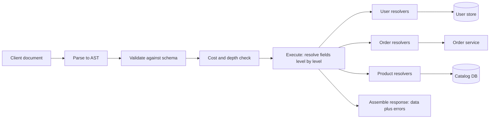
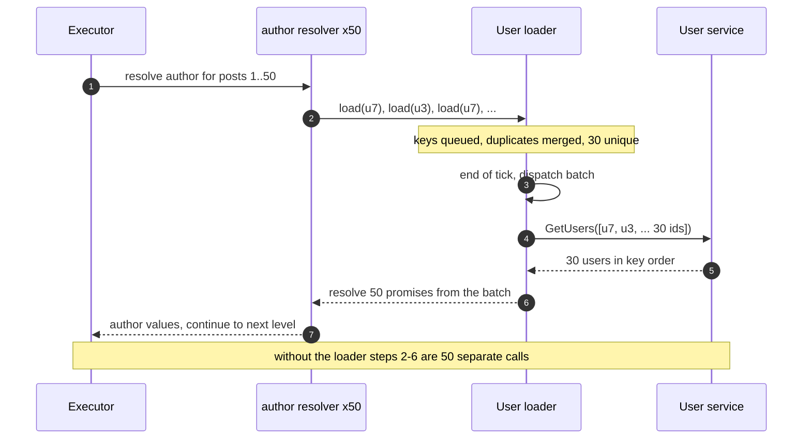
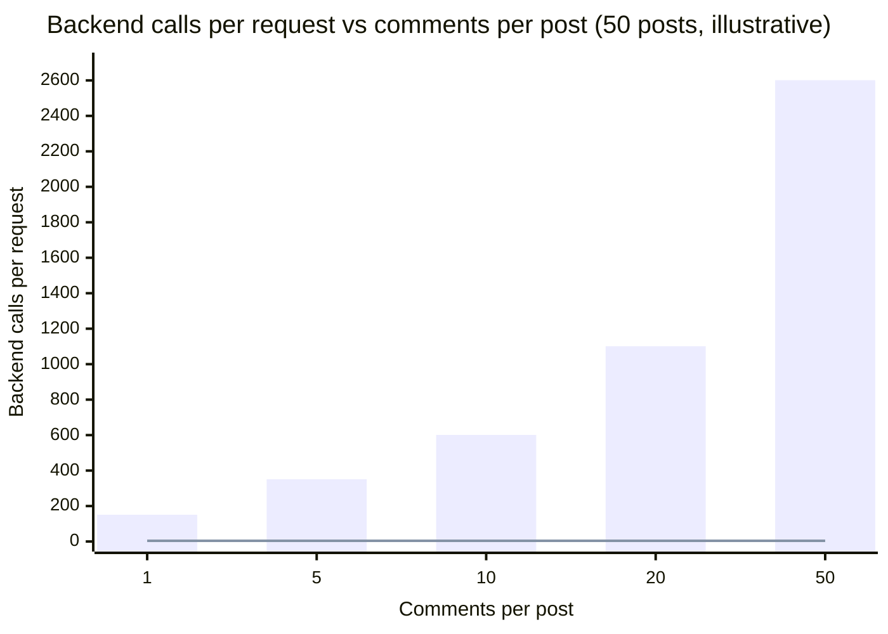
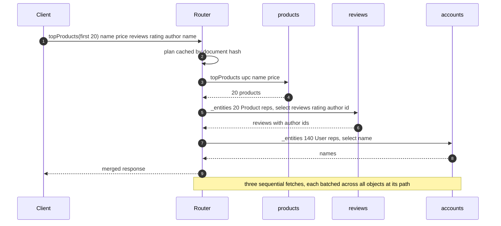
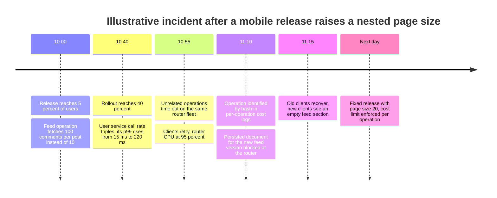

GraphQL, GraphQL Foundation tarafından tanımlanan (güncel sürüm Eylül 2025 baskısıdır) API'ler için bir sorgu dili ve yürütme modelidir. Sunucu, döndürebileceği nesneleri ve bunların birbirine nasıl bağlandığını anlatan tipli bir şema yayımlar; istemci ise tam olarak istediği alanları, şemanın izin verdiği her derinlikte iç içe adlandıran bir doküman gönderir ve aynı şekle sahip bir JSON yanıtı alır. Tek bir endpoint'e yapılan tek bir istek, bir REST istemcisinin bir ekranı oluşturmak için arka arkaya yapacağı kaynak çağrılarının yerini alır ve istemci istemediği hiçbir alanı almaz.

GraphQL'in çözdüğü problem, hangi verinin gerektiğini bilen tarafla neyin döndürüleceğine karar veren taraf arasındaki uyumsuzluktur. Kaynak tabanlı bir API'de her yanıtı sunucu tasarımcısı önceden sabitler; bu yüzden bir mobil istemci bir endpoint'ten fazlasını, diğerinden eksiğini alır ve ekipler ekran başına özel endpoint'ler ekleyerek buna yanıt verir. GraphQL bunu tersine çevirir: sunucu yalnızca neyin mümkün olduğunu sabitler, neyin fiilen isteneceğine her istemci kendisi karar verir. Çok sayıda istemci tipi ve çok sayıda backend servisi olduğunda bu, frontend ve backend ekipleri arasındaki koordinasyonun bütün bir kategorisini ortadan kaldırır.

Asıl denge şudur: sunucu artık iş yükünü önceden bilmez. Kaynak tabanlı bir API'nin sabit URL kümesinden bedavaya aldığı her özellik, yani kaynak başına bir cache anahtarı, endpoint başına bilinen bir maliyet, endpoint başına bir hata oranı ve çağrı başına bir rate limit, istemcinin istek anında seçtiği bir iş yükü için yeniden inşa edilmek zorundadır. GraphQL istemci esnekliği ve daha az round trip satın alır; bedelini sorgu maliyeti denetimi, önbellekleme, resolver katmanında batching disiplini ve graph birden fazla servise yayıldığında her isteğin yolunda duran dağıtık bir sorgu planlayıcısı ile öder. Birçok ekibin tek bir graph'ın bir parçasına sahip olmasını sağlayan mimari olan federasyon, bunun üstüne organizasyonel bağımsızlık ekler ve bunun faturasını gecikme, kısmi hata ve şema yönetişimi olarak keser.


*Tek bir GraphQL sunucusunda istek yolu. Ayrıştırma, doğrulama ve maliyet kontrolleri yalnızca dokümana ve şemaya bağlıdır; backend'ler yürütme aşamasında çağrılır.*

Diyagram, özellikleri farklı iki aşamayı birbirinden ayırır. Yürütmenin solundaki her şey doküman ve şema üzerinde saf hesaplamadır: doküman hash'ine göre önbelleğe alınabilir, bozuk ya da geçersiz istekleri hiçbir backend görmeden reddeder ve operatörün bir isteğin yol açabileceği işi sınırlayabileceği yer burasıdır. Backend'lerle konuşan tek aşama yürütmedir ve şekli sabit bir kod yolunu değil sorguyu izler; bu yüzden bir istemcinin dokümanındaki tek bir değişiklik, hangi servislerin kaç kez çağrılacağını değiştirebilir. Production'daki GraphQL problemlerinin çoğu, denetimin yeterince büyük bir kısmını sol yarıya taşımamaktan kaynaklanır.

## Yürütme Modeli: Dokümandan Yanıta

### Şema, Operasyonlar ve Doğrulamanın Garanti Ettikleri

Şema; tipli alanlara sahip nesne tiplerini, argümanlar için input tiplerini, enum'ları, interface'leri ve union'ları ve üç kök tipi tanımlar: okumalar için `Query`, yazmalar için `Mutation` ve olay akışları için `Subscription`. Bir alanın tipi liste (`[Order]`) ve non-null (`Order!`) olarak sarmalanabilir; non-null, istemciye başarılı bir yanıtta alanın asla `null` olmayacağı sözünü verir. Bir operasyon dokümanı bir kök tipten alan seçer, değişken alabilir, aynı alanın farklı argümanlarla iki kez istenebilmesi için alanlara alias verebilir ve fragment'lar aracılığıyla seçim kümelerini yeniden kullanabilir.

Doğrulama, dokümanı yürütmeden önce şemaya karşı denetler: seçilen her alan kendi tipinde mevcuttur, argümanların tipleri doğrudur, değişkenler tutarlı kullanılır, fragment'lar kullanılır ve döngü oluşturmaz, yaprak alanlar scalar ya da enum'dur. Doğrulamadan geçen bir doküman, şekli sorguyla birebir örtüşen bir yanıt üreteceğinin garantisini taşır; istemcilerin dokümanlarından tip üretebilmesini ve bu tiplere güvenebilmesini sağlayan da budur. Doğrulama maliyeti sınırlamaz. Geçerli bir doküman connection'ları on seviye iç içe kurabilir, pahalı bir alana bin kez alias verebilir ya da boyutu sınırsız listeler isteyebilir; spesifikasyonun doğrulama kurallarında derinliği, genişliği ya da toplam işi sınırlayan hiçbir şey yoktur. Bu boşluk, aşağıda ele alınan implementasyon düzeyindeki denetimlerle kapatılır.

### Resolver Yürütmesi ve Alan Düzeyinde Hatalar

Yürütme, seçim kümesini dolaşır. Her alan için sunucu bir resolver çağırır; resolver, üst nesneyi, alanın argümanlarını ve istek başına bir context'i alan ve bir değer ya da bir değerin promise'ini döndüren fonksiyondur. Değer bir nesneyse yürütme, bu değeri yeni üst nesne olarak alıp alanın alt seçimine iner; değer bir listeyse her eleman için bir kez devam eder. Dolayısıyla çözümleme seviye seviye ilerler: önce tüm kök alanlar, sonra onların sonuçlarının alanları ve bu böyle sürer. Sorgularda spesifikasyon kardeş alanların herhangi bir sırayla, eşzamanlı olarak da çözülmesine izin verir; mutation'larda ise üst düzey alanlar doküman sırasıyla seri olarak yürütülür, yani `createOrder` bitmeden `chargeOrder` başlamaz.

Hatalar istek başına değil alan başınadır. Bir resolver hata fırlatırsa sunucu; bir mesaj, alana giden `path` (örneğin `["user", "orders", 3, "total"]`) ve dokümandaki kaynak konumu ile bir hata kaydeder, o alanı `null` yapar ve geri kalanı çözmeye devam eder. Yanıt `data` ve bir `errors` listesini yan yana taşır. Bu, tasarım gereği kısmi başarıdır: tek bir backend'in hatası tüm ekranı değil, ekranın tek bir parçasını bozar.

Non-null tipler bu `null` değerin nereye düşeceğini değiştirir. `Money!` olarak tanımlanmış bir alan hata verirse `null` olamaz; bu yüzden hata üst nesneye yayılır ve onun yerine üst nesne `null` olur. Üst nesne de non-null ise yayılım, nullable bir alana ya da köke ulaşana kadar yukarı doğru sürer; kökte `data`'nın kendisi `null` olur. Doğruluk argümanı, istemcinin tip sözleşmesinin asla ihlal edilmemesidir: `order.total` alanını non-null olarak okuyan bir istemci orada asla `null` görmez, çünkü okuyacağı order nesnesi bunun yerine yanıttan çıkarılır. Bedeli şudur: ağacın derinlerindeki tek bir hata, en yakın nullable sınıra kadar her atanın her kardeşini silebilir. Bu yüzden nullability bir veri modelleme ayrıntısı değil, bir hata izolasyonu kararıdır.

GraphQL, tek bir SQL sorgusunun vereceği garantiyi de vermez. Farklı resolver'ların çözdüğü alanlar farklı anlarda ve çoğu zaman farklı servislerden okunur; bu nedenle bir yanıt tutarlı bir snapshot değildir: iki okuma arasına bir yazma girerse bir `balance` ile onu açıklayan `transactions` birbiriyle çelişebilir. Yürütme modelinde alanlar arasında izolasyon sağlayan hiçbir şey yoktur.

:::caution[Seri mutation'lar bir transaction değildir]
Tek bir dokümandaki iki üst düzey mutation alanı sırayla çalışır, ancak ikincisi başarısız olursa birincisi commit edilmiş olarak kalır ve yanıt bir başarı ile bir hata bildirir. GraphQL'de alanlar arasında rollback yoktur. Atomik olması gereken çok adımlı bir yazma, transaction'ı ya da [saga](/distributed-systems/tr/coordination/distributed-transactions/saga-pattern/) akışını kendi resolver'ı yöneten tek bir mutation alanına aittir; timeout sonrasında yeniden denenebilecek bir mutation ise idempotent olmayan diğer her çağrı gibi bir [idempotency anahtarına](/distributed-systems/tr/communication/api-gateway/idempotency/) ihtiyaç duyar.
:::

### Taşıma: Tek Endpoint, Tek Durum Kodu

GraphQL taşıma katmanından bağımsızdır, ancak dağıtımların neredeyse tamamı HTTP kullanır: gövdesinde `query`, `operationName` ve `variables` taşıyan bir JSON ile `POST` ya da aynı değerleri query string'de taşıyan bir `GET`; GraphQL over HTTP taslak spesifikasyonu `GET`'e yalnızca sorgular için izin verir, mutation'lar için asla. Sunucular tarihsel olarak, doğrulama hataları dahil bir GraphQL yanıtı üreten her şeye `200 OK` döndürdü. GraphQL over HTTP taslağı daha sıkı semantiğe sahip `application/graphql-response+json` media type'ını getirir: doküman geçerliyse ve yürütme denendiyse, alan hataları oluşsa bile `200`; istek bozuksa ya da doğrulamadan geçemediyse `4xx`. Örneğin Shopify, Admin API'si için bu davranışı 2025-01 sürümünden itibaren duyurdu. Hangi media type kullanılırsa kullanılsın, alanların yarısını hataya çeviren bir backend kesintisi hâlâ bir `200`'dür.

Bunun sunucunun dışında iki sonucu vardır. Sağlığı HTTP durum koduna göre değerlendiren her genel araç, load balancer health check'lerinden API gateway'in hata oranı panosuna kadar, kısmi bir kesinti sırasında başarı görür; hata hesabının `errors` dizisini okuması gerekir. Ayrıca her istek tek bir path'e gittiği için endpoint başına metrikler tek bir seriye çöker: gözlem birimi, `operationName` ya da bir doküman hash'i ile tanımlanan operasyon olmalıdır. Subscription'lar genellikle graphql-ws kütüphanesinin, bakımı bırakılmış `subscriptions-transport-ws`'in yerini alan `graphql-transport-ws` alt protokolüyle WebSocket üzerinden ya da Server-Sent Events üzerinden taşınır; bağlantı düzeyindeki davranış [WebSocket ve SSE](/distributed-systems/tr/communication/synchronous-protocols/websocket-sse/) sayfasında anlatılanın aynısıdır, yalnızca her olaya bir GraphQL seçimi uygulanır.

## N+1 Problemi ve Toplu Çözümleme

Alan alan yürütmenin istemcinin görmediği bir maliyeti vardır. Her biriyle birlikte yazarı da istenen 50 gönderilik bir sorgu düşünün. `posts` resolver'ı tek bir sorgu atar; ardından `author` resolver'ı her gönderi için bir kez, yani 50 kez çalışır ve her çağrı tek bir kullanıcı çekiyorsa, elle yazılmış bir endpoint'in iki çağrıyla yapacağı işi sunucu 51 backend çağrısıyla yapar. Her gönderinin yorumlarını ve her yorumun yazarını da eklediğinizde sayı, her seviyedeki liste boyutlarının çarpımıyla büyür. Buna N+1 problemi denir ve GraphQL bunu varsayılan davranış hâline getirir: resolver'lar birbirinden bağımsız yazılır, dolayısıyla hiçbiri 49 kardeşinin aynı servise aynı türden bir soru sormak üzere olduğunu bilmez.

Standart çözüm, Facebook'un JavaScript için geliştirdiği DataLoader kütüphanesiyle yaygınlaşan ve çoğu sunucu ekosisteminde yeniden yazılmış (Netflix DGS'in kullandığı Java'daki java-dataloader, .NET'te Hot Chocolate'in batch resolver'ları, Ruby'de graphql-batch) bir batching loader'dır. Resolver backend'i çağırmak yerine `load(key)` çağırır ve bir promise alır. Loader, mevcut yürütme adımında istenen tüm anahtarları toplar; adım teslim ettiğinde (JavaScript'te, event loop'un mevcut tick'i promise işlerini boşalttıktan sonra) toplanan tüm anahtarlarla tek bir batch fonksiyonu çağırır, örneğin `SELECT ... WHERE id IN (...)` ya da tek bir `GetUsers` RPC'si, ardından bekleyen her promise'i kendi sonucuyla çözer.


*Batching loader ile tek bir yürütme seviyesi. Loader 50 resolver çağrısını tek bir backend çağrısına dönüştürür ve tekrarlanan anahtarları tekilleştirir.*

Diyagram, loader'ın neden tek bir isteğe kapsamlanması gerektiğini gösterir. 2. adımda loader anahtarları memoize de eder; iki kez istenen `u7` bir kez çekilir ve aynı istekteki sonraki her `load(u7)` önbellekteki değeri döndürür. Bu önbellek yalnızca tek bir isteğin içinde doğrudur: istekler arasında paylaşılırsa bir kullanıcının yetkilendirmeye göre filtrelenmiş görünümünü bir başkasına sunar ve değerleri değiştikten çok sonra da tutar. Loader, context nesnesinde istek başına oluşturulur ve istekle birlikte atılır; o bir batching ve tekilleştirme aracıdır, [Önbellek Stratejileri](/distributed-systems/tr/data-management/distributed-caching/cache-strategies/) sayfasındaki anlamıyla bir önbellek değildir.

Batching'in doğru olup olmadığına iki sözleşme ayrıntısı karar verir. Batch fonksiyonu, anahtarlarla aynı sırada anahtar başına tam bir sonuç döndürmeli, eksik anahtarlar için açık bir hata ya da boş işaretçisi koymalıdır; satırları rastgele sırayla döndüren ya da eksik ID'leri sessizce atlayan bir backend, bir gönderiye yanlış yazarı iliştirir. Ayrıca batching yalnızca aynı adımda istenen anahtarlar için çalışır: gönderilerin yazarları ile yorumların yazarları farklı seviyelerdedir, bu yüzden iki ayrı batch oluştururlar. Batching genişliği daraltır, derinliği değil: beş seviye derinliğindeki bir sorgu hâlâ beş ardışık tura mal olur.

### Örnek Hesap: Batching ile ve Batching Olmadan Bir Akış Sorgusu

Yazarıyla ve ilk 10 yorumuyla birlikte 50 gönderi döndüren, her yorumun da yazarını içeren bir akış sorgusu varsayın. Her backend çağrısının 4 ms sürdüğünü, her isteğin en fazla 16 eşzamanlı backend çağrısı tutabildiğini ve API'nin saniyede bu türden 300 sorgu sunduğunu varsayın. Tüm sayılar açıklama amaçlıdır.

Batching olmadan sunucu gönderiler için 1, gönderi yazarları için 50, yorum listeleri için 50 ve yorum yazarları için 500 çağrı yapar: istek başına 601 çağrı. Yürütmenin üç ardışık seviyesi vardır. Birinci seviye tek çağrıdır (4 ms). İkinci seviye 16'lık dalgalar hâlinde 100 çağrıdır; yedi dalga, yani 28 ms. Üçüncü seviye 500 çağrıdır; 32 dalga, yani 128 ms. Sorgu yaklaşık 160 ms backend süresi tutar ve saniyede 300 sorguda kullanıcı servisi saniyede 550 × 300 = 165.000 çağrı alır.

Batching ile her seviye, farklı loader başına bir çağrı yapar: gönderiler (1), ardından paralel olarak yazarlar ve yorum listeleri (2), ardından yorum yazarları (1); toplam dört çağrı. Batch çağrıları daha büyüktür, örneğin 50 anahtar için 6 ms ve 500 anahtar için 8 ms; bu durumda sorgu yaklaşık 4 + 6 + 8 = 18 ms sürer. Kullanıcı servisi saniyede 2 × 300 = 600 çağrı alır ve her çağrı daha fazla anahtar taşır. Batching 500 yazar kaydını çekme işini ortadan kaldırmaz; 549 çağrı başı ek yükü (bağlantı alma, istek ayrıştırma, ağ round trip'i, backend'de sorgu planlama) ortadan kaldırır ve bu hızlarda bu, yüzlerce instance gerektiren bir servis ile birkaç tane gerektiren bir servis arasındaki farktır.


*Çubuklar: batching'siz resolver'lar, 1 + 50 + 50 + 50k çağrı. Çizgi: batching'li resolver'lar, liste boyutundan bağımsız olarak seviye başına loader başına bir çağrı.*

Batching'siz çağrı sayısı iç liste boyutuyla doğrusal, eklenen her iç içe listeyle çarpımsal olarak büyürken batching'li sayı yalnızca seviye ve loader sayısına bağlıdır. N+1 regresyonlarının, listelerin üç elemanlı olduğu geliştirme ortamında görünmez olup production'da bir istemci sayfa boyutunu büyüttüğünde ya da tek bir iç içe alan eklediğinde backend çağrı hızında ani bir sıçrama olarak ortaya çıkmasının nedeni budur.

## İstemcinin Seçtiği İş Yükünü Sınırlamak

Sorguyu istemci seçtiği için sunucunun, yürütmeden önce sorgunun karşılanabilir olup olmadığına karar vermesi gerekir. Genellikle birlikte kullanılan dört mekanizma vardır ve her biri farklı bir şeyi sınırlar.

Derinlik sınırları, sabit bir seviye sayısının ötesinde iç içe geçen dokümanları reddeder. Ucuzdurlar ve en kaba özyinelemeli sorguları (`user { friends { friends { friends ... } } }`) durdururlar, ancak genişlik hakkında hiçbir şey söylemezler: her seviyede 100 eleman isteyen üç derinlikli bir sorgu bir milyon düğüme dokunur.

Statik maliyet analizi, işi doküman ve şemadan tahmin eder. Her alanın bir ağırlığı vardır ve her liste, alt seçiminin maliyetini istenen sayfa boyutuyla ya da varsayılan bir boyutla çarpar. GitHub'ın public API'si kuralını kesin biçimde belirtir: her connection'ın 1 ile 100 arasında bir `first` ya da `last` argümanı olmalıdır, tek bir çağrı 500.000'den fazla düğüm isteyemez ve bir sorgunun rate limit maliyeti, her connection'ı sınırına kadar doldurmak için gereken backend isteği sayısının 100'e bölünmesidir. GitHub'ın kendi örneğinde, her biri 50 issue'lu 100 repository ve issue başına 60 label, 1 + 100 + 5.000 = 5.101 istek gerektirir ve bir kullanıcının saatlik 5.000 puanlık bütçesinden 51 puan düşer. Shopify'ın Admin API'si nesneleri 1, scalar ve enum'ları 0, mutation'ları 10 olarak ağırlıklandırır, istenen maliyeti 1.000 puanı aşan her tekil sorguyu reddeder ve her uygulamanın leaky bucket'ını mağazanın planına bağlı bir hızla doldurur (standart planda saniyede 100 puan); yanıttaki `extensions.cost` istenen ve gerçekleşen maliyeti bildirir ve aradaki fark yürütmeden sonra iade edilir. Apollo Router'ın demand control özelliği benzer varsayılanlarla IBM GraphQL Cost Directive spesifikasyonunu izler ve şema yazarlarının ağırlıkları `@cost` ile, liste boyutlarını `@listSize` ile geçersiz kılmasına izin verir.

Bunun sonucu, rate limiting'in istek sayısına göre değil maliyete göre yapılmasıdır. [Gateway Düzeyinde Throttling ve Rate Limiting](/distributed-systems/tr/communication/api-gateway/throttling-rate-limiting/) sayfasında anlatıldığı gibi HTTP isteklerini sayan bir gateway, alias verilmiş 500 `login` mutation'ı içeren ve 500 parola tahmini deneyen bir dokümanı ya da 5.000 REST çağrısının işini yapan iç içe bir sorguyu tek istek olarak görür. Bucket maliyet birimi cinsinden tutulmalıdır; algoritmanın kendisi [Rate Limiting](/distributed-systems/tr/resilience/flow-control/rate-limiting/) sayfasında anlatılan token bucket'tan farklı değildir.

Yürütme timeout'ları, tahminin kaçırdığı her şey için son savunma hattıdır: GitHub 10 saniyeden uzun süren sorguları sonlandırır ve bunlar için ek puan keser. Timeout istek başına hasarı sınırlar ama istemci başına hasarı sınırlamaz; bu yüzden maliyet sınırlarının yerini almaz, onları tamamlar.

Trusted document'lar, kalıcı sorgular (persisted queries) ya da operasyon allowlist'i olarak da bilinir ve problemi birinci taraf istemciler için ortadan kaldırır. Build sırasında istemci kodundaki her operasyon çıkarılır, hash'lenir ve sunucuya kaydedilir; çalışma zamanında istemci yalnızca hash'i gönderir ve sunucu yalnızca kayıtlı dokümanları yürütür. Keyfi sorgular doğrudan reddedilir; böylece iş yükü, maliyeti önceden ölçülebilen bilinen ve sonlu bir operasyon kümesine dönüşür. Apollo'nun, istemcinin önce bir SHA-256 hash'i gönderdiği ve tam metni ancak bir `PersistedQueryNotFound` hatasından sonra gönderdiği Automatic Persisted Queries (APQ) protokolü benzer görünür, ancak ilk kullanımda her dokümanı kaydeder: APQ istek baytlarından tasarruf sağlar ve `GET` önbelleklemesini mümkün kılar, ama hiçbir koruma sağlamaz.

| Denetim | Neyi sınırlar | Neyi kaçırır | Ne zaman tercih edilmeli |
|---|---|---|---|
| Derinlik sınırı | Özyinelemeli iç içe geçme | Genişlik, alias'lar, liste boyutları | Her zaman, ucuz bir ilk filtre olarak |
| Zorunlu sayfalama ve düğüm sınırı | İstek başına toplam düğüm | Tek tek pahalı alanlar | Connection tabanlı şemalara sahip public API'ler |
| Statik maliyet analizi | Yürütmeden önce tahmini iş | Gerçek liste boyutları ve alan başına gecikme | Public ya da partner API'ler; maliyete göre rate limiting |
| Gerçekleşen maliyet hesabı | Fiilen yapılan iş | Olaydan önceki hiçbir şey | Statik tahminlerin üstüne iade ve faturalama |
| Yürütme timeout'u | İstek başına en kötü durum süresi | İstemci başına birikimli maliyet | Her zaman, son savunma hattı olarak |
| Trusted document'lar | Çalışabilecek operasyon kümesi | Üçüncü taraf istemciler | Birinci taraf web ve mobil istemciler |

Tablonun satırları birbirinin alternatifi değil, katmanlarıdır. Bilinmeyen istemcileri allowlist'e alamayacağı için public bir API'nin statik maliyet sınırlarına ihtiyacı vardır; birinci taraf bir API ise allowlist kullanmalıdır, çünkü hiçbir maliyet modeli ölçülmüş sabit bir operasyon kümesi kadar kesin değildir.

```yaml
# Apollo Router: estimate cost before subgraph calls, start in measure mode
demand_control:
  enabled: true
  mode: measure          # log cost.estimated / cost.actual, reject nothing yet
  strategy:
    static_estimated:
      list_size: 10      # assumed size of lists without @listSize
      max: 1000          # reject estimated cost above this once mode: enforce
```

Şema sayfa boyutu argümanlarını `@listSize` ile tanımlıyorsa, bu varsayılanlarla yukarıdaki akış sorgusunun maliyeti 50 × (1 + 1 + 10 × (1 + 1)) = 1.100'dür: her gönderi bir nesnedir (1), yazarı bir başkasıdır (1) ve 10 yorumunun her biri kendisini ve yazarını katar. Enforce modunda `max: 1000` ile reddedilirdi. Önce `measure` modunda çalıştırıp router'ın yaydığı `cost.estimated` ve `cost.actual` enstrümanlarını karşılaştırmak, herhangi bir istemci reddedilmeden önce modelin varsaydığı liste boyutlarının gerçek boyutlardan ne kadar uzak olduğunu gösterir.

:::tip[Birinci taraf istemcileri allowlist'e alın, gerisine maliyet sınırı koyun]
Yalnızca kendi web ve mobil uygulamalarınızın kullandığı bir API'de trusted document'lar, GraphQL'in açık iş yükünü tek tek yük testinden geçirilebilen, maliyeti ölçülebilen ve önbelleğe alınabilen kapalı bir operasyon kümesine dönüştürür. Keyfi dokümanlara izin verilen üçüncü taraf istemciler için ayrı bir endpoint ya da token sınıfı tutun ve maliyet modelini yalnızca onun önüne koyun.
:::

### Her İstek POST Olduğunda Önbellekleme

[REST: Kısıtlar, Kaynaklar ve HTTP Sözleşmeleri](/distributed-systems/tr/communication/synchronous-protocols/rest/) sayfasında anlatılan HTTP önbelleklemesi, saklanan yanıtları method ve URI ile anahtarlar; `/graphql`'e yapılan bir `POST` paylaşılan önbellekler tarafından hiç önbelleğe alınamaz. Üç katman bunun bir kısmını geri kazandırır. Sorguları `GET` olarak, URL'leri kısa tutmak için tam metin yerine kalıcı doküman hash'iyle göndermek, yanıtları yeniden CDN'ler tarafından önbelleğe alınabilir hâle getirir; sunucu bir yanıtın `Cache-Control` değerini, içerdiği alanlar arasındaki en küçük `max-age` olarak hesaplayabilir ve alanlardan biri kullanıcıya özgüyse tüm yanıtı `private` olarak işaretler (Apollo Server'ın cache-control ipuçları böyle çalışır). Sunucunun içinde resolver'lar backend sonuçlarını entity anahtarıyla, olağan [geçersizleştirme](/distributed-systems/tr/data-management/distributed-caching/cache-invalidation/) kurallarıyla önbelleğe alabilir. İstemci tarafında Apollo Client ve Relay'deki normalize önbellekler yanıtları `__typename` ve `id` ile anahtarlanmış entity'lere böler; böylece güncellenmiş bir nesne döndüren bir mutation, o nesneyi gösteren her ekranı günceller.

En keskin kenar CDN katmanındadır. Seçimi public bir ürünle görüntüleyen kullanıcının sepetini karıştıran, `GET` olarak gönderilip public bir direktifle önbelleğe alınan bir sorgu, bir kullanıcının sepetini aynı hash'i gönderen bir sonraki kullanıcıya sunar. Cache anahtarı görüntüleyeni tanımlayan bilgiyi içermeli ya da yanıt `private` olmalıdır; güvenli varsayılan, bir yanıtın yalnızca içindeki her alan açıkça public olarak tanımlanmışsa paylaşılan önbellekte tutulabilmesidir.

## Federasyon: Birçok Servise Yayılan Tek Graph

Birçok backend'in önünde duran tek bir GraphQL sunucusu, şema onlarca ekibin entegrasyon noktası hâline gelene kadar işe yarar. Her alan değişikliği tek bir kod tabanından, tek bir deploy pipeline'ından ve tek bir sahip ekipten geçer ve GraphQL katmanı, backend'lerin kaçınmak için bölündüğü monolitin kendisine dönüşür. Netflix bu durumu 2020'de Studio API'si üzerinden anlattı: birleştirme katmanı fiilen bir monolite dönüşmüştü ve çözüm, her alan ekibinin graph'taki kendi parçasına Kotlin ile yazılmış bir gateway'in arkasında sahip olabilmesi için onu federe etmek oldu.

Bir graph'ı bölmenin iki mimarisi vardır. The Guild'in graphql-tools kütüphanesiyle yaygınlaşan schema stitching, bir gateway'in birkaç bağımsız şemayı içe aktarmasını ve bunların tiplerinin nasıl birleşeceğini gateway yapılandırmasında tanımlamasını sağlar; birleştirme mantığı gateway ekibinde yaşar. Apollo'nun getirdiği ve bugün birkaç sağlayıcının uyguladığı federasyon ise bu bilgiyi servislere taşır: her servis, hangi tiplere katkıda bulunduğunu ve bunların nasıl tanımlandığını bildiren bir subgraph şeması yayımlar; bir composition adımı subgraph'ları, bir router'ın sunduğu tek bir supergraph şemasında birleştirir. Fark, join'lerin sahipliğindedir. Stitching'de join'leri gateway ekibi yazar; federasyonda her subgraph ekibi kendi join'lerini bildirir ve composition hepsini aynı anda denetler.

### Entity'ler, Anahtarlar ve Composition

Federasyonun birimi entity'dir: birden fazla subgraph'ın alan katkısında bulunduğu ve bir anahtarla tanımlanan nesne tipi. Bir subgraph bir tipi `@key(fields: "id")` ile işaretler; bu, bir `id` verildiğinde o tipin kendi alanlarını üretebileceği anlamına gelir. Aynı tipe alan eklemek isteyen başka bir subgraph, aynı tipi aynı anahtar ve kendi alanlarıyla tanımlar ve bir anahtarı nesneye dönüştüren bir reference resolver uygular.

```text
# products subgraph: owns Product and its catalog fields
type Product @key(fields: "upc") {
  upc: ID!
  name: String!
  price: Money
}

# reviews subgraph: adds reviews to Product without owning it
type Product @key(fields: "upc") {
  upc: ID!
  reviews(first: Int = 10): [Review!]!
}

type Review {
  rating: Int!
  author: User          # User is an entity owned by the accounts subgraph
}
```

Composition bu subgraph şemalarını alıp supergraph'ı üretir: `Product`'ın `upc`, `name`, `price` ve `reviews` alanlarına sahip olduğu, her alanın hangi subgraph tarafından ve hangi anahtarla çözülebileceğinin işaretlendiği tek bir şema. Federation 2'de bir alan `@shareable` olarak işaretlenmeden iki subgraph tarafından tanımlanırsa, bir anahtar subgraph'ta bulunmayan bir alana referans verirse ya da tipler hiçbir sorgu planının uzlaştıramayacağı biçimde çelişirse composition başarısız olur. Composition, federasyonun doğruluk argümanıdır: başarılı olursa supergraph'taki her alana, anahtarlarını en az bir subgraph'ın üretebildiği bir entity zinciri üzerinden bir kök alandan ulaşılabilir; dolayısıyla router her zaman bir plan kurabilir. Diğer direktifler join'leri ince ayarlar: `@external` ve `@requires`, bir subgraph'ın resolver'ının başka bir subgraph'a ait alanlara bağımlı olmasını sağlar; `@provides`, bir subgraph'ın bir fetch'ten tasarruf etmek için belirli bir yol boyunca başka bir subgraph'ın bazı alanlarını döndürebileceğini bildirir; `@override` ise bir alanın sahipliğini bir subgraph'tan diğerine taşır.

### Sorgu Planlama ve Entity Fetch'leri

Router gelen her operasyon için bir sorgu planı kurar; bu, sequence ve parallel düğümleriyle birleştirilmiş, subgraph'lara yönelik fetch'lerden oluşan bir ağaçtır ve dokümana göre önbelleğe alınır. Her fetch, tek bir subgraph'a gönderilen sıradan bir GraphQL operasyonudur. Plan bir subgraph'tan diğerine geçtiğinde router, önceki sonuçlarda o path'te bulunan her nesnenin anahtarını toplar ve bunları tek bir `_entities(representations: [_Any!]!)` sorgusuyla gönderir; buradaki her representation, `__typename: "Product"` ve `upc: "p1"` gibi küçük bir nesnedir. Alıcı subgraph her representation'ı kendi reference resolver'ı ile çözer ve istenen alanları döndürür; router da bunları yanıtta doğru path'lere geri birleştirir.


*Federe bir sorgu planının yürütülmesi. Subgraph'lar arası her geçiş tek bir toplu entity fetch'idir; bu yüzden round trip sayısını liste boyutu değil plan derinliği belirler.*

Diyagramdaki planın üç ardışık adımı vardır, çünkü her adım bir öncekinin döndürdüğü anahtarlara bağlıdır: yorumlar ürün anahtarlarına, yazar adları ise yorumlardan gelen kullanıcı anahtarlarına ihtiyaç duyar. Router plan düzeyinde zaten batching yapar; bu yüzden 5. adım 20 ürünü 20 istek yerine tek bir istekte gönderir. Subgraph'ın da reference resolver'ının içinde batching yapması gerekir: reviews subgraph'ı 20 representation'ı 20 veritabanı sorgusuyla çözerse N+1 problemi bir katman aşağı kaymış olur; Apollo'nun kendi dokümantasyonu da tam bu nedenle reference resolver'larda data loader kullanılmasını önerir.

Planın derinliği gecikmenin alt sınırını belirler. Router'dan subgraph'a her geçişin 1 ms ağ süresi tuttuğunu ve her subgraph'ın 8 ms'de yanıt verdiğini varsayın; üç adımlı plan, router'ın kendi işinden önce yaklaşık 27 ms tutar; aynı alanları süreç içinde çözen tek bir sunucu ise bu geçişler olmadan tek bir backend çağrısı kümesinin bedelini öderdi. Kuyruğu (tail) ise yayılım (fan-out) belirler. Her subgraph fetch'i birbirinden bağımsız olarak %1 olasılıkla 100 ms'yi aşıyorsa, altı fetch'li bir plan `1 - 0.99^6` olasılıkla, yani yaklaşık %5.9 ile en az bir yavaş fetch'e denk gelir; dolayısıyla router'ın 95. persentili subgraph'ların 99. persentiline yaklaşır. Her iki sayı da açıklama amaçlıdır; şekil ise geneldir ve [API Bileşimi](/distributed-systems/tr/microservice-patterns/data-management-patterns/api-composition/) sayfasının elle yazılmış birleştiriciler için incelediği kuyruk büyümesinin aynısıdır. Federasyon join'i otomatikleştirir; ucuzlatmaz.

### Implementasyonlar ve Ayrıştıkları Noktalar

Apollo'nun Federation 2'si fiilî standarttır: subgraph protokolü (`_entities` ve `_service` alanları ile yukarıdaki direktifler) çoğu dildeki subgraph kütüphaneleri tarafından uygulanır ve router'ı Rust ile yazılmıştır; demand control, kalıcı dokümanlar ve `@defer` desteği içerir. Netflix federasyonu, Java ve Kotlin subgraph'ları için açık kaynaklı DGS framework'üyle çalıştırır. The Guild'in Hive Gateway'i, WunderGraph Cosmo, Grafbase ve ChilliCream'in Hot Chocolate Fusion'ı gibi diğer router'lar Apollo tarzı subgraph'ları farklı ölçülerde kabul eder; planlama stratejisi, desteklenen direktifler ve subgraph hatalarını raporlama biçimleri bakımından ayrışırlar. Bu yüzden router'lar arasında taşınan bir supergraph'ın planlarının ve hata davranışının yeniden test edilmesi gerekir. Bu modeli sağlayıcılar arasında standartlaştırmayı amaçlayan GraphQL Foundation Composite Schemas spesifikasyonu öneri aşamasındadır; dolayısıyla direktif kümesi hâlâ sağlayıcıya göre tanımlanır.

Federasyon subgraph'lar arası tutarlılık sağlamaz. Her fetch tek bir subgraph'ı tek bir anda okur, bir mutation alanı tam olarak tek bir subgraph'ta yürütülür ve subgraph'lar arasında atomik yazma için bir protokol yoktur. Bir yanıtın yavaş alanları hızlı alanlardan sonra akıtmasını sağlayan `@defer` ve `@stream` ile artımlı teslim (incremental delivery) bazı sunucu ve router'larda uygulanmıştır, ancak spesifikasyonun Eylül 2025 baskısının parçası değildir; bu yüzden istemci ile sunucunun implementasyonun wire formatı üzerinde uzlaşması gerekir.

:::note[GraphQL'in bittiği ve komşu desenlerin başladığı yer]
İstemci tipi başına bir GraphQL sunucusu, sorgu dili olan bir [Frontend için Backend](/distributed-systems/tr/communication/api-gateway/bff-pattern/)'dir; federe bir router ise yönlendirme tablosu supergraph olan bir [API gateway](/distributed-systems/tr/communication/api-gateway/api-gateway-pattern/)'dir. Kimlik doğrulama, TLS sonlandırma ve kaba taneli rate limiting yine edge'e aittir; alan düzeyinde yetkilendirme ise o alanın sahibi olan subgraph'a aittir, çünkü router alanın arkasındaki alan kurallarını bilemez.
:::

## GraphQL Sistemlerinde Hata Modları

GraphQL hatalarının ortak bir özelliği vardır: bir `200` ve tek bir endpoint'in arkasına saklanırlar; bu yüzden tespit, operasyona ve alana göre anahtarlanmış telemetriye bağlıdır. OpenTelemetry'nin semantik konvansiyonları bunun için span özniteliklerini adlandırır (`graphql.operation.name`, `graphql.operation.type`, `graphql.document`) ve router'lar subgraph başına fetch metrikleri yayar; bunlar olmadan aşağıdaki her mod `/graphql` üzerinde belirsiz bir gecikme artışı olarak görünür.

### Pahalı Sorgular ve Yük Amplifikasyonu

Tetikleyici: bir istemci sürümü maliyeti hiç ölçülmemiş bir doküman yayımlar, örneğin iç içe bir connection'daki sayfa boyutu 10'dan 100'e çıkarılır; ya da bir saldırgan derin iç içe veya yoğun alias'lı dokümanlar gönderir. Belirtiler: GraphQL sunucularında ya da router'da CPU ve bellek yükselir, bir backend'in çağrı hızında ani bir sıçrama olur ve aynı filoyu paylaşan her operasyonun gecikmesi kötüleşir. Tespit: operasyon başına maliyet histogramları (`cost.estimated`, `cost.actual` ya da `extensions.cost` logları), GraphQL isteği başına backend çağrısı, toplam backend süresine göre en üstteki operasyonlar ve operasyon başına yanıt boyutu.


*Bir yük amplifikasyonu olayının şeklini gösteren varsayımsal bir zaman çizelgesi; gerçek bir olay değildir.*

Zaman çizelgesi, operasyon başına kimliğin neden kurtarma kaldıracı olduğunu gösterir. Hatalı iş yükü, yüzlerce sağlıklı doküman arasında tek bir dokümandır ve operatörün endpoint'i engellemeden onu engellemesini yalnızca bir hash ya da operasyon adı mümkün kılar. Trusted document'larla engelleme bir registry değişikliğidir; onlar olmadan, saldırganların ve istemcilerin istedikleri gibi değiştirebileceği sorgu metni üzerinde bir desen eşleştirmesidir. 10:55'teki retry'lar [retry fırtınalarının](/distributed-systems/tr/resilience/flow-control/retry-storms-metastable-failures/) bilinen amplifikasyonudur ve router ile backend'leri paylaştıkları için ilgisiz operasyonları vurur; bu da [bulkhead deseni](/distributed-systems/tr/resilience/protection-patterns/bulkhead-pattern/) anlayışıyla operasyon başına eşzamanlılık sınırları ya da yüksek maliyetli trafik için ayrı router havuzları gerekçesidir. Önlem: maliyet sınırlarını zorunlu kılın, istemci sürümlerini dokümanlarının ölçülmüş maliyeti gözden geçirilmiş olarak yayımlayın ve operasyon bazında engelleyin ya da düşürün. Kurtarma: doküman engellendiğinde ya da istemci geri alındığında yük hemen düşer, çünkü GraphQL'in kendisinde kuyrukta bekleyen bir şey yoktur; metastabil bir duruma giren her backend'in toparlanmadan önce yük atması gerekir.

### N+1 Regresyonları

Tetikleyici: bir loader üzerinden değil doğrudan backend'i çağıran bir resolver'la yeni bir alan eklenir ya da bir loader yanlışlıkla istek başına değil resolver çağrısı başına oluşturulur; bu da hem batching'i hem tekilleştirmeyi devre dışı bırakır. Belirtiler: backend çağrı hızı liste boyutlarıyla orantılı yükselir, gecikme sayfa boyutuyla büyür ve backend'in çağrı başı ek yükü CPU'sunda baskın hâle gelir. Tespit: operasyon başına backend çağrılarının GraphQL isteklerine oranı ve tek bir GraphQL span'inin yüzlerce özdeş alt span'e sahip olduğu trace'ler; bunlar herhangi bir [dağıtık izleme](/distributed-systems/tr/observability/logs-metrics-traces/distributed-tracing/) backend'inde görünür. Önlem: tüm entity erişimini istek kapsamlı loader'lardan geçirin ve temsilî operasyonları sayaçlı bir backend'e karşı yürüten, çağrı sayısı liste boyutuyla büyüdüğünde başarısız olan bir test ekleyin.

### Bir Yanıtı Silen Null Yayılımı

Tetikleyici: ayrı bir servisin ya da subgraph'ın beslediği bir alan non-null tanımlanmıştır ve o servis hata verir. Belirtiler: eksik tek bir fiyat yerine ürünün tamamı kaybolur; ürünler bir `[Product!]!` listesindeyse listenin üst nesnesi `null` olur ve yukarıya kadar her şey non-null ise `data` `null` olur; diğer tüm backend'ler sağlıklıyken istemci bir hata sayfası gösterir. Tespit: operasyon başına `data: null` içeren yanıtların oranı ve birçok yanıtta tek bir alanı gösteren hata path'leri. Önlem: her servis ya da subgraph sınırında ve G/Ç'si bağımsız olarak başarısız olabilen her resolver'ın alanında alanları nullable yapın; non-null'u üst nesneyle aynı okumadan birlikte üretilen alanlara saklayın ve istemcilerin kısmi veriyi göstermesine izin verin.

:::caution[Non-null, hata alanları arasında verilmiş bir sözdür]
Üç subgraph'tan birleştirilen bir tipteki `price: Money!`, fiyatlandırma servisinin hiç çökmeyeceği sözünü verir. Çöktüğünde yayılım, tek bir alanın hatasını eksik bir üst nesneye, belki de eksik bir sayfaya dönüştürür. Alanları yalnızca kendilerini içeren nesneyle aynı okumadan geliyorlarsa non-null tanımlayın.
:::

### Federe Yayılım ve Plan Regresyonları

Tetikleyici: bir şema değişikliği bir alanı başka bir subgraph'a taşır ya da bir `@requires` bağımlılığı ekler ve router'ın popüler bir operasyon için kurduğu plan ardışık bir adım ya da birkaç paralel fetch kazanır. Belirtiler: dokümanları değişmeyen operasyonların gecikmesi artar; bir subgraph'ın entity çağrı hızı yükselir. Tespit: router'ların loglayabildiği operasyon başına plan derinliği ve fetch sayısı ile subgraph başına fetch gecikmesi. Önlem: en sık kullanılan operasyonların sorgu planlarını şema değişikliklerinin parçası olarak gözden geçirin, her zaman birlikte istenen alanları tek bir subgraph'ta toplayın ve bir subgraph'ın bilinen bir yol boyunca bir alanı döndürebildiği yerlerde `@provides` kullanın.

### Composition Üzerinden Gelen Kırıcı Değişiklikler

Tetikleyici: bir subgraph bir alanı kaldırır, nullable bir alanı non-null yapar, bir argüman tipini daraltır ya da bir anahtarı değiştirir; composition yine başarılı olabilir, ancak alanı seçen istemciler doğrulamadan geçemez. Belirtiler: bir subgraph deploy'unun hemen ardından belirli bir istemci sürümü doğrulama hataları almaya başlar (yeni media type'ta bir `400`, eski media type'ta hatalarla birlikte bir `200`). Tespit: istemci ve operasyon başına doğrulama hatası oranı ve alan kullanım raporları. Önlem: composition'ı ve kırıcı değişiklik kontrollerini her subgraph'ın CI'ında yakın zamanlı production trafiğinde gözlemlenen operasyonlara karşı çalıştırın, `@deprecated` ile kullanımdan kaldırıp yalnızca kullanım sıfıra indiğinde silin ve evrim stratejisini [API versiyonlamanın](/distributed-systems/tr/communication/synchronous-protocols/api-versioning/) bir parçası olarak ele alın: GraphQL'in konvansiyonu sürüm numarası olmayan, sürekli evrilen tek bir graph'tır ve bu yalnızca silmeler ölçülmüş kullanıma bağlandığında çalışır.

### Hata İmzalarının Özeti

| Hata | Dışarıdan görünen belirti | Tespit sinyali | Önlem |
|---|---|---|---|
| Pahalı sorgu | Tek bir operasyon tüm filoyu yavaşlatır | Operasyon başına maliyet; istek başına backend çağrısı | Maliyet sınırları, trusted document'lar, hash ile engelleme |
| N+1 regresyonu | Backend çağrı hızı sayfa boyutuyla ölçeklenir | GraphQL isteği başına çağrı; tekrarlanan alt span'ler | İstek kapsamlı loader'lar, çağrı sayısı testleri |
| Null yayılımı | Tek bir backend hatasında bölümler ya da sayfalar boş kalır | `data: null` oranı; baskın tek bir hata path'i | Servis sınırlarında nullable alanlar |
| Plan regresyonu | Değişmeyen operasyonların gecikmesi artar | Operasyon başına plan derinliği ve fetch sayısı | Şema CI'ında plan incelemesi, alanları bir arada tutma |
| Composition kırılması | Tek bir istemci sürümü için doğrulama hataları | İstemci başına doğrulama hataları; alan kullanımı | Kullanıma bağlı silme, CI'da şema kontrolleri |
| Paylaşılan önbellek sızıntısı | Kullanıcılar birbirlerinin verisini görür | Cache anahtarı incelemesi; public yanıtlarda private alanlar | Her alan public değilse `private` |
| İzleme kör noktası | Kesinti durum kodu panolarında görünmez | `errors` dizisi oranı ile HTTP hata oranı karşılaştırması | Operasyon başına, yanıt gövdesinden hata metrikleri |

Paylaşılan önbellek sızıntısı, hizmeti yavaşlatmak yerine veriyi ifşa eden tek kalemdir; yalnızca `GET` önbelleklemesi etkin olduğunda ve bir yanıt görüntüleyene özgü alanlarla public alanları karıştırdığında ortaya çıkar ve önlemi, önbellekleme bölümündeki önbellek kapsamı kuralıdır.

## GraphQL'i ve Alternatiflerini Seçmek

| Yaklaşım | Yanıtı kim biçimlendirir | Önbellekleme | Maliyet denetimi | Ne zaman tercih edilmeli |
|---|---|---|---|---|
| GraphQL, tek sunucu | İstemci, tek şema içinde | İstemcide normalize; HTTP yalnızca `GET` ve kalıcı dokümanlarla | Maliyet analizi ya da allowlist şart | Bir ya da iki ekibin sahip olduğu makul sayıda backend'den örtüşen veri okuyan çok sayıda istemci tipi |
| Federe GraphQL | İstemci, birçok ekibin sahip olduğu subgraph'lar boyunca | Aynısı, ek olarak subgraph başına entity önbelleklemesi | Router düzeyinde maliyet sınırları; plan incelemesi | Tek bir ürün graph'ına katkı yapan birçok ekip ve router'ı ile şema yönetişimini işletecek bir platform ekibi |
| [REST](/distributed-systems/tr/communication/synchronous-protocols/rest/) kaynakları | Sunucu tasarımcısı, kaynak başına | Tam HTTP önbelleklemesi ve koşullu istekler | Endpoint başına sabit | Public ve partner API'ler, önbelleğe alınabilir okumalar, bağımsız güncellenen istemciler |
| [BFF](/distributed-systems/tr/communication/api-gateway/bff-pattern/) arkasında REST ya da gRPC | BFF ekibi, ekran başına | BFF edge'inde HTTP önbelleklemesi | BFF endpoint'i başına sabit | İhtiyaçları belirgin biçimde farklı az sayıda istemci tipi; her istemci için bir ekibin kendi birleştirmesine sahip olabildiği durumlar |
| [gRPC](/distributed-systems/tr/communication/synchronous-protocols/grpc-protocol-buffers/) | Servis tasarımcısı, metot başına | HTTP aracılarından hiçbiri | Metot başına sabit, deadline'lar yerleşik | Sıkı gecikme bütçesine sahip iç servisler arası çağrılar |

GraphQL'i şu durumlarda kullanın: baskın tüketiciler ekran başına birçok entity'yi birleştiren kullanıcı arayüzleri olduğunda; ihtiyaçları ayrışan ve backend ekiplerinin endpoint ekleyebileceğinden daha hızlı değişen birkaç istemci tipi olduğunda; ve organizasyon denetimlerin bedelini karşılayabildiğinde: her resolver'da istek kapsamlı batching, maliyet sınırları ya da trusted document'lar, operasyon başına telemetri ve gerçek kullanıma karşı şema kontrolleri. Bunun üstüne federasyonu yalnızca graph tek bir ekibin sahiplenebileceğinden büyüdüğünde ve router'ı işletecek, composition'ı CI'da çalıştıracak ve önemli operasyonların planlarını gözden geçirecek bir platform ekibi olduğunda kullanın.

GraphQL'i şu durumlarda kullanmayın: çağıranın ihtiyaçlarının tasarım anında bilindiği ve gRPC'nin sabit metotlarının, deadline'larının ve kompakt kodlamasının daha iyi oturduğu backend içi servisten servise çağrılarda; asıl değeri edge'de önbelleğe alınabilirlik olan public API'lerde, örneğin bir CDN üzerinden sunulan katalog ya da içerik API'lerinde; maliyet sınırlı bir graph üzerinden sayfalamanın bir dosyadan ya da bir akıştan daha yavaş olduğu büyük veri kümelerinin toplu dışa aktarımında veya akıtılmasında (Shopify bu tür işleri, sorgu maliyet sınırlarından muaf ayrı bulk operasyonlara yönlendirir); GraphQL'in mutation modelinin sağlamadığı, entity'ler arasında atomiklik gerektiren yazmalarda; ya da servis sınırlarının yerine geçecek bir şey olarak, çünkü [paylaşılan bir veritabanının](/distributed-systems/tr/microservice-patterns/data-management-patterns/shared-database-antipattern/) üzerine serilmiş bir graph, gizlediği bağımlılığı miras alır. İki ekibin tek bir repository'de paylaşabileceği bir graph için federasyonu benimsemeyin: router, composition pipeline'ı ve her plan adımındaki ek ağ geçişi kalıcı maliyetlerdir ve çözdükleri organizasyonel problemin önce var olması gerekir.

## İleri Okuma

- GraphQL Foundation, *GraphQL Specification, September 2025 Edition*, spec.graphql.org, 2025.
- GraphQL Foundation, *GraphQL over HTTP*, working draft, graphql.github.io.
- Lee Byron et al., *DataLoader*, GitHub repository graphql/dataloader.
- Apollo Graph Inc., *Apollo Federation documentation: Entities, Composition, and Query Plans*, apollographql.com/docs.
- GitHub, *Rate limits and node limits for the GraphQL API*, docs.github.com.
- Netflix Technology Blog, *How Netflix Scales its API with GraphQL Federation*, Parts 1 and 2, 2020.
