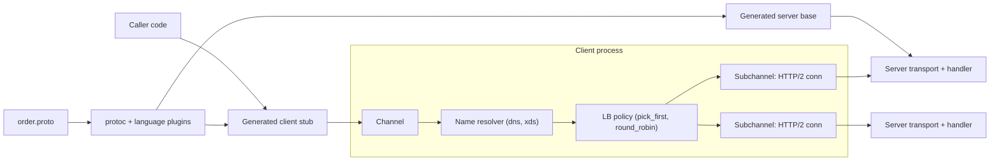
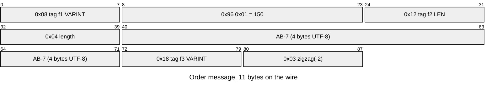
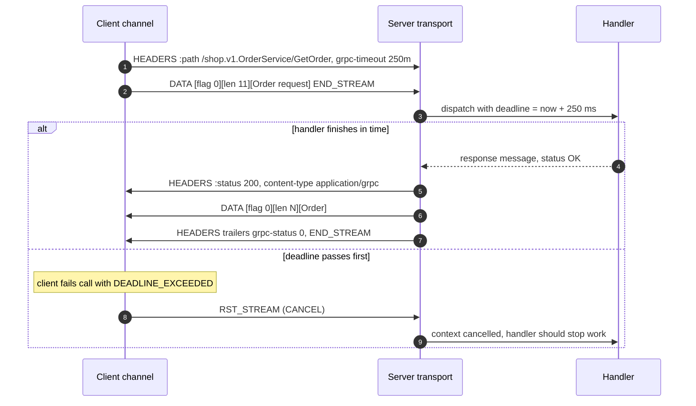
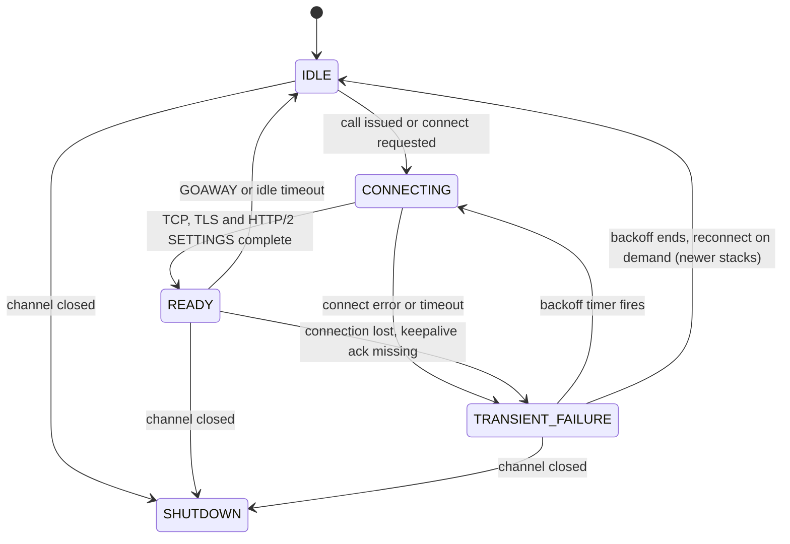
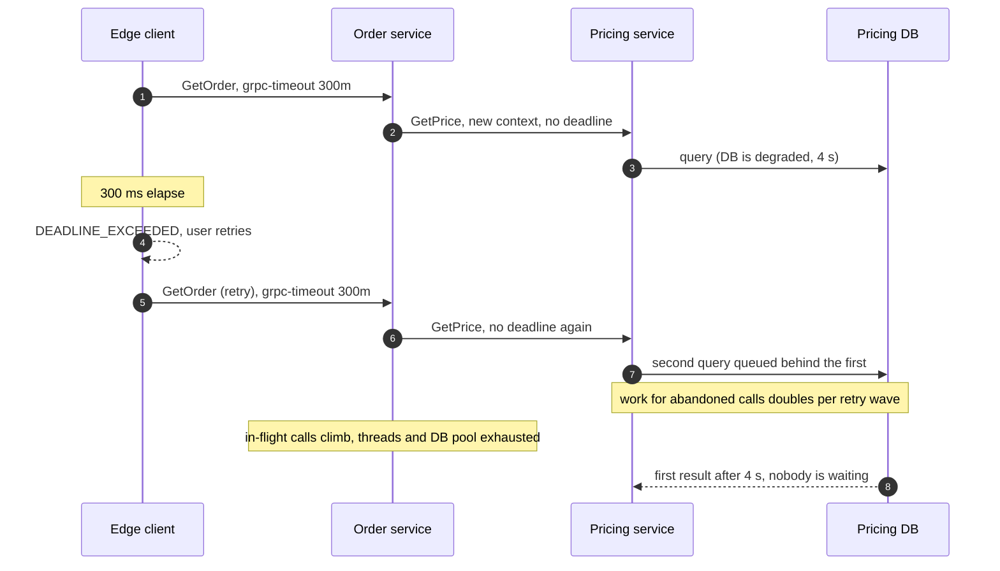

gRPC bir uzak prosedür çağrısı (remote procedure call, RPC) framework'üdür: bir servis, arayüz tanımlama dilinde (interface definition language, IDL) tipli metotlar kümesi olarak bir kez tanımlanır, bir derleyici her dil için client stub'larını ve sunucu iskeletlerini üretir ve her çağrı, uzunluk önekli (length-prefixed) binary mesajlar taşıyan tek bir HTTP/2 stream'i olarak yol alır. Protocol Buffers (protobuf), gRPC servislerinin çoğunun kullandığı IDL ve serileştirme formatıdır. Bu ikilinin var olma nedeni, servisler arası iç trafiğin herkese açık web API'lerinden farklı ihtiyaçlarıdır: çağrılar sıktır, payload'lar yapılandırılmıştır, iki uç da aynı organizasyona aittir ve gecikme bütçeleri; metin kodlamanın, elle yazılmış client'ların ve gelişigüzel timeout yönetiminin maliyetinin görünür hâle geleceği kadar dardır.

Bu yığının kazandırdıkları şunlardır: kesin bir uyumluluk sözleşmesine sahip kompakt bir kodlama, tipleri sunucununkinden sapamayan üretilmiş client'lar ve HTTP'nin tek başına tanımlamadığı çağrı semantiği. Bu semantik; çağrıyla birlikte yol alan bir deadline'ı, bir çağrı ağacı boyunca aşağıya yayılan iptali, retry anlamı taşıyan kapalı bir status code kümesini ve isimleri çözen, yükü dengeleyen ve yeniden bağlanan client tarafı bir channel'ı kapsar. Bedeli ise görünürlüktür. Payload'lar şema olmadan anlaşılamayan binary verilerdir, her yanıt gerçek sonucu bir trailer'da taşırken HTTP status 200 döner, HTTP cache'leri ve web araçlarının çoğu bu trafiği yorumlayamaz, tarayıcılar protokolü doğal olarak konuşamaz ve uzun ömürlü multiplex bağlantılar bağlantı düzeyindeki load balancer'ları etkisiz bırakır. Asıl denge, verimlilik ve sözleşme katılığı ile genel HTTP ekosistemiyle birlikte çalışabilirlik arasındadır.

gRPC'den daha eski, kavramsal bir maliyet de vardır. Bir RPC framework'ü uzak bir çağrıyı yerel bir fonksiyon çağrısı gibi gösterir ve hatalar tam da bu benzerlikten doğar: yerel bir çağrı yarı yolda zaman aşımına uğrayamaz, iki kez çalışamaz ve sonucu bilinmez durumdayken başarısız olamaz. gRPC bu gerçekleri gizlemez; onları deadline'larda, status code'larda ve retry kurallarında kodlar ve bu sayfanın geri kalanı büyük ölçüde bunların doğru okunmasıyla ilgilidir. gRPC'nin üzerinde çalıştığı HTTP/2 framing'i (stream'ler, flow control, GOAWAY) [HTTP/2 ve HTTP/3](/distributed-systems/tr/communication/synchronous-protocols/http2-http3-quic/) sayfasında ele alınır ve burada yalnızca referans verilir; uzun ömürlü streaming çağrılar ise [gRPC Streaming](/distributed-systems/tr/communication/synchronous-protocols/grpc-streaming/) sayfasının konusudur.


*gRPC yığını. Kod üretimi iki ucu da tek bir şemadan üretir; çalışma zamanında her çağrıyı hangi bağlantının taşıyacağına çağıran kod değil, channel karar verir.*

Diyagramdaki iki ayrım operasyonel açıdan önemlidir. Şema iki taraf için de tek doğruluk kaynağıdır; dolayısıyla client ile sunucu arasındaki bir tip uyuşmazlığı, iki taraf da dosyanın uyumlu sürümlerinden derlendiği sürece, çalışma zamanında sürpriz değil derleme hatasıdır. "Uyumlu"nun kuralları bir sonraki bölümün konusudur. İkinci ayrım, stub'ın bir bağlantıya sahip olmamasıdır: her çağrıyı bir channel'a devreder; channel hedef ismi adreslere çözer, seçilen her adres için bir HTTP/2 bağlantısı (subchannel) tutar ve her çağrı için subchannel seçimini bir load-balancing policy'sine bırakır. İleride anlatılan gRPC load balancing ve yeniden bağlanma davranışlarının neredeyse tamamı bu channel'da yaşar.

## Protocol Buffers: Kodlama ve Uyumluluk Sözleşmesi

Bir protobuf mesajı düz bir kayıt dizisi olarak kodlanır ve her kayıt bir anahtar ile onu izleyen bir değerden oluşur. Tag adı verilen anahtar `(field_number << 3) | wire_type` olarak hesaplanır: düşük üç bit değerin nerede bittiğinin nasıl bulunacağını, kalan bitler ise hangi alan olduğunu söyler. Alan isimleri wire üzerinde hiçbir zaman görünmez. Bu tek tercih, hem formatın kompaktlığını hem de başlıca operasyonel tehlikesini açıklar: bir decoder bir kaydın ne anlama geldiğini yalnızca birlikte derlendiği şema aracılığıyla bilir.

Tamsayılar ve tag'ler değişken uzunluklu tamsayılar (varint) kullanır. Her bayt yedi payload biti taşır ve en anlamlı bitini devam bayrağı olarak kullanır; en düşük anlamlı grup önce gelir. 150 değeri `96 01` olur: ilk baytın devam biti set edilmiştir ve düşük yedi biti taşır, ikinci bayt geri kalanını taşır. 128'in altındaki değerler bir, 16.384'ün altındakiler iki bayt tutar; tam bir 64 bit değer ise on bayta kadar çıkar. Tag'ler de varint olduğundan 1-15 numaralı alanların tag'i bir bayt, 16-2.047 numaralı alanlarınki iki bayttır; en sık set edilen alanlara en düşük numaraların verilmesi gerekmesinin nedeni budur.

Herhangi bir decoder'ın herhangi bir kaydı atlayabilmesini sağlayan şey wire type'tır. Kullanımda dört wire type vardır: `int32`, `int64`, `uint32`, `uint64`, `sint32`, `sint64`, `bool` ve `enum` için `VARINT` (0); `fixed64`, `sfixed64` ve `double` için `I64` (1); string, bytes, gömülü mesajlar ve packed repeated alanlar için, ardından bir varint uzunluk gelen `LEN` (2); `fixed32`, `sfixed32` ve `float` için `I32` (5). 3 ve 4 numaralı tipler, kullanımdan kaldırılmış proto2 group'larını sınırlıyordu. Wire type bilindiğinde değerin sonu şema olmadan her zaman hesaplanabilir: bir varint oku, sekiz bayt oku, bir uzunluk okuyup o kadar bayt atla ya da dört bayt oku.


*`order_id = 150` (alan 1, int64), `sku = "AB-7"` (alan 2, string) ve `qty_delta = -2` (alan 3, sint32) içeren bir mesajın bayt bayt görünümü.*

Yerleşimdeki üç ayrıntı dikkatle okunmaya değer. `0x12` tag'i, üç bit sola kaydırılmış alan 2 (`0x10`) ile wire type 2'nin birleşimidir ve ardından gelen uzunluk baytı, alan 2'yi hiç duymamış olanlar dahil her decoder'a tam olarak kaç bayt atlaması gerektiğini söyler. `qty_delta` alanı `sint32` olarak tanımlanmıştır; bu da varint'ten önce ZigZag kodlaması uygular: 0, -1, 1, -2 sırasıyla 0, 1, 2, 3'e eşlenir, böylece küçük negatif sayılar küçük kalır. Alan `int32` olarak tanımlansaydı -2 değeri 64 bite işaret genişletmesiyle uzatılır ve on bayt tutardı; yani bu tek alan mesajın geri kalanından büyük olurdu. Son olarak baytlarda "Order" diyen hiçbir şey yoktur: mesaj tipi yalnızca bağlamdan, gRPC'de çağrılan metottan bilinir.

### Eski ve Yeni Okuyucular Neden Birlikte Yaşayabilir

Uyumluluk sözleşmesi kodlamadan çıkar. Daha eski bir şemadan derlenmiş bir okuyucu tanımadığı bir tag ile karşılaştığında değeri atlamak için wire type'ı kullanır; modern implementasyonlar atlanan baytları unknown field olarak saklar ve mesaj yeniden serileştirildiğinde geri yazar. Böylece bir mesajı okuyan, değiştiren ve ileten bir servis, daha yeni bir üreticinin eklediği alanları yok etmez. Daha yeni bir şemadan derlenmiş bir okuyucu beklediği bir alanı bulamadığında alanın varsayılan değerini görür. Bu ikisi birlikte, dağıtık deployment'ların dayandığı iki özelliği verir: yeni alanlar tüm okuyucuları koordine etmeden eklenebilir ve eski alanlar, hiçbir okuyucu onlara hâlâ ihtiyaç duymuyorsa kaldırılabilir. Bir alan numarası yeniden kullanılırsa bu özelliklerin hiçbiri geçerli değildir, çünkü eski okuyucu yeni alanın baytlarını eski alanın anlamıyla yorumlar.

Ayrıştırmanın pratikte önemli iki kuralı daha vardır. Skaler ve string alanlarda aynı alan iki kez görünürse son değer kazanır; gömülü mesajlarda tekrar eden örnekler birleştirilir (merge). Bunun sonucu olarak iki serileştirilmiş mesajı uç uca ekleyip ayrıştırmak, ikisini ayrı ayrı ayrıştırıp birleştirmeye eşdeğerdir. Ekleme yoluyla alan düzeyinde override'ı mümkün kılan budur; bir mesajın tekrarlanan tag'lere bakılarak doğrulanamamasının nedeni de budur. Wire üzerindeki alan sırası garanti değildir ve serileştirilmiş baytlar kanonik değildir: eşit iki mesaj farklı diller ya da sürümler arasında farklı kodlanabilir; dolayısıyla serileştirilmiş protobuf'u hash'leyip ya da imzalayıp başka bir implementasyonun aynı baytları üreteceğini beklemeyin.

Bazı tip değişiklikleri aynı wire type'ı paylaştıkları için wire düzeyinde uyumludur. `int32`, `uint32`, `int64`, `uint64` ve `bool` birbirini okuyabilir; geniş bir değer dar bir tipe okunduğunda kesilir (truncation). `sint32` ve `sint64` birbiriyle uyumludur ama düz tamsayı tipleriyle değildir, çünkü ZigZag bit desenini değiştirir. `string` ve `bytes`, baytlar geçerli UTF-8 olduğu sürece uyumludur; gömülü bir mesaj, onun kodlamasını taşıyan `bytes` ile uyumludur. "Wire düzeyinde uyumlu", baytların ayrıştırılabildiği anlamına gelir, anlamın korunduğu anlamına gelmez: `int32`'yi `int64`'e genişletmek yeni yazıcılar için ancak tüm okuyucular yükseltildikten sonra güvenlidir, çünkü eski bir okuyucu değeri sessizce keser. Bu kuralların ekipler arasında nasıl uygulatılacağı, registry uyumluluk modları ve CI'daki breaking-change kontrolleri dahil, [Şema Evrimi ve Schema Registry](/distributed-systems/tr/communication/async-messaging/schema-evolution-registry/) sayfasında ele alınır.

```proto
syntax = "proto3";
package shop.v1;

message Order {
  int64 order_id = 1;                // 1-byte tag: hot fields get numbers 1-15
  string sku = 2;
  sint32 qty_delta = 3;              // ZigZag: -2 costs 1 byte, not 10
  optional uint32 discount_pct = 5;  // explicit presence: 0 differs from unset
  reserved 4;                        // deleted field: number may never be reused
  reserved "legacy_price";           // also block the name (JSON mapping uses it)
}

service OrderService {
  rpc GetOrder(GetOrderRequest) returns (Order);  // path /shop.v1.OrderService/GetOrder
}
```

### Presence, Varsayılan Değerler ve Enum'lar

Proto3 başlangıçta skaler alanlara implicit presence (örtük varlık) veriyordu: varsayılan değerini (0, boş string, false) taşıyan bir alan hiç serileştirilmez ve okuyucu "sıfıra set edildi" ile "set edilmedi"yi ayırt edemez. Bir indirim yüzdesi, bir bakiye ya da iş anlamında varsayılanı true olan bir boolean bayrak için bu belirsizlik, kısmi güncelleme yapan bir handler'ın bilinçli bir sıfırı "eski değeri koru" diye yorumladığı hatalara dönüşür. `optional` anahtar kelimesi explicit presence'ı (açık varlık) geri getirir ve bir has-metodu üretir; protobuf 3.12'den itibaren deneysel bir bayrak arkasında mevcuttu ve 3.15'ten itibaren varsayılan olarak etkin. 2024'te `protoc` 27.0 ile genel kullanıma açılan Protobuf Editions, proto2/proto3 ayrımını dosya ve alan başına feature'larla değiştirir; Edition 2023 varsayılan olarak explicit presence, packed repeated skalerler ve açık enum'lar kullanır. Mesaj tipindeki alanların presence'ı her zaman vardı.

Enum'lar da benzer bir tuzak taşır. Proto3 ilk değerin sıfır olmasını ister ve onu varsayılan olarak kullanır; bu nedenle ilk değer anlamlı bir durum değil, açık bir `..._UNSPECIFIED` değeri olmalıdır. Aksi hâlde alanı hiç set etmeyen bir üreticiden gelen her mesaj o durumda okunur. Proto3 enum'ları açıktır (open): bilmediği sayısal bir değer alan okuyucu sayıyı korur ve uygulama kodu switch ifadesinin dışında kalan bir değeri ele almak zorundadır. Proto2 enum'ları kapalıdır (closed) ve bilinmeyen değerleri unknown field kümesine taşır; bu da alanın set edilmemiş gibi okunması demektir. Bu yüzden bir enum değeri eklemek wire üzerinde uyumlu, ama her tüketicinin iş mantığında potansiyel olarak uyumsuz bir değişikliktir.

:::danger[Alan numarasını yeniden kullanmak veriyi sessizce bozar]
Alan 4 önce `int64 price_cents` iken sonradan `int64 warehouse_id` olarak yeniden kullanılırsa, eski binary'ler depo kimliklerini fiyat olarak okumaya devam eder. İkisi de wire type 0 kullandığı için ayrıştırma başarısız olmaz: hata yok, log satırı yok; yalnızca veritabanlarına yazılan ve diğer servislere iletilen yanlış değerler vardır. Silinen alanları hem numara hem isim için `reserved` ile işaretleyin ve her şema değişikliğinde bir breaking-change kontrolcüsü çalıştırın. Alanları "toparlamak için" yeniden numaralandırmak aynı hatadır.
:::

### Hesaplamalı Örnek: Kodlama Ne Kazandırır

100 satır kalemi içeren, örnek amaçlı bir sepet yanıtı varsayalım; her kalemde 1,2 milyon civarında bir ürün kimliği, küçük bir adet, 2.000 civarında kuruş cinsinden bir fiyat ve 10 karakterlik bir SKU bulunsun. Protobuf'ta her kalem ürün kimliği için 4 bayt (1 baytlık tag ve 3 baytlık varint), adet için 2, fiyat için 3 ve SKU için 12 bayt (tag, uzunluk, 10 bayt), toplamda 21 bayt tutar; repeated gömülü mesaj olarak sarıldığında bir tag ve bir uzunluk baytı eklenir, dolayısıyla yanıt 100 x 23 = 2.300 bayttır. Protobuf'ın kanonik JSON eşlemesinde, JavaScript client'ları hassasiyet kaybetmesin diye 64 bit tamsayılar string olarak kodlanır; bu eşlemeyle eşdeğer kompakt JSON 8.011 bayttır, yani yaklaşık 3,5 kat büyüktür, çünkü her kalem dört alan ismini tekrarlar ve sayıları ondalık olarak yazar.

Saniyede 20.000 yanıt varsayımıyla bu, sıkıştırma ve framing öncesinde kabaca 1,28 Gbit/s JSON payload'a karşılık 0,37 Gbit/s protobuf demektir. gRPC bunun üzerine her mesaja 5 baytlık önek ve her frame'e 9 baytlık HTTP/2 DATA frame başlığı ekler; HPACK ise tekrarlanan header'ları çağrı başına birkaç bayta indirir. JSON alan isimleri iyi sıkıştığı için sıkıştırma boyut farkını ciddi ölçüde daraltır, ama maliyeti iki uçta da CPU'ya taşır. Boyut görünen yarıdır; daha az görünen yarı ayrıştırmadır: bir JSON parser'ı her baytı tarar, escape'leri işler ve ondalık metni tamsayıya çevirir; protobuf parser'ı ise bir tag okur, alan numarasına göre dallanır ve değeri kopyalar ya da çözer. Gerçek oran dile ve kütüphaneye bağlıdır; bu yüzden başkasının benchmark'ını benimsemek yerine kendi payload'larınızı ölçün. Aritmetiğin kanıtladığı şey, küçük ve sayı ağırlıklı mesajlarda JSON boyutuna verinin değil alan isimlerinin hâkim olduğudur.

## Wire Üzerinde gRPC: Bir Çağrı, Bir HTTP/2 Stream'i

Bir gRPC çağrısı sabit biçimli bir HTTP/2 isteğidir. İstek header'ları `:method POST`, `/package.Service/Method` biçiminde bir `:path`, `content-type: application/grpc` (isteğe bağlı olarak `+proto` ya da `+json` ile) ve `te: trailers`'tır; sonuncusu, trailer iletemeyen bir proxy'nin çağrıları sessizce bozması yerine tespit edilmesi için vardır. İsteğe bağlı header'lar timeout'u (`grpc-timeout`), mesaj sıkıştırma codec'ini (`grpc-encoding`; `grpc-accept-encoding` ise gönderenin kabul ettiklerini listeler) ve uygulama metadata'sını taşır. Sonu `-bin` ile biten metadata anahtarları binary değerleri base64 olarak taşır; diğer tüm değerler yazdırılabilir ASCII olmalıdır; `grpc-` ile başlayan isimler ayrılmıştır. Implementasyonlar header ve trailer boyutunu genellikle sınırlar; spesifikasyonun önerdiği değer 8 KiB'tır. Metadata içindeki büyük token'ların eninde sonunda çağrıları `RESOURCE_EXHAUSTED` ya da `INTERNAL` ile başarısız kılmasının nedeni budur.

Gövde, uzunluk önekli mesajlardan oluşan bir dizidir: mesajın sıkıştırılıp sıkıştırılmadığını belirten bir bayt, big-endian dört baytlık uzunluk ve ardından serileştirilmiş mesaj. gRPC mesajlarını HTTP/2 frame'lerinden ayıran şey bu önektir: bir mesaj birden çok DATA frame'ine yayılabilir, bir frame iki mesajın parçalarını içerebilir ve alıcı bildirilen uzunluğa göre yeniden birleştirir. Unary bir istek tam olarak bir mesaj ve ardından END_STREAM'dir; streaming çağrılar aynı stream üzerinde çok sayıda mesaj gönderir. gRPC'nin dört metot türünün (unary, server streaming, client streaming, bidirectional) protokol değişikliği gerektirmemesinin, yalnızca her yönde farklı sayıda mesaj gerektirmesinin nedeni budur.


*Unary bir çağrı. Sonuç gövdeden sonra trailer'larda gelir; deadline dolduğunda client stream'i iptal eder ve sunucudaki handler bunu çağrı context'i üzerinden öğrenir.*

Yanıt aynı deseni ters yönde izler: `:status 200` içeren ilk header'lar, sıfır ya da daha fazla mesaj ve ardından END_STREAM taşıyan, `grpc-status`'u, isteğe bağlı percent-encoded `grpc-message`'ı ve isteğe bağlı olarak yapılandırılmış hata ayrıntıları içeren serileştirilmiş bir `google.rpc.Status` olan `grpc-status-details-bin`'i barındıran sondaki bir HEADERS frame'i. Hiç mesaj üretmeden başarısız olan bir çağrı Trailers-Only yanıtı kullanır: hem HTTP status'unu hem gRPC status'unu içeren tek bir HEADERS frame'i. Status'un trailer'larda gitmesinin nedeni, streaming yapan bir sunucunun göndermeye başladığında sonucu bilmemesidir; bedeli ise yalnızca `:status`'a bakan aracıların her başarısız çağrı için 200 görmesidir. 7. adımda trailer frame'i üzerindeki END_STREAM çağrıyı kapatır: `grpc-status` olmadan biten bir stream protokol hatasıdır ve client, hata bölümünde anlatıldığı gibi onun için bir status sentezler.

İptal dalında client CANCEL koduyla RST_STREAM gönderir. Sunucunun transport'u çağrıyı iptal edilmiş olarak işaretler ve handler'ın context'i ya da cancellation token'ı tetiklenir; ama handler kodunun bunu kontrol etmesi gerekir: context'i iletmeden bir veritabanı sorgusunda bekleyen bir handler sonuna kadar çalışmaya devam eder ve sonucu çöpe atar. HTTP/2 hata kodları gRPC status'larına tanımlı bir biçimde eşlenir. `REFUSED_STREAM`, `UNAVAILABLE`'a eşlenir ve sunucunun stream'i işlemediğini garanti eder, dolayısıyla yeniden denemek güvenlidir; GOAWAY, son kabul edilen kimliğin üzerindeki hangi stream'lerin hiç işlenmediğini client'a bildirir ve bunu [HTTP/2 sayfası](/distributed-systems/tr/communication/synchronous-protocols/http2-http3-quic/) açıklar; `ENHANCE_YOUR_CALM` ise `RESOURCE_EXHAUSTED`'a eşlenir.

Varsayılan protokol, tarayıcıların fetch API'lerinin sunmadığı trailer'larla birlikte uçtan uca HTTP/2 gerektirir. gRPC-Web, trailer'ları yanıt gövdesinin içinde kodlayan ve HTTP/1.1 ya da HTTP/2 üzerinde çalışan bir varyanttır; Envoy'un gRPC-Web filtresi gibi çeviri yapan bir proxy'ye ya da bunu doğal olarak implemente eden bir sunucuya ihtiyaç duyar ve tarayıcılardan client streaming ya da bidirectional streaming'i desteklemez. Buf'ın Connect protokolü, aynı sunucuda gRPC ve gRPC-Web desteğinin yanında daha basit bir HTTP eşlemesi tanımlar. Bir proxy'nin ya da kütüphanenin işaretlenmiş metotları REST tarzı JSON endpoint'lerine eşlediği transcoding (`google.api.http` annotation'ı), aynı servisi gRPC konuşamayan client'lara açmanın üçüncü yoludur.

## Deadline'lar, İptal ve Status Code'lar

### Deadline Yayılımı

Deadline, çağıranın artık yanıtı istemediği mutlak bir zaman noktasıdır. gRPC bunu wire için göreli bir timeout'a çevirir: `grpc-timeout`, en fazla sekiz basamaklı pozitif bir tamsayı ve ardından bir birim (`H`, `M`, `S`, `m`, `u`, `n`) taşır; dolayısıyla `250m` 250 milisaniye demektir. Sunucu, timeout'u alındığı anda kendi saatine ekler ve yerel bir deadline elde eder. Zaman damgası yerine süre göndermek, yayılımı host'lar arasındaki saat kaymasından (clock skew) etkilenmez kılar; bedeli ağ geçiş süresinin düşülmemesidir. Bu yüzden her hop'un deadline'ı gerçeğinden tek yönlü gecikme kadar sonradır; bu, bölge içinde tipik olarak bir milisaniyenin çok altındadır ve deadline'ların ayarlandığı hassasiyette önemsizdir.

Bir sunucu handler'ı, gelen çağrının context'ini kullanarak dışarıya bir çağrı yaptığında, giden çağrı kalan süreyi devralır. Java ve Go, context iletildiğinde bunu otomatik olarak yayar; C++'ta bunun açıkça etkinleştirilmesi gerekir. Yayılımın sağladığı değişmez (invariant) şudur: hiçbir aşağı akış çağrısına, asıl çağıranın hâlâ beklemeye razı olduğundan fazla süre verilmez; dolayısıyla her hop context'i ilettiği ve her handler iptale uyduğu sürece bir çağrı ağacı onu başlatan istekten daha uzun yaşayamaz. Deadline yoksa gRPC süresiz bekler: varsayılan değer hiç deadline olmamasıdır.

Edge'deki bir client'ın 300 ms ayarladığını varsayalım. Gateway kimlik doğrulamaya 10 ms harcar ve order servisini kabaca 290 ms kalmışken çağırır; order servisi bir veritabanı okumasına 40 ms harcar ve pricing servisini kabaca 250 ms kalmışken çağırır. Pricing aşırı yüklenmiş ve yavaşsa, handler'ı kendi context'inin edge client'ın vazgeçtiği anla hemen hemen aynı anda dolduğunu görür ve ağaçtaki her hop, kimsenin okumayacağı bir yanıt için çalışmaya devam etmek yerine birbirinden bir milisaniye içinde iptal edilir. Bunu her biri 300 ms olan sabit hop başına timeout'larla karşılaştırın: pricing, client vazgeçtikten 600 ms sonra hâlâ çalışıyor, bir veritabanı bağlantısını ve bir worker thread'ini tutuyor olabilir. Sayıların kendilerinin nasıl seçileceği, deneme başına ve uçtan uca bütçeler dahil, [Zaman Aşımları](/distributed-systems/tr/resilience/protection-patterns/timeouts/) sayfasında ele alınır.

:::caution[Varsayılan, deadline olmamasıdır]
Deadline'sız bir gRPC çağrısı sonsuza kadar bekleyebilir ve askıda kalan her çağrı her hop'ta bir stream, bir goroutine ya da thread, buffer'lar ve çoğu zaman bir veritabanı bağlantısı tutar. Handler içinden yapılanlar dahil her giden çağrıya bir deadline koyun ve kalan bütçenin yayılması için gelen context'i iletin. Bir sunucu, `grpc-timeout` olmadan gelen çağrıları reddeden ya da sınırlayan bir interceptor ile bir tavan uygulatabilir.
:::

### Retry Sözleşmesi Olarak Status Code'lar

gRPC'nin `OK` (0) ile `UNAUTHENTICATED` (16) arasında on yedi status code'u vardır. Kütüphanenin kendisi bunların yalnızca bir alt kümesini üretir; `INVALID_ARGUMENT`, `NOT_FOUND`, `ALREADY_EXISTS`, `FAILED_PRECONDITION`, `ABORTED`, `OUT_OF_RANGE` ve `DATA_LOSS` gibi kodları yalnızca uygulama kodu üretir. Değerleri, client'ların, proxy'lerin ve retry policy'lerinin mesajları ayrıştırmadan onlara göre davranabilmesidir; ama bu yalnızca servisler onları kesin biçimde kullanırsa işe yarar: doğrulama hataları için `UNKNOWN` ya da aşırı yük için `INTERNAL` döndüren bir servis, aşağı akıştaki her retry policy'sini ve dashboard'u sabote eder.

| Kod | Tipik kaynak | Çağıran için anlamı | Retry? |
|---|---|---|---|
| `UNAVAILABLE` (14) | Kütüphane: bağlantı hatası, GOAWAY, hazır subchannel yok; sunucu: aşırı yük | İşlenmedi ya da geçici olarak yapılamıyor | Evet, backoff ile; varsayılan retry edilebilir kod |
| `DEADLINE_EXCEEDED` (4) | Kütüphane: deadline doldu | Sonuç bilinmiyor; sunucu işi tamamlamış olabilir | Yalnızca idempotent ise ve bütçe kaldıysa |
| `CANCELLED` (1) | Kütüphane: çağıran iptal etti | Çağıran artık sonucu istemiyor | Hayır |
| `RESOURCE_EXHAUSTED` (8) | Kütüphane: mesaj çok büyük, header limitleri; sunucu: kota | İstek boyut ya da kota nedeniyle reddedildi | Boyut için hayır; kota için yalnızca pushback'ten sonra |
| `UNIMPLEMENTED` (12) | Kütüphane: bilinmeyen metot ya da servis | Client ve sunucu şemaları uyuşmuyor | Hayır |
| `INTERNAL` (13) | Kütüphane: protokol ya da ayrıştırma hatası; sunucu: bug | Bir şey bozuk | Hayır |
| `ABORTED` (10) | Uygulama: eşzamanlılık çakışması | Oku-değiştir-yaz döngüsünün tamamını yeniden dene | Daha üst bir düzeyde |
| `FAILED_PRECONDITION` (9) | Uygulama: durum işleme izin vermiyor | Durum değişene kadar yeniden deneme | Hayır |

Tablo en sık yapılan yanlış okumayı kayıt altına alır: `DEADLINE_EXCEEDED` sunucunun başarısız olduğu anlamına gelmez. Client'ın beklemeyi bıraktığı anlamına gelir ve sunucu yazmayı bir mikrosaniye sonra commit etmiş olabilir. `UNAVAILABLE` için otomatik retry güvenlidir, çünkü kütüphane bu kodu isteğin işlenmediği ya da sunucunun başlayamayacağını bildirdiği durumlar için kullanır; diğer her şey için retry güvenliği metodun idempotent olmasına bağlıdır ve bu, [Idempotency ve Güvenli HTTP Metotları](/distributed-systems/tr/communication/api-gateway/idempotency/) sayfasının konusudur.

### Yerleşik Retry ve Hedging

gRPC üç tür retry'ı birbirinden ayırır. Transparent retry'lar, kütüphane sunucu uygulamasının çağrıyı hiç görmediğinden emin olduğunda hiçbir yapılandırma olmadan gerçekleşir: çağrı client'tan hiç çıkmadıysa sınırsız sayıda, sunucu kütüphanesine ulaşıp handler'a ulaşmadıysa bir kez. Yapılandırılmış retry'lar, service config içindeki metot başına bir policy'yi izler: `maxAttempts`, üstel bir backoff (`initialBackoff`, `maxBackoff`, `backoffMultiplier`, artı eksi %20 jitter ile) ve bir `retryableStatusCodes` listesi. Hedging ise ilk çağrının başarısız olmasını beklemeden bir `hedgingDelay` sonrasında çağrının ek kopyalarını gönderir ve ilk başarılı yanıtı alır. Hem retry hem hedging policy'leri 5'in üzerindeki `maxAttempts` değerlerini 5 olarak ele alır ve deneme sayısı asıl çağrıyı da içerir.

Bir çağrı, client yanıt header'larını aldığı anda commit edilmiş olur: o andan sonra yeniden denenmez, çünkü kısmi bir yanıt uygulamaya ulaşmış olabilir. Genel deadline tüm denemeleri birlikte sınırlar; sunucu ise trailer'larında `grpc-retry-pushback-ms` göndererek belirli bir gecikme isteyebilir ya da negatif bir değerle retry yapılmamasını isteyebilir. Retry throttling sunucu başına bir token bucket'tır: retry edilebilir status ile biten her başarısız çağrı bir token düşer, her başarı `tokenRatio` kadar ekler ve bucket `maxTokens`'ın yarısının altına düştüğünde retry'lar toparlanana kadar durur. Başarısız bir backend'in katlanmış yük almasını engelleyen mekanizma budur ve yapılandırılmadıkça kapalıdır.

```json
{
  "methodConfig": [{
    "name": [{ "service": "shop.v1.OrderService", "method": "GetOrder" }],
    "timeout": "0.3s",
    "waitForReady": false,
    "retryPolicy": {
      "maxAttempts": 3,
      "initialBackoff": "0.05s",
      "maxBackoff": "0.5s",
      "backoffMultiplier": 2,
      "retryableStatusCodes": ["UNAVAILABLE"]
    }
  }],
  "retryThrottling": { "maxTokens": 10, "tokenRatio": 0.1 },
  "loadBalancingConfig": [{ "round_robin": {} }]
}
```

Service config, client uygulaması tarafından sağlanabilir ya da isim çözümlemesi aracılığıyla iletilebilir; böylece timeout'lara, retry'lara ve dengelemeye her çağıran değil servis sahibi karar verir. Snippet üç ayarı birlikte gösterir: deadline koymayan çağıranlar için varsayılan bir deadline, yalnızca `UNAVAILABLE` durumunda en fazla iki retry, kabaca her on çağrıdan biri başarısız olduğunda retry'ları kesen bir throttle ve çözümlenen tüm adresler arasında çağrı başına dengeleme. `waitForReady: false`, varsayılan "fail fast" davranışıdır: channel'ın hazır bağlantısı yokken yapılan bir çağrı deadline'a kadar kuyrukta beklemek yerine hemen `UNAVAILABLE` ile başarısız olur. Backoff ve jitter'ın genel teorisi [Üstel Geri Çekilme ve Jitter ile Yeniden Deneme](/distributed-systems/tr/resilience/protection-patterns/retry-exponential-backoff/) sayfasında ele alınır.

## Channel'lar: Bağlantılar, Keepalive ve Load Balancing

### Subchannel Bağlantı Durumları

Her subchannel tek bir transport bağlantısı üzerinde çalışan bir durum makinesidir ve channel'ın kendi durumu subchannel'larının durumlarını birleştirir. Bir çağrının gönderilip gönderilmeyeceğine, kuyruğa alınıp alınmayacağına ya da başarısız olup olmayacağına bu durumlar karar verir.


*Bir gRPC subchannel'ının bağlantı durumları. Çağrılar yalnızca READY durumunda gönderilir; TRANSIENT_FAILURE durumunda fail-fast çağrılar UNAVAILABLE ile başarısız olur, wait-for-ready çağrılar ise kuyrukta bekler.*

`TRANSIENT_FAILURE` ile `CONNECTING` arasındaki döngüyü gRPC'nin bağlantı backoff'u yönetir: ilk yeniden deneme 1 saniye sonra gelir, her başarısızlık gecikmeyi 1,6 ile çarparak 120 saniyeye kadar çıkarır, artı eksi %20 jitter client'ları birbirinden ayırır ve her denemeye bağlanmak için en az 20 saniye tanınır. Backoff yalnızca sunucunun SETTINGS frame'i geldiğinde, yani bağlantı TCP düzeyinde değil HTTP/2 düzeyinde gerçekten başarılı olduğunda sıfırlanır. Bundan iki sonuç çıkar. İki dakikalık bir kesintiden sonra geri gelen bir backend'i her client hemen kullanmaz; bazı client'lar 60 ila 120 saniyelik bir beklemenin ortasındadır. TCP'yi kabul edip TLS sırasında başarısız olan bir sunucu ise client'ları giderek büyüyen bir backoff'ta tutar ve bu, "servis ayakta ama kimse bağlanmıyor" gibi görünür.

GOAWAY ile READY'den IDLE'a geçiş, düzgün sunucu kapanışını ve bağlantı yenilemeyi çalıştıran mekanizmadır: subchannel, boşaltılan bağlantı üzerinde yeni çağrı göndermeyi bırakır, uçuştaki çağrıların bitmesine izin verir ve bir sonraki çağrıda yeniden bağlanır; bu da çoğu implementasyonda isim çözümlemesinin yeniden yapılmasını tetikler. Sunucu tarafındaki `MAX_CONNECTION_AGE` burada devreye girer (grpc-go'da artı eksi %10 jitter ve ayrı bir grace süresiyle `MaxConnectionAge`): her bağlantıyı sınırlı bir yaştan sonra sonlandıran sunucu, client'ları periyodik olarak yeniden çözümlemeye ve yeniden bağlanmaya zorlar; böylece yeni eklenen backend'ler client tarafında hiçbir değişiklik olmadan trafik alır.

### Keepalive ve Uygulatılması

gRPC, TCP'nin dakikalarca bildirmeyeceği ölü bağlantıları, örneğin bir NAT'ın ya da load balancer'ın boştaki durumu sessizce düşürdüğü durumları, tespit etmek için HTTP/2 PING frame'lerini kullanır. Keepalive'ı etkin olan bir client, `KEEPALIVE_TIME` kadar hareketsizlikten sonra bir PING gönderir ve `KEEPALIVE_TIMEOUT` (varsayılan 20 saniye) içinde onay gelmezse transport'u kapatır; gRPC core'da client keepalive'ı varsayılan olarak kapalıdır. Sunucular çok sık ping atan client'lara karşı kendini korur: varsayılan olarak bir sunucu, veri yokken ping'ler arasında en az 5 dakika bekler ve aktif çağrısı olmayan bağlantılardaki ping'leri reddeder. İki "ping strike"tan sonra sunucu `ENHANCE_YOUR_CALM` ve `too_many_pings` debug verisiyle GOAWAY gönderir ve bağlantıyı kapatır. Varsayılan uygulatmaya sahip bir sunucuya karşı 30 saniyelik bir client keepalive'ı, dolayısıyla, bağlantıları birkaç dakikada bir yok eden bir yapılandırmadır. Client ve sunucu ayarları birlikte seçilmelidir; bulut load balancer'ları gibi aracıların bulunduğu yollarda ise client keepalive'ı aracının idle timeout'undan kısa olmalıdır.

:::tip[Keepalive'ı önce sunucu tarafından yapılandırın]
Önce sunucunun uygulatma policy'sine (`MIN_RECV_PING_INTERVAL_WITHOUT_DATA` ve çağrısız ping'lere izin verilip verilmediği) karar verin, ardından her client'ın keepalive süresini bu minimumun üzerine ayarlayın. Yolda idle timeout'u olan bir aracı varsa client keepalive'ı sunucu minimumu ile o timeout arasında kalmalıdır; böyle bir aralık yoksa client'ı değil sunucunun uygulatmasını gevşetin. `too_many_pings` ya da `ENHANCE_YOUR_CALM` ile GOAWAY gösteren log'lar bu ayarların uyuşmadığı anlamına gelir.
:::

### Dengeleme Nerede Yapılır

Bir HTTP/2 bağlantısı binlerce çağrı taşır; bu yüzden Kubernetes ClusterIP Service'i gibi bağlantıları dağıtan, bağlantı düzeyinde (layer 4) bir balancer neredeyse hiçbir şey dağıtmaz: her client tüm çağrılarını bağlandığı tek backend'e sabitler ve yeni backend'ler yalnızca yeni client'lardan trafik alır. Genel mekanizma ve belirtileri HTTP/2 sayfasında bağlantı yoğunlaşması başlığı altında anlatılır; gRPC üç çıkış yolu sunar. Layer 7 bir proxy (Envoy, Linkerd, gRPC farkındalığı olan bir bulut load balancer'ı) client'ın bağlantısını sonlandırır ve çağrı başına dengeler; bedeli fazladan bir hop'tur. Client tarafı dengeleme, Kubernetes headless Service'i için DNS gibi tüm backend adreslerini döndüren bir resolver ve channel içindeki `round_robin` ya da ağırlıklı policy'leri kullanır; varsayılan `pick_first` policy'si tek bir adrese bağlanır ve bunun için uygun değildir. Lookaside dengelemede client, endpoint'leri ve policy'yi xDS protokolleri üzerinden bir control plane'den alır; proxy'siz gRPC service mesh'leri bu şekilde çalışır. Bunlar arasındaki dengeler, endpoint listesinin ve sağlık durumunun kime ait olduğu dahil, [İstemci Taraflı ve Sunucu Taraflı Yük Dengeleme](/distributed-systems/tr/communication/load-balancing/client-vs-server-side/) ve [Envoy Proxy](/distributed-systems/tr/service-mesh/service-mesh-architecture/envoy-proxy/) sayfalarında ele alınır.

DNS tabanlı client dengelemenin kendi gecikmesi vardır: gRPC resolver'ları DNS TTL'lerini izleyen bir zamanlayıcıyla değil, ağırlıklı olarak bir bağlantı başarısız olduğunda ya da kapatıldığında yeniden çözümleme yapar; dolayısıyla bir scale-out, bir şey bir bağlantıyı kapatana kadar mevcut client'lar için görünmezdir. Olağan çözüm sunucudaki `MAX_CONNECTION_AGE`'dir ve uçuştaki çağrılar için yalnızca kapanış GOAWAY üzerinden geçtiği için güvenlidir.

## Diğer Sözleşmelere Karşı Production Dengeleri

gRPC, servis sözleşmesi tanımlamanın diğer yollarıyla rekabet eder ve doğru seçim, client'ların kim olduğuna ve onlarla sunucu arasında ne bulunduğuna bağlıdır.

| Yaklaşım | Sözleşme ve kodlama | Güçlü yanlar | Maliyetler | Ne zaman tercih edilmeli |
|---|---|---|---|---|
| gRPC + protobuf | Kod üretimli IDL; HTTP/2 üzerinde binary, uzunluk önekli mesajlar | Kompakt kodlama, tipli client'lar, deadline'lar, status code'lar, streaming, yerleşik retry ve dengeleme | HTTP cache'leri ve genel araçlar için opak; uçtan uca trailer'lı HTTP/2 gerekir; L4 dengeleme bozulur | Bir şema deposunu paylaşan ekiplerin sahip olduğu servisler arasındaki iç, yüksek hızlı, gecikmeye duyarlı çağrılar |
| [REST](/distributed-systems/tr/communication/synchronous-protocols/rest/) + JSON | Kaynaklar ve HTTP semantiği; metin payload'lar; isteğe bağlı OpenAPI | Evrensel client'lar, HTTP caching, okunabilir trafik, olgun edge araçları | Daha büyük payload'lar, elle bakımı yapılan ya da üretilen client'lar, standart deadline yayılımı yok | Herkese açık ve partner API'leri, cache'lenebilir okumalar, tarayıcı client'ları |
| gRPC-Web / Connect | Aynı protobuf sözleşmesi; tarayıcıların ve HTTP/1.1'in taşıyabileceği bir HTTP eşlemesi | Backend ve web client'ları için tek şema | Çeviri proxy'si ya da özel sunucu; tarayıcılardan sınırlı streaming | Ayrı bir REST katmanı olmadan bir gRPC backend'inin web frontend'leri |
| [GraphQL](/distributed-systems/tr/communication/synchronous-protocols/graphql/) | Tipli şema; sorgu biçimini client seçer; JSON | Client'a göre şekillenen birleştirme, UI için daha az round trip | Sorgu maliyeti kontrolü, caching ve N+1 çözümü zordur | Çok sayıda backend varlığını birleştiren ürün arayüzleri |
| Apache Thrift | Kod üretimli IDL; çeşitli transport'lar üzerinde binary ya da compact protokoller | Benzer verimlilik, daha eski ekosistemler | Daha küçük ekosistem, varsayılan olarak HTTP/2 semantiği yok | Mevcut Thrift altyapıları; yeni sistemler için nadiren seçilir |

Tablo belirleyici bir soruyu gizler: çağrı yolunda gRPC'yi anlamayan bileşenler var mı? Her gRPC hatası bir HTTP 200'dür; dolayısıyla bir API gateway'in hata oranı dashboard'u, bir CDN ya da sağlığı HTTP status'a göre değerlendiren bir WAF, `grpc-status`'u okumadığı sürece bir kesinti sırasında kusursuz başarı görür. Araçlar bu boşluğun büyük kısmını kapatır (server reflection, `grpcurl`'ün yerel `.proto` dosyaları olmadan servis çağırmasını sağlar; gRPC'nin `grpc.client.attempt.duration` ve `grpc.server.call.duration` gibi OpenTelemetry metrikleri `grpc.method` ve `grpc.status` attribute'larını taşır), ama yoldaki her aracın gRPC farkındalığına sahip olması gerekir ve bu gerçek bir operasyon maliyetidir.

Gizli ikinci soru şema yönetişimidir. Üretilmiş client'lar şemayı ekipler ve repository'ler arasında paylaşılan bir artefakta dönüştürür. gRPC'yi bir schema registry ya da merkezi repository, breaking-change kontrolü ve versiyonlama kuralı olmadan benimseyen organizasyonlar aynı `.proto` dosyasının birbirinden ayrışan kopyalarıyla karşılaşır ve bu, seçimi motive eden sözleşme katılığını ortadan kaldırır. Paket düzeyinde versiyonlama (`shop.v1`, `shop.v2`) ve alternatifleri [API Versiyonlama Stratejileri](/distributed-systems/tr/communication/synchronous-protocols/api-versioning/) sayfasında tartışılır.

## gRPC Sistemlerinde Hata Modları

### Deadline'sız Çağrılar ve Yayılmayan İptal

En yıkıcı gRPC hatası bir protokol hatası değil, eksik bir deadline'dır. Bir bağımlılık yavaşladığında deadline'sız çağıranlar uçuştaki çağrıları sınırsız biçimde biriktirir; her biri bellek, bir thread ya da goroutine ve sıklıkla havuzdan alınmış bir veritabanı bağlantısı tutar; ta ki çağıranın kendi kaynakları tükenip ilgisiz istekleri de sunamaz hâle gelene kadar. Yayılmayan iptal daha sessiz bir varyant üretir: edge vazgeçmiştir, ama aşağı akış servisleri terk edilmiş istek üzerinde çalışmaya devam eder.


*Bir hata zaman çizelgesi. Order servisi 2. adımda yeni bir context oluşturduğu için edge'in deadline'ı ve iptali pricing'e hiç ulaşmadı ve her kullanıcı retry'ı eskilerin arkasına tam maliyetli yeni bir sorgu ekledi.*

Belirti, kendi CPU'su düşükken gecikmesi ve uçuştaki çağrı sayısı tırmanan bir servistir; ardından havuzlar boşaldıkça ilgisiz endpoint'ler başarısız olmaya başlar. Tespit; metot başına uçuştaki RPC gauge'larına, `CANCELLED` ile biten sunucu çağrılarının payına (yüksek değerler, client'ların sunucular bitirmeden vazgeçtiği anlamına gelir) ve `grpc.server.call.duration`'ın client'ların ayarladığı deadline'larla karşılaştırılmasına dayanır. Önlem; gelen ve giden tüm çağrılarda azami bir deadline uygulatan bir interceptor, gelen context'in her giden çağrıya iletilmesi ve döngülerde iptali kontrol eden, context'i veritabanı sürücülerine ileten handler kodudur. Böyle bir olaydan toparlanmak genellikle stres altındaki serviste load shedding gerektirir, çünkü yeni iş sunulabilmeden önce terk edilmiş işlerin birikiminin boşalması gerekir; bkz. [Yük Atma](/distributed-systems/tr/resilience/flow-control/load-shedding/).

### Katmanlar Arasında Retry Amplifikasyonu

Yerleşik retry'lar her hop'ta `maxAttempts: 3` yapılandırmayı kolaylaştırır. En derindeki servisin başarısız olduğu üç katmanlı bir çağrı zincirinde, edge'in üç denemesinin her biri orta katmanda üç deneme, bunların her biri de en altta üç deneme üretir: tek bir kullanıcı isteği için başarısız servise 27'ye kadar çağrı. Transparent retry'lar sayılmaz, ama yapılandırılmış retry'lar ve hedge'ler sayılır. Tespit, her katmandaki `grpc.client.attempt.started` sayısının çağrı sayısına oranıdır; bu oran sağlıklı bir sistemde 1,0'a yakın kalmalıdır ve olaylar sırasında keskin biçimde yükselir. Önlem; yalnızca tek bir katmanda (genellikle başarısız bağımlılığa en yakın olanda) retry yapmak, her yerde retry throttling'i etkinleştirmek, `grpc-retry-pushback-ms`'e uymak ve retry'ların daralan bir bütçeyi tüketmesi için uçtan uca deadline'ları korumaktır. Tetikleyici ortadan kalktıktan sonra bile bu tür sistemlerin neden ayağa kalkamadığı dahil daha geniş dinamikler [Retry Fırtınaları ve Metastabil Hatalar](/distributed-systems/tr/resilience/flow-control/retry-storms-metastable-failures/) sayfasında ele alınır.

### Birkaç Backend'e Sabitlenen Yük

Layer 4 bir Service arkasındaki ya da client tarafında `pick_first` kullanan bir deployment kalıcı bir dengesizlik gösterir: birkaç backend yüksek CPU'da, diğerleri boşta ve yeni scale-out edilmiş pod'lar hiçbir şey almıyor. Autoscaling bu durumda işe yaramayan kapasite ekler. Tespit, backend başına saniyedeki çağrı sayısını backend başına aktif bağlantılarla karşılaştırır ve yapılandırılmış LB policy'sini kontrol eder. Önlem, yukarıdaki üç yoldan biriyle çağrı başına dengeleme ve mevcut client'ların hepsi aynı anda değil kademeli olarak yeniden dengelenmesi için jitter'lı `MAX_CONNECTION_AGE`'dir.

### Keepalive Uyumsuzluğu

Varsayılan uygulatmaya sahip sunuculara karşı agresif keepalive ile yapılandırılmış client'lar bağlantılarını birkaç dakikada bir kaybeder. Sunucu düzgünce boşaltma yaptıysa böyle bir bağlantıdaki uçuştaki çağrılar tamamlanır, ama yeni çağrılar bir yeniden bağlanmaya denk gelir ve TLS ile her yeniden bağlanma el sıkışma gecikmesine mal olur. Bu yüzden belirti, yükle değil bağlantı sayılarıyla korelasyon gösteren periyodik gecikme sıçramaları ve `UNAVAILABLE` patlamalarıdır. Sinyaller GOAWAY sayaçları ve `too_many_pings` içeren sunucu log'larıdır. Düzeltmek için ayarları keepalive bölümünde anlatıldığı gibi hizalamak gerekir; grpc-go client'ları böyle bir bağlantı kesilmesinden sonra keepalive sürelerini ikiye katlar, bu da sorunu çözmek yerine kısmen gizler.

### Mesaj Boyutu Limitleri

gRPC implementasyonlarının çoğu, alınan mesajları varsayılan olarak 4 MiB ile sınırlar ve gönderilen mesajları sınırlamaz. Tüm satırları döndüren bir liste metodu testte çalışır ve bir tenant'ın verisi limiti aştığında production'da alıcı tarafta `RESOURCE_EXHAUSTED` ile başarısız olur; gönderici ise yanıtı oluşturma ve serileştirme işinin tamamını zaten yapmıştır. Tespit, bu status code'un belirli metotlarda ve tenant'larda yoğunlaşması ve sıkıştırılmış mesaj boyutu metrikleridir. Limiti yükseltmek, sorunu belleğe taşıyan kısa vadeli bir çözümdür: bir mesaj, handler onu görmeden önce tamamen buffer'lanır. Kalıcı çözüm, her mesajı sınırlayan sayfalama ya da server-streaming bir metottur.

### gRPC Konuşmayan Aracılar

Bir HTTP/1.1 proxy'si, yanlış yapılandırılmış bir ingress ya da bir load balancer kendi hata sayfasını döndürdüğünde client, 200 olmayan bir status ya da HTML gövdeli ve `grpc-status` içermeyen bir yanıt alır. gRPC client'ları bu durumda HTTP kodundan bir status sentezler: 401 `UNAUTHENTICATED`, 403 `PERMISSION_DENIED`, 404 `UNIMPLEMENTED` olur; 429, 502, 503 ve 504 `UNAVAILABLE` olur; 400 `INTERNAL`, geri kalan her şey ise `UNKNOWN` olur. Bir routing değişikliğinden sonra `UNIMPLEMENTED` sıçraması genellikle metodun ortadan kalktığını değil, bir proxy'nin 404 döndürdüğünü gösterir; beklenmeyen bir content type'tan bahseden mesajlarla gelen bir `UNAVAILABLE` sıçraması ise backend'i değil proxy'yi işaret eder. Tespit, hataları yalnızca koda göre değil status mesajına göre gruplamaktır; önlem, her hop'u HTTP/2 yetenekli ve trailer'ları koruyan hâle getirmek ve her ingress değişikliğinden sonra tüm yolu gerçek bir gRPC client'ıyla test etmektir.

### Sessiz Şema Kırılması

Yeniden kullanılan alan numaraları, `sint32`'ye çevrilen bir `int32`, sayısal bir tip için tekil ile repeated arasında değiştirilen bir alan ya da eski tüketicilerin imkânsız saydığı bir enum değeri; hepsi ayrıştırmadan geçer ve yukarıdaki danger notunun açıkladığı gibi hata yerine yanlış veri üretir. Sonradan tespit zordur: iş metriklerindeki anomaliler, aralık dışı değerler, tüketiciler sayıyorsa bilinmeyen enum sayaçları. Önleme ise mekaniktir: CI'da son yayınlanmış şemaya karşı breaking-change kontrolleri, silinen her alan için `reserved` ve yazıcılar yeni bir alan ya da değer üretmeye başlamadan önce okuyucuların yükseltildiği kademeli rollout'lar.

| Hata | Belirti | Tespit | Önlem |
|---|---|---|---|
| Eksik deadline ya da kaybolan iptal | Uçuştaki çağrılar ve gecikme tırmanır, havuzlar tükenir, CPU düşük | Metot başına uçuştaki gauge'lar, sunucu `CANCELLED` payı | Uygulatılan deadline'lar, gelen context'i iletmek, iptal kontrolleri |
| Retry amplifikasyonu | Başarısız katman normal yükün katlarını alır | Her katmanda çağrı başına deneme | Tek katmanda retry, throttling, pushback, uçtan uca deadline'lar |
| Sabitlenmiş yük | Backend dengesizliği, yeni pod'lar boşta | Backend başına çağrılar ve bağlantılar | L7 ya da client tarafı dengeleme, jitter'lı azami bağlantı yaşı |
| Keepalive uyumsuzluğu | Periyodik yeniden bağlanmalar ve `UNAVAILABLE` patlamaları | `too_many_pings`, GOAWAY sayaçları | Client keepalive'ını sunucu uygulatmasıyla hizalamak |
| Mesaj çok büyük | Belirli metot ve tenant'larda `RESOURCE_EXHAUSTED` | Metoda göre status, mesaj boyutu metrikleri | Önce sayfalama ya da streaming, sonra limitler |
| gRPC olmayan aracı | Tuhaf mesajlarla `UNIMPLEMENTED` ya da `UNAVAILABLE` | Status mesajına göre gruplanmış hatalar | Uçtan uca trailer'lı HTTP/2, yol testleri |
| Şema kırılması | Yanlış değerler, hata yok | İş anomalileri, bilinmeyen enum sayıları | Breaking-change CI, `reserved`, yazıcılardan önce okuyucular |

## gRPC'yi Seçmek

Çağrının iki ucu da sizin kontrolünüzdeki servislerse, çağrı hızları kodlamanın ve bağlantı yeniden kullanımının önemli olacağı kadar yüksekse, gecikme bütçeleri birkaç hop boyunca deadline yayılımı gerektiriyorsa ve organizasyon şema yönetişimini işletebiliyorsa, yani paylaşılan bir şema deposu ya da registry, breaking-change kontrolleri ve dil başına yayınlanan üretilmiş client'lar varsa protobuf ile gRPC kullanın. Bölge içindeki iç east-west trafik, elle yazılmış client'ların saptığı çok dilli servis altyapıları ve iki yönden birinde streaming gerektiren çağrılar için doğal seçimdir. Yolun tamamen sizin kontrolünüzde olduğu ya da gRPC farkındalığı olan bir proxy veya service mesh arkasında bulunduğu, dolayısıyla çağrı başına dengelemenin, status farkındalıklı metriklerin ve trailer'ların uçtan uca çalıştığı durumlara da uyar.

curl, tarayıcı ve HTTP caching bekleyen üçüncü tarafların tükettiği herkese açık API'lerin birincil arayüzü olarak gRPC kullanmayın; gRPC iç sözleşme olarak kalsa bile orada REST ya da transcode edilmiş JSON sunun. Çağrı yolu, eski proxy'ler, bazı WAF'lar ya da kurumsal çıkış proxy'leri gibi HTTP/2 ve trailer farkındalığı kazandıramayacağınız altyapılar içeriyorsa onu seçmeyin; aksi hâlde her hata başarı olarak raporlanır ya da yanıltıcı kodlara sentezlenir. Uzak çağrıları yerel gibi göstermek için benimsemeyin: stub'ları deadline, idempotency analizi ve status yönetimi olmadan yerel fonksiyonlar gibi kullanan bir ekip, yukarıdaki hata modlarını daha yüksek throughput ile yaşar. Okuyucularını sayamadığınız ve şemasını dağıtamadığınız veriler için, örneğin bilinmeyen gelecekteki araçların okuyacağı uzun vadeli arşivler için, şema verinin yanında saklanmadıkça protobuf kullanmayın; format kendini tanımlamaz (self-describing değildir).

Tasarım tartışmalarında iki sınır tekrar tekrar karşınıza çıkar. gRPC bir mesajlaşma sistemi değildir: retry'lı unary bir çağrı yine de senkrondur ve çağıranın erişilebilirliğini çağrılanınkine bağlar; çağrılan çökmüşken de ayakta kalması gereken iş bir kuyruğa ya da log'a aittir ve bu karşılaştırma [Mesaj Kuyruğu ve Event Streaming](/distributed-systems/tr/communication/async-messaging/message-queue-vs-event-streaming/) sayfasında yapılır. Protobuf da gRPC'ye bağlı değildir: Kafka topic'lerindeki mesajlar için ve depolamada da aynı ölçüde kullanılır; orada yukarıdaki uyumluluk kuralları aynı güçle geçerlidir ve schema registry pratikleri isteğe bağlı olmaktan çıkıp zorunlu hâle gelir.

## Further Reading

- gRPC Authors, *gRPC over HTTP2* (PROTOCOL-HTTP2.md), grpc/grpc repository dokümantasyonu. Normatif wire eşlemesi: header'lar, uzunluk önekli mesajlar, trailer'lar ve hata kodu eşlemesi.
- Google, *Protocol Buffers Encoding* ve *Language Guide (proto 3)*, protobuf.dev. Wire type'lar, varint'ler, ZigZag, birleştirme kuralları, alan numarası ve tip uyumluluğu kuralları.
- Noah Eisen ve Eric Gribkoff, *gRFC A6: gRPC Retry Design*, grpc/proposal tasarım dokümanı. Retry ve hedging policy'leri, commit noktası, throttling ve pushback.
- gRPC Authors, *Keepalive User Guide for gRPC Core* ve *gRPC Connection Backoff Protocol*, grpc/grpc repository dokümantasyonu.
- William Morgan, *gRPC Load Balancing on Kubernetes without Tears*, Kubernetes Blog, 2018.
- Betsy Beyer, Chris Jones, Jennifer Petoff ve Niall Richard Murphy (ed.), *Site Reliability Engineering*, O'Reilly, 2016, "Addressing Cascading Failures" bölümü (deadline yayılımı ve retry amplifikasyonu).
