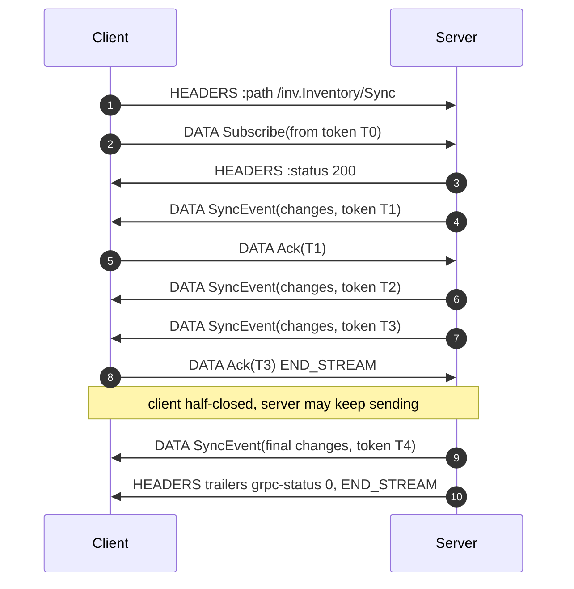
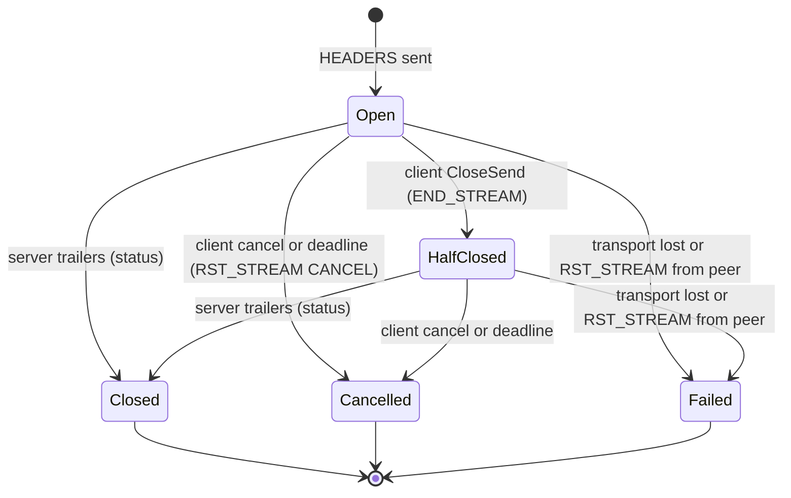
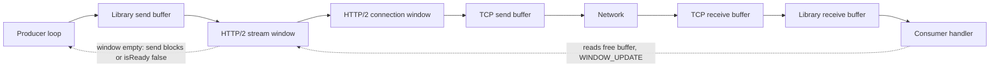
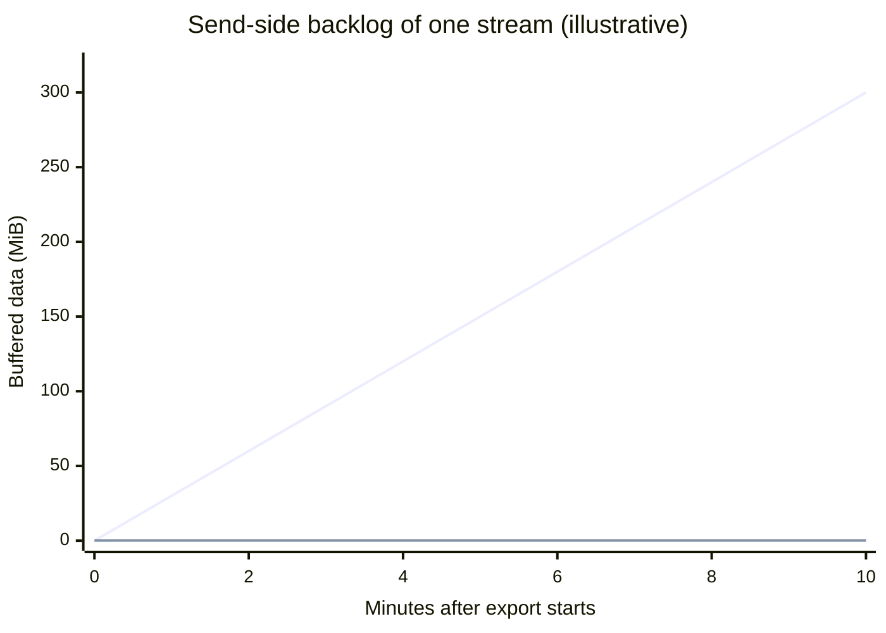
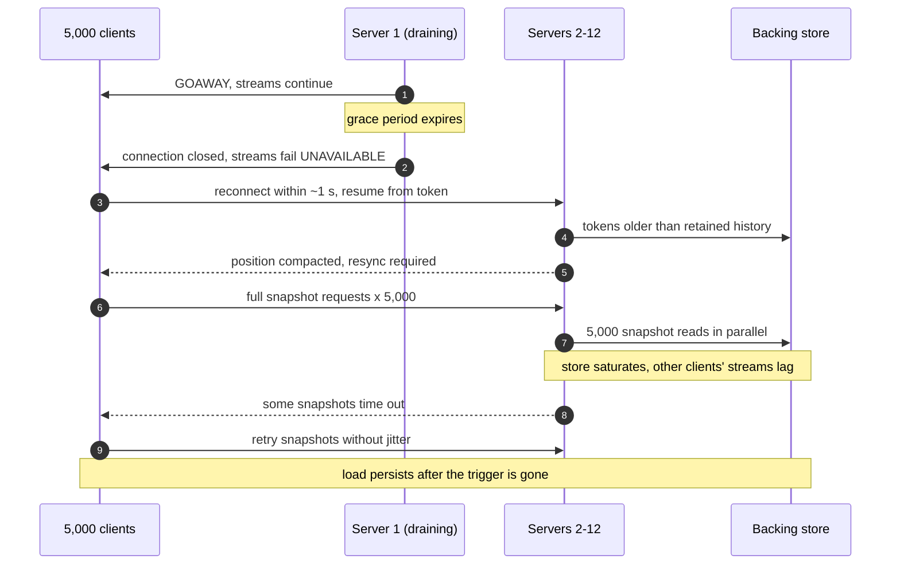

gRPC streaming çağrısı, en az bir yönde birden fazla mesaj taşıyan tek bir HTTP/2 stream'idir. gRPC dört çağrı biçimini mesaj sayısına göre tanımlar: unary (bir istek, bir yanıt), server streaming (bir istek, çok sayıda yanıt), client streaming (çok sayıda istek, bir yanıt) ve bidirectional streaming (her iki yönde de birbirinden bağımsız çok sayıda mesaj). Bu biçimler arasında wire formatı değişmez: her mesaj, [gRPC & Protocol Buffers](/distributed-systems/tr/communication/synchronous-protocols/grpc-protocol-buffers/) sayfasında anlatılan beş baytlık uzunluk öneki ve payload'dan oluşur, her çağrı da `grpc-status` taşıyan bir trailer ile biter. Değişen, çağrının ne kadar yaşadığı ve o süre boyunca iki ucun ne kadar durum (state) tuttuğudur.

Stream'ler, bazı etkileşimlerin milisaniyeler içinde tamamlanan bir isteğe sığmaması nedeniyle vardır. Tek bir mesaja sığmayacak kadar büyük bir sonuç kümesi, bir anahtar aralığındaki her değişikliği gerçekleştiği anda almak isteyen bir client, bir saat boyunca ölçüm yükleyen bir sensör ya da binlerce proxy'ye konfigürasyon iten bir control plane; bunların hepsi iki biçimden birine sahiptir: boyutu sınırsız olan veri ya da ne zaman geleceği bilinmeyen veri. Unary çağrılar bu durumları sayfalama (paging) veya polling ile karşılar; bu da her parti için bir round trip ve tam bir çağrı kurulumu demektir ve "değiştiği anda" beklentisini "bir polling aralığı içinde"ye çevirir.

Asıl denge şudur: stream, çok sayıda kısa, bağımsız ve yeniden denenebilir çağrıyı uzun ömürlü tek bir paylaşılan durum parçasına dönüştürür. Mesaj başına daha düşük ek yük, push teslimi ve transport düzeyinde backpressure karşılığında uygulama, gRPC channel'ının unary çağrılar için yaptığı şeylerin çoğundan vazgeçer: işi sınırlayan bir deadline, otomatik retry'lar, çağrı başına load balancing ve başarısız bir çağrının içinde ne olduğunu bilmeden tekrarlanabilmesi. 40.000 mesaj teslim ettikten sonra kopan bir stream, client'a yalnızca hangi mesajları aldığını söyler; sunucunun hangilerini gönderdiğini ya da kendi gönderdiklerinden hangilerinin sunucuda işlendiğini söylemez. Bu durumdan toparlanmak uygulamanın işidir ve bu toparlanmayı tasarlamak, stream'leri doğru kullanmanın işin büyük kısmıdır.

## Tek Bir HTTP/2 Stream'i Üzerinde Dört Çağrı Biçimi

Her çağrı aynı şekilde başlar: client, metodu adlandıran `:path` ile bir HEADERS frame'i gönderir, ardından iki taraf uzunluk önekli mesajlar içeren DATA frame'leri alıp verir. Çağrı biçimleri yalnızca her tarafın göndermeyi bitirdiğini ne zaman bildirdiği konusunda ayrışır. Client bunu son DATA frame'indeki END_STREAM ile bildirir; HTTP/2 buna stream'i half-close etmek (yarı kapatmak) der ve gRPC API'leri bunu `CloseSend` (Go), istek observer'ı üzerinde `onCompleted` (Java) veya `WritesDone` (C++) olarak sunar. Sunucu ise bunu trailer göndererek bildirir ve trailer aynı zamanda tüm çağrının sonudur. Bu asimetri yaşam döngüsünün merkezi kuralıdır: client göndermeyi bırakıp almaya devam edebilir, ama sunucu çağrıyı bitirmeden göndermeyi bırakamaz.

```proto
service Inventory {
  rpc GetItem(GetItemRequest) returns (Item);                        // unary
  rpc ExportItems(ExportRequest) returns (stream Item);              // server streaming
  rpc UploadCounts(stream CountRecord) returns (UploadSummary);      // client streaming
  rpc Sync(stream SyncRequest) returns (stream SyncEvent);           // bidirectional
}

message SyncRequest {
  oneof kind {
    Subscribe subscribe = 1;   // first message: what to watch, from where
    Ack ack = 2;               // later messages: progress acknowledgements
  }
}

message SyncEvent {
  repeated Change changes = 1;
  string resume_token = 2;     // opaque position; client stores it for reconnects
}
```

Dört metot dört farklı stub imzasına derlenir, ancak sunucu her durumda aynı transport nesnesini görür. Server streaming'de client tek bir mesaj gönderir ve hemen half-close eder, sonra trailer'lar gelene kadar okur. Client streaming'de client çok sayıda mesaj gönderir, half-close eder, sunucu da tek bir yanıt ve ardından trailer'ları gönderir. Sunucunun client half-close etmeden yanıt vermesini engelleyen hiçbir şey yoktur; örneğin ilk bozuk kayıttan sonra yüklemeyi reddedebilir. Bunu yaptığı anda client'ın sonraki gönderimleri başarısız olur ve çağrının status'u alma (receive) tarafından okunabilir. Bidirectional streaming'de her yön kendi hızında ilerler. `SyncRequest` içindeki `oneof`, çift yönlü kontrol protokolleri için yaygın tasarımı gösterir: client'ın ilk mesajı abone olur, sonraki mesajları aynı stream üzerinde onayları (acknowledgement) taşır.


*Çift yönlü bir çağrı. İstekler ve yanıtlar serbestçe iç içe geçer; 8. adımdaki client END_STREAM'i yalnızca kendi yönünü kapatır, 10. adımdaki sunucu trailer'ları ise çağrıyı bitirir.*

Diyagramdaki iki ayrıntı semantiğin çoğunu taşır. 6. ve 7. adımlar aralarında hiçbir client mesajı olmadan gelir: uygulama protokolü tanımlamadıkça n numaralı istek ile n numaralı yanıt arasında bir eşleşme yoktur ve 8. adımdaki Ack bir mesaj sayısına değil bir token'a atıfta bulunur, çünkü iki yön senkronize değildir. 9. adım, sunucunun client half-close ettikten sonra da göndermeye devam ettiğini gösterir; kendi half-close'unda okumayı bırakan bir client, sunucunun teslim edilmiş saydığı veriyi kaybeder. Çağrıyı tamamen bitirmek isteyen client bunun yerine iptal eder; bu, CANCEL koduyla RST_STREAM gönderir ve gRPC sayfasında unary çağrılar için anlatıldığı gibi sunucunun çağrı context'ini tetikler.

### Bir Stream Neyi Garanti Eder, Neyi Etmez

Tek bir stream ve tek bir yön içinde mesajlar, gönderildikleri sırayla, her biri tam olarak bir kez ve boşluksuz olarak alıcı uygulamaya teslim edilir. Kanıtı kısadır: HTTP/2 bir stream'in DATA frame'lerini tek bir TCP bağlantısı üzerinde sırayla taşır, TCP baytları kopyalamadan ve kaybetmeden sırayla teslim eder, uzunluk öneki de frame'ler baytları nasıl bölerse bölsün mesaj sınırlarını bayt dizisinden yeniden kurar. Yol üzerinde hiçbir şey mesaj düzeyinde sıra değiştirmez ya da yeniden göndermez; dolayısıyla stream yaşadığı sürece hiçbir şey bir mesajı çoğaltamaz.

Geri kalan her şey açıkça garanti dışıdır. Gönderen API'nin başarıyla dönmesi, mesajın karşı tarafça alındığı veya işlendiği anlamına gelmez, yalnızca transport'a devredildiği anlamına gelir; grpc-go dokümantasyonu `SendMsg`'nin mesajın alınmasını beklemediğini açıkça belirtir ve aynısı her implementasyon için geçerlidir. İki yön arasında bir sıralama ilişkisi yoktur, aynı bağlantı üzerinde olsalar bile farklı stream'ler arasında da sıralama yoktur. Ve sıralı, tam olarak bir kez teslim özelliğinin hiçbir parçası stream'in sonundan sağ çıkmaz. Bir stream başarısız olduğunda alıcı hangi mesajları aldığını tam olarak bilir, gönderen yalnızca hangilerini bir buffer'a yazdığını bilir, aradaki mesajlar ise (TCP buffer'larında, bir proxy'de, henüz commit etmemiş bir sunucu handler'ında) bilinmeyen bir durumdadır. Dolayısıyla stream, ömrü boyunca tam olarak bir kez teslim eden, hatalar arasında ise en fazla bir kez teslim eden bir kanaldır; uygulama pozisyon ve onay eklerse kanal, pozisyona göre tekilleştirmeyle en az bir kez teslim eden bir kanala dönüşür. Genel terminoloji [En Az Bir Kez, En Fazla Bir Kez ve Tam Olarak Bir Kez Semantiği](/distributed-systems/tr/communication/async-messaging/delivery-semantics/) sayfasında ele alınır.

### Çağrının Yaşam Döngüsü

Client açısından bir streaming çağrısı küçük bir durum kümesi içinde ilerler ve geçişler hangi işlemlerin hâlâ geçerli olduğunu belirler.


*Bir streaming çağrısının client tarafı yaşam döngüsü. Gönderim yalnızca Open'da, alım Open ve HalfClosed'da geçerlidir; her terminal durum tam olarak bir status üretir.*

Open'dan doğrudan Closed'a giden kenar, client streaming kodunu en çok şaşırtan geçiştir. Tüm girdiyi okumadan handler'dan dönen bir sunucu, client hâlâ Open durumundayken çağrıyı bitirir; client'ın sonraki gönderimi başarısız olur ve grpc-go'da gerçek status yalnızca receive çağrısından okunabilirken gönderim `io.EOF` döner. Gönderim hatasını çağrının sonucu sayan kod yanıltıcı bir hata raporlar. İki hata durumu, kararı kimin verdiğine göre ayrışır: Cancelled client'ın kendi tercihidir ve `CANCELLED` veya `DEADLINE_EXCEEDED` üretir; Failed ise ağdan ya da karşı taraftan gelir ve genellikle `UNAVAILABLE` veya `INTERNAL` üretir. Yalnızca Closed'a giden geçişler bir uygulama status'u taşır ve client'a sunucunun ne sonuca vardığını yalnızca bunlar söyler.

## Uygulama Düzeyinde Backpressure Olarak Flow Control

Unary bir çağrı alıcısını veriyle boğamaz, çünkü her taraf tek bir mesaj gönderir. Stream ise boğabilir: tablo dışa aktarımı yapan bir sunucu satırları client'ın diske yazabileceğinden hızlı üretebilir, telemetri yükleyen bir client da her kaydı veritabanına yazan bir sunucuyu geride bırakabilir. Backpressure, aradaki farkı buffer'a almak yerine üreticiyi tüketicinin hızına indiren mekanizmadır; genel teorisi [Geri Baskı](/distributed-systems/tr/resilience/flow-control/backpressure/) sayfasındadır. gRPC stream'leri bunu HTTP/2 flow control'den alır, ama yalnızca üreten kod ile tüketen kod arasındaki her katman sinyali iletirse.


*Tek bir streaming yönünün buffer zinciri. Kredi yalnızca tüketici okuduğunda geri akar; üreticinin bunu hissedip hissetmemesi, üretici ile stream penceresi arasındaki kütüphane API'sine bağlıdır.*

Noktalı oklar geri besleme döngüsüdür. Alıcı kütüphane, tüketici mesajları receive buffer'ından okudukça WINDOW_UPDATE ile HTTP/2 kredisini geri verir; okumayı bırakan bir tüketici kredi vermeyi de bırakır, göndericinin stream penceresi sıfıra iner ve gönderen transport o stream'in DATA frame'lerini hatta koymayı durdurur. Pencerelerin kendisi, 65.535 baytlık varsayılan değerleri ve round trip başına bir pencerelik throughput tavanı [HTTP/2 ve HTTP/3](/distributed-systems/tr/communication/synchronous-protocols/http2-http3-quic/) sayfasında açıklanır. Burada önemli olan son halkadır: dolu bir pencere üreticiye bir sinyal olarak mı ulaşır, yoksa büyüyen bir buffer tarafından mı emilir?

Bu halka dile göre farklıdır ve bu fark, yavaş bir tüketicinin yavaşlığa mı yoksa bellek yetersizliği (out-of-memory) çökmesine mi yol açacağını belirler. grpc-go'da `SendMsg`, mesajı planlamaya yetecek flow control kredisi oluşana, stream bitene ya da kopana kadar bloklanır; böylece saf biçimde yazılmış bir üretici döngüsü kendiliğinden yavaşlatılır. Bedeli, duran her stream için bloklanmış bir goroutine'dir; tehlikesi ise birden fazla stream'e sırayla gönderen bir döngüdür, çünkü orada tek bir duran tüketici hepsini bloklar. grpc-java'da `StreamObserver.onNext` bloklanmaz. Observer, dokümantasyonun "dahili olarak aşırı buffer'lama gerektirmeden" daha fazla mesaj gönderilebileceğini gösterdiğini söylediği `isReady()` metodunu ve `isReady()` her false'tan true'ya döndüğünde çalışan `setOnReadyHandler`'ı sunar. `isReady()`'yi yok sayan bir üreticinin buna izni vardır ve mesajları sınırsızca bellekte birikir. Gelen yönde grpc-java, her `onNext` döndükten sonra sonraki mesajı otomatik olarak ister; `disableAutoInboundFlowControl()` uygulamanın `request(n)`'i kendisinin çağırmasını sağlar ve mesajları başka bir thread'e devreden bir tüketici, göndericinin o thread'i geride bırakmasını bu yolla engeller. Diğer dillerdeki asenkron API'ler bu iki modelden birini izler ve ilgili kütüphanenin dokümantasyonuna bakmak gerekir, çünkü model üretilmiş stub'ın imzasından görünmez.

:::caution[Bloklanmayan bir gönderim backpressure değildir]
Mesaj göndermenin hemen döndüğü her API'de stream'in flow control'ü kütüphanenin buffer'ında durur ve tüketici üreticiden yavaş olduğu sürece buffer büyür. Her gönderimi hazır olma sinyaline bağlayın (Java'da `isReady()` ve on-ready handler, başka yerlerde eşdeğer yazmaya hazırlık callback'i) ya da bloklayan API'yi kullanın. Hızlı client'lara karşı yük testlerini geçen, ama yavaş bir hat üzerindeki tek bir client dışa aktarım başlattığında heap'i tükenen bir streaming sunucusu tam olarak bu hatayı gösteriyordur.
:::

### Hesaplamalı Örnek: Yavaş Bir Tüketici ve Filo Genelinde Yeniden Bağlanma

Örnek amaçlı olarak, saniyede 1 KiB'lık 2.000 mesaj (yaklaşık 2 MiB/s) üreten bir server streaming dışa aktarımının, saniyede 1.500 mesajı kalıcı hâle getiren bir client'a gittiğini varsayalım. Fazlalık saniyede 500 mesaj, yani 500 KiB/s'dir.

Sunucu hazır olma sinyalini yok sayarsa fazlalık kütüphanenin send buffer'ında birikir: tek bir stream için dakikada 30 MiB, saatte yaklaşık 1,76 GiB. Benzer client'lara giden iki yüz eşzamanlı dışa aktarım saniyede 100 MiB heap büyümesi ekler ve birkaç gigabayt boş alanı olan bir sunucu, yavaş client'lar bağlandıktan sonraki bir dakika içinde çöker. Daha kötüsü, hata yavaş bir client gibi değil sunucudaki bir bellek sızıntısı gibi görünür, çünkü client'lar sağlıklıdır ve stream metrikleri mesajların saniyede 2.000 hızla "gönderildiğini" gösterir.

Sunucu hazır olma sinyaline uyarsa buffer, stream penceresi artı kütüphanenin not-ready bildirmeden önce tuttuğu miktarla, yani yaklaşık bir pencere boyutuyla sınırlanır. Üretici her saniyenin çeyreğinde duraklatılır, etkin hızı saniyede 1.500 mesaja oturur ve dışa aktarım, sunucunun üretebileceğinden %33 daha uzun sürer. Bu doğru sonuçtur: darboğaz client'ın diskidir ve sistem artık sınırlı bellekle darboğazın hızında çalışır.


*Hazır olma sinyali yok sayıldığında (500 KiB/s fazlalıkla yükselen çizgi) ve uyulduğunda (bir pencere boyutu civarında düz çizgi) birikme.*

Yükselen çizginin eğimi sabittir, çünkü hız farkının integralidir; üretici durmadıkça hiçbir şey onu tersine çevirmez. Düz çizgi sıfır değildir: uçuştaki (in-flight) penceredir, yani sistemin stream başına harcamayı kabul ettiği bellektir. Bunu eşzamanlı stream sayısıyla çarpmak, streaming için kararlı durum bellek bütçesini verir; throughput için pencere boyutlarını büyütmeden önce hesaplanmaya değer bir sayıdır.

Örneğin ikinci yarısı stream'lerin sona ermesinin maliyetidir. Örnek amaçlı olarak 12 sunucuya dağılmış, sunucu başına 5.000 olmak üzere 60.000 uzun ömürlü watch stream'inden oluşan bir filo varsayalım. Rolling deploy bir sunucuyu yeniden başlatır ve onun 5.000 client'ı diğer 11 sunucuya yeniden bağlanır. Client'lar sunucuların geçmişte hâlâ tuttuğu bir pozisyondan devam edebiliyorsa her yeniden bağlanma, küçük bir abonelik mesajı ve aradaki boşlukta yayımlanan birkaç olayın yeniden oynatılması kadar maliyetlidir ve deploy fark edilmez. Devam edemiyor ve her biri, diyelim ki 400 KiB'lık tam bir snapshot çekmek zorundaysa yeniden bağlanma dalgası 5.000 x 400 KiB, yani yaklaşık 1,9 GiB taşır; client'lar bir saniye içinde yeniden bağlanırsa ayakta kalan sunucular ve arkalarındaki depolama, normal yüke ek olarak yaklaşık 16 Gbit/s snapshot trafiğine hizmet etmek zorunda kalır. Bağlantı geri dönüşümünün (connection recycling) kararlı durumda da bir maliyeti vardır: 30 dakikalık bir maksimum bağlantı yaşıyla 60.000 stream sürekli olarak saniyede yaklaşık 60.000 / 1.800 = 33 yeniden bağlanma üretir; bu, devam ettirme varsa ucuzdur, yoksa saniyede 33 x 400 KiB, yani yaklaşık 13 MiB/s'lik sabit bir snapshot yüküdür. Bu sayıların önemli olup olmadığını transport değil, devam ettirme tasarımı belirler.

## Uzun Ömürlü Stream'ler: Deadline'lar, Canlılık ve Aracılar

### Deadline Tüm Çağrıyı Sınırlar

gRPC deadline'ı her mesaja değil tüm çağrıya uygulanır. Sınırlı boyutlu bir server streaming dışa aktarımı için bu doğrudur: deadline, çağıranın sonucun tamamı için ne kadar bekleyeceğini söyler. Saatlerce çalışması amaçlanan bir watch içinse iki yönden de yanlıştır. Unary varsayılanlarından kopyalanmış 300 ms gibi kısa bir deadline, stream'i neredeyse hemen `DEADLINE_EXCEEDED` ile öldürür. Hiç deadline olmaması, yani gRPC varsayılanı ise, stream'in hiçbir şey olmadan ne kadar bekleyebileceğine dair bir sınır bırakmaz; bu, gRPC sayfasının unary çağrılar için anlattığı tehlikenin saatlere yayılmış hâlidir.

Bu yüzden uzun ömürlü stream'ler iki ayrı sınıra ihtiyaç duyar. Birincisi ömür sınırıdır: ya client'ın sonrasında stream'i bilinçli olarak yeniden kurduğu uzun bir deadline (saatler), ya da sunucunun çağrıyı, client'ın "şimdi yeniden bağlan" olarak yorumladığı bir status ile bitirdiği sunucu tarafı bir maksimum stream yaşı. Ömrü sınırlamak bir geçici çözüm değildir; aşağıda tartışıldığı gibi yük yeniden dengelemeyi ve sunucu deploy'larını mümkün kılan şeydir. İkincisi ilerleme sınırıdır: uygulamanın hiç mesaj almadan tolere ettiği azami süre; her alınan mesajla sıfırlanan ve süre dolduğunda stream'i iptal eden bir zamanlayıcıyla uygulanır.

### Keepalive Ölü Bağlantıları Tespit Eder, Ölü Stream'leri Değil

gRPC sayfasında anlatıldığı gibi yapılandırılan HTTP/2 PING keepalive, karşı tarafı ortadan kaybolmuş bir bağlantıyı tespit eder; örneğin bir NAT eşlemesini düşürdükten veya bir host'un gücü kesildikten sonra. Sunucu handler'ı takılmış, yukarı akıştaki veri kaynağı üretmeyi bırakmış ya da kendi upstream bağlantısı ölüyken bir proxy tarafından açık tutulan bir stream'i ise tespit etmez. Üç durumda da PING'lere canlı bir transport yanıt verir ve stream sonsuza kadar hiçbir şey almaz. Bu boşluğu yalnızca uygulama düzeyinde bir sinyal kapatır: gönderecek başka bir şey olmadığında sunucu sabit aralıklarla bir heartbeat veya ilerleme mesajı gönderir, client'ın önceki bölümdeki ilerleme zamanlayıcısı da birkaç aralığı aşan sessizliği hata olarak ele alır. etcd'nin watch API'si bunu, izlenen hiçbir anahtar değişmediğinde bile güncel revision'ı taşıyan ilerleme bildirimleri (progress notification) olarak sunar; Kubernetes watch bookmark'ları API server watch'ları için aynı rolü oynar. Pozisyon taşıyan bir ilerleme mesajının ikinci bir faydası vardır: sessiz dönemlerde client'ın devam noktasını ilerletir, böylece sonraki bir yeniden bağlanma zaten atılmış bir geçmişi istemez.

:::tip[Heartbeat'lerin bir devam pozisyonu taşımasını sağlayın]
Yalnızca "hâlâ hayattayım" diyen bir heartbeat takılmış stream'leri tespit eder; "P pozisyonu itibarıyla günceldesin" diyen bir heartbeat ise hiçbir şey değişmezken client'ın resume token'ını da taze tutar. Bu olmadan, nadiren değişen bir anahtar aralığını izleyen client saatler öncesine ait bir token tutar ve compaction sonrasındaki ilk yeniden bağlanma, client hiçbir şey kaçırmamış olsa bile tam bir yeniden senkronizasyonu zorunlu kılar.
:::

### Proxy'lerin ve Load Balancer'ların Kendi Saatleri Vardır

Yol üzerindeki her aracı, istek-yanıt trafiği için tasarlanmış timeout'lar uygular. Envoy'un route timeout'u varsayılan olarak 15 saniyedir ve dokümantasyonu bunun hiç bitmeyen streaming yanıtlarla uyumlu olmadığını belirtir; dolayısıyla varsayılan bir Envoy route'u üzerinden geçen bir gRPC watch 15. saniyede ölür. Varsayılanı 5 dakika olan stream idle timeout, iki yönde de etkinlik olmayan stream'leri bitirir; HTTP için varsayılanı 1 saat olan connection idle timeout ise aktif stream'i olmayan bağlantıları kapatır. Bulut load balancer'larının da kendi idle timeout'ları vardır ve varsayılanları ürüne göre değişir. Hata imzası, istemcide ya da sunucuda yapılan hiçbir kod değişikliğiyle açıklanamayan, sabit bir yaşta veya sabit bir sessizlik aralığından sonra periyodik olarak sonlanan stream'lerdir.

```yaml
# Envoy route for a long-lived gRPC streaming service (fields from RouteAction)
routes:
- match: { prefix: "/inv.Inventory/Sync" }
  route:
    cluster: inventory
    timeout: 0s          # disable the 15 s default request timeout for this route
    idle_timeout: 600s   # end a stream only after 10 min with no frames either way
```

Konfigürasyon, yukarıdaki iki sınırlı tasarımı proxy'de kodlar: proxy'nin istek timeout'undan gelen bir toplam ömür yok, sunucunun heartbeat aralığından uzun olması gereken bir boşta kalma (idle) sınırı var. Aralıkların sıralaması yanlış yapılması kolay olan kısımdır. Uygulama heartbeat'i yol üzerindeki her idle timeout'tan (proxy stream idle timeout'u, load balancer idle timeout'u, NAT boşta eşleme süresi) kısa olmalıdır; client'taki ilerleme timeout'u heartbeat'in küçük bir katı olmalıdır; sunucunun seçtiği maksimum stream yaşı da bir aracının uyguladığı her mutlak sınırdan kısa olmalıdır ki stream'ler proxy'nin takviminde bir reset ile değil, sunucunun takviminde temiz bir status ile bitsin.

## Stream'ler İçin Retry, Devam Ettirme ve Load Balancing

### Channel Bir Stream'i Neden Yeniden Deneyemez

gRPC sayfasında ele alınan retry mekanizması, client yanıt header'larını aldığı anda çağrıyı commit eder: o andan itibaren bir hata yeniden denenmez, uygulamaya döndürülür, çünkü kısmi bir yanıt zaten tüketilmiş olabilir. Bir server stream'de yanıt header'ları ilk mesajla gelir; dolayısıyla bir stream yalnızca herhangi bir şey teslim edene kadar yeniden denenebilir. Client streaming ikinci bir sınır ekler: yeniden denemek için kütüphane şimdiye kadar gönderilen her mesajı tekrar oynatmalıdır, bu yüzden onları buffer'a alır ve retry tasarımı (gRFC A6) bu buffer'ı çağrı başına ve channel başına sınırlar. Bir mesaj sınırı aşacaksa çağrı mevcut denemesine commit edilir ve buffer'daki mesajlar serbest bırakılabilir. Bu nedenle uzun bir yükleme, yapılandırılmış limitlere bağlı olarak kütüphane tarafından yalnızca ilk birkaç kilobayt veya megabaytı boyunca yeniden denenir. Sunucu uygulamasının çağrıyı hiç görmediği durumlarda geçerli olan şeffaf (transparent) retry'lar ise stream kurulumu sırasında yine çalışır.

Sonuç olarak her uzun ömürlü stream, uygulama düzeyinde bir yeniden bağlanma döngüsüne ihtiyaç duyar: "yeniden deneme" anlamına gelmeyenler (`INVALID_ARGUMENT`, `PERMISSION_DENIED`, `UNIMPLEMENTED` ve benzerleri) dışındaki her OK olmayan terminal status'ta, [Üstel Geri Çekilme ve Jitter ile Yeniden Deneme](/distributed-systems/tr/resilience/protection-patterns/retry-exponential-backoff/) sayfasında anlatıldığı gibi üstel backoff ve jitter ile bekleyip bilinen son pozisyondan yeni bir stream açmak. Döngü, backoff'unu yeni stream açıldığında değil, bir şey teslim ettikten sonra sıfırlamalıdır; aksi hâlde stream'leri kabul edip hemen başarısız kılan bir sunucu sıkışık bir yeniden bağlanma döngüsü üretir.

### Gerçek Sistemlerde Devam Ettirme Tasarımları

Devam ettirilebilir bir stream üç şeye ihtiyaç duyar: client'ın ne kadarını aldığını tanımlayan bir pozisyon, yakın bir pozisyondan tekrar oynatabilen bir sunucu ve pozisyon tekrar oynatılamayacak kadar eski olduğunda tanımlı bir yanıt. Gerçek sistemler bunları birbirinden önemli ölçüde farklı biçimlerde uygular.

etcd'nin Watch'ı, client'ların bir anahtar aralığı ve başlangıç revision'ı belirten istekler göndererek watch oluşturduğu çift yönlü bir stream'dir; sunucu birçok watch'ı watch ID'ye göre tek bir stream üzerinde multiplex eder ve revision etiketli olaylar gönderir. etcd çok versiyonlu bir geçmiş tuttuğu için yeniden bağlanan bir client son gördüğü revision artı birden başlamayı isteyebilir ve o andan beri olan her olayı alır. Geçmiş sonsuz değildir: compaction eski revision'ları atar ve compaction'a uğramış bir revision'da istenen bir watch, compaction revision'ını taşıyan bir yanıtla iptal edilir. Toparlanma bir retry değildir: client aralığın taze bir snapshot'ını okumalı, yerel durumunu toptan değiştirmeli (birleştirmek, boşluk sırasında silinmiş anahtarları tutar) ve snapshot'ın revision'ı artı birden itibaren izlemelidir. Kubernetes, list-then-watch desenini aynı fikir üzerine kurar: istenen resource version çok eskiyse API server üzerindeki HTTP watch'ları `410 Gone` döner ve client'lar buna yanıt olarak yeniden listeler.

Cloud Spanner'ın `ExecuteStreamingSql`'i, bazıları `resume_token` taşıyan `PartialResultSet` mesajlarından oluşan bir server stream'idir. Stream koparsa client orijinal isteği aldığı son token ile yeniden gönderir ve sonuçlar o token'ı taşıyan mesajdan sonra devam eder. Her mesaj bir token taşımadığından client, son token'dan sonra aldığı her şeyi atar; tek bir büyük değer de `chunked_value` bayrağıyla birden fazla mesaja bölünebilir, bu yüzden client bir satırı sunmadan önce onu yeniden birleştirir. Burada devam ettirme kesindir, çünkü sunucu sonuçları buffer'da tutmaz, sorgu pozisyonunu token'dan yeniden hesaplayabilir.

Envoy'un xDS protokolleri, genellikle proxy başına çift yönlü tek bir Aggregated Discovery Service (ADS) stream'i olarak çalıştırılır ve farklı bir tasarım kullanır: client bir olay geçmişini sürdürmez, sahip olduğu durumu raporlar. Her istek, proxy'nin uyguladığı konfigürasyonun `version_info`'sunu taşır ve onayladığı yanıtın `response_nonce`'unu geri yansıtır; bir güncellemeyi kabul etmek versiyonu ilerletir (ACK), reddetmek eski versiyonu `error_detail` dolu olarak tekrarlar (NACK). Yeniden bağlanmada proxy yeni bir stream açar ve mevcut versiyonunu ve kaynak adlarını gönderir, management server da onu güncel duruma getirmek için ne gerekiyorsa gönderir. State-of-the-world varyantında her yanıt kendi kaynak tipi için tam bir küme olduğundan compaction'a uğrayacak bir geçmiş ve "çok eski" durumu yoktur; bedeli, bir yeniden bağlanmanın büyük kaynak kümelerini yeniden gönderebilmesidir. Tek bir ADS stream'i kullanmak, sunucunun güncellemeleri kaynak tipleri arasında sıralamasına da olanak verir; protokol dokümantasyonu bunu, henüz var olmayan cluster'lara yönlendirmeyi önlemek için önerir.

Bu üç tasarım, her streaming API'nin yapmak zorunda olduğu bir seçime karşılık gelir. Olay geçmişinden devam ettirme (etcd) yeniden bağlanma başına ucuz ve kesindir, ama tutulan bir geçmişe ve snapshot geri dönüş yoluna ihtiyaç duyar. Pozisyonun yeniden hesaplanması (Spanner) tutulan olaylara ihtiyaç duymaz, ancak yalnızca pozisyon deterministik olarak yeniden hesaplanabildiğinde çalışır. Durum uzlaştırma (xDS) ikisine de ihtiyaç duymaz; bedeli, farklar (delta) yerine durumun gönderilmesidir.

:::danger[Pozisyonsuz yeniden bağlanma olayları sessizce kaybeder]
Başlangıçta kullandığı "şu andan itibaren abone ol" isteğini aynen göndererek yeniden bağlanan bir client, eski stream'in ölümüyle yeni stream'in başlangıcı arasında yayımlanan olayları asla görmez. Boşluğu hiçbir şey raporlamaz: iki stream de sağlıklıdır, client'ın cache'i ise o andan itibaren basitçe yanlıştır. Bir cache'i, bir indeksi veya aşağı akıştaki bir sistemi besleyen her abonelik stream'i bir pozisyondan yeniden bağlanmalı ve pozisyon artık mevcut değilse "şu andan itibaren"e değil, tam bir yeniden senkronizasyona geri dönmelidir.
:::

### Load Balancing Stream Başına Bir Kez Yapılır

İster layer 7 bir proxy'de ister client channel'ında olsun, çağrı başına load balancing bir backend'i stream oluşturulurken seçer ve bir daha seçmez. Unary trafik için bu ince taneli bir dengelemedir; saatlerce süren stream'ler içinse yük dağılımının, her stream başladığı andaki backend kümesini yansıtması demektir. Yeni backend'ler stream'leri yalnızca mevcut stream'ler bittiğinde alır ve deploy sırasında bir yeniden bağlanma patlaması alan backend, o patlamayı stream'lerin ömrü boyunca taşır. Stream'ler HTTP/2 eşzamanlılık slotlarını da tüketir: bir sunucunun `SETTINGS_MAX_CONCURRENT_STREAMS` değeri (genellikle 100 civarında yapılandırılır) bağlantı başına uygulanır ve tek bir bağlantıda bu kadar uzun ömürlü stream tutan bir client, biri bitene kadar o bağlantıda başka bir çağrı başlatamaz. İmplementasyonlar genellikle yeni çağrıyı kuyruğa alır; bunun yerine ek bir bağlantı açıp açmadıkları dile ve versiyona göre değişir. etcd'nin watch ID'leriyle yaptığı gibi birçok mantıksal aboneliği tek bir stream üzerinde multiplex etmek slot sorununu ortadan kaldırır ve bu tasarımın var olma nedeni budur.

Yeniden dengeleme, stream'leri bitirmeyi gerektirir. Sunucu tarafı maksimum bağlantı yaşı (grpc-go'nun artı eksi %10 jitter'lı `MaxConnectionAge`'i) GOAWAY gönderir; bu, bağlantıda yeni stream'leri durdurur ama mevcutların devam etmesine izin verir. Uzun ömürlü stream'lerde bu devam, `MaxConnectionAgeGrace` ayarlanmadıkça süresizdir ve grpc-go'daki varsayılanı sonsuzdur. Sonlu bir grace olmadan bağlantı yaşlandırma unary trafiği yeniden dengeler, stream'ler üzerinde ise hiçbir etkisi yoktur. Sonlu bir grace bağlantıyı zorla kapatır ve stream'leri bir hatayla sonlandırır; handler'ın temiz bir status döndürmesiyle uygulanan sunucu tarafı maksimum stream yaşı daha yumuşaktır, çünkü client düzenli bir bitiş görür ve bir hata loglamadan yeniden bağlanır. Her iki durumda da jitter önemlidir: jitter'sız yaşlandırma tüm filonun yeniden bağlanmalarını senkronize eder. Boşaltma (draining) sırasının kendisi [Sağlık Durumuna Duyarlı Yönlendirme ve Bağlantı Boşaltma](/distributed-systems/tr/communication/load-balancing/health-aware-routing/) sayfasında ele alınır.

## Çağrı Biçimini ve Alternatiflerini Seçmek

| Biçim veya alternatif | Mesaj başına ek yük | Retry ve dengeleme | Açıkken tutulan durum | Ne zaman tercih edilmeli |
|---|---|---|---|---|
| Unary | Tam çağrı: header'lar, trailer'lar, stream kurulumu | Otomatik retry, çağrı başına dengeleme, çağrı başına deadline | Çağrılar arasında yok | Bir saniyenin altındaki istek-yanıt işleri; varsayılan seçim |
| Sayfalamalı unary | Sayfa başına tam çağrı | Her sayfa yeniden denenebilir; cursor devam ettirmeyi açık kılar | Client'ta cursor | Sayfa başına gecikmenin kabul edilebilir olduğu ve sadeliğin önemli olduğu büyük ama sınırlı sonuçlar |
| Server streaming | 5 baytlık önek artı frame header'ı | Yalnızca ilk mesajdan önce yeniden denenebilir | Handler, buffer'lar, bir stream slotu | Büyük veya artımlı sonuçlar ve client'ın bir kez abone olduğu değişiklik akışları |
| Client streaming | 5 baytlık önek artı frame header'ı | Yalnızca retry buffer'ı içinde yeniden denenebilir | Sunucuda handler ve buffer'lar | Kayıt başına çağrının çok maliyetli olduğu ve tek bir özet yanıtın yettiği yüklemeler |
| Bidirectional streaming | 5 baytlık önek artı frame header'ı | Yalnızca uygulama düzeyinde yeniden bağlanma döngüsü | İki yön, uygulama protokolü durumu | Onaylı kontrol protokolleri, etkileşimli oturumlar, multiplex edilmiş abonelikler |
| [WebSocket veya SSE](/distributed-systems/tr/communication/synchronous-protocols/websocket-sse/) | Küçük frame header'ı | Uygulama düzeyinde yeniden bağlanma; SSE'de yerleşik last-event ID | Client başına bağlantı | Native gRPC stream'i açamayan tarayıcı client'ları |
| [Mesaj log'u veya kuyruğu](/distributed-systems/tr/communication/async-messaging/message-queue-vs-event-streaming/) | Broker'a bağlı | Kalıcı offset'ler; tüketici herhangi bir yerden yeniden başlar | Veriyi broker tutar | Dakikalarca kapalı kalabilen tüketiciler, kısa bir geçmişin ötesinde tekrar oynatma, birçok bağımsız gruba fan-out |

Tablonun son sütunu tekrar eden bir hatayı gizler: asıl gereksinim ayrıştırma (decoupling) iken throughput için streaming'i seçmek. Üretici servisten her tüketiciye giden bir server stream, tüketicinin erişilebilirliğini ve hızını üreticinin belleğine ve bağlantı slotlarına bağlar; bir log ise bir broker ve uçtan uca gecikme bedeliyle onları ayrıştırır. Stream; tüketici çevrimiçiyken, bir kopmadan sonra ihtiyaç duyabileceği geçmiş üreticinin tutabileceği kadar kısayken ve üretici abone başına durumu karşılayabiliyorken doğru araçtır. Üçünden biri sağlanmadığında araya bir log koyun ve stream'i, kullanacaksanız, son halka için saklayın.

Ek yük sütunu, bir veri merkezi içinde göründüğünden daha az önemlidir. HPACK tekrarlanan unary header'larını birkaç bayta sıkıştırır ve mevcut bir bağlantı üzerindeki unary çağrı yeni bir handshake gerektirmez; bu yüzden saniyede 10.000 çağrılık bir iş yükünü unary'den stream'e taşımak bir miktar framing ve CPU tasarrufu sağlar, ama kapasite planlamasını nadiren değiştirir. Streaming kendini push teslimindeki gecikmede, uzun yollar üzerinden büyük sonuçlar için sayfa başına round trip'lerden kaçınmada ve header ile trailer'ların baskın olduğu kadar küçük mesajlarda amorti eder.

## Streaming Çağrıların Hata Modları

### Sınırsız Gönderim Buffer'ları

Tetikleyici, hazır olma sinyalini kontrol etmeden bloklanmayan bir API üzerinden gönderen bir üreticinin, üreticiden yavaş herhangi bir tüketiciyle birleşmesidir. Belirti, yavaş client sayısı ve bağlantı süreleriyle orantılı sunucu belleği büyümesidir; sonu, sağlıklı olanlar dahil instance üzerindeki her stream'i öldüren garbage collection duraklamaları ve out-of-memory yeniden başlatmalarıdır. Tespit için uygulama düzeyinde stream başına gönderilen mesajlar ile transport'un fiilen yazdığı baytlar karşılaştırılır ve kütüphane sunuyorsa stream başına kuyruktaki baytlar izlenir; istek hızıyla değil uzun süren streaming çağrılarıyla ilişkili heap büyümesi ilk görünür işarettir. Hafifletme, hazır olma sinyaline bağlı gönderim ya da bloklayan API, artı aşıldığında sunucunun stream'i `RESOURCE_EXHAUSTED` ile bitirdiği stream başına bir kuyruk sınırıdır. Bir olaydan sonra toparlanma, client'ların bir pozisyondan yeniden bağlanmasını gerektirir ve bunu ancak devam ettirme tasarıma dahil edilmişse yapabilirler.

### Tek Bir Yavaş Abone Tüm Yayını Durdurur

Bir olay kaynağını birçok aboneye fan-out eden bir sunucu çoğu zaman her olayı sırayla her stream'e gönderen tek bir döngü çalıştırır. Bloklayan gönderimde penceresi dolan ilk abone döngüyü bloklar ve diğer tüm aboneler almayı bırakır; bloklanmayan gönderimde ise bir önceki hata modu geçerli olur. Belirti, yalnızca bir client gerçekten yavaşken tüm abonelerin gecikmesinin birlikte artmasıdır; bu da araştırmayı client yerine sunucuya veya olay kaynağına yönlendirir. Tespit, abone başına gönderim gecikmesi ve gecikmesidir (lag: en yeni olay pozisyonu ile o aboneye gönderilen son pozisyon arasındaki fark). Hafifletme, yayın döngüsünün doldurduğu ve abone başına bir göndericinin boşalttığı, abone başına sınırlı bir kuyruk ve kuyruk dolduğunda açık bir politikadır: aynı anahtara yönelik güncellemeleri birleştirmek (coalesce), aboneyi yeniden senkronize olmasını söyleyen bir status ile düşürmek ya da ikisi birden. Herkesi korumak zorunda olan sistemlerde yavaş aboneleri düşürmek standart tercihtir; yavaş bir client'ın bedelini bellek değil yeniden senkronizasyon maliyeti yapar.

### Aracı Timeout'larının Öldürdüğü Stream'ler

Tetikleyici, istek veya idle timeout'ları unary trafiğe göre boyutlandırılmış bir proxy, ingress veya load balancer'dır. Belirti, stream'lerin sabit bir yaşta (örneğin varsayılan bir Envoy route'u arkasında her 15 saniyede bir) ya da sabit bir sessizlik aralığından sonra bitmesidir; client'ta `UNAVAILABLE` veya `CANCELLED` görülür ve sunucunun loglarında çoğunlukla eşleşen bir hata yoktur, çünkü sunucu açısından karşı taraf stream'i basitçe resetlemiştir. Tespit, stream sürelerinin histogramıdır: tek bir değerde keskin bir sıçrama bir aracı timeout'udur, organik hatalar ise yayılır. Hafifletme, aracılar bölümündeki aralık sıralamasıdır: streaming route'larında istek timeout'larını kapatmak, idle timeout'ları heartbeat aralığının üzerinde ayarlamak ve sunucunun maksimum stream yaşını her mutlak aracı sınırının altında tutmak.

### Yeniden Bağlanma ve Yeniden Senkronizasyon Fırtınaları

Yeniden bağlanma fırtınaları, hesaplamalı örnekteki sayıların bir olaya dönüştüğü yerdir. Çok sayıda stream'i aynı anda bitiren her şey tarafından tetiklenirler: bir sunucunun yeniden başlatılması, jitter'sız bir deploy, bir proxy filosunun yeniden yüklenmesi veya bir bağlantı grace süresinin sonundaki zorla kapatma.


*Bir yeniden senkronizasyon fırtınası. Yeniden başlatmanın kendisi zararsızdır; eskimiş devam pozisyonları (5. adım) 5.000 ucuz yeniden bağlanmayı 5.000 snapshot okumasına çevirir, jitter'sız retry'lar (9. adım) da depolamayı doygun tutar.*

Belirleyici adım 5'tir. Client'lar sessiz dönemlerde ilerleme heartbeat'leriyle güncel tutulan yakın pozisyonlara sahip olsaydı, 3. adım olayın sonu olurdu. Bunun yerine tutulan geçmişten eski pozisyonlar snapshot'ları zorunlu kılar, snapshot'lar depolamayı doyurur, timeout'lar retry'ları tetikler ve retry'lar orijinal tetikleyici ortadan kalktıktan sonra da depolamayı doygun tutar; bu, [Retry Fırtınaları ve Metastabil Hatalar](/distributed-systems/tr/resilience/flow-control/retry-storms-metastable-failures/) sayfasında incelenen metastabil desendir. Tespit, saniye başına stream kurulumu ve yeniden senkronizasyon oranıdır; ikisi de kararlı durum değerlerine (örnekteki saniyede 33) yakın olmalı, fırtınada sıçrar. Hafifletme katmanlıdır: client'larda jitter'lı yeniden bağlanma backoff'u, pozisyonları taze tutan ilerleme heartbeat'leri, bir deploy'u kapsayacak kadar uzun tutulan geçmiş, fazla client'ların hepsi başarısız olmak yerine beklemesi için eşzamanlı snapshot'lar üzerinde sunucu tarafı kabul (admission) sınırları ve senkronize yeniden başlatmalar yerine jitter'lı bağlantı yaşlandırma.

### Sessiz Takılmalar

Tetikleyici, transport düzeyinde açık olan ama hiçbir şey almayan bir stream'dir: takılmış bir handler, bir proxy arkasındaki ölü bir upstream ya da stream açık kalırken bir hata nedeniyle düşürülmüş sunucu tarafı bir abonelik. Keepalive başarılı olur, hiçbir status gelmez ve client'ın veriye bakışı sessizce eskir. Tespit, uygulama düzeyinde bir bayatlık (staleness) metriği (stream başına son mesajdan veya heartbeat'ten bu yana geçen süre) ve pozisyonlu sistemlerde client'ın son pozisyonu ile kaynağın güncel pozisyonu arasındaki farktır. Hafifletme, yukarıda anlatılan heartbeat artı ilerleme timeout'u ikilisidir; bu olmadan bu hatayı kullanıcılar bulur.

### Stream Slotlarının Tükenmesi ve Yük Dengesizliği

Bir bağlantının tüm eşzamanlı stream slotlarını işgal eden uzun ömürlü stream'ler, channel'ı paylaşan unary çağrılar dahil o bağlantıdaki yeni çağrıları bloklar; bu da sunucu tarafında hiçbir nedeni olmayan, ilgisiz metotlarda gecikme olarak görünür. Ayrıca bir patlama sırasında oluşturulan stream'ler patlamayı alan backend'lerde kalır, böylece yük dengesizliği ona neden olan olaydan çok sonra da sürer. Tespit, ilan edilen limite karşı bağlantı başına aktif stream'ler ve backend başına aktif stream'lerdir. Hafifletme, uzun ömürlü stream'ler ve unary trafik için ayrı channel'lar, birçok aboneliği tek bir stream üzerinde multiplex etmek ve dağılımın yakınsaması için jitter'lı sınırlı stream ömürleridir.

| Hata | Belirti | Tespit | Hafifletme |
|---|---|---|---|
| Sınırsız gönderim buffer'ı | Heap büyümesi, tüm stream'leri öldüren OOM yeniden başlatmaları | Stream başına gönderilen ve yazılan, kuyruktaki baytlar, aktif stream'lere karşı heap | Hazır olma sinyaline bağlı veya bloklayan gönderim, stream başına kuyruk sınırı |
| Yayın takılması | Tüm aboneler birlikte gecikir, tek client yavaştır | Abone başına gönderim gecikmesi ve pozisyon farkı | Abone başına sınırlı kuyruk, birleştirme veya düşürme |
| Aracı timeout'u | Stream'ler sabit yaşta veya sessizlik aralığında biter | Stream süresi histogramında sıçrama | Route timeout'larını kapatmak, heartbeat üzerinde idle, sunucunun belirlediği maksimum yaş |
| Yeniden senkronizasyon fırtınası | Yeniden başlatma sonrası depolama doygun, her yerde gecikme | Saniye başına stream kurulumu ve yeniden senkronizasyon | Jitter'lı backoff, taze pozisyonlar, daha uzun geçmiş, snapshot kabul sınırları |
| Sessiz takılma | Mesaj yok, hata yok, bayat veri | Son mesajdan bu yana geçen süre, pozisyon farkı | Pozisyonlu heartbeat'ler, client ilerleme timeout'u |
| Slot tükenmesi ve dengesizlik | İlgisiz çağrılar yavaş, kalıcı backend dengesizliği | Bağlantı ve backend başına aktif stream'ler | Ayrı channel'lar, multiplex abonelikler, jitter'lı maksimum yaş |

## Ne Zaman Stream Kullanmalı, Ne Zaman Kullanmamalı

Server streaming'i; bir sonuç tek bir mesaj için çok büyük olduğunda ya da boyutu bilinmediğinde ve artımlı tüketim client'ın işe daha erken başlamasını veya belleğini sınırlamasını sağladığında; tüketici çevrimiçi olduğunda ve makul her polling aralığının altında bir gecikmeyle değişikliklerin push edilmesini istediğinde; sunucu kısa bir geçmiş tutabildiğinde ya da bir pozisyonu yeniden hesaplayabildiğinde, yani stream'ler devam ettirilebildiğinde kullanın. Client streaming'i, kayıt başına unary çağrıların maliyete baskın geleceği ve tek bir özet yanıtın yettiği yüklemeler için kullanın ve özeti, sunucunun ne kadarını commit ettiğini raporlayacak şekilde tasarlayın; çünkü client'ın bir hatadan sonra neyi yeniden göndereceğini öğrenmesinin tek yolu budur. Bidirectional streaming'i protokol gerçekten diyalog niteliğinde olduğunda kullanın: sunucunun sonra ne göndereceğini belirleyen onaylar, flow control'lü iş dağıtımı ya da slot tükenmesini önlemek için tek bir stream üzerinde multiplex edilmiş birçok mantıksal abonelik.

Ölçümler header'ların ve çağrı kurulumunun baskın olduğunu göstermedikçe, bir veri merkezi içinde unary çağrıların maliyetinden kaçınmak için stream kullanmayın; vazgeçtiğiniz güvenilirlik mekanizması baytlardan daha değerlidir. Stream'i kalıcı bir teslim mekanizması olarak kullanmayın: tüketiciler üreticinin tuttuğu geçmişten daha uzun süre çevrimdışı kalabiliyorsa ya da birkaç bağımsız tüketici grubundan fazlası aynı veriye kendi hızında ihtiyaç duyuyorsa doğru tasarım bir log veya kuyruktur ve stream bunu kötü biçimde yeniden icat eder. Timeout'larını yapılandıramadığınız altyapı üzerinden stream kullanmayın. İstek-yanıt çiftlerinin yeteceği yerde bidirectional streaming kullanmayın; istek ve yanıt mesajları için bir boru olarak kullanılan çift yönlü bir stream, korelasyon ID'lerini, mesaj başına timeout'ları ve mesaj başına hataları yeniden getirir; bunların hepsini unary çağrılar zaten sağlar. Ve ilk handler'ı yazmadan önce pozisyonun ne olduğuna, sunucunun onun için geçmişi ne kadar tuttuğuna ve pozisyon çok eski olduğunda client'ın ne yapacağına karar vermeden bir stream açmayın.

## Further Reading

- gRPC Authors, *Core concepts, architecture and lifecycle*, grpc.io dokümantasyonu. Projenin tanımladığı şekliyle dört çağrı biçimi, half-close, deadline'lar ve iptal.
- gRPC Authors, *gRPC over HTTP2* (PROTOCOL-HTTP2.md), grpc/grpc repository dokümantasyonu. Stream'lerin, mesajların ve trailer'ların HTTP/2'ye nasıl eşlendiği.
- Noah Eisen ve Eric Gribkoff, *gRFC A6: gRPC Retry Design*, grpc/proposal tasarım dokümanı. Commit noktaları, retry buffer'ı ve uzun stream'lerin neden yeniden denenmediği.
- Envoy Project, *xDS REST and gRPC protocol* ve *How do I configure timeouts?*, Envoy dokümantasyonu. ADS stream'lerinde ACK/NACK semantiği ve streaming route'ları için proxy timeout'ları.
- etcd Authors, *etcd API: Watch API*, etcd dokümantasyonu. Revision tabanlı watch devam ettirme, ilerleme bildirimleri ve compaction.
- Google Cloud, *PartialResultSet* (Cloud Spanner API referansı). Devam ettirilebilir server stream'leri için resume token'lar ve chunked değerler.
