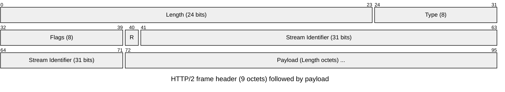
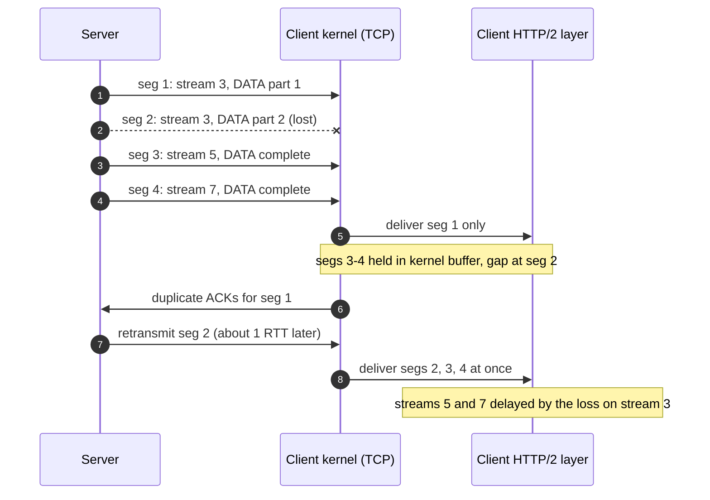
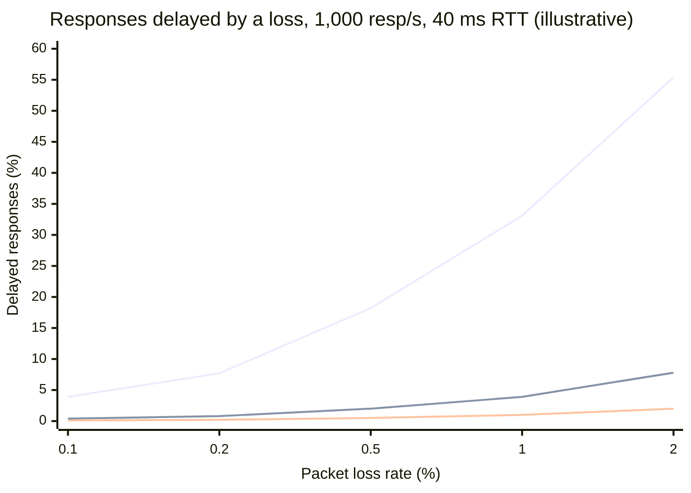
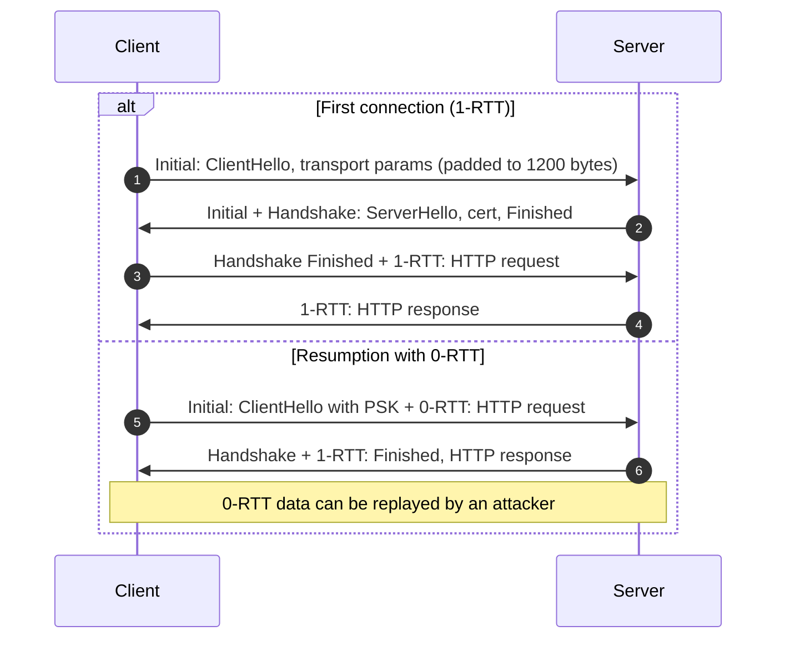
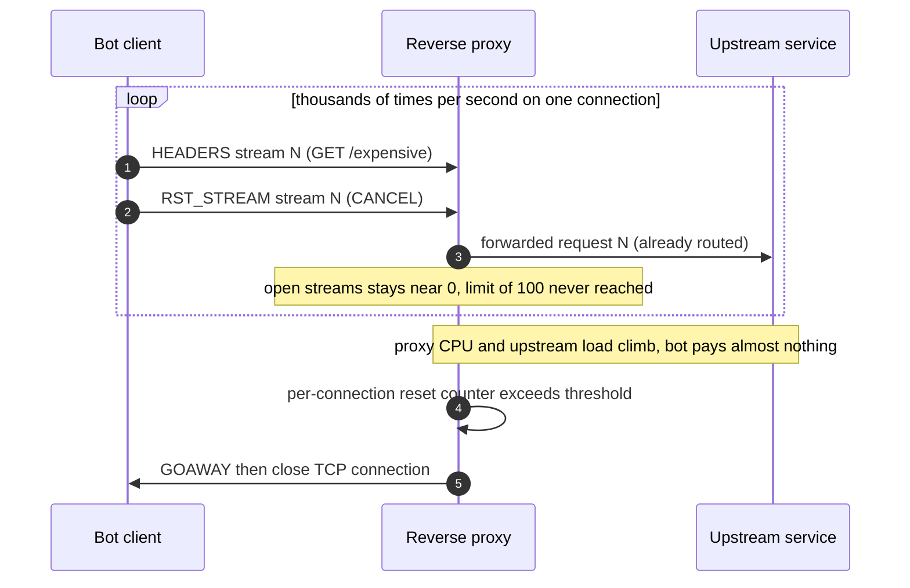

HTTP/2 (RFC 9113) ve HTTP/3 (RFC 9114), HTTP/1.1 ile birebir aynı HTTP semantiğini taşır: [REST: Kısıtlar, Kaynaklar ve HTTP Sözleşmeleri](/distributed-systems/tr/communication/synchronous-protocols/rest/) sayfasında anlatılan metotlar, durum kodları, header'lar ve cache kuralları değişmez. Değişen, mesajların kabloya nasıl dizildiğidir. HTTP/2 her isteği ve yanıtı bir stream tanımlayıcısıyla etiketlenmiş binary frame'lere böler ve birçok stream'i tek bir TCP bağlantısı üzerinde iç içe geçirir. HTTP/3 aynısını QUIC (RFC 9000) üzerinde yapar; QUIC, UDP üzerinde çalışan ve güvenilirliği, sıralamayı ve congestion control'ü kernel yerine uygulama process'inin içinde, stream başına uygulayan bir transport protokolüdür.

İkisinin de çözdüğü problem head-of-line (HOL) blocking'dir: sıralı bir kuyruğun başındaki ilerleyemeyen bir öğe, kendisine bağımlı olmayanlar dahil arkasındaki her öğeyi durdurur. HTTP/1.1 bağlantı başına yalnızca bir bekleyen yanıta izin verir; dolayısıyla yavaş bir yanıt bağlantıyı tıkar ve client'lar bunu origin başına birkaç bağlantı açarak telafi eder. Bu bağlantıların her biri kendi handshake'ini, kendi slow start'ını ve sunucu belleğinden kendi payını öder. HTTP/2 HOL blocking'i HTTP katmanında ortadan kaldırır, ancak tüm stream'leri tek bir TCP byte stream'inde tutar; bu yüzden kaybolan tek bir paket, yeniden gönderilene kadar yine her stream'i durdurur. HTTP/3 her stream'e bağımsız teslimat vererek bu son katmanı da kaldırır.

Asıl denge, ortak kader ile maliyet arasındadır. Her isteği tek bir bağlantıya koymak bağlantıları ucuzlatır, header sıkıştırmasını etkili kılar ve congestion control'ü tutarlı hâle getirir; ama aynı zamanda tek bir kaybın, tek bir flow-control penceresinin, tek bir load balancer kararının ve kötü niyetli tek bir client'ın o bağlantıdaki her şeyi etkilemesi anlamına gelir. QUIC transport düzeyindeki bu bağı koparır, daha hızlı bir handshake ve connection migration ekler; bunun bedelini Google'ın yayımladığı deployment'ta TLS'li TCP'nin yaklaşık iki katı sunucu CPU'su, bazı ağların engellediği ya da kısıtladığı UDP yolları ve artık kernel yerine sizin binary'nizle birlikte gelen bir congestion controller ile kayıp dedektörüyle öder. Kaybın nadir, round trip'lerin kısa olduğu bir veri merkezinin içinde doğru cevap genellikle HTTP/2'dir; kayıplı, yüksek gecikmeli ya da mobil yollarda HTTP/3 maliyetini fazlasıyla karşılar.

```mermaid
flowchart TB
    subgraph H3["HTTP/3"]
        A3["HTTP semantics"] --> B3["HTTP/3 frames, QPACK"]
        B3 --> C3["QUIC: streams, loss recovery, TLS 1.3"]
        C3 --> D3["UDP"]
    end
    subgraph H2["HTTP/2"]
        A2["HTTP semantics"] --> B2["HTTP/2 frames, HPACK, streams"]
        B2 --> C2["TLS"]
        C2 --> D2["TCP: one ordered byte stream"]
    end
    subgraph H1["HTTP/1.1"]
        A1["HTTP semantics"] --> B1["Text messages, one at a time"]
        B1 --> C1["TLS"]
        C1 --> D1["TCP"]
    end
```


*Üç sürümün protokol yığınları. HTTP semantiği katmanı aynıdır; yer değiştiren, multiplexing'in, sıralamanın ve şifrelemenin nerede yaşadığıdır.*

Diyagram, her sürümün sıralama birimini nereye koyduğunu gösterir. HTTP/1.1'de sıralı birim bağlantının tamamıdır; dolayısıyla multiplexing birkaç bağlantı gerektirir. HTTP/2'de multiplexing yukarıya, HTTP framing katmanına taşınır, ama sıralama altta TCP'de kalır ve TCP stream'lerden habersizdir. HTTP/3'te stream soyutlaması aşağıya, transport'a iner; şifreleme de transport'a taşınır: QUIC, TLS 1.3 handshake'ini kendi içine alır ve kendi header'larının neredeyse tamamını şifreler. Middlebox'ların QUIC'i TCP'yi değiştirdikleri gibi inceleyememesinin ve yeniden yazamamasının nedeni budur.

## HTTP/2: Tek Bağlantı Üzerinde Frame'ler, Stream'ler ve Flow Control

Bir HTTP/2 bağlantısı sabit, 24 octet'lik bir client preface ile başlar; ardından her iki taraf da limitleri bildiren bir SETTINGS frame'i gönderir: karşı tarafın aynı anda kaç stream açabileceği, başlangıç flow-control penceresi, maksimum frame boyutu, header sıkıştırma tablosunun boyutu. TLS üzerinde sürüm, handshake sırasında Application-Layer Protocol Negotiation (ALPN) ile `h2` token'ı kullanılarak seçilir; şifresiz HTTP/2 (`h2c`) çoğunlukla veri merkezlerinin içinde, client'ın desteği önceden varsaydığı ("prior knowledge") biçimde kullanılır.

### Framing ve Stream Multiplexing

Preface'ten sonra gelen her şey bir frame'dir. Her frame aynı dokuz octet'lik header ile başlar ve iç içe geçirmeyi mümkün kılan da bu header'dır: alıcı uzunluğu okur, frame'in tam olarak nerede bittiğini bilir ve stream tanımlayıcısını kullanarak payload'u doğru isteğe teslim eder.


*HTTP/2 frame header'ı. Stream 0; SETTINGS, PING ve GOAWAY gibi bağlantı düzeyindeki frame'lere ayrılmıştır.*

Operasyonel açıdan önemli frame tipleri azdır. HEADERS bir stream açar ve sıkıştırılmış istek ya da yanıt header bloğunu taşır; CONTINUATION, tek bir frame'e sığmayan header bloğunun geri kalanını taşır; DATA gövde byte'larını taşır; RST_STREAM diğerlerine dokunmadan tek bir stream'i iptal eder; WINDOW_UPDATE flow-control kredisi verir; PING round-trip süresini ölçer ve boşta kalan bağlantıları canlı tutar; GOAWAY karşı tarafa bağlantının kapatılmakta olduğunu bildirir. Client'ın başlattığı stream'ler tek, sunucunun başlattıkları çift tanımlayıcı kullanır ve tanımlayıcılar yalnızca artar; dolayısıyla bir bağlantıda bir stream numarası asla yeniden kullanılmaz. 31 bitlik alanı tüketen client yeni bir bağlantı açmak zorundadır.

Multiplexing'in doğruluğu iki kurala dayanır. Birincisi, bir frame tamamen tek bir stream'e aittir; böylece alıcı, farklı stream'lerin DATA frame'lerini frame sınırlarında, hangi byte'ın hangi yanıta ait olduğu konusunda hiçbir belirsizlik olmadan iç içe geçirebilir. İkincisi, bir stream'in header bloğu, arasına başka hiçbir şey girmeyen kesintisiz bir HEADERS ve CONTINUATION dizisi olarak gelmelidir. Bunun nedeni header sıkıştırmasıdır: bir header bloğunu çözmek paylaşılan sıkıştırma durumunu değiştirir, bu yüzden decoder header bloklarını teker teker ve sırayla işlemek zorundadır. Bu ikinci kural HTTP/2'nin içindeki bilinçli bir HOL noktasıdır ve aşağıda anlatılan CONTINUATION flood saldırısı onu istismar eder.

Her stream küçük bir durum makinesinden geçer. Bir HEADERS frame'i onu açana kadar idle'dır; iki taraf da gönderebildiği sürece open'dır; bir taraf END_STREAM bayrağını set ettiğinde half-closed olur; iki taraf da set ettiğinde ya da taraflardan biri RST_STREAM gönderdiği anda closed olur. İlan edilen `SETTINGS_MAX_CONCURRENT_STREAMS` limiti yalnızca open ya da half-closed durumdaki stream'leri sayar. RFC bu değerin 100'den küçük olmamasını önerir ve yaygın sunucular düşük yüzlerdeki değerleri ilan eder; nginx'in `http2_max_concurrent_streams` değeri varsayılan olarak 128, Go'nun `net/http` sunucusununki 250'dir. Reset edilen bir stream anında sayılmayı bırakır; Rapid Reset'in istismar ettiği özellik budur.

### Flow Control: HTTP/2'nin Neden TCP'ninkinin Üzerinde Pencereleri Var

TCP'nin zaten flow control'ü vardır, ama bağlantının tamamı için tek bir penceredir. Bir stream'in tüketicisi okumayı bırakırsa, örneğin upstream'i yavaş olan bir proxy, TCP penceresi "stream 7'yi göndermeyi bırak ama stream 9'u göndermeye devam et" diyemez: alıcı ya stream 7'yi sınırsızca buffer'lar ya da socket'i okumayı bırakıp her stream'i durdurur. Bu yüzden HTTP/2 iki seviyede kredi tabanlı flow control ekler. Her stream'in ve bir bütün olarak bağlantının bir gönderme penceresi vardır; DATA frame'leri bu pencereyi tüketir, alıcı da uygulaması veriyi tükettikçe WINDOW_UPDATE frame'leriyle krediyi geri verir. Gönderici yalnızca hem stream penceresi hem bağlantı penceresi pozitifken gönderebilir. Yalnızca DATA frame'leri flow control'e tabidir; kontrol frame'leri ve header'lar değildir, böylece tıkanmış bir pencere onu açmak için gereken frame'leri asla engellemez.

İki pencere de 65.535 octet ile başlar. Stream penceresi `SETTINGS_INITIAL_WINDOW_SIZE` ile büyütülebilir, ama bağlantı penceresi yalnızca stream 0 üzerinden WINDOW_UPDATE göndererek büyütülebilir ve maksimum pencere `2^31 - 1` octet'tir. Varsayılanlar küçüktür ve pencere, round trip başına throughput'a konan bir tavandır: bir stream RTT başına en fazla bir pencere kadar veri taşıyabilir. Varsayılan 64 KiB pencereyle tek bir stream, link hızından bağımsız olarak 50 ms'lik bir yolda yaklaşık 10,5 Mbit/s ile, 2 ms'lik bölge içi bir yolda yaklaşık 260 Mbit/s ile sınırlıdır. Upstream tarafında varsayılanları koruyan bir proxy, hızlı bir backend'i yavaş bir upload'a dönüştürür ve belirti bir yapılandırma problemine değil, bant genişliği problemine benzer. Production sunucularının ve proxy'lerin çoğu pencereleri otomatik ayarlar ya da büyütür; doğru boyut, hizmet verdiğiniz en yavaş yolun bandwidth-delay product'ıdır ve stream başına buffer'lamayı göze alabileceğiniz bellekle sınırlanır.

### HPACK, Öncelikler ve Push

HTTP header'ları tekrarlıdır: her istekte aynı cookie, user agent, authority ve authorization token'ı. HPACK (RFC 7541) bunları 61 yaygın header alanından oluşan statik bir tablo, son gönderilen alanların tutulduğu bağlantı başına dinamik bir tablo (varsayılan 4.096 octet) ve literal string'ler için bir Huffman kodu ile sıkıştırır. Tekrarlanan bir header, ilk istekten sonra bir ya da iki byte'a mal olur. HPACK, SPDY'nin kullandığı DEFLATE gibi genel amaçlı sıkıştırmadan bilinçli olarak kaçınır; çünkü CRIME saldırısı, sıkıştırılmış bir akışa metin enjekte edebilen bir saldırganın sıkıştırılmış uzunluğu gözlemleyerek cookie gibi sırları geri elde edebileceğini göstermiştir. Dinamik tablonun bedeli, encoder ve decoder'ın güncellemeleri tam olarak aynı sırayla uygulamak zorunda olmasıdır; yukarıda anlatılan sıralama gereksinimi budur.

Önceliklendirme, HTTP/2'nin tasarlandığı gibi çalışmayan kısmıdır. RFC 7540 ağırlıklı bir bağımlılık ağacı tanımlamıştı ve onu tutarlı biçimde uygulayan sunucu azdı; RFC 9113 bunu kullanımdan kaldırdı, RFC 9218 de yerine daha basit bir şema getirdi: 0 ile 7 arasında bir urgency değeri ve bir incremental bayrağı taşıyan, hem HTTP/2 hem HTTP/3 tarafından kullanılabilen bir `priority` header'ı. Sunucunun, client'ın henüz istemediği yanıtları gönderdiği server push daha da kötü sonuçlandı. Ölçülen kullanım HTTP/2 sitelerinin %1'i civarındaydı, push edilen kaynaklar çoğunlukla tarayıcının cache'inde zaten olanı tekrarlıyordu ve Chrome, 2022'de 106 sürümüyle push'u varsayılan olarak devre dışı bırakıp yerine `103 Early Hints` durum kodunu ve preload'u önerdi. Push'u eskimiş kabul edin.

### Bağlantı Kapatma ve Retry Güvenliği

GOAWAY, göndericinin işlediği ya da hâlâ işleyebileceği son stream'in tanımlayıcısını taşır. Daha büyük tanımlayıcıya sahip her stream'in işleme alınmadığı garanti edilir; dolayısıyla client, istek non-idempotent bir `POST` olsa bile onu yeni bir bağlantıda yeniden deneyebilir. Benzer şekilde, `REFUSED_STREAM` hata koduyla gönderilen RST_STREAM de stream'in işlenmediğini garanti eder. HTTP/1.1'de bunun karşılığı yoktur: bir istek yoldayken sunucu keep-alive bağlantısını kapatırsa client isteğin çalıştırılıp çalıştırılmadığını bilemez; REST sayfasında anlatılan keep-alive yarışı budur. Bu yüzden HTTP/2'de zarif kapatma iki adımlı bir alışveriştir: sunucu önce yeni stream'leri durdurmak için maksimum stream tanımlayıcısıyla bir GOAWAY gönderir, hâlihazırda yolda olan stream'ler için en az bir round trip bekler, ardından gerçek son tanımlayıcıyla nihai GOAWAY'i gönderip bağlantıyı kapatır.

:::tip[Neyin güvenle yeniden denenebileceğine GOAWAY'in last-stream-id değerine bakarak karar verin]
GOAWAY alan bir client ya da proxy yalnızca ilan edilen last-stream-id'nin üzerindeki stream'leri otomatik olarak yeniden denemelidir; bu değerin altındaki ya da ona eşit stream'ler çalışmış olabilir ve [Idempotency ve Güvenli HTTP Metotları](/distributed-systems/tr/communication/api-gateway/idempotency/) sayfasındaki olağan idempotency kurallarına tabidir. Deploy sırasında önce GOAWAY göndermeden bağlantı kapatan sunucular bu garantiyi çöpe atar ve yoldaki her isteği belirsiz bir hataya dönüştürür. Aynısı gRPC sunucularındaki `MAX_CONNECTION_AGE` tarzı bağlantı yenileme için de geçerlidir: yalnızca GOAWAY üzerinden geçtiği için güvenlidir.
:::

## TCP Head-of-Line Blocking'in Hayatta Kaldığı Yer

TCP byte'ları uygulamaya kesinlikle sırayla teslim eder. Bir segment kaybolduğunda alıcı kernel, sağlam olmalarına ve kaybolanla hiçbir ilgisi olmayan stream'lere ait olmalarına rağmen sonraki tüm segmentleri, yeniden gönderim boşluğu doldurana kadar kendi buffer'ında tutar. HTTP/2 stream'leri bu byte stream'in içinde multiplex eder; dolayısıyla HTTP/2 katmanı, stream 3'ün bir segmenti eksikken stream 5'in tamamlanmış frame'lerini okuyamaz. Duraklama fast retransmit ile en az bir round trip sürer, kayıp bir retransmission timeout'u tetiklerse çok daha uzun sürer; iki kurtarma yolunun mekaniği [Ağ Güvenilirliği, Bant Genişliği Sınırları ve Topoloji Değişiklikleri](/distributed-systems/tr/foundations/monoliths-to-distributed/network-reliability/) sayfasında anlatılır.


*HTTP/2 altında TCP head-of-line blocking. Stream 3'ün önceki bir segmenti eksik olduğu için kernel, stream 5 ve 7'nin tamamlanmış frame'lerini bekletir.*

Problemin tamamı 3. ve 4. adımlardadır: tamamlanmış iki yanıt, tam bir kurtarma süresi boyunca client kernel'ında bekler ve HTTP/2 katmanı onları göremez. QUIC'te aynı senaryo farklı işler. Her QUIC paketi stream tanımlayıcıları ve offset'lerle etiketlenmiş frame'ler taşır ve QUIC kütüphanesi her stream'i ayrı ayrı yeniden birleştirir; böylece stream 5 ve 7'yi taşıyan paketler kendi stream'lerine hemen teslim edilir ve yalnızca stream 3 yeniden gönderimini bekler. QUIC'in ortadan kaldırmadığı şey ortak congestion controller'dır: bir kayıp yine tüm bağlantının gönderme hızını düşürür. Yani QUIC teslimattaki HOL blocking'i çözer, kaybın throughput cezasını değil.

### Sayısal Örnek: Multiplex Edilmiş Bir Bağlantıda Kayıp

Bir client'ın tek bir origin'den saniyede 1.000 küçük yanıt aldığını, her yanıtın tek bir pakete sığdığını ve yolun round trip süresinin 40 ms olduğunu varsayalım. Kayıpların birbirinden bağımsız olduğunu, her kaybın yaklaşık bir RTT'de fast retransmit ile onarıldığını ve hiç retransmission timeout yaşanmadığını da varsayalım. Tüm sayılar örnek amaçlıdır.

Tek bağlantılı HTTP/2'de her kayıp, sonraki RTT boyunca arkasından gelen her yanıtı, yani yaklaşık `1,000 * 0.040 = 40` paketi bloke eder. Bir yanıt, penceresinde kendisinden önceki yaklaşık 40 paketten herhangi biri kaybolmuşsa gecikir; dolayısıyla geciken yanıtların oranı `1 - (1 - p)^40` olur. %0,5 kayıpta bu %18,2'dir: 200 paketten yalnızca biri kaybolmasına rağmen yaklaşık her beş yanıttan biri 40 ms ya da daha fazla ek gecikme öder.

10 bağlantılık bir havuzla HTTP/1.1'de her bağlantı saniyede 100 yanıt taşır; böylece bir kayıp yaklaşık 4 paketi bloke eder: `1 - (1 - p)^4`, yani %0,5 kayıpta %2,0. HTTP/1.1'in kendi HOL blocking'i vardır (yavaş bir yanıt bağlantısını tıkar), ama kayıplı bir yolda ayrı byte stream'leri hasarı sınırlar. HTTP/3'te yalnızca kendi paketi kaybolan yanıt bekler: %0,5.


*Üst: tek TCP bağlantısı üzerinde HTTP/2. Orta: 10 TCP bağlantısına yayılmış HTTP/1.1. Alt: yalnızca paket kaybeden stream'in beklediği HTTP/3.*

Eğriler, birbiriyle çelişiyor gibi görünen iki gözlemi açıklar. Kaybın tipik olarak %0,1'in çok altında, RTT'nin milisaniyenin bir kesri olduğu bir veri merkezinde duraklama penceresi neredeyse hiç paket içermez ve HTTP/2'nin tek bağlantısı bir havuzdan kesinlikle daha iyidir. %1 kayıp ve 100 ms RTT'li bir mobil ağda ise HTTP/2, altı bağlantılı HTTP/1.1'den daha kötü bir tail verebilir; QUIC'in tasarlandığı rejim tam olarak budur. Model bir yönden temkinli, diğer yönden cömerttir: gerçek kayıplar kümelenir ve bu, birbirinden ayrı duraklama pencerelerinin sayısını azaltır; ama retransmission timeout tetikleyen kayıp bir son segment, bağlantıyı bir RTT yerine yüzlerce milisaniye durdurur.

## HTTP/3 ve QUIC: Güvenilirliği UDP'nin Üzerine Taşımak

QUIC, UDP üzerinde user space'te uygulanan, genel amaçlı, bağlantı yönelimli ve şifreli bir transport'tur. UDP yalnızca port numaraları ve bir checksum sağlar; handshake, güvenilirlik, flow control, congestion control ve stream multiplexing dahil geri kalan her şey QUIC'in işidir. User space'te çalışmak bir kaza değil, tasarım tercihiydi: TCP değişikliklerinin her kernel'a ve her middlebox'a ulaşması yıllar sürer, oysa bir QUIC kütüphanesi uygulamayla birlikte gelir ve haftalık olarak güncellenebilir.

### Stream'ler, Paket Numaraları ve Kayıp Kurtarma

Bir QUIC bağlantısı istenen sayıda stream taşır; her biri, en düşük iki biti stream'i kimin açtığını ve stream'in çift yönlü mü tek yönlü mü olduğunu kodlayan 62 bitlik bir tamsayıyla tanımlanır. Stream verisi offset taşıyan STREAM frame'leriyle gider; böylece alıcı her stream'in byte'larını bağımsız olarak yerine koyabilir. Paketler birden fazla stream'den frame taşır ve yeniden gönderimlerde bile asla yeniden kullanılmayan bir paket numarasına sahiptir: kaybolan frame'ler yeni numaralı yeni bir pakette tekrar gönderilir. Bu, göndericinin bir ACK'in orijinal segmente mi yoksa onun yeniden gönderimine mi ait olduğunu ayırt edemediği TCP'nin retransmission belirsizliğini ortadan kaldırır ve QUIC'e TCP'den daha temiz RTT örnekleri sağlar. ACK frame'leri, alınan paket numaralarının birden fazla aralığını ve alıcının onaylamadan önce eklediği gecikmeyi bildirir.

Kayıp tespiti (RFC 9002), bir paketi kendisinden en az üç paket numarası sonra gönderilmiş bir paket onaylandığında ya da onaylanmış bir paketten RTT'nin sekizde dokuzundan (yumuşatılmış ve en son ölçülen örnekten büyük olanı) daha uzun süre önce gönderilmişse kayıp sayar. Hiçbir şey onaylanmadığında, probe timeout (PTO), TCP'nin retransmission timeout'unun yaptığı gibi congestion penceresini çökertmek yerine probe paketleri gönderir. Flow control HTTP/2'deki gibi stream başına (`MAX_STREAM_DATA`) ve bağlantı başına (`MAX_DATA`) kredilerle çalışır; kötüye kullanım açısından önemli bir fark vardır: `MAX_STREAMS` stream limiti, o anda açık stream sayısı değil, karşı tarafın şimdiye kadar açabileceği stream'lerin alıcı tarafından açıkça artırılan kümülatif sayısıdır. Karşı taraf, sunucunun yeni stream kredisi verdiğinden daha hızlı stream açıp iptal edemez.

HTTP/3 her isteği client'ın başlattığı tek bir çift yönlü stream'e eşler. Bağlantı düzeyindeki kontrol (SETTINGS, GOAWAY) ayrılmış, tek yönlü bir kontrol stream'inde gider; bu yüzden HTTP/3'te stream 0 yoktur. Stream'ler artık bağımsız teslim edildiğinden, HPACK'in header bloklarının geliş sırasıyla çözülmesi gerekliliği HOL blocking'i geri getirirdi; bu yüzden HTTP/3 QPACK (RFC 9204) kullanır: dinamik tablo güncellemeleri ayrı bir encoder stream'inde gider, decoder bunları bir decoder stream'inde onaylar ve decoder'ın henüz almadığı bir girdiye referans veren header bloğu yalnızca kendi stream'inde bloke olur. Alıcı bunu `SETTINGS_QPACK_BLOCKED_STREAMS` ile sınırlar; bu değer de dinamik tablo kapasitesi de varsayılan olarak 0'dır ve bu durumda QPACK yalnızca statik tabloyu ve literal'leri kullanır, hiç bloke olmaz.

### Handshake, 0-RTT ve Adres Doğrulama

TCP üzerinde bir TLS 1.3 bağlantısı, client'ın istek gönderebilmesinden önce TCP handshake'i için bir, TLS için bir round trip daha gerektirir; dolayısıyla yanıtın ilk byte'ı üç round trip sonra gelir, TLS 1.2 ile dört. QUIC, TLS 1.3 handshake mesajlarını kendi paketlerinin içinde taşır; böylece transport ve kriptografik kurulum aynı round trip'te gerçekleşir.


*QUIC bağlantı kurulumu. Yeni bir bağlantı isteği bir round trip sonra gönderir; sürdürülen (resumed) bir bağlantı onu ilk uçuşta gönderir.*

İlk dalda istek 3. adımda, bir round trip sonra çıkar ve yanıt iki round trip sonra gelir. Sürdürme dalında client önceki bir oturumdan kalan pre-shared key'i yeniden kullanır ve isteği ilk paketiyle gönderir. Örnek amaçlı 100 ms'lik bir RTT'de yanıtın ilk byte'ı TCP ve TLS 1.2 ile yaklaşık 400 ms, TCP ve TLS 1.3 ile 300 ms, yeni bir QUIC bağlantısıyla 200 ms, QUIC 0-RTT ile 100 ms sonra gelir. Google, 2017 deployment'ında (standart öncesi kendi kripto handshake'iyle) masaüstü QUIC bağlantılarının yaklaşık %88'inin 0-RTT'ye ulaştığını, mobil uygulamalarda ise bu oranın yalnızca %65-68 olduğunu bildirdi; çünkü mobil client'lar ağ değiştirir ve cache'lenmiş durumu kaybeder.

0-RTT'nin TLS'in ortadan kaldıramayacağı bir bedeli vardır: ilk uçuş replay'e karşı korunmaz. Onu yakalayan bir saldırgan tekrar gönderebilir ve sunucu aynı isteği iki kez görür. Bu yüzden RFC 9114 ve RFC 8470, sunucuların early data içinde yalnızca güvenli, idempotent istekleri kabul etmesini ya da `425 Too Early` ile yanıt vermesini bekler. Ayrıca UDP'de kaynak adresi kanıtlayan bir handshake olmadığından, bir QUIC sunucusu doğrulanmamış bir adrese aldığı byte'ların üç katından fazlasını göndermemelidir. Bu anti-amplification limiti, client'ın ilk datagram'ının en az 1.200 byte'a doldurulmasının ve saldırı altındaki bir sunucunun, client'ın geri göndermesi gereken bir token taşıyan Retry paketiyle yanıt verebilmesinin nedenidir; bu bir ek round trip'e mal olur ama adresi kanıtlar.

:::caution[0-RTT, non-idempotent bir isteği tekrar oynatılabilir hâle getirir]
Bir load balancer'da ya da CDN'de 0-RTT'yi etkinleştirmek, arkasındaki her route'a uygulanır. Early data içinde kabul edilen bir `POST /payments`, paketi yakalayan herkes tarafından tekrar oynatılabilir ve ne uygulama ne de log'ları bu tekrarı bir client retry'ından ayırt edebilir. Early data'yı yalnızca güvenli metotlar için kabul edin ya da etkinleştirmeden önce durumu değiştiren her route'ta bir idempotency key zorunlu kılın. Proxy'nin early data'ya dair bir işareti (örneğin RFC 8470'teki `Early-Data: 1` header'ını) iletip iletmediğini ve backend'in buna uyup uymadığını kontrol edin.
:::

### Connection ID'ler, Migration ve Keşif

TCP bir bağlantıyı adreslerden ve port'lardan oluşan 4'lüsüyle tanımlar; dolayısıyla Wi-Fi'dan hücresel ağa geçen bir telefon ya da boşta geçen bir sürenin ardından client'ı yeni bir port'a yeniden bağlayan bir NAT, bağlantıyı sonlandırır. QUIC bir bağlantıyı her uç noktanın seçtiği connection ID'lerle tanımlar; bilinen bir connection ID taşıyan paketler yeni bir adresten geldiğinde sunucu yeni yolu PATH_CHALLENGE ve PATH_RESPONSE alışverişiyle doğrular ve aynı bağlantıya stream'leri bozulmadan devam eder. Uç noktalar migration sırasında connection ID'leri değiştirir; böylece bir gözlemci eski ve yeni yolu ilişkilendiremez.

Migration'ın load balancing üzerinde doğrudan bir sonucu vardır. UDP 4'lüsünü hash'leyen bir layer 4 load balancer, migration yapmış bir bağlantıyı onun için hiçbir durumu olmayan farklı bir sunucuya gönderir. Bu yüzden büyük deployment'lar routing bilgisini sunucunun seçtiği connection ID'nin içine kodlar; böylece herhangi bir balancer connection ID'ye göre yönlendirme yapabilir. IETF'in QUIC-LB çalışması bu tür kodlamaları tarif eder ve her sağlayıcının şeması kendi altyapısına özgüdür. Connection ID'ye göre yönlendirmenin olmadığı yerlerde migration sessizce yeni bir bağlantıya dönüşür.

Client'lar bir origin'in HTTP/3 konuşup konuşmadığını önceden bilmez. Olağan keşif yolu, HTTP/2 ya da HTTP/1.1 üzerinden gönderilen ve bir UDP port'unda `h3` ilan eden `Alt-Svc` yanıt header'ı ya da ALPN değerlerini ilk bağlantıdan önce ilan eden bir HTTPS DNS kaydıdır (RFC 9460). Bazı ağlar UDP'yi engellediği ya da hızını sınırladığı için tarayıcılar QUIC'i TCP ile yarıştırır ya da QUIC başarısız olduğunda TCP'ye geri döner ve başarısızlıkları hatırlar. Google'ın 2017 ölçümlerinde client'ların %4,4'ü, QUIC ya da UDP engellendiği veya yolun MTU'su çok küçük olduğu için QUIC kullanamıyordu.

## HTTP/1.1, HTTP/2 ve HTTP/3 Arasında Production Dengeleri

Sürümler tepe throughput'ta değil, neyi paylaştıklarında ve maliyetlerinin nereye düştüğünde ayrışır. HTTP/2 birçok isteği az sayıda bağlantıda yoğunlaştırır; bu header sıkıştırmasına ve congestion control'e yardım eder, ama bağlantı düzeyindeki load balancing'e zarar verir ve tek bir kaybın ya da kötü davranan tek bir client'ın etki alanını genişletir. HTTP/3 transport HOL blocking'i kaldırır ve kurulumu hızlandırır, ama transport'u user space'e taşır: olağan anlamda TCP segmentation offload yoktur, stack UDP generic segmentation offload (GSO) ve batching kullanmadıkça byte başına daha fazla system call gerekir ve UDP'nin uçtan uca izinli olmasına bağımlı hâle gelinir. Google'ın SIGCOMM 2017 makalesi, QUIC'in Google Search gecikmesini masaüstünde %8,0, mobilde %3,6; YouTube rebuffering'ini ise %18,0 ve %15,3 azalttığını bildirdi. Bunun sunucu CPU maliyeti başlangıçta TCP üzerindeki TLS'in yaklaşık 3,5 katıydı ve optimizasyonla yaklaşık iki katına indirildi. Bunlar Google'ın trafik karışımı üzerinde Google'ın sayılarıdır, genel bir benchmark değildir.

| Özellik | HTTP/1.1 | HTTP/2 | HTTP/3 |
|---|---|---|---|
| Bağlantı başına eşzamanlılık | Aynı anda tek yanıt | Çok sayıda stream | Çok sayıda stream |
| HOL blocking | Bağlantı başına | Transport (TCP), artı header bloğu sıralaması | Yalnızca stream başına; QPACK bir stream'i bloke edebilir |
| İlk istekten önceki kurulum | TCP + TLS (2-3 RTT) | HTTP/1.1 ile aynı, sonra amorti edilir | 1 RTT, sürdürmede 0 RTT |
| Header sıkıştırma | Yok | HPACK, sıralı | QPACK, sıra dışılığa toleranslı |
| Adres değişikliğinde bağlantı korunur mu | Hayır | Hayır | Evet, connection ID'lerle |
| Byte başına sunucu CPU'su | En düşük | Düşük | En yüksek; kernel offload'larının bir kısmı kullanılamaz |
| Middlebox ve araç desteği | Evrensel | TLS üzerinde evrensel | UDP engellenebilir; daha az debug aracı |
| Ne zaman tercih edilmeli | Basit client'lar, eski aracılar, az sayıda uzun transfer | Servisler arası RPC, gRPC, düşük kayıplı veri merkezi yolları | Kayıplı ya da yüksek RTT'li yollardaki mobil ve internet client'ları, edge'de sonlandırma |

Yaygın production şekli tablodan çıkar: HTTP/3, mobil ve tarayıcı client'larına bakan bir CDN'de ya da ön load balancer'da, yani edge'de sonlandırılır; edge'den içeriye doğru, yolların kısa ve temiz olduğu yerde ise HTTP/2 çalışır. [gRPC](/distributed-systems/tr/communication/synchronous-protocols/grpc-protocol-buffers/), HTTP/2 framing'i üzerine kuruludur ve onun tüm multiplexing ve flow-control davranışını devralır; uzun ömürlü HTTP/2 stream'lerine dayanan streaming modları [gRPC Streaming](/distributed-systems/tr/communication/synchronous-protocols/grpc-streaming/) sayfasında, WebSocket'in HTTP/2 ve HTTP/3 extended CONNECT kullanımı ise [WebSocket ve Server-Sent Events](/distributed-systems/tr/communication/synchronous-protocols/websocket-sse/) sayfasında ele alınır.

:::caution[Uzun ömürlü HTTP/2 bağlantıları bağlantı düzeyindeki load balancing'i boşa çıkarır]
Layer 4 load balancer istekleri değil, bağlantıları dengeler. Tek bir bağlantı açıp onu saatlerce tutan bir HTTP/2 client'ı, tüm isteklerini tek bir backend'e gönderir ve yeni eklenen backend'ler client'lar yeniden bağlanana kadar hiç trafik almaz. [L4 ve L7 Yük Dengeleme](/distributed-systems/tr/communication/load-balancing/l4-vs-l7/) ve [İstemci Taraflı ve Sunucu Taraflı Yük Dengeleme](/distributed-systems/tr/communication/load-balancing/client-vs-server-side/) sayfalarında anlatıldığı gibi istekten haberdar bir balancer kullanın ya da client'ların GOAWAY üzerinden yeniden dengelenmesi için sunucuda bağlantı ömrünü sınırlayın.
:::

### Önemli Olan Parametreler

Bir HTTP/2 ya da HTTP/3 sunucusunun yük ve kötüye kullanım altında nasıl davrandığını dört limit belirler: eşzamanlı stream limiti, stream ve bağlantı flow-control pencereleri, maksimum header listesi boyutu ve bağlantı başına stream oluşturma ve iptal etme hızı. İlk üçü protokol ayarlarıdır; sonuncusu Rapid Reset'ten sonra eklenen bir uygulama politikasıdır. Envoy'un edge proxy rehberi internete açık bir listener için şekli gösterir; üzerine yazdığı varsayılanlar, güvenilen eşler arasındaki service mesh trafiği için ayarlanmıştır.

```yaml
# Envoy HttpConnectionManager, downstream (client-facing) side, edge guidance
http2_protocol_options:
  max_concurrent_streams: 100          # streams open at once per connection
  initial_stream_window_size: 65536    # 64 KiB per stream: bounds per-stream buffering
  initial_connection_window_size: 1048576  # 1 MiB for all streams on the connection
common_http_protocol_options:
  max_headers_count: 100               # reject header lists with too many fields
```

Pencereler bir throughput limiti olduğu kadar bir bellek bütçesidir: 10.000 downstream bağlantıya 1 MiB'lık bağlantı penceresi ilan eden bir proxy, her upstream tıkanırsa 10 GB'a kadar veriyi buffer'lamayı taahhüt etmiş olur. Aynı pencereler throughput'u da sınırlar; 1 MiB'lık bir bağlantı penceresi 50 ms RTT'de bir bağlantının tüm stream'leri için toplam yaklaşık 168 Mbit/s'e izin verir. Denge her taraf için ayrı kurulur: güvenilmeyen internet client'larına doğru küçük pencereler, bandwidth-delay product'ın zaten küçük olduğu kısa yollardaki güvenilen upstream'lere doğru daha büyük pencereler. Varsayılanlar Envoy, nginx, Go ve diğer stack'lerin sürümleri arasında değişir; bu yüzden yukarıdaki değerlerin herhangi bir yerde varsayılan olduğunu varsaymak yerine güncel dokümantasyonu okuyun.

## Production'daki Hata Modları

### Rapid Reset: Eşzamanlılık Olmadan Stream Oluşturmak

Ağustos 2023'te Google, Cloudflare ve AWS'ye yönelik saldırılar, 2015'ten beri spesifikasyonda bulunan bir HTTP/2 özelliğini kullandı. Client HEADERS ile bir stream açar ve onu hemen RST_STREAM ile iptal eder. İptal edilen stream artık `SETTINGS_MAX_CONCURRENT_STREAMS` limitine sayılmaz; böylece client limite hiç çarpmaz ve uplink'inin izin verdiği hızda istek gönderebilir. Sunucu ise yine de stream durumu ayırır, header'ları çözer, isteği yönlendirir ve bir reverse proxy söz konusuysa çoğu zaman reset işlenmeden önce isteği upstream'e iletir. Google saniyede 398 milyonun, Cloudflare 201 milyonun üzerinde tepe değerler bildirdi; Cloudflare saldırıyı yapan botnet'in yaklaşık 20.000 makineden oluştuğunu tahmin etti. Sorun 10 Ekim 2023'te CVE-2023-44487 olarak duyuruldu.


*Sunucunun gözünden Rapid Reset. Eşzamanlılık limiti oluşturulan stream'leri değil açık stream'leri sınırladığı için hiç tetiklenmez; saldırıyı yalnızca bağlantı başına bir reset sayacı yakalar.*

Saldırının kendisi 1-3. adımlardaki asimetridir: client iki küçük frame harcar, proxy ve upstream'i ise tam bir istek harcar. Dışarıdan belirtiler; edge katmanında istek hızının ve CPU'nun keskin biçimde artması ama yanıt byte'larının aynı oranda artmaması, isteklerin yüksek bir payının client iptaliyle bitmesi (Envoy'da `downstream_rq_rx_reset` gibi reset-stream sayaçları; access log'larda client-closed ya da reset yanıt bayrakları) ve az sayıda bağlantının devasa istek sayıları taşımasıdır. Ekim 2023'te tüm büyük implementasyonların yayımladığı düzeltmeler, bağlantı başına istatistik tutar ve reset hızı ya da reset payı bir eşiği aşan bağlantıları kapatır; ayrıca stream'leri reset edilmiş olsa bile bir bağlantının aynı anda çalıştırabileceği handler sayısını sınırlar. Go bunu 1.21.3 ve 1.20.10 sürümlerinde, eşzamanlı çalışan handler'ları stream limitiyle sınırlayarak düzeltti. Kurtarma, patch'lemek ve tekil istekleri reddetmek yerine bağlantıları kapatan bir politikadır; çünkü saldırgana bir maliyet çıkaran tek yanıt bağlantıyı kapatmaktır. QUIC'in kümülatif `MAX_STREAMS` kredisi doğrudan varyantı zorlaştırır, ama Google'ın rehberi yine de tek bir QUIC bağlantısının tetikleyebileceği işin sınırlanmasını önerir.

### CONTINUATION Flood ve Header Boyutu Tükenmesi

Nisan 2024'te Bartek Nowotarski, bir client'ın END_HEADERS bayrağı olmadan bir HEADERS frame'i ve ardından sınırsız bir CONTINUATION frame dizisi gönderdiği bir zafiyet ailesini duyurdu. Header bloğu kesintisiz olmak ve sırayla çözülmek zorunda olduğundan, birçok implementasyon bloğu bellekte biriktirmeye ya da sınırsızca çözmeye devam etti ve bazı implementasyonlarda bellek ya da CPU'yu tüketmek için tek bir TCP bağlantısı yetti. CERT/CC; Apache httpd, nghttp2, Envoy, Node.js ve Go dahil implementasyonlar genelinde düzeltmeleri koordine etti. Tespit zordur; çünkü hiç tamamlanmayan bir header bloğu hiçbir zaman bir isteğe dönüşmez ve bu yüzden access log'larda görünmez. Sinyal, buna karşılık gelen bir istek hızı olmadan bağlantı başına bellek ya da CPU artışıdır. Önlem, blok tamamlandıktan sonra değil frame'ler gelirken uygulanan bir maksimum header listesi boyutu (`SETTINGS_MAX_HEADER_LIST_SIZE` ve implementasyonun kendi byte ve alan sayısı limitleri) ile tamamlanmamış header blokları için bir timeout'tur.

### Flow-Control Tıkanmaları

Alıcısı hiç WINDOW_UPDATE döndürmeyen bir stream, bir pencerelik veriden sonra durur. İki hata şekli yaygındır. Birincisi varsayılan pencerenin throughput tavanıdır: bir proxy üzerinden yapılan upload'lar link kapasitesiyle değil `window / RTT` ile ölçeklenen sabit bir hızda akar; bölge içi transferler sorunsuzken bölgeler arası transferler yavaştır. İkincisi proxy'lerde bağlantı penceresi kilitlenmesidir: yavaş bir tüketici okumadığı veriyi tutar, bağlantı penceresi dolar ve kendi stream penceresi açık olsa bile bağlantıdaki diğer her stream durur. Tespit için, pencerenin RTT'ye bölümüne eşit bir değerde düz seyreden stream başına throughput'a ya da proxy debug istatistiklerinde gönderme penceresi sıfırda takılı kalmış stream'lere bakılır. Önlem; pencereleri yolun bandwidth-delay product'ına göre boyutlandırmak, proxy'nin yavaş stream'lerden bağımsız olarak buffer'lamasına ve bağlantı kredisini geri vermesine izin vermek ve [Zaman Aşımları](/distributed-systems/tr/resilience/protection-patterns/timeouts/) sayfasında tartışıldığı gibi ilerleme kaydetmeyen stream'leri reset eden timeout'lardır.

### Bağlantı Yoğunlaşması ve Yeniden Dengeleme Fırtınaları

Bir layer 4 balancer'ın arkasındaki backend kümesi büyüdüğünde mevcut HTTP/2 client'ları bağlantılarını korur ve yeni instance'lar boşta kalır; küme küçüldüğünde ya da deploy yapıldığında, kaldırılan instance'taki her client aynı anda yeniden bağlanır. Belirti, routing yapılandırması tekdüze olmasına rağmen instance başına kalıcı bir yük çarpıklığı ve ardından deploy'larda yük sıçramalarıdır. Tespit, instance başına saniyedeki istek sayısını instance başına aktif bağlantı sayısıyla karşılaştırır. Önlem; istek düzeyinde dengeleme, yeniden bağlanmaların yayılması için jitter'lı, sınırlandırılmış bir maksimum bağlantı ömrü ve [Sağlık Durumuna Duyarlı Yönlendirme ve Bağlantı Boşaltma](/distributed-systems/tr/communication/load-balancing/health-aware-routing/) sayfasında anlatıldığı gibi GOAWAY üzerinden boşaltmadır.

### UDP Kara Delikleri ve Geri Dönüş Gecikmesi

QUIC, TCP'nin başarısız olmadığı şekillerde başarısız olur. Bazı kurumsal firewall'lar UDP 443'ü engeller; bazı ağlar UDP'nin hızını sınırlar; bazı yollar beklenenden küçük bir MTU'dan büyük datagram'ları düşürür ve QUIC IP fragmentation'ı yasakladığı ve en az 1.200 byte gerektirdiği için bunun etrafından dolaşamaz. İlk Initial paketleri kaybolduğunda client, ikisini yarıştırmıyorsa, TCP'ye dönmeden önce handshake timeout'unu bekler. Google'ın 2017 makalesi ossification'ı diğer yönden de belgeler: QUIC header'ındaki bir alanda yapılan tek bitlik değişiklik, trafiği sınıflandırmak için o alanı kullanan belirli bir firewall markasının arkasındaki kullanıcılar için ağır paket kaybına yol açtı. Tespit; ağ ya da client popülasyonu başına TCP'ye geri dönen bağlantıların payı, handshake timeout sayaçları ve tek bir autonomous system için HTTP/3 trafik payının düşmesidir. Önlem, her zaman bir TCP yolunu açık tutmak, sıraya koymak yerine yarıştırmak ve olumsuz sonuçları ağ başına cache'lemektir.

### Hata İmzalarının Özeti

| Hata | Belirti | Tespit | Önlem |
|---|---|---|---|
| Rapid Reset | Edge CPU'sunda ve istek hızında sıçrama, düşük yanıt byte'ı | Bağlantı başına reset ve iptal sayaçları, bağlantı başına istek | Patch'lenmiş stack, bağlantı başına reset limitleri, bağlantıları kapatmak |
| CONTINUATION flood | Bellek ya da CPU artışı, karşılık gelen access log yok | Bağlantı başına bellek, tamamlanmamış header blokları | Alım sırasında uygulanan header boyutu limitleri, header timeout'ları |
| Flow-control tıkanması | Pencerenin RTT'ye bölümünde düz seyreden throughput | Stream başına throughput, sıfır pencereli stream'ler | Pencereleri yolun BDP'sine göre boyutlandırmak, ilerleme timeout'ları |
| Bağlantı yoğunlaşması | Instance'lar arasında yük çarpıklığı, deploy'larda yeniden bağlanma sıçramaları | Instance başına istekler ve bağlantılar | L7 ya da client-side dengeleme, jitter'lı maksimum bağlantı ömrü |
| Kayıplı yollarda TCP HOL | Düşük kayba rağmen p50'nin çok üzerinde p99 | Bağlantı başına retransmission'a karşı tail gecikme | Edge'de HTTP/3, bağlantı başına daha az stream |
| UDP kara deliği | Bazı ağlarda yavaş ilk yüklemeler | Ağ başına geri dönüş oranı, handshake timeout'ları | QUIC ve TCP'yi yarıştırmak, TCP yolunu korumak, başarısızlıkları cache'lemek |
| 0-RTT replay | Durumu değiştiren mükerrer istekler | Mükerrer idempotency key'ler, early-data bayrakları | Early data'yı yalnızca güvenli metotlara açmak, `425 Too Early` |

## Protokol Sürümü Seçmek

Bölge içindeki servisler arası trafik için HTTP/2 kullanın. Yollar kısa ve neredeyse kayıpsızdır; dolayısıyla TCP HOL blocking nadiren can yakar, kernel TCP offload'ları CPU'yu düşük tutar ve gRPC zaten onu gerektirir. Bunu istek düzeyinde load balancing, sınırlandırılmış bir bağlantı ömrü ve yukarıdaki bağlantı başına kötüye kullanım limitleriyle birlikte kullanın. HTTP/2 multiplexing'ini kapasitenin yerine koymayın: tek bir backend'e 500 stream taşıyan tek bir bağlantı hâlâ tek bir backend'dir ve tek bir TCP bağlantısının congestion penceresi hepsi tarafından paylaşılır.

HTTP/3'ü client'ın sizin kontrol etmediğiniz bir yolda olduğu yerde kullanın: edge'e ulaşan tarayıcılar ve mobil uygulamalar, özellikle hücresel ağlarda, kıtalar arasında ya da client'ların ağ değiştirdiği yerlerde. Kazanç, sayısal örneğin ve handshake aritmetiğinin nicelleştirdiği üç yerden gelir: kayıpta daha az duraklayan stream, her yeni bağlantıda bir round trip eksik ve adres değişikliklerinden sağ çıkan bağlantılar. HTTP/3'ü QUIC stack'i onu ayarlayan birileri tarafından bakımı yapılan bir CDN'de ya da edge proxy'de sonlandırın ve ağları UDP'yi engelleyen client'lar için HTTP/2 ile HTTP/1.1'i açık tutun.

Önce kaybı ölçmeden tail gecikmeyi düzeltmek için veri merkezinin içinde HTTP/3 deploy etmeyin: retransmission'lar ihmal edilebilir düzeydeyse CPU maliyeti hiçbir şey satın almaz ve şifreli user-space transport'lar için debug araçları TCP için olanlardan zayıftır. İstekler idempotency key taşımıyorsa durumu değiştiren route'larda 0-RTT'yi etkinleştirmeyin. Aracıların, gömülü client'ların ya da eski araçların HTTP/2 konuşamadığı yerlerde ve multiplexing'in hiçbir şey katmadığı az sayıda büyük, uzun transferde HTTP/1.1'i koruyun. Darboğaz transport değil de yavaş ya da aşırı yüklenmiş bir sunucuysa hiçbir protokol sürümü yardımcı olmaz; o problemin araçları [yük atma (load shedding)](/distributed-systems/tr/resilience/flow-control/load-shedding/) ve [retry bütçeleridir](/distributed-systems/tr/resilience/flow-control/retry-storms-metastable-failures/).

:::note
Head-of-line blocking HTTP'nin üzerinde de vardır. Çağrıları tek bir stream üzerinden sıraya koyan bir gRPC client'ı, sırayla işlenen bir message broker partition'ı ya da slotları yavaş istekler tarafından tutulan bir connection pool, aynı deseni farklı kuyruklarla yeniden üretir. HTTP sürümünü değiştirmek yalnızca HTTP framing ve transport katmanlarındaki HOL blocking'i kaldırır.
:::

## İleri Okuma

- Martin Thomson ve Cory Benfield (ed.), *RFC 9113: HTTP/2*, IETF, 2022.
- Jana Iyengar ve Martin Thomson (ed.), *RFC 9000: QUIC: A UDP-Based Multiplexed and Secure Transport*, IETF, 2021.
- Mike Bishop (ed.), *RFC 9114: HTTP/3*, IETF, 2022.
- Adam Langley ve diğerleri, *The QUIC Transport Protocol: Design and Internet-Scale Deployment*, ACM SIGCOMM, 2017.
- Juho Snellman ve Daniele Iamartino, *How it works: The novel HTTP/2 'Rapid Reset' DDoS attack*, Google Cloud Blog, 2023.
