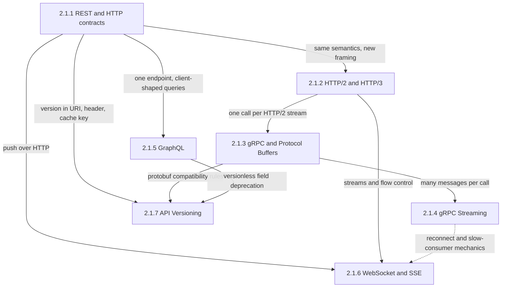
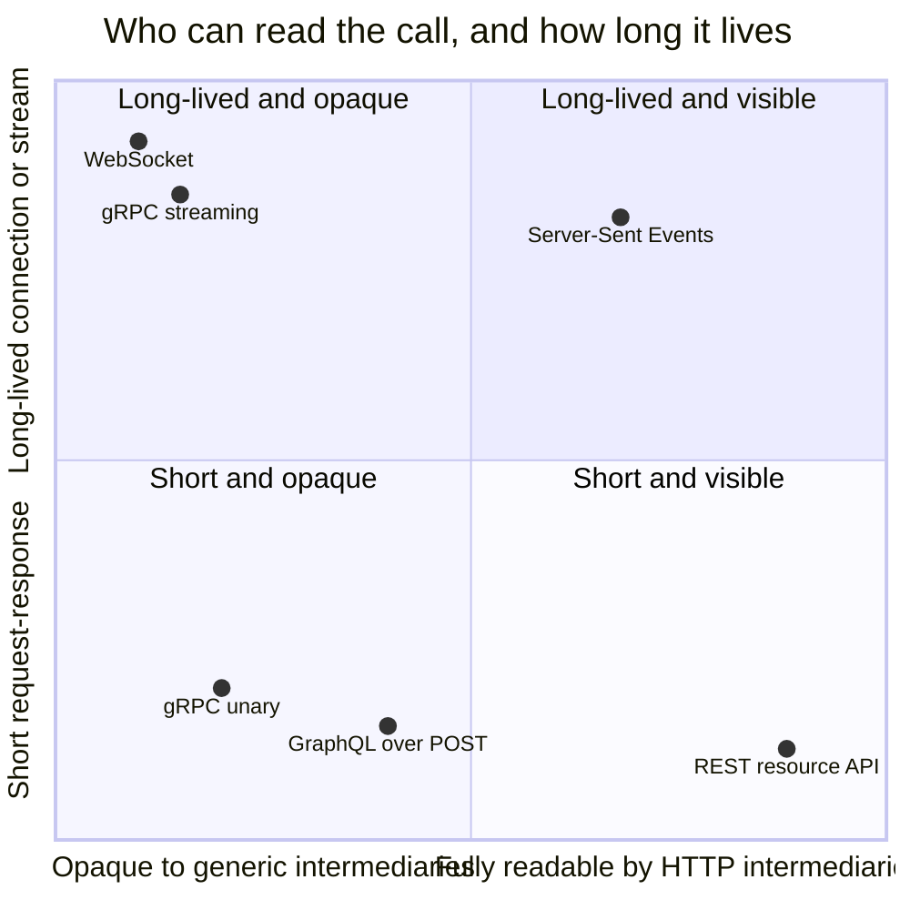
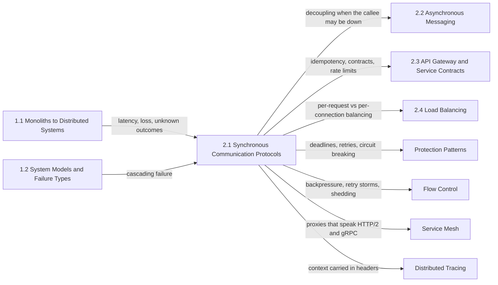

Senkron bir çağrıda çağıran bir istek gönderir ve bir yanıt ya da hata dönene kadar kaynak tutar: bir thread veya task, bir bağlantı slotu, bir deadline bütçesi ve çoğu zaman ekranın başında bekleyen bir kullanıcı. Bu biçim, sonucun onu isteyen kod noktasına geri gelmesi nedeniyle programlaması en kolay olanıdır; işletmesi ise en pahalı olanıdır, çünkü çağıranın gecikmesi altındaki her hop'un toplamına, erişilebilirliği de onların erişilebilirliklerinin çarpımına dönüşür. Bu bölümdeki her protokol, bu beklemenin ağ üzerinden nasıl taşınacağına verilmiş farklı bir cevaptır: mesajın kablo üzerinde nasıl göründüğü, yol boyunca kimin ona göre davranabileceği, alışverişin ne kadar yaşadığı ve iki taraf farklı takvimlerle değiştiğinde sözleşmenin nasıl ayakta kaldığı.

Bölümün ele aldığı tek problem, uç noktaların güvenebileceği ve aradaki ağın bozmadan cache'leyebileceği, yeniden deneyebileceği, dengeleyebileceği ve gözlemleyebileceği bir istek-yanıt sözleşmesinin nasıl kurulacağıdır. Yedi konunun hepsinden geçen gerilim görünürlük ile verimlilik arasındadır. HTTP'nin tek tip (uniform) kelime dağarcığıyla ifade edilmiş bir mesajı, servisi daha önce hiç görmemiş herhangi bir cache, proxy, gateway ya da load balancer anlayabilir. İki uç nokta için optimize edilmiş bir mesaj ise, yani binary, multiplex edilmiş ve gerçek sonucu bir trailer'da taşıyan bir mesaj, çağrı başına daha ucuz ve sözleşme olarak daha katıdır; ama onu ayrıştıramayan her ara katman ya kör ya da zararlı hâle gelir. İkinci bir eksen birinciyi keser: bir çağrının ne kadar yaşadığı. Kısa ve birbirinden bağımsız çağrıları yeniden denemek, dengelemek ve boşaltmak (drain) ucuzdur. Uzun ömürlü stream'ler veriyi oluştuğu anda iletir, ama sunucu katmanını istemci başına durum tutan bir katmana dönüştürür; orada deadline'lar, retry'lar, dengeleme ve deploy'lar milisaniyelik isteklerdeki gibi çalışmaz.

Bu protokollerin hiçbiri bir çağrıyı senkron yapan bağımlılığı (coupling) ortadan kaldırmaz; yalnızca nasıl başarısız olacağını belirler. Yayılan bir deadline, retry anlamı taşıyan bir durum kodu, bayat bir yazmayı reddeden bir önkoşul (precondition) ve bir resume token, hatayı çağıran için okunabilir kılar. Çağrılan taraf ayakta değilken de hayatta kalması gereken iş bir kuyruğa ya da bir log'a aittir; bu da sonraki bölümün konusudur.

## HTTP Semantiğinden Uzun Ömürlü Stream'lere: Konular Birbirinin Üzerine Nasıl Kurulur

Bölüm, sözleşmeden dışarıya doğru sıralanmıştır: önce HTTP semantiği, ardından aynı semantiğin altında yeni bir transport, o transport üzerinde daha katı bir RPC sözleşmesi ve iki modelin kısa çağrılardan stream'lere ve push'a doğru genişletilmesi. Son konu hepsine uygulanır, çünkü her sözleşme eninde sonunda güncellenemeyen tüketicileri kırmadan değişmek zorunda kalır.

*Bölümdeki konular arasındaki bağımlılıklar. Düz oklar her sayfanın üzerine kurulduğu sayfadan neyi devraldığını gösterir; kesikli ok, WebSocket ve SSE sayfasının yeniden türetmek yerine yeniden kullandığı genel stream hata mekaniklerini işaret eder.*

REST sayfası köktür, çünkü diğer sayfaların ya koruduğu ya da vazgeçtiği sözleşmeyi tanımlar: anlamı üzerinde uzlaşılmış metotlar, kontrol sinyali olarak durum kodları, iyimser eşzamanlılık (optimistic concurrency) için doğrulayıcılar (validator) ve ara katmanların göre davrandığı cache direktifleri. HTTP/2 ve HTTP/3 bunların hepsini korur, yalnızca çerçevelemeyi (framing) ve transport'u değiştirir. gRPC HTTP/2 gerektirir ve her çağrıyı onun stream'lerinden birine eşler; dolayısıyla gRPC sayfası ancak stream'ler, window'lar ve bağlantı kapatma anlaşıldıktan sonra doğru okunur. GraphQL HTTP üzerinde kalırken kaynak (resource) modelinden ayrılır ve bunun bedelini tek endpoint, tek durum kodu ve elle yeniden kurulan cache ve maliyet kontrolüyle öder.

İki streaming sayfası kısa çağrıyı farklı yönlere genişletir. gRPC streaming RPC sözleşmesini korur ve tek bir çağrıyı dakikalara ya da saatlere yayar; WebSocket ve SSE ise tarayıcılara hizmet eder; biri bir handshake'ten sonra HTTP'den çıkarak, diğeri hiç bitmeyen bir yanıtın içinde kalarak. Tarayıcı sayfası, paylaştıkları reconnect fırtınası ve yavaş abone mekanikleri için streaming sayfasına yönlendirir. Versiyonlama en sona gelir, çünkü önceki üç cevaba dayanır: bir HTTP isteğinde versiyonun nerede yaşayabileceği ve bunun cache anahtarına ne yaptığı, hangi protobuf değişikliklerinin kablo düzeyinde uyumlu olduğu ve tek bir GraphQL grafının versiyon yerine alanları (field) nasıl kullanımdan kaldırdığı.

## Her Konunun Yanıtladığı Soru

[REST: Kısıtlar, Kaynaklar ve HTTP Sözleşmeleri](/distributed-systems/tr/communication/synchronous-protocols/rest/), bir HTTP arayüzünün istemci ile sunucu arasındaki ağa ne vaat ettiğini ve metotlar, durum kodları ve cache başlıkları gevşek kullanıldığında kayıp güncellemelerin, mükerrer oluşturmaların ve cache'lenmiş kişisel verinin nasıl ortaya çıktığını yanıtlar. Herkese açık ya da ekipler arası herhangi bir API'yi tasarlamadan önce ve bir gateway'in, CDN'in ya da retry katmanının trafiği bozduğu izlenimi doğduğunda bu sayfayı açın.

[HTTP/2 ve HTTP/3: Multiplexing, HOL Blocking ve QUIC](/distributed-systems/tr/communication/synchronous-protocols/http2-http3-quic/), çok sayıda istek tek bir bağlantıyı paylaştığında neyin değiştiğini, kaybolan bir paketin TCP üzerinde neden hâlâ her stream'i durdurduğunu ve QUIC'in bu duraksamayı kaldırmak için CPU ve işletilebilirlik cinsinden ne ödettiğini yanıtlar. Bir edge ya da mesh için protokol versiyonu seçerken veya duraksamaları, bağlantı yoğunlaşmasını ve stream reset istismarını araştırırken bu sayfayı açın.

[gRPC & Protocol Buffers: Yüksek Performanslı RPC](/distributed-systems/tr/communication/synchronous-protocols/grpc-protocol-buffers/), şema öncelikli bir RPC sözleşmesinin mesajları nasıl kodladığını, alanlar değiştikçe nasıl uyumlu kaldığını ve deadline'ları, iptali (cancellation) ve retry anlamı taşıyan durum kodlarını bir çağrı ağacı boyunca nasıl taşıdığını yanıtlar. Servisler arası dahili API'ler kurarken ve çağrılar deadline olmadan asılı kaldığında ya da yük birkaç backend'e yapıştığında bu sayfayı açın.

[gRPC Streaming: Unary, Server-Streaming, Çift Yönlü](/distributed-systems/tr/communication/synchronous-protocols/grpc-streaming/), bir stream'in yaşadığı sürece neyi garanti ettiğini ve koptuğunda neyin kaybolduğunu, transport akış kontrolünün uygulama düzeyinde backpressure'a nasıl dönüştüğünü ve gerçek sistemlerin bir stream'i bir konumdan nasıl sürdürdüğünü yanıtlar. Polling'i ya da sayfalamayı bir stream ile değiştirmeden önce ve stream'ler sabit bir yaşta ölüyor, sessizce takılıyor ya da fırtınalar hâlinde yeniden bağlanıyorsa bu sayfayı açın.

[GraphQL: Sorgu Dili ve Federasyon Mimarisi](/distributed-systems/tr/communication/synchronous-protocols/graphql/), bir sunucunun istek anında istemcilerin seçtiği iş yüklerini maliyet, batching ve cache kontrolünü kaybetmeden nasıl çalıştırabileceğini ve tek bir graf birçok servise yayıldığında federasyonun ne eklediğini ve ne ödettiğini yanıtlar. Birçok istemci türü aynı verinin farklı biçimlerine ihtiyaç duyduğunda ve resolver'lar fan-out yaptığında ya da sorgular kapasiteyi tükettiğinde bu sayfayı açın.

[WebSocket ve Server-Sent Events: Gerçek Zamanlı İletişim](/distributed-systems/tr/communication/synchronous-protocols/websocket-sse/), bir sunucunun veri oluştuğu anda tarayıcılara nasıl push yaptığını, her protokolün teslimat ve sürdürme (resumption) konusunda neyi garanti ettiğini ve milyonlarca uzun ömürlü bağlantıdan oluşan bir katmanın nasıl dengelendiğini, boşaltıldığını ve debug edildiğini yanıtlar. Polling, SSE ve WebSocket arasında seçim yaparken ve bağlantılar proxy timeout'larında kopuyor ya da olaylar buffer'layan bir hop'ta bekliyorsa bu sayfayı açın.

[API Versiyonlama Stratejileri](/distributed-systems/tr/communication/synchronous-protocols/api-versioning/), bir sözleşmedeki değişikliğin ne zaman yeni bir isme ihtiyaç duyduğunu, o ismin bir istekte nerede yaşadığını, tek bir kod tabanının birden fazla sözleşmeye nasıl hizmet ettiğini ve eski versiyonların kesintiye yol açmadan nasıl emekliye ayrıldığını yanıtlar. Güncelleyemediğiniz tüketicileri olan herhangi bir API'deki ilk kırıcı (breaking) değişiklikten önce ve bir kullanımdan kaldırma (deprecation) planlarken bu sayfayı açın.

| Konu | Yanıtladığı soru | Ne zaman açılmalı |
|---|---|---|
| [REST](/distributed-systems/tr/communication/synchronous-protocols/rest/) | Bir HTTP sözleşmesi her ara katmana ne vaat eder? | Herkese açık bir API tasarlarken, durum kodlarını ve cache başlıklarını seçerken, kayıp güncellemeleri veya mükerrer oluşturmaları düzeltirken |
| [HTTP/2 ve HTTP/3](/distributed-systems/tr/communication/synchronous-protocols/http2-http3-quic/) | Multiplexing neyi paylaştırır, QUIC neyi kaldırır? | Protokol versiyonu seçerken, stream ve window limitlerini ayarlarken, duraksamaları veya reset sellerini teşhis ederken |
| [gRPC ve Protocol Buffers](/distributed-systems/tr/communication/synchronous-protocols/grpc-protocol-buffers/) | Şema öncelikli bir RPC nasıl uyumlu kalır, deadline ve durumu nasıl taşır? | Dahili API kurarken, deadline ve retry politikası belirlerken, yapışan yükü veya keepalive hatalarını debug ederken |
| [gRPC Streaming](/distributed-systems/tr/communication/synchronous-protocols/grpc-streaming/) | Uzun ömürlü bir çağrı koptuğunda geriye ne kalır? | Polling yerine push kurarken, sürdürmeyi tasarlarken, ölen veya takılan stream'leri araştırırken |
| [GraphQL](/distributed-systems/tr/communication/synchronous-protocols/graphql/) | İstemcinin seçtiği bir iş yükü nasıl sınırlı ve cache'lenebilir tutulur? | Çok sayıda UI istemcisine hizmet verirken, maliyet limiti veya batching eklerken, federasyona geçerken |
| [WebSocket ve SSE](/distributed-systems/tr/communication/synchronous-protocols/websocket-sse/) | Sunucu tarayıcılara nasıl push yapar, bağlantı katmanı nasıl işletilir? | Push protokolü seçerken, gateway filosunu boyutlandırırken, proxy kaynaklı kopmaları düzeltirken |
| [API Versiyonlama](/distributed-systems/tr/communication/synchronous-protocols/api-versioning/) | Bir değişiklik ne zaman yeni bir sözleşme gerektirir, eskisi nasıl emekliye ayrılır? | Kırıcı bir değişiklik planlarken, versiyonun nerede yaşayacağını seçerken, sunset tarihi belirlerken |

Protokoller, girişte adı geçen iki eksene yerleştirilebilir. Grafik nitel bir haritadır; transport ve versiyonlama grafiğe konmamıştır, çünkü üzerindeki her noktaya uygulanırlar.

*Bölümdeki protokollerin nitel konumları. Yatay eksen: çağrının anlamının (metot, sonuç, cache'lenebilirlik) ne kadarına genel amaçlı bir HTTP cache'inin, proxy'sinin ya da gateway'inin göre davranabildiği. Dikey eksen: tek bir alışverişin iki uçta ne kadar süre durum tuttuğu.*

Aşağıya ve sağa gitmek, ara katmanların bedavaya yaptığı işleri satın alır: cache'leme, metot semantiğinden çıkarılan retry kararları, durum farkında metrikler ve istek başına dengeleme. Yukarıya ve sola gitmek ise verimlilik ve push teslimatı satın alır ve bu işleri uç noktalara geri devreder. GraphQL, HTTP kullanmasına rağmen REST'in solunda durur; çünkü tek bir endpoint'e giden POST istekleri ve kısmi hatalarda dönen 200, hem cache'lenebilirliği hem de sonucu ara katmanlardan gizler. SSE, görünür kalan tek uzun ömürlü protokoldür ve istemcinin çoğunlukla dinlediği durumlarda olağan cevabın o olmasının nedeni de budur. Yedi sayfadaki birçok hata modu, bir çeyrekteki protokolü başka bir çeyrek için yapılandırılmış altyapının arkasında çalıştırmaktan doğar: 15 saniyelik route timeout'u olan bir proxy'nin arkasındaki gRPC stream'i, 60 saniyelik bir idle zamanlayıcının arkasındaki WebSocket, paylaşımlı bir cache'teki kişiselleştirilmiş yanıt.

## Okuma Sırası ve Gerekçesi

İlk okumada bölümü kenar çubuğundaki sırayla okuyun; gerekçesi yukarıdaki bağımlılık diyagramıdır. En önemli iki sıralama şunlardır. HTTP/2, gRPC'den önce gelmelidir; çünkü gRPC'nin trailer'ları, akış kontrolü, keepalive etkileşimi ve düzgün kapanışı (graceful shutdown), gRPC sayfasının yeniden açıklamadan referans verdiği HTTP/2 mekanizmalarıdır. gRPC streaming ise unary gRPC'den sonra gelmelidir; çünkü unary çağrıya göre neyi kaybettiğiyle tanımlanır: çağrı başına deadline'lar, şeffaf retry'lar ve istek başına dengeleme.

Üç kısayol makuldür. Herkese açık ya da iş ortaklarına yönelik bir API tasarlayan bir mühendis REST, GraphQL ve API versiyonlama sayfalarını okumalı, ardından idempotency anahtarları ve rate limit'ler için API gateway bölümüne geçmelidir. Dahili bir servis platformu kuran bir mühendis HTTP/2 ve HTTP/3, gRPC ve gRPC streaming sayfalarını birlikte okumalıdır; çünkü bağlantı ömrü ve dengeleme üçüne birden yayılır. Tarayıcı ya da mobil için gerçek zamanlı bir ürün geliştiren bir mühendis HTTP/2 ve HTTP/3 sayfasını, ardından WebSocket ve SSE sayfasını, sonra da streaming sayfasının hata modlarını okumalıdır.

## Bölümün El Kitabındaki Yeri

Bölüm, ilk kısmın ağın bir çağrıya ne yaptığına dair anlattıklarını varsayar. [Dağıtık Hesaplamanın 8 Yanılgısı](/distributed-systems/tr/foundations/monoliths-to-distributed/eight-fallacies/) ve [Ağ Güvenilirliği, Bant Genişliği Sınırları ve Topoloji Değişiklikleri](/distributed-systems/tr/foundations/monoliths-to-distributed/network-reliability/), buradaki her protokolün tepki verdiği gerçekleri sağlar: gecikme sıfır değildir, kayıp yaşanır ve timeout'a uğramış bir istek çalışmış da olabilir, çalışmamış da. [Stateful ve Stateless Servisler](/distributed-systems/tr/foundations/monoliths-to-distributed/stateful-vs-stateless/), uygulama kodu stateless olsa bile uzun ömürlü bağlantılardan oluşan bir katmanın neden stateful olduğunu açıklar; [Kaskad Hata Analizi](/distributed-systems/tr/foundations/system-models/cascading-failure/) ise senkron bağımlılığın aşırı yük altında neye dönüştüğünü gösterir.

*Solda ön koşullar, sağda bu bölümü kullanan bölümler. Her ok neyin devredildiğini adlandırır.*

Bu bölüm çağrıları tanımlar; el kitabının geri kalanı onları korur, yönlendirir ve yerlerine başka şeyler koyar. [Mesaj Kuyruğu ve Event Streaming](/distributed-systems/tr/communication/async-messaging/message-queue-vs-event-streaming/), çağıranın çağrılanın erişilebilirliğine bağımlı olmaması gerektiğinde işin gittiği yerdir; [Şema Evrimi ve Schema Registry](/distributed-systems/tr/communication/async-messaging/schema-evolution-registry/) ise protobuf uyumluluğunu saklanan mesajlara uygular. API gateway bölümü, buradaki birçok sayfanın yalnızca link verdiği mekanizmaların sahibidir: durum değiştiren çağrıların retry'larını güvenli kılmak için [Idempotency ve Güvenli HTTP Metotları](/distributed-systems/tr/communication/api-gateway/idempotency/), çağrıları istemci türüne göre birleştirmek için [Frontend için Backend](/distributed-systems/tr/communication/api-gateway/bff-pattern/), sözleşmeleri gerçek tüketicilere karşı doğrulamak için [Tüketici Güdümlü Sözleşme Testi](/distributed-systems/tr/communication/api-gateway/contract-testing/) ve [Gateway Düzeyinde Throttling ve Rate Limiting](/distributed-systems/tr/communication/api-gateway/throttling-rate-limiting/). Uzun ömürlü bağlantılar, [İstemci Taraflı ve Sunucu Taraflı Yük Dengeleme](/distributed-systems/tr/communication/load-balancing/client-vs-server-side/) ile [Sağlık Durumuna Duyarlı Yönlendirme ve Bağlantı Boşaltma](/distributed-systems/tr/communication/load-balancing/health-aware-routing/) konularının önemli olmasının nedenidir.

Dayanıklılık (resilience) kısmı, bölümün hata sinyallerini politikaya dönüştürür. [Zaman Aşımları](/distributed-systems/tr/resilience/protection-patterns/timeouts/) ve [Üstel Geri Çekilme ve Jitter ile Yeniden Deneme](/distributed-systems/tr/resilience/protection-patterns/retry-exponential-backoff/) bir deadline ve retry edilebilir bir durumla ne yapılacağına karar verir; [Geri Baskı](/distributed-systems/tr/resilience/flow-control/backpressure/), HTTP/2 ve gRPC stream'lerinin akış kontrolü window'larını genelleştirir; [Retry Fırtınaları ve Metastabil Hatalar](/distributed-systems/tr/resilience/flow-control/retry-storms-metastable-failures/) ise buradaki sayfaların çoğunun uyardığı olay desenidir. [Envoy Proxy](/distributed-systems/tr/service-mesh/service-mesh-architecture/envoy-proxy/), bu timeout'ların ve stream limitlerinin çoğunun yapılandırıldığı yerdir; [Dağıtık İzleme](/distributed-systems/tr/observability/logs-metrics-traces/distributed-tracing/) de bu protokollerin başlıklarında taşınan bağlama (context) dayanır.
