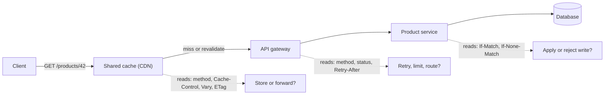
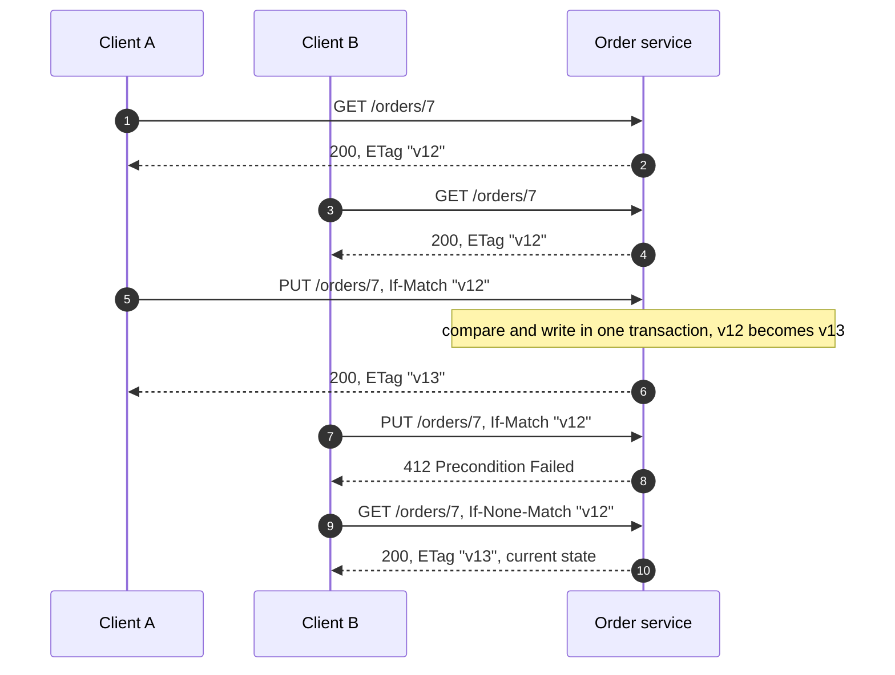
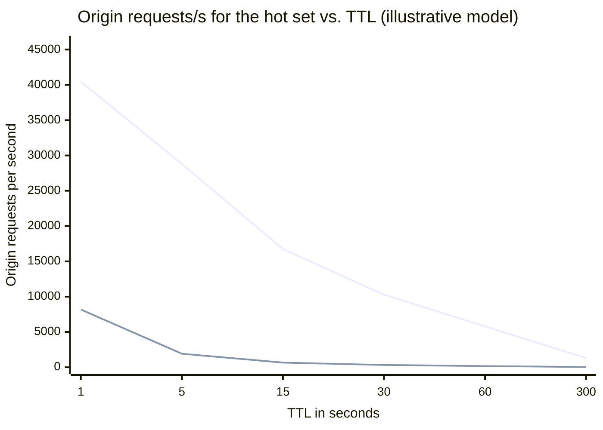
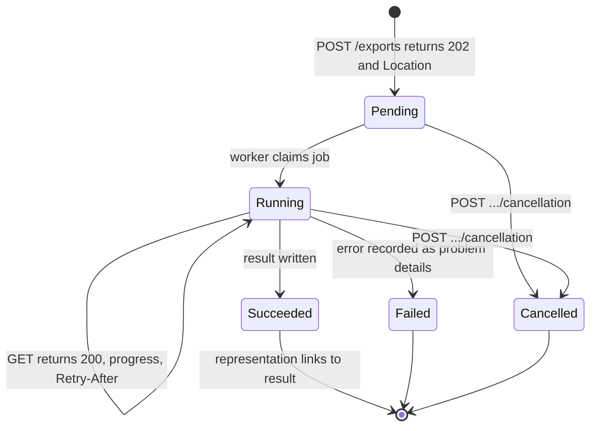

Representational State Transfer (REST), Roy Fielding'in 2000 tarihli doktora tezinde Web'in neden ölçeklendiğini açıklamak için türettiği mimari stildir: bileşenlerin nasıl etkileşeceğine dair bir kısıtlar kümesi. Bu kısıtlar, istemci ile sunucu arasındaki ağın uygulama hakkında hiçbir şey bilmeden mesajları anlayabilmesi, cache'leyebilmesi, yeniden deneyebilmesi ve yönlendirebilmesi için seçilmiştir. Bir REST arayüzü, her biri bir URI ile adlandırılan kaynaklar (resource) sunar ve istemcilerin bu kaynaklar üzerinde yalnızca temsil (representation) aktararak işlem yapmasına izin verir: bir JSON dokümanı, bir görsel, bir HTML sayfası. Bu aktarım, anlamı tüm katılımcılar tarafından önceden kabul edilmiş küçük ve sabit bir metot kümesiyle yapılır. HTTP bu kısıtlar etrafında şekillenmiş protokoldür; dolayısıyla pratikte "bir REST API", metotları, durum kodları ve header'ları standart anlamlarıyla kullanılan bir HTTP API demektir.

Asıl denge, genellik ile verimlilik arasındadır. Her mesaj kendi başına anlaşılır olduğu ve ortak bir sözlük kullandığı için, servisinizi hiç görmemiş bir cache, proxy, gateway ya da load balancer bile bir yanıtın saklanıp saklanamayacağına, başarısız bir isteğin yeniden gönderilip gönderilemeyeceğine ve istemcinin elindeki kopyanın hâlâ güncel olup olmadığına karar verebilir. Bedeli, uygulama semantiğinin bu genel sözlüğe sığdırılmak zorunda olmasıdır: doğası gereği "bu dokümanı oku ya da değiştir" olmayan işlemler hantallaşır, her istek kendi bağlamını ayrıntılı header'larla taşır ve birkaç kaynaktan veri isteyen bir istemci birkaç round trip öder. REST; birbirinden bağımsız evrilen taraflar arasındaki iri taneli, cache'lenebilir ve uzun ömürlü arayüzler için optimize edilmiştir. Sıkı bağlı bileşenler arasındaki geveze (chatty) ve düşük gecikmeli çağrılar için ise kötü bir seçimdir.

Bu sayfa, HTTP sözleşmesinin production'da doğruluğu belirleyen kısımlarına odaklanır: metot semantiği, ön koşullar (precondition), cache'leme ve kontrol sinyali olarak durum kodları. Idempotency anahtarları [Idempotency ve Güvenli HTTP Metotları](/distributed-systems/tr/communication/api-gateway/idempotency/), versiyonlama [API Versiyonlama Stratejileri](/distributed-systems/tr/communication/synchronous-protocols/api-versioning/), alttaki taşıma katmanı ise [HTTP/2 ve HTTP/3](/distributed-systems/tr/communication/synchronous-protocols/http2-http3-quic/) sayfasında ele alınır.


*Katmanlı bir istek yolu. Her ara katman kararını ürün servisi hakkındaki bilgiden değil, standartlaştırılmış mesaj alanlarından verir.*

Stilin özü kesikli kenarlardadır. CDN, metot ve cache direktiflerine bakarak tek başına yanıt verip veremeyeceğine; gateway, metot ve duruma bakarak başarısız bir denemenin yeniden gönderilip gönderilemeyeceğine; origin ise bir precondition header'ına bakarak yazmanın güncel duruma dayanıp dayanmadığına karar verir. Bu kararların hiçbiri gövdeyi parse etmeyi ya da servisle kod paylaşmayı gerektirmez ve servis bir metodu, durum kodunu ya da direktifi standart anlamına aykırı kullandığı anda her biri yanlış hâle gelir.

## Kısıtlar ve Kazandırdıkları Özellikler

Fielding REST'i hiç kısıt olmayan bir başlangıç noktasından altı kısıt ekleyerek tanımlar; her kısıt bir özellik kazandırır ve her birinin bir bedeli vardır. Onları okumanın yararlı yolu nedenseldir: mesajları kendini tanımlar hâle getiren statelessness'tır, cache'lemeyi ve katmanlamayı güvenli kılan kendini tanımlayan mesajlardır, Web'in hiçbir origin'in tek başına karşılayamayacağı okuma yükünü emmesini sağlayan da cache'lemedir.

İstemci-sunucu ayrımı, kullanıcı arayüzü kaygılarını veri depolamadan ayırır; böylece iki taraf kendi başına evrilip ölçeklenebilir. Statelessness, her isteğin anlaşılması için gereken tüm bilgiyi taşımasını şart koşar; sunucu istekler arasında konuşma bağlamı tutmaz. Oturum durumu istemcide ya da isteğin kendisinde (bir token, bir cursor) yaşar; bu, [Stateful ve Stateless Servisler](/distributed-systems/tr/foundations/monoliths-to-distributed/stateful-vs-stateless/) sayfasında incelenen instance değiştirilebilirliğinin protokol düzeyindeki karşılığıdır. Sunucu kaynak durumunu yine kalıcı olarak saklar; kısıt yalnızca etkileşim durumunu, yani bir istemciyi tek bir instance'a bağlayacak "bu konuşmanın neresindeyiz" verisini yasaklar.

Cache kısıtı, yanıtların kendilerini cache'lenebilir ya da cache'lenemez olarak etiketlemesini şart koşar. Tekdüze arayüz (uniform interface) en merkezi ve en pahalı kısıttır ve dört parçadan oluşur: kaynaklar URI'lerle tanımlanır; sunucunun depolama biçimiyle değil, temsiller aracılığıyla değiştirilir; mesajlar kendini tanımlar, yani metot, media type ve kontrol header'ları herhangi bir alıcının mesajı işlemesine yeter; ve hypermedia uygulama durumunun motorudur (HATEOAS), yani istemciler sonraki adımları bant dışı bilgiden değil, temsillerdeki linklerden öğrenir. Katmanlı sistem kısıtı her bileşenin yalnızca komşu katmanı görmesini sağlar; böylece bir CDN, gateway ya da mesh proxy istemci fark etmeden araya eklenebilir. İsteğe bağlı altıncı kısıt olan code on demand, Web'de JavaScript'tir ve servis API'lerinde bir rolü yoktur.

| Kısıt | Kazandırdığı özellik | Bedeli | Pratikte yaygın ihlal |
|---|---|---|---|
| İstemci-sunucu | Her tarafın bağımsız evrimi | Her etkileşimde bir ağ atlaması | Tek bir istemci türünü varsayan, sunucuda render edilen durum makineleri |
| Stateless | Her instance her isteğe hizmet verebilir; hatalar yalnızca uçuştaki işi kaybettirir | Bağlam her istekte yeniden gönderilir; daha büyük mesajlar | Cookie ile anahtarlanan sunucu tarafı oturumlar, doğruluk şartı olarak sticky routing |
| Cache | Okuma yükü ara katmanlarca emilir; daha düşük gecikme | Sınırlı bayatlık; geçersizleştirme protokolün parçası değil | Hiç cache header'ı olmaması ya da her yerde `no-store` |
| Tekdüze arayüz | Genel ara katmanlar, bağımsız evrilebilirlik | İşlemler sabit bir metot kümesine sıkıştırılır; amaca özel bir protokolden daha az verimli | Her şey için `POST /doAction`, `200` olarak dönen hatalar |
| Katmanlı sistem | Şeffaf proxy'ler, gateway'ler, CDN'ler, load balancer'lar | Katman başına ek gecikme; her katmanın kendi timeout'ları | Belirli bir backend'e ulaşmaya bağımlı istemciler |
| Code on demand (isteğe bağlı) | İstemci genişletilebilirliği | Daha az görünürlük ve güvenlik | Servis API'lerinde uygulanamaz |

### Hypermedia: API'lerin Çoğunun Bıraktığı Kısıt

RESTful denen API'lerin çoğu, Leonard Richardson'ın olgunluk modelinin "seviye 2" dediği yerde durur: kaynaklar ve doğru HTTP fiilleri, ama hypermedia yok. Fielding 2008'de, URI şablonlarının bant dışı dokümantasyonuyla yürüyen bir API'nin REST olmadığını yazdı; çünkü istemciler sunucunun URI yapısını ve iş akışını koda gömer ve ikisinden biri değiştiğinde bozulur. API tasarımcılarının çoğunun savunduğu karşı görüş ise makine istemcilerinin keşif yapmadığıdır: bir servis, geliştiricilerinin kodladığı endpoint'leri çağırır ve linkler dokümantasyon ihtiyacını ortadan kaldırmadan yalnızca bayt ekler.

Bu el kitabının görüşü, belirleyici değişkenin istemciyi kimin kontrol ettiği olduğudur. İki tarafa da tek bir ekip sahipse ya da istemciler bir [OpenAPI sözleşmesinden](/distributed-systems/tr/communication/api-gateway/openapi-swagger/) üretiliyorsa, tam hypermedia çok az şey kazandırır. İstemciler çok sayıda, harici ve uzun ömürlü olduğunda ise dar bir biçimi iki yerde kendini amorti eder: duruma bağlı eylemler (yalnızca iptal hâlâ mümkünken bulunan bir `cancel` linki; böylece istemciler sunucunun durum makinesini kodlamayı bırakır) ve sayfalama cursor'ları ile uzun süren işlemler için sunucunun verdiği URI'ler; bunlar sunucunun yönlendirmeyi ve depolamayı istemci sürümü gerektirmeden değiştirmesine izin verir.

## HTTP Sözleşmesi: Metotlar, Ön Koşullar ve Durum Kodları

HTTP semantiği RFC 9110'da (2022), cache'leme RFC 9111'de, HTTP/1.1 kablo formatı ise RFC 9112'de tanımlanır. Dağıtık bir sistem için önemli olan sözleşme, bir metodun günlük dilde ne "anlama" geldiği değil, her tarafın onunla ne yapmaya yetkili olduğudur.

Bir metot, istemci onu gönderirken herhangi bir durum değişikliği talep etmiyorsa güvenlidir (safe): `GET`, `HEAD`, `OPTIONS`. Bu yüzden bir crawler, prefetcher ya da izleme probu onu serbestçe gönderebilir. Bir metot, tekrarlanması tek bir kez gönderilmesiyle aynı amaçlanan etkiyi yaratıyorsa idempotent'tir: güvenli metotlar artı `PUT` ve `DELETE`. Bu yüzden bir istemci ya da ara katman, ilk denemenin işlenip işlenmediğini bilmeden onu bir bağlantı hatasından sonra yeniden gönderebilir; RFC 9112 de yanıt gelmeden kapanan bir bağlantıda idempotent isteklerin otomatik olarak yeniden denenmesine açıkça izin verir. `POST` ve `PATCH` böyle bir garanti taşımaz; timeout'a uğrayan bir `POST`'un istemciyi başarıyı başarısızlıktan ayıramaz hâlde bırakmasının nedeni budur. Onu güvenle yeniden denenebilir kılmak bir idempotency anahtarı gerektirir; bu konu [Idempotency ve Güvenli HTTP Metotları](/distributed-systems/tr/communication/api-gateway/idempotency/) sayfasında ele alınır. Pratikte genel amaçlı cache'ler yalnızca `GET` ve `HEAD` yanıtlarını cache'ler.

`PUT`, hedef kaynağın durumunu gönderilen temsille değiştirir. `PATCH` (RFC 5789), ayrı bir media type ile ifade edilen bir değişiklik kümesi uygular: JSON Merge Patch (RFC 7396), `null`'ın "bu üyeyi sil" anlamına geldiği kısmi bir doküman gönderir; kısadır ama bir değeri null yapamaz ya da tek bir dizi elemanını değiştiremez. JSON Patch (RFC 6902) ise sıralı bir işlem listesi gönderir; buna, bir değer eşleşmedikçe tüm patch'i başarısız kılan bir `test` işlemi de dahildir. RFC 10008 (Haziran 2026) ile standartlaşan `QUERY` metodu güvenli ve idempotent'tir ama bir gövde taşır; böylece devasa bir query string ile cache'lerin ve retry mantığının güvensiz saymak zorunda olduğu bir `POST` arasındaki eski seçimi ortadan kaldırır. Proxy, CDN ve kütüphane desteği standardın gerisinden gelecektir.

### Validator'larla İyimser Eşzamanlılık

Bir kaynağı okuyan, kendi kopyasını değiştiren ve sonucu `PUT` eden iki istemci birbirinin üzerine sessizce yazar: ikinci yazma kazanır ve ilk değişiklik `200 OK` ile birlikte kaybolur. Bu, [Zayıf İzolasyon ve MVCC](/distributed-systems/tr/data-management/consistency-models/weak-isolation-mvcc/) sayfasında incelenen read-modify-write yarışının HTTP düzeyindeki karşılığı olan kayıp güncelleme (lost update) anomalisidir. HTTP'nin yanıtı koşullu istektir (conditional request). Her yanıt bir validator taşıyabilir: temsil her değiştiğinde sunucunun değiştirdiği opak bir dize olan `ETag` (entity tag) ya da bir `Last-Modified` zaman damgası. Yazmak isteyen istemci validator'ı `If-Match` içinde geri gönderir ve sunucu yazmayı yalnızca kaynağın güncel validator'ı hâlâ eşleşiyorsa uygular; aksi hâlde `412 Precondition Failed` döner ve hiçbir şeyi değiştirmez.


*`If-Match` ile iyimser eşzamanlılık. İstemci B'nin bayat yazması, İstemci A'nın değişikliğinin üzerine yazmak yerine reddedilir.*

Doğruluk, 6. adımdan önceki notta yaşar. Karşılaştırma ve yazma origin'de atomik olmalıdır; genellikle `UPDATE ... WHERE id = ? AND version = ?` ifadesinde kontrol edilen bir `version` sütunuyla yapılır ve etkilenen satır sayısının sıfır olması `412`'ye eşlenir. Güncel ETag'i okuyan, onu uygulama kodunda karşılaştıran ve ardından ayrı bir ifadeyle yazan bir servis, yarışı kendi içine geri getirmiş olur. 9. ve 10. adımlar kurtarma yolunu gösterir: İstemci B güncel durumu koşullu olarak çeker, böylece hiçbir şey değişmemiş olsaydı gövdesiz bir `304 Not Modified` alırdı; ardından niyetini yeniden uygular ve tekrar dener. Bu yeniden deneme kör bir tekrar gönderim değil, semantik bir birleştirmedir; kararın genel bir retry katmanına değil istemciye ait olmasının nedeni budur.

Bunun işe yarayıp yaramayacağını üç ayrıntı belirler. `If-Match` güçlü karşılaştırma kullanır; bu yüzden zayıf validator'lar (`W/` önekli, bayt düzeyinde aynı değil "anlamsal olarak eşdeğer" demek olan) asla eşleşmez. Sıkıştırılmış bir gövdeyi hash'leyerek zayıf ETag üreten bir framework, ön koşulları sessizce devre dışı bırakır. `If-None-Match: *`, bir `PUT`'u yalnızca-oluştur işlemine çevirir ve herhangi bir temsil zaten varsa başarısız olur; bu da yarışsız bir "yoksa oluştur" sağlar. Son olarak sunucu, koşulsuz yazmaları `428 Precondition Required` (RFC 6585) ile tamamen reddedebilir; böylece istemcinin unuttuğu bir header sessiz veri kaybı yerine anında bir hataya dönüşür.

Gerçek sistemler bu şekli kullanır. Amazon S3, `PutObject`'e Ağustos 2024'te `If-None-Match`'i, Kasım 2024'te `If-Match`'i ekleyerek nesne depolamayı bir compare-and-swap primitifine dönüştürdü. Kubernetes API'si versiyonu gövdede taşır: bayat bir `metadata.resourceVersion` ile gelen güncelleme `409 Conflict` ile reddedilir ve controller'lar yeniden okuyup tekrar dener. GitHub'ın REST API'si kimliği doğrulanmış bir `304`'ü birincil rate limit'e saymaz; bu da koşullu polling'i neredeyse bedava yapar.

:::danger[Koşulsuz yazmalar hata vermeden veri kaybettirir]
Birden fazla aktörün değiştirebildiği bir kaynakta ön koşulsuz bir `PUT` ya da `PATCH`, er ya da geç eşzamanlı bir değişikliği düşürür ve ilgili her istek başarı döner. Bunu ne loglar ne metrikler gösterir; sonradan bir müşterinin "kaydetmedi" dediği bir değişiklik olarak ortaya çıkar. Eşzamanlı yazıcıları olan her değişebilir kaynakta `If-Match` (ya da bir versiyon alanı) zorunlu tutun ve eksik olduğunda `428` dönün.
:::

### Kontrol Sinyali Olarak Durum Kodları

Durum kodlarını insanlardan önce makineler okur: retry middleware'leri, circuit breaker'lar, gateway'ler ve dashboard'lar onları sınıflarına göre ayırır ve buna göre davranır. Operasyonel açıdan önemli olan sınıflandırma "başarı ya da hata" değil, "davranışını kim, nasıl değiştirmeli" sorusudur.

Bir `4xx`, isteğin gönderildiği hâliyle başarılı olmayacağını söyler; onu değiştirmeden yeniden göndermek boşa iştir. Üç bilinçli istisna vardır. `408 Request Timeout` ve `429 Too Many Requests` "aynı istek daha sonra başarılı olabilir" demektir; `429` ve `503 Service Unavailable` ne zaman olacağını söylemek için `Retry-After` taşıyabilir ve [gateway düzeyinde rate limiting](/distributed-systems/tr/communication/api-gateway/throttling-rate-limiting/) istemcilerin buna uymasına dayanır. `409 Conflict` ve `412`, yukarıda görüldüğü gibi "yeniden oku ve karar ver" demektir. Bir `5xx` sunucunun başarısız olduğunu söyler, ancak alt sınıflar sonuç hakkında farklı şeyler açığa çıkarır. İşlemeden önce dönen `503` (load shedding, açık bir circuit) hiçbir şeyin olmadığı anlamına gelir; `500` kısmi bir durum değişikliğinin ardından gelmiş olabilir; `502 Bad Gateway` ve `504 Gateway Timeout` bir ara katmandan gelir ve yalnızca onun origin ile bağlantısını kaybettiğini söyler; origin hâlâ işliyor ya da commit etmiş olabilir. Idempotent olmayan bir istek için bu belirsizlik, aşağıdaki mükerrer oluşturma hatasının köküdür.

Hata gövdeleri, istemcilerin mesajları parse etmek yerine kararlı bir türe göre dallanabilmesi için standart bir format kullanmalıdır. RFC 9457 (2023, RFC 7807'yi geçersiz kılar) Problem Details'i tanımlar: `application/problem+json` media type'ına sahip, `type` (problem sınıfını tanımlayan bir URI), `title`, `status`, `detail` ve `instance` üyelerini içeren ve probleme özgü üyelerle genişletilebilen bir JSON nesnesi.

```text
PUT /orders/7 HTTP/1.1
If-Match: "v12"
Content-Type: application/json

HTTP/1.1 412 Precondition Failed
Content-Type: application/problem+json
ETag: "v13"

{"type": "https://api.example.com/problems/stale-version",
 "title": "Order was modified since it was read",
 "status": 412,
 "detail": "Expected version v12, current version is v13.",
 "instance": "/orders/7"}
```

Yanıt güncel `ETag`'i taşır ve problem `type`'ı mesaj yeniden yazıldığında değişmez. Gövdesinde hata nesnesi olan bir `200` dönmek, açılış diyagramındaki her katmanı işlevsiz bırakır: cache'ler onu saklayabilir, retry middleware'i onu başarı sayar ve dashboard'lar bir kesinti sırasında yeşil kalır.

## Bir Protokol Olarak Cache'leme: Tazelik, Doğrulama ve Paylaşılan Cache'ler

HTTP cache'leme iki adımlı bir protokoldür: tazelik (freshness), saklanan bir yanıtın origin'e hiç başvurmadan kullanılıp kullanılamayacağına; doğrulama (validation) ise bayatlamış bir yanıtın ucuz bir kontrolden sonra yeniden kullanılıp kullanılamayacağına karar verir. `Cache-Control: max-age=60` bir yanıtı her cache'te 60 saniye taze kılar; `s-maxage` bunu yalnızca CDN'ler ve reverse proxy'ler gibi paylaşılan cache'ler için geçersiz kılar; `private` paylaşılan cache'lerin onu saklamasını yasaklar; `no-store` ise her yerde saklamayı yasaklar. `no-cache` sık yanlış okunur: saklamaya izin verir, ama her yeniden kullanımdan önce doğrulama ister. RFC 5861, arka planda yenilenirken bayat bir yanıtı en fazla N saniye sunan `stale-while-revalidate=N`'i ve origin başarısız olduğunda bayat içerik sunan `stale-if-error=N`'i ekler; bu ikincisi okuma yolları için yerleşik bir fallback'tir.

Ekipleri en çok şaşırtan iki kural vardır. Birincisi `Vary`'dir: bir cache saklanan yanıtı yalnızca metot ve URI ile anahtarlar; bu yüzden temsil `Accept`, `Accept-Language` ya da `Accept-Encoding`'e göre değişiyorsa, yanıt bu header'ları `Vary` içinde listelemelidir, yoksa cache bir istemcinin varyantını diğerine sunar. İkincisi sezgisel tazeliktir (heuristic freshness): açık tazelik bilgisi olmayan ama bir `Last-Modified` header'ı ve sezgisel olarak cache'lenebilir bir durumu (`200`, `301`, `404` ve `410` bunlar arasındadır) olan bir yanıt, cache'in seçtiği bir süre boyunca cache'lenebilir; RFC 9111 son değişiklikten bu yana geçen sürenin %10'unu önerir. 30 gün önce değiştirilmiş bir doküman, kimsenin yapılandırmadığı bir cache tarafından yaklaşık üç gün sunulabilir; bu yüzden her yanıt açık bir `Cache-Control` taşımalıdır.

Paylaşılan cache'ler kimliği doğrulanmış trafik için üçüncü bir kural ekler: RFC 9111, yanıt `public`, `s-maxage` ya da `must-revalidate` ile açıkça izin vermedikçe, paylaşılan bir cache'in `Authorization` header'ı taşıyan bir isteğe verilmiş yanıtı yeniden kullanmasını yasaklar. Bu, bearer token kullanan API'leri varsayılan olarak korur; ancak cookie ile kimlik doğrulayan sayfaları ve birinin "hızlandırmak için" `s-maxage` eklediği yanıtları korumaz. Geçersizleştirme ise tamamen protokolün dışındadır: HTTP'de downstream cache'lere bir kaynağın değiştiğini söyleyen bir mesaj yoktur; purge API'lerinin sağlayıcıya özgü olmasının ve asıl tasarım kararının TTL seçimi olmasının nedeni budur. Bu konu [Önbellek Geçersizleştirme](/distributed-systems/tr/data-management/distributed-caching/cache-invalidation/) sayfasında ele alınır.

```text
# Product page: shared caches hold 60 s, serve stale while refreshing and during origin errors
Cache-Control: public, max-age=10, s-maxage=60, stale-while-revalidate=30, stale-if-error=300
ETag: "p42-v881"
Vary: Accept-Encoding
---
# Account page: never in a shared cache, browsers must revalidate
Cache-Control: private, no-cache
ETag: "acct-91-v17"
---
# Payment confirmation: no copy anywhere
Cache-Control: no-store
```

Ürün sayfası tarayıcılara kısa, CDN'lere daha uzun bir tazelik penceresi verir; çünkü bir CDN purge edilebilir, bir tarayıcı edilemez. Hesap sayfası yalnızca kullanıcının tarayıcısında ve yalnızca doğrulamayla yaşar; böylece geri dönen bir kullanıcı tam gövde yerine bir `304` öder.

### Sayısal Örnek: TTL ve Katmanlamanın Origin Yükünü Nasıl Sınırladığı

Bir katalog API'sinin 40 CDN erişim noktası (point of presence, PoP) üzerinden saniyede 50.000 ürün okuması sunduğunu varsayalım. 10.000 sıcak ürün okumaların %90'ını alıyor ve bu trafik PoP'lara ve ürünlere eşit dağılıyor; kalan saniyede 5.000 okuma 190.000 soğuk ürüne yayılıyor ve neredeyse her zaman miss oluyor. Tüm sayılar örnek amaçlıdır.

Dolayısıyla her sıcak ürün, her PoP'ta saniyede `45,000 / (10,000 * 40) = 0.1125` istek, yani 8.9 saniyede bir istek alır. TTL'i `T` olan bir cache girdisi, `λ` hızındaki bir akışı `T + 1/λ` uzunluğundaki her döngüde bir origin isteğine çevirir (önce taze pencere, sonra bir sonraki isteğin girdiyi bayat bulmasına kadar geçen bekleme); dolayısıyla girdi başına origin istekleri `λ / (1 + λT)` olur. `T = 60` s için bu `0.1125 / 7.75` eder ve 400.000 ürün-PoP çifti genelinde sıcak küme için saniyede yaklaşık 5.800 origin isteği demektir: %87'lik bir azalma, artı 5.000 soğuk miss. Azalma sezginin söylediğinden zayıftır, çünkü 40 bağımsız cache her sıcak anahtarı ayrı ayrı çeker.

Tüm PoP'ların miss durumunda başvurduğu tek bir bölgesel cache olan bir shield katmanı eklemek aritmetiği değiştirir: shield her sıcak ürünü saniyede 4.5 istekle görür, bu yüzden aynı 60 s TTL ile origin sıcak küme için `10,000 * 4.5 / (1 + 4.5 * 60)`, yani saniyede yaklaşık 166 istek alır. Fan-in 40 cache'ten bire iner ve popüler içerik için origin yükü kabaca sıcak anahtar sayısının TTL'e bölümüyle sınırlanır.


*Üst çizgi: 40 bağımsız PoP. Alt çizgi: aynı PoP'lar tek bir shield cache'in arkasında. Sıcak küme trafiği saniyede 45.000 istek, eşit dağılımlı; cache girdisi başına model `λ / (1 + λT)`.*

Üst eğri, anahtar başına PoP trafiği seyrek olduğunda kısa TTL'lerin neredeyse işe yaramadığını gösterir: 5 saniyede isteklerin çoğu girdinin süresi dolduktan sonra gelir. Alt eğri, okuma ağırlıklı API'lerde katmanlamanın neden TTL ayarından daha önemli olduğunu gösterir. Doğrulama maliyeti daha da düşürür: her origin isteği koşullu bir `GET` ise ve ürün vakaların yalnızca %5'inde değişmişse, isteklerin %95'i 20 KB'lık bir gövde yerine birkaç yüz baytlık bir `304` döner; böylece istek sayısı düşmese bile origin çıkış trafiği yaklaşık %95 azalır. Model, sürenin dolduğu anın kendisini yok sayar; çok sıcak bir anahtarın süresi birçok cache'te aynı anda dolduğunda eşzamanlı yeniden çekme bir stampede'dir. Bu konu [Cache Stampede](/distributed-systems/tr/data-management/distributed-caching/cache-stampede/) sayfasında ele alınır; HTTP'nin kendi hafifletme yolu `stale-while-revalidate`'tir.

## Kaynak Tasarımı: Taneciklilik, Uzun Süren İşler ve Sayfalama

Kaynak, bir veritabanı tablosu değil, adlandırılmaya değer herhangi bir kavramdır. Onları iyi tasarlamak çoğunlukla üç baskıyla ilgilidir: round trip'ler, tek bir istek içinde tamamlanmayan işlemler ve bir kerede döndürülemeyecek kadar büyük koleksiyonlar.

Taneciklilik (granularity) round trip sayısını belirler. 50 siparişi listeleyip ardından her siparişin müşterisini çeken bir istemci 51 istek yapar. 1 ms ağ round trip'i ve 2 ms sunucu süresiyle (örnek değerler) bu sıralı olarak 153 ms eder; altı paralel HTTP/1.1 bağlantısıyla dokuz dalga yaklaşık 30 ms sürer; HTTP/2 multiplexing ile bir round trip'e yaklaşır, ama sunucu yine 51 istek yürütür. Çözümler daha iri temsiller, bir genişletme (expansion) parametresi ya da [Frontend için Backend](/distributed-systems/tr/communication/api-gateway/bff-pattern/) veya [API bileşimi](/distributed-systems/tr/microservice-patterns/data-management-patterns/api-composition/) gibi bir birleştirme katmanıdır. Her istemci farklı bir şekle ihtiyaç duyduğunda bu baskı, [GraphQL](/distributed-systems/tr/communication/synchronous-protocols/graphql/)'in çözmek için tasarlandığı problemdir. Oluşturma, okuma, değiştirme ve silme dışındaki işlemler de kaynak olur: `POST /orders/7/cancellation`, bir iş akışını alan yazmasının arkasına saklayan bir `PATCH` yerine kendi durumu ve denetim izi olan bir iptal kaydı oluşturur.

### Kaynak Olarak Uzun Süren İşlemler

Makul bir istek timeout'unu aşan işler (bir rapor, toplu bir içe aktarma, bir provisioning işi) bir bağlantıyı açık tutmamalıdır. Sunucu isteği `202 Accepted` ve yeni bir işlem kaynağını adlandıran bir `Location` header'ıyla kabul eder; istemci onu poll eder ya da bir callback'e abone olur ve iş bittiğinde sonucu bir link üzerinden bulur. Google'ın API Improvement Proposals'ı bunu uzun süren işlem (long-running operation) kaynağı olarak standartlaştırır; ilke her yerde aynıdır.


*Bir işlem kaynağının yaşam döngüsü. Her durum, istemciye `Location` içinde dönen URI üzerinde yapılan `GET` ile görünür.*

Deseni sağlam kılan durum makinesidir. İşlem URI'si olan bir kaynak olduğu için, poll sırasında çöken bir istemci saklanan URI'den devam edebilir; timeout artık "sonuç bilinmiyor" değil "tekrar kontrol et" anlamına gelir; her poll'daki `Retry-After` da sunucunun tüm istemcilerden sabit bir polling hızını emmek yerine onların temposunu belirlemesine izin verir. İlk `POST` idempotent olmamaya devam eder; bu yüzden yine bir idempotency anahtarı gerekir, aksi hâlde yeniden denenen iki gönderim iki iş oluşturur. Son durumlar belgelenmiş bir süre boyunca saklanmalıdır; çünkü işlem kaynağı silindikten sonra poll eden bir istemci, "hiç var olmadı"dan ayırt edemeyeceği bir `404` alır.

### Eşzamanlı Yazmalara Dayanıklı Sayfalama

Offset sayfalama (`?offset=500000&limit=50`) basittir ve ölçekte iki açıdan yanlıştır. Maliyet: veritabanı atlanan her satırı üretip atmak zorundadır; 50 satırlık bir listelemenin 10.001. sayfası 50 satır döndürmek için 500.050 satır okur ve derin sayfalar doğrusal olarak yavaşlar. Doğruluk: iki sayfa isteği arasında mevcut konumdan önce bir satır eklenirse, sonraki tüm satırlar bir kayar ve istemci bir satırı iki kez görür; bir satır silinirse istemci bir satırı atlar. Cursor (keyset) sayfalama, son satırın sıralama anahtarını kodlayan opak bir `next` token döner; sonraki sayfa `WHERE (created_at, id) > (?, ?) ORDER BY created_at, id LIMIT 50` sorgusunu çalıştırır. Bu, maliyeti derinlikten bağımsız ve eşzamanlı yazmaların kaydıramayacağı bir index seek'tir. Sıralama benzersiz bir eşitlik bozucuyla (tiebreaker) bitmelidir, yoksa sayfa sınırında aynı anahtara sahip satırlar kaybolur; opak, tercihen imzalı bir token da sunucunun kodlamasını sonradan değiştirmesine izin verir.

## HTTP API'lerinde Hata Modları

Aşağıdaki hataların ortak bir özelliği vardır: her biri, bir tarafın başka bir tarafın ihlal ettiği ya da yanlış anladığı bir sözleşmeye göre doğru davranmasından doğar.

### Gateway Timeout'unun Arkasında Mükerrer Oluşturma

Tetikleyici: idempotent olmayan bir `POST`, bir ara katmanın timeout'undan uzun sürer; ara katman origin hâlâ çalışırken `504` döner ve bir `5xx` gören istemci yeniden dener. Belirtiler: gecikme sıçramaları sırasında kümelenen, her biri origin'de başarılı bir log kaydına sahip mükerrer siparişler, ödemeler ya da işler.

```mermaid
sequenceDiagram
    autonumber
    participant C as Client
    participant G as Gateway, timeout 5 s
    participant S as Order service
    participant D as Database
    C->>G: POST /orders
    G->>S: POST /orders
    S->>D: INSERT order, slow lock wait
    rect rgb(70, 40, 40)
    Note over G: 5 s elapse with no response
    G-->>C: 504 Gateway Timeout
    C->>G: Retry POST /orders
    G->>S: POST /orders
    end
    D-->>S: First insert commits at 6.2 s
    S-->>G: 201 Created, response discarded
    S->>D: Second INSERT commits
    S-->>G: 201 Created
    G-->>C: 201 Created, client believes one order exists
```


*Örnek amaçlı bir mükerrer oluşturma. Gateway'in timeout'u origin'in en kötü durum gecikmesinden kısadır ve istemci `504`'ü "hiçbir şey olmadı" olarak yorumlar.*

Yanlış anlama 4. adımdadır: `504`, siparişin oluşturulmadığı değil, gateway'in beklemeyi bıraktığı anlamına gelir. İlk insert, istemci yeniden denedikten sonra 7. adımda commit edilir ve gateway o alışverişi kapattığı için yanıtı 8. adımda atılır. Tespit: istemcinin gözlemlediği başarıları aşan origin `201` sayıları, mükerrer iş anahtarlarıyla ilişkili gateway `504` oranı ve gateway timeout'unu aşan origin istek süresi. Hafifletmenin iki katmanı vardır. `POST`'u istemcinin sağladığı bir anahtarla idempotent yapın ki ikinci deneme ilk sonucu dönsün. Timeout'ları her atlamanın bütçesi önündekinden kısa olacak biçimde hizalayın ve origin'in deadline'ı geçtiğinde işi iptal etmesini sağlayın; bu konu [Zaman Aşımları](/distributed-systems/tr/resilience/protection-patterns/timeouts/) sayfasında anlatılır. Kurtarma, olaydan sonra iş anahtarına göre tekilleştirme gerektirir; bu da ancak böyle bir anahtar varsa mümkündür.

### Havuzlanmış Bağlantılarda Keep-Alive Yarışları

HTTP/1.1 istemcileri havuzdaki boşta bağlantıları yeniden kullanır. Sunucu boştaki bir bağlantıyı tam istemcinin onun üzerinden gönderim yaptığı anda kapatırsa istek kaybolur ve istemci bir reset görür ya da bir load balancer `502` döner. Klasik yapılandırma, keep-alive timeout'u load balancer'ının idle timeout'undan kısa olan bir backend'dir: Node.js'in HTTP sunucusu varsayılan olarak 5 saniyelik keep-alive kullanırken, bir AWS Application Load Balancer'ın varsayılan idle timeout'u 60 saniyedir; böylece load balancer zaman zaman backend'in kapatmakta olduğu bir bağlantıya istek gönderir. Belirtiler: yükle ilişkisiz ve backend loglarında görünmeyen, düşük ve sabit bir `502` ya da reset oranı. Tespit: eşleşen bir backend hatası olmayan, boşta geçen bir aralıktan sonraki ilk istekte yoğunlaşan load balancer `502` sayıları. Hafifletme: bağlantıları açan tarafın idle timeout'u daha kısa olmalıdır ki her zaman önce o kapatsın. İstemciler reset olan bir bağlantıda idempotent istekleri yeniden gönderebilir; yarışın `GET` için zararsız, `POST` için tehlikeli olmasının nedeni budur.

### Paylaşılan Cache'te Kişiselleştirilmiş Yanıtlar

Tetikleyici: kullanıcıya bağlı bir yanıt, `private` ya da `no-store` taşımadığı, `Authorization` korumasını geçersiz kılan bir direktif taşıdığı ya da kullanıcıları ayırt eden header olmadan anahtarlandığı için paylaşılan bir cache tarafından saklanır. Belirtiler: kullanıcılar birbirlerinin verilerini görür; genellikle bir CDN ya da cache yapılandırma değişikliğinden sonra. En iyi belgelenmiş vaka 25 Aralık 2015'teki Steam olayıdır: mağaza trafiğini %2.000 artıran bir denial-of-service saldırısı sırasında, saldırıya yanıt olarak Valve'ın web caching ortağıyla devreye alınan ikinci bir cache yapılandırması kimliği doğrulanmış kullanıcıların web trafiğini hatalı biçimde cache'ledi. Valve daha sonra, mağaza kapatılmadan önce yaklaşık 34.000 kullanıcının fatura adresleri ve kısmi ödeme bilgileri dahil sayfalarının başkalarına gösterildiğini açıkladı. Önleme mekaniktir: her yanıtta açık `Cache-Control`, kişiselleştirilmiş her şeyde `private` ya da `no-store` ve aynı URI'yi gerçek cache yolu üzerinden iki farklı kimlikle isteyip yanıtları karşılaştıran bir test.

:::caution[Cache yapılandırma değişiklikleri şema değişiklikleri kadar titizlik ister]
Performans için "`/api/` altındaki her şeyi" cache'leyen bir CDN kuralı, eksik her `Cache-Control` header'ını potansiyel bir veri sızıntısına çevirir. Cache kurallarını kod gibi ele alın, eşleştikleri endpoint'lere karşı gözden geçirin ve gerçeğin kaynağı olarak CDN'in varsayılanlarını değil, origin'in header'larını kullanın.
:::

### Hata İmzalarının Özeti

| Hata | Dışarıdan belirti | Tespit sinyali | Hafifletme |
|---|---|---|---|
| Kayıp güncelleme | Değişiklikler "kaydedilmiyor"; hata yok | Erişim loglarında tek kaynağa eşzamanlı yazmalar; eksik `If-Match` | `If-Match` ya da versiyon alanı, koşulsuz yazmalarda `428` |
| Mükerrer oluşturma | Gecikme sıçramalarında mükerrer iş kayıtları | İstemci başarılarının üzerinde origin `201` sayısı; mükerrerlerle ilişkili `504` | Idempotency anahtarları; origin'e doğru küçülen timeout bütçeleri |
| Keep-alive yarışı | Düşük, sabit `502`/reset oranı | Backend log kaydı olmayan LB `502`'leri | LB idle timeout'unun üzerinde backend idle timeout'u |
| Paylaşılan cache sızıntısı | Kullanıcılar başkalarının verilerini görüyor | Aynı URI, farklı kimlikler, aynı cache'lenmiş gövde | `private`/`no-store`, doğru `Vary`, cache yolu testleri |
| Sezgisel bayatlık | TTL yapılandırılmadan eski veri sunuluyor | `Cache-Control` taşımayan yanıtlarda `Age` header'ı | Her yerde açık `Cache-Control` |
| Sayfalama kayması | Sayfalar arasında mükerrer ya da eksik öğeler | Öğe sayıları toplamdan farklı; tekrar eden ID'ler | Benzersiz eşitlik bozuculu keyset cursor |
| Durum kodu kötüye kullanımı | `400`'de retry'lar; kesintide yeşil dashboard'lar | Hata nesnesi içeren `2xx` gövdeleri; `4xx`'te retry oranı | Doğru durum sınıfları, RFC 9457 gövdeleri |

Kötüye kullanılan durum kodları yerel hataları yüke çevirir: `2xx` olmayan her şeyi yeniden deneyen bir istemci kütüphanesi `400` ve `401` isteklerini sonsuza kadar yeniden gönderir; doğrulama hataları için `500` dönen bir servis de tam olarak buna davetiye çıkarır. Bu, [retry fırtınalarına](/distributed-systems/tr/resilience/flow-control/retry-storms-metastable-failures/) giden bir yoldur. Retry politikasının kendisi [Üstel Geri Çekilme ve Jitter ile Yeniden Deneme](/distributed-systems/tr/resilience/protection-patterns/retry-exponential-backoff/) sayfasına aittir; API'nin görevi durum kodunun doğruyu söylemesini sağlamaktır.

## REST'i ve Alternatiflerini Seçmek

REST, senkron çağrılar için birkaç arayüz stilinden biridir ve her stil istemci ile sunucu arasındaki farklı bir ilişki için optimize edilmiştir.

| Stil | Sözleşme ve kodlama | Güçlü yanları | Zayıf yanları | Ne zaman tercih edilmeli |
|---|---|---|---|---|
| HTTP üzerinde REST | Kaynaklar, standart metotlar, media type'lar, genellikle JSON | Genel ara katmanlar, HTTP cache'leme, koşullu istekler, evrensel araç desteği | Ayrıntılı, bileşik okumalarda geveze, yerel streaming yok | Herkese açık ve partner API'leri, okuma ağırlıklı cache'lenebilir veri, bağımsız evrilen istemciler |
| [gRPC](/distributed-systems/tr/communication/synchronous-protocols/grpc-protocol-buffers/) | HTTP/2 üzerinde Protobuf ile servis metotları | Kompakt kodlama, üretilen istemciler, deadline'lar, streaming | HTTP cache'lerine kapalı, uçtan uca HTTP/2 gerektirir, zayıf tarayıcı desteği | Yüksek hızlı ve katı gecikme bütçeli dahili servisten servise çağrılar |
| [GraphQL](/distributed-systems/tr/communication/synchronous-protocols/graphql/) | Tipli şema, tek endpoint üzerinden istemcinin belirlediği sorgular | Ekran başına tek round trip, istemcinin şekillendirdiği yanıtlar | HTTP cache'leme büyük ölçüde kaybolur, sorgu maliyeti kontrolü gerekir | Birçok backend'den veri toplayan çok sayıda istemci türü |
| [WebSocket ve SSE](/distributed-systems/tr/communication/synchronous-protocols/websocket-sse/) | Uzun ömürlü bağlantı, uygulamanın tanımladığı frame'ler | Sunucu push'u, mesaj başına düşük ek yük | Stateful bağlantılar, daha zor yük dengeleme | Canlı güncellemeler ve çift yönlü etkileşim |
| [Asenkron mesajlaşma](/distributed-systems/tr/communication/async-messaging/message-queue-vs-event-streaming/) | Bir broker üzerinden mesajlar ya da event'ler | Zamansal ayrışma, tamponlama, fan-out | Anında yanıt yok, nihai tutarlılık | Çağıranın isteği içinde tamamlanması gerekmeyen işler |

Arayüz bir organizasyon sınırını aşıyorsa, istemciler çok sayıda ya da harici ise ve kendi takvimlerine göre güncelleniyorsa, okumalar baskın ve cache'lenebilir ise ve standart araçlarla (curl, tarayıcılar, CDN'ler, gateway'ler, WAF'lar) işletilebilirlik çağrı başına verimlilikten daha değerliyse REST kullanın. Eşzamanlı yazıcıları olan kaynaklar için de doğru varsayılan REST'tir; çünkü koşullu istekler her istemcinin uygulayabileceği standart bir iyimser eşzamanlılık protokolü sunar.

Çağrılar yüksek hızlı, dahili ve katı bir gecikme bütçesine sahipse, yani gRPC'nin kodlamasının ve deadline yayılımının HTTP cache görünürlüğünü kaybetmeye değdiği durumlarda; işlem bir doküman değil bir event akışıysa; bir istemci birçok kaynağın tek bir birleşik görünümüne ihtiyaç duyuyor ve round trip'ler bir BFF'nin arkasına saklanamıyorsa; ya da etkileşim doğası gereği adlandırılacak bir kaynağı olmayan bir prosedür çağrısıysa REST'i kullanmayın ya da yalnızca REST'i kullanmayın. Son durumda kaynak modeli, HTTP'nin faydaları olmadan maliyetini devralan `POST /doAction` endpoint'leri üretir. REST'in esnekliği yazılı bir sözleşmeyi atlamak için bir gerekçe değildir: OpenAPI tanımı ve [tüketici güdümlü sözleşme testleri](/distributed-systems/tr/communication/api-gateway/contract-testing/) olmayan bir kaynak API'si de diğerleri kadar hızlı kayar.

:::tip[Tasarım çabasını ara katmanların okuduğu kısımlara harcayın]
URI adlandırma, REST tasarımının en çok tartışılan ve en az sonuç doğuran kısmıdır. Doğru metot seçimi, açık `Cache-Control`, `If-Match` ile güçlü ETag'ler, dürüst durum kodları ve cursor'lar ile işlemler için sunucunun verdiği opak URI'ler; cache'lerin, gateway'lerin ve retry katmanlarının API'ye yardım mı edeceğini yoksa onu mu bozacağını belirler.
:::

## İleri Okuma

- Roy T. Fielding, *Architectural Styles and the Design of Network-based Software Architectures*, doktora tezi, University of California, Irvine, 2000.
- Roy T. Fielding ve Richard N. Taylor, *Principled Design of the Modern Web Architecture*, ACM Transactions on Internet Technology, 2002.
- R. Fielding, M. Nottingham ve J. Reschke (ed.), *RFC 9110: HTTP Semantics*, IETF, 2022.
- R. Fielding, M. Nottingham ve J. Reschke (ed.), *RFC 9111: HTTP Caching*, IETF, 2022.
- M. Nottingham, E. Wilde ve S. Dalal, *RFC 9457: Problem Details for HTTP APIs*, IETF, 2023.
- Roy T. Fielding, *REST APIs must be hypertext-driven*, Untangled (blog), 2008.
