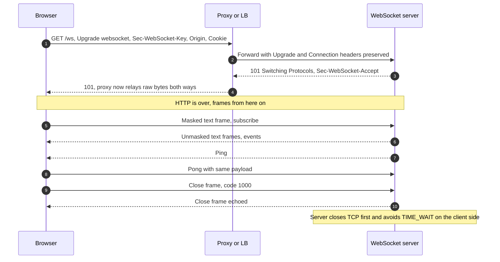
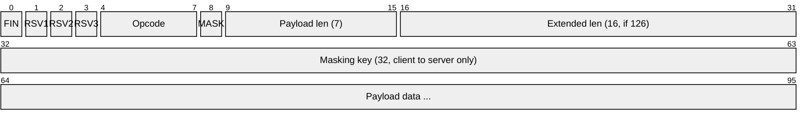
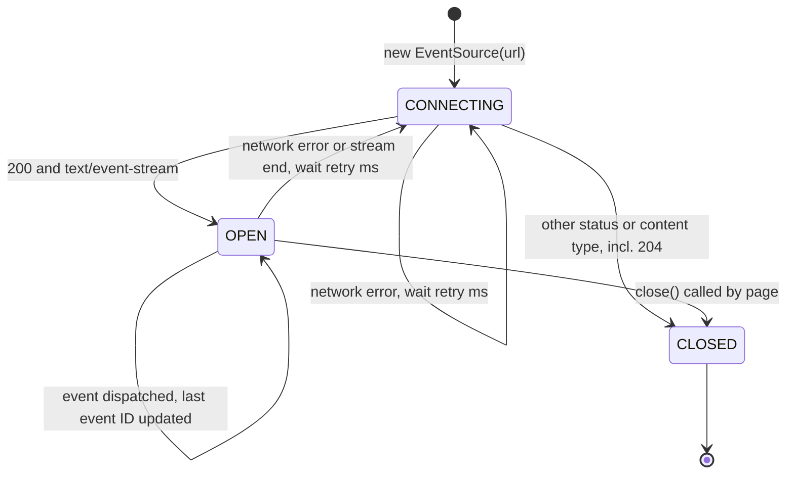
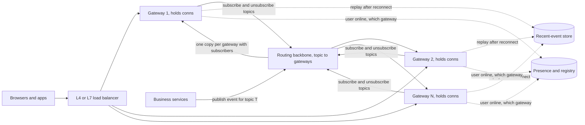
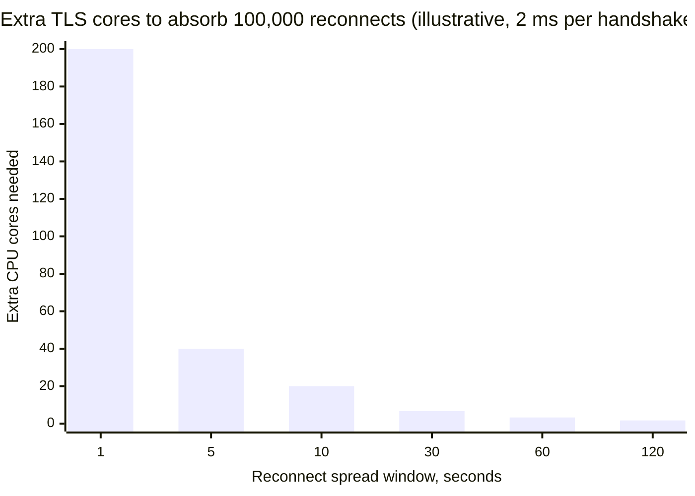

WebSocket ve Server-Sent Events (SSE), sunucunun veriyi oluştuğu anda, tarayıcı önce istemeden ona göndermesini sağlar. WebSocket bunu bir HTTP/1.1 isteğini aynı TCP bağlantısı üzerinde ham, tam çift yönlü (full-duplex) bir mesaj kanalına dönüştürerek yapar; handshake'ten sonra HTTP ortadan kalkar ve iki taraf RFC 6455'in tanımladığı frame'leri değiş tokuş eder. SSE ise HTTP'den hiç çıkmadan aynı işi görür: sunucu tek bir GET isteğine gövdesi hiç bitmeyen bir yanıtla karşılık verir ve olayları bu gövdeye metin satırları olarak yazar. İkisi de polling'in yerini alır. Polling'de istemci bir zamanlayıcıyla "yeni bir şey var mı?" diye sorar ve bir şey değişsin ya da değişmesin her aralık için bir istek bedeli öder. Long polling'de ise sunucu her isteği haber olana kadar açık tutar ve istemci hemen yeniden sorar.

Asıl denge ikisi için de aynıdır: push gecikmesi, polling aralığının yarısından tek bir ağ geçişine düşer; karşılığında sunucu katmanı stateless olmaktan çıkar. Bağlı her istemci açık bir socket, bir TLS oturumu, buffer'lar, abonelikler ve bir zamanlayıcı demektir ve bağlantı bitene kadar tek bir process'e bağlı kalır. Deploy, autoscaling, yük dengeleme ve hatadan kurtarma, istek-yanıt servisinde hiç var olmamış bir durumla başa çıkmak zorunda kalır. İkinci denge iki protokolü birbirinden ayırır. SSE tek yönlüdür, yalnızca metin taşır ve HTTP'nin verdiği her şeyi miras alır (önbellekleyen proxy'ler hariç): kimlik doğrulama header'ları, HTTP/2 multiplexing, standart loglama ve tarayıcıya gömülü bir yeniden bağlanma ve devam etme (resume) protokolü. WebSocket çift yönlüdür, 2 ila 14 baytlık bir frame header'ıyla ikili veri taşıyabilir; ancak mesaj kimliği, resume ve klasik tarayıcı API'sinde backpressure yoktur: "TCP bağlantısı yaşadığı sürece baytlar sırayla gelir" garantisinin üstündeki her şey uygulamanın işidir.

Bu sayfa iki wire protokolünün, tarayıcıdaki semantiklerinin ve bunların üzerine kurulan büyük bağlantı katmanlarının işletilmesinin sahibidir. Genellikle gRPC'nin HTTP/2 stream'leriyle yapılan servisler arası streaming, burada da geçerli olan reconnect storm'ların ve yavaş abonelerin genel mekaniğiyle birlikte [gRPC Streaming](/distributed-systems/tr/communication/synchronous-protocols/grpc-streaming/) sayfasında ele alınır. Alttaki HTTP/2 ve HTTP/3 taşıma katmanları [HTTP/2 ve HTTP/3](/distributed-systems/tr/communication/synchronous-protocols/http2-http3-quic/) sayfasında anlatılır.

## WebSocket: Mesaj Framing'i Eklenmiş, Upgrade Edilmiş Bir TCP Bağlantısı

WebSocket, yalnızca HTTP'yi anlayan altyapıdan geçebilecek şekilde tasarlandı: 80 ve 443 portlarına izin veren firewall'lar, HTTP proxy'leri ve load balancer'lar. Bu yüzden açılış handshake'i iki ek header taşıyan sıradan bir HTTP/1.1 GET'tir. Framing ise TCP'nin byte stream'i üzerinde mesajlara sınır kazandırmak ve aynı zamanda telin üzerindeki baytları, onları yanlışlıkla HTTP diye okuyan bir aracı için işe yaramaz hâle getirmek için vardır.

### Açılış Handshake'i

İstemci `GET /path HTTP/1.1` isteğini `Upgrade: websocket`, `Connection: Upgrade`, `Sec-WebSocket-Version: 13` ve base64 ile kodlanmış rastgele 16 baytlık bir değer olan `Sec-WebSocket-Key` ile gönderir. İsteğe bağlı header'lar bir subprotocol (`Sec-WebSocket-Protocol`, örneğin `graphql-transport-ws` ya da `mqtt`) ve extension'lar (`Sec-WebSocket-Extensions`, pratikte yalnızca `permessage-deflate`) üzerinde anlaşmayı sağlar. Tarayıcı ayrıca `Origin` header'ını ve hedef host'un cookie'lerini gönderir. Sunucu `101 Switching Protocols` ve `Sec-WebSocket-Accept` ile kabul eder; bu değer, istemcinin key'i ile sabit GUID `258EAFA5-E914-47DA-95CA-C5AB0DC85B11` birleştirilip SHA-1 hash'inin base64'ü alınarak hesaplanır.


*Tek bir aracı üzerinden WebSocket yaşam döngüsü: HTTP upgrade'i, veri frame'leri, bir canlılık (liveness) değişimi ve iki taraflı kapanış handshake'i.*

3. adımdaki accept hash'i bir güvenlik önlemi değildir. Sunucunun, header'ları yankılayan bir HTTP sunucusu olmadığını ve WebSocket handshake'ini gerçekten anladığını kanıtlar; böylece istemci, önbellekten gelen ya da ilgisiz bir HTTP yanıtını açık bir WebSocket sanacak şekilde kandırılamaz. Yetkilendirme ayrı bir sorundur ve tarayıcı onu kısıtlar: JavaScript'teki `WebSocket` constructor'ı istediğiniz header'ı ekleyemez, dolayısıyla `Authorization: Bearer` kullanılamaz. Gerçek kurulumlar kimlik doğrulamayı cookie'lerle (bu da bir `Origin` kontrolünü zorunlu kılar, hata bölümüne bakın), URL query'sinde taşınan kısa ömürlü bir ticket ile (maskelenmezse proxy ve access log'larında görünür) ya da upgrade'den sonraki ilk uygulama mesajındaki bir token ile yapar; bu son yöntemde token birkaç saniye içinde gelmezse sunucu bağlantıyı kapatır.

Kurulum sorunlarının çoğu 2. adımda başlar. `Upgrade` ve `Connection` hop-by-hop header'lardır ve bir HTTP/1.1 proxy'si, aksi yapılandırılmadıkça bunları siler; bunu yapan bir proxy isteği düz bir GET'e çevirir ve istemci 101 yerine 200 ya da 400 görür. 4. adımdan sonra proxy artık HTTP ayrıştırmaz. Baytları iki yönde kopyalar ve bağlantıya yalnızca kendi boşta kalma (idle) zamanlayıcılarını uygular. Boştaki bir WebSocket'in ne kadar yaşayacağını istek timeout'larının değil, proxy read timeout'larının belirlemesinin nedeni budur.

### Frame'ler, Masking ve Parçalama

TCP bir byte stream teslim eder; WebSocket mesaj sınırlarını geri kazanmak için frame'ler ekler. Her frame 2 baytlık bir header ile başlar: bir mesajın son parçasını işaretleyen FIN biti, extension'ların kullandığı üç ayrılmış bit (`permessage-deflate` altında RSV1, sıkıştırılmış bir mesajı işaretler), 4 bitlik bir opcode, MASK biti ve 7 bitlik payload uzunluğu. 0 ile 125 arasındaki değerler uzunluğun kendisidir; 126, ardından 16 bitlik bir uzunluk geldiği, 127 ise 64 bitlik bir uzunluk geldiği anlamına gelir. İstemciden sunucuya giden frame ayrıca 32 bitlik bir masking key taşır.


*126 ila 65.535 baytlık payload taşıyan bir istemci frame'inin WebSocket header'ı. 127 uzunluk kodu, 16 bitlik alanın yerine 64 bitlik bir alan koyar.*

Bu nedenle header maliyeti, sunucudan istemciye giden küçük bir frame için 2 bayt, 64 KiB'a kadar 4 bayt, daha büyükleri için 10 bayttır; istemci frame'leri mask için 4 bayt ekler. Opcode'lar text (`0x1`; payload geçerli UTF-8 olmalıdır, alıcı bunu kontrol etmek ve değilse bağlantıyı 1007 koduyla sonlandırmak zorundadır), binary (`0x2`), continuation (`0x0`) ve kontrol frame'leri olan close (`0x8`), ping (`0x9`) ve pong (`0xA`) arasında ayrım yapar. Bir mesaj parçalara bölünebilir: ilk frame opcode'u taşır, sonrakiler continuation taşır ve sonuncusu FIN'i set eder. Kontrol frame'leri 125 baytla sınırlıdır, asla parçalanmaz ve bir veri mesajının parçaları arasına girebilir; böylece büyük bir mesajı stream eden gönderici yine de bir ping'e yanıt verebilir. Ancak hâlihazırda yazılmakta olan tek bir frame'in önüne geçemezler; birkaç megabaytlık bir mesajı tek frame olarak göndermek ping'leri, pong'ları ve close frame'lerini bu yüzden onun arkasında bekletir.

Masking uç noktalar için değil, aracılar için bir savunmadır. Her istemci frame'inin payload'ı, tarayıcının seçtiği taze ve rastgele 32 bitlik bir key ile XOR'lanır; böylece sayfadaki script, telde görünecek baytları seçemez. Bunun nedeni Huang, Chen, Barth, Rescorla ve Jackson'ın 2011 tarihli çalışmasıdır: Upgrade'i anlamayan ve bağlantıyı HTTP olarak ayrıştırmaya devam eden şeffaf proxy'lere karşı, ikinci bir HTTP isteği gibi biçimlendirilmiş saldırgan kontrolündeki baytlar, ilgisiz bir host için proxy'nin önbelleğini zehirleyebiliyordu. Masking saldırganın baytlar üzerindeki kontrolünü ortadan kaldırır; key verinin yanında açık olarak taşındığı için hiçbir gizlilik sağlamaz. Sunucular mask uygulamaz ve mask'lenmemiş bir istemci frame'i alan sunucu bağlantıyı kapatmak zorundadır. Unmasking'in CPU maliyeti bayt bazında bir XOR'dur; TLS'in yanında ihmal edilebilir.

### Ping, Pong ve Kapanış Handshake'i

Ping, aynı payload'ı taşıyan bir pong talebidir ve iki taraf da gönderebilir. Tarayıcılar ping'lere otomatik yanıt verir, ancak ping göndermek için bir API sunmaz; ölü bir sunucuyu tespit etmek isteyen tarayıcı istemcisi uygulama seviyesinde bir heartbeat mesajı kullanmak zorundadır. Ping'ler, sıkça birbirine karıştırılan iki ayrı amaca hizmet eder. Herhangi bir yöndeki trafik, yol üzerindeki proxy'lerin ve NAT cihazlarının idle zamanlayıcılarını sıfırlar ve bağlantıyı canlı tutar. Bir deadline içinde gelmeyen pong ise göndericiye karşı tarafın ya da yolun gittiğini söyler; TCP bunu tek başına ancak bir yazma işlemi timeout'a düştüğünde, belki dakikalar sonra öğrenir. Bu deadline'ların ardındaki zamanlama kuralları ve hata dedektörü tasarımı [Heartbeats ve Zaman Aşımı Yapılandırması](/distributed-systems/tr/resilience/failure-detection/heartbeats-timeouts/) sayfasında ele alınır.

Kapanış iki taraflı bir handshake'tir. Kapatmak isteyen taraf, 2 baytlık bir durum kodu ve isteğe bağlı bir neden içeren bir close frame gönderir, veri göndermeyi bırakır ve karşı tarafın close frame'ini bekler; karşı taraf onu yankılar ve ardından sunucu TCP bağlantısını kapatır. Durum kodları operasyonel anlam taşır. 1000 normal kapanış, 1001 uç noktanın ayrıldığı (sunucu kapanışı ya da sayfadan çıkış), 1008 politika ihlali, 1009 fazla büyük mesaj, 1011 dahili sunucu hatası demektir; 1012 (service restart) ve 1013 (try again later) ise istemciye yeniden bağlanmasını nasıl zamanlayacağını söyleyen kayıtlı kodlardır.

:::note[1006 telden hiç geçmez]
1005 (durum alınmadı), 1006 (anormal kapanış) ve 1015 (TLS handshake hatası) ayrılmış kodlardır: uç noktalar bunları göndermemelidir ve tarayıcı API'si bunları yerel olarak raporlar. 1006 gören bir istemci yalnızca TCP bağlantısının bir close frame olmadan bittiğini öğrenir. Neden bir sunucu çökmesi, bir proxy idle timeout'u, bir load balancer reset'i, bir telefondaki ağ değişikliği ya da upgrade'i bozan bir proxy olabilir. 1006 bir semptomdur; neden, her hop'un log'larında ve zamanlayıcılarında bulunur.
:::

### HTTP/2 ve HTTP/3 Üzerinden WebSocket

HTTP/1.1 Upgrade, tek bir TCP bağlantısının birçok stream taşıdığı ve devredilecek bir bağlantının olmadığı HTTP/2 içinde çalışamaz. RFC 8441 (2018) bunun yerine extended CONNECT'i tanımlar: sunucu `SETTINGS_ENABLE_CONNECT_PROTOCOL` ayarını duyurur, istemci de `:method CONNECT` ve `:protocol websocket` ile bir stream açar; WebSocket frame'leri bundan sonra o stream'in DATA frame'leri içinde taşınır ve bağlantıyı sıradan isteklerle paylaşır. RFC 9220 (2022) aynı mekanizmayı HTTP/3'e uygular. Güncel Chrome ve Firefox, origin HTTP/2 üzerinden bunu duyurduğunda extended CONNECT kullanır; bu satırların yazıldığı sırada tarayıcılarda RFC 9220 desteği hâlâ eksikti. Sonuç, her WebSocket için bir yerine origin başına tek bir TLS handshake'idir; bedeli ise WebSocket trafiğinin HTTP/2 flow-control pencerelerini ve TCP head-of-line blocking'i bağlantıdaki diğer her şeyle paylaşmasıdır ve bunu HTTP/2 sayfası açıklar. Operasyonel risk, tarayıcıyla HTTP/2 üzerinde anlaşan, ayarı duyuran ama extended CONNECT stream'ini doğru aktarmayan bir proxy'dir; bunun nasıl göründüğünü hata bölümü gösterir.

## Server-Sent Events: Tek Bir Uzun HTTP Yanıtı Üzerinden Push

SSE, WebSocket'in tersi bir yaklaşım izler: HTTP'de hiçbir şeyi değiştirmez, yalnızca bir gövde formatı ve bir istemci tanımlar. Tarayıcının `EventSource` nesnesi `Accept: text/event-stream` ile bir `GET` gönderir; sunucu `Content-Type: text/event-stream` ile `200` döner ve gövdeyi hiç bitirmez. Değişim normal bir HTTP isteği olduğu için cookie'ler, CORS, HTTP/2 multiplexing, access log'lar ve standart kimlik doğrulama middleware'leri değişmeden uygulanır. Yine de `EventSource`, tıpkı WebSocket constructor'ı gibi özel header ekleyemez; `Authorization` gerektiren kütüphaneler stream edilen gövdeyle `fetch` kullanır ve formatı kendileri ayrıştırır.

### Event Stream Formatı

Gövde UTF-8 metindir ve satır satır işlenir. `field: value` biçimindeki bir satır dört alandan birini ayarlar: `data` (tekrarlanan satırlar arasına bir newline konarak olayın data buffer'ına eklenir), `event` (olay tipi, varsayılan `message`), `id` (son olay ID'si) ve `retry` (milisaniye cinsinden yeniden bağlanma gecikmesi; yalnızca rakamlardan oluşuyorsa kabul edilir). İki nokta üst üste ile başlayan satır bir yorumdur ve yok sayılır. Boş bir satır biriken olayı dispatch eder; sonlandırıcı boş satır olmadan alınan veri, stream bittiğinde atılır.

```text
retry: 5000

: keepalive comment, ignored by the client

id: 48211
event: order-status
data: {"order":"A-17","status":"shipped"}

id: 48212
data: first line of a multi-line payload
data: second line

```

İlk blok istemcinin yeniden bağlanma gecikmesini ayarlar. İkincisi bir yorumdur ve boştaki proxy'lerin bağlantıyı kapatmasını önlemenin standart yoludur; HTML standardı yaklaşık 15 saniyede bir göndermeyi önerir. Üçüncüsü, sayfanın `order-status` için kayıtlı bir listener üzerinden aldığı tipli bir olaydır; dördüncüsü ise data'sı iki satırın bir newline ile birleştirilmesinden oluşan tipsiz bir `message` olayıdır. Olay başına maliyet, alan adları ve satır sonlarıdır; birkaç düzine bayt. Format ikili veri taşıyamaz; ikili payload'ların kodlanması gerekir ve base64 boyutu üçte bir artırır. Olay yazan bir sunucu ayrıca her olaydan sonra flush etmek zorundadır: uygulama ile socket arasında buffer'layan her şey, bir bloğu doldurmayı bekleyen bir yanıt sıkıştırıcısı da dahil, gerçek zamanlı olayları gecikmiş yığınlara dönüştürür.

### İstemciye Gömülü Yeniden Bağlanma ve Resume

SSE'nin WebSocket'te olmayan kısmı bir resume protokolüdür. `EventSource` aldığı en son `id` değerini hatırlar. Bağlantı bir ağ hatası nedeniyle koptuğunda tarayıcı, yeniden bağlanma süresi kadar bekler (standartta başlangıçta implementasyona bırakılmış, "muhtemelen birkaç saniye civarında" bir değerdir; sonrasında son `retry` alanının ayarladığı değerdir) ve GET'i o ID'yi taşıyan bir `Last-Event-ID` header'ıyla yeniden gönderir. Replay buffer tutan bir sunucu bu durumda yalnızca istemcinin kaçırdıklarını gönderebilir.


*`EventSource`'un `readyState` durum makinesi. Yeniden bağlanmalar `Last-Event-ID` taşır; 200 dışındaki her yanıt ya da yanlış content type stream'i kalıcı olarak bitirir.*

Yeniden bağlanma geçişleri ile CLOSED geçişi arasındaki asimetri, bu diyagramda saklı operasyonel kuraldır. Bir ağ hatası ya da yanıtı bitiren bir sunucu istemciyi CONNECTING'e geri gönderir; dolayısıyla sunucu bir bağlantıyı yalnızca yanıtı sonlandırarak yükten kurtarabilir (shed) ya da yeniden dengeleyebilir. `204 No Content`, 200 dışındaki herhangi bir durum kodu ya da yanlış content type ile gelen bir 200 ise istemciyi CLOSED'a taşır ve tarayıcı kendiliğinden asla yeniden denemez. Aşırı yük sırasında `503` dönen bir sunucu bu yüzden bir retry storm'a yol açmaz, ama onu alan her istemciyi de sayfa yenilenene ya da uygulama yeni bir `EventSource` oluşturana kadar sessizce devre dışı bırakır. Amaç istemciyi durdurmak değilse, SSE için aşırı yük yönetimi yanıtları hata kodlarıyla reddetmek yerine yanıtları bitirmeli ya da kabul etmeyi geciktirmelidir.

Resume mekanizması, sunucunun replay buffer'ı kadar iyidir. Tarayıcı bir ID gönderir; sunucunun bunu stream ya da topic başına saklanan bir log'daki bir pozisyona eşlemesi ve sonrasındaki her şeyi göndermesi gerekir. ID buffer'dan eskiyse sunucu sessizce "şimdi"den devam etmek yerine bunu uygulamanın tanımladığı bir şekilde bildirmelidir (örneğin sayfaya durumu yeniden çekmesini söyleyen bir `reset` olayı). Aynı tasarım soruları, yani saklama pencereleri, heartbeat'lerin taze tuttuğu pozisyonlar ve snapshot'a geri düşme, gRPC watch stream'leri için [gRPC Streaming](/distributed-systems/tr/communication/synchronous-protocols/grpc-streaming/) sayfasında tartışılır ve burada da aynen geçerlidir.

### Protokollerin Garanti Ettikleri ve Etmedikleri

Tek bir bağlantı içinde iki protokol de mesajları sırayla, kayıpsız ve tekrarsız teslim eder, çünkü TCP (ya da bir QUIC stream'i) bunu yapar. Bağlantılar arasında ikisi de hiçbir şey garanti etmez. Sunucudaki başarılı bir yazma, baytların istemciye değil yerel socket buffer'a ulaştığı anlamına gelir; bir bağlantı öldüğünde sunucunun socket buffer'ındaki, ağdaki ve istemcinin alma buffer'ındaki her mesaj kaybolur ve sunucu bunu sonradan, neyin kaybolduğuna dair bir liste olmadan öğrenir. Dolayısıyla uygulama mesajları numaralandırmadıkça, bir replay buffer tutmadıkça ve istemci yeniden bağlanırken onay vermedikçe ya da bir pozisyondan istemedikçe, WebSocket teslimatı hatalar karşısında en fazla bir kez (at-most-once) olur. SSE bu protokolün istemci yarısını sağlar (işlediği son ID'yi bildirir) ve sunucu yarısını uygulamaya bırakır. Tam olarak bir kez (exactly-once) işleme, yeniden oynatılan mesajların istemcide idempotent işlenmesini gerektirir; bu konu [En Az Bir Kez, En Fazla Bir Kez ve Tam Olarak Bir Kez Semantiği](/distributed-systems/tr/communication/async-messaging/delivery-semantics/) sayfasında ele alınır.

İki protokol de TCP'nin üstünde backpressure sağlamaz. Sunucuda, yavaş bir istemciye yazmak önce TCP send buffer'ını, sonra sunucu kütüphanesinin bağlantı başına tuttuğu kuyruğu doldurur. Tarayıcıda `WebSocket.send()` asla bloklamaz; boyutu yalnızca `bufferedAmount` sorgulanarak görülebilen dahili bir buffer'a ekleme yapar ve gelen mesajlar `onmessage`'a geldikleri hızda teslim edilir; okumayı duraklatmanın bir yolu yoktur. Chrome'un `WebSocketStream` API'si WebSocket'i Streams API ile birleştirir ve yavaş bir okuyucunun TCP üzerinden göndericiyi yavaşlatmasını sağlar; bu satırların yazıldığı sırada diğer tarayıcı motorları onu implemente etmemişti. Bu yüzden sunucuda sınırlı (bounded) kuyruklar ve açık bir taşma politikası zorunludur; hata bölümü bunu gösterir.

## Milyonlarca Uzun Ömürlü Bağlantıyı İşletmek

Bir istek-yanıt servisi, [Stateful ve Stateless Servisler](/distributed-systems/tr/foundations/monoliths-to-distributed/stateful-vs-stateless/) sayfasında anlatıldığı gibi, bir balancer'ın arkasına stateless instance'lar ekleyerek ölçeklenir. Bir bağlantı katmanı bunu yapamaz: her bağlantı tek bir process'e bağlıdır, bir kullanıcıya giden mesajın o kullanıcının bağlantısını tutan process'e ulaşması gerekir ve bir process'i kaybetmek onun bütün bağlantılarını başka bir yerde yeniden kurmak demektir. Ortaya çıkan mimari, büyük kurulumların çoğunda aynıdır.

### Bir Bağlantı Katmanı ve Bir Fan-Out Omurgası

Standart tasarım, bağlantıları tutmayı ne gönderileceğine karar vermekten ayırır. Bir gateway katmanı TLS'i ve WebSocket ya da SSE'yi sonlandırır, kimlik doğrular, bağlantı başına abonelik durumunu tutar ve başka hiçbir şey yapmaz. İş servisleri olayları bir yönlendirme omurgasına publish eder; omurga her olayı en az bir abonesi olan gateway'lere teslim eder ve her gateway onu yerel bağlantılarına yazar.


*Gerçek zamanlı bir teslimat katmanı: gateway'ler bağlantıları tutar; omurga topic'leri tek tek bağlantılara değil gateway'lere yönlendirir.*

Kilit özellik, omurganın bağlantılara değil gateway'lere fan-out yapmasıdır. 20 gateway'e dağılmış 40.000 abonesi olan bir kanal için bir olay, omurgaya 20 teslimata mal olur; ardından her gateway yaklaşık 2.000 socket yazmasından oluşan yerel fan-out'unu yapar. Gateway'ler ilk yerel bağlantı abone olduğunda bir topic'e abone olur, sonuncusu ayrıldığında aboneliği bırakır; böylece omurganın yönlendirme durumu bağlantı sayısıyla değil, gateway sayısı çarpı aktif topic sayısıyla orantılı olur. Omurganın kendisi Redis pub/sub, NATS ya da amaca özel bir servis olabilir. Kafka gibi kalıcı bir log genellikle omurganın kendisi olarak değil arkasında kullanılır; çünkü kullanıcı başına topic'ler milyonlarca partition ya da her olayın consumer tarafında filtrelenmesini gerektirirdi. Bu ayrım [Mesaj Kuyruğu ve Event Streaming](/distributed-systems/tr/communication/async-messaging/message-queue-vs-event-streaming/) sayfasında ele alınır. Son olaylar deposu (recent-event store), resume'u mümkün kılan bileşendir: yeniden bağlanan bir istemci son pozisyonundan sonraki olayları ister ve gateway bunları, hiç geçmiş tutmayan omurgadan değil oradan okur.

Slack bu mimariyi 2023'te kamuya açık olarak anlattı. Gateway sunucuları WebSocket bağlantılarını ve abonelikleri tutar ve istemcilerin yakındakine bağlanabilmesi için birden fazla bölgede çalışır. Channel sunucuları stateful ve bellek içidir; kanallara kanal ID'si üzerinde consistent hashing ile sahip olurlar ve ring yöneticileri sağlıksız bir channel sunucusunun yerine yenisini koyar. Bir mesaj web API'sinden bir admin sunucusu üzerinden o kanalın sahibi olan channel sunucusuna gider; channel sunucusu onu dünya genelinde o kanala abone olan her gateway'e iletir ve her gateway mesajı kendi istemcilerine teslim eder. Presence ayrı bir bellek içi servis olarak çalışır ve istemciler yalnızca ekranda görünen kullanıcıların presence güncellemelerini alır; bu da fan-out açısından en ağır olay tipini kullanıcının görebildikleriyle sınırlar. Kanalların consistent hashing ile sahiplenilmesi [Consistent Hashing](/distributed-systems/tr/data-management/data-partitioning/consistent-hashing/) sayfasındaki mekanizmadır.

Discord'un herkese açık gateway API'si aynı tasarımın istemci yarısını gösterir. Bağlantı kurulunca sunucunun Hello mesajı istemciye heartbeat aralığını bildirir; istemci ilk heartbeat'inden önce bu aralığın rastgele bir kesri kadar bekler ve böylece birlikte bağlanmış istemcilerin heartbeat'lerini zamana yayar. Gelmeyen bir heartbeat onayı bağlantıyı "zombi" olarak işaretler ve istemciden onu 1000 ya da 1001 dışında bir kodla kapatıp yeniden bağlanması istenir. Yeniden bağlanan istemciler, oturum başında verilen bir resume URL'ine oturum ID'leri ve aldıkları son sıra numarasıyla birlikte bir Resume mesajı gönderir ve sunucu kaçırılan olayları yeniden oynatır; oturum devam ettirilemiyorsa sunucu bunu açıkça söyler (Invalid Session) ve istemci yeni bir oturum başlatır. Her parça, WebSocket'in sağlamadığı garantilerden birine karşılık gelir: canlılık, resume pozisyonu ve "pozisyonun artık yok" için açık bir sinyal.

:::tip[Heartbeat yoldaki en kısa idle zamanlayıcısından kısa olmalıdır]
Yol üzerindeki her proxy'nin, load balancer'ın, NAT gateway'in ve mobil operatör middlebox'ının kendi idle timeout'u vardır ve bağlantı en küçüğünde ölür. nginx, upstream'den veri gelmeyen proxy'lenmiş bir bağlantıyı varsayılan olarak 60 saniye sonra kapatır; AWS Application Load Balancer'ın idle timeout'u da varsayılan olarak 60 saniyedir. 25 ila 30 saniyede bir gönderilen bir sunucu heartbeat'i, bir heartbeat kaybına pay bırakarak ikisinin de altında kalır; 60 saniyelik bir heartbeat ise hiç girmemesi gereken bir yarışı kaybeder.
:::

### Dengeleme, Boşaltma ve Bağlantı Ömrü

Bir load balancer backend'i bağlantı başına bir kez seçer; bu yüzden uzun ömürlü bağlantılar zamanla round-robin dengelemeyi işlevsiz kılar. Bir scale-out sırasında eklenen yeni gateway'ler yalnızca yeni bağlantıları alır, mevcutlar yerinde kalır; yeniden başlatılan bir gateway ise o anda yeniden bağlanan istemcilerle dolar. [Yük Dengeleme Algoritmaları](/distributed-systems/tr/communication/load-balancing/algorithms/) sayfasında anlatılan bağlantı anında least-connections yönlendirme, yeni bağlantıların yerleşimini düzeltir ama mevcutları asla taşımaz; yeniden dengelemenin tek yolu bağlantıları sonlandırıp istemcilerin yeniden bağlanmasına izin vermektir. Kurulmuş bir WebSocket, tek bir backend'e giden tek bir bağlantı olduğu için sticky session gerektirmez; ancak Socket.IO gibi kütüphanelerdeki long-polling fallback'leri gibi oturum başına birden fazla HTTP isteği kullanan taşıma yöntemleri ve resume durumunu yalnızca gateway'in belleğinde tutan tasarımlar için gereklidir.

Bağlantıları bilinçli olarak sonlandırmaya boşaltma (draining) denir. Boşaltılan bir gateway yeni bağlantı kabul etmeyi bırakır (readiness kontrolünü başarısız kılar), istemcilerine bir pencereye yayılmış gruplar hâlinde 1001 ya da 1012 kodlu close frame'ler gönderir (ya da SSE yanıtlarını bitirir) ve sayı sıfıra ulaştığında ya da bir deadline dolduğunda çıkar. İstemciler [Üstel Geri Çekilme ve Jitter ile Yeniden Deneme](/distributed-systems/tr/resilience/protection-patterns/retry-exponential-backoff/) sayfasındaki gibi üstel geri çekilme (exponential backoff) ve jitter ile yeniden bağlanır ve son pozisyonlarından devam eder. Boşaltma penceresinin, platformun sonlandırma süresine (termination grace period) sığması gerekir; bu konu [Graceful Termination ve PodDisruptionBudget'lar](/distributed-systems/tr/kubernetes/runtime-and-operations/graceful-termination-pdb/) sayfasında ele alınır. Kubernetes'in varsayılan 30 saniyesi, 100.000 bağlantıyı nazikçe boşaltmak için çok kısadır.

Bazı platformlar, uygulama istesin ya da istemesin, bir azami bağlantı ömrü dayatır. Amazon API Gateway'in WebSocket API'leri her bağlantıyı 2 saat sonra ve 10 dakika boşta kaldıktan sonra kapatır, frame'leri 32 KB ve mesajları 128 KB ile sınırlar (aşıldığında 1009 ile kapatır) ve yeni bağlantıları varsayılan olarak hesap ve bölge başına saniyede 500 ile sınırlar. Dokümantasyon, eşzamanlı bağlantı için bir kota uygulamadığını belirtir; dolayısıyla etkin üst sınır bağlantı hızı çarpı ömürdür: 500 çarpı 7.200 saniye, yani 3,6 milyon. Azami ömür aynı zamanda bilinçli bir araçtır: her bağlantının her ömür süresinde en az bir kez yeniden dengelenmesini ve hiçbir istemcinin sonradan iptal edilmiş kimlik bilgilerini tutmaya devam etmemesini garanti eder; bedeli, bağlantı sayısının ömre bölünmesine eşit, sürekli bir arka plan yeniden bağlanma hızıdır.

### Hesaplamalı Örnek: İki Milyon Bağlantı

Tepe noktada 2.000.000 eşzamanlı bağlantısı olan ve her biri 100.000 bağlantı tutacak şekilde boyutlandırılmış gateway'lerde çalışan, yani 20 gateway artı yedeklerden oluşan bir gerçek zamanlı bildirim katmanı varsayalım. Bu örnekteki tüm sayılar açıklayıcı amaçlıdır.

Önce bellek. Kernel socket buffer'ları, TLS durumu, kütüphanenin okuma ve yazma buffer'ları ve abonelik map'leri için boştaki bağlantı başına 30 KB varsayalım; bu durumda her gateway yaklaşık 3 GB bağlantı durumu tutar ve 16 GB'lık bir node'da rahattır. Sıkıştırma bu tabloyu değiştirir. Context takeover ile `permessage-deflate`, bağlantının ömrü boyunca bağlantı başına bir zlib sıkıştırıcı ve açıcı tutar; zlib'in varsayılan parametreleriyle yalnızca sıkıştırıcı yaklaşık 256 KB (`2^(windowBits+2) + 2^(memLevel+9)` bayt, 128 KB + 128 KB), açıcı da yaklaşık 32 KB gerektirir. 100.000 bağlantıda bu gateway başına yaklaşık 29 GB eder; sıkıştırmasız durumun on katı. Node kütüphanesi ws, sunucuda sıkıştırma varsayılan olarak kapalı gelir ve bunun ciddi bellek ve performans maliyeti eklediği konusunda uyarır. Window bit'lerini düşürmek, context takeover'ı kapatmak (sıkıştırıcıyı her mesajda sıfırlar ve küçük mesajlarda oranın çoğunu kaybettirir) ya da yalnızca büyük mesajları sıkıştırmak olağan çözümlerdir.

Canlılık trafiği bant genişliği açısından ucuzdur, uyandırmalar açısından bedava değildir. 2.000.000 bağlantıda 25 saniyede bir sunucu ping'i, filo genelinde saniyede 80.000 ping, gateway başına 4.000 ping demektir; her biri her yönde TCP, IP ve TLS ek yükü dahil telde birkaç düzine bayttır, yani toplamda saniyede birkaç megabayt. Daha çok önem taşıyan maliyet istemci tarafındadır: her ping bir mobil radyoyu uyandırır ve mobil platformların uygulama arka plandayken uygulamaları push bildirim servislerine yönlendirmesinin nedeni budur.

Portlar, proxy ile gateway arasındaki hop'u sınırlar. Bir proxy bir gateway'e tek bir kaynak IP'den tek bir hedef IP ve porta bağlanır ve Linux'un varsayılan ephemeral port aralığı olan 32768 ile 60999, 28.232 kaynak portu verir. Daha fazla kaynak IP, daha fazla gateway dinleme portu ya da bağlantı yeniden kullanımı olmadan (her istemci bağlantısının tek bir upstream bağlantıya eşlendiği WebSocket'te bu imkânsızdır), tek bir proxy adresi her gateway uç noktasına en fazla yaklaşık 28.000 eşzamanlı bağlantı tutabilir; bu, gateway'in boyutlandırıldığı 100.000'in çok altındadır.

Deploy'lara yeniden bağlanma maliyeti hâkimdir. Tam bir TLS handshake'inin gateway tarafında 2 ms CPU'ya, oturum geri yüklemenin (token doğrulama, abonelik kaydı, bir replay okuması) ise gateway'ler, omurga ve son olaylar deposu arasında dağılan 3 ms'ye mal olduğunu varsayalım. Bir gateway'i boşaltmak 100.000 istemciyi taşır; bu 200 core-saniye TLS işi ve 300 core-saniye geri yükleme demektir. Hepsi aynı saniyede yeniden bağlanırsa kalan 19 gateway o saniye için 200 ek core'a ihtiyaç duyar; bu imkânsızdır ve handshake'ler kuyruğa girer, timeout'a düşer ve yeniden denenir. Jitter ile 60 saniyelik bir boşaltma penceresine yayıldığında aynı iş, filo genelinde yaklaşık 3,3 ek TLS core'u gerektirir.


*Gereken handshake kapasitesi, yeniden bağlanmaların yayıldığı pencereyle ters orantılı olarak düşer. Yeniden bağlanma başına maliyet varsayılmış bir değerdir.*

Bu eğri, boşaltma pencerelerinin ve istemci jitter'ının neden bir incelik değil zorunluluk olduğunu gösterir: iş sabittir ve tepe talebi değiştiren tek değişken penceredir. Çökmenin neden bir deploy'dan kötü olduğunu da gösterir. Çöken bir gateway hiç pencere vermez; 100.000 istemcisi backoff politikalarının izin verdiği hızda yeniden bağlanır ve yükü yalnızca bu politikalardaki jitter yayar. 20 gateway'in tamamının 60 saniyelik boşaltmalar ve aralarında bir bekleme ile rolling deploy edilmesi 20 dakikadan uzun sürer; bu, yeniden bağlanma yükünü grafiğin sağ ucuna yakın tutmanın bedelidir. 2 saatlik bir azami ömürle sürekli arka plan hızı 2.000.000 bölü 7.200 saniye, yani saniyede yaklaşık 280 yeniden bağlanmadır; bu da kabaca 0,6 TLS core'u eder: küçüktür, ama provizyon edilmesi gerekir ve bağlantı sayısıyla artar.

## Polling, SSE, WebSocket ve Alternatifleri Arasında Seçim

"Gerçek zamanlı" gereksinimlerin çoğu, ara sıra istemci eylemleri içeren sunucudan istemciye bildirimlerdir ve bu eylemleri düz HTTP istekleri taşıyabilir. WebSocket'in ayırt edici yeteneği, yani aynı kanal üzerinde düşük ek yükle sık istemciden sunucuya mesajlar, seçildiğinden daha az sıklıkla gerekir.

| Mekanizma | Yön | Yeniden bağlanınca resume | HTTP altyapısından geçiş | Boştaki istemci başına maliyet | Ne zaman tercih edilmeli |
|---|---|---|---|---|---|
| Short polling | İstemci çeker | Doğal, istek ile | Tamamen, önbelleklenebilir | Poll'lar arasında yok | Güncellemeler onlarca saniyelik gecikmeyi tolere ediyorsa ya da istemciler çok sayıda ve çoğunlukla boştaysa |
| Long polling | Sunucu push'u, istek başına bir olay | Her istekte uygulama cursor'ı | Tamamen, ama istekler açık tutulur | Bekletilen bir istek | Streaming'in engellendiği yerlerde fallback; düşük olay hızları |
| SSE | Sunucudan istemciye | Gömülü: `Last-Event-ID`, `retry` | Normal HTTP yanıtı; buffer'layan proxy'ler kapatılmalı | Açık bir yanıt | Akışlar, bildirimler, ilerleme, token streaming; istemciler ara sıra HTTP isteği gönderir |
| WebSocket | İki yönlü, frame'li | Yok; uygulama protokolü | Upgrade iletilmeli; sonrası opak baytlar | Bir socket artı durum | Chat, ortak düzenleme, oyunlar, trading arayüzleri: iki yönde sık mesajlar |
| [gRPC streaming](/distributed-systems/tr/communication/synchronous-protocols/grpc-streaming/) | İki yönlü, tipli mesajlar | Uygulama resume token'ı | Uçtan uca HTTP/2 | Bir stream | Servisler arası stream'ler; tarayıcılarda doğal olarak yok |
| WebTransport | İki yönlü, birden çok stream ve datagram | Yok; uygulama protokolü | Yalnızca HTTP/3, UDP üzerinde QUIC | Bir QUIC oturumu | Güvenilmez datagram'lardan fayda gören, gecikmeye duyarlı medya ya da oyun durumu; tarayıcı desteğinin izin verdiği yerde |
| Mobil ve web push servisleri | Sunucudan cihaza | Platform yönetir | Platform işletir | Sunucuda yok | Çevrimdışı ya da arka plandaki istemciler; oturum içi stream'ler için değil |

En sık gözden kaçan satır SSE satırıdır. HTTP/1.1 altında tarayıcılar host başına bağlantıyı yaklaşık altı ile sınırlar ve açık her `EventSource` bunlardan birini işgal eder; aynı sitenin birkaç sekmesini açan bir kullanıcı sınırı tüketip sıradan istekleri durdurabilir. HTML standardı bu sorunu belirtir ve tek bir bağlantının bir shared worker aracılığıyla sekmeler arasında paylaşılmasını önerir. HTTP/2 altında bir SSE stream'i, bağlantının eşzamanlı stream sınırı (genellikle 100) içindeki tek bir stream'dir ve sorun büyük ölçüde ortadan kalkar. Extended CONNECT ile HTTP/2 üzerinden taşınan bir WebSocket de aynı şekilde paylaşılan bağlantı üzerinde tek bir stream'dir.

Tablodan basit bir kural çıkar. İstemci seyrek gönderiyorsa SSE'yi seçin ve istemci eylemlerini sıradan HTTP istekleri olarak gönderin; bu, retry'ları, idempotency'yi, kimlik doğrulamayı ve gözlemlenebilirliği iyi bilinen yollarda tutar. İstemci sık gönderiyorsa ve gecikme iki yönde de önemliyse WebSocket'i seçin ve uygulama protokolünü tasarlamak için bütçe ayırın: mesaj ID'leri, onaylar, resume, versiyonlama ve hata sinyalleri. Long polling birincil bir tasarım değil, geçerli bir fallback olarak kalır ve onu destekleyen kütüphanelerin sticky yönlendirme gerektirmesinin nedeni de odur.

### Bağlantıların Hayatta Kalıp Kalmayacağını Belirleyen Proxy ve Gateway Ayarları

WebSocket ve SSE kesintilerinin birçoğu uç noktalardan değil, aradaki hop'ların yapılandırmasından kaynaklanır. nginx için temel olanlar upgrade'i iletmek, read timeout'u heartbeat aralığının üstüne çıkarmak ve SSE için yanıt buffer'lamayı kapatmaktır.

```text
map $http_upgrade $connection_upgrade {
    default upgrade;
    ''      close;               # plain requests keep normal Connection handling
}
location /ws/ {
    proxy_pass http://gateways;
    proxy_http_version 1.1;      # needed before nginx 1.29.7 (older default: 1.0)
    proxy_set_header Upgrade $http_upgrade;
    proxy_set_header Connection $connection_upgrade;
    proxy_read_timeout 120s;     # default 60s; must exceed server heartbeat interval
}
location /events/ {
    proxy_pass http://gateways;
    proxy_buffering off;         # default on: events would wait for the buffer to fill
    proxy_read_timeout 120s;     # comments or heartbeats must arrive more often than this
}
```

`proxy_read_timeout` bağlantının tamamı üzerinden değil, upstream'den yapılan art arda iki okuma arasında ölçülür; bu yüzden sunucudan gelen her trafik, bir ping ya da bir SSE yorumu, onu sıfırlar; istemciden sunucuya giden trafik ise sıfırlamaz. Buffer'lama, uygulamadan `X-Accel-Buffering: no` göndererek yanıt bazında da kapatılabilir; bu, tek bir location hem sıradan hem stream yanıtları sunduğunda kullanışlıdır. Eşdeğer ayarlar her proxy'de farklı adlarla bulunur: bir bulut load balancer'ındaki idle timeout (AWS ALB'de varsayılan 60 saniye, 4.000 saniyeye kadar ayarlanabilir), Envoy'daki stream idle ve route timeout'ları (gRPC streaming sayfası bunları tartışır) ve yukarıda listelenen yönetilen gateway'lerin katı sınırları. Her birinin heartbeat aralığına göre kontrol edilmesi, API Gateway'in 10 dakikalık idle ve 2 saatlik ömür sınırları gibi artırılamayanların ise tasarımda hesaba katılması gerekir.

## Gerçek Zamanlı Bağlantıların Hata Modları

Gerçek zamanlı bağlantıların hatalarının çoğu istemciden aynı görünür: 1006 koduyla kapanmış bir bağlantı ya da teslimatı duran bir stream. Bu yüzden teşhis, önceden toplanmış sunucu tarafı ve aracı sinyallerine dayanır. Bir gateway katmanı için yararlı metrikler şunlardır: gateway başına açık bağlantılar, close koduna göre kırılmış saniye başına bağlantı kurulumları ve kapanışları, bağlantı yaşı dağılımı, heartbeat round-trip süresi ve kaçırılan heartbeat sayısı, bağlantı başına kuyruktaki baytlar (maksimum ve yüksek yüzdelikler), yavaşlık nedeniyle düşürülen mesajlar ya da kapatılan bağlantılar, replay istekleri ve replay ıskaları ve omurga teslimat gecikmesi.

### Heartbeat'ten Kısa Aracı Idle Timeout'ları

Tetikleyici, bir hop üzerindeki ve oradan geçen trafik aralığından kısa olan bir zamanlayıcıdır: bir load balancer idle timeout'u, bir proxy read timeout'u, bir NAT eşleme timeout'u ya da bir kurumsal proxy'nin sınırı. Semptom, bağlantıların sessiz dönemlerde rastgele değil sabit bir yaşta ölmesidir; istemcide 1006 görülür, sunucu log'unda ise ne bir close frame ne de bir hata vardır, çünkü aracı bağlantıyı reset etmiş ya da düpedüz unutmuştur.

```mermaid
sequenceDiagram
    autonumber
    participant C as Client
    participant L as Load balancer, idle 60s
    participant G as Gateway, ping every 90s
    C->>L: WebSocket established at t=0
    L->>G: Upstream connection
    G-->>C: Events until t=20, then quiet
    rect rgb(70, 40, 40)
    Note over L: t=80, 60s without traffic, LB drops both sides
    L--xC: TCP reset or silent drop
    L--xG: TCP reset or silent drop
    end
    Note over C: close code 1006, reconnect after backoff
    C->>L: New handshake, TLS, auth, resubscribe at t=82
    G->>G: Ping at t=90 fails on the old socket, cleaned up late
    Note over C,G: Repeats every quiet minute for every client
```


*Bir idle timeout uyumsuzluğu. Sunucunun heartbeat aralığı load balancer'ın idle timeout'unu aştığı için her sessiz bağlantı sabit bir yaşta kesilir.*

Diyagram, hiçbir şey çökmemişken bile bu hatanın neden pahalı olduğunu gösterir. Her sessiz istemci her idle dönemde bir kez tam handshake yapar (8. adım); dolayısıyla yeniden bağlanma hızı aktiviteyle değil boştaki istemci sayısıyla ölçeklenir ve hesaplamalı örnekteki yeniden bağlanma başına maliyet sürekli ödenir. Aracı bir reset göndermek yerine sessizce düşürdüğünde istemci hiç fark etmeyebilir: socket'i açık görünür ve kendi heartbeat deadline'ı (varsa) dolana kadar hiç gelmeyecek olayları bekler. Tespit aracı bağlantı yaşı histogramıdır: tek bir yaşta (burada 60 saniye) keskin bir sivrilme bir zamanlayıcının imzasıdır. Azaltma, en küçük zamanlayıcıdan pay bırakacak kadar kısa bir sunucu heartbeat'i, kaçırılan heartbeat'leri hata sayan bir istemci deadline'ı ve her hop'un zamanlayıcısının bir envanteridir. Aralık düzeltildiği anda kurtarma gerçekleşir.

### Buffer'layan Bir Hop'ta Bekletilen SSE Olayları

Tetikleyici, yanıt gövdelerini buffer'layan herhangi bir hop'tur: buffer'lama açık bir reverse proxy, tam bir bloğu bekleyen bir sıkıştırma middleware'i, stream etmeyen bir CDN ya da API gateway veya her olaydan sonra flush etmeyen bir uygulama framework'ü. Semptom, olayların saniyeler ya da dakikalar gecikmeyle yığınlar hâlinde ya da yalnızca buffer dolduğunda veya bağlantı kapandığında gelmesidir; proxy'nin olmadığı staging ortamında her şey çalışır. Tespit, sunucunun olay yazma zaman damgalarını istemcinin alma zaman damgalarıyla karşılaştırarak ya da geliş aralıklarını kaydeden bir test istemcisiyle yapılır; buffer boyutunun olay hızına bölümüne eşit tutarlı bir gecikme buffer'lamaya işaret eder. Azaltma, stream route'u için buffer'lamayı kapatmak (nginx'te `proxy_buffering off` ya da `X-Accel-Buffering: no`), `text/event-stream`'i yanıt sıkıştırmasından hariç tutmak ya da olay başına flush eden bir sıkıştırıcı kullanmak ve uygulamada her olaydan sonra açıkça flush etmektir.

### Yalnızca Tarayıcılarda Bozulan Extended CONNECT

Tetikleyici, tarayıcılara doğru HTTP/2'yi etkinleştiren ve extended CONNECT'i duyuran ama WebSocket stream'lerini backend'e doğru aktarmayan bir proxy ya da ingress'tir. RFC 8441 kullanan tarayıcılar bu durumda WebSocket açamaz; HTTP/1.1 Upgrade kullanan komut satırı istemcileri ve test araçları ise başarılı olur. Traefik arkasındaki Mattermost hakkında 2025 tarihli herkese açık bir issue bu imzayı gösterir: Chrome ve Firefox 1006 ile kapanırken Safari ve HTTP/1.1 araçları çalışıyordu. Tespit, handshake hatalarının protokole göre kırılımı (HTTP/1.1 Upgrade ile HTTP/2 CONNECT) ve curl tabanlı değil tarayıcı tabanlı bir sentetik kontroldür. Azaltma, o hop'ta extended CONNECT'i kapatmak ya da proxy'yi doğru aktarana kadar yükseltmektir; genel ders, bir WebSocket sağlık kontrolünün gerçek tarayıcıların izlediği protokol yolunu kullanması gerektiğidir.

### Sınırsız Gönderme Kuyrukları ve Yavaş İstemciler

Bir WebSocket sunucusu her bağlantıya bağlantı başına bir kuyruk üzerinden yazar ve istemci yavaş okuduğunda protokoldeki hiçbir şey bu kuyruğun büyümesini durdurmaz: zayıf bağlantıdaki bir telefon, event loop'u kısıtlanmış arka plandaki bir sekme ya da yoğun bir topic'e yetişemeyen bir istemci. Semptom, istek hızıyla değil yavaş istemcilerin sayısı ve bağlantı yaşlarıyla büyüyen gateway belleğidir; sonu, gateway'deki sağlıklı istemcilerin de bağlantısını koparan garbage collection duraklamaları ya da out-of-memory yeniden başlatmalarıdır ve ardından hesaplamalı örnekteki yeniden bağlanma yükü gelir. Tespit, bağlantı başına kuyruktaki bayt dağılımı ve bir yazmanın kuyrukta beklediği süredir. Azaltma, sınıra ulaşıldığında açık bir politikası olan katı bir bağlantı başına sınırdır: yalnızca en son değerin önemli olduğu yerlerde (bir fiyat, bir imleç pozisyonu, bir presence durumu) güncellemeleri birleştirmek (conflation), aksi hâlde istemcinin bir pozisyondan devam etmesi ya da yeniden çekmesi için bağlantıyı 1008 ya da 1013 ile kapatmak. Tek bir yavaş abonenin herkesi durdurduğu broadcast döngüsü varyantı ve genel sınırlı kuyruk tasarımı [gRPC Streaming](/distributed-systems/tr/communication/synchronous-protocols/grpc-streaming/) ve [Geri Baskı](/distributed-systems/tr/resilience/flow-control/backpressure/) sayfalarında ele alınır.

### Bir Gateway Kaybından Sonra Reconnect Storm'ları

Tetikleyici, bir gateway çökmesi, boşaltma yapılmadan yapılan bir deploy, bir load balancer yeniden başlatması ya da birçok bağlantıyı aynı anda kesen bir ağ olayıdır. Semptom, handshake'lerde, kimlik doğrulama çağrılarında ve replay okumalarında bir sivrilme, kalan gateway'lerde CPU doygunluğu ve daha fazla retry'a yol açan handshake timeout'larıdır. Pencerenin neden önemli olduğunu hesaplamalı örnek sayısallaştırır; retry'ların kısa bir tetikleyiciyi nasıl kalıcı bir aşırı yüke dönüştürdüğünün mekaniği [Retry Fırtınaları ve Metastabil Hatalar](/distributed-systems/tr/resilience/flow-control/retry-storms-metastable-failures/) sayfasında ele alınır. Bu katmana özgü azaltmalar şunlardır: bir pencereye yayılmış sunucu tarafı boşaltmalar, uygulama protokolünde sunucunun önerdiği bir gecikmeyle birlikte 1012 ya da 1013 close kodu, sıfırdan değil rastgele bir gecikmeden başlayan full jitter'lı istemci backoff'u, gateway başına yeni handshake'ler için kabul (admission) sınırları ve tam durum çekmek yerine son olaylar deposundan replay.

### Siteler Arası WebSocket Ele Geçirme (Cross-Site WebSocket Hijacking)

WebSocket handshake'i tarayıcının same-origin politikasına tabi değildir: herhangi bir sitedeki bir sayfa herhangi bir host'a WebSocket açabilir ve tarayıcı o host'un cookie'lerini ekler. Sunucu cookie ile kimlik doğruluyor ve `Origin`'i kontrol etmiyorsa, oturum açmış bir kullanıcının ziyaret ettiği kötü niyetli bir sayfa kimliği doğrulanmış, çift yönlü bir kanal açar ve her mesajı okuyabilir. Bir REST uç noktasına karşı yapılan cross-site request forgery bunu yapamazdı, çünkü CORS yanıtı gizlerdi.

:::caution[Cookie ile kimlik doğrulanan her upgrade'de Origin'i kontrol edin]
Cookie ile kimlik doğrulamayı kabul eden bir WebSocket sunucusu, 101 dönmeden önce `Origin` header'ını bir izin listesiyle karşılaştırmalı ve aksi hâlde handshake'i reddetmelidir. CORS WebSocket'i korumaz ve framework'ler `Origin`'i varsayılan olarak kontrol edip etmeme konusunda farklılık gösterir. İlk mesajda token ile kimlik doğrulama cookie sorununu ortadan kaldırır, ancak kısa bir deadline içinde kimlik doğrulamayan bağlantıları yine de reddetmelidir; aksi hâlde boştaki, kimliği doğrulanmamış socket'ler ucuz bir kaynak tüketme saldırısına dönüşür.
:::

### Hata İmzalarının Özeti

| Hata | Dışarıdan görünen semptom | Tespit sinyali | Azaltma |
|---|---|---|---|
| Heartbeat'in altında idle zamanlayıcı | Sessiz dönemlerde sabit bağlantı yaşında 1006 | Bağlantı yaşı histogramında sivrilme, boştaki istemcileri izleyen yeniden bağlanma hızı | En küçük zamanlayıcının altında heartbeat, istemci deadline'ı |
| SSE'de buffer'layan hop | Olaylar geç ve yığınlar hâlinde gelir | Sunucu yazma zamanı ile istemci alma zamanı | Route için proxy buffer'lamayı ve sıkıştırmayı kapatmak, olay başına flush |
| Extended CONNECT bozulması | Tarayıcılar başarısız, curl çalışıyor | Protokole göre handshake hataları, tarayıcı sentetik kontrolleri | Hop'ta RFC 8441'i kapatmak ya da proxy'yi düzeltmek |
| Sınırsız gönderme kuyrukları | Gateway bellek büyümesi, OOM, toplu bağlantı kopması | Bağlantı başına kuyruktaki baytlar, yazma bekleme süresi | Sınırlı kuyruk, conflation, yavaş istemcileri 1008 ya da 1013 ile kapatmak |
| Sıkıştırma belleği | Bağlantı başına bellek planın birkaç katı | Sıkıştırma açıkken bağlantı başına heap ya da RSS | Daha küçük pencereler, context takeover'sız, yalnızca büyük mesajları sıkıştırmak |
| Proxy port tükenmesi | Yeni bağlantılar proxy başına sabit bir sayıda başarısız | Kullanımdaki ephemeral portlar, proxy'de connect hataları | Daha fazla kaynak IP ya da gateway portu, daha az proxy hop'u |
| Reconnect storm | Handshake sivrilmesi, timeout'lar, doymuş auth ve replay | Saniye başına kurulumlar, handshake gecikmesi | Yayılmış boşaltmalar, jitter'lı istemci backoff'u, handshake kabul sınırları |
| Siteler arası ele geçirme | İstismar edilene kadar semptom yok | Beklenmeyen `Origin` ile handshake'ler | Origin izin listesi, token tabanlı kimlik doğrulama |

## WebSocket ya da SSE Ne Zaman Kullanılmalı, Ne Zaman Kullanılmamalı

Sunucu push ettiğinde ve istemci çoğunlukla dinlediğinde SSE'yi kullanın: bildirimler, aktivite akışları, dashboard'lar, iş ilerlemesi ve bir modelden token token gelen yanıtlar. En az yeni mekanizmayı gerektirir, HTTP/2 üzerinden sekme başına bağlantı sınırları olmadan çalışır, istemci eylemlerini idempotency ve retry semantikleriyle birlikte sıradan HTTP isteklerinde tutar ve yeniden bağlanma ile bir resume pozisyonu hazır gelir. Gereksinimleri, kaçırılan olaylar önemliyse sunucuda bir replay buffer ve streaming'e uygun proxy'lerdir.

İstemci sık gönderdiğinde ve iki yönün de tek bir sıralı kanal üzerinde düşük gecikmeye ihtiyacı olduğunda WebSocket'i kullanın: yazıyor göstergeleriyle chat, ortak düzenleme, çok oyunculu durum, etkileşimli trading ya da izleme konsolları. WebSocket'in sağlamadığı uygulama protokolünü baştan planlayın: mesaj ID'leri ya da sıra numaraları, kaybın önemli olduğu yerlerde onaylar, bir pozisyondan resume, açık hatalar, iki taraftan heartbeat'ler ve subprotocol header'ı üzerinden versiyon anlaşması.

İkisini de şu durumlarda kullanmayın: gRPC stream'lerinin tipli mesajlar, deadline'lar, flow control ve durum kodları sağladığı veri merkezi içi servisler arası streaming için; uzun süre çevrimdışı kalabilecek istemcilere teslimat için, çünkü bu kalıcı bir kuyruk ya da bir platform push servisi gerektirir ve iki protokol de bağlantı koptuğunda henüz teslim edilmemiş her şeyi kaybeder; birkaç bayt header tasarrufu için bir socket'e taşınan istek-yanıt etkileşimleri için, çünkü bu HTTP önbelleklemesinden, durum kodlarından, istek başına metriklerden ve standart retry'lardan vazgeçmek demektir; ya da milyonlarca, çoğunlukla boştaki istemcide onlarca saniyelik polling aralığını tolere eden güncellemeler için, çünkü orada bir önbelleğe karşı polling yapmak milyonlarca bağlantı tutmaktan ucuzdur. Bağlantı sayısını, azami ömrü ve bunların ima ettiği yeniden bağlanma hızını yukarıdaki yönetilen gateway sınırları ve maliyetleriyle karşılaştırmadan hiç bağlantı katmanı kurmayın.

## Further Reading

- Ian Fette and Alexey Melnikov, *RFC 6455: The WebSocket Protocol*, IETF, 2011.
- Patrick McManus, *RFC 8441: Bootstrapping WebSockets with HTTP/2*, IETF, 2018.
- Takeshi Yoshino, *RFC 7692: Compression Extensions for WebSocket*, IETF, 2015.
- WHATWG, *HTML Living Standard, section 9.2: Server-sent events*, continuously revised.
- Lin-Shung Huang, Eric Y. Chen, Adam Barth, Eric Rescorla, and Collin Jackson, *Talking to Yourself for Fun and Profit*, IEEE Web 2.0 Security and Privacy Workshop (W2SP), 2011.
- Sameera Thangudu, *Real-time Messaging*, Slack Engineering blog, 2023.
