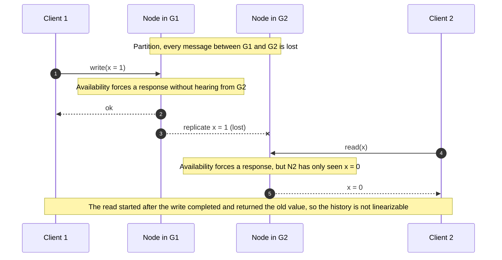
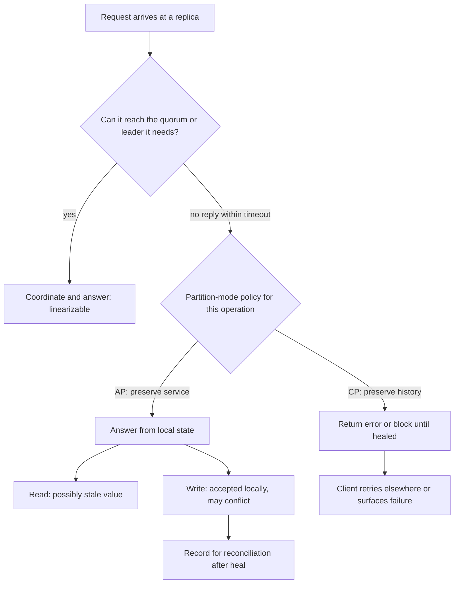
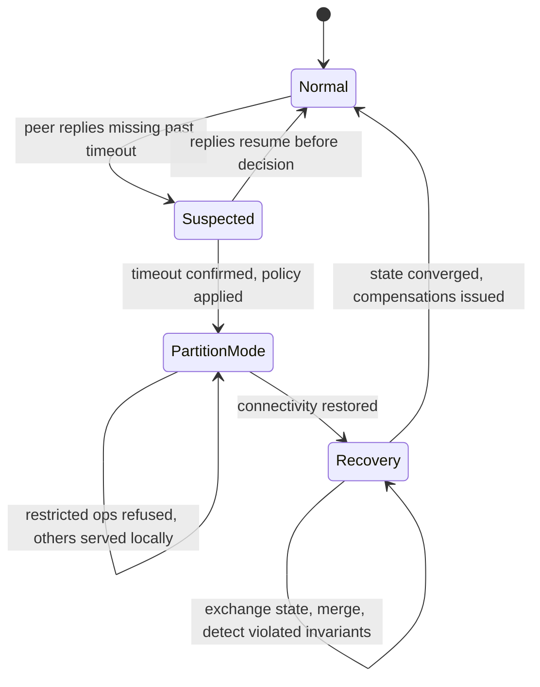
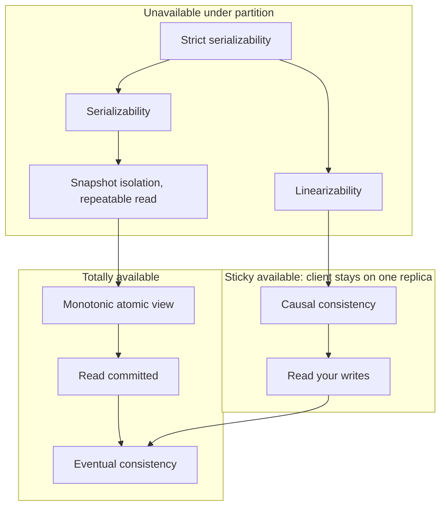
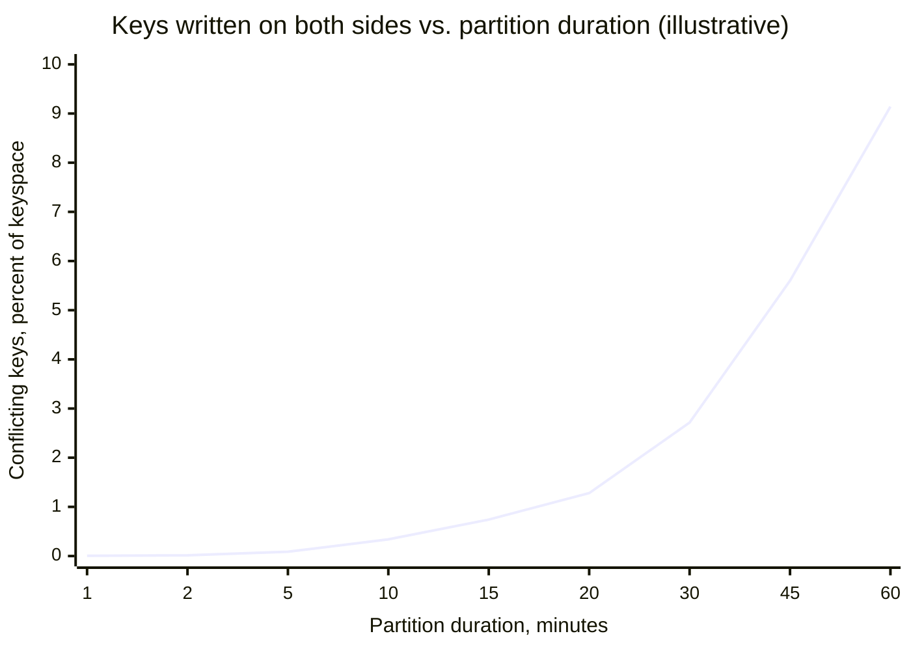
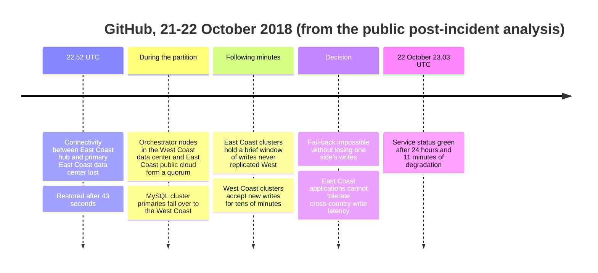

CAP teoremi, replike bir okuma-yazma deposunun, ağ replika grupları arasında mesaj kaybedebildiği sürece hem linearizable operasyonları hem de hata vermemiş her replikada her isteğe bir yanıt verilmesini aynı anda garanti edemeyeceğini söyler. Eric Brewer bunu PODC 2000 açılış konuşmasında bir varsayım (conjecture) olarak ortaya attı; Seth Gilbert ve Nancy Lynch 2002'de kesin tanımlanmış bir model için kanıtladı. Teorem dardır ve yaygın yorumlarının neredeyse hepsi, tasarım açısından önemli bir şekilde yanlıştır: "üçünden ikisini seç" demez, ağ sağlıklıyken sistemin davranışını tarif etmez ve gerçek veritabanlarının çoğu, takas ettiği iki özellikten hiçbirini sağlamaz.

Formalize ettiği problem, bir istek geldiğinde diğer replikalar yanıt vermiyorsa her replikanın karşılaştığı problemdir. Replika, onların çöktüğünü mü, yavaşladığını mı, yoksa yalnızca kendi bulunduğu yerden mi erişilemez olduğunu ayırt edemez; bu durum [Ağ Modelleri](/distributed-systems/tr/foundations/system-models/network-models/) sayfasında anlatılır. Önünde iki seçenek vardır. Kendi durumundan yanıt verebilir; böylece erişilebilir kalır, ama sistemin geri kalanının çoktan geride bıraktığı bir değeri döndürebilir ya da başka bir yerde kabul edilmiş bir yazmayla çakışan bir yazmayı kabul edebilir. Ya da koordinasyon kurabilene kadar reddedebilir veya süresiz bekleyebilir; bu, sistemin geçmişini tutarlı tutar, ama ağ bölünmesi (partition) sürdükçe bu replikayı erişilemez kılar. Linearizable tek nesneli operasyonlar için üçüncü bir seçenek yoktur ve teoremin bütün içeriği budur.

Dolayısıyla asıl denge, partition anında, isteğin düştüğü tarafta, istek başına verilen bir karardır: reddet ve doğru kal, ya da yanıt ver ve sonra uzlaştır. CP bir sistem bedelini azınlık tarafında reddedilen veya bloke olan isteklerle öder. AP bir sistem bedelini, partition iyileştikten sonra birleştirilmesi gereken ıraksamış durumla öder; bunun uygulamaya yansıyan maliyeti sıfırdan (değişmeli sayaçlar) kayıp güncellemelere ve bozulmuş invariant'lara kadar uzanır. CAP adı altında genellikle konuşulan diğer her şey, özellikle hiç partition yokken tutarlılığın gecikme maliyeti, [PACELC](/distributed-systems/tr/data-management/consistency-models/pacelc-theorem/) sayfasına aittir.

## Teorem Gerçekte Ne Söylüyor

Kanıt kısadır ve bu kısalık, yanlış okumalara karşı en iyi korumadır. Tamamen üç tanıma dayanır ve her biri gündelik anlamından ya daha katı ya da daha gevşektir.

### Kelimesi Kelimesine Üç Tanım

CAP'teki tutarlılık (consistency), tek bir okuma-yazma register'ının [linearizability](/distributed-systems/tr/data-management/consistency-models/linearizability/) özelliğidir: her operasyon çağrısıyla yanıtı arasındaki tek bir anda gerçekleşmiş gibi görünür ve bir okuma, bu sıradaki en son yazmanın değerini döndürür. ACID'deki C ile, yani transaction'ların koruduğu uygulama invariant'larıyla hiçbir ilgisi yoktur; çok nesneli transaction'lar hakkında da bir şey söylemez, o alan [serializability](/distributed-systems/tr/data-management/consistency-models/serializability/) konusudur.

Erişilebilirlik (availability), hata vermemiş bir node'un aldığı her isteğin eninde sonunda bir yanıtla sonuçlanması demektir. İki ayrıntı bunu operasyonel bir SLO'dan daha güçlü kılar. Tanım, diğer bütün node'lardan kopmuş bir replika dahil, hata vermemiş her node için geçerlidir; çoğunluk tarafını hizmette tutup azınlık tarafındaki istekleri reddeden bir sistem, kaç dokuzluk raporlarsa raporlasın, CAP anlamında erişilebilir değildir. Ayrıca yanıt bir hata değil, gerçek bir cevap olmalıdır; zaman aşımı ya da "unavailable" durumu sayılmaz. Öte yandan tanım bir açıdan SLO'dan zayıftır: yanıtın ne kadar sürede geleceğine sınır koymaz. Bir saat sonra cevap veren bir sistem, kanıtta erişilebilirdir.

Partition toleransı, ağ bir node grubundan diğerine gönderilen keyfi sayıda mesajı kaybettiğinde bile sistemin garantilerini koruması demektir. Kanıtın asenkron modelinde saat yoktur ve mesaj gecikmesine sınır yoktur; dolayısıyla alıcı için kaybolmuş bir mesaj ile gecikmiş bir mesaj ayırt edilemez. Partition, tasarımcının yaptığı bir seçim değildir; garantilerin dayanması gereken bir ortam özelliğidir.

:::note[İki farklı tutarlılık]
CAP'teki "consistency", tek bir nesnenin linearizability'sidir. ACID'deki "consistency" ise uygulama invariant'larının transaction'lar tarafından korunmasıdır ve hangi eşzamanlı iç içe geçmelerin bunları bozabileceğini izolasyon seviyesi belirler. Bir veritabanı replikalardan eski okumalar sunarken ACID açısından "tutarlı" olabilir; linearizable bir key-value deposu da çok anahtarlı bir invariant'ın bozulmasına izin verebilir. İzolasyon seviyeleri [Zayıf İzolasyon ve MVCC](/distributed-systems/tr/data-management/consistency-models/weak-isolation-mvcc/) sayfasında ele alınır.
:::

### Kanıt: İki Node ve Kaybolan Bir Mesaj

Gilbert ve Lynch'in argümanı node'ları boş olmayan iki gruba, `G1` ve `G2`'ye ayırır ve aralarındaki her mesajın kaybolduğunu varsayar. Çelişki elde etmek için, bir algoritmanın hem linearizable hem erişilebilir olduğunu varsayalım.


*Gilbert-Lynch kurgusu. Register 0 ile başlar; G1'in yaptığı hiçbir şey G2'ye ulaşamaz.*

2. adım tamamlanmak zorundadır, çünkü `G1`'deki node hata vermemiştir ve erişilebilirlik bir yanıt gerektirir; `G2`'yi bekleyemez, çünkü bekleyeceği mesajlar kaybolmaktadır (4. adım). İstemci 2'nin 5. adımdaki okuması, İstemci 1 onayını aldıktan sonra başlar; dolayısıyla linearizability 1 döndürmesini gerektirir. Ama `G2`'deki node `G1`'den hiçbir şey almamıştır, durumu yazmanın hiç gerçekleşmediği bir yürütmeden ayırt edilemez ve erişilebilirlik onu 7. adımda yanıt vermeye zorlar. 0 yanıtını verir ve geçmiş linearizable değildir. Çelişki her algoritma için geçerlidir, çünkü argüman yalnızca `G2`'deki node'un bilebileceklerini kullanır.

Kanıt, hiçbir mesaj gerçekten kaybolmadığında bile asenkron modelin neden önemli olduğunu da açıklar. Ağ mesajları sınırsız geciktirebiliyorsa, `G2`'deki node "yazma mesajı kayboldu" ile "yazma mesajı gecikti" arasında ayrım yapamaz. Erişilebilir bir algoritma, bir noktada haber almadan yanıt vermek zorundadır ve o andan itibaren yürütme, partition olan bir yürütmeden ayırt edilemez hale gelir. Gilbert ve Lynch ardından kısmen senkron bir modeli incelediler; bu modelde node'ların yerel saatleri vardır ve mesajlar ya bilinen bir sınır içinde ulaşır ya da kaybolur. İmkansızlık orada da geçerlidir, ancak daha zayıf bir garanti elde edilebilir hale gelir: yeterince uzun bir süre hiç mesaj kaybolmazsa, okumalar eninde sonunda daha önceki bütün yazmaları yansıtır; bu garantiye delayed-t consistency adını verirler. Sonucun yapısı [FLP imkansızlık sonucu](/distributed-systems/tr/coordination/consensus-algorithms/flp-impossibility/) ile aynıdır: zaman aşımları sistemin ilerlemesini sağlar ve bedeli, sistemin hangi node'ların canlı olduğuna dair yanlış inançlarla hareket edebilmesidir.

### CAP'in Söylemedikleri

Teorem çoğu zaman "tutarlılık, erişilebilirlik ve partition toleransından ikisini seç" diye ifade edilir; bu da üç kombinasyonlu bir menü varmış izlenimi verir. Brewer, 2012 tarihli değerlendirmesinde bu formülasyonu yanıltıcı olarak nitelendirdi. Partition toleransı, dağıtık bir sistemin geri çevirebileceği bir seçenek değildir: ağ mesaj kaybedecektir ve "CA'yı seçen" bir sistem, partition altındaki davranışı tanımsız bırakılmış bir sistemdir. Pratikte böyle bir sistem partition geldiğinde ya bloke olur (erişilebilirlikten vazgeçer) ya da ıraksar (tutarlılıktan vazgeçer) ve tasarımcıları hangisinin olduğunu production'da öğrenir. Tek node'lu bir veritabanı ancak bir node'un kendinden bölünemeyeceği önemsiz anlamında "CA"dır.

Teorem, ağ sağlıklıyken sistem hakkında hiçbir şey söylemez. CP bir sistem normal işleyişte her isteği karşılayabilir; AP bir sistem de partition yokken pratikte her okumada linearizable olabilir. CAP yalnızca bölünmüş durumu kısıtlar. Her zaman var olan maliyet, yani koordineli operasyonların round trip beklemesi, gerçektir ama CAP değildir; Daniel Abadi'nin PACELC formülasyonu tam da onu adlandırmak için yazıldı.

Teorem, linearizability'den zayıf hangi tutarlılık modellerinin erişilebilirlikle birleştirilebileceği konusunda bir şey söylemez ve transaction'lar hakkında değil, tek bir register hakkındadır. Bu iki boşluk sonradan dolduruldu ve aşağıda partition modu altında tartışılıyor. Gecikme, dayanıklılık (durability) ya da throughput hakkında da bir şey söylemez ve erişilebilirliği seçen bir sistemin veri kaybedeceğini ima etmez; yalnızca linearizable olmayan geçmişler gösterebileceğini ima eder.

Son olarak, sistemleri sınıflandırmaz. CP ve AP, tek bir partition altındaki tek bir operasyonun davranışını tarif eder; ayarlanabilir tutarlılığa sahip bir sistem CP ve AP operasyonlarını yan yana çalıştırabilir. Martin Kleppmann 2015 tarihli eleştirisinde, yaygın kullanılan veritabanlarının çoğunun iki etikete de uymadığını savundu: normal işleyişte linearizable değildirler, partition'ın azınlık tarafında da erişilebilir değildirler ve etiketler gerçekte verdikleri garantileri gizler.

## Partition'larla Yaşamak: Tespit, Partition Modu ve Kurtarma

Brewer'ın 2012 makalesi CAP'i statik bir sınıflandırmadan üç aşamalı operasyonel bir prosedüre dönüştürür: partition'ı tespit et, bazı operasyonları sınırlayan açık bir partition modunda çalış ve tutarlılığı geri getirip hataları telafi ederek kurtar. Bu çerçevenin değeri, kararı zaman aşımları tetiklendiğinde tesadüfen gerçekleşen bir şey olmaktan çıkarıp tasarımın önceden belirleyebileceği bir şeye dönüştürmesidir.

### Her İsteğin Karşılaştığı Karar

Bir replika hiçbir zaman "bir partition" görmez. Koordinasyon kurmak istediği bir istek ve zaman aşımı içinde yanıt vermemiş eşler görür. CAP seçimi zaman aşımında yapılır; bu yüzden [Heartbeats ve Zaman Aşımı Yapılandırması](/distributed-systems/tr/resilience/failure-detection/heartbeats-timeouts/) sayfasında tartışılan bu değer, sistemin ne sıklıkla bölünmüş gibi davrandığını belirler.


*Koordinasyon kuramayan replikada, operasyon başına bir politika olarak CAP seçimi.*

Diyagram kararı doğru ayrıntı düzeyine yerleştirir. Aynı replika bir bakiye çekimini reddedip alışveriş sepetine eklenen bir ürünü kabul edebilir, çünkü iki operasyonun ıraksama durumundaki sonuçları farklıdır. AP dalı bedava değildir: yazma yolu, uzlaştırmanın sonradan yapılabilmesi için yeterli bilgiyi (version vector'lar, operasyon log'ları, zaman damgaları) kaydetmelidir ve okuma yolu değerin eski olabileceğini kabul etmelidir. CP dalı da bedava değildir: istemci hata alır ya da bekler ve partition'ın aynı tarafındaki başka bir replikaya yeniden deneyen istemci aynı cevabı alır.


*Brewer'ın üç aşaması, bir replikanın durum makinesi olarak.*

Sistemler geçişlerde ayrışır. Suspected durumu vardır, çünkü zaman aşımı yalnızca bir kanıttır; her yavaş yanıtta partition moduna giren bir replika gerekenden fazla isteği reddeder (CP) ya da gerekenden fazla ıraksama yaratır (AP). Kurtarma, çoğu tasarımın belirsiz bıraktığı aşamadır. CP bir sistem için genellikle basittir: azınlık tarafı commit edilmemiş işi atar ve çoğunluğun log'undan yetişir. AP bir sistem için ise zor kısımdır, çünkü her taraf yazma kabul etmiştir ve çakışan her çiftin deterministik bir kuralla birleştirilmesi gerekir; bu, [Multi-Leader Replikasyon](/distributed-systems/tr/data-management/replication/multi-leader-replication/) sayfasında incelenir. Kurtarma, birleştirilemeyen eylemlerin telafisini de içerir; örneğin iki kez satılmış bir koltuk: sistem invariant'ı bir özür, iade ya da yeniden rezervasyonla geri getirir ve bu bir veritabanı özelliği değil, bir iş sürecidir.

### Çoğunluk Tarafları, Azınlık Tarafları ve İstemcilerin Yeri

Bir [Raft](/distributed-systems/tr/coordination/consensus-algorithms/raft/) grubu gibi çoğunluk quorum'larına dayanan CP bir sistem, partition sırasında erişilemez hale gelmez; azınlık tarafı gelir. Beş replikalı bir grup üçe iki bölünürse, üç replikalı taraf bir leader seçer (ya da mevcut leader'ını korur) ve commit etmeye devam eder; diğer taraftaki iki replika quorum oluşturamaz ve yazmaları ve linearizable okumaları reddeder. CP sistemlerin pratikte neden yüksek erişilebilirliğe sahip olduğunun kesin anlamı budur: partition'ın bedeli, yalnızca azınlığa erişebilen istemcilere düşer.

Bu da CP bir sistem için partition'ın maliyetini replika sayısının değil, istemci yerleşiminin belirlediği anlamına gelir. Beş replikadan birini ve istemcilerin %30'unu barındıran bir bölgeyi yalıtan bir partition, o %30'u partition süresince devre dışı bırakır; meğer ki bu istemciler hâlâ çoğunluğa ulaşan bir yol üzerinden yönlendirilebilsin. Hiç istemciye hizmet vermeyen bir bölgedeki tek bir replikayı yalıtan bir partition'ın ise hiçbir maliyeti yoktur. Bir tasarım tartışmasında "CP mi AP mi?" diye sorulduğunda daha faydalı soru şudur: "Hangi olası partition'ların hangi tarafındaki hangi istemciler hizmet kaybeder?" Replikaları iki sahaya yerleştirmenin, yani aralarındaki her partition'ın bir tarafı çoğunluksuz bıraktığı durumun hesabı [Failover ve Lider Seçimi](/distributed-systems/tr/data-management/replication/failover-leader-election/) sayfasındadır.

AP bir sistemin bu anlamda bir azınlık tarafı yoktur. İstemcinin erişebildiği her replika yanıt vermeye devam eder; maliyet daha sonra, partition süresi ve her iki tarafta yazılan anahtarların örtüşmesiyle büyüyen uzlaştırma işi olarak ortaya çıkar.

### Koordinasyon Olmadan Elde Edilebilenler

CAP, linearizability'nin erişilebilirlikle bağdaşmadığını kanıtlar; ama linearizability'den zayıf birçok garanti bağdaşır. Sınırı iki sonuç çizer. Mahajan, Alvisi ve Dahlin 2011'de, replikaların bölünebildiği bir modelde, real-time causal consistency adını verdikleri bir varyanttan daha güçlü hiçbir tutarlılık modelinin hem erişilebilir hem yakınsak (convergent) olamayacağını gösterdi; dolayısıyla nedensel tutarlılık, AP bir sistemin sunabileceği en güçlü garantiye yakındır. Bailis ve arkadaşlarının 2014 tarihli highly available transactions çalışması izolasyon seviyelerini aynı şekilde sınıflandırdı: Read Committed, Read Uncommitted ve Monotonic Atomic View tam erişilebilirlikle sağlanabilir; read-your-writes ve nedensel tutarlılık yapışkan erişilebilirlik (sticky availability) gerektirir, yani istemcinin aynı replikayla (ya da onun yazmalarına sahip bir replikayla) konuşmaya devam etmesi gerekir; Snapshot Isolation, Repeatable Read, serializability ve gerçek zaman sıralaması içeren her şey ise hiç erişilebilir olamaz.


*Garantilerin, partition altında izin verdikleri erişilebilirliğe göre gruplanması (Bailis vd., 2014'ten). Oklar güçlüden zayıfa doğrudur.*

Bu gruplama CAP'i bir ikilikten bir tasarım uzayına dönüştürür. AP bir sistem en zayıf biçimiyle "eventual consistency"ye razı olmak zorunda değildir; istemci kendi geçmişini görmüş bir replikaya yönlendirildiği sürece oturumlara [nedensel tutarlılık ve oturum garantileri](/distributed-systems/tr/data-management/consistency-models/causal-consistency-session-guarantees/) verebilir ve çok anahtarlı yazmaların atomik görünürlüğünü koordinasyonsuz sağlayabilir. Yapışkan grubun gözden kaçması kolay bir operasyonel koşulu vardır: bir load balancer partition sırasında istemciyi başka bir replikaya taşırsa, tek tek hiçbir replika hatalı davranmasa bile read-your-writes bozulur. En zayıf grup, yani hiçbir sıralama olmadan yakınsama, [Nihai Tutarlılık](/distributed-systems/tr/data-management/consistency-models/eventual-consistency/) sayfasının konusudur; yakınsamayı otomatik hale getiren veri türleri ise [CRDTs](/distributed-systems/tr/data-management/consistency-models/crdts/) sayfasının konusudur.

Fox ve Brewer'ın 1999 tarihli harvest ve yield çerçevesi, CAP'in ikiliğinin gizlediği ikinci bir zarif bozulma yolu sunar. Yield, yanıtlanan isteklerin oranıdır; harvest ise her yanıtta yansıtılan verinin oranıdır. Bir index shard'ını kaybetmiş bir arama motoru diğer shard'lardan sonuç döndürebilir; böylece yield %100'de kalırken harvest %100'ün altına düşer. Okuma ağırlıklı, yaklaşık sonuçla yetinen iş yükleri için bu, çoğu zaman reddetmekten ya da eski bir tam kopyadan yanıt vermekten daha iyi bir partition modu politikasıdır.

## Hesaplı Örnek: On Dakika Boyunca Kopan Bir Bölge

10 milyon anahtarlı, `A`, `B` ve `C` adlı üç bölgeye dağıtılmış, toplamda saniyede 2.000 yazma alan ve bunların %30'unun `C` bölgesinden geldiği bir servis varsayalım. Bir yönlendirme hatası `C`'yi on dakika boyunca `A` ve `B`'den koparıyor; her bölgedeki istemciler yerel replikalarına hâlâ erişebiliyor. Bütün sayılar örnek amaçlıdır.

CP tasarımda veri, ikisi `A`'da, ikisi `B`'de ve biri `C`'de olmak üzere beş replikalı Raft gruplarında tutulur. `A` ve `B`'deki dört replika çoğunluğu oluşturur. Bir grubun leader'ı `C`'deyse, çoğunluk tarafı election timeout'undan sonra yeni bir leader seçer (tipik yapılandırmalarda bu, saniye mertebesindedir) ve devam eder. `C`'deki tek replika commit edemez; dolayısıyla `C`'den çıkan her yazma başarısız olur ya da bloke olur: saniyede `0.3 * 2,000 = 600` yazma, on dakikada `600 * 600 = 360,000` başarısız yazma isteği; `C`'de sunulan linearizable okumalar için de aynısı. `A` ve `B`'deki istemciler, etkilenen grup başına en fazla bir seçim süresi kadar duraklama görür. Partition iyileştikten sonra `C`'nin replikası eksik log kayıtlarını leader'dan alır; uzlaştırılacak hiçbir şey yoktur.

Böyle bir bölge yalıtımı yılda, diyelim, üç kez yirmişer dakika yaşansaydı, `C`'deki istemciler yılda altmış dakikalık yazma erişilebilirliği kaybederdi; bu, yalnızca bu nedenle erişilebilirliklerini yaklaşık %99,989 ile sınırlar. Bütün bölgeler genelinde trafik ağırlıklı erişilebilirlik ise yaklaşık `1 - 0.3 * 60 / 525,600`, yani kabaca %99,997 olurdu. CP seçimi, maliyetin tamamını tek bir bölgenin kullanıcılarına yoğunlaştırır.

AP tasarımda veri üç bölgeye de replike edilir; her bölge yerel replikalarına yerel bir quorum ile yazar, sonra asenkron olarak replike eder. Partition sırasında `C` saniyede 600 yazmasını, `A` ve `B` de 1.400 yazmasını kabul etmeye devam eder. Hesabı basit tutmak için her tarafın yazmalarının 10 milyon anahtara düzgün dağıldığını varsayalım ve iki tarafı saniyede 1.000'er yazmayla karşılaştıralım. `t` dakika sonra bir taraf `60,000 * t` yazma yapmış olur; dolayısıyla belirli bir anahtarın o tarafça en az bir kez yazılmış olma olasılığı `p = 1 - e^(-60,000 * t / 10,000,000)` olur. Bir anahtar, iki taraf da onu yazdıysa çakışır; bunun olasılığı `p^2`'dir. On dakikada `p = 1 - e^(-0.06) = 0.0582` ve `p^2 = 0.0034`, yani yaklaşık 33.900 çakışan anahtar.


*Her biri 10 milyon anahtara saniyede 1.000 düzgün dağılmış güncelleme yazan iki taraf. Çarpık anahtar dağılımına sahip gerçek iş yükleri sıcak anahtarlarda çok daha fazla, soğuk anahtarlarda daha az çakışır.*

Eğri başlangıçta karesel büyür, çünkü bir çakışma iki tarafta da isabet gerektirir ve her isabetin olasılığı zamanla kabaca doğrusal artar. Partition'ı on dakikadan yirmi dakikaya çıkarmak çakışmaları neredeyse dört katına, anahtar uzayının %0,34'ünden %1,28'ine çıkarır. Bu özellik, AP sistemlerin kısa partition'larda operasyonel olarak rahat, uzun partition'larda ise sancılı olmasının ve sistem "ayakta kalsa" bile partition tespiti ve alarmın neden önemli olduğunun sayısal gerekçesidir. Last-write-wins uzlaştırmasıyla, 33.900 çakışan anahtarın her biri en az bir onaylanmış güncellemeyi sessizce kaybeder; sibling'ler ya da CRDT'lerle ise onları uygulama veya veri türü birleştirir.

Karşılaştırma 360.000 hataya karşı 33.900 çakışma değildir. Hatalar görünür, anlıktır ve `C` ile sınırlıdır; çakışmalar ise biri yanlış bir değer okuyana kadar görünmezdir ve maliyetleri tamamen anahtarların neyi temsil ettiğine bağlıdır. Bir CRDT'nin birleştirdiği sayaçlar ve kümeler için AP maliyeti sıfıra yakındır. Hesap bakiyeleri ya da envanter için ise her çakışma, telafi edici bir eylem gerektiren potansiyel bir invariant ihlalidir ve saniyede 600 reddedilen yazmanın CP maliyeti daha ucuz olan olabilir.

## Production Sistemlerinde CP, AP ve İkisi de Değil

Gerçek sistemler partition kararını çok farklı mekanizmalarla uygular ve birçok popüler sistem, Kleppmann'ın işaret ettiği üçüncü kategoriye düşer: ne linearizability ne de CAP erişilebilirliği sağlarlar.

| Sistem ve mod | Partition'ın azınlık tarafındaki davranış | Dürüst sınıflandırma | Ne zaman tercih edilmeli |
|---|---|---|---|
| etcd, ZooKeeper yazmaları; tutarlı okumalarla Consul | Quorum yok: yazmalar ve quorum okumaları başarısız olur; serializable veya stale okumalar hâlâ yerelde sunulabilir | Yazmalar ve quorum okumaları için CP; eski yerel okumalar ikisi de değil | Koordinasyon verisi, lease'ler, yapılandırma, leader seçimi |
| ZooKeeper varsayılan okumaları | Follower'lar yerel durumdan, partition olmasa bile eski olabilecek yanıt verir; quorum'dan kopan bir sunucu read-only modu açık değilse istemcilere hizmet vermeyi keser | Sıralı tutarlı (sequentially consistent), linearizable değil | İstemci başına sıranın yettiği okuma ağırlıklı koordinasyon |
| Spanner, CockroachDB | Çoğunluğu olmayan range'ler veya split'ler erişilemez olur; diğerleri devam eder | CP; ölçülen erişilebilirlik çok yüksek | Bölgeler arası, strict serializability gerektiren transaction'lar |
| `unclean.leader.election.enable=false`, `acks=all`, `min.insync.replicas=2` ile Kafka | Yeterli in-sync replikası olmayan bir partition produce isteklerini reddeder | Topic partition'ı başına CP | Onaylanmış bir kaydın kaybolmaması gereken log'lar |
| `ONE` veya `LOCAL_QUORUM` ile Cassandra veya ScyllaDB | Erişilebilen her replika kümesi okumaya ve yazmaya devam eder; çakışmalar zaman damgasıyla çözülür | AP | Çok bölgeli yazmalar, yüksek yazma hızları, LWW'ye tahammül eden veri |
| `QUORUM` ile Cassandra | Azınlık tarafı başarısız olur; çoğunluk tarafı hizmet verir, ama LWT olmadan okumalar yine de geriye gidebilir | İkisi de değil | Nadiren doğru orta yoldur; aşağıya bakın |
| DynamoDB global tables (çok bölgeli nihai tutarlılık) | Her bölge yazma kabul etmeye devam eder; bölgeler arasında son yazan kazanır | AP | Bağımsız öğeler üzerinde küresel düşük gecikmeli yazmalar |
| Çok bölgeli güçlü tutarlılıkla DynamoDB global tables (Haziran 2025'te GA) | Yazmalar diğer bölgelerle koordinasyon gerektirir | CP | Sıfır kurtarma noktası hedefi (RPO) gerektiren küresel veri |
| Otomatik failover'lı asenkron replikaya sahip PostgreSQL veya MySQL | Eski primary, promosyondan sonra kaybolan ya da ıraksayan yazmaları kabul etmeye devam edebilir | İkisi de değil | Failover'da kısa süreli kaybın kabul edildiği tek bölgeli OLTP |
| Sentinel ile Redis veya Redis Cluster | Asenkron replikasyon: bölünmüş bir primary, failover'dan sonra atılacak yazmaları kabul edebilir | İkisi de değil | Cache'ler ve yeniden üretilebilen veri |

Spanner, etiketlerin pratikte nasıl yanılttığının kanonik örneğidir. Eric Brewer'ın 2017 tarihli notu, Spanner'ın teknik olarak CP bir sistem olduğunu, partition sırasında tutarlılığı seçip erişilebilirlikten vazgeçtiğini ve Google'ın onun için beş dokuzdan fazla erişilebilirlik ölçtüğünü, zaten nadir olan kesintilerinin %10'undan azına ağın katkıda bulunduğunu belirtir. "Fiilen CA" davranışı teoremden kaçmaktan değil, partition'ları nadir kılan özel, yedekli bir ağdan ve operasyonel pratikten gelir; saatlerinin strict serializability'yi nasıl sağladığı [Google TrueTime & Spanner](/distributed-systems/tr/foundations/time-and-ordering/truetime-spanner/) sayfasındadır.

### Yaygın Üçüncü Kategori: Ne C Ne A

En yaygın production yapılandırması, asenkron replikalara sahip bir primary ve otomatik bir failover kontrolcüsüdür. Partition altında erişilebilir değildir, çünkü failover kontrolcüsü, kendi quorum'unun bulunmadığı tarafın yazmaları sunmayı en azından eninde sonunda bırakmasına yol açar. Tutarlı da değildir, çünkü eski primary fence edilmeden önceki pencerede yazmaları onaylayabilir; bu yazmalar ya yeni primary devraldığında kaybolur ya da eski primary'de ıraksamış bir geçmiş olarak kalır. Pencere, partition ile eski primary'nin yazma kabul etmeyi bıraktığı an arasındaki süredir ve ancak eski primary bir lease ile kendini geri çekerse sınırlıdır; bu konu [Fencing Tokens](/distributed-systems/tr/coordination/distributed-locking/fencing-tokens/) ve [Failover ve Lider Seçimi](/distributed-systems/tr/data-management/replication/failover-leader-election/) sayfalarında ele alınır.

Dynamo tarzı bir depodaki quorum okuma ve yazmaları da farklı bir nedenle aynı kategoriye düşer. `R + W > N` ile bir okuma tamamlanmış her yazmayla örtüşür; ama bir yazmayla eşzamanlı bir okuma yeni değeri, sonraki bir okuma eski değeri döndürebilir; dolayısıyla depo linearizable değildir. Partition'ın azınlık tarafı bir quorum toplayamaz; dolayısıyla erişilebilir de değildir. Mekanizma [Leaderless Replikasyon](/distributed-systems/tr/data-management/replication/leaderless-replication/) sayfasında incelenir. Cassandra'nın operasyon başına bir Paxos turu çalıştıran lightweight transaction'ları o sistemdeki CP yoldur; düz quorum operasyonları değildir.

:::caution[CP bir depo, okuma yolunu CP yapmaz]
Leader'da linearizable olan bir depo, okumalar bir follower'dan, yerel bir "serializable" okuma modundan, bir cache'ten ya da linearizable okuma seçeneğini istemeyen bir bağlantıdan sunulduğu anda istemci açısından linearizable olmaktan çıkar. etcd'nin serializable okumaları, Consul'ün stale modu, ZooKeeper'ın varsayılan okumaları ve MongoDB'nin varsayılan `local` read concern'ü, garantiyi erişilebilirlik ya da gecikme karşılığında takas eder. Veritabanını değil, her okuma yolunu ayrı ayrı sınıflandırın.
:::

### Operasyon Başına Seçim

Çoğu sistem seçimi istek ya da topic başına bir ayar olarak sunar; bu da sınıflandırmanın çağırana ait olduğu anlamına gelir. Cassandra'nın consistency level'ı ifade başına belirlenir; DynamoDB'nin `ConsistentRead` bayrağı, tek bir bölge içinde bir öğenin leader replikasından güçlü tutarlı bir okuma seçer; MongoDB, write concern'ü (örtük varsayılan MongoDB 5.0'da `majority` oldu; arbiter içeren bazı dağıtımlar hariç) read concern ile birleştirir (varsayılan `local`, sonradan geri alınabilecek veri döndürebilir; `linearizable` ise primary'den tek belge okumaları içindir); Consul istek başına default, consistent ve stale modları sunar. Kafka'nın seçimi topic ve producer başına yapılır:

```text
# Topic/broker side: never elect a leader that may lack acknowledged records
unclean.leader.election.enable=false   # default false since Kafka 0.11.0
min.insync.replicas=2                  # with replication.factor=3
# Producer side: an ack means every in-sync replica has the record
acks=all
# Result under partition: produce fails with NotEnoughReplicas when the
# partition leader cannot keep 2 in-sync replicas (the CP choice).
# Setting unclean election to true restores availability by allowing an
# out-of-sync replica to lead, discarding records it never received.
```

Bu üç ayar birlikte, bir Kafka topic'inin CAP dengesinin hangi tarafında duracağını belirler. `acks=all` ama `min.insync.replicas=1` ile in-sync kümesi tek başına leader'a kadar küçülebilir; leader yazma kabul etmeye devam eder ve ardından gelen bir leader arızası bu yazmaları kaybettirir: producer yapılandırmasında CP görünen bir topic, depolama katmanında AP davranır. Unclean leader election açıkken, senkronizasyondan düşmüş bir replika in-sync replikalar arızalandıktan sonra leader olabilir; bu, partition'ı yazılabilir tutar ve onaylanmış kayıtları sessizce keser; KIP-106'da tarif edilen erişilebilirlik-dayanıklılık takası budur.

## Hata Modları ve Dışarıdan Görünüşleri

CAP ile ilişkilendirilen hatalar nadiren "sistem C'yi seçti" ya da "sistem A'yı seçti" türündendir. Bunlar, operatörleri sistemin diğerini seçtiğine inanırken sistemin birini seçtiği ya da hiçbirini seçmediği durumlardır.

### CP Olduğuna İnanılan Bir Sistemde Split-Brain

Tetikleyici: partition'ın azınlık tarafındaki bir leader okuma, yanlış yapılandırılmış bir sistemde ise yazma sunmaya devam eder; çünkü çoğunluğun election timeout'undan uzun bir lease'e ya da zaman aşımına dayanır veya süreci duraklayıp yeni bir leader seçildikten sonra devam etmiştir. Belirtiler: iki taraftaki istemciler de başarılı operasyonlar görür; iyileşmeden sonra azınlık tarafının yazmaları kaybolur ya da çakışır. Tespit: aynı term veya grup için kendini leader olarak raporlayan iki node, artan `etcd_server_leader_changes_seen_total`, iyileşmeden sonra term veya epoch hatalarıyla reddedilen yazmalar ve onaylanmış yazmaların eksik olduğunu gösteren uygulama seviyesi denetimler. Azaltma: saat kayması payıyla election timeout'tan kısa leader lease'leri, çoğunluktan haber alamayan leader'ın geri çekildiği `CheckQuorum` tarzı mekanizmalar ve depolama katmanında kontrol edilen fencing token'ları.

:::danger[Azınlık tarafında onaylanmış yazmalar]
Yazmaları onaylayan azınlık tarafı leader'ı, çoğunluğun geçmişinde bulunmayan veri üretir. Partition iyileştiğinde azınlığın yazmaları ya atılır (Raft onları keser; asenkron bir primary geri sarılır) ya da ikinci bir geçmiş olarak hayatta kalır. Her iki durumda da onaylanmış veri, yazma anında hiçbir hata olmadan kaybolur ya da bozulur. Bir partition'ın iki tarafında da yazma onaylayabilen ve bunları deterministik olarak birleştirmeyen her sistemde, nasıl etiketlenmiş olursa olsun, split-brain vardır.
:::

### İyileşmede Iraksama ve Kayıp Güncellemeler

Tetikleyici: AP bir sistem uzun bir partition'ın iki tarafında da yazma kabul eder ve çakışmaları last-write-wins ile çözer. Belirtiler: iyileşmeden sonra bazı güncellemeler, hiç hata dönmeden eksiktir; sayaçlar artışların toplamından düşüktür; silinmiş öğeler geri gelir ya da yeni eklenenler kaybolur. Tespit: sistemin sunduğu yerlerde çakışma sayaçları ve sibling sayıları, replikasyon gecikmesi metriklerinden partition modunun süresi, Cassandra'da hint birikimi ve uzlaştırma denetimleri. Azaltma: partition modu süresini alarmlarla sınırlayın, iki tarafın da değiştirdiği veri için birleştirilebilir veri türleri kullanın, her kayda bir ev bölgesi verin ve invariant'a duyarlı operasyonları CP yola kısıtlayın. Zaten yanlış birleştirilmiş verinin kurtarılması, kaybeden yazmaları saklayan bir operasyon log'u ya da değişiklik akışı gerektirir.

### Partition Boyunca Asenkron Failover

GitHub'ın Ekim 2018 olayı, "ikisi de değil" kategorisindeki bir sistemin bir partition ile karşılaşmasının en net kamuya açık örneğidir. Optik ekipman üzerindeki rutin bakım sırasında GitHub'ın ABD Doğu Yakası ağ merkezi ile birincil ABD Doğu Yakası veri merkezi arasındaki bağlantı 43 saniye boyunca kesildi.


*GitHub'ın 30 Ekim 2018'de yayımladığı analizden özetlenmiş zaman çizelgesi.*

43 saniyelik partition kısaydı, ama failover kontrolcüsünün tespit penceresinden uzundu; bu yüzden partition'ın bir tarafındaki Orchestrator node'larından oluşan bir quorum, Batı Yakası veri merkezinde yeni primary'ler terfi ettirdi. Doğu Yakası primary'leri henüz replike edilmemiş yazmaları onaylamıştı ve Batı Yakası primary'leri yeni yazmalar kabul ettiği anda iki taraf da diğerinde olmayan yazmalara sahip oldu. Sistem, yazmaları tek bir tarafa taşıması bakımından CP gibi, eski tarafın onaylanmış yazmalarının yeni tarafta bulunmaması bakımından AP gibi davranmıştı. Geri dönmek Batı Yakası'nın yazmalarını atmak anlamına gelirdi; olduğu yerde kalmak ise Doğu Yakası'nın replike edilmemiş yazmalarını ortada bırakır ve Doğu Yakası uygulamalarına her yazmada kıtalar arası gecikme ödetirdi. Tutarlı bir duruma dönmek bir günden fazla sürdü. Böyle bir tasarımda tespit sinyalleri; günlük failover sayısı, terfi anındaki replikasyon gecikmesi ve eski primary'de bulunup yenisinde bulunmayan binary log pozisyonlarıdır. Azaltma yolları; kontrolcünün failover yapabildiği hata alanı içinde senkron ya da yarı senkron replikasyon, kısa partition'larda bölgeler arası terfiyi reddeden failover politikaları ve ıraksamış geçmişlerin uzlaştırılması için runbook'lardır.

### Quorum'un Partition'ın Düştüğü Yere Yerleştirilmesi

Tetikleyici: bir consensus grubu iki sahaya ya da oyların çoğunluğunun tek bir sahada olduğu üç sahaya yayılmıştır ve partition çoğunluğun sahasını istemcilerden ayırır. Belirtiler: görünüşte "yüksek erişilebilir" CP bir servis, tek bir sahalar arası bağlantı arızasında kullanıcılarının çoğu için erişilemez hale gelir. Tespit: quorum kaybı alarmları, etkilenen üyelerde 0 olan `etcd_server_has_leader` ve bölgeye göre istemci hata oranları. Azaltma: oy veren üyeleri en az üç bağımsız hata alanına yerleştirerek tek bir bağlantı ya da saha arızasının çoğunluğu götürmemesini sağlayın ve istemcileri çoğunluğun yakınına yerleştirin ya da onlara çoğunluğa giden yönlendirilmiş bir yol verin. Bu ayar değil, tasarım hesabıdır; iki saha tuzağı [Aktif-Pasif ve Aktif-Aktif Çok Bölgeli Mimari](/distributed-systems/tr/resilience/multi-region-dr/active-passive-vs-active-active/) sayfasında ele alınır.

### Kısmi Partition'lar ve Seçim Çalkantısı

Gerçek partition'lar çoğu zaman kısmidir: X node'u Y'ye, Y de Z'ye ulaşır, ama X, Z'ye ulaşamaz; ya da trafik yalnızca tek yönde akar. [Ağ Güvenilirliği](/distributed-systems/tr/foundations/monoliths-to-distributed/network-reliability/) sayfasında anlatılan bu topolojiler, bir partition'ın node'ları iki temiz gruba ayırdığı varsayımını bozar. Leader'ı duyamayan ama diğer follower'lara ulaşabilen bir node seçim başlatır, term'i artırır ve kümenin geri kalanının hâlâ ulaşabildiği bir leader'ı bozar. Cloudflare'in Kasım 2020 olayı kamuya açık bir örnektir: kısmen çalışan durumdaki bir switch trafiğin yalnızca bir kısmını iletti, bir etcd üyesi bazı eşlere ulaşıp diğerlerine ulaşamadı, küme yazmaları bloke eden tekrarlı leader seçimlerinden geçti ve etcd üzerine kurulu veritabanı küme yönetimi aksadı; bu da Cloudflare'in API'sini ve dashboard'unu altı saatten uzun süre bozdu. Tespit: dakika başına leader değişikliklerinin taban çizgisinin çok üstüne çıkması, başarısız proposal'lar (`etcd_server_proposals_failed_total`) ve karşılığında bir node arızası olmadan artan term numaraları. Azaltma: bir adayın term'i artırmadan önce eşlerine kendisine oy verip vermeyeceklerini sorduğu Raft PreVote uzantısı ve çoğunlukla teması kaybeden leader'ın geri çekildiği CheckQuorum; ikisi de etcd'nin Raft kütüphanesinde seçenektir. Kısmi partition'lar, tam olarak [Jepsen tarzı testlerin](/distributed-systems/tr/deployment/distributed-testing/jepsen-deterministic-simulation/) enjekte ettiği hata türüdür.

### Güçlü Depo, Eski Yol

Tetikleyici: CP bir veritabanı bir follower üzerinden, zamana dayalı süre sonu olan bir cache üzerinden ya da varsayılan olarak yerel bir okuma modu kullanan bir istemci kütüphanesi üzerinden okunur. Belirtiler: partition'lar sırasında ve daha düşük oranda normal işleyişte eski okumalar; aslında yapılandırıldığı gibi davranan bir depoya karşı raporlanan "linearizability hataları". Tespit: istemci yapılandırmasındaki okuma modunu uygulamanın varsaydığı garantiyle karşılaştırmak; tam istemci yolu üzerinde Jepsen tarzı geçmişler. Azaltma: ihtiyaç duyan operasyonlar için linearizable okuma seçeneğini açıkça isteyin ve yalnızca bunları leader üzerinden ya da bir ReadIndex turuyla yönlendirin.

| Hata | Altta yatan CAP davranışı | Dışarıdan belirti | Tespit sinyali | Azaltma |
|---|---|---|---|---|
| Azınlık tarafı leader'ı | CP olduğu iddia edilir, AP davranır | İyileşmeden sonra yazmalar kaybolur | İki leader, term hataları, denetim boşlukları | Election timeout'tan kısa lease'ler, CheckQuorum, fencing |
| LWW ıraksaması | Tasarım gereği AP | Sessizce eksik güncellemeler | Çakışma veya sibling sayıları, partition süresi | CRDT'ler, ev bölgeleri, invariant'lar için CP yol |
| Partition boyunca asenkron failover | İkisi de değil | Iraksamış primary'ler, uzun kurtarma | Sıfırdan büyük gecikmeyle terfi | Failover kapsamında yarı senkron, temkinli bölgeler arası politika |
| Yanlış taraftaki quorum | Tasarım gereği CP | İstemcilerin çoğu erişemez | Bölgeye göre quorum kaybı | Üç hata alanı, istemci yerleşimi |
| Seçim çalkantısı | Tasarım gereği CP | Yazmalar tekrar tekrar durur | Dakika başına leader değişikliği, başarısız proposal'lar | PreVote, CheckQuorum, gri bağlantıyı onarmak |
| Eski istemci yolu | Depo CP, yol değil | Eski okumalar | Okuma modu denetimi | Açık linearizable okumalar |

:::tip[Yalnızca çoğunluğu değil, azınlık tarafını da test edin]
Partition testleri genellikle çoğunluk tarafının çalışmaya devam ettiğini doğrular. Tersini de kontrol edin: istemcileri bağlı bir replikayı yalıtın ve beklenen süre içinde yazmaları reddettiğini, istemcilerinin askıda kalmak yerine hata aldığını ve replikanın linearizable kabul ettiğiniz okumaları sunmadığını doğrulayın. Ardından partition'ı iyileştirin ve iki tarafta da onaylanmış hiçbir şeyin eksik olmadığını doğrulayın.
:::

## CP mi AP mi Seçmeli

Iraksamış bir geçmişin geri alınamayan ya da birleştirilemeyen bir maliyeti varsa, operasyon için CP davranışı seçin: benzersiz kaynakların tahsisi (kullanıcı adları, koltuklar, envanter birimleri), para transferi, kilit ve lease edinme, leader seçimi, diğer bileşenlerin üzerine iş yaptığı yapılandırmanın saklanması ve onaylanmış kayıtları asla kaybolmaması gereken log'lara ekleme. Azınlık tarafında hizmet kaybedecek istemciler çoğunluğa yönlendirilebiliyorsa da CP'yi seçin; bu, CP maliyetini pratikte küçültür. Yolun tamamının CP olduğundan emin olun: quorum yazmaları, linearizable okumalar, depolama tarafında fencing ve en az üç bağımsız hata alanında oy veren üyeler.

Operasyonun herhangi bir çoğunluktan kopabilecek istemciler (mobil ya da edge istemcileri, şube ofisleri ya da erişilebilirlik hedefi diğerlerinden bağımsız bir bölge) için çalışmaya devam etmesi gerekiyorsa, oradaki hizmet reddi kabul edilebilir olmadıkça CP'yi seçmeyin. Sayaçlar, kümeler, presence, sepetler ve telemetri gibi doğası gereği birleştirilebilir veri için de seçmeyin; burada CP maliyeti, bir birleştirme fonksiyonunun sağlayamayacağı hiçbir şey satın almaz. Ve depo CP olarak etiketlendi diye CP'nin güvenli olduğunu varsaymayın; eski bir okuma yolu ya da asenkron bir failover, CP'nin garantisini vermeden maliyetini ödetir.

Veri deterministik olarak birleştirilebiliyorsa, operasyonlar değişmeliyse ya da idempotent yapılabiliyorsa, iş tarafı nadir çakışmaları telafi edebiliyorsa (bir özür bir kesintiden ucuzdur) ya da her bölgedeki yazma gecikmesi küresel sıradan daha önemliyse AP davranışını seçin. Kurtarma aşamasını açıkça planlayın: neyin otomatik birleştirileceğini, iyileşmeden sonra hangi invariant'ların kontrol edileceğini, çakışma eğrisi kabul edilemez hale gelmeden önce bir partition'ın ne kadar sürebileceğini ve bu olduğunda hangi alarmların çalacağını.

Uygulama benzersizliği, monoton sayaçları ya da "en sonu oku" davranışını varsayıyorsa AP'yi seçmeyin; çünkü uzlaştırması ne kadar iyi olursa olsun hiçbir AP sistem partition altında bunları sağlamaz. Ve en zayıf AP garantisine razı olmayın: nedensel tutarlılık, yapışkan yönlendirmeyle read-your-writes ve çok anahtarlı yazmaların atomik görünürlüğü partition altında erişilebilirdir ve AP sistemlere karşı program yazmayı zorlaştıran anomalilerin çoğunu ortadan kaldırır.

Gerçek sistemlerin çoğu ikisini karıştırır. Bir rezervasyon servisi aramayı, gezinmeyi ve sepetleri AP tutup koltuk tahsisini ve ödemeyi azınlık tarafı reddeden bir CP yoldan geçirebilir; bir sosyal uygulama zaman akışlarını AP, kullanıcı adlarını CP tutabilir. CAP sorusu operasyon başına, o operasyonu sunan replika diğerlerine ulaşamadığında operasyonun ne yapması gerektiği sorularak yanıtlanır.

## İleri Okuma

- Eric A. Brewer, *Towards Robust Distributed Systems*, keynote at the ACM Symposium on Principles of Distributed Computing (PODC), 2000.
- Seth Gilbert and Nancy Lynch, *Brewer's Conjecture and the Feasibility of Consistent, Available, Partition-Tolerant Web Services*, ACM SIGACT News, 2002.
- Eric Brewer, *CAP Twelve Years Later: How the "Rules" Have Changed*, IEEE Computer, 2012.
- Peter Bailis, Aaron Davidson, Alan Fekete, Ali Ghodsi, Joseph M. Hellerstein, and Ion Stoica, *Highly Available Transactions: Virtues and Limitations*, VLDB, 2014.
- Martin Kleppmann, *A Critique of the CAP Theorem*, arXiv, 2015.
- GitHub Engineering, *October 21 post-incident analysis*, GitHub Blog, 2018. https://github.blog/2018/10/30/oct21-post-incident-analysis/
