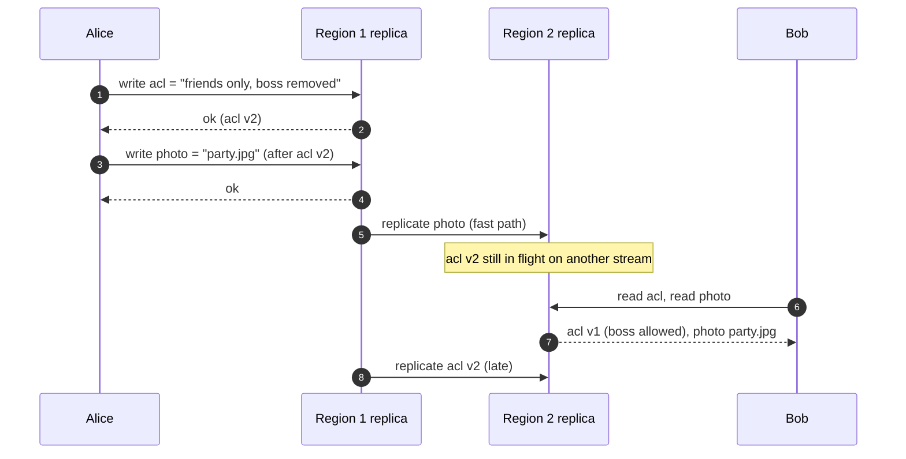
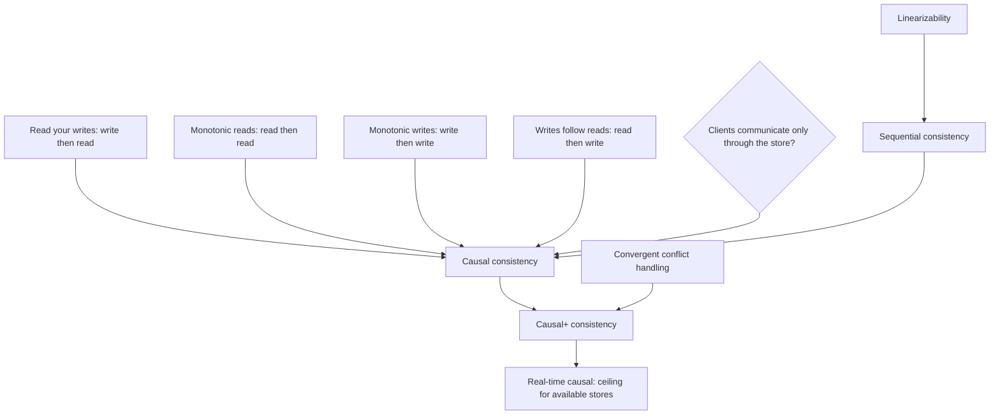
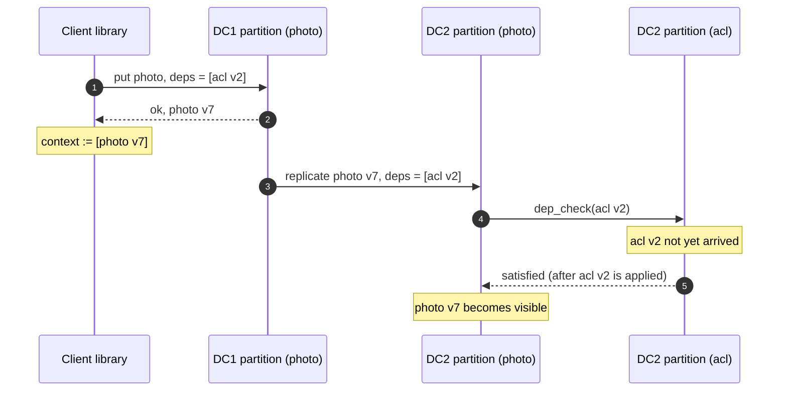
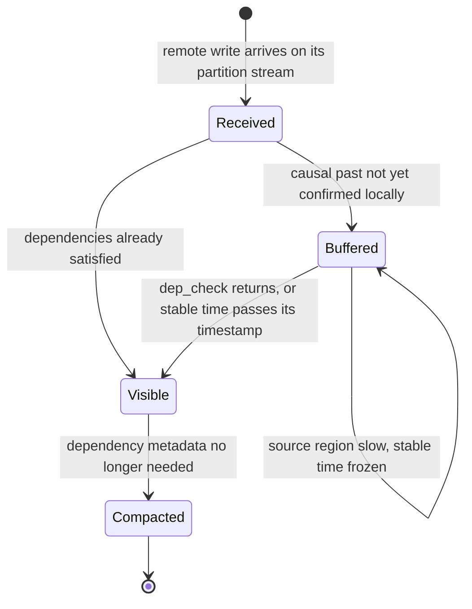
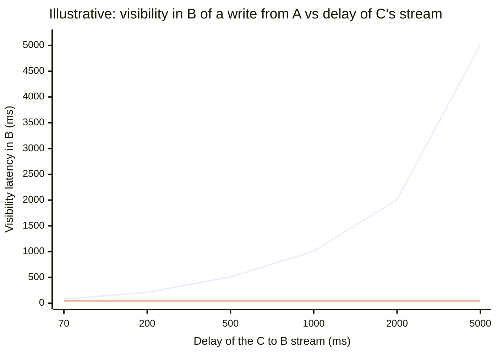

Nedensel tutarlılık (causal consistency), bir operasyon diğerini etkilemiş olabiliyorsa her process'in ikisini bu sırayla gözlemlemesini garanti eder: kimse bir yanıtı yanıtladığı gönderiden önce, bir fotoğrafı yüklenmeden önce yapılan yetki değişikliğinden önce görmez; iptal edilmiş bir sipariş de "verildi" durumuna geri dönmez. Birbirini etkilemiş olamayacak operasyonlar, yani eşzamanlı (concurrent) operasyonlar, farklı replikalarda farklı sıralarda gözlemlenebilir. Oturum garantileri (session guarantees) aynı fikrin tek bir istemciye indirgenmiş hâlidir: read-your-writes (kendi yazmalarını okuma), monotonic reads (monoton okumalar), monotonic writes (monoton yazmalar) ve writes-follow-reads (yazmalar okumaları izler). Terry ve arkadaşları bu dördünü 1994'te Bayou sistemi için birlikte tanımladı. Aşağıda açıklanan tek bir koşul altında, dört oturum garantisi birlikte nedensel tutarlılığın kendisidir.

İkisinin de çözdüğü problem, tutarlılık spektrumunun iki ucu arasındaki boşluktur. [Linearizable](/distributed-systems/tr/data-management/consistency-models/linearizability/) bir depo her istemciye tek bir güncel değer verir; ama bunun bedelini her operasyonda bir quorum'a veya leader'a yapılan round trip ile, [CAP](/distributed-systems/tr/data-management/consistency-models/cap-theorem/)'in kanıtladığı gibi de partition'ın azınlık tarafında erişilemezlikle öder. Yalnızca [nihai tutarlılık](/distributed-systems/tr/data-management/consistency-models/eventual-consistency/) vaat eden bir depo yerelden yanıt verir ve erişilebilir kalır; ama arada her türlü yeniden sıralamaya izin verir, kullanıcıların hata olarak fark ettikleri dahil: makaleden önce görünen bir yorum, sayfa yenilenince geri gelen silinmiş bir öğe, gizlemesi gereken içerikten sonra gelen bir erişim iptali. Nedensel tutarlılık tam olarak sebep-sonuç ilişkisini bozan yeniden sıralamaları ortadan kaldırır ve geri kalanına dokunmaz; spektrumun ortasında durmasının, zayıf seviyelerden yalnızca biri olmamasının nedeni budur.

Temel denge şudur: nedensel tutarlılık round trip yerine metadata ve görünürlük gecikmesiyle ödenir. Hiçbir operasyon onaylanmadan önce uzak bir replikayı beklemez; dolayısıyla yazmalar ve okumalar yerel kalır ve partition'lar boyunca erişilebilir olur. Karşılığında her yazma neye bağımlı olduğunun bir tanımını taşır ve her replika, bağımlılıkları gelene kadar uzak bir yazmayı bekletmek zorundadır. Maliyet, linearizability'nin gecikme olarak ödediği istek yolundan replikasyon yoluna taşınır; orada bağımlılık metadata'sı, tamponlanmış güncellemeler ve geldiklerinden daha geç görünür olan uzak yazmalar olarak ortaya çıkar. Bir veri merkezi yavaşladığında bu gizli maliyet, nedensel tutarlı sistemlerin baskın hata biçimine dönüşür.

## Garanti: Gerçek Zaman Sırası Olmadan Nedensel Sıra

Bir depoda nedensellik, istemcilerin gözlemleyebildiklerinden tanımlanır. Ahamad, Neiger, Burns, Kohli ve Hutto 1995'te nedensel belleği (causal memory) operasyonlar arasındaki iki tür doğrudan bağla formalize etti. Program sırası (program order) aynı process'in iki operasyonunu, öncekini önce olacak şekilde bağlar. Reads-from ilişkisi (Ahamad ve arkadaşları buna writes-into der) bir yazmayı, onun değerini döndüren her okumaya bağlar. Nedensel sıra ikisinin geçişli kapanışıdır: `a`'dan `b`'ye program sırası ve reads-from bağlarından oluşan bir zincir varsa `a` nedensel olarak `b`'den önce gelir. Bu, [happened-before ilişkisinin](/distributed-systems/tr/foundations/time-and-ordering/happened-before/) depo düzeyindeki karşılığıdır; mesaj alma ve gönderme rolünü okumalar ve yazmalar üstlenir.

Bir depo, her process gözlemlediğini tüm yazmaların ve kendi okumalarının nedensel sırayı koruyan bir sıralamasıyla açıklayabiliyorsa nedensel tutarlıdır. Her process farklı bir sıralama kullanabilir. Nedensel olarak sıralı iki yazma herkese bu sırayla görünmelidir; eşzamanlı iki yazma ise bir process'e bir sırayla, diğerine öbür sırayla görünebilir. Tanımın yasakladığı klasik anomali iki anahtar ve üçüncü bir taraf içerir.



*Yetki anomalisi. Alice'in fotoğraf yazması program sırası yoluyla ACL yazmasına bağımlıdır; ama iki anahtar bağımsız akışlarla replike olur ve bölge 2 sonucu sebepten önce gösterir.*

1. ve 3. adımlar program sırasıyla bağlıdır; bu yüzden nedensel tutarlı her replika ACL değişikliğini fotoğraftan önce uygulamak zorundadır. Bölge 2 bunu 7. adımda ihlal eder: Bob'un okuması fotoğrafı ve eski ACL'i görür; bu, Alice'in ACL değişikliğini tam olarak önlemek için yaptığı durumdur. Ne 5. ne de 9. adım tek başına yanlıştır; her anahtarın replikasyonu doğrudur ve sonunda tamamlanır. İhlal, anahtarlar arasındaki görünürlük sırasındadır; anahtar başına replikasyonun ne kadar yeniden denenirse denensin bunu düzeltememesinin nedeni de budur. Tek bir leader-follower log'unda sıra kendiliğinden korunurdu, çünkü log totaldir; anomali veri partition'landığı, çok liderli ya da lidersiz olduğu anda ortaya çıkar ve [Replikasyon Gecikme Sorunları](/distributed-systems/tr/data-management/replication/replication-lag/) sayfasında partition'lanmış follower'lar için anlatılan consistent-prefix anomalisidir.

### Garantinin Vaat Etmedikleri

Nedensel tutarlılığın gerçek zaman bileşeni yoktur. Alice yazıp ardından Bob'u telefonla ararsa Bob hâlâ eski değeri okuyabilir; telefon görüşmesi deponun görüş alanı dışındadır ve tanımdaki hiçbir şey depo üzerinden bilgi alışverişi yapmamış istemcilerin operasyonlarını ilişkilendirmez. Linearizability'nin kapattığı boşluk budur ve nedensel bir deponun kilit, leader seçimi ya da benzersizlik kontrolü gerçekleyememesinin nedeni de budur.

Tazelik vaat etmez. Hiç uzak yazma almayan bir replika, gösterdiği şey nedensel olarak kapalı olduğu sürece tanımı sağlar. Gerçek sistemler sürekli replike ederek bayatlığı sınırlar; ama bu sınır garantinin parçası değil, operasyonel bir özelliktir.

Yakınsama (convergence) vaat etmez. Aynı anahtara yapılan eşzamanlı iki yazma iki replikada farklı sıralarla uygulanabilir ve düz nedensel tutarlılık iki replikanın sonsuza kadar farklı son değerler tutmasına izin verir. Lloyd, Freedman, Kaminsky ve Andersen çözüme 2011 tarihli COPS makalesinde causal+ consistency adını verdi: nedensel tutarlılık artı yakınsayan çakışma yönetimi. Yani her replika aynı anahtara yapılan eşzamanlı yazmaları aynı deterministik fonksiyonla çözer; böylece aynı yazmaları görmüş replikalar aynı değeri tutar. Bu fonksiyon bir last-writer-wins kuralı, bir birleştirme ya da bir [CRDT](/distributed-systems/tr/data-management/consistency-models/crdts/) olur; zayıflıkları [nihai tutarlılık](/distributed-systems/tr/data-management/consistency-models/eventual-consistency/) sayfasında ele alınır. Üretimdeki her nedensel depo aslında causal+'tır.

Eşzamanlı yazanlar arasındaki invariant'ları korumaz. Her biri 100'lük bir bakiye okuyup 80 çeken iki istemci eşzamanlı yazmalar üretir; nedensel sıra bunları ilişkilendirmez, ikisi de kabul edilir ve eksi 60'lık bir bakiyenin ne anlama geldiğine birleştirme karar vermek zorunda kalır. Eşzamanlı yazanlar arasında geçerli kalması gereken her şey koordinasyon ister; bu da [serializability](/distributed-systems/tr/data-management/consistency-models/serializability/)'nin alanıdır.

### Ortanın Neden Bir Tavan Olduğu

Spektrumun ortası keyfî bir uzlaşma değildir. Mahajan, Alvisi ve Dahlin 2011'de, partition'lar altında erişilebilir kalan ve yakınsayan bir deponun real-time causal consistency'den (gerçek zamanlı nedensel tutarlılık) daha güçlü hiçbir tutarlılık modelini sağlayamayacağını kanıtladı; sonuç, CAP sonrası sınırın geri kalanıyla birlikte [CAP sayfasında](/distributed-systems/tr/data-management/consistency-models/cap-theorem/) tartışılır. Dolayısıyla causal+, her zaman erişilebilir ve düşük gecikmeli bir deponun sunabileceği en güçlü garantidir; yalnızca her şeyi bilen bir gözlemcinin fark edebileceği bazı geçmişleri dışlayan gerçek zamanlı bir inceltme bunun üstündedir. Erişilebilirlik, Bailis ve arkadaşlarının 2014 tarihli highly available transactions sınıflandırmasından gelen bir kayıtla birlikte gelir: oturum garantileri ve nedensel tutarlılık sticky availability (yapışkan erişilebilirlik) gerektirir. Yani istemci, zaten gördüğü her şeyi tutan replikalarla konuşmaya devam eder; ya tek bir replikada kalarak ya da yeni bir replikanın yetişebileceği kadar durum taşıyarak. Nedensel geçmişi eksik bir replikaya geçen istemci beklemek ya da başarısız olmak zorundadır; aşağıdaki hata biçimlerinin çoğu bu beklemeyle başlar.

## Oturum Garantileri: İstemci Başına Ayrıştırılmış Nedensellik

Terry, Demers, Petersen, Spreitzer, Theimer ve Welch oturum garantilerini Bayou için tanımladı. Bayou, mobil bir istemcinin her operasyonda farklı bir sunucuyla konuşabildiği, zayıf bağlantılı replike bir depodur. Her sunucu, `S` sunucusunda `t` anında `DB(S, t)` olarak gösterilen bir yazmalar kümesi tutar ve bunları write order (yazma sırası) denen bir sırayla uygular. Oturum, bir istemcinin verdiği okuma ve yazmaların dizisidir. Dört garanti, oturumun o ana kadar yaptıklarına göre bir sonraki operasyonunu hangi sunucuların sunabileceğini kısıtlar.

**Read your writes.** Oturumda bir okuma bir yazmadan sonra geliyorsa, okumayı sunan sunucu o yazmayı içerir. Kullanıcıların ilk fark ettiği garanti budur: yenilenince eski hâline dönen kaydedilmiş bir profil, bir read-your-writes ihlalidir.

**Monotonic reads.** Oturumda R2 okuması R1 okumasından sonra geliyorsa, R2'yi sunan sunucu R1 ile ilgili her yazmayı, yani etkisi R1'e yansımış olabilecek her yazmayı içerir. Oturumun görünümü zamanda asla geriye gitmez.

**Writes follow reads.** Oturumda bir W yazması bir R okumasından sonra geliyorsa, R ile ilgili her yazma her sunucudaki yazma sırasında W'den önce gelir. Bir gönderiyi okuduktan sonra yazılan yanıt her yerde gönderiden sonra sıralanır; fotoğraf anomalisini üçüncü bir taraf için önleyecek olan garanti tam olarak budur.

**Monotonic writes.** Oturumda W2 yazması W1 yazmasından sonra geliyorsa, W1 her sunucudaki yazma sırasında W2'den önce gelir ve W2'yi içeren her sunucu W1'i de içerir. Önce parolasını değiştirip ardından bir kurtarma anahtarını silen oturumun silme işlemi, parola değişikliği olmayan bir yerde uygulanamaz.

İlk iki garanti okuma tarafındadır: bir okumanın nerede sunulabileceğini kısıtlar. Son ikisi yazma tarafındadır: bir yazmanın önceki operasyonlara göre nasıl sıralanıp yayılacağını kısıtlar ve diğer istemcileri koruyan da bunlardır. Yalnızca read-your-writes ve monotonic reads uygulayan bir sistem, ki çoğu "session consistency" ürünü pratikte bunu kasteder, oturumu kendine karşı korur ama diğer oturumların onun yazmalarını sırasız görmesine yine de izin verir.



*Dört oturum garantisi nasıl birleşir. Her biri oturum içindeki bir tür nedensel bağı kapsar; gizli kanalların yokluğuyla birlikte nedensel tutarlılığı verirler, yakınsama da bunu causal+'a dönüştürür.*

Üstteki dört ok, bir oturumun iki operasyonunun yan yana gelebileceği dört biçime karşılık gelir: yazma sonra okuma, okuma sonra okuma, yazma sonra yazma, okuma sonra yazma. Her garanti koruduğu kenarla etiketlenmiştir; bir sonraki alt bölümdeki doğruluk argümanının yapısı da budur. Baklava, çoğu gerçeklemenin sessizce varsaydığı ve çoğu uygulamanın sessizce bozduğu koşuldur. Linearizability ve sequential consistency'den gelen oklar nedensel tutarlılığa yönelir, çünkü ikisi de onu gerektirir: her linearizable ya da sequentially consistent yürütme aynı zamanda nedensel tutarlıdır; yani oklar mekanizmayı değil gücü gösterir.

### Bayou'nun Mekanizması: Yazma Kümeleri, Okuma Kümeleri ve Version Vector'ler

Bayou garantileri, her oturumun neye bağımlı olduğunu kaydetmesi ve her sunucunun sunmadan önce kontrol etmesiyle gerçekledi. Her yazmanın, onu kabul eden sunucunun atadığı global olarak benzersiz bir kimliği vardır: sunucunun kimliği artı bir sayaç, yani Bayou'nun accept stamp'i. Oturum iki küme tutar: kendi yazmalarının kimliklerinden oluşan yazma kümesi (write set) ve okumalarıyla ilgili yazmaların kimliklerinden oluşan okuma kümesi (read set). Bir sunucu okumayı sunmadan önce yazma kümesini (read-your-writes) ve okuma kümesini (monotonic reads) içerdiğini kontrol eder. Bir yazmayı kabul etmeden önce okuma kümesini (writes-follow-reads) ve yazma kümesini (monotonic writes) içerdiğini kontrol eder; böylece yazma sırası yeni yazmayı hepsinin arkasına yerleştirir.

Kimlik kümeleri sınırsız büyür; Bayou bu yüzden onları [version vector](/distributed-systems/tr/foundations/time-and-ordering/vector-clocks/)'lerle sıkıştırır. Bayou sunucuları yazmaları birbirlerine anti-entropy yoluyla accept-stamp sırasında yayar; bu da prefix özelliğini verir: `X` sunucusundan `k` numaralı yazmayı tutan bir sunucu, `X`'in önceki tüm yazmalarını da tutar. Böylece sunucunun tuttuğu bir yazma kümesi, kabul eden her sunucu için bir sayaç içeren bir vektörle tam olarak özetlenir ve "sunucu bu yazmaları içeriyor" ifadesi "sunucunun vektörü oturumun vektörüne baskın" ifadesine, yani girdi başına bir karşılaştırmaya dönüşür.

```text
session:  read_vv, write_vv          # one counter per accepting server
server:   vv                         # writes this server has applied

on read(key) at server S:
    require S.vv >= write_vv         # read your writes
    require S.vv >= read_vv          # monotonic reads
    result = S.read(key)
    read_vv = max(read_vv, S.vv)     # conservative: everything S held is "relevant"

on write(key, value) at server S:
    require S.vv >= read_vv          # writes follow reads
    require S.vv >= write_vv         # monotonic writes
    id = S.accept(key, value)        # S.vv[S] += 1
    write_vv = max(write_vv, S.vv)
# a failed require means: wait for anti-entropy, or try another server
```

Taslaktaki iki ayrıntı mühendisliğin çoğunu taşır. Okuma, `read_vv`'yi anahtara gerçekten dokunan yazmalara değil sunucunun bütün vektörüne yükseltir; çünkü ilgili kümeyi tam olarak hesaplamak, kazandırdığından fazlasına mal olur. Bedeli sahte bağımlılıklardır (false dependencies): oturum artık hiç bakmadığı yazmalara bağımlıdır. Başarısız bir kontrolün de yalnızca iki sonucu vardır, beklemek ya da başka bir sunucu seçmek; bu, sticky availability'nin formal ifadesidir. Yazma tarafı garantileri ayrıca sunucunun kendi yayılımının sırayı korumasını gerektirir; bunu prefix özelliği sağlar. Anahtarları bağımsız akışlarla replike eden bir depo bu özelliği kaybeder ve bir sonraki bölümün gösterdiği gibi bağımlılıkları yazma başına taşımak zorunda kalır.

### Dördü Neden Nedenselliği Oluşturur

Argüman nedensel sıranın tanımını izler. Nedensel sıranın iki tür doğrudan bağı vardır: oturum içinde program sırası ve oturumlar arasında reads-from; ikisi geçişlilik altında kapatılır. Bir oturumun yan yana iki operasyonu arasındaki program sırası dört biçimden biridir ve her garanti her sunucuyu bir biçime uymaya zorlar: read-your-writes sonraki okumanın önceki yazmayı görmesini, monotonic reads sonraki okumanın önceki okumanın gördüğünü görmesini, writes-follow-reads sonraki yazmanın önceki okumanın gördüğünü izlemesini, monotonic writes de sonraki yazmanın öncekini izlemesini sağlar. Oturumlar arasındaki bir reads-from bağı korunur, çünkü okuyan oturumun okuma kümesi artık o yazmayı içerir ve o oturumun sonraki her yazması writes-follow-reads ile onun arkasına sıralanır. Bu tür bağlardan oluşan zincirler korunur, çünkü garantiler ilgili yazmaların bütün kümeleri üzerinden ifade edilir ve bu kümeler yapıları gereği geçişli olarak kapalıdır: bir yazmayı tutan sunucu, o yazmayı yapanın gördüğü her şeyi de tutmuştur.

Brzezinski, Sobaniec ve Wawrzyniak bunu 2004'te kesinleştirdi: istemcilerin depoyla yalnızca onun operasyonları üzerinden etkileştiği bir modelde dört oturum garantisi birlikte nedensel tutarlılık sağlar. Bu son koşul, diyagramdaki baklavadır. İki istemci başka herhangi bir yoldan bilgi alışverişi yaparsa, bir mesaj kuyruğu, bir webhook, bir e-posta ya da bir telefon görüşmesi, depo reads-from bağını hiç görmez; alan oturumun okuma kümesi sebebi içermez ve depo sonucu meşru biçimde önce gösterebilir. Bu, derinlemesine [happened-before sayfasında](/distributed-systems/tr/foundations/time-and-ordering/happened-before/) anlatılan gizli kanal (hidden channel) hatasıdır; oturum garantisi bakışı yalnızca çözümün kesin biçimini ekler: gizli kanal gönderenin oturum vektörünü taşımalıdır ki alan taraf onu kendi okuma kümesine katabilsin.

:::note[Aynı kelimeler, daha dar anlamlar]
Ürün dokümantasyonu bu adları Terry ve arkadaşlarından daha dar kapsamlarla kullanır. Yönetilen bir veritabanında "session consistency" genellikle dört garantiyi bir kullanıcı için cihazlar boyunca değil, tek bir SDK istemci örneği ya da tek bir token için ifade eder. MongoDB'nin "causal consistency"si tek bir istemci oturumu içinde geçerlidir; oturumlar arasında ise ancak uygulama cluster time ve operation time'ı aktardığında geçerli olur. Bir ürünün garantisine güvenmeden önce oturum durumunu neyin taşıdığını ve bu durum kaybolduğunda ne olduğunu netleştirin.
:::

## Partition'lar ve Bölgeler Boyunca Nedenselliği Uygulamak

Bayou'nun sunucu başına tek vektörü işe yarar, çünkü her sunucu bütün veritabanını tek bir sıralı akışla replike eder. Coğrafi olarak replike edilen bir depo ise anahtar uzayını partition'lar: her veri merkezi her anahtarı birçok partition'a dağılmış olarak tutar ve her partition diğer veri merkezlerindeki eşlerine kendi akışıyla replike olur. Prefix özelliği artık veri merkezi başına değil partition başına geçerlidir ve veri merkezi başına partition başına bir girdi içeren bir vektör, her yazmaya eklenmiş binlerce sayaç demek olurdu. Son on beş yılın her nedensel tutarlı deposu tek bir soruyu farklı yanıtlar: alıcı veri merkezi, uzak bir yazmanın nedensel geçmişinin yerelde zaten görünür olduğunu nasıl bilir? İki yanıt ailesi vardır ve farklı biçimlerde başarısız olurlar.

### Açık Bağımlılıklar: COPS ve Eiger

causal+'ı tanıtan sistem olan COPS (Lloyd ve arkadaşları, SOSP 2011) bağımlılıkları açıkça izler. İstemci kütüphanesi bir bağlam (context) tutar: oturumun okuduğu ya da yazdığı anahtarların versiyonları. Bir put değeri bağlamdaki bağımlılıklarla birlikte gönderir; yerel partition onu hemen yazar ve bir versiyon numarası döndürür; istemci de bağlamını bu tek yeni versiyonla değiştirir, çünkü yeni yazma geçişli olarak bağlamdaki her şeye bağımlıdır. Bağlamları küçük tutan bu değiştirmedir: bir yazmanın taşıdığı bağımlılıklar onun en yakın bağımlılıklarıdır (nearest dependencies), yani başka bir bağımlılık tarafından zaten ima edilmeyenler.



*COPS'ta bağımlılık kontrolü. Alıcı partition, en yakın her bağımlılığın sahibi olan partition'lardan onu yerelde doğrulamalarını ister ve her kontrol dönene kadar yazmayı görünmez tutar.*

Yazma 2. adımda hiçbir uzak etkileşim olmadan onaylanır; tasarımı haklı çıkaran gecikme özelliği budur. Maliyet 4. ile 7. adımlar arasında, uzak veri merkezinde ortaya çıkar: fotoğrafı alan partition, ACL partition'ı 7. adımda ACL'in 2. versiyonunun uygulandığını doğrulayana kadar onu gösteremez ve diyagramda bu doğrulama ACL'in kendi replikasyon akışını bekler. Kontrol alıcı veri merkezi içinde yereldir; bağımlılık zaten gelmişse en yakın bağımlılık başına bir veri merkezi içi round trip'e, gelmemişse sınırsız bir beklemeye mal olur. Doğruluk sezgisi görünürlük üzerinde tümevarımdır: bir yazma ancak en yakın bağımlılıkları görünür olduktan sonra görünür olur, onların her biri de ancak kendi bağımlılıkları görünür olduktan sonra görünür olmuştur; dolayısıyla her veri merkezindeki görünür küme her an nedensel olarak kapalıdır.

Eiger (Lloyd ve arkadaşları, NSDI 2013) yaklaşımı korudu ama birimi değiştirdi. Bağımlılıkları anahtarlar yerine operasyonlar üzerinden izler; bu, tek bir satırın birçok bağımsız değer tuttuğu column-family modeli için daha sıkıdır. Ayrıca aynı bağımlılık mekanizmasıyla write-only ve read-only transaction'lar ekledi. İki sistem de metadata'yı yazma başına, kontrolleri en yakın bağımlılık başına öder; dolayısıyla maliyet yazma hızıyla ve her istemcinin yazmadan önce ne kadar okuduğuyla ölçeklenir.

### Stabilizasyon: Kararlı Zamanla Görünürlük

İkinci aile, yazma başına bağımlılık kontrollerinin yerine bir watermark koyar. GentleRain (Du, Iorgulescu, Roy ve Zwaenepoel, SoCC 2014) her yazmayı kabul eden partition'ın fiziksel zaman damgasıyla, istemcinin gördüğü her damgadan büyük olacak şekilde damgalar. Her partition, her uzak veri merkezi için o akıştan aldığı en son zaman damgasını izler ve bir veri merkezindeki partition'lar bu değerleri periyodik olarak paylaşarak global kararlı zamanı (global stable time) hesaplar: tüm veri merkezlerinden gelen tüm akışlar üzerindeki minimum. Zaman damgası global kararlı zamana eşit ya da ondan küçük olan her uzak yazmanın bütün nedensel geçmişinin zaten alındığı bilinir; çünkü bağımlı olduğu her şeyin damgası daha küçüktür ve her akış o noktaya kadar her şeyi teslim etmiştir. Görünürlük tek bir skaler ile karşılaştırmaya dönüşür ve bir yazma, bir bağımlılık listesi yerine tek bir zaman damgası metadata'sı taşır. Saat kayması (clock skew) doğruluğu bozmaz; çünkü zaman damgalarının yalnızca oturumun nedensel sırasına uyması gerekir ve bunu "görülen her şeyden büyük" kuralı sağlar. Kayma yalnızca kararlı zamanın daha da geride kalmasına yol açar.

AntidoteDB araştırma veritabanının arkasındaki protokol olan Cure (Akkoorath ve arkadaşları, ICDCS 2016), watermark'ı korur ama onu veri merkezi başına bir girdi içeren bir vektöre dönüştürür. Veri merkezi 1'den gelen bir yazma yalnızca her yerel partition veri merkezi 1'in akışlarını kendi zaman damgasına kadar alana dek bekler; veri merkezi 3'ün de yetişmesini beklemez. Vektör yazma başına birkaç sayaca, partition başına değil veri merkezi başına bir sayaca mal olur; karşılığında bir bölgenin yazmalarının görünürlüğünü başka bir bölgenin sağlığından ayırır. Cure ayrıca kararlı vektörü nedensel tutarlı transaction'ların snapshot'ı olarak kullanır; bu da çok anahtarlı okumaları bedavaya getirir.



*Nedensel tutarlı bir replikada uzak bir yazmanın yaşamı. İki aile Buffered durumunu paylaşır; farkları, bir yazmayı oradan hangi olayın serbest bıraktığıdır.*

Buffered üzerindeki kendine dönen ok, aşağıdaki her olayın zamanını geçirdiği durumdur. Bağımlılık kontrolünde bir yazma yalnızca kendi bağımlılıklarından biri eksikse tamponda kalır; skaler stabilizasyonda herhangi bir bölgeden gelen herhangi bir akış geride kaldığı sürece her uzak yazma tamponda kalır; vektör stabilizasyonda ise bir bölgenin yazmaları o bölgenin akışları geride kaldığı sürece tamponda kalır. Compacted geçişi bellek açısından önemlidir: COPS, bir yazmanın her veri merkezinde görünür olduğu bilindiğinde bağımlılık listelerini atabilir; bunu ayrı bir garbage collection değiş tokuşuyla öğrenir. Hiç doğrulama göndermeyen bir bölge metadata'yı her yerde canlı tutar.

### Birden Fazla Anahtarı Okumak: Nedensel Snapshot'lar

Anahtar başına nedensel görünürlük, iki anahtar okuyan bir istemci için yeterli değildir. Bob'un istemcisi önce ACL'i okuyup 1. versiyonu alabilir, ardından fotoğrafı 7. versiyon ACL'in 2. versiyonuyla birlikte görünür olduktan sonra okuyabilir: her okuma çalıştığı anda depoyla nedensel olarak tutarlıdır, ama çift hiç var olmamış bir durumu gösterir. COPS-GT buna en fazla iki turluk bir read-only transaction ile yanıt verir: ilk tur her anahtarın en son görünür versiyonunu bağımlılıklarıyla birlikte getirir; dönen bir değer istenen başka bir anahtarın dönenden daha yeni bir versiyonuna bağımlıysa, ikinci tur tam olarak o versiyonları getirir. Bu versiyonların yerelde görünür olduğu garantidir, çünkü bağımlılık sağlanmıştır. Stabilizasyon protokolleri ikinci turdan, her anahtarı kararlı zamanın ya da vektörün altındaki tek bir snapshot'ta okuyarak kaçınır; bedeli biraz daha eski veri okumaktır. Her iki durumda da birkaç anahtardan sayfa oluşturan bir uygulamanın tek okumalar dizisine değil, transaction'lı okumaya ihtiyacı vardır.

### Nihai Tutarlı Bir Deponun Üstüne Eklenen Nedensellik

Bailis, Ghodsi, Hellerstein ve Stoica 2013'te nedensel tutarlılığın, mevcut nihai tutarlı bir deponun, prototiplerinde Cassandra'nın, üstüne istemci tarafında bir ara katman (shim) olarak eklenebileceğini gösterdi. Ara katman her değerle birlikte bağımlılık metadata'sını saklar ve yerel, nedensel tutarlı bir önbellek tutar; bir yazmayı ancak bağımlılıkları alttaki depoda bulunduğunda gösterir. Pratisyenler için en yararlı bulguları mekanizmayla değil metadata ile ilgiliydi. Potansiyel nedenselliği, yani bir oturumun okuduğu her şeyi izlemek, bağımlılık kümelerini her okumayla büyütür ve yazmaların ilgisiz verileri beklemesine yol açar. Açık nedenselliği (explicit causality), yani yalnızca uygulamanın beyan ettiğini izlemek, örneğin bir yanıtın yanıtladığı gönderiye bağımlı olduğunu, metadata'yı küçük tutar. Adını koydukları tuzak üzerine yazılmış geçmişlerdir (overwritten histories): depoda üzerine yazılan bir değer, başka bir yazmanın bağımlılığının işaret ettiği versiyonu ortadan kaldırabilir; bu yüzden ara katman bir bağımlılığın sağlanıp sonra geçildiğini bilecek kadar geçmiş tutmak zorundadır.

### Hesaplı Örnek: Üç Tasarımın Görünürlük Gecikmesi

Bu örnekteki sayılar açıklama amaçlıdır. A, B ve C adlı, her biri 32 partition'lı üç veri merkezi varsayın. A'dan B'ye tek yönlü replikasyon gecikmesi 40 ms, C'den B'ye 70 ms'dir. B'deki her partition aldığı zaman damgalarını diğerleriyle her 10 ms'de bir paylaşır; dolayısıyla B'deki kararlı zaman kapsadığı en yavaş akışın yaklaşık bir paylaşım aralığı gerisinde kalır. Her veri merkezi saniyede 30.000 yazma kabul eder ve bir yazma ortalama üç en yakın bağımlılık taşır.

A'da kabul edilen ve B'deki istemcilerce gözlemlenen bir yazmayı ele alın. Bağımlılık kontrolünde yazma B'de 40 ms'lik iletim artı üç veri merkezi içi bağımlılık kontrolünden sonra görünür olur; kontroller paralel çalışır ve bağımlılıklar gelmişse her biri bir milisaniyenin çok altına mal olur; yaklaşık 41 ms diyelim. Vektör stabilizasyonda yazma, B'nin A girdisi kendi zaman damgasını geçene kadar bekler: 40 ms iletim artı bir paylaşım aralığı, yaklaşık 50 ms. Skaler stabilizasyonda ise tüm akışlar üzerindeki minimum kendi zaman damgasını geçene kadar bekler; en yavaş akış 70 ms ile C'ninkidir, dolayısıyla A'dan gelen yazma yaklaşık 80 ms sonra, kendi iletim süresinin iki katında, hiçbir ilgisi olmayan bir bölge yüzünden görünür olur.

Metadata ve mesaj maliyetleri ters yönü gösterir. Bağımlılık kontrolü, A ve C'den gelen yazmalar için B'de saniyede `3 * 60,000 = 180,000` bağımlılık kontrolü yapar; bu yük yazma hızıyla ve istemcilerin yazmadan önce ne kadar okuduğuyla orantılıdır. Stabilizasyon ise B'de, 32 partition'ın her 10 ms'de bir diğer 31'ine küçük bir mesaj yayınlamasıyla, herkesin herkese gönderdiği düzende saniyede `32 * 31 * 100 = 99,200` mesaj, ağaç biçiminde toplama ile saniyede 6.400 civarında mesaj üretir; iki rakam da yazma hızından bağımsızdır. Yazma başına bağımlılık kontrolü 16 baytlık üç versiyon referansı, yani 48 bayt taşır; skaler stabilizasyon 8 baytlık tek bir zaman damgası taşır; vektör stabilizasyon üç tane.

C yavaşladığında karşılaştırma tamamen değişir. Tıkanmış bir bağlantının C'den B'ye gecikmeyi 70 ms'den 2.000 ms'ye çıkardığını varsayın.



*Açıklama amaçlı model: skaler watermark her bölgenin görünürlüğünü en yavaş akışa bağlar; vektör watermark ve açık bağımlılıklar, bir yazma gerçekten C'ye bağımlı olmadıkça onu yalıtır.*

Düz çizgiler yalnızca C'nin yazdığı hiçbir şeye bağımlı olmayan, A'dan gelen yazmalar için geçerlidir. Yalıtan iki tasarımda da C'den gelen bir yazmaya gerçekten bağımlı olan, A'dan gelen bir yazma C'nin akışını yine bekler; bu bir tasarım kusuru değil, doğru olmanın bedelidir. Skaler tasarım bu bedeli her yazmaya yükler; dolayısıyla C'de 2.000 ms gecikme olduğunda A'dan gelen her yazma, B'nin yerel istemcileri açısından da her uzak güncelleme 2 saniye gecikir. Tamponlama Little yasasından çıkar: A'dan saniyede 30.000 yazma gelirken 2 saniyelik ek gecikme, herhangi bir anda B'nin tamponlarında yaklaşık 60.000 ek yazmayı görünmez tutar; 1 KB'lık değerlerle bu, C sağlıklıyken sistemin ihtiyaç duymadığı 60 MB bellek demektir. Aşağıdaki takılma (stall) hatasının arkasındaki aritmetik budur.

## Üretim Sistemlerinde Nedensel Tutarlılık

Araştırma sistemleri causal+ coğrafi replikasyonu baştan sona kurdu; üretim sistemleri ise çoğunlukla pozisyon token'larıyla uygulanan oturum garantileri sunar ve tam çok anahtarlı anlamda nedensel tutarlılık, pazarlama dilinin düşündürdüğünden daha nadirdir. Tablo, bir tasarımcının gerçekte arasında seçim yaptığı yaklaşımları karşılaştırır.

| Yaklaşım | Elde edilen garanti | Yazma ya da okuma başına metadata | Görünürlüğü ne durdurur | Ne zaman tercih edilmeli |
|---|---|---|---|---|
| Tek log, pozisyon token'lı follower okumaları | Log'un kapsamı içinde oturum garantileri | Oturum başına bir log pozisyonu | Yalnızca seçilen follower'ın gecikmesi | Veri kümesi başına tek leader; çoğu OLTP servisi |
| Partition başına token'lar (oturum başına vektör) | Partition'lar boyunca oturum garantileri | Dokunulan partition başına bir pozisyon | Dokunulan en yavaş partition | Oturumun az partition'a dokunduğu partition'lı depolar |
| Açık bağımlılıklar (COPS, Eiger) | Anahtarlar ve bölgeler boyunca causal+ | Yazma başına en yakın bağımlılıklar | Yalnızca bağımlılığı eksik yazmalar | Anahtarlar arası bağımlılıkları seyrek, yerelde yazılan coğrafi replike veri |
| Skaler kararlı zaman (GentleRain) | Anahtarlar ve bölgeler boyunca causal+ | Yazma başına bir zaman damgası | Herhangi bir bölgeden herhangi bir yavaş akış | Sadeliğin kazandığı, tekdüze bağlantılı az sayıda bölge |
| Vektör kararlı zaman (Cure) | Nedensel snapshot'larla causal+ | Yazma başına bölge başına bir girdi | Yazanın bölgesinin yavaş akışları | Nedensel transaction gerektiren çok bölgeli depolar |
| Kritik yolda linearizable okumalar | Linearizability | Protokolün ötesinde yok | Leader ya da quorum erişilebilirliği | Invariant'lar, benzersizlik, koordinasyon kayıtları |

Tek leader'lı ve partition'lı follower'lar için pozisyon token'ları [Replikasyon Gecikme Sorunları](/distributed-systems/tr/data-management/replication/replication-lag/) sayfasında derinlemesine ele alınır; aşağıdaki sistemler tasarımı özellikle nedensellikle ilgili olanlardır.

**MongoDB**, 3.6 sürümünden beri nedensel tutarlı istemci oturumları sunar. Sunucu operasyonları [hibrit mantıksal saatler sayfasında](/distributed-systems/tr/foundations/time-and-ordering/hybrid-logical-clocks/) anlatılan hibrit bir cluster time ile damgalar; driver oturumun operation time'ını ve gördüğü en yüksek cluster time'ı izler; her okuma `afterClusterTime` taşır, böylece bir secondary oplog'u o noktaya kadar uygulayana dek bekler. Garantiler read concern ve write concern'e bağlıdır ve dokümantasyon bu konuda kesindir: yalnızca read concern `majority` ile write concern `majority`, iki üyenin geçici olarak ikisinin de primary olduğuna inandığı pencere dahil, dört nedensel garantinin hepsini her durumda sağlar. Read concern `majority` ve write concern `w: 1` ile monotonic reads ve writes-follow-reads listelenir, read-your-writes ve monotonic writes listelenmez; `local` ve `majority` ile yalnızca monotonic writes; `local` ve `w: 1` ile hiçbiri, ancak "bazı durumlarda" geçerli olabilirler. Jepsen'in 2018 tarihli MongoDB 3.6.4 analizi, nedensel oturumların varsayılan concern'lerle nedensel tutarlılığı korumadığını raporladı; 2020 tarihli 4.2.6 analizi de arka plan bölümünde bu noktayı yineler.

```typescript
// mongosh: a causally consistent session that keeps its guarantees through failover
const s = db.getMongo().startSession({ causalConsistency: true });
const orders = s.getDatabase("shop").orders;
orders.insertOne({ _id: 42, state: "placed" },
                 { writeConcern: { w: "majority" } });   // w:1 drops RYW and MW
orders.find({ _id: 42 })
      .readConcern("majority")                           // "local" drops MR and WFR
      .readPref("secondary");                            // waits for afterClusterTime
// hand-off to another process: copy s.getOperationTime() and s.getClusterTime(),
// then call advanceOperationTime / advanceClusterTime on the receiving session
```

Snippet önemli olan üç kararı gösterir: oturum bayrağı, iki concern ve nedensel zincir process'ten çıktığında oturum zamanlarının açıkça aktarılması. Son adım olmadan, kuyruktan 42 numaralı işi alan bir worker boş bir oturumla başlar ve siparişi insert'i henüz uygulamamış bir secondary'den okuyabilir; bu, gizli kanalın en yaygın modern biçimidir.

**Azure Cosmos DB**, session consistency'yi varsayılan seviyesi yapar. Her yazma yanıtı, oturumun ulaştığı pozisyonu fiziksel partition başına kodlayan bir session token taşır; SDK bu token'ı sonraki okumalarla gönderir, böylece bir replika okumayı ancak yetiştikten sonra sunar. Tek bir istemci örneği içinde token read-your-writes ve monotonic reads verir; uygulama örnekleri arasında ise dokümantasyonun başka bir SDK örneğinden gelen yazmayla yarışan bir okuma için tavsiyesi, session token'ı örnekler arasında aktarmak ya da daha güçlü bir seviye seçmektir. Bir replika bir token'ı sunamadığında istemci "the read session isn't available for the input session token" olarak tanımlanan bir not-found hatası görür; Microsoft'un sorun giderme kılavuzu bunu çoğunlukla düzeltilmiş SDK hatalarına bağlar ve SDK'yı yükselterek çözer.

**Neo4j** cluster'ları nedensel tutarlılığı bookmark'larla uygular: bir driver oturumu son commit edilen transaction'ının bookmark'ını kaydeder ve bir sonrakiyle gönderir; bookmark'lı transaction'ı henüz uygulamamış bir sunucu onu bekler, zamanında yetişemezse `BookmarkTimeout` geçici hatasıyla başarısız olur. Oturumlar bookmark'ları otomatik olarak zincirler; zinciri process'ler arasında uzatmak için bir bookmark başka bir oturuma açıkça aktarılabilir. Bu, Raft ile replike edilen bir log üzerinde bir pozisyon token'ıdır; dolayısıyla garanti çok bölgeli causal+ değil, tek bir veritabanı içinde oturum nedenselliğidir.

**Facebook**, büyük bir sistemin daha güçlü tutarlılığı benimsememeye karar vermesinin en iyi belgelenmiş örneğidir. Lu ve arkadaşları, Facebook'un TAO tabanlı sosyal grafiğindeki tutarlılığı bir istek izinden örnek alıp birkaç modele karşı kontrol ederek ölçtü ve linearizability'ye ve nesne başına sequential consistency'ye göre anomalilerin seyrek olduğunu raporladı. Ajoux, Bronson, Kumar, Lloyd ve Veeraraghavan'ın HotOS 2015 makalesi ise bu ölçekte nedensel tutarlılığı benimsemeyi neyin zorlaştırdığını sıraladı: bağımlılıklar önbellekler, asenkron işler ve depo dışındaki servisler gibi gizli kanallardan geçer; metadata istek yolundaki her sistemden taşınmak zorundadır; ve herhangi bir yerdeki yavaşlama her yerdeki görünürlüğü geciktirebilir. Causal+'ı tek bir depo içinde değil bir servis grafiği boyunca kurmaya karar vermeden önce iki makale de okunmaya değer.

:::tip[Kararlı zamanın yaşını birinci sınıf metrik yapın]
Her stabilizasyon ya da bağımlılık izleme sistemi için görünürlük watermark'ının yaşını kaynak bölge başına dışa aktarın: şimdiki zaman eksi o bölgenin kararlı zamanı ya da vektör girdisi; buna ek olarak bölge başına tamponlanmış uzak yazmaların sayısını ve bayt miktarını. Replikasyon gecikmesi dashboard'ları teslimatı ölçer; bunlar görünürlüğü ölçer ve ikisi tam da önemli olan olaylarda birbirinden ayrılır. Watermark yaşı üzerindeki bir alarm, kullanıcılar "hiç gelmeyen" güncellemeleri bildirmeden çok önce bir takılmayı yakalar.
:::

## Hata Biçimleri ve Nasıl Görünürler

Nedensel sistemler nadiren yanlış yanıt döndürür. Eski bir yanıt döndürür ya da beklerler; ikisi de sistemin bozuk olmasından çok yavaş ya da unutkan olması gibi görünür. Bu yüzden tespit, görünürlüğün ve oturum beklemelerinin doğrudan ölçülmesine dayanır.

### Yavaş Bir Bölgenin Arkasında Görünürlük Takılması

Tetikleyici: bir bölgenin replikasyon akışları bağlantı tıkanıklığı, bir partition ya da aşırı yüklenmiş bir partition sunucusu yüzünden yavaşlar veya durur; diğer bölgeler sağlıklıdır. Belirtiler: skaler stabilizasyonda, sağlıklı bölgelerden gelen replikasyon akışları aktığı ve baytları ulaştığı hâlde her bölgede her uzak güncelleme görünmeyi bırakır; vektör stabilizasyonda ya da bağımlılık kontrolünde yalnızca yavaş bölgeden gelen güncellemeler ve onlara bağımlı güncellemeler görünmeyi bırakır. Alıcı partition'lardaki bellek tamponlanan yazmalarla büyür; tamponlar sınırlıysa replikasyon alıcıları yukarı doğru backpressure uygular.

```mermaid
gantt
    title Illustrative stall: region C stream stops at 10:00:05 (scalar stable time)
    dateFormat HH:mm:ss
    axisFormat %H:%M:%S
    section Streams into B
    Stream from A delivering          :a1, 10:00:00, 120s
    Stream from C delivering          :c1, 10:00:00, 5s
    Stream from C stalled             :crit, c2, 10:00:05, 85s
    Stream from C catching up         :c3, 10:01:30, 30s
    section Visibility in B
    Remote writes visible             :v1, 10:00:00, 5s
    All remote writes frozen          :crit, v2, 10:00:05, 85s
    Buffered writes flushed           :v3, 10:01:30, 30s
    section Signals
    Stable time age alert fires       :milestone, m1, 10:00:20, 0s
    Buffer memory alert fires         :milestone, m2, 10:00:50, 0s
```



*Açıklama amaçlı bir takılma. A'dan gelen yazmalar bütün aralık boyunca B'ye ulaşmaya devam eder; ama skaler bir watermark altında C'nin akışı toparlanıp yetişene kadar hiçbiri görünür olmaz.*

Zaman çizelgesi teslimatı görünürlükten ayırır. A'dan gelen akış hiç durmaz; dolayısıyla A için bir replikasyon gecikmesi dashboard'u olay boyunca yeşil kalır. Görünürlük satırı 10:00:05'te donar, çünkü global kararlı zaman bir minimumdur ve C'nin katkısı ilerlemeyi bırakmıştır. 10:01:30'da C yeniden bağlanır, birikmiş yükü gelir, watermark sıçrar ve A'dan gelen 85 saniyelik yazma bir anda görünür olur; aşağı akıştaki tüketiciler bunu bir patlama (burst) olarak görür. Tespit, yukarıdaki ipucundaki watermark yaşı metriğidir; bu örnekte takılmanın 15. saniyesinde tetiklenir. Buna kaynak bölge başına tampon boyutu eklenir. Hafifletme, yavaş bölgenin diğerlerini kilitlemesine izin vermemektir: vektör stabilizasyon bunu yapısal olarak sağlar; skaler bir watermark'ta tek çıkış, bir zaman aşımından sonra bölgeyi kararlı zaman hesabından çıkarmaktır ve bu da nedenselliği ancak o bölgeden gelen yazmalar yeniden kabul edilene kadar bekletilirse korur. Kurtarma, yetişme patlamasıdır; aşağı akış tüketicilerine hız sınırıyla aktarılmalıdır.

### Hiç Gelmeyecek Durumu Bekleyen Oturumlar

Tetikleyici: bir oturumun token'ı ya da bookmark'ı, sunan replikanın sahip olmadığı ve belki hiç sahip olmayacağı yazmalara işaret eder: istemci başka bir bölgeye geçmiştir, yazmasını kabul eden bölge asenkron bir failover'da onu kaybetmiştir ya da token farklı bir cluster ile konuşan bir process'e kopyalanmıştır. Belirtiler: okumalar bir zaman aşımına kadar asılı kalır, ardından Neo4j'nin `BookmarkTimeout`'u ya da Cosmos DB'nin session-not-available yanıtı gibi ürüne özgü bir hatayla başarısız olur; sınırsız bir beklemede istek thread'leri eksik tek bir yazmanın arkasında birikir. Tespit: replika başına oturum beklemelerini ve zaman aşımlarını sayın; bir bekleme zaman aşımına uğradığında token'ın pozisyonunu replikanın uyguladığı pozisyonla birlikte loglayın. Hafifletme: her beklemeyi sınırlayın, ardından durumu tutan bir replikadan, genellikle kaynak bölgeden sunmak ile garantinin açıkça kaybını kabul ederek oturumu sıfırlamak arasında bilinçli bir seçim yapın. Neden failover sonrası kaybolmuş bir yazmaysa beklemek başarılı olamaz; token'ların failover ile etkileşimi [Replikasyon Gecikme Sorunları](/distributed-systems/tr/data-management/replication/replication-lag/) sayfasında ele alınır.

### Dayanıklılık Ayarıyla Zayıflayan Garantiler

Tetikleyici: nedensel bir oturum tek bir node'dan gelen onaylarla ya da majority-commit edilmemiş verinin okunmasıyla kullanılır; bir uygulama concern'leri değiştirmeden nedensel oturumları açtığında MongoDB'nin varsayılan concern kombinasyonu budur. Belirtiler: bir oturum kendi yazmasını okur, primary çöker, yazma geri alınır (rollback) ve oturumun sonraki okuması yazmadan önceki durumu gösterir: read-your-writes ve monotonic reads ikisi birden, hiçbir hata olmadan bozulmuştur. Tespit: replica set üzerindeki rollback olayları ve dönen operation time'ları oturumunkiyle karşılaştıran istemci tarafı kontroller. Hafifletme: nedensel bir zincire katılan her operasyonda majority concern'ler; gerektiren yollarda gecikmeleri ölçülerek, fazla pahalı oldukları varsayılmadan.

:::danger[Onaylanmamış dayanıklılık üzerindeki nedensel oturum, zaten gösterdiği yazmaları kaybeder]
Nedensel tutarlılık, istemcilerin gördüklerinin sırası hakkında bir ifadedir; görülenin kalıcı olup olmadığı hakkında değil. Depo bir yazmayı tek bir node'dan onaylar ve o node geri alınırsa, oturum yazmayı zaten okumuştur, bir kullanıcıya göstermiş olabilir ve başka servislerde bağımlı yazmalar yapmış olabilir. Rollback, oturumun bakış açısından sessizdir. Her nedensel garanti, sıraladığı yazmaların dayanıklılığı kadar güçlüdür; MongoDB'de bu, write concern `majority` ile read concern `majority`'nin birlikte kullanılması demektir.
:::

### Yakınsama Olmadan Ayrışma

Tetikleyici: farklı bölgelerde kabul edilen, aynı anahtara yapılmış eşzamanlı iki yazma farklı replikalarda farklı sıralarla uygulanır ve depoda ya da uygulamada deterministik bir çözüm kuralı yoktur; artısız nedensel tutarlılık altında bu meşrudur. Belirtiler: iki bölge aynı anahtar için süresiz olarak farklı değerler döndürür; her bölge kendi içinde tutarlıdır ve replikasyon hiç gecikme göstermez. Tespit: periyodik bölgeler arası karşılaştırma, örneğin [Anti-Entropy](/distributed-systems/tr/data-management/replication/anti-entropy-merkle/) sayfasındaki Merkle ağacı karşılaştırması ya da aynı anahtarların her bölgede örneklenerek okunması. Hafifletme: her yerde aynı biçimde uygulanan yakınsayan bir kural: HLC gibi nedensel tutarlı bir zaman damgası üzerinde last-writer-wins, bir birleştirme fonksiyonu ya da bir CRDT. Kurtarma, ayrışmış her anahtar için bir kazanan seçmeyi gerektirir; eksik kuralın otomatik olarak vermesi gereken karar tam olarak budur.

:::caution[Nedensel, çakışmasız demek değildir]
Nedensel tutarlılık ilişkili yazmaları sıralar, eşzamanlı yazmalar hakkında hiçbir şey söylemez. Aynı kullanıcının iki cihazı iki oturumdur; dolayısıyla aynı notu düzenleyen bir telefon ve bir dizüstü bilgisayar, ikisini de tek bir kişi yapmış olsa bile eşzamanlı yazmalar üretir. Ürün "kullanıcının son düzenlemesi kazanır" varsayıyorsa, bu varsayım ya cihazlar arasında paylaşılan tek bir oturum durumu ya da bir çözüm kuralı gerektirir; nedensel sıralama tek başına ikisini de sağlamaz.
:::

### Bağımlılık Metadata'sının Büyümesi ve Sahte Bağımlılıklar

Tetikleyici: istemciler, bir akış sayfasının, bir arama sonucunun ya da bir toplu işin yaptığı gibi yazmadan önce çok sayıda öğe okur ve sistem potansiyel nedenselliği izler. Belirtiler: yazma istekleri büyür, yazma başına bağımlılık kontrolleri bir avuçtan yüzlere çıkar, görünürlük gecikmesi yazma hacmiyle değil okuma hacmiyle artar ve yazmalar hiç kullanmadıkları bağımlılıkları bekler. Bayou tarzı vektörlerde aynı mekanizma, bir kez geride kalmış bir bölgeden okumuş bir oturumun, gördüğü her şeye yetişmemiş hiçbir replikayı kullanamamasına yol açar. Tespit: bağlam boyutu ve yazma başına bağımlılık sayısı histogramları ve bağımlılık sayısına göre ayrılmış görünürlük gecikmesi. Hafifletme: en yakın bağımlılık sıkıştırması, COPS'un yaptığı gibi bir yazmadan sonra bağlamı sıfırlamak, bolt-on causality'nin önerdiği gibi uygulamanın beyan ettiği ilişkiler için açık nedensellik ve oturumları gerçekten sıralanması gereken veriyle sınırlamak.

### Servisler Arası Gizli Kanallar

Tetikleyici: nedensel zincir depodan bir kuyruk, bir olay, bir önbellek ya da farklı bir replikadan okuyan başka bir servise yapılan bir çağrı yoluyla çıkar. Belirtiler: aşağı akıştaki tüketici, işlediği olaydan daha eski bir durumu okur: siparişi bulunamayan bir sipariş olayı, henüz var olmayan içeriğe bağlantı veren bir bildirim. Tespit, olayın kaynak pozisyonunun ya da operation time'ının, tüketicinin okumasının sunulduğu pozisyonla karşılaştırılmasıdır. Mekanizma [happened-before sayfasındaki](/distributed-systems/tr/foundations/time-and-ordering/happened-before/) gizli kanaldır; çözüm, yani oturum token'ının olayda taşınması, leader-follower depolar için [Replikasyon Gecikme Sorunları](/distributed-systems/tr/data-management/replication/replication-lag/) sayfasında anlatılır. Nedensel depo versiyonu aynıdır; tek fark token'ın oturumun vektörü ya da cluster time'ı olmasıdır.

| Hata | Belirti | Tespit | Hafifletme |
|---|---|---|---|
| Görünürlük takılması | Akışlar akarken uzak güncellemeler donar | Bölge başına watermark yaşı, tamponlanmış bayt | Vektör watermark, yavaş bölgelerin sınırlı süreli dışlanması |
| Erişilemeyen oturum durumu | Asılı okumalar, bookmark ya da session zaman aşımları | Oturum bekleme zaman aşımları, token ile uygulanan pozisyon | Sınırlı bekleme, kaynağa yönlendirme, açık sıfırlama |
| Zayıf dayanıklılık | Kendi yazması görünür, sonra kaybolur | Rollback olayları, istemci zaman kontrolleri | Majority read ve write concern'leri |
| Ayrışma | Bölgeler süresiz olarak anlaşamaz | Bölgeler arası özetler | Yakınsayan kural: HLC üzerinde LWW, birleştirme, CRDT |
| Metadata büyümesi | Büyük yazmalar, yoğun okumada yavaş görünürlük | Bağlam boyutu ve bağımlılık sayısı histogramları | En yakın bağımlılıklar, açık nedensellik, dar oturumlar |
| Gizli kanallar | Tüketici olayının sebebini kaçırır | Olay pozisyonu ile sunulan pozisyon | Oturum token'ını kanal boyunca taşımak |

## Nedensel Tutarlılık mı, Oturum Garantileri mi: Seçim

Okumaların geride kalabilen replikalardan sunulduğu ve bir kullanıcının ya da bir işin kendi önceki eylemlerini gözlemleyebildiği her yerde oturum garantilerini kullanın: profil düzenlemeleri, alışveriş sepetleri, ayarlar, bir yazma hakkındaki olayı işleyen iş. Tek leader'lı bir depoda pozisyon token'ları bunları ucuza verir ve birlikte yazılan veri tek bir log'da duruyorsa fazlasına gerek yoktur. Oturumun kapsamını üründen seçin: servisler boyunca bir istek zinciri de, cihazlar boyunca bir kullanıcı da yaygındır ve ikisi de durumun açıkça taşınmasını gerektirir.

Yazmaların birkaç bölgede yerel olarak kabul edilmesi, partition'lar boyunca erişilebilir kalması ve anahtarlar arasında üçüncü tarafların gözlemlediği biçimlerde ilişkili olması gerektiğinde causal+ tutarlılığı kullanın: yetkilendirmeli sosyal içerik, yorumlar ve yanıtlar, erişim değişiklikleri olan ortak belgeler, mesajlaşma dizileri. Bölgeler uzaklık ya da güvenilirlik bakımından farklıysa skaler watermark yerine açık bağımlılıkları ya da bölge başına vektör watermark'ı tercih edin; aksi hâlde en yavaş bölge hepsinin görünürlük gecikmesini belirler. Bir sayfa birlikte değişebilen birkaç anahtardan oluşturuluyorsa çok anahtarlı nedensel snapshot'ları şart koşun.

Doğruluğu eşzamanlı yazanların dışlanmasına bağlı olan hiçbir şey için nedensel tutarlılığı kullanmayın: kullanıcı adlarının benzersizliği, hesap bakiyeleri, stok rezervasyonları, kilit ve lease kayıtları, leader kayıtları. Nedensellik eşzamanlı yazanları hiç ilişkilendirmez; bunlar kritik yolda [linearizable](/distributed-systems/tr/data-management/consistency-models/linearizability/) operasyonlar ya da serializable transaction'lar gerektirir. İstemcilerin birbirlerinin yazmalarını deponun göremediği kanallardan hızla gözlemlemesi gereken yerlerde de kullanmayın; örneğin bir servis yazıp diğerine token aktarmadan RPC ile haber veriyorsa garanti sessizce geçersiz kalır. Ve her adım metadata'yı taşıyamıyorsa bütün bir servis grafiği boyunca nedensel bir katman kurmayın; Facebook'un deneyimi, kısmi kapsamın karmaşıklığın çoğuna mal olduğunu ve garantinin pek azını sağladığını gösterir.

Dört komşu kavram sıklıkla onunla karıştırılır. Cosmos DB'deki bir seviye olan consistent prefix, okumaların her partition'ın yazma sırasının bir prefix'ini görmesini garanti eder, ama partition'lar arasında nedensel sırayı garanti etmez. Sequential consistency herkesin üzerinde anlaştığı tek bir total sıra gerektirir ve kesinlikle daha güçlüdür; koordinasyon maliyetini [PACELC](/distributed-systems/tr/data-management/consistency-models/pacelc-theorem/) fiyatlandırır. Causal delivery (nedensel teslimat), bir mesajın nedensel geçmişinden sonra teslim edildiği mesajlaşma katmanı kuralıdır ve [vector clock](/distributed-systems/tr/foundations/time-and-ordering/vector-clocks/)'larla birlikte ele alınır; nedensel bir depo içeride onun bir biçimini kullanır ama dışarıya mesajlar değil okumalar ve yazmalar sunar. Snapshot isolation eşzamanlı transaction'lar hakkında transaction düzeyinde bir garantidir ve [Zayıf İzolasyon ve MVCC](/distributed-systems/tr/data-management/consistency-models/weak-isolation-mvcc/) sayfasında ele alınır; nedensel tutarlı bir snapshot daha zayıftır, çünkü yalnızca nedensel olarak ilişkili yazmaları sıralar.

## İleri Okuma

- Douglas B. Terry, Alan J. Demers, Karin Petersen, Mike J. Spreitzer, Marvin M. Theimer, and Brent B. Welch, *Session Guarantees for Weakly Consistent Replicated Data*, Parallel and Distributed Information Systems (PDIS), 1994.
- Mustaque Ahamad, Gil Neiger, James E. Burns, Prince Kohli, and Phillip W. Hutto, *Causal Memory: Definitions, Implementation, and Programming*, Distributed Computing, 1995.
- Wyatt Lloyd, Michael J. Freedman, Michael Kaminsky, and David G. Andersen, *Don't Settle for Eventual: Scalable Causal Consistency for Wide-Area Storage with COPS*, ACM SOSP, 2011.
- Jiaqing Du, Calin Iorgulescu, Amitabha Roy, and Willy Zwaenepoel, *GentleRain: Cheap and Scalable Causal Consistency with Physical Clocks*, ACM SoCC, 2014.
- Peter Bailis, Ali Ghodsi, Joseph M. Hellerstein, and Ion Stoica, *Bolt-on Causal Consistency*, ACM SIGMOD, 2013.
- Phillipe Ajoux, Nathan Bronson, Sanjeev Kumar, Wyatt Lloyd, and Kaushik Veeraraghavan, *Challenges to Adopting Stronger Consistency at Scale*, USENIX HotOS, 2015.
