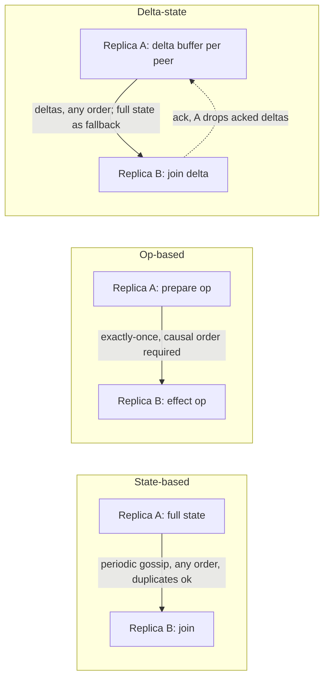
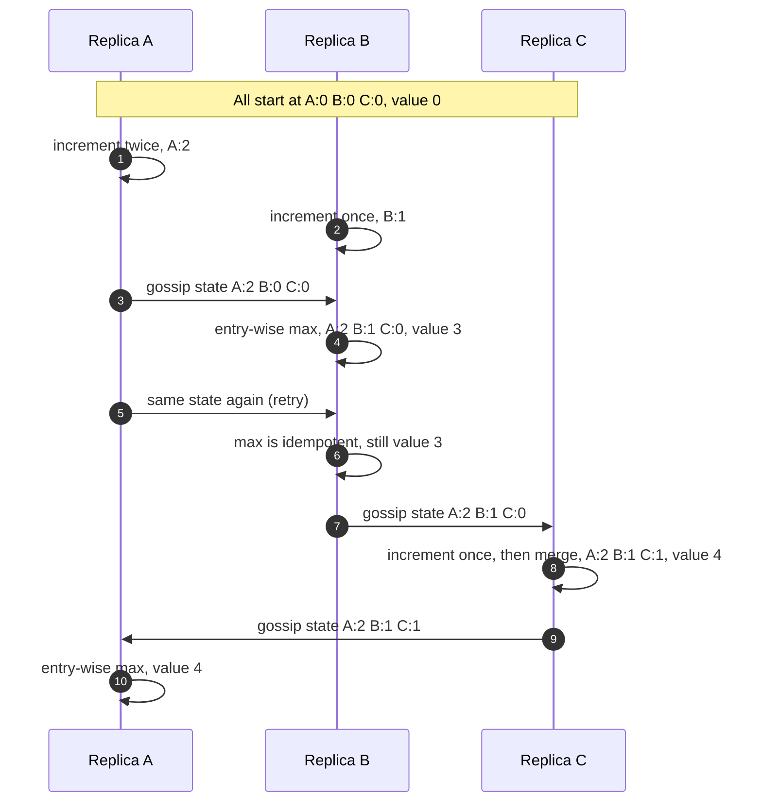
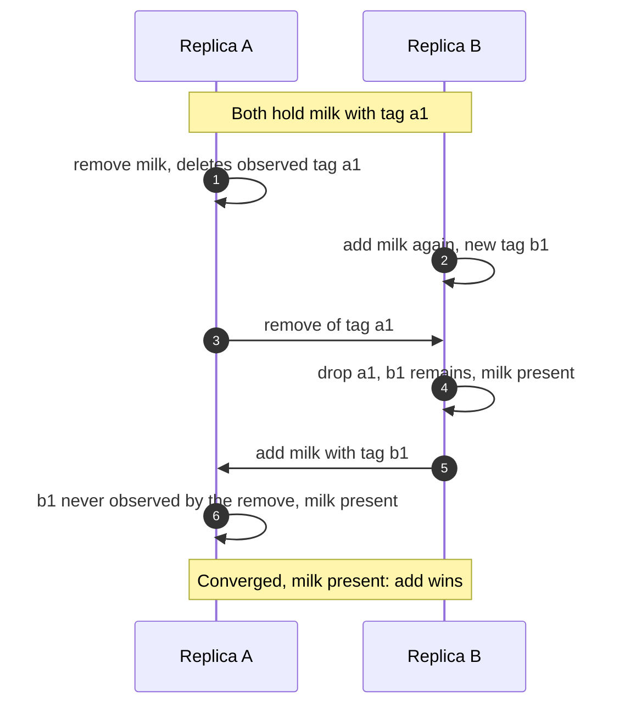
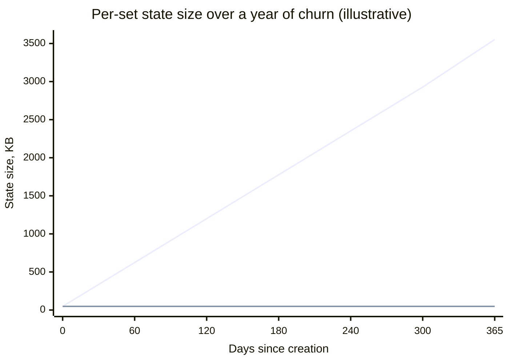
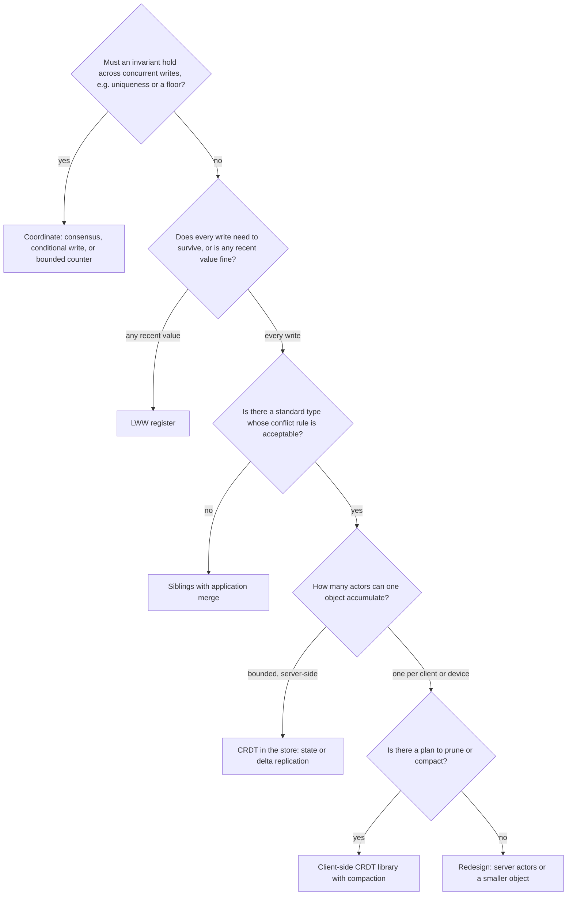

Çakışmasız çoğaltılmış veri türü (conflict-free replicated data type, CRDT), replikalarının her birinin güncellemeleri hiçbir koordinasyon olmadan yerel olarak kabul edebildiği ve aynı güncellemeleri aldıklarında, teslimatın sırası, gruplanması ya da tekrarlanmasından bağımsız olarak aynı duruma ulaşmaları garanti edilen bir veri türüdür. Garanti bir protokolden değil, türün matematiğinden gelir: ya iki durumun birleştirilmesi (merge) değişmeli (commutative), birleşmeli (associative) ve eşgüçlüdür (idempotent), ya da eşzamanlı işlemler sıra değiştirebilir. Replika başına katkıları toplayan bir sayaç, her eklemeyi benzersiz bir etiketle işaretleyen bir küme ve her karaktere kalıcı bir konum veren bir metin tamponu birer CRDT'dir.

Çözdükleri problem, [last write wins](/distributed-systems/tr/data-management/consistency-models/eventual-consistency/)'ın açık bıraktığı problemdir. Yazmaları herhangi bir replikada kabul eden bir depo eşzamanlı yazmaları deterministik biçimde çözmek zorundadır; LWW bunu birini tutup gerisini atarak yapar. Bir CRDT ise her yazmanın etkisini koruyarak çözer: iki eşzamanlı artırma da sayılır, bir ekleme ile başka bir elemanın eşzamanlı eklemesi birlikte hayatta kalır, aynı paragrafta yazan iki kullanıcı da kendi metnini görür. Yazma yolu yerel kaldığı için bir CRDT deposu, [CAP teoremi](/distributed-systems/tr/data-management/consistency-models/cap-theorem/) sayfasında anlatılan AP sistemlerin erişilebilirliğini ve yerel replika gecikmesini, sessiz kayıp olmadan korur.

Temel denge şudur: birleştirme kuralı tasarım anında belirlenmek zorundadır ve kimseye danışamaz. Bir CRDT, koordinasyonsuz yakınsamanın bedelini üç biçimde öder. Birincisi, yazar sayısıyla ve bazı türlerde silme geçmişiyle büyüyen metadata'dır. İkincisi, çakışma anında uygulama tarafından değil tür tarafından sabitlenmiş semantiktir: aynı elemanın eklenmesi ve çıkarılması eşzamanlı olduğunda hangisinin kazanacağına bir insan değil tür karar verir. Üçüncüsü, küresel bilgi gerektiren hiçbir değişmezin (invariant) sağlanamamasıdır: "bakiye asla sıfırın altına düşmez" ya da "bu kullanıcı adı benzersizdir" gibi. CRDT'ler eşzamanlı güncellemeleri yalnızca anlamı her iç içe geçme sırasında (interleaving) korunan veriler için zararsız hâle getirir.

## Yapı Gereği Yakınsama: Yarı Örgüler ve Teslimat Sözleşmeleri

Bir CRDT'nin her replikası bir durum tutar, yerel güncellemeleri ona hemen uygular ve arka planda diğer replikalarla bilgi alışverişi yapar. İki tasarım neyi alışveriş ettikleri bakımından ayrılır ve her biri replikalar arasındaki ağa farklı bir gereksinim yükler. Bu gereksinim bir CRDT'nin en önemli operasyonel özelliğidir, çünkü onu hangi taşıma katmanının taşıyabileceğini belirler.

### State-Based CRDT'ler: Durumu Gönder, Join ile Birleştir

Yakınsayan çoğaltılmış veri türü (convergent replicated data type, CvRDT) olarak da bilinen state-based bir CRDT'de bir replika, tüm durumunu periyodik olarak başka bir replikaya gönderir; alan taraf onu kendi durumuyla birleştirir. Doğruluk üç koşula dayanır. Olası durumlar kümesi kısmi sıralı olmalıdır ki "`b` durumu en az `a` durumunun bilgisini içerir" ifadesinin bir anlamı olsun. Her yerel güncelleme şişirici (inflationary) olmalıdır: durumu bu sırada yukarı taşır, asla yana ya da aşağı taşımaz. Birleştirme de iki durumun en küçük üst sınırını, yani join'ini hesaplamalıdır: ikisini de içeren en küçük durumu. Her durum çiftinin bir join'e sahip olduğu kısmi sıraya join-yarı örgü (join-semilattice) denir.

Join, güvenilmez bir ağın tam olarak ihtiyaç duyduğu özelliklere sahiptir. Değişmelidir, yani iki replikanın durumları hangi sırayla alışveriş ettiği önemli değildir. Birleşmelidir, yani bir aracı üzerinden birleştirmek doğrudan birleştirmekle aynı sonucu verir. Eşgüçlüdür, yani aynı durumu iki kez almak hiçbir şeyi değiştirmez. Dolayısıyla durumları geç, sırasız, tekrar tekrar ya da rastgele aracılar üzerinden teslim eden bir gossip protokolü replikaları anlaşmazlığa düşüremez: bir replika, doğrudan ya da dolaylı olarak, her güncellemeyi yansıtan durumları birleştirdiğinde hepsinin join'ini tutar ve bir kümenin join'i nasıl hesaplandığına bağlı değildir. Ağdan beklenen tek şey, her güncellemenin bir birleştirme zinciri üzerinden sonunda her replikaya ulaşmasıdır. Bu, nihai tutarlılığın nihai teslimat yarısıdır ve [gossip protokolleri](/distributed-systems/tr/resilience/failure-detection/gossip-protocols/) ile [Merkle ağacı tabanlı anti-entropy](/distributed-systems/tr/data-management/replication/anti-entropy-merkle/) tarafından sağlanır.

Join'in neden her yazmayı koruduğunun sezgisi şişirme koşulundadır. Bir güncelleme bilgi ekler; birleştirme hiçbir zaman iki taraftan birinin sahip olduğu bilgiyi silmez. Bu nedenle bir yazma bir birleştirme sırasında "kaybolamaz", yalnızca daha büyük bir duruma katılır. Bunun tersi olan, bilgi atan bir birleştirme, LWW'nin eşzamanlı bir değerle yaptığı şeyin ta kendisidir. LWW register'ı da yalnızca sıralaması kaybeden değeri kazanandan bilerek "daha az bilgi" saydığı için bir join-yarı örgüdür.

### Operation-Based CRDT'ler: İşlemi Gönder, Taşıma Katmanına Güven

Değişmeli çoğaltılmış veri türü (commutative replicated data type, CmRDT) olarak da bilinen operation-based bir CRDT'de bir replika her güncellemeyi bir işlem olarak yayınlar ve her replika onu uygular. Her güncelleme ikiye bölünür. Hazırlık (prepare) aşaması yalnızca kaynak replikada çalışır, yerel durumu okur ve bir işlem mesajı üretir; örneğin "`x` elemanını `(B, 7)` etiketiyle ekle". Etki (effect) aşaması kaynak dahil her replikada çalışır ve bu mesajı uygular. Eşzamanlı işlemlerin etki aşamaları sıra değiştirebilmelidir; nedensel olarak sıralı işlemlerin buna ihtiyacı yoktur, çünkü taşıma katmanının onları nedensel sırada teslim etmesi şart koşulur.

Op-based tasarımların bedeli budur: taşıma katmanı her işlemi her replikaya tam bir kez ve [happened-before](/distributed-systems/tr/foundations/time-and-ordering/happened-before/) ile tutarlı bir sırada teslim etmek zorundadır. Artırma işlemleri sıra değiştirebildiği için bir sayaca tam bir kez teslimat yeter; ancak bir elemanın çıkarılması gözlemlediği eklemeden önce uygulanmamalıdır, bu yüzden bir küme nedensel teslimata da ihtiyaç duyar. Mesajlar küçüktür, çoğu zaman onlarca bayt; ortak düzenleme araçlarının ve sohbet sistemlerinin bu tasarımı tercih etmesinin nedeni budur. Ne var ki at-least-once teslimat yapan bir broker, bir consumer yeniden başladıktan sonraki tekrar oynatma ya da düşen bir mesaj sözleşmeyi sessizce ihlal eder ve tür bunu fark edemez: tekrarlanan bir artırma ikinci bir artırmadan ayırt edilemez. İki tasarım ifade gücü bakımından eşdeğerdir, Shapiro ve arkadaşları her birinin diğerini taklit edebildiğini gösterir; ancak altyapıdan talep ettikleri bakımından eşdeğer değildir.

### Delta-State CRDT'ler: Yalnızca Değişeni Gönder

Almeida, Shoker ve Baquero'nun önerdiği delta-state CRDT'ler, state-based tasarımların ağ toleransını op-based tasarımlara yakın mesaj boyutlarıyla birleştirir. Her güncelleme, yalnızca değişikliği temsil eden küçük bir durum, yani delta döndüren bir delta mutator olarak yazılır. Replika deltayı hem kendi durumuna hem de her eş için henüz onaylanmamış deltaların tutulduğu bir tampona join eder. Delta da aynı yarı örgünün bir durumu olduğundan, tam bir durum gibi join edilebilir, tekrarlanabilir, yeniden sıralanabilir ve gruplanabilir. Bir replika birleştirilmiş delta gruplarını eşlerine gönderir, onaylanınca atar; uzun süre ortadan kaybolmuş bir eşe ise tam durumu göndermeye geri döner. Bazı türlerde, en önemlisi aşağıdaki nedensel küme ve map'lerde, bir deltayı sırasız almak yakınsama açısından güvenlidir ama nedensel sırayı ihlal eden bir ara durumu açığa çıkarabilir; bu yüzden nedensel görünürlük gereken gerçekleştirimler delta aralıklarını her eşe sıralı gönderir.


*Üç CRDT ailesi ve her birinin replikalar arasındaki kanala yüklediği sözleşme.*

Diyagram, veri yapıları kadar altyapıyla ilgili bir karardır. State-based bir tür her kayıplı, tekrarlayan, sırasını bozan kanal üzerinde taşınabilir; bedeli, boyutu nesneyle birlikte büyüyen durumların gönderilmesidir. Op-based bir tür minik mesajlar gönderir ama güvenilir bir nedensel yayın (causal broadcast) katmanı ister; bu katman da tamponlama ve üyelik içeren ayrı bir dağıtık protokoldür. Delta-state ikisinin arasında durur: mesajları olağan durumda küçüktür, state-based türlerle aynı kanala tahammül eder ve tek ek mekanizma onay okudur. CRDT sunan üretim anahtar-değer depolarının çoğu state-based ya da delta-state replikasyon kullanır; ortak düzenleme kütüphanelerinin çoğu ise kendi senkronizasyon protokolleri üzerinde op-based tasarımlar kullanır.

### Güçlü Nihai Tutarlılık ve Dışarıda Bıraktıkları

CRDT'lerin sağladığı garantinin bir adı vardır: güçlü nihai tutarlılık (strong eventual consistency, SEC). Aynı güncelleme kümesini teslim almış iki replika, geri alma, consensus ya da uzlaştırma adımı olmadan, hemen aynı durumdadır; doğru çalışan bir replikaya teslim edilen her güncelleme de sonunda hepsine teslim edilir. Daha zayıf model [nihai tutarlılık](/distributed-systems/tr/data-management/consistency-models/eventual-consistency/) sayfasında tanımlanır; SEC yakınsamayı bir liveness özelliğinden bir safety özelliğine dönüştürür.

SEC'in vermedikleri de en az bu kadar önemlidir. Hiçbir güncellik garantisi vermez: bir güncellemeyi almamış replika onsuz bir durum döndürür; yani CRDT'ler tek başlarına [oturum garantilerinin](/distributed-systems/tr/data-management/consistency-models/causal-consistency-session-guarantees/) hiçbirini sağlamaz ve başka bir replikaya yönlendirilen istemci kendi artırmasını okuyamayabilir. Yakınsanan durumun kimsenin niyetine uymasını sağlamaz: türün semantiği ne üretiyorsa onda anlaşmayı garanti eder; "ekleme kazanır" ya da "çıkarma kazanır" türü tasarlayan kişinin seçimidir. Nesneler arasında işlem sırası vermez: birlikte güncellenen iki CRDT bağımsız olarak yakınsar ve depo transaction ya da nedensel görünürlük eklemedikçe bir okuyucu güncellemelerden birini diğeri olmadan görebilir. Ve tek tek geçerli eşzamanlı güncellemelerin bir birleşiminin bozabileceği hiçbir değişmezi koruyamaz. Bu, benzersizliği, negatif olmamayı ve her türlü "en fazla N" kısıtını dışarıda bırakır, çünkü her replika diğer replikaların eşzamanlı güncellemelerini içermeyen bir duruma göre doğrulama yapar.

## Veri Türü Kataloğu: Her Türün Sizin Yerinize Verdiği Karar

CRDT, keyfi verilere uygulanan genel bir replikasyon tekniği değildir; eşzamanlılığa belirli bir yanıtı olan belirli bir veri türüdür. Aşağıdaki her tür, kendinden önceki daha basit tür ya yakınsamadığı ya da yanlış sonuçta yakınsadığı için vardır.

### Sayaçlar: Tek Bir Tamsayı Neden Çoğaltılamaz

Birleştirme kuralı "en büyüğü tut" olan çoğaltılmış bir tamsayı yakınsar ama artırmaları kaybeder: 10'da duran ve her biri 1 ekleyen iki replika 11 tutar; en büyüğü 12 değil 11'dir. Birleştirmede toplamak da yakınsamaz, çünkü aynı durumu iki kez birleştirmek onu iki kez sayar. Yalnızca artan sayaç (grow-only counter, G-Counter) ikisini de replika başına bir tamsayı tutarak çözer. `i` replikası yalnızca kendi girdisini artırır; değer tüm girdilerin toplamıdır; birleştirme girdi bazında en büyüğü alır. Her girdiyi yalnızca bir replika yazdığı için girdi bazında en büyük hiçbir artırmayı kaybetmez; en büyük alma eşgüçlü olduğu için de tekrarlar zararsızdır. Azalabilen sayaç, yani PN-Counter, biri artırmalar biri azaltmalar için iki G-Counter'dan oluşur ve değeri `P - N`'dir.


*Tekrarlayan ve aracı üzerinden aktaran bir gossip kanalında yakınsayan bir G-Counter.*

3. ve 5. adımlar aynı durumu iki kez teslim eder; 6. adım bunun neden güvenli olduğunu gösterir: bir durumun kendisiyle girdi bazında en büyüğü yine o durumdur. 7. adım A'nın artırmalarını B üzerinden aktarır; C, 9. adımdan önce A ile hiç doğrudan konuşmaz, yine de sonucu bu artırmaları zaten içerir. Birleşme özelliği tam olarak budur. 8. adımda C'nin kendi artırması ve birleştirme hangi sırayla olursa olsun sonuç aynıdır. Yapı maliyeti de gösterir: durum, bugüne kadar artırma yapmış her replika için bir girdi taşır ve tür, hâlâ o girdiye sahip bir replikayla yapılacak bir sonraki birleştirmenin onu geri getirmesi riski olmadan bir girdiyi unutamaz.

PN-Counter yakınsar ama bir alt sınırı zorlayamaz. Her biri 1 birim stok tutan iki replika birer azaltma kabul edebilir ve yakınsanan değer -1 olur. Balegas ve arkadaşlarının sınırlı sayacı (bounded counter) bunu sınırı haklara dönüştürerek çözer: izin verilen toplam azaltma replikalar arasında paylaştırılır, her replika yalnızca kendi haklarına karşı azaltma yapar ve iletişim gerektiren tek adım hakların replikalar arasında aktarılmasıdır. Bu, [çok liderli replikasyon](/distributed-systems/tr/data-management/replication/multi-leader-replication/) sayfasında anılan escrow tekniğinin CRDT biçimidir: koordinasyon ortadan kalkmaz, istek yolundan çıkıp yeniden dengelemeye taşınır.

### Register'lar: Birini Seç ya da Hepsini Tut

Register, bir bütün olarak üzerine yazılan tek bir değer tutar. LWW register'ı en büyük `(timestamp, replica ID)` çiftine sahip değeri tutar; mekanizması ve kayıp biçimleri [nihai tutarlılık](/distributed-systems/tr/data-management/consistency-models/eventual-consistency/) sayfasındadır. Çok değerli register (MV-Register) seçim yapmayı reddeder: her değer bir version vector taşır, bir yazma gözlemlediği değerleri geride bırakır ve eşzamanlı yazmalar okuyucunun çözmesi için yan yana hayatta kalır. Bu, [vektör saatler](/distributed-systems/tr/foundations/time-and-ordering/vector-clocks/) sayfasında anlatılan sibling'lerin CRDT formülasyonudur. İki register da değerleri birleştirmez: LWW bilgi atar, MV-Register kararı uygulamaya erteler. İçerikleri birleştirmek, değerin yapısını bilen bir tür gerektirir; küme, map ve diziler tam olarak budur.

### Kümeler: Yalnızca Büyüyen Kümeden Observed-Remove'a

Yalnızca büyüyen küme (G-Set) birleşim (union) ile birleşir ve çıkarmayı desteklemez. Semantik seçimler çıkarma eklendiğinde başlar. İki aşamalı küme (2P-Set) bir eklenenler kümesini tombstone'lardan oluşan bir çıkarılanlar kümesiyle eşler; eklenmiş ve çıkarılmamış eleman mevcuttur, dolayısıyla bir kez çıkarılan eleman bir daha asla eklenemez. LWW-element-set her eklemeyi ve çıkarmayı damgalar ve eleman başına daha sonra olanı tutar; LWW'nin bütün saat problemlerini miras alır. Gözlemlenen-çıkarma kümesi (observed-remove set, OR-Set) kullanıcıların beklediği davranışa uyan tasarımdır: bir ekleme benzersiz bir etiket oluşturur, bir çıkarma yalnızca kendi replikasının gözlemlediği etiketleri siler; bu yüzden bir çıkarmayla eşzamanlı bir ekleme hayatta kalır, çünkü çıkarma onun etiketini hiç görmemiştir. Bu kurala add-wins (ekleme kazanır) denir.


*Observed-remove kümede eşzamanlı çıkarma ve yeniden ekleme. Çıkarma elemanı değil, gördüğü etiketi siler.*

Kritik adım 1. adımdır: çıkarma "sütü çıkar" demez, "`a1` etiketini çıkar" der; A replikasının bildiği tek şey budur. 4. adımda B bu etiketi siler ve elinde hâlâ `b1` vardır; 6. adımda A hiç gözlemlemediği bir etiket alır, bu yüzden onu iptal eden hiçbir şey yoktur. Kural remove-wins (çıkarma kazanır) olsaydı eleman iki replikada da bulunmazdı; seçim her iki durumda da yakınsar ve bir ürün kararıdır. Add-wins sepetler, üyelik listeleri ve etiketler için doğru varsayılandır; remove-wins ise eşzamanlı bir yeniden yetkilendirmenin bir iptali geri almaması gereken erişim iptali için uygundur. Dynamo makalesi add-wins semantiğinin kullanıcıya görünen yüzünü alışveriş sepetinde anlatır: eşzamanlı sürümlerin birleştirilmesi eklenmiş bir ürünü asla kaybetmez, ama silinmiş bir ürün yeniden ortaya çıkabilir.

Özgün OR-Set tombstone'lara ihtiyaç duyar: `a1` etiketinin çıkarıldığını bilmek için replikanın onu hatırlaması gerekir, yoksa `a1`'e hâlâ sahip bir replikayla birleştirme onu yeniden ekler. Bieniusa ve arkadaşları bu gereksinimi optimize edilmiş OR-Set ile kaldırdı; Riak bu yapıya ORSWOT (OR-Set without tombstones) der. Her replika, bugüne kadar gördüğü her etiketi, yani `(replica, counter)` çifti olan her dot'u özetleyen bir version vector tutar. Kümede bulunmayan ama version vector tarafından kapsanan bir etiket çıkarılmış olmalıdır; diğer tarafta bulunan ve yerel vektör tarafından kapsanmayan bir etiket yenidir. Bu karşılaştırma tombstone'ların yerini alır; böylece durum boyutu canlı elemanlarla artı replika başına bir vektör girdisiyle orantılı olur.

```text
# Dotted set merge (ORSWOT). A dot is (replica_id, counter); vv summarizes seen dots.
merge(local, remote):
  keep = {}
  for (elem, dot) in local.entries union remote.entries:
    in_l = (elem, dot) in local.entries
    in_r = (elem, dot) in remote.entries
    if in_l and in_r:                      keep.add(elem, dot)   # both still have it
    elif in_l and not covers(remote.vv, dot): keep.add(elem, dot) # remote never saw it
    elif in_r and not covers(local.vv, dot):  keep.add(elem, dot) # local never saw it
    # else: one side saw the dot and no longer has it -> it was removed
  return (keep, pointwise_max(local.vv, remote.vv))

add(elem) at replica r:   dot = (r, local.vv[r] + 1); local.vv[r] += 1
                          remove all dots of elem; add (elem, dot)   # re-add supersedes
remove(elem):             remove all dots of elem   # vv unchanged: absence plus vv = removed
```

Pseudocode, doğruluk argümanının nerede durduğunu gösterir. Bir dot bir kez, tek bir replika tarafından, yalnızca o replikanın ilerlettiği bir sayaçtan üretilir; dolayısıyla dot'lar küresel olarak benzersizdir ve bir replikanın version vector girdisi tam olarak onun ürettiği ya da aldığı dot'ları kapsar. Üç dal eksiksiz bir durum analizidir: iki tarafta da var; bir tarafta var ve diğer tarafça görülmemiş (eşzamanlı ekleme); ya da bir tarafta var ve diğer tarafça görülüp bırakılmış (çıkarma). Tasarım, operasyon ekiplerinin bozabileceği tek bir varsayıma dayanır: bir replika kimliği bir sayaç değerini asla yeniden kullanmamalıdır. Yedekten eski kimliğiyle geri yüklenen bir replika, diğer replikaların zaten tuttuğu ya da çıkarıldığını gördüğü dot'ları yeniden üretir ve üçüncü dal bu durumda taze eklemeleri siler. Bu hata aşağıda incelenmiştir.

### Map'ler ve Bileşim

CRDT'lerden oluşan bir map her anahtarın altına bir CRDT yerleştirir ve anahtar anahtar, özyinelemeli olarak birleştirir; böylece bir belge, alanları register, sayaç, küme ya da iç içe map olan bir map'tir. Bileşim CRDT'leri yapılandırılmış veri için kullanılabilir kılan şeydir ve semantiğin inceldiği yer de burasıdır. Farklı alanlara eşzamanlı güncellemeler etkileşmeden birleşir. Bir alanın güncellenmesiyle o alanın anahtarının eşzamanlı çıkarılması ise bir kural gerektirir: observed-remove semantiğinde çıkarma yalnızca gözlemlediği durumu siler, dolayısıyla alan içinde yalnızca eşzamanlı güncelleme kalacak biçimde hayatta kalır. Çıkarılıp ardından güncellenen bir sayacın yalnızca eşzamanlı artırmalara eşit bir değerle yeniden belirmesinin nedeni budur. Riak map'ler için add-wins biçimini belgeler: bir alan eşzamanlı olarak eklenir ya da güncellenir ve çıkarılırsa ekleme ya da güncelleme kazanır. Kleppmann ve Beresford'un Automerge'ün modelinin temelindeki JSON CRDT'si aynı kuralı keyfi iç içe yapılara uygular ve aynı anahtara farklı türlerden eşzamanlı atamaların sonuçlarını belgeler.

Dotted tasarım iyi bileşir, çünkü iç içe her tür ayrı ayrı kendi bağlamını taşımak yerine tek bir nedensel bağlamı, yani kapsayan nesnenin version vector'ünü paylaşabilir. Binlerce alanlı bir map'in metadata'sını alan sayısıyla değil replika sayısıyla orantılı tutmasını sağlayan bu paylaşılan bağlamdır.

### Diziler ve Metin

Dizi CRDT'leri bir listenin ya da metnin her elemanına benzersiz, değişmez bir kimlik ve ondan türetilen bir konum verir; böylece aynı yere yapılan eşzamanlı eklemeler her replikada deterministik biçimde sıralanır. Aileler sıralama biçiminde ayrılır. Logoot ve LSEQ komşular arasında yoğun konum kimlikleri ayırır; RGA (Replicated Growable Array) her elemanı bir referans elemanın arkasına ekler ve kardeşleri bir [Lamport zaman damgası](/distributed-systems/tr/foundations/time-and-ordering/lamport-timestamps/) ile sıralar; Yjs'in arkasındaki algoritma olan YATA hem sol hem sağ kökeni kaydeder; Treedoc ve Fugue elemanları, dolaşımı sırayı veren bir ağaca yerleştirir. Silme genellikle bir tombstone bırakır, çünkü sonraki eklemeler silinen elemanı köken olarak referans gösterebilir.

Diziler başka hiçbir türde olmayan bir anomali ekler. İki kullanıcı aynı konuma eşzamanlı olarak kelimeler yazdığında birkaç algoritma iki eklemeyi karakter karakter iç içe geçirebilir; sonuç okunamaz ama yine de yakınsamış bir birleştirmedir. Kleppmann, Gomes, Mulligan ve Beresford bunu 2019'da tanımladı. Weidner ve Kleppmann'ın Fugue çalışması ise daha sonra naif bir iç içe geçmeme özelliğinin hiçbir algoritma için mümkün olmadığını gösterdi, yerine maksimal iç içe geçmeme (maximal non-interleaving) özelliğini tanımladı ve mevcut algoritmaları buna göre inceledi: bu analizde Logoot, LSEQ ve Treedoc inceledikleri her durumda iç içe geçirebiliyor; RGA ve Yjs tek replikada ileri yönlü iç içe geçmeyi önlüyor ama her geri yönlü ya da çok replikalı durumu önlemiyor; FugueMax ise özelliği sağlıyor. Dizi CRDT'leri, bir sunucunun eşzamanlı işlemleri birbirine göre dönüştürdüğü operational transformation (OT) ile rekabet eder. OT'nin karakter başına metadata'sı küçüktür ama pratikte doğruluk için merkezi bir sıralama noktasına ihtiyaç duyar; dizi CRDT'leri ise bugüne kadar eklenmiş her eleman için bir kimlik bedeline eşler arası (peer to peer) çalışır.

| Tür | Durum | Birleştirme | Eşzamanlı çakışma kuralı | Metadata büyümesi | Ne zaman tercih edilmeli |
|---|---|---|---|---|---|
| G-Counter, PN-Counter | Replika başına bir ya da iki tamsayı | Girdi bazında en büyük | Tüm artırma ve azaltmalar sayılır | Yazar kimliği başına | Beğeniler, görüntülenmeler, aşılmaya tahammül eden kotalar |
| Sınırlı sayaç | PN-Counter artı haklar matrisi | Girdi bazında en büyük | Her replika yalnızca kendi haklarını harcar | Replika çifti başına | Tabanı olan stok ya da kredi, ara sıra hak aktarımı pahasına |
| LWW register | Değer, zaman damgası, replika kimliği | En büyük çifti tut | Bir değer kalır, diğerleri atılır | Sabit | Yakın tarihli herhangi bir değerin kabul edildiği tüm değer değişimi |
| MV-Register | Version vector'lü değerler | Geride kalmayanları tut | Tüm eşzamanlı değerler okuyucu için tutulur | Yazar ve sibling başına | Uygulamanın okumada birleştirebildiği değerler |
| OR-Set (ORSWOT) | Dot'lu elemanlar, version vector | Yukarıdaki dotted birleştirme | Ekleme eşzamanlı çıkarmaya karşı kazanır | Canlı elemanlar artı replika başına | Sepetler, üyelik, etiketler, presence |
| Remove-wins küme | Aynı yapı, ters eğilim | Dotted birleştirme | Çıkarma eşzamanlı eklemeye karşı kazanır | Canlı elemanlar artı replika başına | Yetki iptali, engelleme listeleri |
| CRDT map'i | İç içe CRDT'ler, ortak nedensel bağlam | Anahtar başına, özyinelemeli | Güncelleme eşzamanlı anahtar çıkarmaya karşı kazanır (add-wins biçimi) | Çocukların toplamı artı replika başına | Bağımsız alanlı belgeler ve profiller |
| Dizi (RGA, YATA, Fugue) | Eleman kimlikleri, kökenler, tombstone'lar | Kimliklere göre sırala | Eşzamanlı eklemelerin ikisi de kalır, deterministik sıra | Bugüne kadar eklenmiş eleman başına | Ortak metin, sıralı listeler, offline-first düzenleme |

"Eşzamanlı çakışma kuralı" sütununu, türün her nesne için, bağlamsız ve sonsuza dek verdiği kararların listesi olarak okuyun. Bu kurallardan biri bir veri parçası için yanlışsa, tür ne kadar iyi yakınsarsa yaksın o veri için yanlıştır.

## Hesaplı Örnek: Metadata Faturası

Bir servisin, her biri beş depolama düğümlü üç bölgeye çoğaltılmış bir CRDT deposunda 10 milyon öğe başına sayaç ve 100.000 aktif kullanıcı başına küme tuttuğunu varsayın. Bu bölümdeki tüm sayılar örnek amaçlıdır.

Önce sayaçlar. Her güncellemenin aktörü (actor) onu kabul eden depolama düğümüyse, bir PN-Counter'ın iki yarısının her birinde en fazla 15 aktör olur. Girdi başına 8 baytlık aktör kimliği ve 8 baytlık sayımla bir yarı en fazla `15 * 16 = 240` bayt, sayaç da en fazla 480 bayttır; düz bir tamsayı ise 8 bayttır. 10 milyon sayaç için bu, replikasyondan önce, 80 MB yerine 4,8 GB'a kadar, yani 60 kat demektir. Pratikte çoğu sayaca daha az düğüm dokunur, dolayısıyla ortalama daha düşüktür; ama kapasite planlamasının kapsaması gereken en kötü durumdur. Tasarım aktör olarak istemciyi kullanırsa, örneğin çevrimdışıyken artırma yapan bir mobil cihazı, 2.000 farklı cihazın beğendiği bir sayaç 2.000 girdiye, 32 KB'a ulaşır ve boyutun sınırı küme değil, bugüne kadar görülmüş istemci sayısı olur. Aktör seçimi her CRDT için baskın metadata kararıdır; sunucu tarafı aktörlerin varsayılan olmasının nedeni budur.

Şimdi kümeler. Her kümenin 32 baytlık 1.000 canlı eleman tuttuğunu, her elemanın 16 baytlık bir dot taşıdığını ve günde 200 ekleme ile 200 çıkarma yaşandığını varsayın; canlı boyut sabit kalır. Canlı durum iki tasarımda da `1,000 * 48 = 48,000` bayttır. Tombstone'lu bir OR-Set ayrıca çıkarılmış her `(element, tag)` çiftini, her biri 48 bayt olmak üzere tutar: 365 gün boyunca günde 200 adet, 73.000 tombstone eder; bir yıl sonra küme başına yaklaşık 3,5 MB, yani canlı verinin 73 katı. ORSWOT ise 48.000 baytı ve en fazla 15 girdili, 240 baytlık bir version vector'ü süresiz olarak tutar.


*Üst çizgi: tombstone'lu OR-Set, 1.000 canlı eleman, günde 48 baytlık 200 çıkarma. Alt çizgi: 15 girdili version vector'lü dotted OR-Set (ORSWOT).*

Üst çizgi, hiç çöp toplama çalışmadığında "tombstone'lar zamanla çöp toplanır" sözünün neye benzediğini gösterir. Bir tombstone'u güvenle silmek, her replikanın çıkarmayı gördüğünü bilmeyi gerektirir; buna nedensel kararlılık (causal stability) denir: tombstone'un dot'u tüm replikaların version vector'leri tarafından kapsanır. Bu küresel bir koşuldur; dolayısıyla ya her replikayı bilen bir üyelik protokolü ya da koordineli bir sıkıştırma adımı gerektirir ve çevrimdışı kalan tek bir replika, ayrıldığından beri oluşan bütün tombstone'ları yerinde tutar. Dizi CRDT'leri aynı aritmetikle ORSWOT benzeri bir çıkış yolu olmadan yüzleşir, çünkü silinen karakterler sonraki eklemeler tarafından referans gösterilir. Yjs silinen öğelerin içeriğini çöp toplar ama yapısal metadata'larını tutar; Automerge ise tüm işlem geçmişini sıkıştırılmış, sütun tabanlı bir kodlamayla saklar.

Son olarak ağ. 100.000 kümenin her birinin dakikada bir güncellendiğini ve her güncellemenin iki eş bölgeye gönderildiğini varsayın. Nesnenin tamamının state-based replikasyonu `100,000 / 60 * 48,000 * 2`, yani yaklaşık 160 MB/s bölgeler arası trafiğe mal olur. Delta-state replikasyon değişen elemanı, dot'unu ve nedensel bağlamı, yaklaşık 300 bayt olarak gönderir: `100,000 / 60 * 300 * 2`, yaklaşık 1 MB/s, yani 160 kat daha az. Bölgeler arası aktarım fiyatlarında bu fark, bir CRDT tasarımının hiç karşılanabilir olup olmadığına karar verir; tam durum gossip'iyle başlayan Akka Distributed Data'nın daha sonra delta yayılımı eklemesinin nedeni de budur.

:::tip[Türü seçmeden önce aktör kümesini boyutlandırın]
Tasarımdaki her CRDT için aktörün ne olduğunu ve bir nesnenin ömrü boyunca kaç aktör biriktirebileceğini yazın. Yanıt "istemci başına bir" ya da "pod başına bir, pod'lar da her dağıtımda değişiyor" ise, sistem emekliye ayrılan aktörleri budamadıkça metadata sınırsız büyür ve budama kendi başına bir protokol gerektirir. Sunucu tarafında, kararlı aktör kimlikleri vektörleri küçük tutar ve bu bölümdeki diğer bütün maliyetleri öngörülebilir kılar.
:::

## CRDT'ler ve Eşzamanlılığı Çözmenin Diğer Yolları

CRDT'ler, çoğaltılmış bir sistemin aynı veriye eşzamanlı yazmaları ele alabildiği beş yoldan biridir ve her zaman en güçlüsü değildir. Karşılaştırma sistem başına değil, veri türü başına yapılır.

| Yaklaşım | Eşzamanlı yazmalar neye dönüşür | Sağlayabildiği değişmezler | Ağdan beklenen | Metadata | Ne zaman tercih edilmeli |
|---|---|---|---|---|---|
| LWW register | Bir yazma kalır, diğerleri atılır | Hiçbiri | Nihai teslimat | Bir zaman damgası | Tüm değer değişimi, cache'ler, son görülme değerleri |
| Uygulama birleştirmeli sibling'ler | Bir okuyucu birleştirene kadar tüm sürümler | Birleştirme kodunun sonradan denetlediği her şey | Nihai teslimat | Değer başına version vector | Hiçbir standart türün ifade edemediği alana özgü birleştirmeler |
| CRDT | Her yazmanın etkisini koruyan deterministik birleştirme | Yalnızca her birleştirmenin koruduğu değişmezler | State/delta: nihai; op: tam bir kez, nedensel | Türe bağlı, aktör ya da eleman başına | Sayaçlar, kümeler, map'ler, metin, offline-first ve çok bölgeli yazarlar |
| Operational transformation | Ortak bir sıraya dönüştürülmüş işlemler | Sunucunun denetledikleri | İşlemleri sıralayan merkezi sunucu | Küçük, artı sunucu geçmişi | Her zaman erişilebilir sunuculu ortak düzenleme |
| Consensus ya da koşullu yazma | Onaydan önce sıralanan yazmalar | Benzersizlik ve sınırlar dahil hepsi | Yazma yolunda erişilebilir bir çoğunluk | Sürüm numarası | Bakiyeler, benzersizlik, rezervasyonlar, iş akışları |

Tablo bir sınırı açık hâle getirir: eşzamanlı geçerli güncellemelerin birlikte ihlal edebildiği bir değişmez için CRDT hiçbir zaman doğru araç değildir. Bailis ve arkadaşları bunu değişmez birleşebilirliği (invariant confluence) olarak biçimselleştirdi: bir değişmez, ancak ve ancak onu ayrı ayrı sağlayan herhangi iki durumun birleştirilmesi onu sağlayan bir durum veriyorsa koordinasyonsuz korunabilir. Azaltmalarla birlikte "sayı negatif değildir" değişmezi birleşebilir değildir; bu yüzden ya yazmada koordinasyon ya da sınırlı sayaçtaki gibi önceden paylaştırılmış haklar gerektirir. "Kümedeki her eleman birisi tarafından eklenmiştir" ise birleşebilirdir; bu nedenle bir küme bunun için hiçbir zaman koordinasyona ihtiyaç duymaz.

:::note[CRDT'ler ve nedensel tutarlılık birbirini tamamlar]
Bir CRDT, replikaların aynı güncellemelere sahip olduklarında anlaşacağını garanti eder; bir okuyucunun nesneler arasında güncellemeleri hangi sırayla gördüğü hakkında hiçbir şey söylemez. [Nedensel tutarlılık](/distributed-systems/tr/data-management/consistency-models/causal-consistency-session-guarantees/) sayfasında anlatılan causal+ tutarlılık, anahtar başına yakınsayan bir birleştirme kullanır ve anahtarlar arasına nedensel görünürlük ekler. AntidoteDB gibi depolar ikisini birleştirir: transaction'lar içinde CRDT nesneleri ve nedensel snapshot okumaları sunar.
:::

## Üretim Sistemlerinde CRDT'ler

Ders kitabındaki türler üretime üç tekrarlayan değişiklikle ulaşır: aktörü depo seçer, tür menüsünü kısıtlar ve çakışma semantiğini uygulama adına sabitler.

### Riak Veri Türleri

Riak 1.4 sürümünde state-based bir sayaç, 2.0'da ise açık kaynaklı `riak_dt` kütüphanesinde gerçekleştirilmiş bir veri türleri ailesi ekledi: sayaçlar, kümeler, map'ler, bayraklar (flag) ve register'lar; HyperLogLog türü de 2.2'de eklendi. Riak'ın belgeleri yakınsama kurallarını açıkça yazar: sayaçlar PN-Counter'dır, dolayısıyla tüm aktörlerin tüm artırma ve azaltmaları sonunda uygulanır; kümeler eşzamanlı ekleme ve çıkarmada add-wins'tir; map'lerde bir ekleme ya da güncelleme alanın eşzamanlı çıkarılmasına karşı kazanır; bayraklarda etkinleştirme devre dışı bırakmaya karşı kazanır; register'lar zaman damgasına göre en yakın tarihli değeri tutar, yani map içindeki bir LWW register'ıdır. Replikalar istemcilerle bağlam (context) alışverişi yapar; böylece çıkarmalar dayandıkları nedensel bilgiyi taşır. Tasarımdan iki operasyonel sonuç çıkar. Her güncelleme replikada nesnenin tamamının bir oku-değiştir-yaz işlemidir; bu yüzden büyük küme ve map'ler her güncellemeyi orantılı olarak pahalı kılar. Belgeler ayrıca sayaçların benzersiz ya da sıralı kimlik üretmek için kullanılmaması gerektiği konusunda uyarır, çünkü benzersizlik birleşebilir bir değişmez değildir.

### Redis Active-Active Veritabanları

Redis Enterprise'ın Active-Active veritabanları bir anahtar uzayını kümeler arasında, Redis veri türü başına CRDT semantiğiyle çoğaltır. Belgelerine göre kümeler OR-Set davranışı için ek metadata tutar ve add-wins'tir: bir çıkarma yalnızca daha önce gördüğü örnekleri çıkarır. String'ler üzerindeki `INCRBY` gibi tamsayı işlemleri, tüm üye veritabanlarındaki işlemleri biriktiren sayaçlar gibi davranır; sayaçlar, eşzamanlı işlemlerde taşmaya karşı korunmak için 59 bitle sınırlıdır. String'lerde düz `SET` ise last-write-wins'tir: syncer yazmaları başka türlü sıralayamadığında her işlemle saklanan, işletim sisteminden alınmış duvar saati zaman damgasını kullanır. Bu karışım önemlidir: bazen `SET` edilen, bazen artırılan bir anahtar iki farklı çakışma semantiği taşır ve LWW yarısı nihai tutarlılık sayfasındaki bütün saat problemlerini miras alır.

### Akka Distributed Data

Akka Distributed Data, bir Akka kümesinin düğümleri arasında CRDT'leri gossip ile çoğaltır ve `GCounter`, `PNCounter`, `ORSet`, `ORMap`, `LWWMap`, bayraklar ve register'lar sunar; destekleyen türler için delta yayılımı da vardır. Her okuma ve yazma bir tutarlılık düzeyi alır (yerel, belirli sayıda düğüm, çoğunluk ya da hepsi); bu, bir yazma dönmeden önce kaç replikanın onayladığını sınırlar ama yakınsamayı değiştirmez. Girdiler küme düğümüne göre anahtarlandığı için kümeden çıkarılan düğümler geride durum bırakır; türler, replicator'ın çıkarılan bir düğümün girdilerini başka bir düğüme katlayıp daha sonra temizlediği bir `RemovedNodePruning` arayüzünü gerçekleştirir. Düğümler, her yeniden doğuşa (incarnation) özgü bir kimlik içeren benzersiz bir adresle tanımlanır; bu tam olarak aşağıdaki hata bölümünün aktör yeniden kullanımına karşı istediği korumadır.

### Ortak Düzenleme Kütüphaneleri

Automerge ve Yjs CRDT'leri istemciye taşır. İkisi de özünde op-based'dir; eksik değişiklikleri eşler arasında ya da bir aktarma sunucusu üzerinden alışveriş eden bir senkronizasyon protokolleri vardır ve ikisi de her replikaya, tipik olarak bir tarayıcıda açık her belgeye, kendi aktör kimliğini verir. Automerge bir belgeyi Lamport zaman damgalı işlem kimlikleriyle JSON benzeri bir ağaç olarak modeller ve tüm geçmişi sıkıştırılmış olarak tutar; Yjs diziler için YATA kullanır ve silinen içeriği çöp toplarken yapısal metadata'yı tutar. Operasyonel kaygıları bir veritabanınınkinden farklıdır: aylarca süren düzenlemeyle belge boyutu, geçmiş yeniden oynatılırken yükleme süresi ve belgeyi açmış her cihaz ve oturumla büyüyen aktör sayısı.

## Hata Biçimleri ve Kendilerini Nasıl Gösterdikleri

CRDT hataları nadiren hata gibi görünür. Replikalar anlaşır, okumalar başarılı olur ve veri yanlış, aşırı büyük ya da yavaştır. Bu yüzden tespit, hata oranlarını değil nesne boyutlarını, aktör sayılarını ve yakınsamayı ölçmeye dayanır.

### Geri Yüklemeden Sonra Aktör Kimliğinin Yeniden Kullanılması

Tetikleyici: bir replika yedekten geri yüklenir, bir snapshot'tan yeniden kurulur ya da bir container kalıcı kimliğiyle ama yerel durumu kaybolmuş olarak yeniden oluşturulur ve eski aktör kimliğini korur. Sayaçları, diğer replikaların ondan zaten gördüğü değerlerin altında, yedeğin değerlerinden yeniden başlar. Belirtiler: o replikada geri yüklemeden sonra yapılan artırmalar kaybolur; OR-Set'lere eklemeler yok olur ya da eski çıkarmalar yeni eklemelere uygulanıyormuş gibi görünür; hiçbir yerde hata loglanmaz, çünkü her birleştirme biçimsel olarak doğrudur.

```mermaid
gantt
    title Actor reuse after restore on replica B (hypothetical)
    dateFormat HH:mm
    axisFormat %H:%M
    section Replica B
    Snapshot taken, entry B at 1000            :milestone, m1, 01:00, 0m
    Increments continue to B at 1500, gossiped :b1, 01:00, 120m
    Disk lost, restored from older snapshot   :crit, b2, 03:00, 15m
    New increments reuse B 1001 to 1500        :crit, b3, 03:15, 60m
    section Replicas A and C
    Hold entry B at 1500 from gossip           :a1, 01:30, 165m
    Merge with B, max of 1500 and 1500         :crit, a2, 04:15, 10m
    section Visible effect
    500 increments since restore lost silently :crit, e1, 04:25, 35m
```


*Eski aktör kimliğiyle geri yüklenen bir replika, diğer replikaların zaten tuttuğu sayaç değerlerini yeniden üretir; girdi bazında en büyük alma yeni artırmaları yutar.*

Gantt şeması kaybın neden sessiz olduğunu gösterir. Disk kaybından önce A ve C, B'nin girdisini zaten 1500 olarak tutar. Geri yüklemeden sonra B'nin 500 yeni artırması girdisini 1000'den yeniden 1500'e çıkarır; farklı olaylar için aynı sayı. Birleştirme en büyüğü alır, değiştirecek bir şey bulmaz ve geri yüklemeden sonraki 500 artırma, her replika aynı değeri bildirirken kaybolur. Dotted bir kümede etki daha kötüdür: B, A ile C'nin zaten görüp çıkardığı dot'ları yeniden üretir; böylece birleştirmenin üçüncü dalı B'nin yeni eklemelerini çıkarma olarak ele alır. Tespit: kendi aktör kimliğine ait girdisi yerel girdisinden büyük olan bir durum alan replika, geri sarıldığının kanıtına sahiptir; doğru bir gerçekleştirim bunu loglar ve o kimlikle devam etmeyi reddeder. Birleştirme sırasında aktör başına monotonluk denetimleri ucuzdur ve deponun sahip olmadığı yerlerde eklenmeye değer. Hafifletme: her yeniden doğuşa, rastgele bir bileşenden ya da verinin yanında saklanan bir epoch'tan türetilmiş taze bir aktör kimliği verin ve geri yükleme prosedürlerini kimlik değişikliği olarak ele alın. Kurtarma: kaybolan artırmalar CRDT durumundan yeniden kurulamaz; varsa bir üst akış logundan yeniden oynatılmaları gerekir.

:::danger[Bir CRDT replikasını asla eski kimliğiyle geri yüklemeyin]
Sayaçları geriye gitmiş bir aktör kimliğiyle yeniden katılan bir replika, sayaçları eski en yüksek değeri geçene kadar yaptığı her güncellemeyi sessizce atar; dotted bir kümede ise yeni eklemeleri çıkarmaya dönüştürebilir. Yedekler, snapshot'lar ve disk değişimleri yeni bir aktör kimliği oluşturmalıdır; yerel aktör için yerel durumun tuttuğundan daha yüksek bir sayaç alan birleştirme bir bozulma alarmı olarak ele alınmalı, birleştirilmemelidir.
:::

### Op-Based Türlerde Tekrarlanan ya da Sırası Bozulan İşlemler

Tetikleyici: op-based bir CRDT, at-least-once teslimat yapan bir taşıma katmanıyla taşınır; örneğin consumer'ının offset'leri işlemleri uyguladıktan sonra commit ettiği bir mesaj broker'ı ve uygulama ile commit arasında yeniden başlayan bir consumer. Ya da bir replikanın işlemleri iki farklı yoldan farklı sıralarla gelir. Belirtiler: sayaçlar yeniden oynatılan grubun boyutu kadar yukarı kayar; gözlemlediği eklemeden önce uygulanan bir çıkarmanın hiçbir etkisi olmaz ve eleman kalıcı olarak görünür. Replikalar ayrışır; bu, anlaşmayı gerçekten bozan tek CRDT hatasıdır. Tespit: anti-entropy'nin kullandığı hash karşılaştırmasıyla aynı nesnelerin replikalar arasında periyodik özet (digest) karşılaştırması ve alıcıda tekrarlanan işlem kimliklerinin sayaçları. Hafifletme: [inbox pattern](/distributed-systems/tr/coordination/distributed-transactions/inbox-pattern-idempotent-consumers/)'deki gibi gönderen başına sıra numarasıyla işlem kimliğine göre tekilleştirme, işlemleri nedensel bağımlılıkları uygulanana kadar tamponlama ya da her iki hataya yapı gereği tahammül eden state-based veya delta-state replikasyona geçme. Bir broker'ın gerçekte sağladığı garantiler [teslimat semantiği](/distributed-systems/tr/communication/async-messaging/delivery-semantics/) sayfasındadır.

:::caution[At-least-once kuyruk üzerindeki op-based CRDT, CRDT değildir]
Eşzamanlı işlemlerin sıra değiştirebilmesi op-based sözleşmenin yalnızca yarısıdır; diğer yarısı tam bir kez, nedensel teslimattır. Bir consumer çökmesinden sonra yeniden oynatılan artırmalar iki kez sayılır ve türdeki hiçbir şey bunu ayırt edemez. Ya teslimatı alıcıda işlem kimlikleriyle tam bir kez hâle getirin ya da birleştirmesi eşgüçlü olan durumları veya deltaları çoğaltın.
:::

### Sınırsız Metadata Büyümesi

Tetikleyici: bir replika hiç onay vermediği için asla toplanmayan tombstone'lar, istemcilerin ya da kısa ömürlü pod'ların aktör olması nedeniyle biriken aktörler ya da yıllarca düzenleme geçmişi olan dizi belgeleri. Belirtiler: görünen içerik büyümezken nesne boyutları büyür; state-based depolar tüm nesneyi okuyup yeniden yazdığından güncelleme gecikmesi nesne boyutuyla artar; trafik artmadan replikasyon bant genişliği yükselir; belgelerin istemcide yüklenme süreleri uzar. Tespit: tür bazında nesne boyutu histogramları, metadata'nın payload'a oranı, nesne başına aktör girdisi sayısı ve toplanmamış en eski tombstone'un yaşı. Hafifletme: tombstone tabanlı türler yerine dotted türler, sunucu tarafı aktörler, emekliye ayrılan aktörlerin deponun mekanizmasıyla budanması ve çok büyük nesnelerin bölünmesi; örneğin kullanıcı başına sonsuza dek tek bir küme yerine kullanıcı başına ay başına bir küme. Belgeler için kurtarma genellikle geçmişi bir snapshot'a yeniden yazan bir sıkıştırmadır ve bu, eski işlemleri hâlâ gönderebilecek her replikanın önce güncellenmiş olmasını gerektirir.

### Geçerli Durum Olarak Kabul Edilen Değişmez İhlalleri

Tetikleyici: bir tasarım sınırlı bir niceliği, bir benzersizlik gereksinimini ya da nesneler arası bir kısıtı bir CRDT'ye koyar. Belirtiler: stok negatife düşer, iki kullanıcıya aynı ad verilir, bir rezervasyon iki kez satılır ve yakınsanan durum replikalar arasında kusursuz biçimde tutarlıdır. Tespit: yakınsanan durum üzerinde uzlaştırma işleri olarak çalışan değişmez denetimleri ve ihlallerde alarmlar; ihlal oranı yazma eşzamanlılığıyla ve replikasyon gecikmesiyle artar. Hafifletme: sayısal tabanlar için sınırlı sayaçlar, benzersizlik için [çok liderli replikasyon](/distributed-systems/tr/data-management/replication/multi-leader-replication/) sayfasındaki gibi tek bir sahip ya da bir consensus grubu, veya bir veri yapısı değil bir iş süreci olan, sonradan uygulanan telafi edici bir eylem.

### Semantik Sürprizler: Diriliş ve İç İçe Geçme

Tetikleyici: kullanıcının çıkarmaların kalıcı olmasını beklediği verilere uygulanan add-wins semantiği, alan güncellemeleriyle eşzamanlı map anahtar çıkarmaları ya da tek bir konuma eşzamanlı yazma. Belirtiler: silinen sepet ürünleri yeniden belirir, çıkarılmış bir profil bölümü yalnızca eşzamanlı düzenlenen alanla geri gelir ve birleştirilmiş metin iç içe geçer. Hiçbir bileşen sorun bildirmez, çünkü tür tanımlandığı gibi davranır. Tespit: kullanıcı bildirimleri ve destek talepleri ya da yayından önce seçilen türlere karşı eşzamanlı geçmişler çalıştıran hedefli testler. Hafifletme: çıkarmaların kalıcı olması gereken yerde remove-wins seçmek, bir çıkarmayı anahtar çıkarma yerine uygulamanın anladığı bir tombstone değeri olarak modellemek ve metin için daha güçlü iç içe geçmeme özellikleri olan bir algoritma seçmek.

### Yarı Örgü Olmayan Birleştirmeler ve Karışık Sürümlerden Doğan Ayrışma

Tetikleyici: birleştirmesi eşgüçlü ya da birleşmeli olmayan, elle yazılmış bir "CRDT", örneğin toplayan bir birleştirme; ya da birleştirme fonksiyonunun iki sürümünün bir arada bulunduğu kademeli bir güncelleme (rolling upgrade). Belirtiler: aynı durumları alışveriş etmiş replikalar farklı değerler tutar; değerler tekrarlanan anti-entropy turlarında değişir. Tespit: onarımdan sonra da süren özet uyuşmazlıkları ve rastgele durumları rastgele sıra ve gruplarla birleştirip karşılaştıran property-based testler. Hafifletme: birleştirmeleri dağıtımdan önce değişme, birleşme ve eşgüçlülük açısından test etmek; türü sürümlemek ve bir güncelleme penceresi boyunca iki birleştirme fonksiyonunun davranışını özdeş tutmak.

| Hata | Anlaşmayı bozar mı? | Birincil sinyal | İlk hafifletme |
|---|---|---|---|
| Geri yüklemeden sonra aktör yeniden kullanımı | Hayır, güncelleme kaybettirir | Kendi aktörü için yerelden yüksek girdi alınması | Her yeniden doğuşa taze aktör kimliği |
| Tekrarlanan ya da sırası bozulan işlemler | Evet | Replikalar arası özet uyuşmazlığı, tekrarlı işlem kimlikleri | İşlem kimliğine göre tekilleştirme ya da state/delta replikasyon |
| Metadata büyümesi | Hayır, performansı düşürür | Nesne başına boyut ve aktör sayısı | Dotted türler, sunucu aktörleri, budama |
| Değişmez ihlali | Hayır, yanlış ama üzerinde anlaşılmış | Yakınsanan durumda uzlaştırma denetimleri | Sınırlı sayaç ya da koordinasyon |
| Diriliş, iç içe geçme | Hayır, istenmeyen semantik | Kullanıcı bildirimleri, eşzamanlılık testleri | Tür başına eğilim seçimi, daha güçlü dizi algoritması |
| Yarı örgü olmayan birleştirme | Evet | Onarım sonrası süren özet uyuşmazlığı | Birleştirmenin property-based testleri |

## CRDT Seçimi

Karar, her veri parçası için, eşzamanlı geçerli güncellemelerin her iç içe geçme sırasının kabul edilebilir bir sonuç üretip üretmediği sorularak verilir.


*Bir veri parçasının CRDT'ye ait olup olmadığına karar vermek. Değişmez sorusu önce gelir, çünkü hiçbir CRDT onu yanıtlayamaz.*

Soruların sırası önemlidir. Değişmez sorusu, bir CRDT'nin geçersiz bir durumda yakınsadığı ve türün içinde ne kadar mühendislik yapılırsa yapılsın düzeltilemeyecek durumları eler. İkinci soru, uygulama eşzamanlı bir yazmanın kaybolmasını zaten kabul edeceği için CRDT'nin ek metadata'sının hiçbir şey kazandırmadığı durumları eler. Üçüncü soru semantikle ilgilidir: bir sepet add-wins ile çalışır, bir erişim denetim listesi remove-wins gerektirebilir ve birleştirmesi iş kurallarına bağlı bir alan nesnesi uygulama kodu ister. Yalnızca son iki soru maliyetle ilgilidir ve CRDT'lerle yaşanan üretim problemlerinin çoğu bunlardan doğar.

CRDT'leri şu durumlarda kullanın: farklı bölgelerdeki, mobil cihazlardaki ya da partition yaşayan ağlardaki yazarların güncellemeleri yerel olarak kabul etmeye devam etmesi gerektiğinde; veri bir sayaç, bir küme, bağımsız alanlardan oluşan bir map ya da metin olduğunda; türün çakışma kuralı kullanıcıların beklediği davranış olduğunda; ve aktörler kararlı ve az olduğunda ya da sistemin bir budama planı olduğunda. Çok bölgeli sayaçlar ve presence, alışveriş sepetleri ve üyelik listeleri, offline-first ve local-first uygulamalar ve her zaman erişilebilir bir sunucu olmadan ortak düzenleme için güçlü bir uyum gösterirler.

Şunlar için kullanmayın: sıfırın altına düşmemesi gereken bakiyeler, stoklar, kotalar ya da koltuklar, açık bir hak aktarım yolu olan bir sınırlı sayaç dışında; adların, kimliklerin ya da rezervasyonların benzersizliği; doğruluğu nesneler arası işlem sırasına bağlı veriler, örneğin [consensus tabanlı state machine replikasyonuna](/distributed-systems/tr/coordination/consensus-algorithms/total-order-broadcast-smr/) ya da tek bir sahibe ait olan iş akışları ve durum makineleri; aynı anda tek yazarı olan, bir sürüm numarasının ya da yazar başına saatli LWW'nin daha ucuz olduğu ve çözülecek çakışmanın bulunmadığı veriler; ve her güncellemenin tüm nesneyi yeniden yazdığı state-based bir depo üzerinden güncellenen büyük nesneler. Bir CRDT, iş olaylarının bir logunun yerini de tutmaz: geçmişin denetlenmesi ya da yeniden oynatılması gerekiyorsa onu [event sourcing](/distributed-systems/tr/microservice-patterns/event-sourcing-cqrs/event-sourcing/) tutar ve bir CRDT onun projeksiyonlarından biri olabilir.

Üç komşu kavram sıklıkla CRDT'lerle karıştırılır. Version vector'ler eşzamanlılığı tespit eder ve çoğu zaman bir CRDT'nin içindeki bir bileşendir, ama hiçbir şeyi birleştirmez; bu sınır [vektör saatler](/distributed-systems/tr/foundations/time-and-ordering/vector-clocks/) sayfasındadır. Anti-entropy ve gossip durumu replikalar arasında taşır; CRDT birleştirmesi, veri ulaştığında onların çağırdığı şeydir. Nihai tutarlılık ise garantinin kendisidir; CRDT, onun yakınsama yarısını yazma atmadan karşılamanın bir yoludur.

## İleri Okuma

- Marc Shapiro, Nuno Preguica, Carlos Baquero, and Marek Zawirski, *Conflict-Free Replicated Data Types*, SSS, 2011.
- Marc Shapiro, Nuno Preguica, Carlos Baquero, and Marek Zawirski, *A Comprehensive Study of Convergent and Commutative Replicated Data Types*, INRIA Research Report RR-7506, 2011.
- Paulo Sergio Almeida, Ali Shoker, and Carlos Baquero, *Delta State Replicated Data Types*, Journal of Parallel and Distributed Computing, 2018.
- Annette Bieniusa, Marek Zawirski, Nuno Preguica, Marc Shapiro, Carlos Baquero, Valter Balegas, and Sergio Duarte, *An Optimized Conflict-free Replicated Set*, arXiv:1210.3368, 2012.
- Martin Kleppmann and Alastair R. Beresford, *A Conflict-Free Replicated JSON Datatype*, IEEE Transactions on Parallel and Distributed Systems, 2017.
- Matthew Weidner and Martin Kleppmann, *The Art of the Fugue: Minimizing Interleaving in Collaborative Text Editing*, IEEE Transactions on Parallel and Distributed Systems, 2025.
