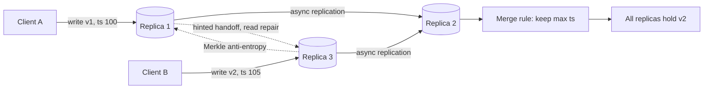
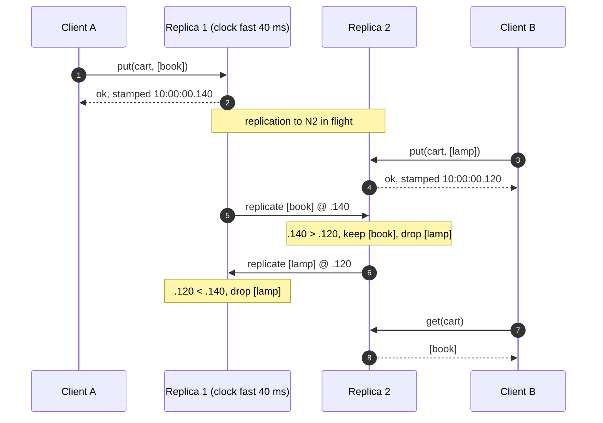
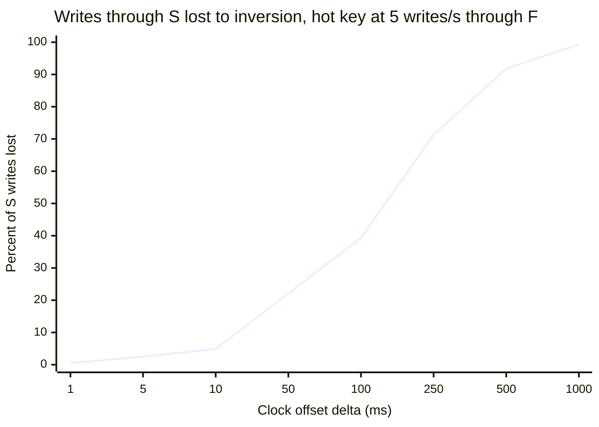
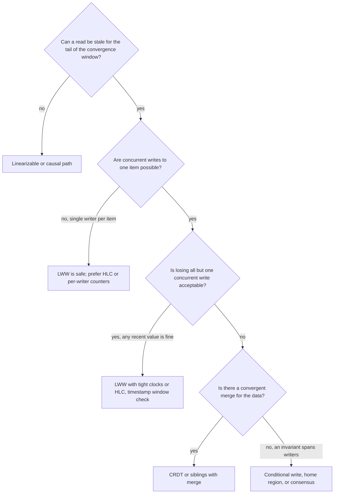

Nihai tutarlılık (eventual consistency), istemciler bir öğeye yazmayı bıraktığında o öğenin tüm replikalarının, belirsiz bir süre sonra, aynı değeri tutacağını ve her okumanın bu değeri döndüreceğini garanti eder. Bir replike depo için hâlâ işe yarar kalan en zayıf tutarlılık modelidir. Yazmalar yoldayken bir okumanın ne döndüreceği, yakınsamanın ne kadar süreceği ve replikaların birden çok eşzamanlı yazmadan hangisinde birleşeceği hakkında hiçbir şey söylemez. Yalnızca bu sözü veren bir depo, bir yazmayı erişilebilir herhangi bir replikada kabul edebilir, hemen onaylayabilir ve arka planda yayabilir; partition'lar boyunca erişilebilir kalmasının ve yerel replika gecikmesiyle yanıt vermesinin nedeni budur.

Çözdüğü problem şudur: daha güçlü her model, replikaların onay vermeden önce koordine olmasını gerektirir; koordinasyon ise olağan durumda bir round trip'e, partition sırasında da erişilebilirliğe mal olur. [CAP teoremi](/distributed-systems/tr/data-management/consistency-models/cap-theorem/) ve [PACELC](/distributed-systems/tr/data-management/consistency-models/pacelc-theorem/) sayfaları bunu gösterir. Koordinasyon olmadan iki replika aynı öğeye çakışan yazmaları kabul edebilir. Bu çakışmaları her yerde aynı biçimde çözen bir kural yoksa replikalar hiçbir zaman anlaşamaz; depo nihai tutarlı bile değildir, kalıcı olarak ayrışmıştır. Dolayısıyla garantinin yakınsama yarısı bedava değildir: deterministik bir uzlaştırma (reconciliation) kuralıyla satın alınır.

Son yazı kazanır (last write wins, LWW) bu kuralların en ucuzudur. Her sürüm bir zaman damgası taşır ve her replika en büyük damgalı sürümü tutar. LWW uygulama kodu, çakışma depolama ya da değer başına sekiz bayttan fazla metadata gerektirmez ve koşulsuz yakınsar. Temel denge şudur: veri atarak yakınsar. Eşzamanlı her yazma kümesinden birini tutar, gerisini kimseye haber vermeden düşürür; "son" saatlere göre belirlendiği için de gerçek zamanda daha sonra yapılmış bir yazmayı, hatta kendisini yenen yazmayı zaten görmüş bir istemcinin yazmasını düşürebilir. Her iki kayıp da istemciye yazmanın başarılı olduğu söylendikten sonra gerçekleşir. Bu sayfa garantinin ve LWW'nin hata biçimlerinin kanonik anlatımıdır; yayılım mekanizması [Lidersiz Replikasyon](/distributed-systems/tr/data-management/replication/leaderless-replication/) ve [Anti-Entropy](/distributed-systems/tr/data-management/replication/anti-entropy-merkle/) sayfalarında, veri atmadan yakınsayan kurallar ise [CRDT'ler](/distributed-systems/tr/data-management/consistency-models/crdts/) sayfasında ele alınır.

## Garanti: Süre Sınırı Olmayan Yakınsama

Werner Vogels'in sıkça alıntılanan tanımına göre, bir nesneye yeni güncelleme yapılmazsa sonunda tüm erişimler son güncellenen değeri döndürür. Tanım iki varsayımı gizler. "Sonunda" sınırsızdır: bir yıl sonra yakınsayan bir depo da tanımı karşılar. "Son güncellenen değer" ise deponun sahip olmadığı bir güncelleme sırasını önceden varsayar; çünkü farklı replikaların kabul ettiği eşzamanlı yazmaların doğal bir sırası yoktur. Bu sırayı uzlaştırma kuralı sonradan sağlar ve "son", kural neyi söylüyorsa odur.

Burckhardt'ınki ve Bailis ile Ghodsi'nin kullandığı gibi daha kesin formülasyonlar garantiyi iki parçaya ayırır. Nihai görünürlük (eventual visibility): bir replikanın kabul ettiği her yazma, ayakta kalan her replikaya sonunda ulaşır. Yakınsama (convergence): aynı yazma kümesini almış iki replika, yazmaların geliş sırasından bağımsız olarak aynı durumdadır. Görünürlük yayılımın, yakınsama uzlaştırma kuralının özelliğidir. İkisi birlikte Vogels'in ifadesini doğurur; ayrılmaları da yakınsamayan bir depoda operatöre nereye bakacağını söyler: ya yazmalar her yere ulaşmıyordur ya da ulaşıp farklı biçimde birleştiriliyordur.

İki parça da liveness (canlılık) özelliğidir: iyi bir şeyin sonunda olacağını söylerler ve hiçbir sonlu gözlem onları ihlal edemez. Son bir saatte kimsenin yazmadığı bir değeri döndüren okuma nihai tutarlılığı ihlal etmez, çünkü yakınsama daha sonra da olabilir. Modelin bir sözleşme olarak en derin zayıflığı budur. Bailis ve Ghodsi, nihai tutarlılığın harfiyen okunduğunda bir deponun yakınsamadan önce herhangi bir değer döndürmesine izin verdiğine dikkat çeker. Gerçek depolar bir istemcinin gerçekten yazdığı bir değeri döndürür; bu safety (güvenlik) özelliğini garantinin bir sonucu olarak değil, ona ek olarak sağlarlar.


*Garantinin iki yarısı. Düz ve kesikli oklar görünürlüğü sağlayan yayılımdır; her replikada bağımsız olarak uygulanan birleştirme kuralı ise yakınsamayı sağlar.*

Diyagram, çoğu zaman tek bir ad altında karıştırılan üç mekanizmayı ayırır. Yazma, yayılımdan önce, onu kabul eden replika ya da quorum tarafından onaylanır. Yayılım, doğrudan asenkron replikasyondan onun kaçırdıklarını yakalayan onarım yollarına kadar birkaç kanaldan akar; bunlar replikasyon bölümünün konusudur. Birleştirme kuralı yereldir: replika 2 hangi sürümü tutacağını kimseye sormaz, cevabı elindeki sürümlerden hesaplar. Yakınsama ancak her replika aynı girdiler üzerinde aynı kuralı çalıştırıyorsa ve kuralın cevabı geliş sırasına bağlı değilse ortaya çıkar. Şekilde replika 2, v2'yi v1'den önce de sonra da alabilir; en büyük damgayı tut kuralıyla her iki durumda v2'de biter.

### Garantinin Vaat Etmedikleri

Üretim hatalarının çoğu garantinin boş bıraktığı alanda yaşar; bu yüzden onu kesin olarak saymaya değer. Nihai tutarlılık bir istemcinin kendi yazmasını okuyacağını vaat etmez: sonraki okuma onu henüz almamış bir replikaya gidebilir; bu, [Replikasyon Gecikmesi](/distributed-systems/tr/data-management/replication/replication-lag/) sayfasında ele alınan problemdir. Monoton okumaları vaat etmez: art arda iki okuma farklı replikalara düşüp zamanda geri gidebilir. Nedensel sırayı vaat etmez: bir yanıt, yanıtladığı gönderiden önce görünür olabilir; [nedensel tutarlılığın](/distributed-systems/tr/data-management/consistency-models/causal-consistency-session-guarantees/) eklediği tam olarak budur. Belirli bir yazmanın hayatta kalacağını vaat etmez: LWW altında bir yazmanın sonunda görünür olacağı ancak daha büyük damgalı bir yazma onu gölgeleyene kadar garantidir ve bu, onu hiçbir okuyucu görmeden de olabilir. Süre sınırı vaat etmez; öğeler arası atomikliği de vaat etmez: birlikte yazılan iki öğe farklı zamanlarda yakınsayabilir ve öğe başına uzlaştırmada farklı yazmalardan gelen değerlerde birleşebilir.

Ön koşulları sağlandığında vaat ettiği şey durgunlukta uzlaşmadır (quiescent agreement). Ön koşullar şunlardır: yazmalar sonunda yeterince uzun süre durur; her replika sonunda her yazmayı (ya da onu gölgeleyen daha yeni bir sürüm gibi etkisini) alır; birleştirme kuralı deterministiktir, sıraya duyarsızdır ve her yerde aynıdır. Her ön koşulun bir hata biçimi vardır: yazılması hiç durmayan sıcak bir anahtar hiç durgunlaşmaz, bozuk bir onarım takvimi görünürlüğü ihlal eder, "en son uyguladığım sürümü tut" gibi yerel duruma bağlı bir kural ise yakınsamayı sessizce bozar.

### "Sonunda"yı Bir Sayıya Dönüştürmek

Bir operatör bir liveness özelliği için alarm kuramaz; bu yüzden yararlı ölçüm, yakınsama penceresinin dağılımıdır: bir yazmanın onaylanmasıyla herhangi bir replikadaki okumanın onu ya da daha yenisini döndürdüğü an arasındaki süre. Bailis ve arkadaşlarının probabilistically bounded staleness (PBS, olasılıksal sınırlı bayatlık) çalışması bunu Dynamo tarzı quorum'lar için modelledi ve kısmi quorum'ların çoğu zaman kısa bir pencere içinde tutarlı olduğunu, kuyruğun ise replika yükü ve yayılım gecikmeleriyle belirlendiğini buldu; [PACELC](/distributed-systems/tr/data-management/consistency-models/pacelc-theorem/) sayfası gecikmeyi tercih eden sistemleri bu çerçeveyle anlatır. Pratikte pencerenin nedenleri farklı iki bileşeni vardır. Gövde, yayılım gecikmesi ve uygulama süresidir: veri merkezi içinde milisaniyeler, bölgeler arasında kabaca bir bölgeler arası round trip. Kuyruk ise yayılımı durduran her şeydir: hint'leri süresi dolan düşmüş bir replika, geride kalan bir onarım takvimi, birikmiş bir replikasyon kuyruğu. Uygulamalar gövdeye göre tasarlanır; operatörü uyandıran kuyruktur ve kuyruk yapısı gereği sınırsızdır.

## Last Write Wins: Tam Sıra ile Yakınsama

LWW, bir öğenin sürüm kümesini tam sıralı (totally ordered) bir kümeye dönüştürür ve maksimumunu tutar. Fikir nihai tutarlılık teriminden eskidir. Johnson ve Thomas onu 1975'te RFC 677, *The Maintenance of Duplicate Databases* içinde tanımladı: her kayıt mevcut değerini belirleyen değişikliğin zaman damgasını saklar, bir zaman damgası bir saat okuması ile bir veritabanı sitesi kimliğinden oluşan bir çifttir ve replika gelen bir değişikliği yalnızca damgası daha büyükse uygular. Çift önemlidir. İki site aynı saat değerini okuyabilir; bir eşitlik bozucu (tie-breaker) olmadan iki replika aynı yazma çiftini farklı çözebilir. RFC ayrıca saatlerin, iki atamadan ikincisini birincisinden önce damgalayacak kadar senkron dışı olabileceğini ve bunun olasılığının asla sıfır olamayacağını belirtiyordu.

Her replikadaki mekanizma, gelen her sürüm üzerinde bir karşılaştır-ve-tut işlemidir; sürüm bir istemci yazması, bir replikasyon mesajı, bir hint ya da bir onarım akışı olarak gelebilir. Replika gelen `(timestamp, tie-breaker)` çiftini saklı olanla karşılaştırır, büyüğünü tutar, diğerini atar. Silme bir kaldırma değil, aynı kurala göre yarışan, "t zamanı itibarıyla yok" diyen bir tombstone (mezar taşı kaydı) yazmasıdır; o olmasaydı öğeyi silmiş bir replikanın karşılaştıracak hiçbir şeyi kalmaz ve geç gelen daha eski bir yazma öğeyi geri getirirdi. Tombstone'lar ancak her replikanın onları tuttuğu bilindikten sonra temizlenir. RFC 677 silinmiş bir kaydı, damgası sitelerin birbirine onayladığı tüm damgalardan eski olduğunda kaldırıyordu; Cassandra ise sabit bir bekleme süresinden sonra temizler ve bu süre içinde onarım ister. Bu tasarımın hata biçimi, yani silinen verinin geri gelmesi, [Lidersiz Replikasyon](/distributed-systems/tr/data-management/replication/leaderless-replication/) sayfasında anlatılır.


*LWW'nin iki eşzamanlı yazmayı çözmesi. İki istemci de başarı yanıtı alır; B'nin yazması gerçek zamanda 20 ms sonra gelmiştir ama daha küçük damgayı taşır ve iki replika da A'nın değerinde yakınsar. Zamanlar örnek amaçlıdır.*

1-4. adımlar olağan hızlı yoldur: her replika bağımsız olarak damgalar ve onaylar; bu anda sistem iki farklı "en son" değer tutmaktadır. 5. ve 6. adımlar yayılımdır; ardından gelen notlar her iki tarafta yerel olarak uygulanan birleştirme kuralıdır ve zıt geliş sıralarında aynı cevaba ulaşır. Bedel 7. ve 8. adımlarda görünür olur: B yazdı, yazmanın başarılı olduğu söylendi ve şimdi onu içermeyen bir değer okuyor; ne bir hata, ne bir çakışma kaydı, ne de iki replikanın durumunda bir iz var. B'nin yazması A'nınkini okuduktan sonra yapıldıysa kayıp, eşzamanlı yazmalar arasında keyfi bir seçimden daha kötüdür: nedensel olarak sonraki bir yazma, 40 ms'lik bir saat sapması yüzünden önceki bir yazmaya yenilmiştir.

### LWW Neden Yakınsar ve Bu İspat Neyi Kapsamaz

Yakınsama argümanı kısadır. Tam bir sıraya göre iki sürümden büyüğünü tutmak değişmeli (commutative), birleşmeli (associative) ve idempotent'tir; dolayısıyla herhangi bir sürüm kümesini, herhangi bir sırayla ve herhangi bir tekrarla almış bir replikanın durumu o kümenin maksimumudur. Aynı kümeye sahip iki replika aynı maksimuma sahiptir. Bu tam olarak durum tabanlı bir CRDT'nin (Conflict-free Replicated Data Type, çakışmasız çoğaltılmış veri türü) yapısıdır; LWW register'ı bunların en basitidir ve genel teori [CRDT'ler](/distributed-systems/tr/data-management/consistency-models/crdts/) sayfasındadır.

Argümanın dört ön koşulu vardır ve her biri gerçek dünyada bir hata yüzeyidir. Sıra tam olmalıdır: eşitlikler, her replikanın aynı biçimde gördüğü bir şeyle, örneğin bir düğüm kimliği ya da değer baytlarıyla bozulmalıdır; asla geliş sırasıyla değil. Karşılaştırma yalnızca sürümle birlikte taşınan veriyi kullanmalıdır: örneğin "gelecekten gelen" sürümleri reddetmek için yerel saatiyle karşılaştırma yapan bir replika determinizmi bozar, çünkü replikaların saatleri farklıdır. Tombstone'lar her replika onları alana kadar yaşamalıdır, yoksa kümenin maksimumu replikadan replikaya değişebilir. Ve her replika aynı kuralı çalıştırmalıdır; bu, eşitlik bozmayı ya da tombstone işlemeyi değiştiren bir rolling upgrade sırasında önem kazanır.

İspatın kapsamadığı şey, hayatta kalan değerin doğru değer olup olmadığıdır. Yakınsama niyet hakkında değil, uzlaşma hakkında bir önermedir. LWW yanlış kazanan üzerinde de doğru kazanan üzerinde olduğu kadar güvenilir biçimde yakınsar; onarım ve anti-entropy'nin bir LWW kaybını düzeltememesinin nedeni budur: kazananı sadakatle her replikaya yayarlar.

### Zaman Damgası Nereden Gelir

Pratikte dört kaynak kullanılır ve hata biçimlerini kaynak belirler. Uygulama sunucusunun duvar saatinden istemci tarafından atanan bir damga, "son"u "damgalayan uygulama host'una göre son" anlamına getirir; Cassandra sürücüleri bunu varsayılan olarak yapar (Java sürücüsü 4.x'in varsayılan üreticisi istemci tarafındadır ve oturum başına monotondur). Koordinatör tarafından atanan bir damga saati isteği alan depolama düğümüne taşır. Mantıksal bir damga, yani bir [Lamport saati](/distributed-systems/tr/foundations/time-and-ordering/lamport-timestamps/) ya da sürüm sayacı, nedensel olarak sıralı yazmaları asla ters çevirmez ama gerçek zamanla bir ilişkisi yoktur; birbiriyle iletişim kurmayan yazıcılar arasında daha çok operasyon yapan tarafı kayırır, sayfasında incelenen aktivite yanlılığı (activity bias) budur. [Hibrit mantıksal saat](/distributed-systems/tr/foundations/time-and-ordering/hybrid-logical-clocks/) (HLC) ikisini birleştirir: nedensel bir çifti asla ters çevirmez ve fiziksel zamandan en fazla saat sapması sınırı kadar uzaklaşır. Dördü içinde yalnızca HLC "son"u hem nedensel olarak güvenli hem de yaklaşık olarak güncel kılar; hiçbiri iki eşzamanlı yazmadan birden fazlasını tutmaz.

### Granülerlik: Nesne, Satır, Hücre

LWW bütün bir nesneye, bir satıra ya da her sütuna bağımsız olarak uygulanabilir. Kaba granülerlik daha çok kaybettirir: aynı nesnenin farklı alanlarını değiştiren iki yazma çakışır ve biri tamamen düşer. Bu durum için satır ve sütun düzeyinde çözümleme [Çok Liderli Replikasyon](/distributed-systems/tr/data-management/replication/multi-leader-replication/) sayfasında ele alınır. İnce granülerliğin daha az belirgin bir maliyeti vardır: yakınsanan satır, hiçbir istemcinin yazmadığı bir satır olabilir. Cassandra LWW'yi hücre başına uygular ve her hücre kendi damgasını taşır; ancak tek bir ifadenin yazdığı tüm hücreler aynı damgayı paylaşır. Bu yüzden tam olarak aynı sütunları yazan iki yazma birlikte kazanır ya da birlikte kaybeder. Farklı sütun alt kümelerini yazanlar ise öyle değildir. Bir yazma 10 damgasıyla `amount = 100, currency = EUR` yazarsa ve dolar bağlamındaki eski bir okumadan hesaplanmış eşzamanlı bir yazma 11 damgasıyla yalnızca `amount = 90` yazarsa, yakınsanan satır 90 euro olur; bu, iki istemcinin de yazmadığı bir satırdır. Eşit damgalar sütun kümeleri aynı olsa bile satırı yırtar: iki yazma da her iki sütunu aynı damgayla yazarsa her hücre bağımsız olarak büyük değeri tutar; böylece `(100, EUR)` ile `(90, USD)` karşılaşınca sonuç `(100, USD)` olur. Bir tutarın ancak kendi para birimiyle anlamlı olması gibi sütunlar arası bir değişmez (invariant) bu durumda her replikada, tutarlı biçimde ihlal edilmiş olur. Atomik olarak değişmesi gereken veri tek bir hücreye, örneğin serileştirilmiş bir değere ya da frozen bir kullanıcı tanımlı türe aittir; böylece uzlaştırma birimi anlam birimiyle örtüşür.

## LWW Onaylanmış Yazmaları Nasıl Kaybeder

Her LWW kaybı aşağıdaki mekanizmalardan birine dayanır. Bunlar nedenleri, LWW'nin kendisine mi yoksa damgalarına mı ait oldukları ve nasıl tespit edilebilecekleri bakımından ayrışır.

### Eşzamanlı Yazmalar: Tasarım Gereği Kayıp

İki yazmanın yazıcılarından hiçbiri diğerinin yazmasını görmemişse yazmalar eşzamanlıdır; resmî tanım [happened-before](/distributed-systems/tr/foundations/time-and-ordering/happened-before/) sayfasındadır. Böyle bir çift için hiçbir sıra kimsenin niyetini yansıtmaz ve LWW'nin birini seçmesi, iki değerin de kabul edilebilir olduğu veri için meşru bir politikadır: bir kullanıcının son görüldüğü konum, bir cache kaydı, bir sensörün son okuması. Kayıp, yazma bir read-modify-write (oku-değiştir-yaz) olduğunda kusura dönüşür. Bir sayacı 10 olarak okuyup 11 yazan iki istemci iki artırım yapmıştır; LWW 11 saklar. Bir alışveriş sepetini okuyup birer ürün ekleyen iki istemci, her biri tek ürünlü iki sepet üretir ve LWW bunlardan birini tutar. Hiçbir saat düzeltmesi işe yaramaz, çünkü sorun sıra değildir; semantiğin iki değerin bir birleşimini gerektirdiği yerde kuralın tek değer tutmasıdır. Bu çakışmaların yazma hızı ve replikasyon gecikmesine göre ne sıklıkta olduğu [Çok Liderli Replikasyon](/distributed-systems/tr/data-management/replication/multi-leader-replication/) sayfasında hesaplanır.

### Saat Kayması: Ters Çevirme Penceresi

Damgalar fiziksel saatlerden geldiğinde, gerçek zamanda aralarında damgalayan saatler arasındaki sapmadan daha az süre bulunan bir yazma çifti ters sıralanabilir. F host'u S'den `delta` kadar ilerideyse, S'nin `t2` gerçek zamanında damgaladığı bir yazma, F'nin `t1` gerçek zamanında damgaladığı bir yazmaya, `t1` `t2`'den önce olduğu ve `t2 - t1` değeri `delta`'dan küçük olduğu her durumda yenilir. Pencere tek yönlüdür: F'nin yazmaları her F yazmasından sonraki `delta` süresince S'ninkileri yener; S'nin yazmaları ise F'ninkileri asla haksız yere yenmez.

Pencerenin önemi, boyutunun bir istemcinin okuması ile sonraki yazması arasındaki round trip süresine göre büyüklüğüne bağlı olarak iki farklı biçim alır. Sapma mümkün olan en hızlı oku-sonra-yaz döngüsünden küçükse ters çevrilen her çift zaten eşzamanlıdır; ters çevirme hangi eşzamanlı yazmanın kaybolacağını değiştirir, güncelliğe zarar verir ama nedenselliğe vermez. Sapma bu döngüyü aştığında bir istemci F'nin yazmasını okuyabilir, ona göre davranabilir ve S üzerinden yazabilir; nedensel olarak sonraki bu yazma kaybolur. Veri merkezi içinde oku-sonra-yaz döngüsü bir milisaniyenin epey altında olabilir; dolayısıyla birkaç milisaniyelik herhangi bir sapma nedensel ters çevirmeler için yeterlidir. Kingsbury'nin 2013 tarihli Cassandra Jepsen analizinin gösterdiği koşul budur; analiz [happened-before](/distributed-systems/tr/foundations/time-and-ordering/happened-before/) sayfasında tartışılır, gerçek saatlerin hata bütçesi ise [Fiziksel Saatler](/distributed-systems/tr/foundations/time-and-ordering/physical-clocks/) sayfasında sayısallaştırılır.

### Hesaplamalı Örnek: Ters Çevirme Oranı ve İleri Tarihli Damga Gölgelemesi

Örnek olarak, F ve S adlı iki koordinatörün yazdığı bir anahtar varsayalım; F'nin saati S'ninkinden `delta` kadar ileride olsun ve F'nin o anahtara yazmaları saniyede `lambda` hızlı bir Poisson süreci olarak gelsin. S üzerinden gelen bir yazma, F anahtarı önceki `delta` saniyelik gerçek zaman içinde yazmışsa haksız yere atılır; bunun olasılığı `1 - exp(-lambda * delta)`'dır.

F üzerinden saniyede `lambda = 5` yazma alan sıcak bir anahtar için, örneğin birçok oturumun güncellediği bir varlık (presence) kaydı ya da paylaşılan bir dokümanın metadata'sı, ve iyi senkronize edilmiş `delta = 2 ms`'lik bir çift için olasılık `1 - exp(-0.01)`, yaklaşık %1,0'dır. S üzerinden o anahtara yapılan her yüz yazmadan biri sessizce daha eski bir değerle değiştirilir. Zaman daemon'u bir süre kaynaklarını kaybetmiş bir host için makul bir sapma olan `delta = 50 ms`'de olasılık `1 - exp(-0.25)`, yaklaşık %22'dir. F üzerinden dakikada bir yazılan soğuk bir anahtarda, `lambda = 1/60`, aynı 50 ms'lik sapma `1 - exp(-0.05/60)`, yaklaşık `8.3e-4` verir. Yazma başına ihmal edilebilir görünür; ama bu tür anahtarlara S üzerinden günde bir milyon yazmada, günde yaklaşık 830 kayıp yazma eder ve her biri onaylanmıştır.


*Saniyede `lambda = 5` için ters çevirme olasılığı `1 - exp(-lambda * delta)`. Model ve yazma hızı örnek amaçlıdır.*

Eğri küçük sapmalarda neredeyse doğrusaldır, S'nin yazmalarının kabaca `lambda * delta` kadarı kaybolur; `delta`, F'nin yazmaları arasındaki ortalama aralığı aştığında doyuma ulaşır. Pratik okuma şudur: güvenli sapma, ortalama anahtarın değil en sıcak anahtarların yazma hızına bağlıdır. Kullanıcı profilleri için zararsız olan 10 ms'lik bir sapma, saniyede beş kez yazılan bir anahtarda yirmi yazmadan birini kaybettirir. Model koordinatör tarafındaki monoton düzeltmeleri yok sayar ve F'nin yazmalarını bağımsız kabul eder; bu yüzden sayılar bir tahmin değil, bir ölçektir.

İkinci hesap, bir saat hatasını bir kesintiye dönüştürendir. Bir host'un saatinin 30 saniye ileri sıçradığını ve host'un, devreden çıkarılmadan önce iki dakika boyunca yazmaların %10'unu koordine etmeye devam ettiğini varsayalım; anahtarlar toplamda saniyede bir kez yazılıyor olsun. Host'un bir anahtarda damgaladığı ilk yazma ortalama olarak olayın yaklaşık onuncu saniyesinde gelir. O andan itibaren, başka herhangi bir koordinatör üzerinden o anahtara yapılan her yazma, gerçek zaman zehirli damgayı yakalayana kadar, yani hatalı host'un o anahtara son yazmasından 30 saniye sonrasına kadar, zehirli damgadan küçük bir damga taşır. Hatalı host'un damgaladığı her yeni yazma gölgeyi uzatır. Anahtar başına, sağlıklı koordinatörler üzerinden 10. ile 150. saniyeler arasındaki yazmalar kabaca kaybolur: yaklaşık 0,9 çarpı 140, anahtarın aldığı kabaca 150 yazmadan 126 kadarı. Her biri onaylanmıştır. Silmeler de aynı biçimde gölgelenir; bu yüzden gölge geçene kadar anahtar silinemez bile ve gölge hatalı host'tan daha uzun yaşar. Saat yeterince ileride, saatler ya da yıllar ilerideyse, öğe normal yazmalar açısından fiilen değiştirilemez hâle gelir.

### Silmeler, Tombstone'lar ve Eşit Damgalar

LWW altında silmeler de yazmadır; bu yüzden yukarıdaki her ters çevirme onlar için de geçerlidir. Eşzamanlı bir güncellemenin biraz gerisinde damgalanan bir silme kaybeder ve öğe silmeden sağ çıkar; sonraki bir yeniden eklemenin ilerisinde damgalanan bir silme ise gerçek zaman tombstone'un damgasını geçene kadar yeniden eklemeyi görünmez kılar. Eşit damgalar deterministik ama şaşırtıcı bir durum ekler. Cassandra'da bir tombstone ile canlı bir hücre aynı damgayı taşıdığında tombstone kazanır; dolayısıyla aynı mikrosaniyede damgalanmış bir silme ve ardından gelen ekleme, ki bu bir batch ya da istemci ikisini tek damgayla ürettiğinde olur, satırı silinmiş bırakır. Aynı damgalı iki canlı hücre arasında Cassandra değerlerin kendisini karşılaştırır ve büyüğünü tutar; bu kural yakınsar ama hangi yazmanın sonra geldiğiyle hiçbir ilgisi yoktur. Milisaniye granülerliğinde damgalayıp mikrosaniyeye tamamlayan istemciler, bu eşitlikleri mikrosaniye biriminin düşündürdüğünden çok daha olası kılar.

Tombstone'ların ömrü son mekanizmadır ve niyeti değil yakınsamayı bozan tek mekanizmadır. Bir tombstone, silmeyi kaçırmış bir replika onu almadan önce bazı replikalarda temizlenirse, o replikadaki eski canlı değerin yenileceği hiçbir şey kalmaz ve onarım onu herkese geri yayar: silinen veri diriltilir. Bekleme süresi mekaniği ve bunu önleyen onarım takvimi [Lidersiz Replikasyon](/distributed-systems/tr/data-management/replication/leaderless-replication/) ve [Anti-Entropy](/distributed-systems/tr/data-management/replication/anti-entropy-merkle/) sayfalarındadır.

:::danger[İleri tarihli bir damga bir öğeye yazmayı sessizce devre dışı bırakır]
Gerçek zamanın ilerisinde damgalanmış bir sürüm, saatler yetişene kadar normal damgalı her yazmayı ve silmeyi yener ve bu yazmaların hepsi onaylanır. Kaynak ileri sıçramış bir host saati, kendi damgalarını gönderen bir istemci ya da yanlış birim kullanan bir toplu yükleme olabilir (Cassandra'nın mikrosaniye beklediği yerde nanosaniye, damgayı on binlerce yıl ileriye koyar; tersi hata, milisaniye ise damgayı 1970'e koyar ve o yazmalar asla etkili olmaz). Onarım işe yaramaz, çünkü onarım replikaları zehirli sürümde yakınsatır.
:::

### Kayma Olmadan Nedensel Ters Çevirme: Mantıksal Damgalar

Mantıksal damgalı LWW'de ters çevirme penceresi yoktur, çünkü nedensel olarak sonraki bir yazma her zaman daha büyük bir damga taşır. Farklı bir yanlılığı vardır: iletişim kurmamış yazıcılar arasında daha çok operasyon yapan tarafın sayaçları daha büyüktür ve gerçek zamandan bağımsız olarak o kazanır. Bir partition'dan sonra sakin bir bölgenin sonraki düzenlemeleri, yoğun bir bölgenin önceki düzenlemelerine yenilebilir. Mekanizma [Lamport Zaman Damgaları](/distributed-systems/tr/foundations/time-and-ordering/lamport-timestamps/) sayfasındadır; burada önemi şudur: duvar saatlerinden mantıksal saatlere geçmek anomalileri ortadan kaldırmaz, bir LWW anomalisini bir başkasıyla takas eder.

## LWW ve Alternatifleri

LWW'nin rakiplerinin hepsi ya daha fazla bilgi tutar ya da daha fazla koordine olur. Version vector'ler iki yazmanın eşzamanlı olduğunu tespit eder ve okuyucunun birleştirmesi için ikisini de sibling (kardeş sürüm) olarak tutar; özgün Dynamo tasarımı ve Riak böyledir, karşılaştırma kuralları [Vektör Saatler](/distributed-systems/tr/foundations/time-and-ordering/vector-clocks/) sayfasındadır. CRDT'ler register'ı, birleştirmesi her yazmanın etkisini koruyan bir veri türüyle değiştirir: replika başına artırımları toplayan bir sayaç ya da eklemeleri ve çıkarmaları izleyen bir küme gibi. Koşullu yazmalar ve konsensüs, sırayı onaydan önce tek bir yerin belirlemesini sağlayarak çakışmayı önler; bedeli bir round trip ve partition'ın azınlık tarafında erişilebilirliktir.

| Yaklaşım | Eşzamanlı yazmalar | Saat bağımlılığı | Değer başına metadata | Yazmada koordinasyon | Ne zaman tercih edilmeli |
|---|---|---|---|---|---|
| LWW, fiziksel damgalar | Biri tutulur, gerisi sessizce düşer | Kazanan ve nedensel güvenlik sapmalara bağlı | Bir damga | Yok | Herhangi bir yakın değerin kabul edilebildiği değerler: cache'ler, son görülme, sensör okumaları |
| LWW, hibrit mantıksal saat | Biri tutulur, gerisi sessizce düşer | Nedensel olarak güvenli; güncellik sapma sınırı içinde | Bir HLC değeri | Yok | Nedensel olarak sonraki bir yazmanın asla kaybetmemesi gereken LWW semantiği |
| LWW, Lamport damgası | Biri tutulur, gerisi sessizce düşer | Yok; yazıcılar arasında aktivite yanlılığı | Sayaç ve düğüm kimliği | Yok | Okumaları replike edilen, öğe başına tek yazıcılı veri |
| Sibling'li version vector'ler | Bir okuyucu birleştirene kadar hepsi tutulur | Yok | Yazıcı ya da replika başına bir girdi | Yok | Uygulama tanımlı birleştirmesi olan nesneler, örneğin sepetler |
| CRDT'ler | Her yazmanın etkisi korunur | Yok | Türe bağlı, büyüyebilir | Yok | Eşzamanlı yazıcılar altında sayaçlar, kümeler, map'ler, ortak metin |
| Koşullu yazma ya da konsensüs | Onaydan önce reddedilir ya da sıralanır | Doğruluk için yok | Sürüm numarası | Bir leader'a ya da quorum'a round trip | Değişmezler, benzersizlik, bakiyeler, read-modify-write |

İki sütun özellikle vurgulanmayı hak eder. "Eşzamanlı yazmalar" sütunu üç LWW çeşidi için de aynıdır: hiçbir damga kaynağı LWW'nin tek değer tuttuğu gerçeğini değiştirmez. Damga kaynağı yalnızca hangisinin tutulacağını ve seçimin nedenselliğe aykırı düşüp düşemeyeceğini belirler. "Koordinasyon" sütunu ise LWW'nin zayıflıklarına rağmen bu kadar çok depoda varsayılan olarak kalmasını açıklar: yazma yolunu tamamen yerel tutan, birleştirme kodu gerektirmeyen ve sabit metadata'ya sahip tek satır odur. Onu seçen ekipler bedelin gecikmeyle değil veriyle ödendiğini bilerek seçmelidir.

## Üretim Sistemlerinde LWW

### Cassandra ve ScyllaDB

Cassandra her hücreyi mikrosaniyelik bir damgayla işaretler ve her okumayı, onarımı ve compaction'ı en büyüğü tutarak uzlaştırır. Damgayı, istemci sunucu tarafı üretimi seçmedikçe istemci sürücüsü atar; seçerse koordinatör atar. Java sürücüsü 4.x'in varsayılanı oturum çapında monoton bir istemci tarafı üreticidir: saat geri gittiğinde ya da mikrosaniye başına birden fazla damga istendiğinde, verdiği son değerin ötesine artırır ve üretilen damgalar saatin bir eşikten (varsayılan olarak bir saniye) fazla önüne geçtiğinde bir sapma (drift) uyarısı loglar. Monotonluk üretici başınadır; dolayısıyla farklı uygulama host'larından gelen yazmalar yine o host'ların saatlerine göre sıralanır. Bir istemci damgayı `USING TIMESTAMP` ile açıkça da belirleyebilir; idempotent tekrar oynatmalar ve toplu yükleyiciler özgün yazma zamanlarını böyle korur, bir birim hatası da bir tabloyu böyle zehirler. `WRITETIME()` fonksiyonu bir hücrenin damgasını döndürür ve birincil teşhis aracıdır.

Cassandra'nın Paxos tabanlı koşullu yazmaları olan lightweight transaction'lar (LWT), damgalarını istemciden değil Paxos ballot'undan alır; sürücü dokümantasyonu koşullu güncellemelerde istemci tarafı damgaların yok sayıldığını belirtir ve bunlarda açık bir `USING TIMESTAMP` reddedilir. İki damga kaynağı birbiriyle ilişkisiz olduğu için DataStax dokümantasyonu, aynı veri üzerinde LWT ile normal operasyonları karıştırmanın hatalara yol açabileceği konusunda uyarır ve bu tür verinin hem okumaları hem yazmaları için LWT kullanılmasını önerir; örneği, düz bir `DELETE` ardından `INSERT ... IF NOT EXISTS` dizisidir ve bunun yerine `DELETE ... IF EXISTS` kullanılmalıdır.

```sql
-- Find cells stamped in the future (WRITETIME is microseconds since epoch).
SELECT id, status, WRITETIME(status) AS ts_us
FROM orders WHERE id = 42;
-- Compare ts_us with the current time in microseconds; a value ahead of now
-- means every normal write and delete to this cell is being shadowed.

-- Recovery: overwrite with a timestamp strictly greater than the poisoned one.
-- 1800000000000001 is an illustrative value above the poisoned timestamp.
UPDATE orders USING TIMESTAMP 1800000000000001 SET status = 'shipped' WHERE id = 42;
```

Snippet teşhisi ve tek anlık kurtarma yolunu gösterir. Daha büyük açık bir damgayla üzerine yazmak işe yarar; ama yeni değer de gelecektedir, bu yüzden gerçek zaman yetişene kadar sonraki her normal yazma da onun üstünde açık damgalar kullanmalıdır. Alternatif, zehirli hücreleri açık ve yüksek bir damgayla silip ardından onun üstünde açık damgalarla yeniden eklemektir; bu durumda tombstone'un aynı süre boyunca normal yazmaları gölgelemesi kabul edilir. İkisi de temiz değildir; önlemenin, yani damgası koordinatörün saatinden çok uzak yazmaları uygulama ya da proxy katmanında reddetmenin kurtarmadan daha önemli olmasının nedeni budur.

### DynamoDB Global Tabloları

Tek bölgedeki tek bir DynamoDB tablosu bir LWW deposu değildir; her partition'ın yazmaları sıralayan bir Paxos leader'ı vardır. LWW, multi-Region eventual consistency modundaki global tablolarda ortaya çıkar: aynı öğe farklı bölgelerde eşzamanlı olarak değiştirildiğinde DynamoDB, öğe başına, en son dahili damgaya sahip değişikliği tutar. Belgelenmiş iki sonuç doğar. Koşullu yazmalar koşullarını, verildikleri bölgedeki öğe sürümüne göre değerlendirir; bu yüzden `attribute_not_exists` gibi bir benzersizlik kontrolü iki bölgede aynı anda başarılı olabilir ve LWW ardından iki "başarılı" oluşturmadan birini atar. Transaction'lar yalnızca çalıştıkları bölge içinde atomiktir ve bir birim olarak replike edilmez; diğer bölgeler bir transaction'ın bir kısmını gözlemleyebilir ve öğe başına LWW onun bazı yazmalarını tutup bazılarını düşürebilir. Multi-Region strong consistency modu, yazmaları onaydan önce bölgeler arasında koordine ederek iki davranışı da ortadan kaldırır; gecikme maliyeti PACELC sayfasında ele alınır.

### Cosmos DB ve Riak

Birden çok yazma bölgeli Cosmos DB varsayılan olarak sistem `_ts` özelliği ya da uygulamanın adlandırdığı sayısal bir özellik üzerinde LWW politikası uygular ve silmeler her zaman kazanır; politika container başına seçilir, özel birleştirme alternatifi [Çok Liderli Replikasyon](/distributed-systems/tr/data-management/replication/multi-leader-replication/) sayfasında anlatılır. Bir uygulama özelliğini adlandırmak yararlıdır, çünkü uygulamanın bir sunucu saati yerine anlamlı bir sürüm, örneğin monoton artan bir doküman revizyonu sağlamasına izin verir. Riak seçimi bucket başına açıkça sunar: `allow_mult` etkinken vektör saatler ya da dotted version vector'ler altında sibling'leri tutar, `last_write_wins` ile ise eşzamanlı sürümleri damgaya göre atar. Aynı deponun ikisini de sunması dengeyi somutlaştırır: sibling'ler okuma yolunda birleştirme koduna ve metadata'ya, LWW ise kayıp yazmalara mal olur.

:::caution[İstemcinin verdiği damgalar saat problemini uygulama katmanına taşır]
İstemci tarafı damgalar koordinatör saat kaymasını tablodan ancak uygulama filosu depolama filosundan daha iyi senkronize ise çıkarır ve bu nadiren kontrol edilir. Her uygulama host'u bir "son" kaynağı olur, container'lar host saatini devralır ve veriyi özgün damgalarıyla tekrar oynatan batch işleri canlı yazmaları gölgeleyebilir. Saat sapmasını yalnızca veritabanı düğümlerinde değil, yazma damgalayan her host'ta izleyin ve sürücünün sapma uyarısını açık tutun.
:::

## Hata Biçimleri ve Nasıl Görünürler

LWW hatalarının onları tehlikeli kılan ortak bir özelliği vardır: depo başarı bildirir, her replika uzlaşır ve onarım hiçbir şey bulamaz. Bu yüzden tespit uzlaştırma yolunun dışından gelmelidir: saat telemetrisinden, damga incelemesinden ya da uygulama düzeyindeki değişmezlerden.

### İleri Tarihli Damga Gölgelemesi

Tetikleyici: damgalayan bir host'un saati ileri sıçrar, bir istemci damgaları yanlış birimle gönderir ya da bir taşıma işlemi veriyi hedefin şimdisinin ilerisindeki damgalarla tekrar oynatır. Belirtiler: bazı öğelere yapılan yazmalar ve silmeler başarılı olur ama hiçbir etkisi olmaz; etkilenen öğeler hatalı kaynağın dokunduklarıdır ve kaynak düzeltildikten sonra da problem sürer. Tespit: zaman kaynağına göre damgalayan host başına saat sapması, zaman daemon'unun step ve panic mesajları, Java sürücüsünün drift uyarıları ve örneklenmiş `WRITETIME()` değerlerinin şimdiki zamanla karşılaştırılması; koordinatör saatinin birkaç saniyeden fazla ilerisindeki herhangi bir damga için kurulan bir alarm sorunu ilk yazmada yakalar. Hafifletme: izin verilen bir pencerenin dışındaki damgalı yazmaları koordinatörde ya da bir proxy'de reddedin, zaman daemon'unda adım büyüklüğünü sınırlayın ve sapma alarmlarında host'u rotasyondan çıkarın. Kurtarma: zehirli öğeleri damgaları tarayarak bulun, ardından yukarıda gösterildiği gibi zehirli damgaların üstünde açık damgalarla üzerlerine yazın ya da silin.

```mermaid
gantt
    title Illustrative future-timestamp incident, clock stepped 30 s ahead
    dateFormat HH:mm:ss
    axisFormat %H:%M:%S
    section Faulty coordinator
    Clock steps forward 30 s             :milestone, m1, 10:00:00, 0s
    Stamps writes 30 s in the future     :crit, f1, 10:00:00, 120s
    Removed from rotation                :milestone, m2, 10:02:00, 0s
    section Healthy coordinators
    Writes to poisoned keys acked and lost :crit, h1, 10:00:10, 140s
    Writes take effect again             :h2, 10:02:30, 60s
    section Operators
    Offset alarm fires                   :milestone, a1, 10:01:30, 0s
    Users report edits not saving        :u1, 10:00:40, 110s
```


*Gölge, arızadan saat sıçramasının büyüklüğü kadar uzun yaşar. Zamanlar ve süreler örnek amaçlıdır.*

Zaman çizelgesi bu hatanın neden kolayca yanlış teşhis edildiğini gösterir. Arıza ile kullanıcıya görünen belirti farklı host'lardadır: asla etkili olmayan yazmaları onaylayanlar sağlıklı koordinatörlerdir. Hatalı host'u 10:02:00'da çıkarmak olayı bitirmez; zehirli damgalar zaten her replikada olduğu için yazmalar 30 saniye daha başarısız olmaya devam eder. Saniyeler yerine saatler büyüklüğünde bir sıçrama aynı diziyi bir veri onarım projesine dönüştürür; yalnızca sapmaya kurulan ve 10:01:30'da tetiklenen alarm da geç kalmıştır: ilk zehirli yazma 80 saniye önce düşmüştü. Koordinatörün saatinin ilerisindeki yazma damgalarına alarm kurmak daha hızlı sinyaldir.

### Read-Modify-Write Kaynaklı Kayıp Güncellemeler

Tetikleyici: bir uygulama bir değeri okur, yenisini hesaplar ve geri yazar; bu sırada başka bir istemci aynısını başka bir replikada ya da replikasyon gecikmesi içinde yapar. Belirtiler: artırım sayısının altında kalan sayaçlar, listelerden ya da sepetlerden kaybolan öğeler, geri dönen yapılandırma düzenlemeleri. Tespit: depodan gelmez, çünkü tutarsız hiçbir şey yoktur; türetilmiş değerleri bağımsız bir kayıtla (bir olay logu, bir sipariş tablosu) karşılaştıran uzlaştırma işleri bunu bulur, artırıp doğrulayan canary istemciler de oranı ölçebilir. Hafifletme: değeri bir CRDT ya da olay eklemeleri olarak modelleyin, güncelleme kaybetmemesi gereken değerler için deponun koşullu yazma ya da LWT yolunu kullanın veya her öğeye tek bir yazıcı verin. Kurtarma: varsa yetkili bir logdan değeri yeniden oluşturun; yoksa kayıp güncellemeler geri getirilemez.

### Etkili Olmayan Silme ya da Görünmeyen Ekleme

Tetikleyici: aynı öğenin bir silmesi ile bir güncellemesi ya da eklemesi farklı host'lar tarafından birbirine yakın ya da aynı damgayla işaretlenir. Belirtiler: silinmiş bir öğe kalır ya da yeniden oluşturulmuş bir öğe bir süre geçene kadar görünmez; Cassandra'da tek bir batch içinde tek damgayla verilen bir silme ve ekleme satırı silinmiş bırakır. Tespit: canlı hücrelerin `WRITETIME()` değerinin, tracing ya da sstable inceleme araçlarının gösterdiği tombstone damgasıyla karşılaştırılması ve amaçlanan sırayı kaydeden uygulama logları. Hafifletme: bir silme ile yeniden eklemeyi asla aynı damgayla üretmeyin, sil-sonra-ekle yerine üzerine yazmayı tercih edin ve aynı öğenin silmelerini ve yeniden oluşturmalarını tek bir damga kaynağından geçirin. Kurtarma: amaçlanan son operasyonu ikisinden de büyük bir damgayla yeniden verin.

### Hücreler Arasında Yırtılmış Satırlar

Tetikleyici: hücre başına LWW altında, örtüşen sütun kümelerine dokunan ve farklı host'lar tarafından damgalanan eşzamanlı yazmalar. Belirtiler: sütunları tek tek geçerli ama birlikte tutarsız satırlar: yanlış para birimli bir tutar, zaman damgası sütunuyla uyuşmayan bir durum. Tespit: örneklenmiş satırlar üzerinde uygulama düzeyinde değişmez kontrolleri; bir satır içinde farklılaşan hücre başına `WRITETIME()` değerleri hangi sütunun hangi yazmadan geldiğini gösterir. Hafifletme: birlikte değişmesi gereken değerleri tek bir hücreye koyun ya da bir satırın yazmalarını tek bir damga kaynağından geçirin. Kurtarma: doğru satırı yazma logundan ya da en son damgalı sütundan belirleyin ve satırı bütün olarak yeniden yazın.

### İki Kez Geçen Benzersizlik Kontrolleri

Tetikleyici: LWW ile replike edilen çok bölgeli bir depoda, replikasyon gecikmesi içinde iki bölgede yerel olarak değerlendirilen koşullu bir oluşturma. Belirtiler: iki kullanıcı aynı adı kaydettiğine, iki sipariş aynı koltuğu ayırdığına inanır; sonrasında biri her bölgeden kaybolur ve koşulunu "kazanan" istemci artık var olmayan veri için bir onay tutar. Tespit: uygulama loglarındaki onaylanmış oluşturmaları yakınsanmış durumla karşılaştırın; replikasyon penceresi içinde bölgeler arasında anahtar başına koşullu yazmaları sayın. Hafifletme: benzersizlik taşıyan yazmaları tek bir ev bölgesine ya da strongly consistent bir moda yönlendirin veya anahtarı yazmadan önce konsensüs destekli bir depo üzerinden rezerve edin. Kurtarma: kaybeden tarafı iş süreci üzerinden telafi edin; veri katmanı kanıtı zaten atmıştır.

| Hata | LWW'ye mi saatine mi özgü | Belirti | Tespit | Hafifletme |
|---|---|---|---|---|
| Eşzamanlı kayıp | LWW | Kayıp artırımlar, eksik öğeler | Bağımsız bir kayıtla uzlaştırma | CRDT'ler, koşullu yazmalar, tek yazıcı |
| Kayma kaynaklı ters çevirme | Saat | Son düzenleme eskisine döner | Damgalayan host başına saat sapması | Sıkı sapma sınırı, HLC, tek damga kaynağı |
| İleri tarihli gölgeleme | Saat | Yazmalar ve silmeler onaylanır ama etkisizdir | Koordinatör saatinin ilerisindeki yazma damgaları | Damga penceresi kontrolü, adım sınırları |
| Eşit damga eşitliği | LWW eşitlik bozma kuralı | Yeniden ekleme görünmez, keyfi kazanan | Sürümler arasında eşit `WRITETIME()` | Operasyon başına farklı damgalar |
| Yırtılmış satır | Hücre başına granülerlik | Birlikte tutarsız sütunlar | Değişmez kontrolleri, hücre başına damgalar | Atomik birim başına bir hücre |
| Erken temizlenen tombstone | Yayılım ve GC | Silinen veri geri gelir | Bekleme süresine göre onarım yaşı | Bekleme süresi içinde onarım |

:::tip[Yalnızca saatlere değil, damgalara alarm kurun]
Saat sapması metrikleri host'ları, yazma damgaları ise veriyi anlatır. Yazma yolunda her yazmanın damgasını alan düğümün saatiyle karşılaştıran ve küçük bir payın ilerisinde ya da gerisinde kalan yazmaları sayan ucuz bir kontrol, istemcinin verdiği damgaları, birim hatalarını ve saat sıçramalarını aynı anda yakalar; üstelik bir sapma alarmının eşiği aşmasını beklemeden, ilk hatalı yazmada tetiklenir.
:::

## Nihai Tutarlılığı ve LWW'yi Seçmek

Nihai tutarlılık, sistemin partition'lar sırasında her konumda ve yerel gecikmeyle yazma kabul etmesi gerektiğinde ve uygulama, yakınsama penceresinin yalnızca gövdesi değil kuyruğu boyunca da bayat değer okumaya katlanabildiğinde doğru sözleşmedir. Replike cache'lere, bayatlığın kozmetik olduğu kullanıcıya dönük veriye, telemetriye, akışlara ve doğruluğu başka bir yerde kontrol edilen ya da yeniden oluşturulan her veriye uyar. Bir okumanın doğruluk için tamamlanmış bir yazmayı yansıtması gerektiğinde yanlış sözleşmedir; yetki değişiklikleri ve leader seçimi buna örnektir ve orada [linearizability](/distributed-systems/tr/data-management/consistency-models/linearizability/) gerekir. Kullanıcıların kendi eylemlerini ve sonuçlardan önce nedenleri görmesi gerektiğinde de yanlıştır; orada oturum garantileri ya da nedensel tutarlılık daha ucuz çözümdür.


*Belirli bir öğe için LWW'nin kabul edilebilir olup olmadığına karar vermek. Karar depo başına değil, veri türü başına verilir.*

Ağaç öğe türü başına uygulanır, çünkü tek bir depo genellikle birkaç dalda yer alan veriyi birlikte tutar. Bir kullanıcı profilinin görünen adı LWW altında sorunsuz olabilir; aynı kullanıcının takipçi sayısı bir CRDT sayacına, benzersiz kullanıcı adı ise tek bir yerde koşullu yazmaya ihtiyaç duyar. İkinci soru çoğu zaman eşzamanlı yazmaların nadir olduğu varsayılarak yanlış cevaplanır; [Çok Liderli Replikasyon](/distributed-systems/tr/data-management/replication/multi-leader-replication/) hesabı, ortalama öğe hiç görmese bile sıcak öğelerin onları sürekli gördüğünü gösterir. Tek yazıcı dalı LWW'nin en güçlü durumudur: cihaz başına durum ya da tek bir servisin sahip olduğu kayıtlar gibi her öğenin aynı anda tek bir yazıcısı varsa kaybedilecek eşzamanlı yazma yoktur ve damganın yalnızca yazıcı başına monoton olması gerekir; bunu saat senkronizasyonuna dayanmadan yazıcı başına bir sayaç ya da HLC sağlar.

LWW'yi özellikle şu durumlarda kullanın: değer önceki değerin bir değişikliği değil, tam bir yerine koyma olduğunda; kaybolan eşzamanlı bir yazma, anlamsal olarak biraz daha önce gelmiş bir yazmaya eşdeğer olduğunda; damgalar, sapması izlenen ve en sıcak öğelerin yazma aralığının çok altında sınırlanan bir kaynaktan geldiğinde ve pencere dışı damgalı yazmalar reddedildiğinde. Sayaçlar, bakiyeler, stoklar ya da okunup değiştirilip geri yazılan herhangi bir şey için; eşzamanlı istemcilerin ekleme yaptığı koleksiyonlar için; benzersizlik ve rezervasyon için; alanlar arası değişmezleri hücrelere bölünmüş değerler için ya da kaybı tespit edilemeyen veya başka bir kaynaktan yeniden oluşturulamayan veri için kullanmayın. Veri birleştirilebiliyorsa bir [CRDT](/distributed-systems/tr/data-management/consistency-models/crdts/), metadata ve türe özgü semantik bedeliyle, yazma atmadan LWW ile aynı erişilebilirliği ve gecikmeyi verir.

:::note[Güçlü nihai tutarlılık]
Shapiro ve arkadaşlarının tanımladığı güçlü nihai tutarlılık (strong eventual consistency, SEC), yakınsamayı bir safety özelliğine dönüştürür: aynı güncelleme kümesini almış iki replika, sonunda değil hemen, geri alma ya da yeniden zamanlama olmadan aynı durumdadır. Birleştirmeleri bir yarı-örgü birleşimi (semilattice join) olduğu için LWW register'ları bunu sağlar. SEC yakınsanan durumun her yazmayı koruyup korumadığı hakkında hiçbir şey söylemez; dolayısıyla bu sayfadaki kayıpların hiçbirini ortadan kaldırmaz. Hem SEC'i sağlayan hem de her yazmayı koruyan veri türleri [CRDT'ler](/distributed-systems/tr/data-management/consistency-models/crdts/) sayfasının konusudur.
:::

## İleri Okuma

- Paul R. Johnson and Robert H. Thomas, *The Maintenance of Duplicate Databases*, RFC 677, 1975.
- Werner Vogels, *Eventually Consistent*, Communications of the ACM, 2009.
- Peter Bailis and Ali Ghodsi, *Eventual Consistency Today: Limitations, Extensions, and Beyond*, ACM Queue, 2013.
- Sebastian Burckhardt, *Principles of Eventual Consistency*, Foundations and Trends in Programming Languages, 2014.
- Marc Shapiro, Nuno Preguica, Carlos Baquero, and Marek Zawirski, *Conflict-Free Replicated Data Types*, SSS, 2011.
- Peter Bailis, Shivaram Venkataraman, Michael J. Franklin, Joseph M. Hellerstein, and Ion Stoica, *Probabilistically Bounded Staleness for Practical Partial Quorums*, VLDB, 2012.
