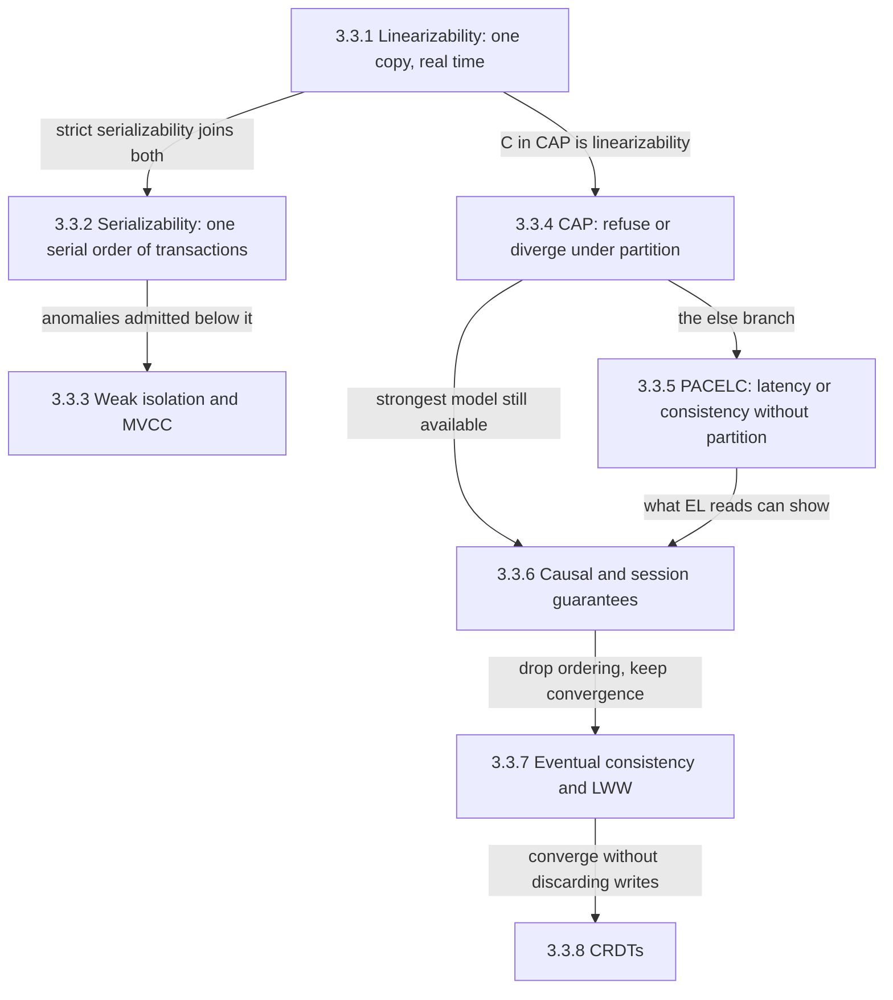
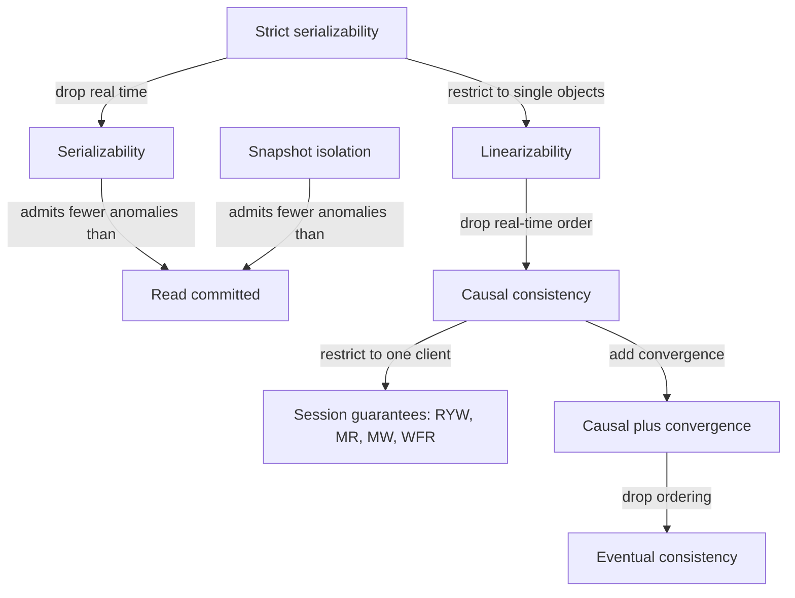
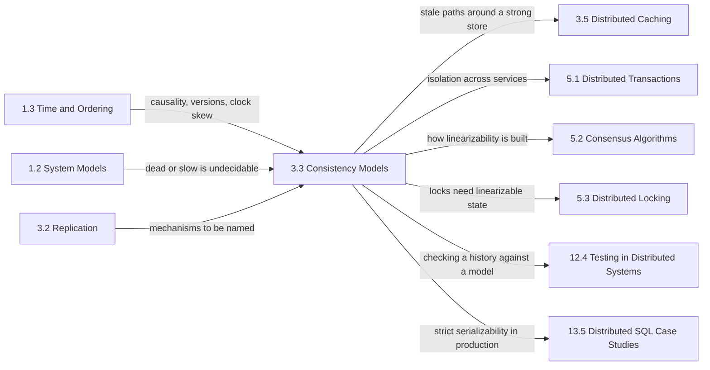

Bir tutarlılık modeli, bir veri deposu ile istemcileri arasındaki bir sözleşmedir: başka istemciler eşzamanlı olarak yazarken ve replikalar bu yazmaları farklı zamanlarda uygularken, bir okumanın ya da bir transaction'ın hangi sonuçları döndürmesine izin verildiğini tanımlar. Önceki bölüm, [Replikasyon Stratejileri](/distributed-systems/tr/data-management/replication/), yazmaları kopyalar arasında taşıyan mekanizmaları anlatır. Bu bölüm o mekanizmaların neyi vaat ettiğine bir ad verir, hiçbir mekanizmanın neyi ucuza vaat edemeyeceğini kanıtlar ve en zayıf vaatlerin nasıl kullanılabilir hâle getirileceğini gösterir. Adı konmuş bir sözleşme olmadan bir mühendis, kaybolan bir yazmanın, iki kez atanan bir kullanıcı adının ya da hiç var olmamış parayı gören bir raporun depodaki bir hata mı, yoksa deponun hiçbir zaman dışlamadığı bir davranış mı olduğunu ayırt edemez.

Sekiz konunun hepsinden geçen gerilim şudur: her garantinin bedeli koordinasyonla ödenir, koordinasyonun bedeli de her işlemde gecikmeyle ve partition sırasında erişilebilirlikle. Güçlü bir model, uygulamanın tek bir kopya ve aynı anda tek bir istemci varmış gibi akıl yürütmesine izin verir; bunun karşılığında kritik yola bir leader'a ya da bir quorum'a giden round trip'i koyar ve partition'ın azınlık tarafındaki istekleri reddeder. Zayıf bir model en yakın replikadan yanıt verir ve ağ bölündüğünde de yanıt vermeyi sürdürür; bunun karşılığında invariant'ları koruma, etkileri sıralama ve çakışmaları çözme işini uygulamaya ya da veri türüne devreder. Bu bedeli ortadan kaldıran bir ayar yoktur. Seçilebilecek olan, bedeli hangi işlemlerin ödeyeceği ve bedelin operatörün ölçebildiği bir gecikme olarak mı, yoksa kullanıcıların bildirdiği anomaliler olarak mı ortaya çıkacağıdır.

Bu alandaki hasarın çoğuna iki yanlış anlama yol açar ve bölüm bunları önleyecek biçimde kurulmuştur. Birincisi kelimenin kendisidir: CAP'teki "consistency" tek nesnelerin linearizability'si, ACID'deki "consistency" transaction'ların uygulama invariant'larını koruması anlamına gelir; izolasyon seviyeleri ise bunlardan da farklı üçüncü bir şeydir. İkincisi, modelleri tek bir merdiven gibi görmektir. Modeller yalnızca tepede buluşan iki aile oluşturur: tek nesneler üzerinde gerçek zamana dair garantiler ve çok nesneli transaction'lar üzerindeki garantiler. Bir depo her anahtar için linearizable olup yine de bir transaction'ın hiçbir seri yürütmenin üretemeyeceği bir durumu okumasına izin verebilir; serializable bir veritabanı da bir transaction'ı, gerçek zamanda kendisinden önce commit edilmiş bir transaction'ın önüne sıralayabilir.

## Sekiz Sayfa, İki Eksen, İki Teorem

Bölüm her eksendeki en güçlü garantiyle açılır, ardından üretimdeki veritabanlarının fiilen çalıştığı zayıf izolasyon seviyelerine geçer, sonra güçlü ucun fiyatını belirleyen iki teoremi ele alır ve bu fiyat fazla yüksek olduğunda erişilebilir kalan modellerle biter.

*Bölümdeki konular arasındaki bağımlılıklar. Her ok, bir sayfanın işaret ettiği sayfaya neyi devrettiğini ya da ona neyi dayattığını adlandırır.*

Sol dal transaction ekseni, sağ dal replikasyon eksenidir; ortak bir kökleri vardır, çünkü Spanner'ın external consistency adını verdiği strict serializability, linearizability'nin gerçek zaman kısıtı eklenmiş serializability'dir. Linearizability'den CAP'e giden kenar en sık gözden kaçandır: teorem tam olarak bu model hakkındadır, dolayısıyla kendi terimleriyle yeniden ifade edilmedikçe serializability, snapshot isolation ya da nedensel tutarlılık hakkında hiçbir şey söylemez. Sağ dal ardından her adımda neyden vazgeçildiğine göre aşağı iner. Nedensel tutarlılık gerçek zaman sırasından vazgeçer ve neden-sonuç sırasını korur; bu, her replika erişilebilir kalırken bir deponun koruyabileceği en fazla şeydir. Nihai tutarlılık sıralamadan tamamen vazgeçer ve yalnızca yakınsamayı tutar; son iki sayfa da yakınsamanın nasıl sağlandığıyla ilgilidir: eşzamanlı yazmaları son yazı kazanır ilkesiyle atarak ya da veri türünün tanımladığı bir birleştirme ile hepsini koruyarak.

## Her Konunun Yanıtladığı Soru

[Linearizability: En Güçlü Garanti, En Yüksek Maliyet](/distributed-systems/tr/data-management/consistency-models/linearizability/), replike edilmiş bir nesnenin tek bir kopya gibi davranmasının ne anlama geldiğini, tamamlanmış bir yazmanın neden ondan sonra başlayan her işlem tarafından görülmesi gerektiğini ve bunu hangi okuma yollarının sağladığını yanıtlar: quorum ya da leader okumaları, read index'ler veya sınırlı saat kaymasına dayanan lease'ler. Bir deponun üzerine kilitler, leader seçimi, benzersizlik kısıtları ya da yapılandırma bayrakları kurarken veya görevden düşmüş bir leader eski okumalar sunduğunda açın.

[Serializability: İşlem İzolasyonu](/distributed-systems/tr/data-management/consistency-models/serializability/), çok nesneli transaction'ların eşzamanlı bir yürütmesinin ne zaman seri bir yürütmeye denk olduğunu, bunun birkaç satıra yayılan invariant'ları neden bozulmadan tuttuğunu ve two-phase locking, iyimser doğrulama, serializable snapshot isolation ile deterministik sıralamanın bunu bekleme ve abort cinsinden farklı fiyatlarla nasıl sağladığını yanıtlar. Bir invariant birden çok satıra yayıldığında, sıcak bir satır throughput'u sınırladığında ya da serialization hataları retry fırtınasına dönüştüğünde açın.

[Zayıf İzolasyon ve MVCC: Read Committed, Snapshot Isolation, Write Skew](/distributed-systems/tr/data-management/consistency-models/weak-isolation-mvcc/), gerçek veritabanlarının varsayılan seviyelerinin hangi anomalileri geçirdiğini, multi-version concurrency control'ün (MVCC, çok sürümlü eşzamanlılık denetimi) okuyuculara yazıcıları bloklamadan nasıl bir snapshot verdiğini ve write skew'in snapshot isolation'ın yaptığı her kontrolden neden geçtiğini yanıtlar. Bir check-then-write yoluna güvenmeden önce, read-modify-write kodunda kayıp güncellemeler göründüğünde ya da unutulmuş bir transaction sürüm şişmesine yol açtığında açın.

[CAP Teoremi: CP ve AP Sistemler](/distributed-systems/tr/data-management/consistency-models/cap-theorem/), teoremin tanımları harfiyen alındığında neyi kanıtladığını, bir replikanın diğerlerine ulaşamadığında ne yapabileceğini ve birçok gerçek sistemin neden ne CP ne de AP olduğunu yanıtlar. Her işlemin partition'ın azınlık tarafında nasıl davranacağına karar verirken ya da CP olduğu sanılan bir sistemde split-brain yaşandığında açın.

[PACELC Teoremi: Gecikme-Tutarlılık Dengesi](/distributed-systems/tr/data-management/consistency-models/pacelc-theorem/), hiçbir partition yokken tutarlılığın neye mal olduğunu, tutarlı bir okuma ya da yazmanın neden replikalar arasında en az bir round trip beklemek zorunda olduğunu ve gerçek sistemlerin bu seçimi ifade başına nerede sunduğunu yanıtlar. Çok bölgeli bir tasarımı fiyatlarken, yavaş bir replika koordineli her işlemin gecikmesini belirlediğinde ya da bir varsayılan, okumaları sessizce eski okumalara düşürdüğünde açın.

[Nedensel Tutarlılık ve Oturum Garantileri: Spektrumun Ortası](/distributed-systems/tr/data-management/consistency-models/causal-consistency-session-guarantees/), bir deponun round trip olmadan nedeni sonuçtan önce nasıl tuttuğunu, dört oturum garantisinin nedenselliği istemci başına nasıl parçalara ayırdığını ve bedelin neden istek gecikmesinden bağımlılık metadata'sına ve gecikmeli görünürlüğe taşındığını yanıtlar. Kullanıcılar yanıtları gönderilerden önce ya da iptal edilmiş erişimi iptalden önce gördüğünde veya yavaş tek bir bölge görünürlüğü her yerde durdurduğunda açın.

[Nihai Tutarlılık: Son Yazı Kazanır (LWW) ve Zayıflıkları](/distributed-systems/tr/data-management/consistency-models/eventual-consistency/), kullanışlı en zayıf garantinin neyi vaat ettiğini, yakınsamanın neden deterministik bir uzlaştırma kuralı gerektirdiğini ve en ucuz kural olan LWW'nin onaylanmış yazmaları eşzamanlılık, saat kayması, gelecekteki zaman damgaları ve tombstone eşitlikleri yoluyla nasıl attığını yanıtlar. Onaylanmış yazmalar kaybolduğunda, bir silme etkisini göstermediğinde ya da yazmaları zaman damgalarıyla sıralamaya güvenmeden önce açın.

[CRDTs: Çakışmasız Çoğaltılmış Veri Türleri](/distributed-systems/tr/data-management/consistency-models/crdts/), bir veri türünün eşzamanlı güncellemeleri hiçbirini kaybetmeden nasıl birleştirebileceğini, state-based, operation-based ve delta-state tasarımların hangi teslim sözleşmesini gerektirdiğini ve hiçbir CRDT'nin hangi invariant'ları zorlayamayacağını yanıtlar. Sayaçların, kümelerin ya da ortak düzenlenen belgelerin aynı anda birkaç yerde yazma kabul etmesi gerektiğinde veya CRDT metadata'sı büyümeye devam ettiğinde açın.

| Konu | Yanıtladığı soru | Ne zaman açılmalı |
|---|---|---|
| [Linearizability](/distributed-systems/tr/data-management/consistency-models/linearizability/) | Replike nesne gerçek zamanda tek bir kopya gibi davranıyor mu? | Kilitler, benzersizlik, yapılandırma bayrakları, eski leader okumaları |
| [Serializability](/distributed-systems/tr/data-management/consistency-models/serializability/) | Transaction geçmişi seri bir geçmişe denk mi? | Satırlar arası invariant'lar, sıcak satırlar, retry fırtınaları |
| [Zayıf izolasyon ve MVCC](/distributed-systems/tr/data-management/consistency-models/weak-isolation-mvcc/) | Varsayılan seviye hangi anomalilere izin veriyor? | Check-then-write kodu, kayıp güncellemeler, sürüm şişmesi |
| [CAP teoremi](/distributed-systems/tr/data-management/consistency-models/cap-theorem/) | Replikalar konuşamadığında reddetmek mi, ayrışmak mı? | Partition davranışı, "CP" bir sistemde split-brain |
| [PACELC teoremi](/distributed-systems/tr/data-management/consistency-models/pacelc-theorem/) | Sağlıklı bir ağda tutarlılık neye mal olur? | Çok bölgeli gecikme bütçeleri, eski okuma varsayılanları |
| [Nedensel tutarlılık ve oturumlar](/distributed-systems/tr/data-management/consistency-models/causal-consistency-session-guarantees/) | Sonuçlar round trip olmadan nedenlerin ardında tutulabilir mi? | Kullanıcıya görünen sırasız etkiler, görünürlük duraklamaları |
| [Nihai tutarlılık ve LWW](/distributed-systems/tr/data-management/consistency-models/eventual-consistency/) | Yakınsama neyi vaat eder, LWW neyi atar? | Kaybolan yazmalar, ölmeyen silmeler, saatle sıralanan yazmalar |
| [CRDTs](/distributed-systems/tr/data-management/consistency-models/crdts/) | Eşzamanlı yazmalar kayıpsız nasıl birleşir? | Çok yazarlı sayaçlar, kümeler, ortak düzenleme |

Modeller birbirine gerektirme ilişkileriyle bağlıdır ve okuyucunun bir sağlayıcının ilan ettiği garantiden bu garantinin hâlâ izin verdiği anomalilere geçmesini sağlayan da bu ilişkilerdir.

*Bölümdeki modellerin birbiriyle ilişkisi. Her ok, daha güçlü bir garantiden onun gerektirdiği ya da kenardaki özellik bırakılarak elde edilen daha zayıf bir garantiye doğru gider.*

Bu haritada biçiminden daha önemli iki şey vardır. Snapshot isolation ile serializability üst üste değil yan yana çizilmiştir; çünkü snapshot isolation, serializability'nin yasakladığı write skew'e izin verir ve ikisi farklı mekanizmalarla sağlanır. Snapshot seviyesine "serializable" ya da "repeatable read" etiketi koyan bir veritabanı, varsayılan garanti ile gerçek garanti arasındaki boşluğun en yaygın kaynağıdır. İkinci olarak, iki aile yalnızca strict serializability'de birbirine değer: bunun altında linearizable bir key-value deposu hiçbir transaction izolasyonu vermez, serializable bir veritabanı da hiçbir gerçek zaman vaadinde bulunmaz. Nihai tutarlılık en altta, farklı türden bir özellik olarak durur: herhangi bir tekil okumanın ne döndürebileceğine dair bir kısıt değil, gelecek hakkında bir vaattir, yani yakınsamadır.

## Okuma Sırası ve Gerekçesi

İlk okumada bölümü kenar çubuğundaki sırayla okuyun. Linearizability ilk sıradadır, çünkü CAP, PACELC ve nedensel tutarlılık sayfası kendilerini ona göre tanımlar ve sonraki sayfaların fiyatlandırdığı şey onun okuma yolu analizidir. Serializability ile zayıf izolasyon bir çift olarak gelir; anomali kataloğu ancak geride kaldığı seri denklik standardı netleştikten sonra anlam kazanır. Ardından CAP ve PACELC, güçlü ucun neden ucuz olamayacağını açıklar; bu da son üç sayfanın gerekçesidir. Bu üç sayfa, her biri bir öncekinin koruduğu şeyden başlasın diye güçten zayıfa doğru okunur.

Üç kısayol makuldür. İlişkisel bir uygulama için izolasyon seçerken önce zayıf izolasyonu, ardından write skew'i kapatan seviyeler için serializability'yi okuyun. Çok bölgeli bir depo tasarlarken ya da Cassandra, DynamoDB veya Cosmos DB'de tutarlılık seviyelerini seçerken CAP, PACELC ve nihai tutarlılığı art arda okuyun. Çevrimdışı çalışabilen ya da çok yazarlı özellikler geliştirirken önce nedensel tutarlılığı, sonra CRDT'leri okuyun.

## Bölümün Kitaptaki Yeri

Ön koşullar iki bölümden gelir. [Happened-Before](/distributed-systems/tr/foundations/time-and-ordering/happened-before/), [Vektör Saatler](/distributed-systems/tr/foundations/time-and-ordering/vector-clocks/) ve [Hybrid Logical Clock'lar](/distributed-systems/tr/foundations/time-and-ordering/hybrid-logical-clocks/), nedensel tutarlılığın, LWW'nin ve CRDT'lerin üzerine kurulduğu sıralama ve sürümleme mekanizmalarını sağlar; [Fiziksel Saatler](/distributed-systems/tr/foundations/time-and-ordering/physical-clocks/) ise LWW'nin kayıplarının ardındaki saat kaymasını ve lease okumalarının dayandığı sınırlı sapma varsayımını açıklar. [Ağ Modelleri](/distributed-systems/tr/foundations/system-models/network-models/), bir replikanın ölü bir eşi yavaş olandan neden ayırt edemediğini, yani CAP'in öncülünü açıklar. [Replikasyon Stratejileri](/distributed-systems/tr/data-management/replication/) ise garantilerine bu bölümün ad verdiği mekanizmaları sağlar.

*Solda ön koşullar, sağda bu bölümün üzerine kurulan bölümler. Her ok, devredilen şeyi adlandırır.*

Sonraki bölümler modelleri uygular. [Raft](/distributed-systems/tr/coordination/consensus-algorithms/raft/) ve [Paxos](/distributed-systems/tr/coordination/consensus-algorithms/paxos/), linearizable replike durumun nasıl kurulduğunu gösterir; [Fencing Tokens](/distributed-systems/tr/coordination/distributed-locking/fencing-tokens/) ise arkasındaki depo linearizable olsa bile bir kilidin neye ihtiyaç duyduğunu anlatır. [Two-Phase Commit](/distributed-systems/tr/coordination/distributed-transactions/two-phase-commit/) ve [SAGA Deseni](/distributed-systems/tr/coordination/distributed-transactions/saga-pattern/), izolasyonu ya da izolasyonun açıkça yokluğunu servisler arasına taşır. [Google TrueTime ve Spanner](/distributed-systems/tr/foundations/time-and-ordering/truetime-spanner/), [Spanner](/distributed-systems/tr/case-studies/distributed-sql/spanner-architecture/) ve [Follower Reads ve Bounded Staleness](/distributed-systems/tr/case-studies/distributed-sql/follower-reads-bounded-staleness/), strict serializability'yi ve onun gevşetilmiş biçimlerini üretimde gösterir. [Dağıtık ve Yerel Önbellek](/distributed-systems/tr/data-management/distributed-caching/distributed-vs-local/), güçlü bir deponun önüne eski bir okuma yolunun eklenmesinin en yaygın biçimini ele alır; [Doğruluk Testi: Jepsen ve Deterministik Simülasyon](/distributed-systems/tr/deployment/distributed-testing/jepsen-deterministic-simulation/) ise bir sistemin iddia ettiği modeli gerçekten sağlayıp sağlamadığının nasıl denetleneceğini anlatır.

İki sınır sıkça bulanıklaşır. ACID'deki tutarlılık, yani her transaction'ın uygulama invariant'larını koruması, bu bölümdeki bir model değildir; izolasyonun koruduğu, uygulamanın yükümlülüğüdür ve iki yaklaşımı [ACID ve BASE](/distributed-systems/tr/coordination/distributed-transactions/acid-vs-base/) ele alır. Bir tutarlılık modeli bir dayanıklılık ayarı da değildir: her model onaylanmış yazmaların hayatta kaldığını varsayar; bu yüzden bir yazmayı yeterli sayıda diske ulaşmadan onaylayan bir depo, bir çökmede onu kaybedebilir ve ilan ettiği modeli ihlal eder. Onay noktasının nerede durduğu [Lider Tabanlı Replikasyon](/distributed-systems/tr/data-management/replication/leader-based-replication/) ve [Write-Ahead Log](/distributed-systems/tr/data-management/storage-engines/write-ahead-log/) sayfalarının konusudur.
