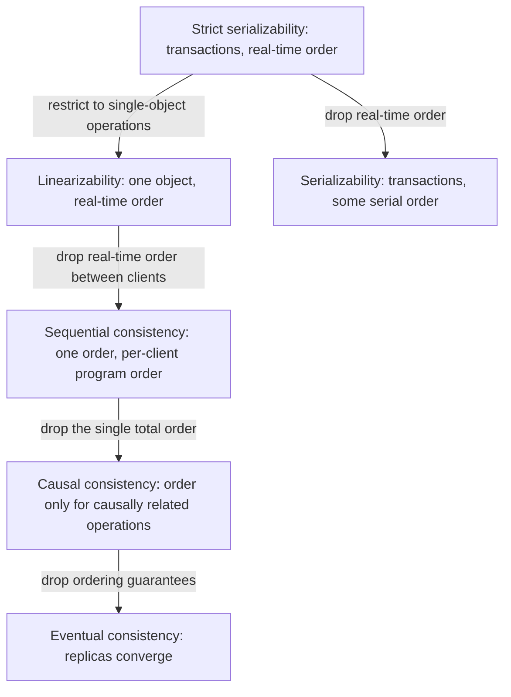
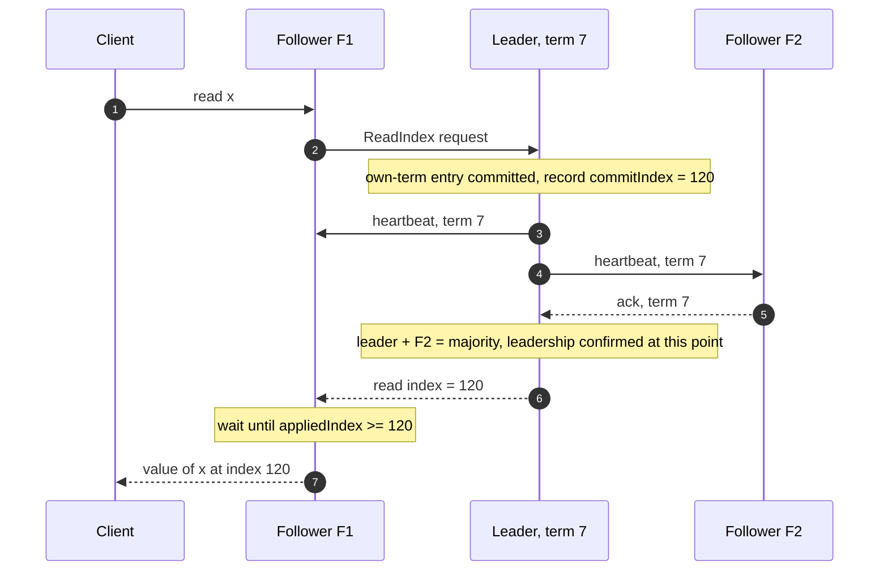
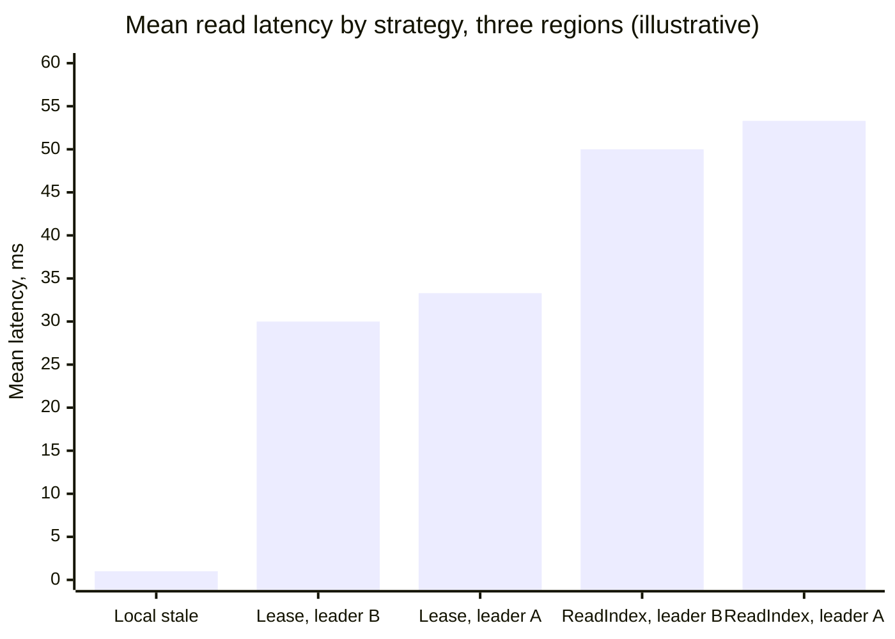
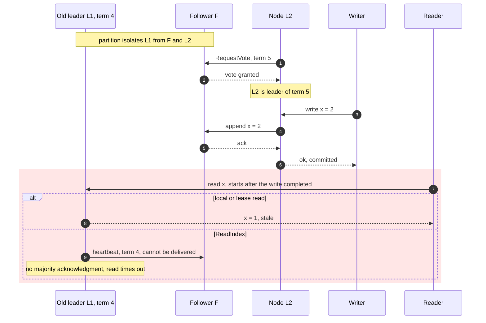
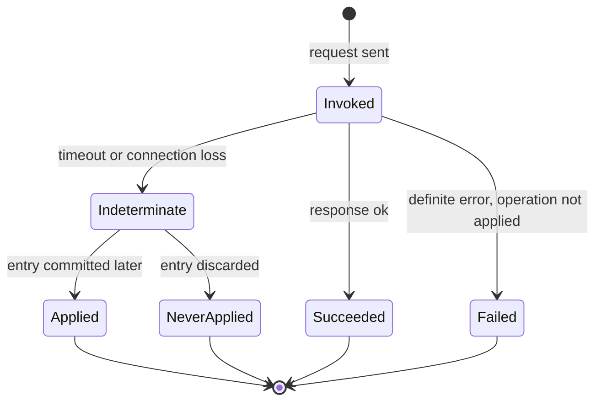

Linearizability, paylaşılan bir nesne (register, anahtar, kuyruk ya da kilit) için tanımlanmış bir doğruluk koşuludur: her operasyon, istemcinin onu çağırdığı an ile yanıtı aldığı an arasındaki tek bir anda atomik olarak gerçekleşmiş gibi görünmeli ve bu anların oluşturduğu sıra, nesnenin geçerli bir sıralı (sequential) yürütmesi olmalıdır. Linearizable olan replike bir sistem, dışarıdan bakıldığında operasyonları teker teker yürüten tek bir makineden ayırt edilemez. Bir yazma tamamlandıktan sonra başlayan her operasyon, hangi replika yanıtlarsa yanıtlasın ve hangi istemci gönderirse göndersin, o yazmayı ya da daha yenisini görür.

Çözdüğü problem, replikasyonun kendisinin yarattığı problemdir. Üç makinede saklanan bir anahtarın, farklı zamanlarda değişen üç kopyası vardır. İstemcinin hangi kopyayı göreceğine dair bir garanti yoksa tamamlanmış bir yazma bir sonraki okumada kaybolabilir, iki istemci aynı kullanıcı adını almayı birlikte başarabilir, iki node kilidi kendisinin tuttuğuna inanabilir ve bir operatör bir yapılandırma bayrağını değiştirdikten hemen sonra onu okuyan bir süreç eski değerle hareket edebilir. Bu hataların hepsi aynı boşluktan doğar: okuma anında replikalar en son değerin ne olduğu konusunda uzlaşmış değildir.

Asıl denge şudur: bu boşluğu kapatmak, okumalar dahil her operasyonun kritik yolunda koordinasyon gerektirir. Linearizable bir okuma, yakında hangi kopya varsa ondan yanıtlanamaz; sunucunun, hiçbir yerde daha yeni bir yazmanın tamamlanmadığını kanıtlaması gerekir. Bu da ya bir quorum'a round trip, ya da güvenliği sınırlı saat kaymasına (clock drift) ve sınırlı süreç duraklamalarına dayanan zaman tabanlı bir lease demektir. Bedel; replikalar arası mesafeyle orantılı gecikme, koordinasyon mesajlarına giden throughput ve erişilebilirlik olarak ödenir: çoğunluktan kopmuş bir replika, eski olabilecek bir değerle yanıt vermek yerine yanıt vermeyi reddetmek zorundadır. [Nedensel tutarlılık ve oturum garantileri](/distributed-systems/tr/data-management/consistency-models/causal-consistency-session-guarantees/) gibi daha zayıf modeller, birbiriyle iletişim kurmayan istemcilere verilen gerçek zaman vaadinden vazgeçerek yerel okumaları geri satın alır.

## Tanım: Aralıklar, Gerçek Zaman Sırası ve Linearization Noktaları

Herlihy ve Wing'in 1990'da verdiği tanım bir geçmiş (history) üzerinden kurulur: her operasyonun çağrılmasının (invocation) ve yanıtının (response), her şeyi gören bir gözlemcinin gerçek zamanda göreceği biçimdeki kaydı. Her operasyon bir aralık kaplar. Aralıkları örtüşen iki operasyon eşzamanlıdır (concurrent); örtüşmüyorsa biri gerçek zamanda diğerinden önce gelir. Bir geçmiş, her operasyon için kendi aralığının içinden tek bir nokta, yani linearization noktası seçilebiliyorsa ve operasyonlar bu noktaların sırasına göre sıralı biçimde yürütüldüğünde istemcilerin aldığı yanıtların tam olarak aynısı üretiliyorsa linearizable'dır.

Bundan hemen iki sonuç çıkar. Örtüşmeyen operasyonlar gerçek zaman sıralarıyla gerçekleşmek zorundadır, çünkü aralıklarının yer değiştirebilecekleri ortak bir noktası yoktur. Örtüşen operasyonlar ise her iki sırayla da yerleştirilebilir ve seçim sisteme kalmıştır. Tanım replikalardan, mesajlardan ya da saatlerden hiç söz etmez: istemcilerin gözlemleyebildikleri hakkında bir önermedir ve bir uygulama, üretebileceği her geçmiş bu koşulu sağlıyorsa linearizable'dır.

```mermaid
gantt
    title One register x, initially 0, observed by three clients
    dateFormat X
    axisFormat %S
    section Client A
    write x = 1, ok              :a1, 1, 6s
    section Client B
    read x returns 1             :b1, 2, 1s
    section Client C
    read x returns 0             :crit, c1, 4, 1s
```


*Linearizable olmayan bir geçmiş. Her okuma yazmayla eşzamanlıdır, ancak iki okuma tutarlı biçimde sıralanamaz. Zaman birimleri keyfidir.*

İstemci B'nin okuması 1 döndürür; dolayısıyla yazmanın linearization noktası, en geç 3. saniyede olan B'nin noktasından önce olmalıdır. İstemci C'nin okuması 4. saniyede, B'nin okuması bittikten sonra başlar; yani C'nin noktası B'ninkinden, dolayısıyla yazmanınkinden sonradır ve C'nin 1 döndürmesi gerekir. C ise 0 döndürmüştür. Hiçbir nokta ataması işe yaramaz; tek başına bakıldığında her okuma geçerli olsa da (her biri yazmayla örtüşür ve ondan önceye yerleştirilebilirdi) geçmiş linearizable değildir. Bu, write-back yapmayan quorum okumalarının ürettiği "önce yeni, sonra eski" tersinmesidir ve Dynamo tarzı depolar için [Lidersiz Replikasyon](/distributed-systems/tr/data-management/replication/leaderless-replication/) sayfasında incelenir. C 1 döndürmüş olsaydı yazma, B ve C için 2.5, 2.8 ve 4.5. saniyedeki noktalar geçmişi linearizable yapardı. Uygulayıcılar için ders şudur: herhangi bir istemci bir değeri gözlemlediği anda sistem o değere bağlanmıştır. Bir değer ancak sistem sonraki bir okuyucunun onu kaçırmasını imkânsız kılıyorsa kademeli olarak görünür hâle gelebilir.

### Neyi Garanti Eder, Neyi Etmez

Linearizability üç şeyi garanti eder: nesne üzerindeki tüm operasyonlar için her istemcinin üzerinde uzlaştığı tek bir sıra, bu sıranın örtüşmeyen operasyonların gerçek zaman önceliğiyle tutarlı olması ve bu sıranın nesnenin sıralı spesifikasyonuna göre geçerli olması. Mühendislerin "güçlü tutarlılık" ile ilişkilendirdiği bazı özellikler ise bunun parçası değildir.

Çok nesneli atomiklik hakkında hiçbir şey söylemez. Her operasyon tek bir nesneye dokunur. `x` anahtarını ve ardından `y` anahtarını iki linearizable operasyonla okumak, `x`'i bir anda ve `y`'yi daha sonraki bir anda döndürür; bu yüzden "`x + y` 100 kalır" gibi bir değişmez (invariant), onu koruyan her transfer atomik olarak uygulanmış olsa bile ihlal edilmiş görünebilir. Operasyon grupları hakkındaki garantiler işlem izolasyonunun (transaction isolation) konusudur; serializability'nin gerçek zaman sırasıyla birleşimi strict serializability'dir, [Serializability](/distributed-systems/tr/data-management/consistency-models/serializability/) sayfasında ele alınır ve Spanner'ın [external consistency](/distributed-systems/tr/foundations/time-and-ordering/truetime-spanner/) dediği şeydir.

İlerleme (progress) hakkında hiçbir şey söylemez. Linearizability bir güvenlik (safety) özelliğidir: hiç yanıt vermeyen bir sistem önemsiz biçimde linearizable'dır. Partition altında erişilebilirlik, Gilbert ve Lynch'in biçimsel ispatında "C" için tam olarak bu tanımı kullandığı [CAP teoreminin](/distributed-systems/tr/data-management/consistency-models/cap-theorem/) konusudur.

Yanıt almamış bir operasyonun ne zaman gerçekleşeceğini sınırlamaz. Tanım, istemcisinin hiç yanıt almadığı bekleyen (pending) bir operasyonu ya geçmişten çıkarılmasına ya da çağrılmasından sonraki herhangi bir noktada linearization noktasıyla tamamlanmasına izin vererek ele alır. İstemcisi timeout'a düşmüş bir yazma bu yüzden daha sonra, istemci yeniden denedikten ya da vazgeçtikten sonra bile gerçekleşebilir. Bu teorideki bir açık değil, bir leader'ın bir girdiyi log'a eklediği, çöktüğü ve halefinin o girdiyi saniyeler sonra commit ettiği durumun tam tarifidir.

Nesnenin hatalardan durumuyla birlikte sağ çıktığını varsayar. Onaylanmış bir yazmayı kaybeden bir çökme, sonraki bir okumanın daha eski bir değer döndürdüğü bir geçmiş üretir; bu, ayrı bir dayanıklılık (durability) problemi değil, bir linearizability ihlalidir. Veri çoğunlukta kalıcı hâle gelmeden onay veren ya da bir node'u eski bir snapshot'tan geri yükleyip oy hakkını koruyan sistemler, garantiyi depolama katmanı üzerinden bozar.

### Yerellik: Garanti Neden Birleştirilebilir

Herlihy ve Wing, linearizability'nin yerel (local) olduğunu ispatladı: birçok nesne üzerindeki bir geçmiş, ancak ve ancak her nesnenin alt geçmişi linearizable ise linearizable'dır. Bağımsız olarak linearizable anahtarlardan, partition'lardan ya da servislerden kurulmuş bir sistem bu yüzden aralarında hiçbir koordinasyon olmadan, nesne bazında bir bütün olarak linearizable'dır. Tek bir ortak sırayı ve her istemcinin program sırasını koruyan ama istemciler arası gerçek zaman önceliğini bırakan sequential consistency ise bu şekilde birleşmez: sequential consistent iki nesne birlikte, hiçbir tek sıralı düzenin açıklayamayacağı bir geçmiş üretebilir.

Yerellik, linearizability'yi ölçekte uygulanabilir kılan şeydir. Bir veritabanı, her range için bir tane olmak üzere binlerce bağımsız [Raft](/distributed-systems/tr/coordination/consensus-algorithms/raft/) grubu çalıştırabilir ve tek anahtarlı her operasyon gruplar arası koordinasyon olmadan linearizable'dır. Test etmeyi yönetilebilir kılan da yerelliktir: rastgele bir geçmişin linearizable olup olmadığını kontrol etmek, Gibbons ve Korach'ın 1997'de gösterdiği gibi genel durumda NP-complete'tir; ancak yerellik bir denetleyicinin (checker) geçmişi anahtara göre bölüp her parçayı ayrı kontrol etmesine izin verir ve pratik denetleyiciler aramayı bu şekilde makul boyutta tutar. Bunu uygulayan test düzenekleri [Doğruluk Testi: Jepsen ve Deterministik Simülasyon](/distributed-systems/tr/deployment/distributed-testing/jepsen-deterministic-simulation/) sayfasında ele alınır.


*Linearizability'nin komşu modeller arasındaki yeri. Her ok, daha zayıf modele ulaşmak için kaldırılan kısıtı adlandırır.*

Diyagramı yukarıdan okurken her aşağı adım bir kısıtı ve onunla birlikte bir koordinasyon kaynağını kaldırır. İstemciler arası gerçek zaman sırasını bırakmak, yani linearizability'den sequential consistency'ye geçiş, yerel bir replikadan okumaya izin veren adımdır: bir ZooKeeper follower'ı okumaları kendi kopyasından yanıtlar ve istemciler yazmaların tek bir ortak sırasını ve kendi operasyonlarını sırasıyla görür; ancak bir istemci, başka bir istemcinin eskidiğini zaten bildiği bir değeri okuyabilir. Toplam sıradan da vazgeçildiğinde geriye yalnızca [happened-before](/distributed-systems/tr/foundations/time-and-ordering/happened-before/) ilişkisinin dayattığı sırayı koruyan nedensel tutarlılık kalır. Linearizability ve serializability farklı dallarda durur: biri tekil operasyonları gerçek zamanda kısıtlar, diğeri işlemleri herhangi bir sırada kısıtlar ve hiçbiri diğerini gerektirmez.

:::note[Kolayca karıştırılan iki kelime]
Linearizability, tekil nesneler üzerindeki tekil operasyonlar ve gerçek zamanla ilgilidir. Serializability ise birçok nesne üzerindeki işlemlerle ilgilidir ve gerçek zaman hakkında hiçbir şey söylemez: serializable bir veritabanı, daha sonra başlamış bir işlemi daha önce commit edilmiş bir işlemden önceye sıralayabilir. "Güçlü tutarlılık" diyen ürün dokümantasyonu genellikle bu ikisinden birini ya da birini yalnızca bazı okuma yollarında kasteder. Hangi operasyonlar, hangi yolda, hangi yapılandırmayla olduğunu sorun.
:::

## Uygulama: Replike Sistemler Garantiyi Nasıl Kazanır

Her linearizable uygulama aynı iki şeyi yapar. Her yazmaya, onaylamadan önce tek bir sıra içinde bir konum atar ve bir okumayı yanıtlamadan önce döndüreceği değerin tamamlanmış hiçbir yazmadan daha eski olmadığını kanıtlar. Birinci kısım pahalı ama iyi anlaşılmış yarıdır; ikincisi uygulamaların ayrıştığı ve hataların çoğunun yaşadığı yerdir.

### Yazmalar İçin Tek Bir Sıra

En basit tasarım her nesneye operasyonları sırayla yürüten tek bir sahip verir. Tek bir Redis instance'ı ya da replikası olmayan tek bir PostgreSQL primary'si, kimse başka bir node'la konuşmadığı sürece tek anahtarlı operasyonlar için linearizable'dır; çünkü tek bir thread ya da tek bir lock manager operasyonları sıraya koyar ve yanıt, etkiden sonra gönderilir. Zorluk, sahibin değiştirilmesi gerektiğinde başlar. Asenkron replike eden ve failover yapan bir sistem onaylanmış yazmaları kaybedebilir; eski sahibin durduğunu garanti edemeyen bir sistemin ise iki sahibi olabilir. Bu durum [Failover ve Lider Seçimi](/distributed-systems/tr/data-management/replication/failover-leader-election/) sayfasında anlatılır.

Raft, [Paxos](/distributed-systems/tr/coordination/consensus-algorithms/paxos/) ve [Zab](/distributed-systems/tr/coordination/consensus-algorithms/zab-zookeeper/) gibi consensus protokolleri değiştirme problemini çözer. Yazmalar replike bir log'a eklenir, çoğunluk onları kalıcı hâle getirdiğinde onaylanır ve log sırasıyla uygulanır. Herhangi iki çoğunluk kesiştiği için yeni seçilen bir leader her zaman onaylanmış tüm girdileri tutar; böylece sıra leader değişikliklerinden sağ çıkar. Bir yazmanın linearization noktası, girdisinin commit edildiği andır: istemci onu gönderdiği için çağrılmasından sonra, leader yalnızca commit'ten sonra yanıt verdiği için de yanıtından öncedir.

Consensus'un burada ortaya çıkmasının daha keskin bir nedeni vardır ve bu neden iki tür nesneyi birbirinden ayırır. Herlihy'nin 1991 tarihli wait-free hiyerarşisi her nesneye bir consensus sayısı atar: o nesne kullanılarak consensus'u çözebilecek en büyük süreç sayısı. Bir read-write register'ın consensus sayısı 1'dir; compare-and-swap'ınki sonsuzdur. Bu yüzden linearizable bir read-write register, replikaların çoğunluğuna erişilebildiği sürece, asenkron bir ağda consensus olmadan kurulabilir: Attiya, Bar-Noy ve Dolev algoritması, lidersiz replikasyon sayfasında anlatıldığı gibi quorum yazmaları ve write-back aşaması olan quorum okumaları kullanır. Linearizable bir compare-and-swap, bir kilit, benzersiz bir isim talebi ya da herhangi bir read-modify-write operasyonu ise consensus'a denktir, asenkron sistemler için FLP imkânsızlık sonucunu miras alır ve ilerleyebilmek için bir consensus protokolünün zamanlama varsayımlarına ihtiyaç duyar. "İki istemci birlikte başarılı olmamalı" biçimindeki gereksinimler hiçbir zaman yalnızca quorum örtüşmesiyle karşılanamaz.

### Linearizable Okumayı Yanıtlamanın Üç Yolu

Leader en yeni commit edilmiş durumu tutar; ancak kendini leader sanan bir node, haberdar olmadığı bir seçimle görevden alınmış olabilir ve yeni bir leader yazmaları çoktan commit etmiş olabilir. Bir okumayı yerel durumdan yanıtlamak, bu nedenle ancak node okumanın aralığı içindeki bir anda hâlâ leader olduğunu gösterebiliyorsa güvenlidir. Raft uygulamaları bunu göstermenin üç yolunu sunar; üçü de Ongaro'nun doktora tezinde anlatılır.

Birincisi okumayı log'dan geçirmektir: leader bir okuma girdisi ekler ve girdi commit olduğunda yanıt verir. Commit, okuma geldikten sonra bir çoğunluğun leader'ı mevcut term'ünde kabul ettiğini kanıtlar. Basittir ve çoğunluktaki disk sync'i dahil bir yazma kadar maliyetlidir.

İkincisi ReadIndex'tir. Leader mevcut commit index'ini read index olarak kaydeder, bir çoğunlukla bir heartbeat turu yaparak liderliğini doğrular, state machine'i read index'e kadarki girdileri uygulayana kadar bekler ve yanıt verir. Okuma, heartbeat turunun liderliği doğruladığı anda linearize edilir. Bir incelik önemlidir: yeni seçilmiş bir leader önceki term'ün en son commit index'ini henüz bilmiyor olabilir; bu yüzden ReadIndex okumalarına hizmet etmeden önce kendi term'ünden bir girdiyi, genellikle boş bir no-op'u commit etmelidir. Aynı mekanizma follower'ların da okuma yanıtlamasına izin verir: bir follower leader'dan bir read index ister, kendi log'u o index'e kadar uygulanana dek bekler ve yerel durumdan yanıt verir. Böylece veri aktarımı ve state machine işi leader'dan alınır; heartbeat turunun bedelini ise yine leader öder.


*Üç node'lu bir grupta ReadIndex kullanan bir follower okuması. Okuma, leader 5. adımda çoğunluk onayını aldığı anda linearize edilir.*

2. adımdan sonraki not tabanı sabitler: okuma başlamadan önce tamamlanan her yazma o ana kadar commit edilmişti, yani index'i en fazla 120'dir. 5. adım, o anda daha yüksek term'lü başka bir leader'ın seçilmemiş olduğunu kanıtlar, çünkü F2 eski bir term'den gelen heartbeat'i reddederdi. Okuma 120. index'teki ya da daha sonraki durumu döndürür; bu durum, okuma başlamadan önce tamamlanan her yazmayı içerir ve okumanın linearization noktası olan 5. adım okumanın aralığı içindedir. 120'den sonra commit edilen yazmalar okumayla eşzamanlıdır ve ondan sonraya sıralanabilir. Maliyet, leader'dan en yakın çoğunluğa bir round trip ve follower okuması için follower'dan leader'a bir round trip'tir; disk yazması yoktur. Uygulamalar toplu işleme (batching) yapar: bir heartbeat turu sürerken gelen tüm okumalar bir sonraki turu paylaşabilir; böylece saniyedeki tur sayısı okuma hızıyla değil, toplama penceresiyle sınırlanır.

Üçüncü yol lease okumasıdır. `t` anında bir heartbeat turu başarılı olduktan sonra leader, o çoğunluktaki hiçbir follower'ın election timeout'u dolmadan seçim başlatmayacağını bilir; dolayısıyla kabaca `t` artı election timeout'tan önce başka bir leader var olamaz. Bu pencere içinde leader okumaları hiçbir ağ round trip'i olmadan yerel durumdan yanıtlar. Argüman, leader'ın ve follower'ların saatlerinin neredeyse aynı hızda ilerlemesini ve leader'ın lease'i kontrol etmekle durumunu okumak arasında duraklamamasını gerektirir; uygulamalar kayma için bir güvenlik payı düşer. Senkronize saatler gerektirmez, yalnızca sınırlı kayma gerektirir; bu yüzden makineler arası zaman damgalarını karşılaştıran tasarımlardan daha güvenli, zaman hakkında hiçbir şey varsaymayan ReadIndex'ten ise daha az güvenlidir. Genel lease mekanizması [Kiralama Tabanlı Kilitleme](/distributed-systems/tr/coordination/distributed-locking/lease-based-locking/) sayfasında, dayandığı zamanlama modeli ise [Ağ Modelleri](/distributed-systems/tr/foundations/system-models/network-models/) sayfasında ele alınır.

Raft dışında production'da iki yapı daha görülür. Van Renesse ve Schneider'in 2004'te yayımladığı chain replication, replikaları bir zincir hâlinde sıralar: yazmalar baştan (head) girer ve her node onları uyguladığında kuyruk (tail) tarafından onaylanır; okumalar yalnızca, yapısı gereği tam olarak onaylanmış yazmalar kümesini tutan tail tarafından yanıtlanır. Okumalar ek bir maliyet taşımaz, ancak hepsi tek bir node'a düşer ve bir yazmanın gecikmesi zincirin uzunluğu kadardır. Spanner ise ters yoldan gider: commit zaman damgalarını TrueTime'dan atar ve bir commit'i onaylamadan önce saat belirsizliğini bekleyerek geçirir; böylece güncel zamandaki bir okuma tamamlanmış her işlemi görür. Mekanizma [Google TrueTime & Spanner](/distributed-systems/tr/foundations/time-and-ordering/truetime-spanner/) sayfasındadır.

## Maliyet ve Neden Mühendislikle Ortadan Kaldırılamaz

Linearizability'nin maliyeti belirli uygulamaların bir yan ürünü değildir. Attiya ve Welch 1994'te, mesaj gecikmelerinin `u` belirsizliği içinde değiştiği bir ağda, bir read-write register'ın hiçbir linearizable uygulamasının okumaları `u/4`'ten, yazmaları `u/2`'den kısa sürede tamamlayamayacağını ispatladı; sequential consistency ise iki operasyondan birinin yerel olduğu ve hiçbir maliyet taşımadığı uygulamalara izin verir. Bu asimetri, ZooKeeper'ın yaptığının biçimsel karşılığıdır: yerel okumalar, sıralı yazmalar ve istemciler arası hiçbir gerçek zaman vaadi. CAP sonucu aynı gerçeğin uç durumudur: partition sırasında olduğu gibi belirsizlik sınırsız hâle geldiğinde, linearizable bir sistem en az bir tarafta yanıt vermeyi bırakmak zorundadır.

Pratikte bu, linearizable operasyonların gecikmesinin coğrafya ve leader'ın konumu tarafından, linearizable olmayan okumaların gecikmesinin ise en yakın replikaya olan mesafe tarafından belirlendiği anlamına gelir. Somut bir örnek aradaki farkı görünür kılar.

### Hesaplı Örnek: Üç Bölge, Tek Raft Grubu

A, B ve C bölgelerinin her birinde bir replika bulunan üç replikalı bir Raft grubu ve üç bölgeye eşit dağılmış istemciler varsayalım. A ile B arasında 20 ms, B ile C arasında 70 ms, A ile C arasında 80 ms round trip süresi varsayalım; bölge içi atlamaları ve birkaç milisaniye ekleyen disk sync'lerini yok sayalım. Tüm sayılar örnek amaçlıdır.

Leader A'dayken leader'ın quorum'u kendisi ve B'dir; dolayısıyla istek A'ya ulaştıktan sonra her commit B'ye 20 ms'lik round trip'e mal olur. A'daki bir istemciden gelen yazma 20 ms; B'den, A'ya ulaşmak için 20 ms artı commit için 20 ms, yani 40 ms; C'den 80 artı 20, yani 100 ms sürer. Ortalama yazma gecikmesi `(20 + 40 + 100) / 3 = 53.3` ms'dir. Burada bir ReadIndex okuması bir yazmayla aynı maliyettedir, çünkü B'ye heartbeat turu ile B'ye commit turu aynı ağ yoludur; tasarruf edilen round trip değil, disk sync'idir. Leader'ın yanıtladığı bir lease okuması yalnızca leader'a gidiş-dönüşe mal olur: 0, 20 ve 80 ms, ortalama 33.3 ms. En yakın replikadan yapılan ve linearizable olmayan yerel bir okuma ise her yerde yaklaşık 1 ms sürer.

Leader'ı B'ye taşımak tabloyu değiştirir. B'nin en yakın follower'ı 20 ms ile A'dır; dolayısıyla commit'ler, istek ulaştıktan sonra yine 20 ms sürer. Yazmalar A'dan 40 ms, B'den 20 ms ve C'den 70 artı 20, yani 90 ms sürer: ortalama 50 ms. Lease okumaları 20, 0 ve 70 ms sürer: ortalama 30 ms. Leader'ı istemcilere toplam mesafesi en düşük replikaya yerleştirmek ortalamada birkaç milisaniye, en kötü konumdaki istemciler için 10 ms kazandırır; ancak hiçbir yerleşim linearizable okumayı 1 ms'lik yerel okumanın yakınına getirmez.


*A, B ve C bölgelerine eşit dağılmış istemciler üzerinden ortalama okuma gecikmesi; yukarıda varsayılan round trip sürelerinden hesaplanmıştır. Disk sync'leri ve bölge içi atlamalar yok sayılmıştır.*

Grafik, büyüklük mertebesini leader yerleşiminin değil stratejinin belirlediğini gösterir. ReadIndex'ten lease okumasına geçmek, leader'dan çoğunluğa bir round trip'i kurtarır; lease okumasından yerel okumaya geçmek ise istemciden leader'a yolculuğu kurtarır ve linearizability'den vazgeçer. ReadIndex follower okuması ayrıca görünmez, çünkü bu topolojide B ve C'deki istemciler için leader'daki bir ReadIndex okumasıyla aynı maliyettedir: follower leader'a, leader da bir çoğunluğa ulaşmak zorundadır.

Throughput ikinci bir hikâye anlatır. A'daki leader'ın saniyede 40,000 linearizable okuma aldığını varsayalım. Log üzerinden yapıldığında her okuma, bir çoğunlukta replike edilmesi ve sync edilmesi gereken bir girdidir ve yazma yoluna saniyede 40,000 log girdisi ekler. Toplu işlemesiz ReadIndex ile her okuma iki follower'a bir heartbeat tetikler: saniyede 80,000 mesaj. 1 ms'lik pencerelerle toplu işlenen ReadIndex ile, okuma hızından bağımsız olarak saniyede en fazla 1,000 tur, yani 2,000 mesaj vardır; bedeli okuma başına en fazla 1 ms ek gecikmedir. Toplu işleme ReadIndex'i mesaj açısından neredeyse bedava kılar ama round trip'ini kaldıramaz; zamanlama varsayımlarına rağmen lease okumalarının okuma ağırlıklı iş yükleri için çekici kalmasının nedeni budur.

## Production Sistemlerinde Linearizability

Yukarıdaki stratejiler aynı büyüklükleri farklı varsayımlara karşı takas eder ve production sistemleri, çoğu zaman varsayılan ya da bir anahtar olarak daha zayıf bir mod sunarak, farklı seçimler yapar.

| Strateji | Okuma maliyeti | Yazma maliyeti | Varsayım | Varsayım bozulursa | Ne zaman tercih edilmeli |
|---|---|---|---|---|---|
| Log üzerinden okuma | Çoğunlukta commit round trip'i ve disk sync'i | Commit round trip'i | Consensus'un ötesinde hiçbir şey | Uygulanamaz | Düşük okuma hızları, en basit doğru tasarım |
| ReadIndex | Bir heartbeat turu, follower okumaları için ayrıca leader'a bir yolculuk | Commit round trip'i | Zaman hakkında hiçbir şey | Uygulanamaz | Consensus depoları için varsayılan, karma iş yükleri |
| Leader lease okuması | Leader'da yerel | Commit round trip'i | Sınırlı saat kayması, sınırlı duraklamalar | Sessiz eski okumalar | İyi kontrol edilen host'larda okuma ağırlıklı iş yükleri |
| Write-back'li quorum register (ABD) | İki quorum turu | Bir ya da iki quorum turu | Çoğunluğa erişilebilir | Okuma ve yazma için uygulanamaz; compare-and-swap yok | Leader'sız read-write register'lar |
| Chain replication, tail okumaları | Tail'de yerel | Tüm zincir uzunluğu | Ayrı bir master'dan doğru zincir yapılandırması | Çıkarılmış bir node yanıt vermeye devam ederse eski okumalar | Ayrılmış bir yapılandırma servisiyle güçlü okumalar |
| Sınırlı saatlerde commit wait | Bir zaman damgasında yerel | Commit round trip'i artı saat belirsizliğinin yaklaşık iki katı | Saat belirsizliği sınırı geçerli | Sessiz eski okumalar | Mühendisliği yapılmış bir zaman servisiyle global işlemler |

etcd, anahtar-değer operasyonları için linearizable okumaları varsayılan yapar ve bunları 3.1 sürümünden beri Raft ReadIndex ile uygular; bir istek bunun yerine, herhangi bir üyenin kendi yerel durumundan yanıtladığı serializable bir okuma isteyebilir. Jepsen'in etcd 3.4.3 için 2020 tarihli analizi, tüm anahtar uzayı tek bir log'la sıralanan tek bir state machine olduğu için anahtar-değer operasyonlarını strict serializable buldu ve isteğe bağlı serializable bayrağının okumaları, tam da amaçlandığı gibi, eski olabilecek commit edilmiş duruma zayıflattığını tespit etti. Aynı analiz etcd'nin kilit primitifini karşılıklı dışlama (mutual exclusion) mekanizması olarak güvensiz buldu: 2 saniyelik lease'ler ve enjekte edilen süreç duraklamalarıyla, kilitle korunan bir kümeye yapılan onaylanmış güncellemelerin yaklaşık %18'i kayboldu. Depo linearizable'dı; kilidin koruduğu kaynak ise değildi, çünkü lease'ini aşacak kadar duraklayan bir istemci kilidi tutuyormuş gibi davranmaya devam etti. Korunan kaynağın monoton artan bir token'ı kontrol etmesi [Fencing Tokens](/distributed-systems/tr/coordination/distributed-locking/fencing-tokens/) sayfasının konusudur; etcd'nin iç yapısı ise kanonik [etcd](/distributed-systems/tr/coordination/consensus-algorithms/etcd/) sayfasındadır.

```shell
# Linearizable read (the default): confirms leadership through ReadIndex
etcdctl get /config/feature-x
# Serializable read: served from the contacted member's local state, may be stale
etcdctl get /config/feature-x --consistency=s
# Revision and Raft term of each member, to compare during an incident
etcdctl endpoint status --cluster -w table
```

Consul üç okuma modu sunar. `default` modu okumaları leader'a yönlendirir ve leader leasing'e dayanır; dokümantasyon, lease penceresi bitmeden bir seçim olursa eski leader'ın okumalara hizmet etmeye devam ettiğini ve Consul'ün zaman zaman eski bir sonuç döndürebileceğini açıkça belirtir. `consistent` modu, leader'ın yanıt vermeden önce bir peer quorum'uyla hâlâ leader olduğunu doğrulamasını gerektirir; bu ReadIndex fikridir ve bedeli ek trafik ve gecikmedir. `stale` modu herhangi bir sunucunun yanıt vermesine izin verir ve leader yokken de okumaları erişilebilir tutar. Zamanlama varsayımı olmadan linearizable olan yalnızca `consistent` modudur.

ZooKeeper yazmaları Zab ile linearizable yapar ve okumaları istemcinin bağlı olduğu sunucudan yanıtlar; böylece okumalar yazmaların tek bir sırasını ve her istemcinin kendi operasyonlarını sırasıyla görür, ancak diğer istemcilere göre eski olabilir. Önerilen çare olan okumadan önce `sync` çağırmak, sunucunun leader'a yetişmesini sağlar. Boşluğu tamamen kapatmaz: açık durumdaki ZOOKEEPER-1675 kaydı, hâlâ lider olduğuna inanan görevden alınmış bir leader'ın, yeni bir leader yazmaları çoktan commit etmişken bir `sync`'i nasıl yanıtlayabildiğini anlatır; çünkü `sync` bir quorum tarafından doğrulanmaz.

MongoDB, primary üzerinde `linearizable` bir read concern sunar. `majority` write concern ile birleştirildiğinde, tek bir dokümanın okumaları, okuma başlamadan önce tamamlanmış ve çoğunluk tarafından onaylanmış her yazmayı yansıtır; primary yanıt vermeden önce secondary'lerle hâlâ çoğunluk yazmalarını onaylayabildiğini doğrular, bu da bu okumaları `majority` okumalarından belirgin biçimde yavaş yapar. Garanti yalnızca sorgu filtresi tek bir dokümanı tanımladığında geçerlidir, bu read concern nedensel tutarlı oturumlarla (causally consistent sessions) birleştirilemez ve dokümantasyon her zaman `maxTimeMS` ayarlanmasını önerir, çünkü erişilebilir bir çoğunluk olmadan okuma süresiz bloklanabilir.

```json
{
  "find": "accounts",
  "filter": { "_id": 4711 },
  "readConcern": { "level": "linearizable" },
  "maxTimeMS": 10000
}
```

CockroachDB işlemler için linearizability değil serializability iddia eder. [Hibrit mantıksal saatler](/distributed-systems/tr/foundations/time-and-ordering/hybrid-logical-clocks/) ve yapılandırılmış bir maksimum saat sapması üzerine kurulu belirsizlik aralığı okumaları, yazması okuma başlamadan tamamlanmış bir anahtarın eski okunmasını engeller; ancak mühendislik blogu, ayrık anahtarlara dokunan iki işlemin gerçek zamana ters sıralanabildiği bir "causal reverse" anomalisini anlatır. Saati yapılandırılmış maksimum sapmayı aşan bir node, garantiyi korumak için kendini sonlandırır. Son olarak Redis, tek bir instance'ta linearizable'dır ve replikasyon ile failover devreye girdiği anda bu özelliği kaybeder; çünkü replikasyon asenkrondur ve projenin kendi dokümantasyonuna göre `WAIT` komutu Redis'i güçlü tutarlı bir depo yapmaz.

:::danger[Lease okumaları duraklamış bir leader'ı eski bilgi veren bir kâhine çevirir]
Bir lease okuması, ancak eski leader yeni bir leader seçilebilmeden önce yanıt vermeyi bırakırsa güvenlidir. Lease kontrolü ile okuma arasına düşen bir garbage collection duraklaması, bir sanal makine dondurulması ya da bir saat sıçraması, eski leader'ın yeni bir leader'ın çoktan geçersiz kıldığı durumdan, hiçbir hata ve hiçbir log satırı olmadan yanıt vermesine yol açar. Consul'ün `default` modu bu pencereyi belgeler. Sahiplik, yetkilendirme ya da para hakkında karar veren her okuma için ReadIndex'i ya da eşdeğer bir quorum kontrolünü kullanın; lease okumalarını duraklamalarını ve saat davranışını izlediğiniz host'lara ayırın ve lease tabanlı okumaların dayandığı, çoğunlukla teması kaybeden bir leader'ın görevi bırakmasını sağlayan Raft kontrolünü (etcd Raft kütüphanesinde CheckQuorum) etkinleştirin.
:::

## Hata Modları ve Nasıl Görünürler

Linearizability hatalarının rahatsız edici ortak bir özelliği vardır: sistem yanıt vermeye devam eder ve tek tek her yanıt makul görünür. Tespit bu yüzden farklı node'ların aynı anda ne bildiğini karşılaştırmaya ya da geçmişlerin çevrimdışı test edilmesine dayanır.

### Görevden Alınmış Bir Leader'dan Eski Okumalar

Tetikleyici: bir leader çoğunluktan partition ile ayrılır ya da duraklar ve liderliğini doğrulamadan, bir lease modu, `sync` benzeri bir kısayol ya da bir uygulama hatası yüzünden okumaları yerel durumdan yanıtlamaya devam eder. Bu sırada yeni bir leader seçilir ve yazmaları commit eder. Belirtiler: bir istemci, başka bir istemcinin çoktan üzerine yazdığı ve onay aldığı bir değeri okur; "bayrağı kontrol et, sonra harekete geç" gibi okumalar üzerine kurulu koordinasyon eski veriyle çalışır.


*Bir okumayı yanıtlayan, görevden alınmış bir leader. Gölgeli pencere, liderlik doğrulamasını atlayan bir okumanın onaylanmış bir yazmadan daha eski bir değer döndürdüğü yerdir.*

1 ile 6. adımlar, `x = 2`'nin 7. adımdaki okuma başlamadan önce meşru bir leader tarafından commit edildiğini ve onaylandığını gösterir. 8. adımda yerel olarak yanıtlanan bir okuma gerçek zaman sırasını ihlal eder. 9. adımdaki ReadIndex dalı, quorum kontrolünün bunu neden engellediğini gösterir: L1, term 4 için çoğunluk onayı alamaz, çünkü çoğunluk ya onu duyamaz ya da term 5'e geçmiştir ve onu reddeder; böylece okuma eski veri döndürmek yerine başarısız olur. Azınlık tarafındaki linearizable bir sistem için doğru davranış başarısız olmaktır.

Tespit: her üyenin bildirdiği Raft term'ünü karşılaştırın (`etcdctl endpoint status` bunu üye başına gösterir); çoğunluktan daha düşük bir term ile okuma yanıtlayan bir node bu hatanın imzasıdır. etcd'de `etcd_server_leader_changes_seen_total` seçimleri sayar; `etcd_server_read_indexes_failed_total` ve `etcd_server_slow_read_indexes_total` ise başarısız olan ya da çok uzun süren ReadIndex doğrulamalarını gösterir ve bir leader çoğunluğuyla temasını kaybettiğinde yükselir. Azaltma: her linearizable okumada liderliği doğrulayın ya da lease'leri CheckQuorum ve temkinli paylarla kullanın. Kurtarma: partition iyileştiğinde eski leader daha yüksek term'ü görünce görevi bırakır; asıl hasar, istemcilerin eski okumalara dayanarak verdiği ve hiçbir veritabanı mekanizmasının geri alamayacağı kararlardadır.

### Belirsiz Operasyonlar ve Güvensiz Yeniden Denemeler

Tetikleyici: bir istemci bir yazmada timeout'a düşer, istek gönderildikten sonra bağlantı kopar ya da bir leader girdiyi ekledikten sonra ama yanıt vermeden önce çöker. Belirtiler: bir yeniden denemeden sonra çift ödeme ya da iki kez artırılmış bir sayaç gibi tekrarlanmış etkiler veya "başarısız olmuş" bir yazmanın sonradan ortaya çıkması.


*Tek bir operasyonun istemcisi tarafından görülen sonuçları. Applied ile NeverApplied'ı yalnızca istemci ayırt edemez; bunu sonradan geçmiş belirler.*

Diyagram, tanımdaki bekleyen operasyonların istemci tarafındaki görünümüdür. Bir yanıt operasyonu `Succeeded` ya da `Failed` durumuna koyar ve yalnızca operasyonun uygulanmadığını garanti eden hatalar, örneğin reddedilmiş bir ön koşul ya da yönlendirmeden önce döndürülen bir "leader değil" hatası, kesin başarısızlıktır. Geri kalan her şey `Indeterminate`'tir ve linearizability onun, çağrıdan sonraki herhangi bir noktada her iki yöne de sonuçlanmasına izin verir. Belirsiz, idempotent olmayan bir yazmanın yeniden denenmesi ikinci bir operasyondur ve ikisi birden gerçekleşebilir. Tespit: istemci tarafındaki timeout'ları ve yeniden denemeleri operasyon türü başına sayın ve akış aşağısında tekrarlanmış iş anahtarlarını arayın. Azaltma: yazmaları, etkiyle aynı atomik adımda saklanan ve istemcinin ürettiği bir istek kimliğiyle idempotent yapın ([Idempotency](/distributed-systems/tr/communication/api-gateway/idempotency/) sayfasında anlatıldığı gibi) ya da yeniden denemeleri bir sürüme koşullu hâle getirin; compare-and-set ile ilk deneme başarılı olduysa ikincisi başarısız olur. Kurtarma: tekrarları iş anahtarı üzerinden mutabık kılın; log tek başına hangi istemcinin ne niyet ettiğini göstermez.

:::caution[Timeout bir başarısızlık değildir]
Timeout'a düşen bir yazmayı başarısız saymak ve kullanıcıya başarısızlık bildirmek, linearizable herhangi bir sistemde bir doğruluk hatasıdır; çünkü yazma sonradan commit olabilir. Üçüncü durumu görünür kılın: "bilinmiyor, çözülecek". Bunu operasyonun kimliğiyle okuyarak ya da idempotent biçimde yeniden deneyerek çözün. Jepsen tarzı denetleyiciler bu operasyonları aynı nedenle "tamamlanmış olabilir" olarak modeller.
:::

### Linearizable Olmayan Bir Yolun Arkasındaki Linearizable Depo

Tetikleyici: depo linearizable'dır ama okuma yolu değildir. Önündeki bir önbellek bir replikadan doldurulur; bir kod yolu hız için serializable ya da stale okumalar kullanır; okumalar ReadIndex olmadan bir follower'a gider; bir istemci kütüphanesi leader'a ulaşılamadığında sessizce stale moda geri düşer. Belirtiler: veritabanının kendi testlerinin hiçbir zaman yeniden üretmediği, yalnızca belirli endpoint'lerde ya da leader değişiklikleri sırasında görünen anomaliler. Tespit: her okuma yolunun gerçekte hangi tutarlılık seviyesini kullandığını izleyin, istemcinin sunduğu yerlerde stale moda geri düşme sayaçları için alarm kurun ve yakın zamanda değişmiş anahtarlar için önbellek içeriğini depoyla karşılaştırın. Azaltma: karar veren yollarda linearizable okumaları koruyun ve bir önbelleği, [Önbellek Geçersizleştirme](/distributed-systems/tr/data-management/distributed-caching/cache-invalidation/) sayfasındaki gibi, buna göre tasarlanması gereken daha zayıf bir model olarak ele alın. Kurtarma: geçersiz kılın ve linearizable okumalarla yeniden doldurun.

etcd analizindeki kilit örneği de buraya aittir. Linearizable bir kilit servisi kendi kayıtlarının tutarlı olduğunu garanti eder; bir istemcinin, yazması başka bir sisteme ulaştığında kilidi hâlâ tuttuğunu garanti edemez. "Kilit alındı"dan "kaynak değiştirildi"ye giden yol, kilit servisinin kontrol etmediği bir sınırı geçer ve bu sınırı yalnızca kaynaktaki bir kontrol, örneğin bir fencing token, kapatır.

### Mesafe ya da Partition Altında Gecikme ve Erişilebilirlik Çöküşü

Tetikleyici: leader istemcilerin çoğundan uzaktadır, oy veren bir replikanın bulunduğu bölge bozulur ya da bir partition istemcileri azınlık tarafında bırakır. Belirtiler: stale okumalar hızlı kalırken linearizable okuma ve yazma gecikmeleri bölgeler arası round trip'e sıçrar; azınlık tarafında linearizable operasyonlar tamamen timeout'a düşer. Tespit: üye başına proposal ve ReadIndex gecikmesi, `etcd_server_proposals_failed_total`, `etcd_server_heartbeat_send_failures_total` ve leader'daki disk sync gecikmesi (`etcd_disk_wal_fsync_duration_seconds`); çünkü leader'daki yavaş bir disk her commit'i geciktirir. Azaltma: leader'ı yazma yükünün yakınına yerleştirin, oy verenleri çoğunluk yakın bölgelerde duracak biçimde yerleştirin, gecikmeye toleranslı okumaları [bounded staleness ile follower okumalarına](/distributed-systems/tr/case-studies/distributed-sql/follower-reads-bounded-staleness/) yönlendirin ve bir partition sırasında hangi operasyonların stale okumalara düşebileceğine açıkça karar verin. Partition olmadan da var olan bu seçimin gecikme tarafı [PACELC teoreminin](/distributed-systems/tr/data-management/consistency-models/pacelc-theorem/) konusudur. Kurtarma: çoğunluğu geri getirin; başka hiçbir şey güvenli değildir.

### Sınırlarının Dışındaki Saate Bağlı Garantiler

Tetikleyici: linearizability'si lease'ler, commit wait ya da belirsizlik aralıkları aracılığıyla saatlere dayanan bir sistem, saatleri varsayılan sınırın dışında olacak şekilde çalışır: bir NTP sıçraması, bir sanal makine taşıması, çökmüş bir zaman daemon'u. Belirtiler: sessiz eski okumalar ya da ihlali fark edip kendini sonlandıran ve bu yüzden quorum kaybettirebilen node'lar. Tespit: peer'lere ve bağımsız bir referansa göre saat sapması, zaman daemon'unun senkronizasyon durumu ve sistemin kendi sapma metrikleri. Azaltma: lease süreleri için monotonic saatler, yapılandırılmış sınırın çok altında alarmlar ve kayan node'ların çıkarılması. Saat davranışının kendisi [Fiziksel Saatler](/distributed-systems/tr/foundations/time-and-ordering/physical-clocks/) sayfasında ele alınır.

| Hata | İlk belirti | Tespit sinyali | Azaltma |
|---|---|---|---|
| Okuma yanıtlayan görevden alınmış leader | Onaylanmış bir yazmadan eski okuma | Üye term'ünün çoğunluktan düşük olması, başarısız ya da yavaş ReadIndex | Quorum ile doğrulanmış okumalar, CheckQuorum, temkinli lease'ler |
| Yeniden denenen belirsiz yazma | Tekrarlanmış etkiler, geç gelen yazmalar | Operasyon başına istemci timeout'ları ve yeniden denemeleri | Idempotency anahtarları, koşullu yazmalar |
| Linearizable olmayan okuma yolu | Yalnızca belirli endpoint'lerde anomaliler | Yol başına tutarlılık seviyesi, stale'e düşme sayaçları | Karar yollarında linearizable okumalar, açık önbellek modeli |
| Fencing'siz kilit | Aynı anda hareket eden iki sahip | Kaynakta örtüşen sahip etkinliği | Kaynağın kontrol ettiği fencing token'lar |
| Mesafe ya da partition | Bölgeler arası gecikme, azınlık tarafında timeout'lar | Proposal ve ReadIndex gecikmesi, başarısız proposal'lar | Leader ve oy veren yerleşimi, bounded-staleness okumaları |
| Sınır dışındaki saat | Sessiz eski okumalar ya da kendini sonlandıran node'lar | Peer saat sapması, senkronizasyon durumu | Monotonic lease zamanlaması, erken sapma alarmları |

:::tip[İddiaları değil, geçmişleri test edin]
Bir ürünün "güçlü tutarlı" etiketi, yaşayacağınız hatalar altında kullandığınız okuma yolu hakkında size pek bir şey söylemez. Bir staging cluster'ında çağrı ve yanıt zamanlarıyla istemci tarafı geçmişleri kaydedin, partition'lar, duraklamalar ve saat sapması enjekte edin ve geçmişleri anahtar başına bir linearizability denetleyicisinden geçirin. Bu test, engellediği olaylara kıyasla ucuzdur ve kendi istemci kütüphanenizi ve yapılandırmanızı kapsayan tek kanıttır.
:::

## Linearizability Ne Zaman Gerekir

Doğruluğu, karar anında herkesin üzerinde uzlaştığı tek bir güncel değerin varlığına bağlı olan operasyonlar için onu şart koşun. Leader seçimi ve liderlik kayıtları, kilit ve lease kayıtları, kullanıcı adları ya da idempotency anahtarları gibi benzersizlik talepleri, sipariş durumu geçişleri gibi compare-and-set state machine'leri, koordineli bir dağıtımı yöneten yapılandırma ve feature flag'ler, ayrıca dağıtık sistemin kendi üyelik ve yerleşim metadata'sı bu sınıfa girer. İkinci sınıf, gizli bir kanalı olan her yoldur: bir istemci bir yazmayı tamamlar ve başka birine, bir mesaj kuyruğu, bir webhook ya da bir insan aracılığıyla, onu okumasını söyler. Nedensel metadata böyle bir kanalı takip edemez ve okuyucunun yazmayı görmesini yalnızca gerçek zaman sırası garanti eder.

Kapsamı dar tutun. Linearizability bir sistemin değil, bir yoldaki bir operasyonun özelliğidir ve onun bedelini her yerde ödemek, maliyetini tüm okuma hacmiyle çarpar. Yaygın production tasarımı küçük bir linearizable çekirdektir (consensus destekli bir metadata deposu ya da bir veritabanının karar veren okuma yolları) ve bu çekirdeğin etrafında daha zayıf, açıkça seçilmiş garantilere sahip okumalar bulunur.

Aşağıdaki durumlarda onu şart koşmayın ve bedelini ödemeyin:

- Feed'ler, dashboard'lar, ürün listeleri ve arama sonuçları gibi veri gösteren ve hiçbir karar vermeyen okumalar; burada read-your-writes gibi [oturum garantileri](/distributed-systems/tr/data-management/consistency-models/causal-consistency-session-guarantees/), kullanıcıların fark ettiği anomalileri yerel okuma maliyetiyle ortadan kaldırır.
- Okuma başına bir bölgeler arası round trip'in gecikme bütçesini aştığı çok bölgeli, kullanıcıya dönük okuma yolları; bounded-staleness okumaları kullanın ve linearizable okumaları gerçekten ihtiyaç duyan birkaç operasyona ayırın.
- Kısa süreli uyuşmazlığa tolerans gösteren ve birleştirilebilen sayaçlar, metrikler ve toplamlar; burada [CRDTs](/distributed-systems/tr/data-management/consistency-models/crdts/) koordinasyon olmadan yakınsama sağlar.
- Hesaplar arası transferler gibi birkaç nesneyi atomik olarak kapsayan gereksinimler; nesne başına linearizability bunları sağlamaz, gereksinim strict serializability ya da bir işlem protokolüdür.
- Kaynak bir fencing token'ı kontrol edemiyorsa, harici bir kaynağın linearizable bir depodan alınan kilitle korunması; deponun garantisi kendi sınırının ötesine uzanmaz.
- Bir partition'ın her iki tarafında da yazılabilir kalması gereken sistemler; bu gereksinim CAP sonucu gereği linearizability'yi dışlar ve tasarım bunun yerine [çok liderli replikasyondan](/distributed-systems/tr/data-management/replication/multi-leader-replication/) ya da CRDT'lerden başlamalıdır.

## İleri Okuma

- Maurice P. Herlihy, Jeannette M. Wing, *Linearizability: A Correctness Condition for Concurrent Objects*, ACM Transactions on Programming Languages and Systems, 1990.
- Hagit Attiya, Jennifer L. Welch, *Sequential Consistency versus Linearizability*, ACM Transactions on Computer Systems, 1994.
- Maurice Herlihy, *Wait-Free Synchronization*, ACM Transactions on Programming Languages and Systems, 1991.
- Diego Ongaro, *Consensus: Bridging Theory and Practice*, PhD dissertation, Stanford University, 2014 (salt okunur sorguların işlenmesi bölümü).
- Robbert van Renesse, Fred B. Schneider, *Chain Replication for Supporting High Throughput and Availability*, OSDI, 2004.
- Kyle Kingsbury, *Jepsen: etcd 3.4.3*, jepsen.io, 2020.
