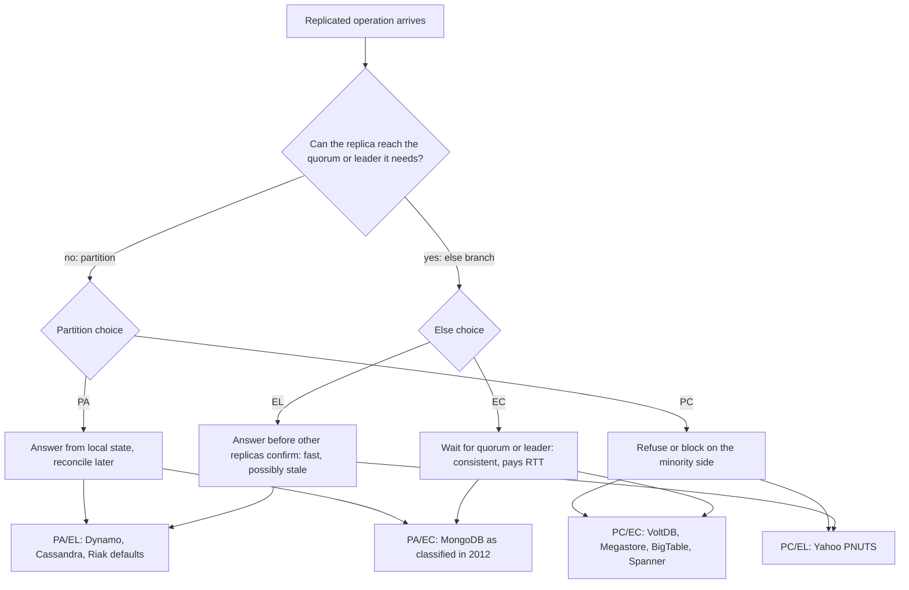
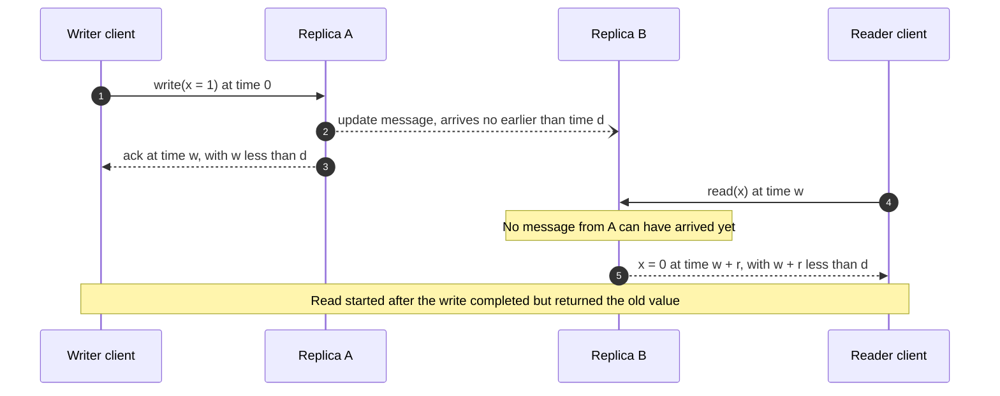
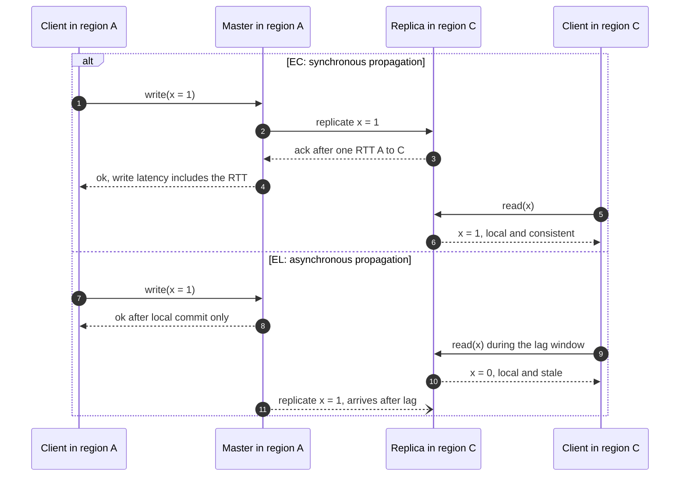
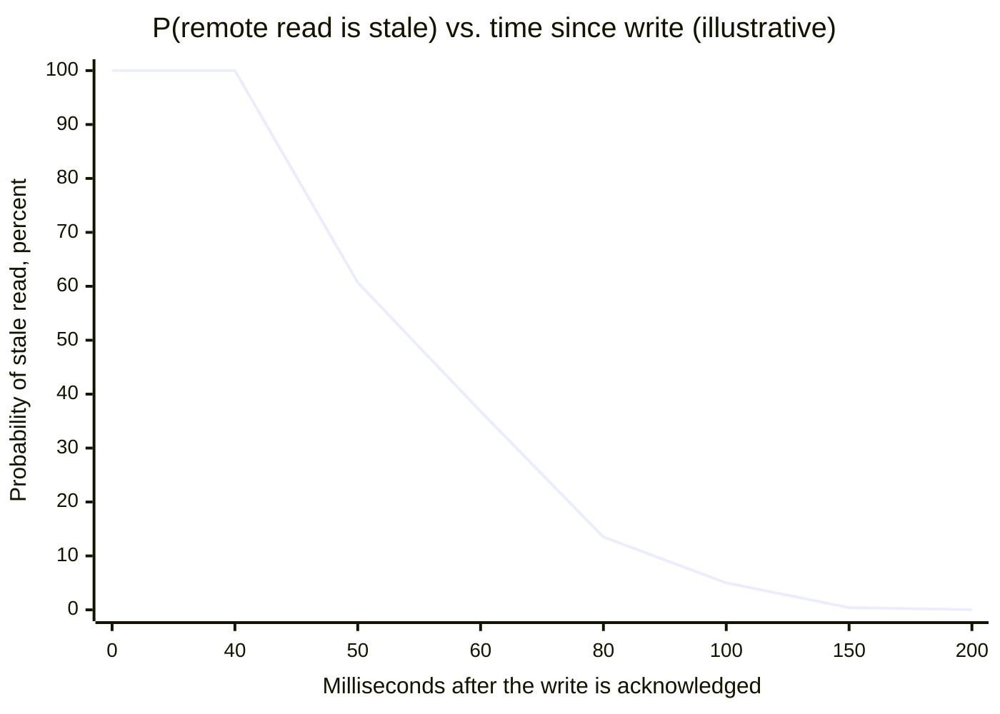
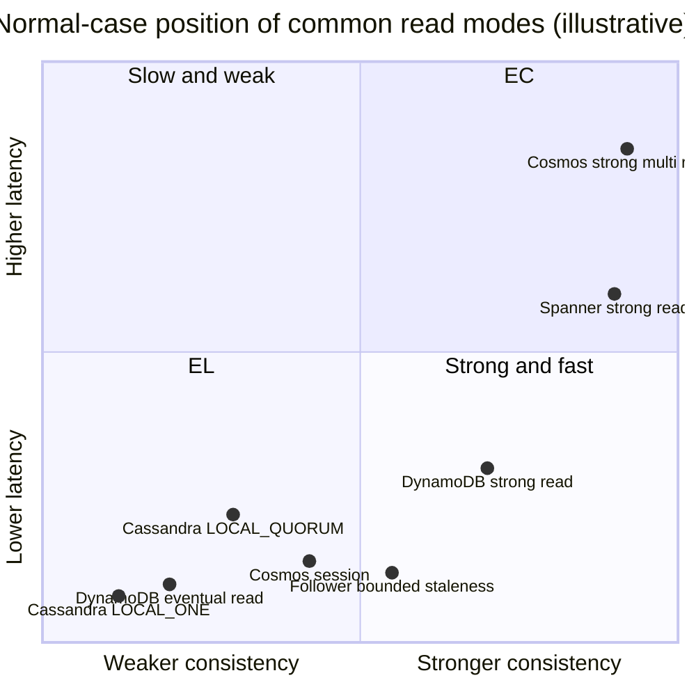
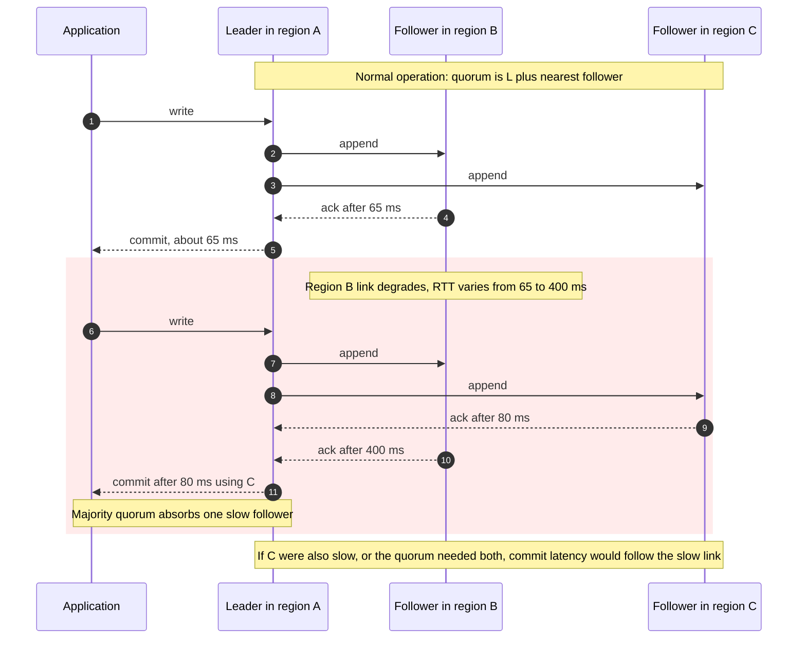

PACELC, CAP teoreminin dışarıda bıraktığı dalı ekler: bir Partition varsa replike bir sistem Availability (erişilebilirlik) ile Consistency (tutarlılık) arasında takas yapar; Else, yani ağ sağlıklıyken, Latency (gecikme) ile Consistency arasında takas yapar. Daniel Abadi bu formülasyonu 2010'da bir blog yazısında ortaya attı, 2012'de IEEE Computer'da yayımlanan makalesinde geliştirdi ve "pass-elk" diye okunduğunu belirtti. Temel iddiası şudur: gündelik sistem tasarımını biçimlendiren denge CAP'in tarif ettiği denge değildir; çünkü partition'lar seyrek ve kısadır, replikaları tutarlı tutmanın gecikme maliyeti ise normal işleyişin her saniyesinde, koordinasyon gerektiren her operasyonda ödenir.

Adlandırdığı problem somuttur. Bir sistem veriyi erişilebilirlik ve dayanıklılık için replike eder; dolayısıyla her yazmanın güncellenmesi gereken birden fazla kopyası vardır. Sistem, onay vermeden ya da yanıt dönmeden önce yeterli sayıda kopyanın uzlaşmasını bekleyebilir; ya da tek bir kopyadan yanıt verip diğerlerinin yetişmesine izin verebilir. Beklemenin bedeli en az replikalar arasındaki ağ gecikmesidir; bölgeler arasında bu onlarca ila yüzlerce milisaniyedir ve fiberdeki ışık hızının altına indirilemez. Beklememenin bedeli tutarlılıktır: bir yazmayı henüz almamış kopyadan sunulan okuma, sistemin çoktan geride bıraktığı bir değeri döndürür. İki durumda da ortada partition yoktur; denge, replikalar birbirinden uzak olduğu ve mesajlar zaman aldığı için vardır.

Dolayısıyla asıl denge, beklemenin nereye konacağıdır. Bir EC operasyonu (else dalında tutarlılık) kritik yolunda diğer replikalara bir ya da birkaç round trip öder ve gecikmesini coğrafya ile duyması gereken en yavaş replika belirler. Bir EL operasyonu (else dalında gecikme) kritik yolunda hiçbir şey ödemez ve boyutunu replikasyon gecikmesinin belirlediği bir bayatlık (staleness) penceresi açar; bu pencere de tam olarak sistem baskı altındayken büyür. Her replike depo bu seçimi, çoğu zaman operasyon başına yapar ve çoğu, her iki tarafı da bir yapılandırma bayrağının arkasında sunar; uygulamaların büyük kısmının nasıl davranacağını o bayrağın varsayılan değeri belirler.

## Formülasyon ve CAP'e Kattıkları

CAP tek bir durumu kısıtlar: bir istek, diğerlerine ulaşamayan bir replikaya gelir. Bu analiz [CAP Teoremi: CP ve AP Sistemler](/distributed-systems/tr/data-management/consistency-models/cap-theorem/) sayfasında ele alınır. PACELC, bir sistemin ömrünün neredeyse tamamını kaplayan durumu ekler: her replikaya ulaşılabilir, ama ulaşmak zaman alır.

### İki Dal, Dört Sınıf

Abadi bir sistemin davranışını eğik çizgiyle birleştirilmiş iki seçim olarak yazar: partition seçimi (PA veya PC) ve else seçimi (EL veya EC). Dört kombinasyon eşit sıklıkta görülmez ve bir kombinasyonun neden seyrek olduğu, formülasyon hakkında kombinasyonların kendisinden daha fazlasını anlatır.


*Tek bir operasyon için iki PACELC kararı ve ortaya çıkan dört sınıf; her sınıfın yanında Abadi'nin 2012'de örnek olarak kullandığı sistemler.*

Diyagram, iki kararın ilke olarak bağımsız ama pratikte ilişkili olduğunu gösterir. Tutarlı kalmak için partition sırasında yanıt vermeyi reddeden bir sistem (PC), tutarlılığın gerektirdiği koordinasyon mekanizmasını zaten kurmuştur ve bu mekanizma genellikle normal durumun yolunda da durur; bu yüzden PC sistemler çoğunlukla EC'dir. Partition sırasında yerel durumdan yanıt veren bir sistem (PA), sonradan uzlaştırmayı zaten kabul etmiştir; bu bedel bir kez ödendiğinde ağ sağlıklıyken de yerel yanıt vermek ucuzdur, bu yüzden PA sistemler çoğunlukla EL'dir. Abadi'nin argümanı, bu tür sistemlerin tasarımını asıl belirleyenin ikinci karar olduğuydu: Dynamo tarzı depolar bayatlığı partition olabilir diye kabul etmez, her gün tek haneli milisaniyelik yazmalar istedikleri için kabul eder; partition davranışları bundan türer.

Köşegen dışındaki iki sınıf, bu ilişkinin zorunlu olmadığını gösterir. Abadi, Yahoo'nun coğrafi olarak replike edilen deposu PNUTS'u PC/EL olarak sınıflandırdı: normal işleyişte okumaları geride kalabilen yerel bir replikadan sunar, ama her kaydın bir master bölgesi vardır ve makalenin belirttiği gibi bir partition bu master'ı azınlık tarafında yalıttığında sistem varsayılan olarak kaydı güncellemelere kapatır. O dönemin MongoDB'sini ise PA/EC olarak sınıflandırdı; etiketin arkasındaki davranış şuydu: bir replica set normal işleyişte okuma ve yazmaları bir primary üzerinden sunuyordu, ama azınlıkla birlikte yalıtılmış bir primary daha sonra geri alınacak yazmaları kabul edebiliyordu. Her iki örnek de bu sistemlerin 2012'deki varsayılanları hakkında yargılardır, kalıcı özellikler değildir; MongoDB'nin varsayılanları aşağıda anlatıldığı gibi o zamandan beri değişti.

### Dengeyi Replikasyon Yaratır

Gecikme-tutarlılık dengesi yalnızca replikasyon nedeniyle vardır. Verinin tek bir kopyası doğası gereği tutarlıdır ve tek bir yerel erişime mal olur. Replikasyon erişilebilirlik için (bir node arızası hizmeti durdurmasın diye) ve okuma kapasitesi ya da yakınlık için (primary'den uzaktaki istemciler hızlı okuma alsın diye) eklenir; seçim yapma zorunluluğunu partition'lar değil, kopyalar yaratır. PACELC "CAP artı gecikme" diye özetlendiğinde çoğu zaman kaybolan Abadi'nin noktası şudur: bir sistem iyi bir ağ kurarak else dalındaki dengeden kaçamaz. Birden fazla hata alanında (failure domain) kopya tuttuğu sürece, bir güncelleme ya görünür olmadan önce o kopyalara gitmek zorundadır ya da gitmeden önce görünür olur.

Bu da EL/EC kararını, sistemin dayanması gereken hata alanlarının doğrudan bir sonucu yapar. Tek bir kabindeki replikaları koordine etmek mikrosaniyeler sürer; üç availability zone'daki replikalar birkaç milisaniye; üç kıtadaki replikalar yüz milisaniye veya daha fazla. Bir bölge kesintisine dayanmak için zonal replikasyondan bölgesel replikasyona geçen bir ekip, aynı kararla her EC operasyonunun fiyatını bir ila iki büyüklük mertebesi artırmış olur.

### PACELC'in Söylemedikleri

PACELC, Abadi'nin makalesinde kanıtı olan bir teorem değil, bir tasarım ilkesidir; formal dayanağı, bir sonraki bölümde anlatılan daha eski alt sınırlardan ve sonraki çalışmalardan gelir. Bir sistemin dört sınıftan birine ait olduğunu söylemez. CAP gibi operasyonları tarif eder ve istek başına tutarlılık seviyeleri olan bir depo EL ve EC operasyonlarını yan yana yürütür. Bir veritabanını varsayılanlarına göre sınıflandırmak, uygulamaların seçim yapmadıklarında ne aldıkları hakkında bir ifadedir.

Okunabilirlik için tutarlılığı ikili bir özellik gibi ele alır, ama denge kademelidir. Linearizable okumalar, beş saniyelik bir bayatlıkla sınırlanmış okumalar, istemcinin kendi yazmalarını gören okumalar ve herhangi bir replikanın mevcut durumunu gören okumalar farklı miktarda koordinasyona mal olur; hâlâ işe yarayan en ucuz modeller [Nedensel Tutarlılık ve Oturum Garantileri](/distributed-systems/tr/data-management/consistency-models/causal-consistency-session-guarantees/) sayfasında ele alınır. Gecikmeyi tek bir nicelik gibi ele alır, ama ilgili sayı genellikle kuyruktur (tail): `n` replikadan `k` tanesini bekleyen bir EC operasyonu, `k`'inci en hızlı yanıtı devralır; bu dağılım [Lidersiz Replikasyon](/distributed-systems/tr/data-management/replication/leaderless-replication/) sayfasında incelenir. Throughput, maliyet ve dayanıklılık hakkında ise hiçbir şey söylemez. Tek bir yerel replikanın onayladığı bir yazma (EL), aynı zamanda tek bir makine arızasının kaybettirebileceği bir yazmadır; bu, gecikme kararı olduğu kadar bir dayanıklılık kararıdır ve [Lider Tabanlı Replikasyon](/distributed-systems/tr/data-management/replication/leader-based-replication/) sayfasında ele alınır.

:::note[Ad ve kanıt]
Abadi'nin makalesi PACELC'i bir teorem olarak değil, CAP'in yeniden formülasyonu olarak sunar. Wojciech Golab'ın 2018 tarihli *Proving PACELC* notu formal versiyonu sağlar: partition dalı Gilbert-Lynch sonucudur, else dalı ise partition'sız yürütmelerde tutarlı register'lar için bir gecikme alt sınırından çıkar. Bu el kitabında "PACELC teoremi", bu birleşik ifadeyi kasteder.
:::

## Tutarlılık Neden Bir Round Trip'e Mal Olur: Alt Sınır

Else dalı belirli gerçekleştirimlerin bir özelliği değildir. Hem CAP'ten hem PACELC'ten eski bir imkansızlık sonucundan çıkar ve bu sonuç tutarlılığın tam olarak ne kadar gecikmeye mal olduğunu söyler.

### r + w >= d Sınırı

Lipton ve Sandberg 1988'de, Attiya ve Welch de 1994'te, sequential consistency için ve dolayısıyla daha güçlü olan linearizability için de şunu gösterdi: replikalar arasındaki her mesajın ulaşması en az `d` sürüyorsa, tutarlı bir okuma-yazma register'ının hiçbir gerçekleştirimi en kötü durumdaki okuma gecikmesi `r` ile yazma gecikmesi `w`'nin toplamını `d`'nin altına indiremez. Golab bunu PACELC'in else yarısı olarak yeniden ifade etti: partition'sız yürütmelerde bir register, her iki operasyon için hem tutarlılığı hem de `d/2`'nin altında gecikmeyi garanti edemez.

Linearizability için sezgi tek bir yürütmeye sığar. Bir yazma ile bir okumanın `r + w < d` olacak şekilde tamamlanabildiğini varsayalım. Bir istemci A replikasına yazar ve onayını `w` sonra alır. Hemen ardından başka bir istemci B replikasından okur ve okuma `r` içinde tamamlanır. Yazmanın başlangıcından okumanın bitişine kadar geçen aralığın tamamı `d`'den kısadır; dolayısıyla A'nın yazma yüzünden gönderdiği hiçbir mesaj B'ye ulaşmış olamaz. Okuma sırasında B'nin durumu, yazmanın hiç gerçekleşmediği bir yürütmedeki durumuyla aynıdır ve B eski değeri döndürür. Ama okuma, yazma tamamlandıktan sonra başlamıştır ve linearizability, başka bir operasyon tamamlandıktan sonra başlayan her operasyonun onu görmesini gerektirir; yani okuma yeni değeri döndürmek zorundadır.


*Else dalının argümanı. Her iki operasyon toplamda tek bir mesaj gecikmesinden hızlı biterse, okuyucunun replikası yazmadan haberdar olamaz.*

1-3. adımlar, yazmanın güncelleme mesajı (2. adım) ulaşamadan geri döndüğünü gösterir. 4-6. adımlar, aynı pencere içinde hem başlayan hem biten bir okumayı gösterir. Yapı CAP kanıtıyla aynıdır, tek farkla: CAP'te mesaj kaybolur, dolayısıyla hiçbir bekleme işe yaramaz; burada mesaj yalnızca yoldadır, dolayısıyla yeterince beklemek her zaman işe yarar ve sınır ne kadar bekleneceğini tam olarak söyler. Sequential consistency farklı istemcilerin operasyonlarını gerçek zamana göre sıralamaz; bu yüzden kanıtı simetrik bir yürütme gerektirir: istemci 1, A'da `x = 1` yazar ve ardından orada `y`'yi okur; aynı anda istemci 2, B'de `y = 1` yazar ve ardından orada `x`'i okur. `r + w < d` ise iki okuma da güncellemelerden herhangi biri ulaşmadan tamamlanır ve ikisi de 0 döndürür. Dört operasyonun hiçbir tekil sıralaması bu sonucu üretmez, çünkü sıralamada hangi yazma önce gelirse gelsin diğer istemcinin okumasından önce gelir. Her iki durumda da her gerçekleştirim, bir yazma ile onu izleyen bir okumanın birleşik yolunun bir yerine en az bir mesaj gecikmesi koymak zorundadır. Bunun tamamını yazmaya koyabilir (onay vermeden önce her replikayı güncelle, sonra yerelden oku), tamamını okumaya koyabilir (yerele yaz, sonra yazanın tarafına sorarak oku) ya da ikisi arasında bölebilir.

### Gerçek Protokoller Sınırdan Ne Kadar Uzakta

Attiya ve Welch, sabit mesaj gecikmeli bir modelde sınırın sıkı (tight) olduğunu da gösterdi: okumaların anlık, yazmaların `d` sürdüğü ya da tam tersi olan protokoller vardır. Gerçek sistemler daha fazlasını öder, çünkü yanıt almadan bir mesajın ulaştığını bilemezler. Golab, onaya dayalı protokollerin sınırı en az iki kat aştığını belirtir: read-one/write-all bir yazmaya `2d` (her replikaya bir round trip) mal olur, çoğunluk quorum'ları da hem okumalar hem yazmalar için en az `2d` tutar. Bir yazmayı commit eden [Raft](/distributed-systems/tr/coordination/consensus-algorithms/raft/) leader'ı bir çoğunluğa bir round trip öder; linearizable bir okuma da, leader zamana dayalı bir lease tutmuyorsa, bir round trip daha öder. Bu okuma yolları [Linearizability](/distributed-systems/tr/data-management/consistency-models/linearizability/) sayfasında karşılaştırılır.

Sınırın gözden kaçması kolay iki sonucu vardır. Birincisi, yalnızca linearizability için değil sequential consistency için de geçerlidir; dolayısıyla gerçek zaman sıralamasından vazgeçmek iki operasyonu birden bedava yapmaz, yalnızca birinin bedava olmasına izin verir. İkincisi, sequential consistency'den zayıf tutarlılık modelleri sınırdan tamamen kurtulur. Nedensel tutarlılık, read-your-writes ve nihai tutarlılık yerel okumalar ve yerel yazmalarla gerçekleştirilebilir, çünkü hiçbiri B'deki bir okumanın, B'nin haberdar olmadığı A'daki bir yazmayı yansıtmasını gerektirmez. Tutarlılık spektrumunun ortasının var olmasının formal nedeni budur: operasyonlarının hepsi EL olabilen en güçlü garantiler kümesidir.

### Beklemenin Yeri: Abadi'nin Replikasyon Seçenekleri

Abadi, bir güncellemenin replikalara yayılma yollarını sıraladı ve her biri sınır üzerinde bir konuma karşılık gelir. Birincisinde güncellemeler tüm replikalara aynı anda gönderilir; bir sıralama adımı yoksa eşzamanlı güncellemeler farklı sıralarda uygulanabilir ve replikalar ıraksar, bir sıralama adımı varsa (bir ön işleme katmanı ya da bir uzlaşma protokolü) her güncelleme o adımın gecikmesini öder. İkincisinde güncellemeler önce üzerinde anlaşılmış bir master'a gider: senkron yayılmada master replikaları bekler ve her yazmaya bir round trip eklenir; asenkron yayılmada onay hemen verilir, sonra ya okumalar master'a gider ve oraya ulaşmanın bedelini öder ya da okumalar herhangi bir replikaya gider ve tutarsız olabilir; karma bir yaklaşım bazı replikalara senkron, diğerlerine asenkron yazar, bu durumda okumalar yalnızca senkron güncellenmiş bir replikaya ulaşırlarsa tutarlı kalır ki bu, `R + W > N` quorum koşuludur. Üçüncüsünde güncellemeler önce rastgele bir replikaya gider; yayılma senkronsa eşzamanlı güncellemeleri tespit edip çözmenin gecikmesi eklenir, değilse asenkron yayılmanın tutarsızlığı yaşanır.


*Abadi'nin listesindeki master tabanlı seçenek, senkron (EC) ve asenkron (EL) yayılmayla. Gecikme yer değiştirir; ortadan kalkmaz.*

EC dalında yazma 3. adımda A-C round trip'ini öder ve 6. adımdaki okuma hem yereldir hem doğrudur. EL dalında yazma 8. adımda hiçbir uzak mesaj olmadan onaylanır ve 9. ile 10. adımlardaki okuma hızlıdır ama bayattır, çünkü 11. adımdaki güncelleme hâlâ yoldadır. Üçüncü tasarım seçeneği, yani C bölgesindeki okumayı yerel replika yerine master'a yönlendirmek, round trip'i yazma yolundan okuma yoluna taşıyarak EL yazmayı yeniden tutarlı hale getirirdi.

## Örnek Hesap: Üç Bölgede EC ve EL'in Fiyatı

`A`, `B` ve `C` bölgelerinin her birinde birer replikası olan bir kullanıcı profili servisi varsayalım; round trip süreleri `A`-`B` arasında 65 ms, `A`-`C` arasında 80 ms ve `B`-`C` arasında 140 ms olsun, istemciler bölgelere eşit dağılmış olsun. Bölge içi atlamalar ve disk sync'leri birkaç milisaniye ekler ve hesaba katılmaz. İş yükü, 1 milyon profil üzerinde saniyede 1.000 yazma ve 20.000 okumadır. Bütün sayılar örnek amaçlıdır.

### EC'nin Fiyatı

Leader'ı `A`'da olan bir konsensüs grubunda bir yazma, leader en yakın follower'ı `B`'den 65 ms'de yanıt aldığında commit olur. `A`'daki bir istemcinin yazması 65 ms sürer; `B`'den, `A`'ya ulaşmak için 65 ms artı commit için 65 ms, yani 130 ms; `C`'den 80 artı 65, yani 145 ms. Ortalama `(65 + 130 + 145) / 3 = 113.3` ms'dir. Leader lease'i kullanan linearizable bir okuma yalnızca leader'a gidişe mal olur: 0, 65 ve 80 ms, ortalama 48.3 ms. Sırayla birbirine bağlı beş okuma yapan bir sayfa (profil, sonra ayarlar, sonra bağlı üç kaydın her biri), `C`'deki bir istemciye ekranı çizmeden önce `5 * 80 = 400` ms ağ süresine mal olur; her okuma yerel olsaydı bu yaklaşık 5 ms olurdu.

### EL'in Fiyatı

Her bölgede yerel bir primary'den asenkron replikasyon ve yerel okumalarla her operasyon yaklaşık bir milisaniye sürer. Bedeli bir bayatlık penceresidir. Bir yazmanın onaylanmasından uzak bir replikaya ulaşmasına kadar geçen sürenin, `A`-`C` hattında yaklaşık 40 ms olan tek yönlü ağ gecikmesi artı ortalaması 20 ms olan üstel dağılımlı bir uygulama (apply) gecikmesi olduğunu varsayalım. Yazmadan `t` ms sonra yapılan uzak bir okumanın eski değeri döndürme olasılığı, 40 ms'ye kadar 1, sonrasında `e^(-(t - 40) / 20)` olur.


*40 ms tek yönlü gecikme artı ortalaması 20 ms olan üstel bir uygulama gecikmesi için bayatlık. Gerçek gecikme dağılımlarının kuyrukları, özellikle yük altında, daha ağırdır.*

Eğrinin düz bir tepesi ve üstel bir kuyruğu vardır. Düz tepe, önceki bölümdeki sınırın görünür hale gelmiş biçimidir: başka bir bölgedeki hiçbir okuma, güncelleme fiziksel olarak oraya ulaşmadan bir yazmayı yansıtamaz. Kuyruk ise sistemin kontrol ettiği kısımdır: uygulama hızı, replikasyonun gruplanması (batching) ve replikadaki kuyruklanma. Bailis ve arkadaşlarının probabilistically bounded staleness (PBS) çalışmasının Dynamo tarzı quorum'lar için ölçtüğü nicelik budur ve bir EL sistem hakkında konuşmanın doğru yolu da budur: "nihai olarak tutarlı" değil, "bir yazmadan `t` milisaniye sonra `p` olasılıkla bayat".

Yazma başına beklenen bayat okuma sayısı, o anahtar için uzak okuma hızı ile eğrinin altındaki alanın çarpımıdır; bu model için alan `40 + 20 = 60` ms'dir. Okumalar düzgün dağılmışsa her profil saniyede `20,000 / 1,000,000 = 0.02` okuma alır ve bunların üçte ikisi, yani saniyede yaklaşık 0.0133'ü, uzak bölgelerden gelir. Bu durumda bir yazma `0.0133 * 0.06 = 0.0008` beklenen bayat okuma üretir; saniyede 1.000 yazma da saniyede yaklaşık 0.8 bayat okuma üretir, bu da bütün okumaların %0.004'üdür.

Gerçek erişim düzgün dağılmaz. Saniyede 2.000 okuma alan bir profil, örneğin bir ünlünün hesabı ya da paylaşılan bir yapılandırma kaydı, saniyede yaklaşık 1.333 uzak okuma alır ve ona yapılan her yazma `1,333 * 0.06 = 80` bayat okuma üretir. EL bir sistemde bayatlık sıcak anahtarlarda (hot key) yoğunlaşır; sıcak anahtarlar da birçok kişinin aynı anda baktığı ve bir tutarsızlığın, örneğin önce azalıp sonra yeniden artan bir takipçi sayısının, fark edilip bildirildiği anahtarlardır. Düzgün dağılım varsayımıyla bulunan ortalama, kullanıcıların tam olarak gördüğü durumları gizler.

### Ara Seçenekler

İki karma tasarım uç noktaların arasında durur ve fiyatları aynı sayılardan hesaplanabilir.

Birincisinde yazmalar EC, okumalar ise bir bayatlık sınırıyla EL'dir; follower read'lerin ve bounded staleness okumaların tasarımı budur. Yazmalar 113.3 ms ortalamasını korur, okumalar yaklaşık 1 ms sürer ve bir okumanın bayatlığını gecikme dağılımı değil, sınır belirler.

İkincisinde her kaydın bir ev bölgesi (home region) vardır; PNUTS tasarımı budur. Bir yazma kaydın master'ına gider, dolayısıyla ev bölgesindeki istemciler için yereldir, diğerleri için master'a bir round trip'e mal olur. Bir kayda yapılan yazmaların %90'ı ev bölgesinden geliyorsa (bir kullanıcı profili için sahibinden) ve uzak yazmalar bölgeler arası ortalama round trip olan `(65 + 80 + 140) / 3 = 95` ms'yi ödüyorsa, ortalama yazma gecikmesi `0.9 * 1 + 0.1 * 95 = 10.4` ms olur. Bir kayda yapılan yazmalar tek bir master'da sıralandıkları için her yerde aynı sırayla uygulanır; PNUTS buna kayıt başına zaman çizelgesi tutarlılığı (per-record timeline consistency) adını verdi. Master olmayan bir bölgeden yapılan okumalar yine de bayat olabilir. Tasarım, küresel konsensüsten bir büyüklük mertebesi daha düşük yazma gecikmesiyle kayıt başına tek bir sıra satın alır; bedelini de kaydın master bölgesi koptuğunda o kaydın yazmalarının erişilemez olmasıyla öder. Abadi'nin onu PC/EL olarak sınıflandırmasının nedeni budur.

| Tasarım | Ortalama yazma gecikmesi | Ortalama okuma gecikmesi | Bir okumanın tutarlılığı | Ne zaman tercih edilmeli |
|---|---|---|---|---|
| Konsensüs, linearizable okumalar (EC/EC) | 113.3 ms | Lease ile 48.3 ms | Linearizable | Benzersizlik, para, lease'ler, yapılandırma |
| Konsensüs yazmaları, bounded staleness okumalar | 113.3 ms | yaklaşık 1 ms | Sınıra kadar bayat | Yazması seyrek, okuması yoğun veri |
| Kayıt başına ev bölgesi (PC/EL) | %90 yerellikte 10.4 ms | yaklaşık 1 ms | Kayıt başına sıra, bayat olabilir | Doğal bir sahibi ve bölgesi olan veri |
| Yerel yazma, asenkron replikasyon (EL/EL) | yaklaşık 1 ms | yaklaşık 1 ms | Gecikme eğrisine göre bayat, eşzamanlı yazmalar çakışır | Birleştirilebilir veri, telemetri, sepetler, zaman akışları |

Tablo kararın şeklini açıkça gösterir. Pahalı sütun her zaman kritik yolda bölgeler arasını geçen sütundur; her tasarım hangi operasyonların, ne sıklıkla geçeceğini ve karşılığında okuyucuların ne göreceğini seçer.

## Production Sistemlerde PACELC

Production depolarının çoğu her iki dalı da sunar; farklılık, hangisinin varsayılan olduğunda, ayarın nasıl biçimlendiğinde ve EC seçeneğinin gerçekte neye mal olduğundadır.


*Konumlar niteldir ve çok bölgeli kurulumları varsayar; tek bölgeli güçlü okumalar gecikme ekseninde çok daha aşağıda durur.*

Grafikteki asıl bilgi boş çeyreklerdedir. Sağ alt çeyrekte, güçlü ve hızlıda, hiçbir şey yoktur, çünkü replikalar birbirinden uzaklaştığında alt sınır bunu yasaklar; en yakın yaklaşımlar iyi konumlanmış bir leader'daki lease okumaları ve kayıt başına master'lardır, ikisi de yalnızca veriye yakın istemciler için hızlıdır. Sol üstte de bilinçli olarak duran bir şey yoktur, ama sistemler oraya kazayla düşer: uzak bir replikaya yönlendirilmiş zayıf bir okuma ya da değer görünene kadar uygulama düzeyinde yeniden deneyen bir döngünün izlediği EL yazma, bir garanti elde etmeden gecikme öder.

Abadi'nin varsayılan olarak PA/EL saydığı Dynamo tarzı depolar, seçimi istek başına tutarlılık seviyesiyle yaptırır. Cassandra ve ScyllaDB `ONE` ya da `LOCAL_ONE` seviyesinde ilk replikadan yanıt verir, `LOCAL_QUORUM` seviyesinde yerel veri merkezindeki bir çoğunluğu bekler ki bu bölgeler arası bir round trip değil milisaniyeler tutar, yazmalar için `EACH_QUORUM` seviyesinde ise her veri merkezinde bir çoğunluğu bekler ki bu bölgeler arası EC'dir. Quorum okuma ve yazmaları, [Lidersiz Replikasyon](/distributed-systems/tr/data-management/replication/leaderless-replication/) sayfasındaki nedenlerle yine de linearizable değildir; linearizable olan operasyon, bir Paxos turu çalıştıran ve birkaç round trip'e mal olan lightweight transaction'dır. Dolayısıyla EL varsayılanın yanında, ara quorum seviyelerinden hem daha yavaş hem daha güçlü bir EC seçeneği bulunur.

DynamoDB, bölge içinde seçimi bir okuma bayrağıyla sunar: nihai tutarlı bir okuma öğenin herhangi bir replikasından sunulabilir, güçlü tutarlı bir okuma ise öğenin leader replikasına gider. EC'nin fiyatı gecikmenin yanı sıra faturalandırma modelinde de görünür: 4 KB'a kadar güçlü tutarlı bir okuma bir okuma kapasite birimi (RCU) tüketir, aynı boyuttaki nihai tutarlı okuma bunun yarısını. Bölgeler arasında, multi-Region eventual consistency modundaki global tables PA/EL'dir: her bölge yazmaları yerelde kabul eder ve son yazan kazanır. 2025'te genel kullanıma açılan multi-Region strong consistency modu ise PC/EC'dir; yazmalar onaylanmadan önce diğer bölgelerle koordine edilir.

Azure Cosmos DB else dalını beş kademeli bir ayara dönüştürür: strong, bounded staleness, session, consistent prefix ve eventual. Dokümantasyonu EC'nin fiyatını doğrudan belirtir: strong tutarlılıklı ve birden fazla bölgeli bir hesapta yazma gecikmesi, en uzak iki bölge arasındaki round trip süresinin iki katı artı 99. persentilde 10 milisaniyedir; diğer seviyelerdeki yazmalar ise 99. persentilde 10 milisaniye içinde tamamlanır. Strong ve bounded staleness okumaları da, tek bir replika yerine yerel replikaların bir azınlığından okudukları için zayıf seviyelerin iki katı request unit tüketir. Birden fazla yazma bölgesi olan hesaplarda strong tutarlılık sunulmaz ve yaklaşık 8.000 km'den uzak bölgeler için varsayılan olarak engellenir. Bounded staleness, bir sistemin dengenin bir tarafını diğerine nasıl dönüştürebileceğini gösterir: okumalar en fazla `K` versiyon ya da `T` saniye geride kalabilir ve bir bölgenin gecikmesi sınırı aştığında etkilenen partition'a yapılan yazmalar, gecikme sınırın içine dönene kadar kısılır (throttle). Bayatlık sınırı, replikasyon geride kaldığında yazma gecikmesi ve throughput harcanarak korunur; bu, else dalındaki dengenin kendiliğinden işlemesidir.

Spanner ve onun modeli üzerine kurulan sistemler, Abadi'nin çerçevesinde PC/EC'ye düşer; güçlü okumaları varsayılan yapar ve EL okumaları istek üzerine sunar. Spanner'da güçlü bir okuma, başlamadan önce commit edilmiş her transaction'ı görmek zorundadır; bu bir timestamp ve leader olmayan bir replikada, o replikanın bu timestamp'e yetiştiğinin teyidini gerektirir. Kesin bir bayatlık, azami bir bayatlık ya da belirli bir timestamp ile istenen bayat okuma ise, o timestamp'e kadar yazmaları uygulamış en yakın replikadan, hiçbir bölgeler arası iletişim olmadan sunulabilir. Bu timestamp'leri anlamlı kılan mekanizma [Google TrueTime & Spanner](/distributed-systems/tr/foundations/time-and-ordering/truetime-spanner/) sayfasında anlatılır. CockroachDB aynı şekli, replikaların zaten kapattığı bir timestamp'te `AS OF SYSTEM TIME` ile yapılan follower read'ler ve bounded staleness okumalarla sunar; gerçekleştirim [Follower Reads ve Bounded Staleness](/distributed-systems/tr/case-studies/distributed-sql/follower-reads-bounded-staleness/) sayfasında ele alınır. Her iki sistem de okuyucunun ne kadar bayatlığa razı olduğunu belirtmesini ister; bu okumaları, keyfi ölçüde geride olabilen bir replika okumasından ayıran da budur.

MongoDB bir sınıflandırmanın nasıl eskidiğini gösterir. Abadi'nin 2012'deki PA/EC etiketi, yazmaları yalnızca primary tarafından onaylanan bir replica set'i tarif ediyordu. MongoDB 5.0'dan beri örtük varsayılan write concern çoğu kurulum için `majority`'dir ve bu her yazmaya bir çoğunluk round trip'i ekler; varsayılan read concern ise hâlâ `local`'dir, node'un mevcut verisini beklemeden okur ve daha sonra geri alınacak yazmaları döndürebilir. Güncel varsayılan, yazmalar için EC, okumalar için EL'dir; read preference ise okumaları secondary'lere taşıyarak onları primary'ye göre de EL yapabilir.

Replikaları olan lider tabanlı SQL veritabanları seçimi iki yerde yapar: yazma tarafında primary'nin senkron standby'ları bekleyip beklemediği, okuma tarafında uygulamanın okumaları replikalara yönlendirip yönlendirmediği. Yazma tarafındaki seçenekler [Lider Tabanlı Replikasyon](/distributed-systems/tr/data-management/replication/leader-based-replication/) sayfasında, okuma tarafındaki anomaliler ve çözümleri [Replikasyon Gecikme Sorunları](/distributed-systems/tr/data-management/replication/replication-lag/) sayfasında incelenir. Kurulumların çoğu tek bölge içindeki yazmalar için EC, bir replikadan sunulan her okuma için EL'dir.

| Sistem ve mod | Else dalı | Partition dalı | EC seçeneğinin maliyeti | Ne zaman tercih edilmeli |
|---|---|---|---|---|
| Cassandra `LOCAL_ONE` / `LOCAL_QUORUM` | EL | PA | Lightweight transaction'lar: birkaç round trip | Yüksek yazma hızları, birleştirilebilir ya da LWW'ye toleranslı veri |
| Cassandra `EACH_QUORUM` yazmaları | Veri merkezleri arası EC | Yazmalar için PC | Yazma başına bir bölgeler arası round trip | Onaydan önce her bölgede kalıcı olması gereken yazmalar |
| DynamoDB nihai / güçlü okumalar | Bölge içinde EL / EC | Tablo moduna göre değişir | İki kat okuma kapasitesi, yalnızca leader replika | Güçlü okumalar yalnızca read-modify-write yollarında |
| DynamoDB global tables, eventual | EL | PA | Uygulanamaz | Birçok bölgede yazılan bağımsız öğeler |
| DynamoDB global tables, strong | EC | PC | Yazmalarda bölgeler arası koordinasyon | Sıfır kurtarma noktası gerektiren küresel veri |
| Cosmos DB eventual, prefix, session | EL | PA | Uygulanamaz | Session token'larıyla, kullanıcıya dönük verinin çoğu |
| Cosmos DB bounded staleness | Sınırlı EC | Sınır aşılınca yazmalar kısılır | İki kat okuma RU'su, gecikme altında throttling | Tek yazma bölgesi, bayatlık sınırı isteyen okuyucular |
| Cosmos DB strong | EC | PC | En uzak bölgeye 2 x RTT artı p99'da 10 ms | Katı sıralama gerektiren küçük küresel veri kümeleri |
| Spanner, CockroachDB güçlü | EC | PC | Commit round trip'i; okuma timestamp'i teyidi | Strict serializability gerektiren transaction'lar |
| Spanner bayat okuma, CockroachDB follower read | Sınırlı EL | Replikada timestamp olduğu sürece sunulur | Uygulanamaz | Dashboard'lar, kataloglar, saniyelerce geride kalabilen okumalar |
| PNUTS tarzı ev bölgesi | EL okumalar, master yazmaları | Kayıt için PC | Kaydın master'ına bir round trip | Doğal bir sahip bölgesi olan veri |

### Seçimi İfade Başına Yapılandırmak

İstek başına seviyeleri olan bir depoda sınıflandırma her çağrı noktasına aittir. Bir CQL oturumu şekli gösterir; aynı seçimler her sürücüde istek seçenekleri olarak bulunur.

```sql
-- EL: fastest replica in the local data center answers
CONSISTENCY LOCAL_ONE;
SELECT display_name, avatar_url FROM profiles WHERE user_id = ?;

-- EC within the region: majority of local replicas
CONSISTENCY LOCAL_QUORUM;
UPDATE profiles SET display_name = ? WHERE user_id = ?;

-- EC across regions for a write that must survive a region loss
CONSISTENCY EACH_QUORUM;
UPDATE accounts SET plan = ? WHERE account_id = ?;

-- Linearizable compare-and-set: Paxos round, SERIAL for the read phase
UPDATE usernames SET owner = ? WHERE name = ? IF NOT EXISTS;
```

Örnek hesaptaki topolojide dört ifade kabaca 1 ms, birkaç milisaniye, bir bölgeler arası round trip ve birkaç round trip'e mal olur. Hiçbiri tablo için "doğru" seviye değildir; her biri kendi operasyonunun ihtiyacına uyar. Tüm küme için tek bir seviye belirleyen bir kod tabanı, her operasyon için aynı anda bir PACELC kararı vermiştir ve bu karar genellikle bazıları için yanlıştır.

:::tip[EC'yi bir insanın sonucu beklediği yerde harca]
Bir EC okumasının gecikmesi en çok, sırayla birkaç okuma yapan bir sayfa yüklemesinde önemlidir, arka plan işinde ise en az. Tersine, bir EL okumasının bayatlığı en çok aynı kullanıcı yazdıktan hemen sonra, başkalarının yazdığı veride ise en az önemlidir. Çoğu üründe en değerli kalıp şudur: varsayılan olarak EL, yazanın kendi oturumu için read-your-writes ve yalnızca bir şeyi kontrol eden ya da sahiplenen operasyonlar için EC. Oturum araçları [Replikasyon Gecikme Sorunları](/distributed-systems/tr/data-management/replication/replication-lag/) sayfasındadır.
:::

## Hata Modları ve Dışarıdan Görünüşleri

Else dalındaki hatalar nadiren kesintidir. EC sistemlerde gecikme gerilemeleri, EL sistemlerde bayatlık sıçramaları ve en tehlikelisi, baskı altında sessizce bir daldan diğerine geçen sistemlerdir.

### EC'den EL'e Sessiz Düşüş

Tetikleyici: bir retry politikası, bir istemci kütüphanesinin fallback'i ya da uygulama düzeyindeki bir zaman aşımı işleyicisi, yavaşlayan veya başarısız olan EC operasyonlarına onları daha zayıf bir seviyede yeniden göndererek ya da bir replikadan veya önbellekten okuyarak yanıt verir. DataStax Java sürücüsünün kullanımdan kaldırılmış (deprecated) düşürücü retry politikası, [Lidersiz Replikasyon](/distributed-systems/tr/data-management/replication/leaderless-replication/) sayfasında ele alınan ders kitabı örneğidir; elle yazılmış "primary zaman aşımına uğrarsa replikadan oku" kodu ise yaygın örnektir. Belirtiler: sistem normal işleyişte EC, tam olarak replikalar yavaşken ya da uyuşmazken, yani bayat okumaların en olası olduğu anda EL'dir; benzersizlik ve bakiye kontrolleri olaylar sırasında bayat veri üzerinden geçer. Tespit: sunucu değil istemci tarafından üretilen, istenen ve fiilen kullanılan tutarlılık seviyesine göre operasyon sayaçları; fallback devreye girişlerinin logları; gecikme olaylarıyla ilişkili invariant ihlallerinde artış. Hafifletme: tutarlılığa bağımlı operasyonlar için tutarlılığı asla otomatik olarak zayıflatmayın; onları başarısız kılın ve yük atın, [Fallback Stratejileri](/distributed-systems/tr/resilience/protection-patterns/fallback-strategies/) sayfasında anlatıldığı gibi. Kurtarma, olay sırasında fallback yolunda çalışan operasyonların bulunmasını gerektirir ve bu yalnızca o yol loglandıysa mümkündür.

:::caution[Zaman aşımı fallback'i bir tutarlılık kararıdır]
Güçlü yol yavaşladığında bir replikadan, önbellekten ya da daha zayıf bir tutarlılık seviyesinden yanıt veren her kod, operasyonu farkın en büyük olduğu koşullarda EC'den EL'e çevirir. Bir operasyon EL'e tolerans gösterebiliyorsa onu her zaman EL olarak gönderin ve gecikmesini öngörülebilir kılın; gösteremiyorsa o fallback, bir sonraki olayı bekleyen bir doğruluk hatasıdır.
:::

### Tek Yavaş Replika EC Gecikmesini Belirler

Tetikleyici: EC bir sistemde commit yolundaki bir replika arızalanmadan yavaşlar: bozulmuş bir bölgeler arası bağlantı, yazma gecikmesi yüksek bir disk, bir garbage collection duraklaması ya da gürültülü bir komşu. Partition yoktur, dolayısıyla partition dalı hiç devreye girmez; sistem tutarlı kalır ve yavaşlar. Belirtiler: p99 commit gecikmesi yavaş replikayı izler, her operasyon kilitleri veya bağlantı yuvalarını daha uzun tuttuğu için yazma throughput'u düşer, üst servisler zaman aşımına uğrayıp yeniden dener ve yük ekler. Tespit: eş başına (per-peer) replikasyon round trip süresi ve onay gecikmesi, commit gecikmesi persentilleri, quorum bileşimi (hangi replikaların fiilen onay verdiği) ve yazmaların p50 ile p99'u arasındaki fark. Hafifletme: replikaları quorum en uzak ya da en az güvenilir replika olmadan kurulabilecek şekilde yerleştirin, bunun için ikisi birbirine yakın en az üç bölge gerekir; yavaş bir üyeyi commit quorum'undan çıkaran protokoller ya da ayarlar kullanın, örneğin üç veya daha fazla bölgeli strong tutarlılıklı hesaplar için Cosmos DB'nin dinamik quorum'u, ki burada çıkarılan bölge yeniden eklenene kadar okuma sunmayı bırakır; birden fazla replikaya gidebilen okumalar için [hedged request'ler](/distributed-systems/tr/resilience/protection-patterns/hedged-requests/) kullanın.


*Varsayımsal bir bozulma. Üçlü bir çoğunluk quorum'u, bir sonraki en hızlı round trip pahasına tek bir yavaş follower'ı tolere eder; bütün replikaları bekleyen bir protokol tolere etmez.*

1-5. adımlar en yakın follower üzerinden normal commit'i gösterir. Gölgeli bloğun içinde `B` ile bağlantı bozulur ve leader 10. adımda `C`'nin onayıyla commit eder; böylece gecikme 65 ms'den 80 ms'ye çıkar ama 400 ms'lik bağlantıyı izlemez. Bu toleransın diyagramın son notunda açıkça belirtilen bir sınırı vardır: bütün standby'lara senkron replikasyonda ya da veri merkezi başına tek replikayla `EACH_QUORUM`'da olduğu gibi her replikayı gerektiren bir quorum'da, ya da yalnızca iki bölge varsa, en yavaş bağlantı her yazmanın commit gecikmesini belirler. Aynı akıl yürütme, replikaları tam olarak iki uzak bölgede bulunan EC sistemlerin neden kötü performans gösterdiğini de açıklar: her quorum uzun bağlantıyı geçer.

### Replikasyon Birikimi Altında Bayatlık Sıçraması

Tetikleyici: EL bir sistemde replikasyon; bir yazma patlaması, toplu bir içe aktarma, replikalarda compaction ya da vacuum, bölgeler arası bant genişliği sınırı veya snapshot'tan yeniden başlayan bir replika nedeniyle geride kalır. Belirtiler: genellikle milisaniyeler kadar bayat olan okumalar saniyeler ya da dakikalar kadar bayatlar; kullanıcılar değişikliklerinin kaybolduğunu görür, sayaçlar sayfa yüklemeleri arasında geriye gider, aşağı akıştaki işler varsaydıklarından eski veriyi işler. Hiçbir şey başarısız olmadığından hata oranı alarmları yeşil kalır. Tespit: replika başına replikasyon gecikmesinin bayt olarak değil zaman olarak (son uygulanan yazmanın yaşı) ölçülmesi, çünkü yazma hızı değiştiğinde bayt birikimi bayatlık hakkında hiçbir şey söylemez; replikasyon kuyruklarının boyutu; bir bölgede bir timestamp yazıp başka bir bölgede ne zaman okunabilir olduğunu ölçen sentetik problar. Hafifletme: uygulamanın tolere ettiği değere karşı saniye cinsinden gecikmeye alarm kurun, bayatlığa duyarlı okumaları geride kalan replikalardan uzağa yönlendirin ve sınırı deponun kendisinin uyguladığı bounded staleness modlarını tercih edin.

```mermaid
gantt
    title Hypothetical staleness excursion in an EL store, bounded vs. unbounded
    dateFormat HH:mm
    axisFormat %H:%M
    section Workload
    Bulk import starts, write rate x5          :a1, 10:00, 40m
    section Unbounded EL replica
    Lag grows from 100 ms to minutes           :crit, b1, 10:02, 45m
    Reads served, increasingly stale           :b2, 10:02, 45m
    Users report missing edits                 :milestone, m1, 10:25, 0m
    section Bounded staleness store
    Lag reaches the bound                      :c1, 10:05, 2m
    Writes to affected partitions throttled    :crit, c2, 10:07, 33m
    Reads stay within the bound                :c3, 10:02, 45m
    section Response
    Import rate limited, lag drains            :d1, 10:40, 7m
```


*Aynı birikim iki farklı tasarımda. Sınırsız replika onu bayatlığa, sınırlı depo ise yazma kısıtlamasına dönüştürür.*

Ortadaki iki bölüm, else dalındaki dengenin yük altında kendini yeniden dayattığını gösterir. Replikasyon yetişemediğinde bir şeyin vazgeçmesi gerekir: ya okuyucular daha eski veri görür (bayatlığının tavanı olmayan ve ilk görünür belirtisi 10:25'teki kullanıcı bildirimleri olan sınırsız EL replika), ya da replikasyon yetişene kadar yazanlar yavaşlatılır (sorunu hemen kısılan yazmalar olarak gösteren ve okumaları verdiği söz içinde tutan sınırlı depo). İkisi de deponun bir hatası değildir; aynı soruya verilen iki cevaptır ve seçim her veri kümesi için bilinçli olarak yapılmalıdır.

### EL Altında Oturum Anomalileri

Tetikleyici: bir kullanıcının isteklerini farklı replikalara gönderen yönlendirmeyle birleşmiş bir EL okuma yolu; örneğin affinity'si olmayan bir load balancer, ağ değiştiren bir mobil istemci ya da başka bir bölgede karşılanan bir takip isteği. Belirtiler: bir kullanıcının kendi güncellemesi bir sonraki sayfa yüklemesinde görünmez, bir yanıt yanıtladığı mesajdan önce görünür ya da silinmiş bir öğe yeniden ortaya çıkar. Tespit: gerçek yönlendirme yolundan geçen sentetik yaz-sonra-oku probları ve yaz-sonra-görüntüle akışları etrafında kümelenen destek talepleri. Hafifletme: pozisyon token'ları ya da yapışkan yönlendirme (sticky routing) ile gerçekleştirilen oturum garantileri (read-your-writes, monotonic reads, consistent prefix); bunlar yaygın durumda her iki operasyonu da yerel tutar ve yalnızca replika istemcinin gerisindeyken bir bekleme öder. Bu mekanizmalar [Replikasyon Gecikme Sorunları](/distributed-systems/tr/data-management/replication/replication-lag/) sayfasında, modeller ise [Nedensel Tutarlılık ve Oturum Garantileri](/distributed-systems/tr/data-management/consistency-models/causal-consistency-session-guarantees/) sayfasında ele alınır.

### EC Gecikmesinin Çekişmeye Dönüşmesi

Tetikleyici: round trip'i bir kilit ya da transaction içinde kalan bir EC yazma yolu; round trip her kilidin tutulma süresini uzatır. Belirtiler: sıcak satırlardaki throughput, donanımın desteklediği throughput'un çok altına çöker; gecikme yükle doğrusal olmayan biçimde artar. Aritmetik doğrudandır: 100 ms'lik bölgeler arası bir commit boyunca kilitli kalan bir satır, makineler ne yapabilirse yapsın saniyede en fazla 10 sıralı güncellemeye izin verir; kilit tutma süresinin bu hesabı [Serializability](/distributed-systems/tr/data-management/consistency-models/serializability/) sayfasında yapılır. Tespit: tablo veya anahtar başına kilit bekleme süresi ve transaction yeniden deneme oranları, commit gecikmesinin yerel yürütme süresine oranı. Hafifletme: sıcak kayıtları tek bir bölgeye bağlayarak, sıcak anahtarlara yapılan güncellemeleri gruplayarak ya da onları [CRDTs](/distributed-systems/tr/data-management/consistency-models/crdts/) sayfasında anlatılan sayaçlar gibi birleştirilebilir veri türlerine çevirerek bölgeler arası round trip'leri sıcak transaction'ların dışında tutun.

| Hata | Dal | Dışarıdan belirti | Tespit sinyali | Hafifletme |
|---|---|---|---|---|
| Sessiz düşüş | Baskı altında EC, EL'e döner | Olaylar sırasında invariant ihlalleri | İstenen ve fiili seviye sayaçları, fallback logları | Zayıflatmak yerine başarısız kıl; EL yalnızca tasarımla |
| Commit yolunda yavaş replika | EC | p99 yazma gecikmesi tek bir bağlantıyı izler | Eş başına onay gecikmesi, quorum bileşimi | Üç veya daha fazla bölge, dinamik quorum, hedging |
| Bayatlık sıçraması | EL | Kaybolan düzenlemeler, geriye giden sayaçlar | Saniye cinsinden gecikme, bölgeler arası problar | Gecikme alarmları, bounded staleness, yönlendirmeyle uzaklaşma |
| Oturum anomalileri | EL | Kendi yazmaları görünmez | Yaz-sonra-oku probları | Pozisyon token'ları, sticky session'lar |
| EC gecikmesinden çekişme | EC | Sıcak satırda throughput çöküşü | Anahtar başına kilit bekleme, retry oranı | Ev bölgeleri, gruplama, CRDT sayaçları |

## EL mi EC mi

Bayat bir değere göre hareket etmenin ucuzca birleştirilemeyen ya da telafi edilemeyen bir zarara yol açtığı operasyonlar için EC'yi seçin: benzersiz bir kaynağı sahiplenmek, borçlandırmadan önce bakiyeyi kontrol etmek, bir kilit veya lease okumak, diğer bileşenlerin üzerine hareket ettiği yapılandırmayı okumak ve yazması okumanın güncel olmasına bağlı her read-modify-write. Ulaşılması gereken replikalar yakın olduğunda da EC'yi seçin, örneğin tek bir bölge içinde availability zone'lar arasında; burada EC'nin fiyatı birkaç milisaniyedir ve önlenen bayatlık gerçektir. EC operasyonları bölgeleri aşmak zorundaysa, replikaları en yakınlardan bir quorum kurulabilecek şekilde yerleştirin, kullanıcı isteği başına sıralı EC operasyonu sayısını küçük tutun ve bölgeler arası round trip'leri sıcak kilitlerin dışında tutun.

Sahibi dışındaki kişilerce yazıldığından çok daha sık okunan veriler için, örneğin profiller, kataloglar, zaman akışları ve dashboard'lar için, EC'yi varsayılan olarak seçmeyin; bounded staleness ya da oturum tutarlı bir okuma, bu okuyucuların gerçekte ihtiyaç duyduğu garantiyi gecikmenin küçük bir kesrine verir. Replikaları yalnızca iki uzak bölgede bulunan bir sistem için küresel EC seçmeyin; her operasyon uzun bağlantıyı öder ve tek bir yavaş bağlantı hepsinin gecikmesini belirler. Ve gerçekte yazanın kendi oturumuyla ilgili olan bir sorunu çözmek için EC seçmeyin; read-your-writes bunu başka hiç kimse için koordinasyon gerektirmeden çözer.

Veri birleştirilebilir ya da last-writer-wins'e toleranslı olduğunda, her bölgedeki gecikme bir ürün gereksinimi olduğunda ya da okumalara okuyucunun az önce yazmadığı veri hakim olduğunda EL'i seçin. Bayatlığı somutlaştırın: gecikmeyi zaman olarak ölçün, her okuyucunun tolere ettiği bayatlığı belirleyin, sınırı deponun uyguladığı modları tercih edin ve oturum garantileriyle yazanlara kendi yazmalarını geri verin. Sıcak anahtarları ayrı ele alın, çünkü düzgün dağılım ortalaması onların bayatlığını büyüklük mertebeleriyle küçük gösterir.

Kontrol edip ardından hareket eden operasyonlar için EL'i seçmeyin, çünkü hiçbir replikasyon hızı iki istemcinin de eski değeri gördüğü pencereyi kapatamaz; alt sınır bu pencerenin var olduğunu garanti eder. EC olarak tasarlanmış bir operasyon için EL'i fallback'ler, yeniden denemeler ya da önbellekler aracılığıyla örtük olarak seçmeyin. Ve bir deponun PACELC sınıfını uygulamanın bir özelliği gibi görmeyin: sınıf varsayılanları tarif eder, uygulamanın gerçek konumu ise çağrı noktalarının kullandığı tutarlılık seviyelerinin kümesidir.

## İleri Okuma

- Daniel J. Abadi, *Consistency Tradeoffs in Modern Distributed Database System Design*, IEEE Computer, vol. 45, no. 2, 2012.
- Wojciech Golab, *Proving PACELC*, ACM SIGACT News, 2018.
- Hagit Attiya and Jennifer L. Welch, *Sequential Consistency versus Linearizability*, ACM Transactions on Computer Systems, 1994.
- Richard J. Lipton and Jonathan S. Sandberg, *PRAM: A Scalable Shared Memory*, Princeton University Technical Report, 1988.
- Brian F. Cooper, Raghu Ramakrishnan, Utkarsh Srivastava, Adam Silberstein, Philip Bohannon, Hans-Arno Jacobsen, Nick Puz, Daniel Weaver, and Ramana Yerneni, *PNUTS: Yahoo!'s Hosted Data Serving Platform*, VLDB, 2008.
- Peter Bailis, Shivaram Venkataraman, Michael J. Franklin, Joseph M. Hellerstein, and Ion Stoica, *Probabilistically Bounded Staleness for Practical Partial Quorums*, VLDB, 2012.
