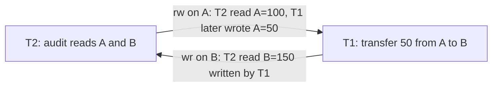
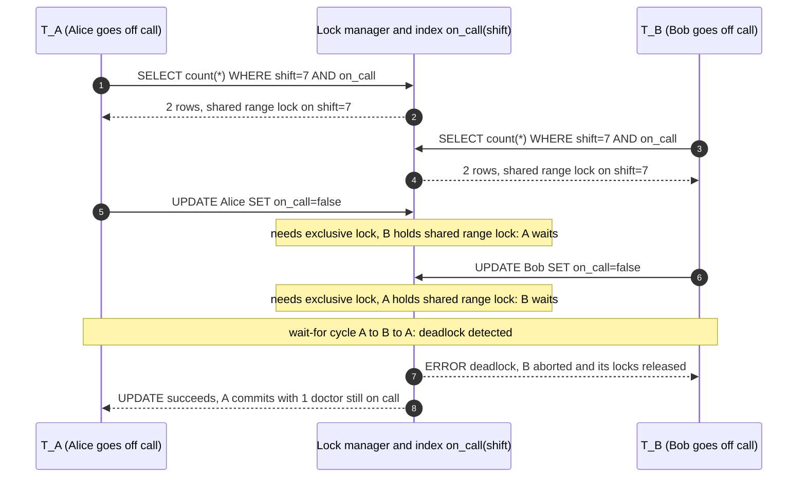
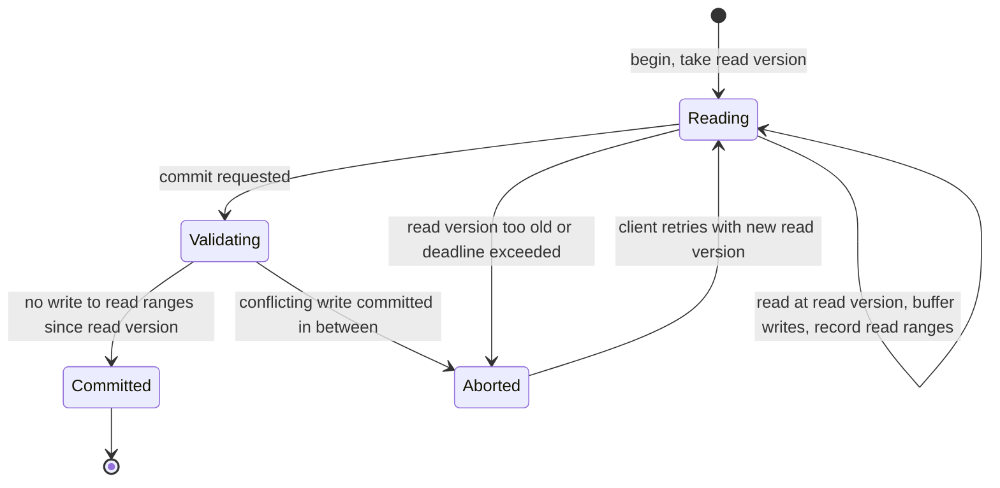
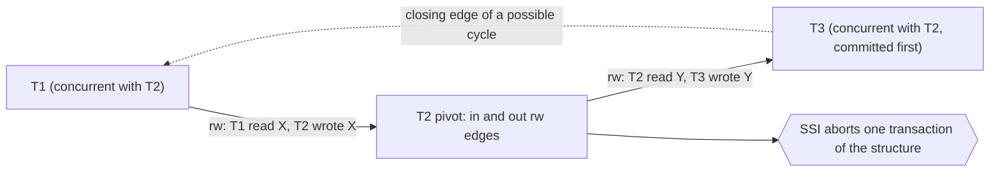
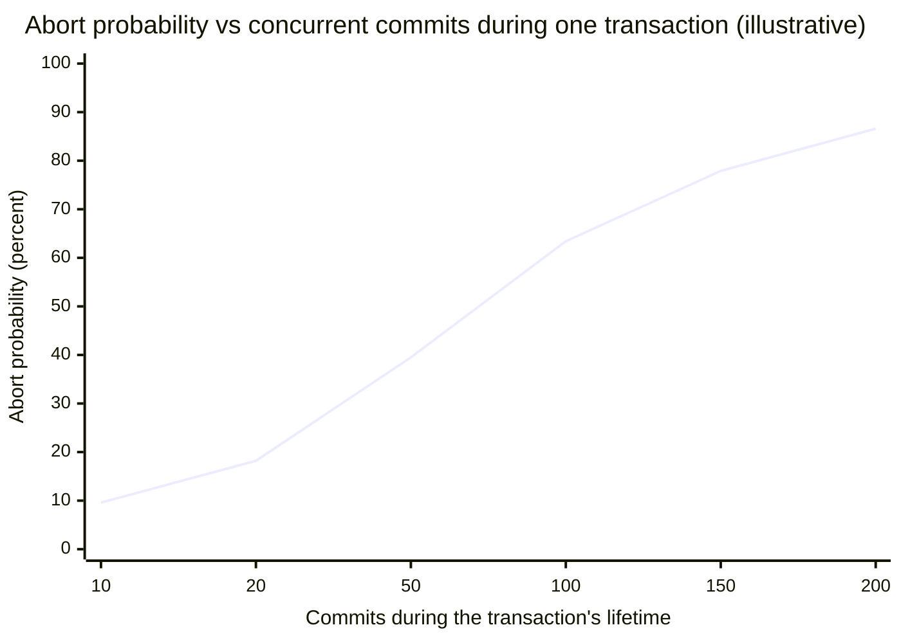
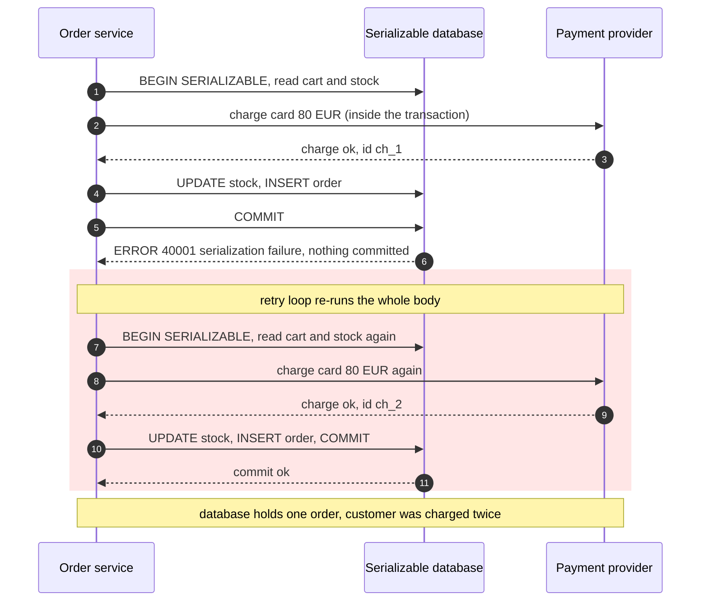

Serializability, transaction'lar (işlemler) için tanımlanmış bir doğruluk koşuludur: her biri birden çok nesneyi okuyan ve yazan çok sayıda transaction'ın eşzamanlı bir yürütmesi, sonucu aynı commit edilmiş transaction'ları hiç örtüşmeden teker teker çalıştıran bir yürütmenin sonucuyla aynıysa serializable'dır. Veritabanı operasyonları iç içe geçirmekte, farklı çekirdeklerde ya da makinelerde çalıştırmakta ve yeniden sıralamakta serbesttir; yeter ki commit edilen her transaction, bir seri sıranın üretebileceği bir durumu görsün ve öyle bir durum üretsin. Tutarlı bir veritabanında tek başına çalıştırılan her transaction uygulamanın değişmezlerini (invariant) koruyorsa, serializable bir veritabanı da kaç transaction aynı anda çalışırsa çalışsın onları korur. Garantinin bütün değeri budur: doğruluk muhakemesi sıralı kalır.

Çözdüğü problem, değişmezlerin birden çok nesneye yayılmasıdır. "Tüm hesap bakiyelerinin toplamı sabittir", "en az bir doktor nöbettedir", "bir kullanıcı adı en fazla bir hesaba atanır", "bir siparişin kalemleri toplam tutarına eşittir": bunların her biri, tek bir transaction'ın bir kısmını okuyup bir kısmını yazarak koruduğu, birden çok satır üzerinde tanımlı bir yüklemdir (predicate). Böyle iki transaction iç içe geçtiğinde, her biri diğerinin geçersiz kılmak üzere olduğu bir durumu okuyabilir ve ikisi de tek tek doğru, birlikte yanlış değişiklikleri commit edebilir. Hiçbir tek-nesne garantisi bunu engellemez. Her anahtarın [linearizable](/distributed-systems/tr/data-management/consistency-models/linearizability/) olduğu bir depo bile, bir denetim sorgusunun bir hesabı transferden önce, diğerini transferden sonra okumasına ve var olmayan bir parayı raporlamasına izin verir.

Asıl denge, eşzamanlılık ile koordinasyon arasındadır. İç içe geçmiş bir yürütmeyi seri bir yürütmeye eşdeğer kılmak için veritabanı ya çakışan operasyonların örtüşmesini engellemeli (kilitler: transaction'lar bekler), ya çakışan örtüşmeleri sonradan tespit etmeli (doğrulama: transaction'lar abort edilip yeniden denenir), ya da sırayı yürütme başlamadan belirlemelidir (sıralama: transaction'lar neye dokunacaklarını önceden bildirmek zorundadır). Beklemek, abort etmek ve bildirmek mevcut olan tek üç para birimidir; kur oranını çakışma (contention) belirler. Transaction'ların nadiren aynı veriye dokunduğu bir iş yükünde serializability birkaç yüzde maliyet getirir; sıcak bir satır ya da sıcak bir aralık olan iş yükünde ise throughput'u kilit tutma süresi başına bir transaction'la sınırlar ya da yükü bir abort fırtınasına çevirir. Daha zayıf izolasyon seviyeleri, belirli anomalilerin geçmesine izin vererek throughput satın alır ve değişmezleri koruma yükünü yeniden uygulamaya devreder.

Serializability ayrıca gerçek zaman hakkında hiçbir şey söylemez: başka bir transaction commit olduktan sonra başlayan bir transaction, sırada ondan önceye konabilir. Gerçek zamanlı varyant olan strict serializability ayrı ve daha pahalı bir garantidir; üretici dokümantasyonu ikisini sık sık birbirine karıştırır.

## Seri Eşdeğerlik: Garanti Tam Olarak Ne Söyler

İzolasyon üzerine biçimsel muhakeme geçmişler (history) üzerinde yapılır. Bir geçmiş, transaction'ların gönderdiği okuma ve yazma operasyonlarının veritabanının onları yürüttüğü sırayla iç içe geçmiş dizisi ile her transaction'ın sonucudur (commit ya da abort). İki operasyon farklı transaction'lara aitse, aynı nesneye dokunuyorsa ve en az biri yazmaysa çakışır. Göreli sırası bir transaction'ın gördüğünü ya da son durumu değiştirebilen operasyonlar yalnızca çakışan operasyonlardır; aynı nesnenin iki okuması ya da farklı nesneler üzerindeki herhangi iki operasyon, hiçbir şey değişmeden yer değiştirebilir.

Pratik tanım bu gözlemden çıkar. Bir geçmiş, çakışmayan komşu operasyonların tekrar tekrar yer değiştirilmesiyle seri bir geçmişe dönüştürülebiliyorsa conflict serializable'dır. Eşdeğer biçimde bir öncelik grafiği (precedence graph, serialization graph olarak da anılır) kurulur: commit edilmiş her transaction için bir düğüm ve T1'in bir operasyonu T2'nin daha sonraki bir operasyonuyla çakıştığında T1'den T2'ye bir kenar. Geçmiş, bu grafikte döngü yoksa ve ancak o zaman conflict serializable'dır; grafiğin herhangi bir topolojik sıralaması geçerli bir eşdeğer seri sıradır. Kenarlar üç türdür. Yazma-okuma kenarı (`wr`), T2'nin T1'in yazdığı bir değeri okuduğunu söyler. Yazma-yazma kenarı (`ww`), T2'nin T1'in değerinin üzerine yazdığını söyler. Okuma-yazma kenarı (`rw`, anti-dependency olarak da anılır), T1'in T2'nin daha sonra değiştirdiği bir versiyonu okuduğunu, yani T2'nin yazmasını görmediğini söyler.

### Çözümlü Bir Geçmiş: 250 Gören Denetim

İki hesap varsayalım, A ve B, her biri 100 tutuyor; değişmez `A + B = 200`. T1, A'dan B'ye 50 transfer eder: A'yı okur, A = 50 yazar, B'yi okur, B = 150 yazar. T2 bir denetimdir: A'yı ve B'yi okur, toplamı raporlar. Hangi sırayla olursa olsun seri çalıştırıldığında denetim 200 raporlar. Şimdi ikisini iç içe geçirelim: `r2(A)=100`, `r1(A)=100`, `w1(A)=50`, `r1(B)=100`, `w1(B)=150`, T1 commit olur, `r2(B)=150`, T2 commit olur. Denetim 250 raporlar.


*İç içe geçmiş geçmişin öncelik grafiği. Zıt yönlü iki kenar bir döngü oluşturur; T2'nin gördüğünü hiçbir seri sıra açıklayamaz.*

A üzerindeki `rw` kenarı T2'nin T1'den önce gelmesi gerektiğini söyler, çünkü T2, T1'in A'ya yazmasını görmedi. B üzerindeki `wr` kenarı T1'in T2'den önce gelmesi gerektiğini söyler, çünkü T2, T1'in B'ye yazmasını gördü. İkisi birden sağlanamaz; grafikte döngü vardır ve denetimin 250 sonucu hiçbir seri yürütmeyle üretilemez. Burada neyin yanlış olmadığına dikkat edin: her okuma commit edilmiş bir değer döndürdü ve her operasyon atomikti, yani bu geçmiş Read Committed altında meşrudur. Kusur tamamen birleşimdedir. T2'nin A okuması T2 commit olana kadar paylaşımlı bir kilit tutsaydı, `w1(A)` beklerdi, T2 B = 100 okurdu, iki kenar da T2'den T1'e işaret ederdi ve denetim 200 raporlardı. T2 bunun yerine B'yi başlangıcında alınmış bir snapshot'tan okusaydı yine B = 100 görürdü, T2, T1 sırası geçerli olurdu ve denetim yine 200 raporlardı. Aşağıdaki her mekanizma, bu sonuçlardan birini garanti etmenin bir yoludur.

Daha geniş bir kavram olan view serializability, kör yazmalar (blind write) içeren bazı geçmişleri de kabul eder; ancak Papadimitriou 1979'da bunu test etmenin NP-complete olduğunu gösterdi, conflict serializability ise bir döngü kontrolüdür. Üretimdeki motorlar conflict serializability'yi hedefler ve bu sayfa o tanımı kasteder.

### Garanti Edilen ve Edilmeyen

Garanti, commit edilmiş transaction'ları ve yaptıkları okumaları kapsar. Bir transaction'ın tutarsız bir durum karışımını görmesine dayanan her anomaliyi dışlar: dirty read, lost update, non-repeatable read, read skew, write skew, phantom ve salt okunur transaction anomalisi. Bu anomaliler ve onlara izin veren Read Committed'dan Snapshot Isolation'a kadar daha zayıf seviyeler [Zayıf İzolasyon ve MVCC](/distributed-systems/tr/data-management/consistency-models/weak-isolation-mvcc/) sayfasının konusudur; bu sayfanın ihtiyaç duyduğu tek olgu, her birinin zayıf seviyenin kıramadığı bir öncelik grafiği döngüsüne karşılık geldiğidir.

Hangi seri sıranın seçileceğini garanti etmez; örtüşmeyen transaction'lar arasında gerçek zaman sırasını da (bir sonraki alt bölüm) garanti etmez. İlerlemeyi garanti etmez: aşağıdaki her mekanizma bazı iş yüklerinde bazı transaction'ları abort eder, dolayısıyla doğru yeniden denemeyen bir istemci iş kaybeder. Veritabanı dışındaki hiçbir şeyi kısıtlamaz: abort edilip yeniden denenen bir transaction'ın içinden gönderilen bir e-posta ya da yapılan bir HTTP çağrısı iki kez gerçekleşir. Son olarak abort edilen transaction'ların okumaları hakkında hiçbir şey söylemez. Saf commit anı doğrulamasında, abort edilmeye mahkum bir transaction bunu öğrenmeden önce tutarsız bir durum görebilir (bunu yasaklayan daha güçlü koşula opacity denir); bu yüzden uygulama kodu ara okumalara dayanarak geri alınamaz bir eylem yapmamalıdır.

ANSI SQL standardı izolasyon seviyelerini yasakladıkları "fenomenler" üzerinden tanımlar; Berenson ve arkadaşları 1995'te üç ANSI fenomeninin hepsini engelleyen bir seviyenin serializable olmak zorunda olmadığını gösterdi, karşı örnek Snapshot Isolation'dır. Dolayısıyla `SERIALIZABLE` anahtar kelimesi bir kanıt değil, bir isimdir ve yaygın kullanılan birkaç veritabanı onu daha zayıf bir şeye eşler.

### Strict Serializability: Gerçek Zamanı Eklemek

Bir fiyatlandırma servisinin, bir ürünün fiyatını artıran T_w'yi 10:00:00.000'da commit edip başarı döndürdüğünü varsayalım. 10:00:00.050'de bir ödeme transaction'ı T_r başlar ve fiyatı, snapshot'ı beş saniye eski olan bir replikadan okuyarak eski fiyatı görür. Geçmiş serializable'dır: T_r'yi T_w'den önce sıralayın, her şey tutarlıdır. Tanımda ihlal edilen hiçbir şey yoktur ve müşteri, ödeme başladığında zaten geçersiz olan bir fiyattan ücretlendirilir.

Strict serializability şu kısıtı ekler: T1, gerçek zamanda T2 başlamadan önce commit olduysa, eşdeğer seri sırada T1 T2'den önce gelir. Serializability için o, sequential consistency için linearizability neyse odur. Papadimitriou bu adı 1979'da koydu; Spanner kendi versiyonuna external consistency der. Her transaction'ı en son commit edilmiş durumuna karşı çalıştıran tek node'lu bir veritabanı bunu bedavaya sağlar. Replike ya da partition'lanmış bir veritabanı ise bedelini öder: ya okumaları önceki her commit'i gördüğünü kanıtlayabilen bir node üzerinden yönlendirerek, ya da saat belirsizliğini sınırlayıp onu bekleyerek; bu ikincisi [TrueTime commit wait](/distributed-systems/tr/foundations/time-and-ordering/truetime-spanner/) yaklaşımıdır.

:::note[Serializability ve linearizability sıralı değildir]
Linearizability, tek nesneler üzerindeki tek operasyonları gerçek zamanda kısıtlar; serializability, çok nesneli transaction'ları herhangi bir sırada kısıtlar. Hiçbiri diğerini gerektirmez. Linearizable anahtarlardan oluşan bir depo yukarıdaki denetim anomalisine izin verir; serializable bir veritabanı ise eski fiyatlı ödemeye izin verir. Strict serializability ikisini birden gerektirir. Bir sistem "güçlü tutarlılık" iddia ettiğinde ilk soru, bu üçünden hangisini ve hangi yolda kastettiğidir.
:::

### Phantom'lar: Satırlar Neden Yetmez

Bir transaction çoğu zaman sabit bir satır listesi yerine bir yüklemle tanımlanan bir kümeyi okur: "7. vardiyada nöbetçi olan tüm doktorlar", "12 numaralı odanın 14:00-15:00 ile çakışan tüm rezervasyonları". Eşzamanlı bir transaction yüklemle eşleşen bir satır ekleyebilir. İlk transaction o satırı hiç okumadı, çünkü satır yoktu; dolayısıyla ikisini satır düzeyinde hiçbir çakışma bağlamaz, ama ilk transaction'ın sorgusunun sonucu farklı olurdu. Buna phantom denir. Öncelik grafiği açısından çakışma, bir yüklem okuması ile yüklemin sonuç kümesini değiştiren bir yazma arasındadır ve yalnızca tek tek satırları izleyen bir mekanizma bu kenarı kaçırır. Bu yüzden her serializable mekanizma "bu koşulla eşleşen satırlar kümesini, henüz var olmayan satırlar dahil" temsil etmenin bir yoluna ihtiyaç duyar: yüklem kilitleri, index aralığı kilitleri ya da kaydedilmiş tarama aralıkları. Her motorun bunu nasıl yaptığı, farklı performans ve yanlış pozitif davranışlarının ana kaynaklarından biridir.

## Seri Eşdeğerliği Sağlamanın Dört Yolu

Tüm serializable motorlar öncelik grafiği döngülerini engeller; farkları ne zaman harekete geçtikleri ve transaction'lar çarpıştığında bedeli kimin ödediğidir. Kilitleme operasyonlar gerçekleşirken, iyimser doğrulama commit anında, Serializable Snapshot Isolation yalnızca belirli bir anti-dependency örüntüsünde, deterministik sıralama ise hiçbir şey çalışmadan önce harekete geçer.

### İki Aşamalı Kilitleme

İki aşamalı kilitleme (two-phase locking, 2PL), her nesneye okuyucular için paylaşımlı (shared), yazıcılar için dışlayıcı (exclusive) modlu bir kilit verir. Bir transaction okumadan önce paylaşımlı, yazmadan önce dışlayıcı kilit alır; paylaşımlı kilitler birbiriyle uyumludur, dışlayıcı kilit hiçbir şeyle uyumlu değildir. İki aşama bir zamanlama kuralıdır: transaction büyüme aşamasında kilit alabilir, küçülme aşamasında bırakabilir, ama herhangi bir kilidi bıraktıktan sonra bir daha kilit alamaz. Üretimdeki motorlar strict 2PL kullanır: dışlayıcı kilitler (güçlü biçimde tüm kilitler) commit ya da abort'a kadar tutulur, çünkü bir yazma kilidini erken bırakmak, başka bir transaction'ın hâlâ geri alınabilecek bir değeri okumasına izin verir.

Doğruluk argümanı kısadır. Her transaction'ın bir kilit noktası (lock point), yani tutacağı tüm kilitleri tuttuğu bir anı vardır. T1 ve T2'nin X nesnesi üzerinde çakıştığını ve X'e önce T1'in eriştiğini varsayalım. T2, X'e ancak T1 X üzerindeki kilidini bıraktıktan sonra erişebilir; bu T1'in kilit noktasından sonradır. T2 ise X üzerindeki kilidini kendi kilit noktasından önce almıştır. Dolayısıyla T1'den T2'ye her çakışma kenarı, T1'in kilit noktasının T2'ninkinden önce olduğunu gösterir. Bir döngü, bir transaction'ın kilit noktasının kendisinden önce olmasını gerektirirdi; bu imkânsızdır. Transaction'ları kilit noktasına göre sıralamak eşdeğer seri sırayı verir ve strict 2PL altında bu sıra commit sırasıyla örtüşür.

Phantom'lar henüz var olmayan şeyleri kilitlemeyi gerektirir. Mantıksal bir koşulu kilitleyen gerçek yüklem kilitlerini kontrol etmek pahalıdır ve neredeyse hiç uygulanmaz. Motorlar bunları index aralığı kilitleriyle yaklaşık olarak gerçekler: bir index taraması okuduğu index girdilerini ve aralarındaki boşlukları kilitler, böylece kilitli bir boşluğa yapılan ekleme bloklanır. InnoDB bunlara next-key lock, SQL Server key-range lock der. Uygun bir index yoksa tarama tüm tabloya dokunur ve motor tüm tabloyu kilitlemek zorunda kalır; eksik bir index'in serializable bir iş yükünü tek iş parçacıklı hale getirmesi böyle olur.


*Nöbet değişmezi üzerinde aralık kilitli strict 2PL. İki transaction aynı yüklemi paylaşımlı kilitler altında okuduğu için diğeri vazgeçmeden hiçbiri yazamaz; motor deadlock'u birini abort ederek kırar.*

1-4. adımlar okuma aşamasıdır: iki transaction da nöbette iki doktor görür. Snapshot Isolation altında 5. ve 6. adımlardaki iki yazma da farklı satırlara dokunduğu için başarılı olur ve vardiya nöbetçisiz kalırdı; bu write skew'dur. 2PL altında her paylaşımlı aralık kilidi diğerinin dışlayıcı kilidini bloklar ve beklemeler bir döngü oluşturur. Kilit yöneticisi 7. adımda T_B'yi abort eder, paylaşımlı kilidini serbest bırakır ve T_A'nın güncellemesinin 8. adımda ilerlemesine izin verir. T_B yeniden denediğinde nöbette tek doktor görür ve ayrılmayı reddeder. Bir transaction bir abort'la, diğeri bir beklemeyle ödedi: çakışma altında 2PL doğruluğu bloklamayla satın alır ve deadlock bir hata değil, olağan bir sonuçtur.

Motorlar deadlock'larla iki yolla başa çıkar. Tespit, bir bekleme grafiği (wait-for graph) kurar ve bir döngü bulduğunda bir kurban abort eder; PostgreSQL kontrolü çalıştırmadan önce `deadlock_timeout` kadar (varsayılan 1 saniye) bekler, yani deadlock'a giren bir transaction önce bir saniyelik bir duraklama yaşar. Önleme ise transaction'ları başlangıç zaman damgasına göre sıralar ve hiçbir döngünün oluşmasına izin vermez: wait-die altında daha yaşlı transaction daha genç olanı bekler, ama daha yaşlı birinin tuttuğu kilidi isteyen genç transaction abort olur; wound-wait altında daha genç birinin tuttuğu kilidi isteyen yaşlı transaction genç olanı abort eder ("yaralar"), genç bir talep sahibi ise bekler. İkisi de en yaşlı transaction'ın sonunda bitmesini garanti eder, bu da açlığı (starvation) önler. Spanner kilit çakışmalarını daha yaşlı transaction'ları kayıran wound-wait ile çözer.

### İyimser Doğrulama ve Zaman Damgası Sıralaması

Kung ve Robinson'ın 1981'de tanıttığı iyimser eşzamanlılık kontrolü (optimistic concurrency control, OCC), bir transaction'ı üç aşamaya böler. Okuma aşamasında commit edilmiş veriyi kilitsiz okur, yazmalarını özel olarak tamponlar ve okuma ile yazma kümelerini kaydeder. Doğrulama aşamasında, commit anında, başladığından beri commit olan herhangi bir transaction'ın onun okuduğu bir şeyi yazıp yazmadığını kontrol eder. Yazmadıysa yazma aşamasına geçip yazmalarını uygular; yazdıysa abort olup yeniden dener. Seri sıra commit sırasıdır: doğrulamayı geçen bir transaction, kendinden önce sıralanan bir transaction'ın okumadan sonra değiştirdiği hiçbir şeyi okumamıştır; dolayısıyla her `rw` kenarı commit sırasında ileriyi gösterir, `wr` ve `ww` kenarları da yapı gereği öyledir ve grafik döngü içeremez. Doğrulama ve yazmaların uygulanması diğer doğrulamalara göre atomik olmalıdır; bu tek bir motorda kısa bir kritik bölge, dağıtık bir motorda ise ayrı bir bileşendir.


*İyimser bir transaction'ın yaşam döngüsü. Çakışmalar yalnızca doğrulamada bulunur; abort olacak bir transaction da önce okuma aşamasının tamamını tüketir.*

Durum makinesi OCC'nin maliyetini nerede ödediğini gösterir. Çakışan bir transaction eski veri okuduğu anda durdurulmaz; sonuna kadar çalışır ve doğrulamada atılır. Düşük çakışmada bu ucuzdur, çünkü neredeyse hiçbir şey abort olmaz ve kimse beklemez. Yüksek çakışmada mümkün olan en pahalı sonuçtur, çünkü iş tekrarlanır ve yeniden deneme, abort'a yol açan çakışmanın kendisine katılır. "Read version too old" kenarı diğer sınırdır: eski versiyonların okuma aşaması boyunca erişilebilir kalması gerekir, dolayısıyla uzun transaction'lar sınırlıdır.

FoundationDB, ölçekte OCC'nin üretimdeki en net örneğidir. İstemci ilk okumasında bir okuma versiyonu alır, storage server'lardan doğrudan o versiyonda okur ve yazmaları okuma ve yazma çakışma aralıklarıyla birlikte tamponlar. Commit anında bir proxy bir commit versiyonu alır, çakışma aralıklarını anahtar aralığına göre böler ve her parçayı sorumlu resolver'a gönderir; her resolver, okuma versiyonu ile commit versiyonu arasında commit olan herhangi bir transaction'ın okuma aralıklarına yazıp yazmadığını kontrol eder. Transaction ancak tüm resolver'lar kabul ederse commit olur ve ortaya çıkan sıra versiyon sırasıdır; bu da sistemi strict serializable yapar. Storage server'lar çok versiyonlu veriyi yalnızca yaklaşık son 5 saniye için tutar; bundan eski bir transaction "transaction too old" hatası alır ve FoundationDB transaction'larının 5 saniyeden uzun süremesinin nedeni budur. Tasarım dokümantasyonu garantinin "strict" kısmı için önemli bir çekinceyi de not eder: okuma versiyonu almak, ancak proxy canlılığını transaction log sistemiyle teyit ederse kesin olarak dışsal tutarlıdır ve üretim cluster'ları bu kontrolü çoğunlukla `ALWAYS_CAUSAL_READ_RISKY` seçeneğiyle atlar.

Zaman damgası sıralaması (timestamp ordering), kilitsiz diğer ailedir. Her transaction başlangıçta bir zaman damgası alır ve motor eşdeğer seri sıranın zaman damgası sırası olmasını sağlar: daha geç zaman damgalı bir transaction nesneyi zaten okuduysa yazma reddedilir, bir okuma ise kendi zaman damgasından eski en son versiyonu görmelidir. CockroachDB bunun geliştirilmiş bir biçimini kullanır. Her range, her anahtardaki en son okumanın zaman damgasını tutan bir timestamp cache barındırır; bu zaman damgasının altındaki bir yazma daha yüksek bir zaman damgasına itilir (push), çünkü zaten sunulmuş bir okumanın geçmişine yazmak sırayı tersine çevirirdi. İtilen transaction artık okuduğundan daha geç bir zaman damgasında commit olacağı için commit'ten önce bir read refresh dener: okuduğu anahtarlardan herhangi birinin eski ve yeni zaman damgası arasında yazılıp yazılmadığını yeniden kontrol eder. Hiçbiri yazılmadıysa yeni zaman damgasında commit olur; bazıları yazıldıysa `RETRY_SERIALIZABLE` hatasıyla başarısız olur. Aynı anahtarda daha yeni commit edilmiş bir yazma bulan yazma `RETRY_WRITE_TOO_OLD` üretir, [hybrid logical clock](/distributed-systems/tr/foundations/time-and-ordering/hybrid-logical-clocks/) saat belirsizliği aralığı içinde bir yazma bulan okuma ise `ReadWithinUncertaintyInterval` üretir. Hepsi istemciye SQLSTATE 40001 olarak ulaşır ve sunucu, istemciye henüz sonuç döndürmediyse yeniden denemeyi şeffaf biçimde kendisi yapar.

### Serializable Snapshot Isolation

Snapshot Isolation (SI), her transaction'a başlangıç anına ait tutarlı bir snapshot verir ve bir transaction'ı yalnızca eşzamanlı bir transaction'ın zaten yazdığı bir satırı yazarsa abort eder (first committer wins). Okuyucular yazıcıları, yazıcılar da okuyucuları asla bloklamaz; SI'nin birçok MVCC (multi-version concurrency control, çok versiyonlu eşzamanlılık kontrolü) motorunda varsayılan yüksek seviye olmasının nedeni budur. SI serializable değildir: nöbet örneğindeki gibi write skew, iki yazma farklı satırlara dokunduğu için geçer. SI mekanizmasının kendisi [zayıf izolasyon sayfasına](/distributed-systems/tr/data-management/consistency-models/weak-isolation-mvcc/) aittir; burada önemli olan onun nasıl onarılacağıdır.

Fekete, Liarokapis, O'Neil, O'Neil ve Shasha 2005'te, SI altındaki her serializable olmayan yürütmenin belirli bir yapı içerdiğini kanıtladı: öncelik grafiğinde, eşzamanlı çalışan transaction'lar arasında art arda iki `rw` anti-dependency kenarı içeren bir döngü; yani T1'den gelen bir `rw` kenarı ve T3'e giden bir `rw` kenarı olan bir "pivot" transaction T2. SI altında `wr` ve `ww` kenarları her zaman zamanda ileriyi gösterir, çünkü bir transaction yalnızca snapshot'ından önce commit edilmiş yazmaları görür ve first-committer-wins eşzamanlı üzerine yazmaları engeller. Eşzamanlı transaction'lar arasını yalnızca `rw` kenarları gösterebilir ve bir döngünün art arda en az iki tanesine ihtiyacı vardır. Cahill, Röhm ve Fekete 2008'de bunu bir mekanizmaya çevirdi: Serializable Snapshot Isolation (SSI), `rw` kenarlarını çalışma zamanında izler ve bir transaction pivot olacağı anda onu abort eder. Her döngü bir pivot içerdiği için pivotları abort etmek her döngüyü kırar.


*SSI'nin tespit ettiği tehlikeli yapı. Bir pivot üzerinden art arda iki anti-dependency bir SI anomalisi için gereklidir; SSI döngünün gerçekten kapanıp kapanmadığını kontrol etmeden yapı üzerinde abort eder.*

Yapıyı gerçek bir anomaliye dönüştüren kesikli kenardır ve SSI onu aramaz: tam döngüleri tespit etmek bütün grafiği izlemeyi gerektirirdi, iki kenarlı yapı ise transaction başına küçük çakışma listeleri yeter. Bedeli yanlış pozitiflerdir, yani yürütmesi aslında serializable olan transaction'ların abort edilmesi. Nöbet örneğinde her transaction diğerinin yazdığı yüklemi okur; ikisi de iki transaction'lık bir döngünün pivotudur ve SSI, hiçbiri bloklanmadan, birini commit anında abort eder. Ports ve Grittner'ın 2012'de anlattığı PostgreSQL uygulaması, yalnızca T3 önce commit olduysa abort eder ve bu, yanlış pozitiflerin çoğunu ortadan kaldırır.

`rw` kenarlarını tespit etmek için SSI her transaction'ın yüklemler dahil ne okuduğunu hatırlamak zorundadır. PostgreSQL okumaları SIRead kilitleri olarak kaydeder; bunlar hiçbir şeyi bloklamaz, yalnızca işaretçi görevi görür. Eşzamanlı bir transaction'ın işaretçisine çarpan bir yazma bir `rw` kenarı yaratır. İşaretçiler tuple'lar, sayfalar ya da bütün relation'lar üzerinde alınır; index taramaları kapsadıkları index sayfalarını işaretler, phantom'lar böyle yakalanır. İşaretçiler, eşzamanlı her transaction bitene kadar kendi transaction'larından daha uzun yaşamak zorundadır. Salt okunur transaction'lar ek bir optimizasyondan yararlanır: salt okunur bir transaction hiçbir şey yazmadığı için tehlikeli yapının yalnızca T1 ucu olabilir; snapshot'ını eşzamanlı hiçbir okuma-yazma transaction'ının ona karşı pivot olamayacağı bir anda alırsa hiçbir izlemeye ihtiyaç duymaz. PostgreSQL bunu `SERIALIZABLE READ ONLY DEFERRABLE` olarak sunar; bu mod başlangıçta böyle güvenli bir snapshot için bekleyebilir ve sonra asla abort olmaz.

### Deterministik Sıralama

Son aile kararı yürütmeden tamamen çıkarır. Thomson ve arkadaşlarının 2012'de yayımladığı Calvin, veritabanının önüne bir sıralama katmanı koyar: transaction istekleri batch'ler halinde toplanır (makalede 10 ms'lik epoch'lar), batch'ler replike edilir ve her partition transaction'ları üzerinde uzlaşılmış global sırayla, o sırada deterministik kilitleme kullanarak yürütür. Her replika aynı girdileri aynı sırayla deterministik biçimde yürüttüğü için sonda bir commit protokolü ve çakışma kaynaklı abort yoktur: çakışan iki transaction yalnızca birbiri ardına çalışır. Kilitler sıralanmış düzende alındığı için deadlock oluşamaz.

Bedeli, bir transaction'ın sıralanmadan önce okuma ve yazma kümelerini bildirmek zorunda olmasıdır. Yazma kümesi okuduklarına bağlı olan bir transaction bir keşif (reconnaissance) adımına ihtiyaç duyar: salt okunur bir sorgu kümeyi bulur, transaction bu kümeyle sıralanır ve küme yürütme anına kadar değiştiyse yeniden başlatılır. İstemcinin bir sonucu inceleyip ne yapacağına sonra karar verdiği etkileşimli transaction'lar hiç uymaz; deterministik veritabanlarının genel amaçlı SQL'de nadir olmasının nedeni budur.

## Serializability'nin Maliyeti, Adım Adım

Her mekanizmanın maliyetini, bir transaction'ın çakışma ayak izinin ne kadar süre açık kaldığı ve bu sürede kaç başka transaction'ın ona dokunduğu belirler. Kilitler bu çarpımı beklemeye, doğrulama ise abort'a çevirir.

### Kilit Tutma Süresi Sıcak Bir Satırı Sınırlar

Her ödemenin güncellediği bir hesap satırı ve bir uygulama sunucusundan tek tek gönderilen dört ifadelik bir ödeme transaction'ı varsayalım: bakiyeyi oku, bir defter kaydı ekle, bakiyeyi güncelle, commit et. Strict 2PL altında bakiye satırındaki dışlayıcı kilit, güncellemeden commit kalıcı hale gelene kadar tutulur. Aynı availability zone'daki veritabanına 0,5 ms round trip ve commit'i diske yazıp replike etmek için yaklaşık 1 ms ile kilit kabaca 2-3 ms tutulur. Kilidi aynı anda yalnızca bir transaction tutabildiği için sıcak satır, çekirdek sayısı ne olursa olsun yaklaşık 1 / 0,0025 s, yani saniyede 400 ödemeyle sınırlanır.

Uygulamayı 70 ms round trip'li başka bir region'a taşıyın; kilit en az iki round trip, yani 140 ms tutulur ve satır saniyede yaklaşık 7 ödemeyle sınırlanır. Çözüm hiçbir zaman daha büyük bir veritabanı değil, daha kısa bir kilit tutma penceresidir: okuma ve güncellemeyi tek ifadede birleştirin (`UPDATE ... SET balance = balance - 30 WHERE id = 42 AND balance >= 30`), transaction'ı tek round trip'e mal olacak şekilde bir stored procedure'a taşıyın ya da kilidi en sona, tüm yavaş işlerden sonraya bırakın. Tek bir kilit tutma süresinin izin verdiğinden fazla güncelleme alması gereken bir satır bölünmelidir; bu [Skew ve Hot Spot'lar](/distributed-systems/tr/data-management/data-partitioning/skew-hot-spots/) sayfasında ele alınır.

### Abort Olasılığı Yükten Hızlı Büyür

İyimser bir motor ve her transaction'ın 1.000 satırlık sıcak bir kümeden düzgün dağılımla seçilmiş 10 satır okuduğu, commit olan diğer her transaction'ın da aynı kümeden bir satır yazdığı bir iş yükü varsayalım. Bir transaction, yaşam süresi boyunca commit olan herhangi bir transaction onun 10 satırından birini yazarsa abort olur. Yaşam süresi boyunca k tane commit olduğunda ve bağımsızlık varsayımıyla hayatta kalma olasılığı `(1 - 10/1000)^k`, abort olasılığı `1 - 0.99^k` ve başarılı commit başına beklenen deneme sayısı `1 / 0.99^k` olur.


*Örnek amaçlı model: 1.000 satırlık sıcak kümeden okunan 10 satır, eşzamanlı her commit'te yazılan bir satır, bağımsız seçimler.*

10 eşzamanlı commit'te denemelerin %9,6'sı abort olur ve her başarı ortalama 1,11 denemeye mal olur. 50'de %39,5 abort olur ve her başarı 1,65 denemeye mal olur; 100'de 2,73; 200'de 7,46. Geri besleme eğriden daha kötüdür. Bir transaction'ın yaşam süresi boyunca olan commit sayısı, commit hızı ile yaşam süresinin çarpımıdır; yeniden denemeler sunulan yükü artırır, bu her transaction'ı uzatır, bu da k'yı ve abort oranını yükseltir, bu da daha fazla yeniden deneme üretir. Bir eşiğin ötesinde sistem, tetikleyen yük ortadan kalktıktan sonra bile işin çoğunun abort edildiği bir durumda kalabilir; bu, [Retry Fırtınaları ve Metastabil Arızalar](/distributed-systems/tr/resilience/flow-control/retry-storms-metastable-failures/) sayfasında incelenen metastabil bir arızadır. Kilitleme motorları aynı iş yükünde farklı biçimde bozulur: throughput kilit tutma süresi sınırında düzleşir ve gecikme kuyrukla birlikte büyür, ama tamamlanmış iş çöpe atılmaz.

### Mekanizmaların Karşılaştırması

| Mekanizma | Okuyucular yazıcıları bloklar mı? | Çakışma sonucu | Phantom yönetimi | Ana maliyet | Çakışma altında ana arıza | Ne zaman tercih edilmeli |
|---|---|---|---|---|---|---|
| Aralık kilitli strict 2PL | Evet, iki yönde de | Bekleme, deadlock abort'u | Index aralığı ya da next-key kilitleri | Bloklama, kilit belleği | Kilit konvoyları, deadlock'lar, eksik index tabloyu kilitler | Bilinen sıcak satırlarda orta çakışmalı kısa transaction'lar; abort edilen işin pahalı olduğu iş yükleri |
| OCC / geriye dönük doğrulama | Hayır | Commit'te abort | Kaydedilmiş okuma aralıkları doğrulanır | Abort'ta boşa giden iş | Abort fırtınaları, uzun transaction'ların açlığı | Düşük çakışma, kısa transaction'lar, key-value API'leri; kilit yöneticisinden kaçınan dağıtık motorlar |
| Read refresh'li zaman damgası sıralaması | Hayır, ama okumalar sonraki yazmaları iter | Push, refresh ya da abort | Aralıklar üzerinde timestamp cache | Yeniden denemeler, saat belirsizliği | Sıcak anahtarlarda retry hataları, saat kaymasıyla belirsizlik yeniden başlatmaları | Transaction'ların kısa kaldığı coğrafi dağıtık SQL |
| MVCC üzerinde SSI | Hayır | Pivot'u commit'te abort et | Index sayfalarında yüklem işaretçileri | İzleme belleği, yanlış pozitif abort'lar | İşaretçiler kaba kilitlere yükseltildiğinde abort sıçramaları | MVCC motorunda okuma ağırlıklı karışımlar, yazmalarla yan yana uzun salt okunur raporlar |
| Deterministik sıralama | Hayır (sıralı kilitler) | Sıra düzeninde bekleme, çakışma abort'u yok | Bildirilmiş okuma ve yazma kümeleri | Sıralama gecikmesi, etkileşimli transaction yok | Kümeler değiştiğinde keşif yeniden başlatmaları | Ayak izi bilinen, yüksek çakışmalı stored procedure iş yükleri |

Bir iş yükünü kilitleme motorundan iyimser bir motora ya da tersine taşımak, izolasyon seviyesi ikisinde de aynı adı taşısa bile arıza modunu gecikmeden abort'a ya da abort'tan gecikmeye çevirir.

## Üretimdeki Veritabanlarında Serializability

Anahtar kelime her yerde aynı anlama gelmez. Tablo, bir transaction `SERIALIZABLE` istediğinde yaygın motorların gerçekte neyi yürüttüğünü listeler.

| Motor | Varsayılan seviye | `SERIALIZABLE`'ın sağladığı | Mekanizma | İstemcinin yeniden denemesi gereken hata |
|---|---|---|---|---|
| PostgreSQL (9.1 ve sonrası) | Read Committed | Serializable | MVCC üzerinde SSI | SQLSTATE 40001, deadlock'lar için ayrıca 40P01 |
| MySQL InnoDB | Repeatable Read | Kilitli okumalarla serializable, autocommit çekincesiyle | Next-key kilitli 2PL | 1213 deadlock, 1205 lock wait timeout |
| SQL Server | Read Committed | Serializable | Key-range kilitli 2PL (SNAPSHOT ayrı bir SI seviyesidir) | 1205 deadlock kurbanı |
| Oracle Database | Read Committed | Write skew'a izin veren Snapshot Isolation | MVCC, first committer wins | Yazma-yazma çakışmasında ORA-08177 |
| CockroachDB | Serializable | Serializable, ayrık anahtarlar için strict değil | Zaman damgası sıralaması, read refresh, HLC | Neden koduyla SQLSTATE 40001 |
| Spanner | Serializable | Strict serializable (external consistency) | Wound-wait'li strict 2PL, TrueTime | ABORTED, istemci kütüphanelerince yeniden denenir |
| FoundationDB | Serializable (tek seviye) | Strict serializable, causal-read-risky çekincesiyle | Resolver'lı OCC, 5 sn MVCC penceresi | Yeniden denenebilir çakışma hatası |

PostgreSQL 9.1'den (2011) beri SSI ile gerçek serializability uygular; bundan önce `SERIALIZABLE`'ı Snapshot Isolation idi ve bugün `REPEATABLE READ`'in sağladığı da budur. SSI işaretçileri boyutu `max_pred_locks_per_transaction` (varsayılan 64; transaction başına bir üst sınır değil, bağlantı başına bir ortalama) ile belirlenen paylaşımlı bir tabloda yaşar. Bir sayfada `max_pred_locks_per_page`'ten (varsayılan 2) fazla tuple işaretçisi bir sayfa işaretçisine yükseltilir; bir relation'da `max_pred_locks_per_relation`'ın izin verdiğinden (varsayılan `-2`, yani `max_pred_locks_per_transaction`'ın yarısı) fazla sayfa ya da tuple işaretçisi ise bir relation işaretçisine yükseltilir. Yükseltme belleği sınırlar ama yanlış pozitif oranını artırır, çünkü kaba bir işaretçi transaction'ın hiç okumadığı yazmalarla da çakışır. Jepsen'in 2020'de PostgreSQL 12.3 üzerine yaptığı analiz bu mekanizmada gerçek bir hata buldu: `SERIALIZABLE` altında, yeni eklenmiş satırları içeren G2-item anomalileri (anti-dependency döngüleri); nedeni, çakışma tespitinin bir tuple versiyonunu yanlış transaction'a atfedebilmesiydi. Hata SSI'nin ilk sürümünden beri vardı, 9.5'ten 13 beta'ya kadar doğrulandı ve Ağustos 2020 minor sürümlerinde düzeltildi. Aynı analiz `REPEATABLE READ`'in Snapshot Isolation olduğunu ve G2-item'a izin verdiğini de doğruladı.

```sql
-- Report that must not abort and must see a serializable snapshot (PostgreSQL)
BEGIN ISOLATION LEVEL SERIALIZABLE READ ONLY DEFERRABLE;  -- may wait for a safe snapshot
SELECT sum(balance) FROM accounts;
COMMIT;
-- Inspect SSI markers: SIReadLock rows never block, they only record reads
SELECT relation::regclass, locktype, count(*) FROM pg_locks
WHERE mode = 'SIReadLock' GROUP BY 1, 2 ORDER BY 3 DESC;
```

İlk ifade, SSI altında yoğun bir PostgreSQL primary'sinde uzun raporları çalıştırmanın yoludur: eşzamanlı hiçbir yazıcının geçersiz kılamayacağı bir snapshot'ı bekler, ardından hiçbir izleme ve abort riski olmadan çalışır. `pg_locks` sorgusu SSI işaretçilerini relation ve granülerliğe göre sayar; sıcak bir tabloda büyüyen `relation` ya da `page` sayıları, yanlış pozitif abort'ların öncü göstergesidir.

MySQL'in InnoDB'si `SERIALIZABLE`'ını "`REPEATABLE READ` gibi" diye tanımlar; tek fark, autocommit kapalıyken düz `SELECT` ifadelerinin örtük olarak `SELECT ... FOR SHARE`'e çevrilmesidir. Autocommit açıkken her `SELECT` kendi kilitsiz, salt okunur transaction'ıdır. Uygulamanın tek bir transaction sandığı ama bir sürücünün autocommit modunda çalıştırdığı bir ifade dizisi hiçbir koruma almaz. Kilit beklemeleri `innodb_lock_wait_timeout` (varsayılan 50 saniye) ile sınırlıdır ve `SHOW ENGINE INNODB STATUS` en son tespit edilen deadlock'u yazdırır. SQL Server'ın `SERIALIZABLE`'ı key-range kilitlerini commit'e kadar tutar; ayrı `SNAPSHOT` seviyesi ise Snapshot Isolation'dır ve write skew'a izin verir.

Oracle en ağır sonuçlu uyumsuzluktur. `SERIALIZABLE`'ı Snapshot Isolation'dır ve ORA-08177'yi yalnızca bir transaction eşzamanlı bir transaction'ın değiştirdiği bir satırı güncellediğinde verir. Nöbet örneğinde iki transaction da commit olur; dolayısıyla PostgreSQL ya da SQL Server'dan taşınan ve anahtar kelimeye güvenen uygulamalar doğruluğu sessizce kaybeder.

Spanner okuma-yazma transaction'larını varsayılan olarak strict 2PL altında çalıştırır: okumalar commit'e kadar tutulan paylaşımlı kilitler alır, yazmalar dışlayıcı kilitleri commit anında alır ve çakışmalar wound-wait ile çözülür. Serializable transaction'ları iyimser biçimde, tüm okumaları commit'te doğrulayarak da çalıştırabilir; artık yalnızca `FOR UPDATE` ile işaretlenmiş okumaları doğrulayan bir repeatable read seviyesi de sunar. Salt okunur transaction'lar hiç kilit almaz ve TrueTime'ın gerçek zamanla tutarlı kıldığı bir zaman damgasında okur. Shard'lar arası mekanizma [Spanner Mimarisi](/distributed-systems/tr/case-studies/distributed-sql/spanner-architecture/) ve [Consensus Üzerinde 2PC](/distributed-systems/tr/case-studies/distributed-sql/transactions-2pc-over-consensus/) sayfalarındadır.

CockroachDB varsayılan olarak `SERIALIZABLE` kullanır. Belirsizlik aralığı tek anahtarların eski okunmasını engeller, ama ayrık anahtarlara dokunan transaction'lar strict serializable değildir; bu [linearizability sayfasında](/distributed-systems/tr/data-management/consistency-models/linearizability/) tartışılır. Retry neden kodları farklı çözümlere işaret eder: `RETRY_WRITE_TOO_OLD` ve `RETRY_SERIALIZABLE` yazılan ya da okunan anahtarlarda çakışma, `ReadWithinUncertaintyInterval` gateway'ler arası saat kaymasıyla birleşen çakışma, `RETRY_COMMIT_DEADLINE_EXCEEDED` ise tekrar tekrar itilen ve yeniden denenmek yerine kısaltılması gereken uzun bir transaction demektir. İç yapı [CockroachDB: Raft, HLC ve Parallel Commits](/distributed-systems/tr/case-studies/distributed-sql/cockroachdb-raft-hlc/) sayfasındadır.

### Doğru Yeniden Deneme

Her serializable motor bazı transaction'ları abort eder; bu yüzden istemcinin yeniden deneme döngüsü izolasyon mekanizmasının bir parçasıdır. Döngü transaction'ın tamamını `BEGIN`'den itibaren yeniden yürütmelidir, çünkü verilen kararlar tutarsız çıkan değerlere dayanıyordu. Yalnızca "serileştirme hatası ya da deadlock, hiçbir şey commit edilmedi" anlamına gelen hataları yeniden denemeli; commit gönderildikten sonra kopan bir bağlantı gibi "sonuç bilinmiyor" hatalarını asla. Çarpışan transaction'lar yeniden çarpışmasın diye jitter'lı backoff uygulamalı ve sürekli çakışan bir transaction yüke dönüşmek yerine hata olarak yüzeye çıksın diye deneme sayısını sınırlamalıdır.

```text
for attempt in 1..MAX_ATTEMPTS:
    begin transaction (isolation = serializable)
    run all reads and writes again        # never reuse values read in a failed attempt
    try commit
        on success: return
        on 40001 / 40P01 / deadlock-victim: rollback, sleep(jittered backoff(attempt)), continue
        on connection lost during commit: outcome unknown -> resolve by idempotency key, do not blindly retry
perform external side effects only after the commit returned success
```

En sık ihlal edilen son satırdır: transaction gövdesinin içinde mesaj gönderen ya da bir ödeme sağlayıcısını çağıran kod, bu etkiyi her yeniden denemede tekrarlar. Veritabanı dışındaki etkiler commit'ten sonra bir idempotency anahtarıyla ya da aynı transaction içinde, ayrı bir sürecin teslim ettiği bir outbox satırı olarak yapılmalıdır; bkz. [Outbox Pattern](/distributed-systems/tr/coordination/distributed-transactions/outbox-pattern/) ve [Idempotency](/distributed-systems/tr/communication/api-gateway/idempotency/). Backoff [Exponential Backoff ile Retry](/distributed-systems/tr/resilience/protection-patterns/retry-exponential-backoff/) sayfasında ele alınır.

:::tip[Saniyedeki abort'u değil, commit başına abort'u ölçün]
Saniyede 50'den 500'e çıkan bir abort oranı, commit'ler on kat arttıysa zararsız, commit'ler yerinde saydıysa felaket olabilir. Transaction türü başına yeniden deneme sayısının başarılı commit'lere oranı, abort grafiğindeki eğriyi izleyen ve metastabil bir duruma varılmadan önce uyaran sayıdır.
:::

## Arıza Modları ve Dışarıdan Görünüşleri

Bu arızaların çoğu veritabanı hatası değildir: maliyet modelinin sınırına dayanmasıdır ya da garantinin uygulamanın varsaydığından daha zayıf veya dar olmasıdır.

### Serileştirme Hatası Kaynaklı Retry Fırtınaları

Tetikleyici: bir trafik sıçraması, bir batch iş, yeni bir paylaşımlı sayaç ya da transaction'ları uzatan bir yavaşlama nedeniyle bazı satır veya aralıklarda çakışma artar; iyimser, zaman damgası sıralamalı ya da SSI motorlarında abort oranı yukarıdaki eğriyi tırmanır. Belirtiler: CPU ve istek hızı artarken commit throughput'unun düz kalması ya da düşmesi, yeniden denemelerin domine ettiği p99 gecikmesi, retry sınırından sonra istemci hataları. Tespit: transaction türü başına istemci tarafı SQLSTATE 40001 sayıları; PostgreSQL'de sunucu logundaki serileştirme hataları ve `pg_stat_database` içindeki `xact_rollback`; CockroachDB'de nedene göre transaction restart metrikleri ve çakışan anahtarları adlandıran contention görünümleri. Azaltma: retry'ları jitter'lı backoff ile sınırlayın, çakışan iş yükünü admission'da atın ya da kuyruğa alın, transaction'ları kısaltın ve sıcak noktayı transaction'dan çıkarın. Kurtarma: tetikleyici ortadan kalktıktan sonra sistem doygun kalıyorsa sunulan yükü dirsek noktasının altına indirin; metastabil bir durum kendiliğinden düzelmez.

### Deadlock'lar ve Kilit Konvoyları

Tetikleyici: 2PL altında transaction'lar aynı kilitleri farklı sıralarla alır ya da çok sayıda transaction, sahibi yavaş olan tek bir sıcak kilit için kuyruğa girer. Belirtiler: tam olarak deadlock tespit aralığı kadar (PostgreSQL varsayılanlarıyla yaklaşık 1 saniye) gecikme sıçramaları, isteklerin bir kısmında deadlock hataları ve konvoylarda veritabanı başka açılardan boştayken kilit tutma süresi sınırına çakılmış throughput. Tespit: `pg_stat_database.deadlocks`, `log_lock_waits` raporları, InnoDB'nin son deadlock bölümü ile `Innodb_row_lock_waits` ve `Innodb_row_lock_time` sayaçları, bloklayanı bulmak için `pg_stat_activity` ile birleştirilmiş `pg_locks`. Azaltma: kilitleri tutarlı bir sırayla alın (örneğin artan hesap id'sine göre), sıcak satırı en son kilitleyip hemen commit edin, ağ çağrılarını kilit tutma penceresinin dışında tutun ve aralık kilidinin tablo kilidine dönüşmesini engelleyecek index'i ekleyin. Kurtarma: transaction içinde boşta bekleyen (idle-in-transaction) bloklayıcıyı sonlandırın; konvoylarda kuyruğun boşalması için sıcak yoldaki eşzamanlılığı azaltın.

### Yüklem İzleme Yükseltmesi ve Yanlış Pozitif Abort'lar

Tetikleyici: SSI altında bir transaction, eksik bir index'in yol açtığı sıralı bir tarama, `READ ONLY DEFERRABLE` olmadan `SERIALIZABLE` çalışan bir rapor ya da uzun bir transaction aracılığıyla bir tablonun çok sayıda satırını okur. İşaretçileri sayfa ya da relation granülerliğine yükseltilir ve tabloya yapılan her eşzamanlı yazma artık bir `rw` kenarı yaratır. Belirtiler: mantıkları gereği çakışamayacak transaction'larda serileştirme hataları, raporun zamanlamasıyla ilişkili bir abort oranı ve `max_pred_locks_per_transaction`'ı artırmayı öneren "out of shared memory" hataları. Tespit: `pg_locks` içinde `locktype`'a göre `SIReadLock` sayıları. Azaltma: raporları `READ ONLY DEFERRABLE` olarak ya da bir replikada çalıştırın, index ekleyin, okuma-yazma transaction'larını kısa tutun, bellek izin veriyorsa işaretçi sınırlarını yükseltin. Kurtarma: uzun transaction'ı sonlandırın.

### Etiket Varsayımdan Zayıf

Tetikleyici: uygulama serializable yürütme varsayar ama daha azını sağlayan bir yolda çalışır: Oracle'ın `SERIALIZABLE`'ı, PostgreSQL'in `REPEATABLE READ`'i, SQL Server'ın `SNAPSHOT`'ı, autocommit altında MySQL'in `SERIALIZABLE`'ı, oturum izolasyonunu sıfırlayan bir bağlantı havuzu ya da asenkron bir replikadan yapılan okumalar. Belirtiler: metriklerde hiçbiri; bir oda için iki rezervasyon ya da uzlaşmayan bir bakiye, günler sonra bir denetimde bulunur. Tespit: oturum başına gerçekte geçerli olan izolasyon seviyesini loglayın, CI'da değişmezleri eşzamanlı yük altında test edin ve [Jepsen ve Deterministik Simülasyon](/distributed-systems/tr/deployment/distributed-testing/jepsen-deterministic-simulation/) sayfasındaki gibi geçmiş denetleyicileri kullanın. Azaltma: seviyeyi her transaction için açıkça ayarlayın; motor bunu sağlayamıyorsa çakışmayı somutlaştırın: yüklemi temsil eden bir satırda `SELECT ... FOR UPDATE` kullanın ya da değişmezi bir unique veya exclusion kısıtı olarak kodlayın. Kurtarma: denetim izinden uzlaştırın; veritabanı hangi transaction'ların commit olmaması gerektiğini bilemez.

:::danger[SERIALIZABLE etiketi altındaki write skew veriyi sessizce bozar]
`SERIALIZABLE`'ın Snapshot Isolation olduğu motorlarda, aynı yüklemi okuyup farklı satırlara yazan iki transaction da commit olur ve hiçbir şey loglanmaz. Uygulamanın "kontrol et, sonra yaz" ile uyguladığı bir kısıt uygulanmış olmaz. Ona güvenmeden önce değişmezi bir veritabanı kısıtına kodlayın ya da yüklemi temsil eden bir satırda yazma-yazma çakışmasını zorlayın.
:::

### İçeride Serializable, Dışarıda Değil

Tetikleyici: transaction serializable'dır ama iş operasyonu onun içinde kalmaz: commit'ten önce harici bir servisi çağırır, bir kuyruğa yayın yapar ya da ikinci bir veritabanına yazar. Belirtiler: yeniden denemelerden sonra çoğalan harici etkiler ve sonunda abort edilen transaction'lara ait etkiler.


*Harici yan etkisi olan bir gövdenin etrafında doğru bir retry döngüsü. Veritabanının garantisi tam olarak sağlanır; çift ücretlendirme onun dışında gerçekleşir.*

Veritabanı her adımda doğru davrandı: ilk deneme 6. adımda hiçbir şey commit edilmeden abort oldu, ikincisi 11. adımda tek bir sipariş commit etti. Veritabanı dışındaki bir etki olan 2. adım iki denemede de çalıştı ve hiçbir abort onu geri alamaz. Tespit: harici etkileri commit edilmiş kayıtlarla uzlaştırın ve harici çağrısı olup sıfırdan büyük retry oranına sahip her transaction türünü işaretleyin. Azaltma: etkiyi bir idempotency anahtarıyla commit'ten sonraya taşıyın ya da niyeti bir outbox satırı olarak yazın. Gerçekten birden çok veritabanına yayılan operasyonlar ya [Two-Phase Commit](/distributed-systems/tr/coordination/distributed-transactions/two-phase-commit/) sayfasındaki gibi bir dağıtık commit protokolüne ya da eşzamanlı saga'lar arasında hiçbir izolasyon sağlamayan [Saga Pattern](/distributed-systems/tr/coordination/distributed-transactions/saga-pattern/) sayfasındaki gibi telafiye ihtiyaç duyar. Kurtarma: uzlaştırmayla bulunan kopyaları geri çevirin.

### İzolasyon Uygulamasındaki Hatalar

Tetikleyici: PostgreSQL 12.3 vakasındaki gibi motorun mekanizmasında bir kusur. Belirtiler: tasarımın imkânsız dediği, tek iş parçacıklı testlerde yeniden üretilemeyen nadir anomaliler. Tespit: eşzamanlılık altında her transaction'ın okuma ve yazmalarını kaydedip döngü arayan geçmiş denetleyicileri, tam olarak kullanılan motor sürümüne karşı çalıştırılır. Azaltma: izolasyon düzeltmeleri için sürüm notlarını takip edin ve kritik değişmezler için ikinci savunma hattı olarak bir veritabanı kısıtı tutun. Kurtarma: yükseltin, ardından uzlaştırın.

## Serializability Ne Zaman Gerekli

Doğruluk, birden çok satıra yayılan ya da bir satırın yokluğuna dayanan, okuyup sonra yazarak kontrol edilen değişmezlere bağlıysa ve eşzamanlı transaction'lar aynı veriye dokunabiliyorsa serializability isteyin: rezervasyon ve stok ayırma, çift taraflı defterler, bir unique index'in ifade edemediği teklik (örneğin "müşteri başına ürün grubu başına en fazla bir aktif abonelik"), satırlara yayılmış iş akışı durumu. Bir ekip zayıf bir seviyede her transaction'ı anomaliler açısından analiz etmeyi göze alamıyorsa da isteyin: serializability, her transaction'ın tek başına incelenmesine izin verir. İstemciler veritabanı dışında iletişim kuruyor ve önceki bir commit'in sonraki bir transaction'a görünmesini bekliyorsa strict serializability isteyin.

Şu durumlarda istemeyin:

- Değişmez bir veritabanı kısıtı olarak ifade edilebiliyorsa (unique index, foreign key, check kısıtı, çakışan aralıklar için PostgreSQL exclusion kısıtı). Kısıt, onu her izolasyon seviyesinde daha az çakışmayla uygular.
- Transaction tek bir satıra ya da tek bir anahtara dokunuyorsa. Tek nesne atomikliği ve linearizability ya da bir compare-and-set yeterlidir.
- İş yükünü her transaction'ın yazdığı tek bir sıcak satır domine ediyorsa. Serializability throughput'u kilit tutma süresiyle sınırlar ya da abort fırtınaları üretir; önce veri modelini yeniden tasarlayın (bölünmüş sayaçlar, asenkron toplamalı ve yalnızca ekleme yapılan bir defter).
- Operasyon ayrı veritabanları olan servislere yayılıyorsa. Tek bir veritabanının izolasyon seviyesi onların ötesine uzanmaz; seçim, [ACID ve BASE](/distributed-systems/tr/coordination/distributed-transactions/acid-vs-base/) sayfasında tartışıldığı gibi bir dağıtık commit protokolü ile açık telafili bir saga arasındadır.
- Uzun analitik okumalar bir OLTP primary'sine karşı çalışıyorsa. Her yazıcıyı onların okumalarını izlemenin bedelini ödemeye zorlamak yerine bunları bir snapshot üzerinde çalıştırın (`READ ONLY DEFERRABLE` bir transaction, bir replika ya da bir veri ambarı).
- Gereken özellik çok nesneli tutarlılık değil de tek bir değerin gerçek zamanlı görünürlüğüyse; bu linearizability'dir.

Serializability seçildiğinde mekanizmayı çakışma profiline göre eşleştirin: öngörülebilir sıcak satırlı kısa transaction'lar için kilitleme, nadir çakışmalı okuma ağırlıklı karışımlar için iyimser ya da SSI motorları, deterministik motorlar ise yalnızca ayak izi bilinen transaction'lar için. Ardından her serializable sistemin er geç ihtiyaç duyacağı retry döngüsü, abort metrikleri ve sıcak nokta yeniden tasarımı için bütçe ayırın.

## İleri Okuma

- Christos H. Papadimitriou, *The Serializability of Concurrent Database Updates*, Journal of the ACM, 1979.
- Philip A. Bernstein, Vassos Hadzilacos, Nathan Goodman, *Concurrency Control and Recovery in Database Systems*, Addison-Wesley, 1987.
- Hal Berenson, Phil Bernstein, Jim Gray, Jim Melton, Elizabeth O'Neil, Patrick O'Neil, *A Critique of ANSI SQL Isolation Levels*, SIGMOD, 1995.
- Michael J. Cahill, Uwe Röhm, Alan D. Fekete, *Serializable Isolation for Snapshot Databases*, SIGMOD, 2008.
- Dan R. K. Ports, Kevin Grittner, *Serializable Snapshot Isolation in PostgreSQL*, PVLDB, 2012.
- Alexander Thomson, Thaddeus Diamond, Shu-Chun Weng, Kun Ren, Philip Shao, Daniel J. Abadi, *Calvin: Fast Distributed Transactions for Partitioned Database Systems*, SIGMOD, 2012.
