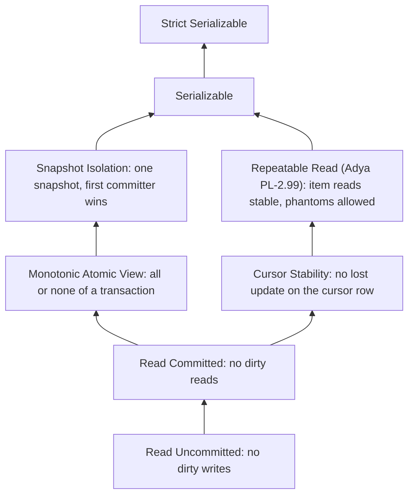
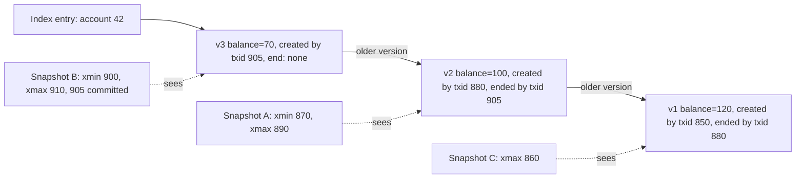
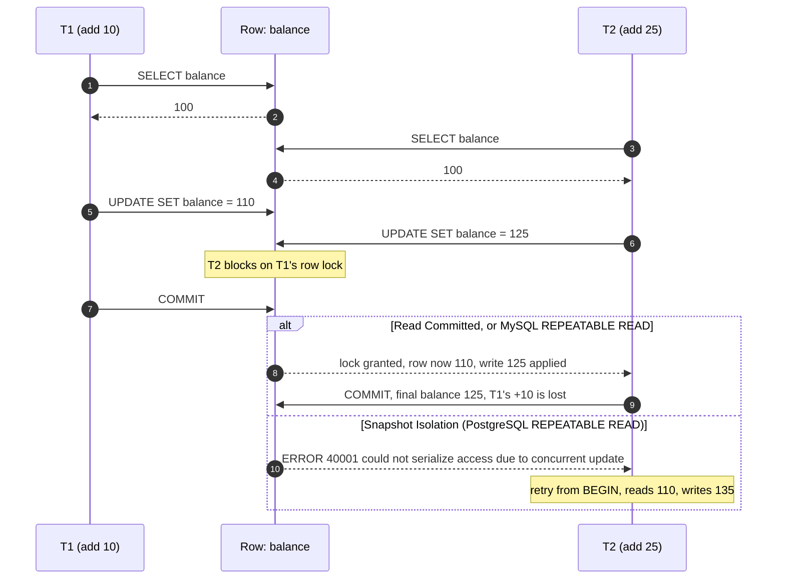
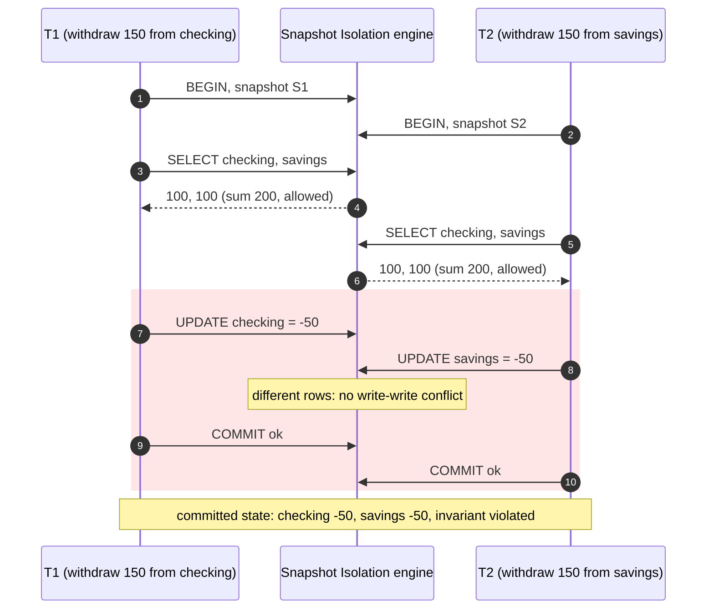
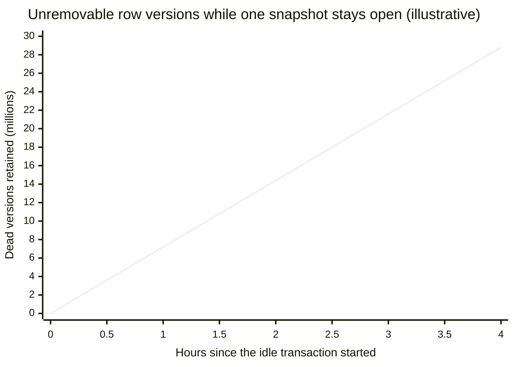

Zayıf izolasyon, serializability'den daha zayıf transaction izolasyon seviyelerinin ailesidir: eşzamanlı transaction'ların hiçbir seri yürütmenin üretemeyeceği biçimlerde iç içe geçmesine izin verirler, ama yalnızca belirli ve adı konmuş biçimlerde. Read Committed, bir transaction'ın commit edilmemiş veriyi asla görmemesini garanti eder. Snapshot Isolation (SI), bir transaction'ın tüm veritabanının başlangıç anında dondurulmuş tek ve tutarlı bir durumunu görmesini ve eşzamanlı iki transaction'ın aynı satırın üzerine asla birlikte yazmamasını garanti eder. İkisi de, bir transaction'ın okuduklarına dayanarak verdiği kararın commit anında hâlâ geçerli olduğunu garanti etmez. Neredeyse her ilişkisel veritabanı varsayılan olarak bu seviyelerden birinde çalışır; dolayısıyla izin verdikleri anomaliler uç durumlar değildir, mühendislerin çoğunun işlettiği production sistemlerinin olağan davranışıdır.

Çok sürümlü eşzamanlılık denetimi (multi-version concurrency control, MVCC), bu seviyeleri ucuz kılan depolama mekanizmasıdır. Motor bir satırın üzerine yerinde yazıp okuyucuları yazıcının kilidini beklemeye zorlamak yerine her satırın birkaç sürümünü tutar; her sürüm onu oluşturan transaction'la damgalanır ve her okuyucu, snapshot'ının görünür dediği sürümü seçer. Okuyucular yazıcıları, yazıcılar da okuyucuları asla bloklamaz. MVCC motorlarının uzun raporları ve kısa güncellemeleri aynı tablolar üzerinde kilit çekişmesi olmadan sunabilmesinin nedeni bu özelliktir.

Asıl dengenin iki yarısı vardır. Serializability'ye karşı zayıf izolasyon, eşzamanlılık için doğruluktan vazgeçer: beklemeyi ve abort'ların çoğunu ortadan kaldırır, karşılığında uygulama, değişmezleri (invariant) için önemli olan anomalileri her seferinde bir transaction çifti ele alarak bulmak ve kapatmak zorunda kalır. Tek sürümlü kilitlemeye karşı ise MVCC, bloklamayan okumalar için depolama alanından ve arka plan işinden vazgeçer: açık kalan her snapshot, kendisinden sonra oluşturulan her sürümü sabitler ve motor bu sürümleri daha sonra bulup silmek zorundadır. Bir raporlama aracının kapatmayı unuttuğu beş saatlik bir transaction kilit olarak hiçbir şeye mal olmaz; ama onlarca gigabaytlık şişkinliğe (bloat), bir purge birikimine ya da PostgreSQL'de zorunlu bir kapanmaya doğru ilerlemeye mal olabilir.

Bu sayfa, Serializable'ın altındaki anomali kataloğunun, Read Committed ile Snapshot Isolation'ı gerçekleştiren MVCC mekanizmasının ve write skew'un sahibidir. Serializable motorların kalan açığı nasıl kapattığı, Serializable Snapshot Isolation dâhil, [Serializability](/distributed-systems/tr/data-management/consistency-models/serializability/) sayfasında; tek nesneye ilişkin gerçek zamanlı garantiler ise [Linearizability](/distributed-systems/tr/data-management/consistency-models/linearizability/) sayfasında anlatılır.

## Anomali Kataloğu: Her Seviye Neyin Geçmesine İzin Verir

Bir izolasyon seviyesi en iyi izin verdiği anomalilerle anlaşılır, çünkü uygulama kodunun kendini koruması gereken şey anomalilerdir. Aşağıdaki her anomali iki transaction'ın somut bir iç içe geçişidir; her birinin ANSI SQL standardında, Berenson ve arkadaşlarının 1995'te bu standarda yönelttiği eleştiride ya da Adya'nın 1999 tarihli genelleştirilmiş tanımlarında bir adı vardır ve bu adlar kısmen örtüşür.

**Dirty write** (kirli yazma), bir transaction'ın henüz commit edilmemiş başka bir transaction'ın yazdığı değerin üzerine yazmasıyla oluşur. T1 A'yı ve B'yi yazarsa, T2 de T1 commit olmadan A'nın üzerine yazarsa ve ikisi de commit olursa, son durum T1'in B'sini T2'nin A'sıyla karıştırabilir; bu, iki transaction'ın da amaçlamadığı bir birleşimdir. T1 abort olursa A'yı geri almak T2'nin yazısını da siler. Read Uncommitted dâhil her seviye dirty write'ı engeller; bunu genellikle yazma kilitlerini commit'e kadar tutarak yapar. Adya, yazma-yazma bağımlılıklarından oluşan bu döngüye G0 der.

**Dirty read** (kirli okuma), bir transaction'ın henüz commit edilmemiş bir transaction'ın yazdığı değeri okumasıyla oluşur. Yazan transaction daha sonra abort olursa, okuyucu hiç var olmamış bir veriye göre davranmış olur (Adya'da G1a, aborted read); yazan daha sonra kendi değerinin üzerine yine yazarsa, okuyucu bir ara durumu görmüş olur (G1b). Read Committed tam olarak bunu engellemek için vardır.

**Lost update** (kayıp güncelleme), iki transaction'ın bir değeri okuyup ondan yeni bir değer hesaplaması ve ikisinin de yazmasıyla oluşur: ikinci yazma birincisini sessizce yok eder. `SELECT balance` ve ardından `UPDATE ... SET balance = 110` olarak gerçekleştirilmiş eşzamanlı iki "bakiyeye 10 ekle" operasyonu bakiyeyi 120 yerine 110'da bırakır. Berenson ve arkadaşları buna P4 adını verdi. Read Committed buna izin verir; Snapshot Isolation engeller.

**Read skew** (okuma çarpıklığı; non-repeatable read ya da fuzzy read olarak da anılır), bir transaction'ın birbiriyle ilişkili iki değeri farklı zaman noktalarında okuyup hiç var olmamış bir durum gözlemlemesiyle oluşur. A hesabını bir transferden önce, B hesabını transferden sonra okuyan ve [Serializability](/distributed-systems/tr/data-management/consistency-models/serializability/) sayfasında adım adım çözümlenen denetim örneği kanonik vakadır. Kleppmann'ın izolasyon test takımı Hermitage bunu G-single, yani tam olarak bir anti-dependency kenarı içeren bir bağımlılık döngüsü olarak sınıflar. Read Committed buna izin verir; Snapshot Isolation engeller, çünkü iki okuma da aynı snapshot'tan gelir.

**Write skew** (yazma çarpıklığı), iki transaction'ın örtüşen bir veri kümesini okuması, her birinin okuduğuna dayanarak bir karar vermesi ve her birinin farklı bir nesneye yazmasıyla oluşur; yazmalardan hiçbiri diğeriyle çakışmaz, ama birlikte, okumaların denetlediği bir değişmezi ihlal ederler. Karar "bu zaman dilimiyle örtüşen rezervasyon yok" gibi bir yükleme (predicate) dayandığında ve yazma, diğer transaction'ın yüklem sonucunu değiştirecek bir satır eklediğinde, anomali write skew'un phantom varyantıdır. Adya'nın adlandırmasında sabit satırlardaki sürüm G2-item, yüklemli sürüm G2'dir. Snapshot Isolation ikisine de izin verir. Anomali aşağıda kendi bölümünde incelenir.

**Read-only anomaly** (salt okunur transaction anomalisi), Fekete, O'Neil ve O'Neil tarafından 2004'te keşfedilmiştir ve en tuhaf olanıdır: Snapshot Isolation altında iki okuma-yazma transaction'ı kendi başına serializable olan bir geçmiş üretebilir ve yalnızca okuyan üçüncü bir transaction, tüm geçmişi serializable olmaktan çıkaran bir durum gözlemleyebilir. SI altında raporların bile imkânsız bir durum görebileceğini gösterir.


*İzolasyon seviyelerinin yasakladıkları anomalilere göre kısmi sıralaması. Ok, daha zayıf seviyeden daha güçlü olana yönelir; Snapshot Isolation ile biçimsel anlamdaki Repeatable Read karşılaştırılamaz.*

Diyagram bir merdiven değil, kısmi bir sıralamadır ve dallar arasındaki boşluklar, taşıma (porting) hatalarının çıktığı yerlerdir. Snapshot Isolation okumalar için phantom'ları yasaklar (snapshot değişmez) ama write skew'a izin verir; kilit tabanlı, biçimsel anlamdaki Repeatable Read ise okuduğu satırlarda write skew'u yasaklar ama phantom'lara izin verir, çünkü yüklemleri değil satırları kilitler. Dolayısıyla hiçbiri diğerini gerektirmez ve SQL anahtar kelimesi `REPEATABLE READ` iki daldan birine ya da hiçbirine karşılık gelebilir: PostgreSQL onu Snapshot Isolation olarak gerçekleştirir; MySQL'in InnoDB'si ise, Jepsen'in 2023'te gösterdiği gibi, ne snapshot ne de kilit tabanlı Repeatable Read olan bir şey gerçekleştirir. Bir başka transaction'ın yazılarının bir kısmını görüp kalanını görmemeyi yasaklayan Monotonic Atomic View, daha çok dağıtık ve replike depolarda önem taşır; orada koordinasyon olmadan ulaşılabilecek en güçlü seviyedir.

### Standardın Tanımları Neden Yetersiz Kalır

ANSI SQL-92 standardı dört seviyesini İngilizce ifade edilmiş üç fenomenle tanımlar: dirty read, non-repeatable read ve phantom. Berenson, Bernstein, Gray, Melton, O'Neil ve O'Neil 1995'te bu tanımların belirsiz olduğunu gösterdi: katı okunduklarında herkesin bozuk diyeceği geçmişleri kabul ederler, gevşek okunduklarında ise yalnızca kilit tabanlı bir gerçekleştirmenin tesadüfen yasakladığını yasaklarlar. Makaleleri Snapshot Isolation'ı ilk kez biçimsel olarak tanımladı ve onun üç ANSI fenomenini de engellediğini, buna rağmen serializable olmadığını gösterdi. Bir veritabanının "ANSI SERIALIZABLE" iddiasında bulunup write skew'a izin verebilmesinin nedeni budur.

Adya'nın 1999 tarihli tezi, 2000'de Liskov ve O'Neil ile birlikte yayımlanarak fenomenlerin yerine commit edilmiş transaction'lar üzerindeki bağımlılık grafiklerini koydu; bunlar [Serializability](/distributed-systems/tr/data-management/consistency-models/serializability/) sayfasının döngüleri tanımlamak için kullandığı `wr`, `ww` ve `rw` kenarlarının aynısıdır. Her seviye bir döngü sınıfının yokluğudur: PL-1 G0'ı yasaklar, PL-2 ayrıca G1'i yasaklar, PL-2.99 öğe (item) anti-dependency döngülerini yasaklar, PL-3 ise tüm döngüleri yasaklar. Bu tanımlar gerçekleştirmeden bağımsızdır: kilit tabanlı, iyimser ya da çok sürümlü bir motora eşit biçimde uygulanırlar. Hermitage ve Jepsen'in Elle'i gibi araçların herhangi bir veritabanını bu tanımlara karşı test edebilmesi bu sayede mümkündür.

:::note[Test raporlarındaki anomali adlarını okumak]
İzolasyon test takımları anomalileri Adya'nın kodlarıyla raporlar. G0 bir dirty write döngüsüdür, G1a aborted read, G1b intermediate read, G1c yazma ve okuma bağımlılıklarından oluşan bir döngü, G-single tek bir anti-dependency içeren döngü (read skew), G2-item iki ya da daha fazla öğe anti-dependency'si içeren döngü (write skew), G2 ise aynısının yüklemli okumalarla oluşanıdır. P4, Berenson eleştirisindeki lost update'tir; "fractured read" ise bir transaction'ın başka bir transaction'ın yazılarının yalnızca bir kısmını gördüğü anlamına gelir.
:::

## MVCC: Sürümler Snapshot'ı Nasıl Kurar

Çok sürümlü bir motorun üç şeye ihtiyacı vardır: bir satırın birkaç sürümünü saklamanın bir yolu, belirli bir transaction'ın hangi sürümü göreceğine karar veren bir kural ve artık kimsenin göremeyeceği sürümleri silen bir çöp toplayıcı. Kural tüm motorlarda ortaktır; depolama yerleşimi ve toplayıcı farklıdır ve her motorun operasyonel hata modlarını bunlar belirler.

### Görünürlük Kuralı

Yazan her transaction bir transaction kimliği alır: monoton artan bir sayı ya da dağıtık motorlarda bir zaman damgası. Bir satırın her sürümü, onu oluşturan transaction'ın kimliğiyle ve sürüm geçersiz kılındığında ya da silindiğinde, onu sonlandıran transaction'ın kimliğiyle damgalanır. PostgreSQL'de bu damgalar her tuple başlığındaki `xmin` ve `xmax` alanlarıdır; InnoDB'de her clustered index kaydı, son yazıcıyı adlandıran 6 baytlık gizli bir `DB_TRX_ID` alanı ve önceki sürümü yeniden kuran undo kaydını gösteren 7 baytlık bir `DB_ROLL_PTR` alanı taşır.

Snapshot, seçilen bir anda hangi transaction'ların commit edilmiş olduğunun kompakt bir tarifidir. PostgreSQL'de üç parçası vardır: `xmin`, snapshot alındığında hâlâ çalışan en eski transaction (ondan eskiler bitmiştir); `xmax`, atanacak bir sonraki kimlik (ona eşit ya da daha büyük olanlar sonra başlamıştır ve görünmezdir); ve ikisinin arasında olup hâlâ devam eden kimliklerin listesi. Bir sürüm, onu oluşturan transaction commit olmuşsa ve snapshot'ın gelecek ya da devam eden kümesinde değilse, onu sonlandıran transaction da (varsa) abort olmuş, devam ediyor ya da snapshot'ın geleceğindeyse o snapshot'a görünürdür. Bir transaction kendi yazılarını her zaman görür. InnoDB'nin read view'ı, farklı adlarla aynı yapıdır.


*Üç sürümlü bir satır ve üç snapshot. Her snapshot, yaratıcısı snapshot'tan önce commit olmuş ve sonlandırıcısı commit olmamış olan sürümü görür. Zincir, InnoDB ve Oracle'ın sakladığı gibi en yeniden eskiye doğru çizilmiştir.*

Snapshot A, transaction 880 commit olduktan sonra ve 905 başlamadan önce alınmıştır; bu yüzden 880'in oluşturduğu sürümü görür ve 905'in değişikliğini gelecek sayar. Snapshot C, 880'den önceye aittir ve hâlâ ilk değeri görür. Diğer transaction'lar yazmaya devam ederken satırla ilgili hiçbir şey onların hiçbiri için değişmez; her okuyucu zinciri kendi snapshot'ına göre çözer. Doğruluk argümanı, snapshot'ın commit sırasının bir kesiti olmasıdır: bir transaction'ın yazılarını ya tamamen içerir ya hiç içermez ve bir transaction'ı içeriyorsa, o transaction'ın commit'i gözlemlenmeden önce commit olmuş her transaction'ı da içerir. Böylece okuyucu asla yarım bir transaction görmez (fractured read yoktur) ve veritabanı içinde nedenini görmeden sonucunu asla görmez. Snapshot'ın yapmadığı şey güncel kalmaktır: tanımı gereği, alındıktan sonra commit olan her şeyi yok sayar.

### Sürümleri Saklamanın Üç Yolu

Motorlar eski sürümlerin nerede yaşadığı konusunda ayrışır ve bu tek karar, uzun süren snapshot'ların bedelini kimin ödeyeceğini belirler.

PostgreSQL her sürümü tablonun kendisinde saklar. Bir `UPDATE` bir tuple'ı asla yerinde değiştirmez; yeni bir tuple yazar, eskisinin `xmax` alanını doldurur ve ikisini eski tuple'ın `t_ctid` işaretçisiyle bağlar; böylece zincir en eskiden en yeniye doğru ilerler. Yeni sürüm aynı 8 KB'lık sayfaya sığıyorsa ve index'lenmiş hiçbir sütun değişmediyse güncelleme bir heap-only tuple (HOT) güncellemesidir ve hiçbir index'e dokunulmaz; aksi hâlde tablodaki her index, yeni tuple'ı gösteren yeni bir girdi alır. Ölü sürümler, autovacuum worker'larının çalıştırdığı `VACUUM` tarafından silinir; vacuum ayrıca alanı yeniden kullanılabilir olarak işaretler ve eski transaction kimliklerini dondurur (freeze). Zincirin eski bir kısmına düşen okuyucular, görünür sürümü bulmak için ölü sürümlerin üzerinden geçmek zorundadır.

InnoDB clustered index kaydını yerinde günceller ve önceki görüntüyü (before-image) bir undo log'a yazar. Read view'ı güncel sürümü göremeyen bir okuyucu, `DB_ROLL_PTR` işaretçisini izleyerek undo log'a girer ve görünür bir sürüme ulaşana kadar undo kayıtlarını geriye doğru uygular; zincir en yeniden en eskiye doğru ilerler. Purge thread'leri, hiçbir read view'ın ihtiyaç duymadığı undo kayıtlarını siler; birikim, `SHOW ENGINE INNODB STATUS` çıktısında `History list length` olarak görünür. Oracle aynı yerinde güncelleme artı undo tasarımını blok düzeyinde kullanır: bir sorgu her bloğun, snapshot'ının System Change Number (SCN) değerine göre tutarlı bir okuma kopyasını undo segment'lerinden yeniden kurar; undo, alan elverdiği sürece en az `UNDO_RETENTION` saniye (varsayılan 900) tutulur.

SQL Server güncel satırı yerinde tutar ve eski sürümleri bir version store'a kopyalar; bu geleneksel olarak `tempdb`'dedir, Accelerated Database Recovery etkinse kullanıcı veritabanı içindeki kalıcı bir version store'dadır. Sürümlenen her satır, önceki sürümünü gösteren 14 baytlık sürümleme bilgisi taşır. Sürümleme varsayılan olarak kapalıdır ve veritabanı başına etkinleştirilir: `READ_COMMITTED_SNAPSHOT`, Read Committed'ı ifade düzeyinde snapshot'lara geçirir; `ALLOW_SNAPSHOT_ISOLATION` ise transaction'ların `SNAPSHOT` seviyesini açıkça istemesine izin verir.

| Motor | Eski sürümlerin yeri | Zincir yönü | Eski bir snapshot'ın bedelini kim öder | Toplayıcı ve birikim sinyali |
|---|---|---|---|---|
| PostgreSQL | Tablo heap'inde, her güncellemede yeni tuple | Eskiden yeniye | Şişmiş tablolardaki her okuyucu ve her index taraması; disk | `VACUUM` / autovacuum; `n_dead_tup`, `backend_xmin` yaşı |
| MySQL InnoDB | Undo tablespace'lerindeki undo log | Yeniden eskiye | Çoğunlukla undo'yu yürüyen eski okuyucu; undo alanı herkes için büyür | Purge thread'leri; `History list length` |
| Oracle | Undo segment'leri, blok düzeyinde yeniden kurma | Yeniden eskiye | ORA-01555 ile başarısız olabilecek eski okuyucu | Undo retention; undo tablespace kullanımı |
| SQL Server | `tempdb` version store'u ya da kalıcı version store | Yeniden eskiye | Eski okuyucular; herkes için `tempdb` alanı | Version cleanup; version store boyutu sayaçları |

Tablonun operasyonel önemi "kim öder" sütunundaki asimetridir. PostgreSQL'de uzun bir snapshot, güncel tüm okuyucuları yavaşlatır, çünkü sabitlediği sürümler taze sorguların taradığı sayfalarda ve index'lerde kalır. Undo tabanlı motorlarda güncel okuyucular en yeni sürümü yerinde ve ek maliyetsiz görür; bedeli uzun süren okuyucunun kendisi, eski sürümleri yeniden kurarak öder. Bu yeniden kurma, okuyucu ne kadar uzun çalışırsa o kadar yavaşlar; Oracle'da sonunda "snapshot too old" hatasıyla başarısız olur.

### MVCC Altında Read Committed

Read Committed, MVCC motorlarında her ifade (statement) için taze bir snapshot alınarak gerçekleştirilir. Her ifade tutarlı bir durum görür; bu yüzden join içeren tek bir `SELECT` iki transaction'ı asla karıştırmaz, ama aynı transaction içindeki iki ifade farklı durumlar görebilir. Seviyenin izin verdiği read skew tam olarak budur.

Yazmalar eski snapshot'ı kullanamaz, çünkü zaten geçersiz kılınmış bir sürümü güncellemek bir dirty write olurdu. PostgreSQL'in Read Committed altında `UPDATE`, `DELETE` ve `SELECT ... FOR UPDATE` için kuralı şöyledir: hedef satır eşzamanlı bir transaction tarafından değiştirilmişse ifade o transaction'ın bitmesini bekler; o transaction commit olduysa ifade `WHERE` koşulunu en yeni sürüme göre yeniden değerlendirir ve koşul hâlâ sağlanıyorsa değişikliği o sürüme uygular. `UPDATE accounts SET balance = balance + 10 WHERE id = 42` ifadesinin Read Committed'da güvenli olmasının nedeni budur: artış, en son commit edilmiş bakiye her neyse ona uygulanır. Aynı kural, `WHERE` koşulu başka satırlara bağlı olan ifadelerde şaşırtıcı sonuçlara yol açar, çünkü yalnızca hedef satır yeniden okunur, sorgunun snapshot'ının geri kalanı değil. Read Committed'daki InnoDB de benzer davranır: `UPDATE` taramalarında bir satırın eşleşip eşleşmediğine kilitlemeden önce karar vermek için en son commit edilmiş sürümü okuyan bir "semi-consistent read" kullanır.

Lost update, okuma ve yazma ayrı ifadeler olduğunda ortaya çıkar. Uygulama bakiyeyi bir ifadede okur, yeni değeri uygulama kodunda hesaplar ve ikinci bir ifadede bir sabit yazar; veritabanının bu sabitin artık bayat olan bir okumadan türetildiğini bilmesinin hiçbir yolu yoktur.

### Snapshot Isolation ve İlk Commit Eden Kuralı

Snapshot Isolation transaction başına tek bir snapshot alır (PostgreSQL'de ilk ifadede, InnoDB'de `START TRANSACTION WITH CONSISTENT SNAPSHOT` kullanılmadıkça ilk tutarlı okumada) ve her ifadeyi bu snapshot'tan okur. Lost update'i engellemek için tek bir yazma kuralı ekler: eşzamanlı iki transaction aynı satıra yazarsa en fazla biri commit olabilir. Berenson ve arkadaşları bunu first-committer-wins (ilk commit eden kazanır) olarak tanımladı: çakışma commit anında denetlenir. Gerçekleştirmelerin çoğu bunun yerine first-updater-wins (ilk güncelleyen kazanır) kullanır: ikinci yazıcı ilk yazıcının satır kilidinde bloklanır ve ilki commit olursa ikincisi hemen abort edilir. PostgreSQL `REPEATABLE READ` seviyesinde "could not serialize access due to concurrent update" mesajıyla SQLSTATE 40001 döndürür. Oracle'ın `SERIALIZABLE` seviyesi ORA-08177, SQL Server'ın `SNAPSHOT` seviyesi ise bir update conflict olan 3960 hatasını döndürür.


*Aynı oku-değiştir-yaz iç içe geçişi Read Committed ve Snapshot Isolation altında. Fark tamamen 8. adımdan sonra T2'ye ne olduğundadır.*

1-4. adımlar iki seviyede de aynıdır: her transaction 100 okur. 6. adımda T2'nin yazması bekler, çünkü satır kilidini T1 tutmaktadır; sonuç T1'in 8. adımda commit olmasıyla belirlenir. Read Committed altında T2, artık güncel olmayan veriden hesaplanmış bir değerle satırın üzerine yazar ve veritabanı bunu fark edemez, çünkü yazılan bir sabittir. Snapshot Isolation altında motor, T2'nin değiştirmek üzere olduğu satırın T2'nin snapshot'ından sonra oluşturulduğunu, dolayısıyla T2'nin okumasının bayat olduğunu fark eder ve onu abort eder. Yeniden deneme 110 okur ve sonuç doğrudur. Mekanizma yalnızca iki transaction'ın da yazdığı satırları korur: bir yazma-yazma denetimidir ve yalnızca okunmuş satırları göremez.

:::caution[MySQL REPEATABLE READ, Snapshot Isolation değildir]
InnoDB düz `SELECT` ifadelerini transaction'ın read view'ından sunar; ama `UPDATE`, `DELETE` ve kilitleyen okumalar (`FOR UPDATE`, `FOR SHARE`) en son commit edilmiş sürüm üzerinde çalışır ve bunun transaction'ın okuduğu sürüm olup olmadığını denetlemez. Bu nedenle iki ifadeli bir oku-değiştir-yaz, MySQL'in varsayılan seviyesinde güncellemeleri kaybeder; bir transaction bir satıra yazdıktan sonra, aynı transaction içindeki sonraki okumalar başka transaction'ların snapshot'tan sonra commit ettiği değerleri döndürebilir. Jepsen'in 2023'teki MySQL 8.0.34 analizi bu seviyede, sağlıklı tek bir node üzerinde lost update, read skew ve write skew gözlemledi. Bir yazmayı besleyen her okuma için `SELECT ... FOR UPDATE` kullanın.
:::

## Write Skew: Snapshot'ların Göremediği Anomali

Write skew, bir seviye dirty read'i, read skew'u ve lost update'i engellediğinde geriye kalandır: her biri kendi başına doğru olan ve her biri tutarlı snapshot'lardan çalışan iki transaction, bir değişmezi ihlal eden birleşik bir durumu commit eder. Snapshot Isolation'ın tanımlayıcı zayıflığı ve SI'nin serializable olmamasının nedeni budur.

### Mekanizma

Bir bankanın, müşterinin iki hesabının toplamı negatif olmadığı sürece her birinin tek başına eksiye düşmesine izin verdiğini varsayalım: değişmez `checking + savings >= 0`'dır. İki hesapta da 100 vardır. T1 vadesiz hesaptan (checking) 150 çeker: iki bakiyeyi okur, toplamı 200 görür, çekimin izinli olduğuna karar verir ve checking = -50 yazar. Eşzamanlı olarak T2 birikim hesabından (savings) 150 çeker: iki bakiyeyi kendi snapshot'ından okur, 200 görür ve savings = -50 yazar. Her transaction farklı bir satıra yazdığı için first-updater-wins hiçbir çakışma bulmaz ve ikisi de commit olur. Toplam -100'dür.


*Snapshot Isolation altında write skew. Her transaction'ın okuma kümesi diğerinin yazdığı satırı içerir, ama SI yalnızca yazma kümelerini denetler.*

Anomali gölgeli bölgede oluşur. 4. ve 6. adımlarda iki transaction da aynı iki satırı okur ve tutarlı bir durum görür; snapshot'ların hiçbirinde yanlış bir şey yoktur. 7. ve 8. adımlarda her biri, diğerinin yalnızca okuduğu satıra yazar. Motor kimin neyi yazdığını izler, ayrık yazma kümeleri bulur ve 10. ile 11. adımlarda ikisinin de commit olmasına izin verir. Bağımlılık terimleriyle, T1'den T2'ye bir anti-dependency vardır (T1 savings'i okudu, T2 onun üzerine yazdı) ve T2'den T1'e bir tane daha vardır (T2 checking'i okudu, T1 onun üzerine yazdı); bu, iki `rw` kenarından oluşan bir döngüdür, yani G2-item. Sonucu hiçbir seri sıra açıklayamaz: hangi transaction ikinci çalışsaydı toplamı 50 görür ve reddederdi.

Yüklemli sürüm uygulama kodunda daha yaygındır ve fark edilmesi daha zordur. Bir toplantı odası rezervasyonu `SELECT count(*) FROM bookings WHERE room = 12 AND tstzrange overlaps the requested slot` sorgusunu çalıştırır, sıfır bulur ve bir rezervasyon ekler. Örtüşen zaman dilimleri için böyle iki transaction ikisi de sıfır görür, ikisi de ekleme yapar ve oda iki kez rezerve edilir. Burada hiçbir transaction diğerinin okuduğu bir satıra yazmamıştır; her biri, diğerinin yüklemiyle eşleşecek bir satır eklemiştir. Okunan satırları kilitlemek işe yaramaz, çünkü okunan satır yoktur. Aynı biçimin diğer örnekleri: bir kullanıcı adının boş olduğunu denetledikten sonra onu almak, sayaç yerine satırlar olarak izlenen envanterin son birimini ayırmak, yöneticilerin kendi yetkilerini düşürebildiği yerde "her organizasyonda en az bir yönetici" kuralını uygulamak ve defter (ledger) satırlarının toplamı olarak hesaplanan bir bakiyeden harcama yapmak.

### Açığı Kapatmak

Write skew dört yolla engellenebilir; kapsamları ve maliyetleri farklıdır.

Birincisi, okunanı kilitleyerek çakışmayı yazma-yazma denetimine görünür kılmaktır. Kararın dayandığı satırlar üzerinde `SELECT ... FOR UPDATE`, bu okumaları çakışma açısından yazmalara dönüştürür: banka örneğinde iki transaction da iki hesap satırını kilitler, ikincisi bloklanır ve devam ettiğinde ya birincinin güncellemesini görür (Read Committed'da) ya da abort edilir (Snapshot Isolation'da). Bu yalnızca kararın dayandığı satırlar var olduğunda işe yarar.

İkincisi, satırlar yokken çakışmayı somutlaştırmaktır (materializing the conflict). Rezervasyon vakasında her oda ve zaman dilimi için ya da her oda için bir satır oluşturulur ve her rezervasyon transaction'ı örtüşmeleri denetlemeden önce bu satırı kilitler ya da günceller. Yüklem bir satıra dönüştürülmüştür ve yazma-yazma denetimi ona uygulanır. Bu, eşzamanlılık denetiminin veri modeline sızmasıdır; somutlaştırılan satırın ayrıntı düzeyi çekişmeyi belirler.

Üçüncüsü, değişmezi veritabanına bir kısıt (constraint) olarak taşımaktır; kısıt, snapshot'lardan bağımsız olarak en son commit edilmiş duruma karşı denetlenir. Bir unique index kullanıcı adı yarışını engeller; `EXCLUDE USING gist (room WITH =, during WITH &&)` gibi PostgreSQL exclusion kısıtları örtüşen rezervasyonları engeller; bir check kısıtı diğer satırları göremez, bu yüzden iki hesaplı toplamda işe yaramaz.

Dördüncüsü, transaction'ı tehlikeli örüntüyü kendisi tespit eden, gerçekten serializable bir seviyede çalıştırmaktır. PostgreSQL'de bu, Serializable Snapshot Isolation olarak gerçekleştirilen `SERIALIZABLE` seviyesidir; iki transaction'dan birini commit anında SQLSTATE 40001 ile abort eder. Mekanizma ve maliyetleri [Serializability](/distributed-systems/tr/data-management/consistency-models/serializability/) sayfasındadır. Geliştiricinin savunmasız her transaction çiftini önceden belirlemesini gerektirmeyen tek seçenek budur.

```sql
-- Option 1: lock every row the decision reads (works at Read Committed and SI)
BEGIN;
SELECT checking, savings FROM accounts WHERE customer_id = 7 FOR UPDATE;
-- application checks checking + savings - 150 >= 0, then:
UPDATE accounts SET checking = checking - 150 WHERE customer_id = 7;
COMMIT;
-- Option 3: let the database enforce the predicate (PostgreSQL, needs btree_gist)
ALTER TABLE bookings ADD CONSTRAINT no_overlap
  EXCLUDE USING gist (room_id WITH =, during WITH &&);
-- Option 4: detect the dangerous structure; the client must retry on 40001
BEGIN ISOLATION LEVEL SERIALIZABLE;
```

İlk blok, iki bakiyenin müşteri başına tek bir satırda tutulduğunu varsayar; tek bir satır kilidinin tüm yüklemi kapsamasını sağlayan yerleşim budur. Hesap başına bir satır varsa iki satırın da, deadlock'tan kaçınmak için sabit bir sırayla, kilitlenmesi gerekir. Exclusion kısıtı, izolasyon seviyesi ne olursa olsun örtüşen ikinci eklemeyi bir kısıt ihlaliyle reddeder; bu da sessiz bir çift rezervasyonu görünür bir hataya dönüştürür.

:::danger[Snapshot Isolation altında denetle-sonra-yaz, veriyi sessizce bozar]
Bir yazmanın izinli olup olmadığına karar vermek için bir satır kümesini okuyan ve ardından bu kümenin dışındaki bir satıra yazan her kod yolu, Read Committed'da ve Oracle'ın `SERIALIZABLE` ile PostgreSQL'in `REPEATABLE READ` seviyeleri dâhil her Snapshot Isolation seviyesinde write skew'a açıktır. Hiçbir şey loglanmaz, hiçbir şey abort olmaz ve ihlal bir denetimle ya da bir müşteri tarafından bulunur. Bu tür her yolu denetleyin ve bir kilitle, somutlaştırılmış bir çakışma satırıyla, bir kısıtla ya da serializable bir transaction'la kapatın.
:::

### Salt Okunur Transaction Anomalisi

Fekete, O'Neil ve O'Neil'in 2004 tarihli örneği, write skew'un hiçbir şey yazmayan bir transaction tarafından açığa çıkarılabileceğini gösterir. X vadesiz bakiyesi ve Y birikim bakiyesi olsun, ikisi de 0; `X + Y`'yi negatife düşüren bir çekim 1 birim cezaya tabi olsun. T1 vadesiz hesaptan 10 çeker: snapshot'ından X = 0 ve Y = 0 okur, toplamın negatife düşeceğini görür ve X = -11 yazar. Eşzamanlı olarak T2 birikim hesabına 20 yatırır ve commit olur. T2 commit olduktan sonra ama T1 commit olmadan önce, salt okunur T3, X = 0 ve Y = 20 okur ve raporlar. Ardından T1 commit olur.

T3 olmadan geçmiş, T1 T2'den önce olacak şekilde serializable'dır: çekim yatırımı görmemiştir, dolayısıyla ceza haklıdır. Ancak T3 yatırımı görmüş ve çekimi görmemiştir; bu, T2'yi T3'ten, T3'ü de T1'den önceye koyar, yani T2 T1'den önce gelmelidir ve bu durumda ceza haksızdır. T3 doğrudan zarar görmez; ama T3 müşterinin hesap özetiyse, müşteri bir yatırım görür, henüz çekim görmez ve daha sonra gösterilen bakiyelerin haklı çıkarmadığı bir cezayla karşılaşır. Operasyon açısından ders şudur: Snapshot Isolation'da çalışan bir rapor, hiçbir seri yürütmenin geçmediği bir durumu görebilir; raporlar kararları ya da mutabakatı besliyorsa bu önemlidir. PostgreSQL'in `SERIALIZABLE READ ONLY DEFERRABLE` seviyesi tam olarak bu durum için vardır.

## Eski Snapshot'ların Depolama Maliyeti: Çözümlü Örnek

MVCC'nin okuyucuların yazıcıları asla bloklamadığı vaadinin bedeli sürüm cinsinden ölçülür: bir sürüm, onu görebilecek herhangi bir snapshot açık olduğu sürece silinemez ve en eski açık snapshot tüm veritabanı için ufku (horizon) belirler (PostgreSQL'de paylaşılan katalog'lar için tüm cluster'ı). Aşağıdaki çözümlü örnek açıklayıcı (illustrative) sayılar kullanır.

### Unutulmuş Tek Bir Transaction

50 milyon satırlı, saniyede 2.000 satır güncellenen, her tuple'ı 23 baytlık başlığı dâhil yaklaşık 200 bayt olan ve üç index'i bulunan bir PostgreSQL `orders` tablosu varsayalım. Bir iş zekâsı (business intelligence) aracı Repeatable Read seviyesinde bir transaction açar, bir sorgu çalıştırır ve oturumu dört saat boyunca transaction içinde boşta (idle in transaction) bırakır.

Bu dört saat boyunca 14.400 saniye boyunca saniyede 2.000 güncelleme 28,8 milyon satır sürümü üretir ve geçersiz kılınan sürümlerin hiçbiri silinemez, çünkü boştaki oturumun snapshot'ı hepsinden eskidir. Her biri 200 bayttan bu, heap'te yaklaşık 5,8 GB ölü tuple demektir. Güncellemeler HOT değilse (index'lenmiş bir sütun değiştiyse ya da sayfada boş alan yoksa), her biri üç index'in her birine de bir girdi eklemiştir: yaklaşık 86 milyon index girdisi; girdi başına 20-30 bayt varsayımıyla 1,7-2,6 GB daha. Autovacuum bu süre boyunca çalışmaya devam eder, tabloyu tarar ve hiçbir şey silmez, çünkü her ölü tuple ufuktan daha yenidir; yani etkisiz biçimde I/O tüketir.


*Açıklayıcı model: saniyede 2.000 satır güncellemesi; en eski snapshot'tan sonra oluşturulan hiçbir sürüm silinemez. Eğim güncelleme hızıdır; süre en eski snapshot'ın yaşıdır.*

Grafik düz bir çizgidir, çünkü tutulan sürüm sayısı güncelleme hızı ile snapshot yaşının çarpımıdır ve iki terim de boştaki oturumun ne kadar meşgul olduğuna bağlı değildir. Zarar ise doğrusal değildir. Tabloyu tarayan sorgular artık çoğu ölü tuple olan sayfaları okur; index taramaları heap tuple'larını yalnızca görünmez oldukları için reddetmek üzere getirir; çalışma kümesi büyüdüğü için buffer cache isabet oranı düşer. Oturum sonunda kapandığında vacuum ölü tuple'ları silebilir; ama PostgreSQL'de bu yalnızca alanı tablo dosyalarının içinde yeniden kullanılabilir yapar: tablo, `VACUUM FULL` (exclusive bir kilit alır) ya da pg_repack gibi çevrimiçi bir araçla yeniden yazılana kadar diskte şişmiş boyutunda kalır.

### Tek Bir Sıcak Satır

Şimdi aynı dört saat boyunca saniyede 50 kez güncellenen tek bir sayaç satırı varsayalım: tek bir mantıksal satırın 720.000 sürümü. PostgreSQL'de bunların her biri heap'te kalır, satırı tutan sayfa dolar, HOT zincirleri yeni sayfalara kırılır ve her kırılma aynı anahtar için index girdileri ekler. Bu anahtarı index üzerinden arayan taze bir okuyucu, canlı sürüme ulaşmadan önce göremediği sürümlerin girdilerini ve heap tuple'larını ziyaret etmek zorundadır; böylece veritabanında en sık okunan satır, her yeni sorgu için giderek daha pahalı hâle gelir. InnoDB'de taze bir okuyucu güncel sürümü yerinde bulur ve fazladan hiçbir şey ödemez; ama eski transaction satırı yeniden okursa, kendi sürümünü yeniden kurmak için 720.000'e kadar undo kaydı uygulamak zorundadır ve tüm bu değişikliklerin undo log'u onun hatırına tutulur. Oracle'da aynı yeniden kurma denenir ve ihtiyaç duyulan undo'nun üzerine yazılmışsa sorgu ORA-01555 ile başarısız olur.

Aritmetik genelleşir: tutulan sürüm sayısı, etkilenen tablolardaki güncelleme hızı ile en eski snapshot'ın yaşının çarpımına eşittir ve sıcak bir satırı okumanın maliyeti, o satırın pencere içindeki sürüm sayısıyla büyür. Aynı ufku kullanıcı transaction'ı olmayan şeyler de sabitler: `hot_standby_feedback` etkin bir PostgreSQL fiziksel standby'ı en eski sorgusunun snapshot'ını primary'ye bildirir ve tüketicisi durmuş bir replication slot ufku süresiz olarak geride tutar; bu konu [Lider Tabanlı Replikasyon](/distributed-systems/tr/data-management/replication/leader-based-replication/) sayfasında ele alınır.

:::tip[Yalnızca sorgu süresini değil, snapshot yaşını da sınırlayın]
`statement_timeout`, transaction içinde boşta bekleyen bir oturuma karşı koruma sağlamaz, çünkü çalışan bir ifade yoktur. PostgreSQL'de uygulama rolleri için `idle_in_transaction_session_timeout`, 17. sürümden itibaren de toplam transaction yaşını sınırlamak için `transaction_timeout` ayarlayın; `pg_stat_activity` içindeki en eski `backend_xmin` yaşına ve `pg_replication_slots` içindeki en eski `xmin` değerine alarm kurun. MySQL'de `History list length` değerine ve `information_schema.innodb_trx` içindeki bir eşikten eski transaction'lara alarm kurun.
:::

## Production Motorlarında İzolasyon Seviyeleri

Seviye adları motorlar arasında ortaktır; davranış ortak değildir. Tablo, her motorun seviyelerinin bu sayfadaki anomaliler için ne sağladığını özetler; tek node'lu motorlar için Hermitage'in yayımlanmış sonuçlarına, CockroachDB için üretici dokümantasyonuna dayanır.

| Motor | Varsayılan | Read Committed gerçekleştirimi | `REPEATABLE READ` / snapshot seviyesi | Varsayılanda lost update | Snapshot seviyesinde write skew | Ne zaman tercih edilmeli |
|---|---|---|---|---|---|---|
| PostgreSQL | Read Committed | İfade başına snapshot, güncellenen satırların yeniden denetimi | Gerçek SI, ilk güncelleyen kazanır, çakışmada 40001 | İzin verilir | İzin verilir (`SERIALIZABLE` ile kapanır) | SSI'ya yükseltme yolu olan gerçek SI istendiğinde |
| MySQL InnoDB | Repeatable Read | İfade başına read view, semi-consistent güncelleme okumaları | Düz okumalar için read view, yazmalar için güncel okuma | İzin verilir | İzin verilir | Yazmalar açık kilitleyen okumalar kullandığında |
| Oracle | Read Committed | Undo'dan ifade düzeyinde tutarlı okuma | `SERIALIZABLE` SI'dir, çakışmada ORA-08177 | İzin verilir | İzin verilir (daha güçlü seviye yok) | Uzun tutarlı okumalar yazıcıları bloklamamalıysa |
| SQL Server | Read Committed (kilitli; Azure SQL Database'de RCSI açık) | Kilitleme ya da `READ_COMMITTED_SNAPSHOT` ile satır sürümleri | `SNAPSHOT` SI'dir, çakışmada 3960 hatası; `REPEATABLE READ` kilit tabanlıdır | İzin verilir | `SNAPSHOT` altında izin verilir | Okuyucu-yazıcı bloklamasını azaltmak için RCSI |
| CockroachDB | Serializable | v23.2'den beri mevcut, ifade başına snapshot | Varsayılan olarak Serializable | Varsayılanda engellenir | Varsayılanda engellenir | Varsayılanın serializable kalması istendiğinde |

İki satır ayrıca vurgulanmalıdır. MySQL'in varsayılan seviyesi, Repeatable Read adını taşıyıp iki ifadeli oku-değiştir-yaz'da lost update'e izin veren tek yaygın varsayılandır. Oracle'da ise Snapshot Isolation'ın üzerinde bir seviye yoktur; bu yüzden orada write skew yalnızca açık kilitleme ya da kısıtlarla kapatılabilir.

### Makineler Arasında Snapshot'lar

Partition'lanmış ya da replike bir veritabanında snapshot, tek bir sunucunun belleğinde tutulan devam eden transaction kimlikleri listesi olamaz. Dağıtık motorlar onu bir zaman damgasıyla değiştirir: commit edilen her sürüm transaction'ının commit zaman damgasıyla damgalanır ve `t` zaman damgasındaki bir snapshot okuması her partition'dan, commit zaman damgası `t`'ye eşit ya da ondan küçük olan en yeni sürümü döndürür. Google'ın Percolator'ı (Peng ve Dabek, 2010), Snapshot Isolation'ı Bigtable üzerinde bu şekilde kurdu: başlangıç ve commit zaman damgalarını dağıtan merkezî bir timestamp oracle ve satır başına iki aşamalı bir kilitle-ve-commit-et protokolü. TiDB'nin depolama katmanı aynı tasarımı izler. Spanner ve CockroachDB zaman damgalarını saatlerden alır, sırasıyla [TrueTime](/distributed-systems/tr/foundations/time-and-ordering/truetime-spanner/) ve [hibrit mantıksal saatler](/distributed-systems/tr/foundations/time-and-ordering/hybrid-logical-clocks/) ile; `t` anındaki bir snapshot'ın `t`'den önce commit olan her transaction'ı gerçekten içermesi için saatler arasındaki belirsizliği ele almak zorundadırlar.

Bundan iki sonuç çıkar. Birincisi, tek bir zaman damgasındaki partition'lar arası bir tarama, alt taramaları farklı makinelerde farklı anlarda çalışsa bile tutarlıdır; [anahtar aralığına göre partition'lanmış](/distributed-systems/tr/data-management/data-partitioning/key-range-partitioning/) depolarda çok aralıklı okumaları tutarlı kılan budur. İkincisi, bir replika tamamen uyguladığı herhangi bir zaman damgasında snapshot okuması sunabilir; böylece geride kalan bir replikadan alınan daha eski bir snapshot da geçerli bir snapshot'tır, yalnızca bayattır. Elnikety, Pedone ve Zwaenepoel 2005'te buna Generalized Snapshot Isolation adını verdi: güncellik dışında SI'nin her özelliğini korur; bu yüzden bir istemcinin kendi yakın tarihli yazısını kaçırmasına izin verir; bu problem [Replikasyon Gecikme Sorunları](/distributed-systems/tr/data-management/replication/replication-lag/) sayfasında ele alınır.

Çöp toplama da zaman damgası modelini izler. Dağıtık motorlar bir snapshot'ın ne kadar geriye okuyabileceğini zamanla ölçülen bir garbage-collection penceresiyle sınırlar ve tek bir istemcinin tüm cluster'da geçmişi sabitlemesine izin vermek yerine daha eski okumaları reddeder. [Serializability](/distributed-systems/tr/data-management/consistency-models/serializability/) sayfası, bu tercihin uç biçimi olan FoundationDB'nin 5 saniyelik sınırını ele alır.

### PostgreSQL'de Snapshot Teşhisi

Görünürlük alanları ve ufuk doğrudan gözlemlenebilir; bu da soyut bir şişkinlik problemini bir sorguya dönüştürür.

```sql
-- Current snapshot as xmin:xmax:in-progress list (PostgreSQL 13+)
SELECT pg_current_snapshot();
-- Version stamps on actual tuples
SELECT xmin, xmax, ctid, id, balance FROM accounts WHERE id = 42;
-- Sessions holding the oldest snapshots, and for how long
SELECT pid, state, age(backend_xmin) AS xmin_age, now() - xact_start AS xact_age, left(query, 60)
FROM pg_stat_activity WHERE backend_xmin IS NOT NULL ORDER BY age(backend_xmin) DESC LIMIT 5;
-- Tables with the most dead tuples waiting for vacuum
SELECT relname, n_live_tup, n_dead_tup, last_autovacuum FROM pg_stat_user_tables
ORDER BY n_dead_tup DESC LIMIT 5;
```

Transaction sayısıyla ölçülen `xmin_age` sütunu ve duvar saatiyle ölçülen `xact_age` sütunu, ufku sabitleyen oturumu belirler. Yakın tarihli bir `last_autovacuum` ile birlikte büyük bir `n_dead_tup`, vacuum'un çalıştığını ve hiçbir şey silemediğini gösterir; bu, yetersiz ayarlanmış bir autovacuum'un değil, sabitlenmiş bir ufkun imzasıdır.

## Hata Modları ve Operasyon

Hatalar iki gruba ayrılır: seviyenin, uygulamanın imkânsız saydığı bir anomaliye izin verdiği doğruluk hataları ve MVCC mekanizmasının yerinin tükendiği kaynak hataları.

### Oku-Değiştir-Yaz Kodunda Lost Update

Tetikleyici: uygulama kodu, çoğu zaman bir entity'yi yükleyip bir alanını değiştiren ve tüm entity'yi kaydeden bir ORM, Read Committed ya da MySQL Repeatable Read seviyesinde okumayı ve yazmayı ayrı ifadelerde yapar. Belirtiler: aşağı doğru kayan sayaçlar, eksiye düşen envanter, geri dönen yapılandırma değişiklikleri; hepsi eşzamanlılık altında, testlerde asla değil. Tespit: toplamları yalnızca eklemeli (append-only) bir defterle karşılaştırın; aynı birkaç milisaniye içinde iki istek tarafından yazılan entity'leri arayın; toplamları denetleyen eşzamanlı testler çalıştırın. Hafifletme: hesaplamayı ifadenin içine taşıyın (`SET stock = stock - 1 WHERE stock >= 1`), bir sürüm sütunuyla iyimser eşzamanlılık denetimi ekleyin (`UPDATE ... WHERE id = 42 AND version = 7`, ardından etkilenen satır sayısını denetleyin), `SELECT ... FOR UPDATE` kullanın ya da yeniden denemelerle gerçek bir Snapshot Isolation seviyesinde çalışın. Sürüm sütunu denetimi, HTTP'nin `If-Match` ile koşullu istekler olarak sunduğu compare-and-set'in aynısıdır; [REST](/distributed-systems/tr/communication/synchronous-protocols/rest/) sayfasında anlatılır. Kurtarma: doğruluk kaynağından mutabakat yapın; lost update veritabanında hiçbir iz bırakmaz.

### Denetle-Sonra-Yaz Yollarında Write Skew

Tetikleyici: eşzamanlı iki istek bir snapshot'a karşı aynı doğrulamadan geçer ve farklı satırlara yazar ya da yeni satırlar ekler. Belirtiler: çift rezervasyonlar, büyük-küçük harf duyarsız karşılaştırmada aynı e-postaya sahip iki hesap, yöneticisiz kalan bir ekip, aşılmış bakiyeler; sıklık aynı entity üzerindeki eşzamanlılıkla arttığı için kampanyalar ya da yeniden denemeler sırasında ortaya çıkar. Tespit: sorgu olarak periyodik çalıştırılan değişmez denetimleri (örneğin örtüşen rezervasyonları bulan bir self-join); CI'da gerçek motora ve seviyeye karşı Elle ya da Hermitage tarzı testler. Hafifletme: yukarıdaki dört seçenek; değişmez bir kısıt olarak ifade edilebiliyorsa veritabanı kısıtı tercih edilmelidir. Kurtarma: iş düzeyinde mutabakat; veritabanı iki transaction'ı da geçerli sayar.

### Seviyeyi Yükselttikten Sonra Beklenmedik Serileştirme Hataları

Tetikleyici: bir ekip lost update'leri ortadan kaldırmak için Read Committed'dan PostgreSQL `REPEATABLE READ`, SQL Server `SNAPSHOT` ya da Oracle `SERIALIZABLE` seviyesine geçer ve uygulamada yeniden deneme döngüsü yoktur. Belirtiler: kullanıcılara sunucu hatası olarak yansıyan, sıcak satırlarda yoğunlaşan SQLSTATE 40001, 3960 hatası ya da ORA-08177. Tespit: SQLSTATE ve transaction türüne göre hata sayıları; PostgreSQL'de sunucu log'undaki `could not serialize access` satırları. Hafifletme: transaction'ı [Serializability](/distributed-systems/tr/data-management/consistency-models/serializability/) sayfasında anlatıldığı gibi `BEGIN`'den itibaren baştan yeniden deneyin ve sıcak satırlara dokunan transaction'ları kısaltın. Kurtarma: gerekmez; başarısız denemelerde hiçbir şey commit edilmemiştir.

### Uzun Ömürlü Snapshot'lar ve Sürüm Şişkinliği

Tetikleyici: transaction içinde boşta bir oturum, primary üzerinde uzun bir analitik sorgu, yoğun yazma sırasında çalışan bir `mysqldump --single-transaction`, uzun sorgular çalıştıran ve `hot_standby_feedback` etkin olan bir standby ya da terk edilmiş bir replication slot. Belirtiler: satır sayısından hızlı büyüyen tablo ve index boyutu, sıcak tablolarda artan gecikme, sürekli çalışan autovacuum, milyonlara çıkan InnoDB `History list length` değeri, büyüyen undo tablespace'i, uzun Oracle sorgularında ORA-01555, SQL Server'da dolan `tempdb`.

```mermaid
gantt
    title Hypothetical incident: one idle transaction pins the MVCC horizon
    dateFormat HH:mm
    axisFormat %H:%M
    section Session
    BI tool opens transaction, then idles      :a1, 09:00, 260m
    section Database
    Autovacuum scans orders, removes nothing   :a2, 09:20, 240m
    Dead tuples grow at update rate            :a3, 09:00, 260m
    section Symptoms
    p99 latency on order lookups climbs        :a4, 11:00, 140m
    Alert on oldest backend_xmin age           :milestone, m1, 12:30, 0m
    section Response
    Session terminated with pg_terminate_backend :milestone, m2, 13:20, 0m
    Vacuum removes dead tuples                 :a5, 13:20, 40m
    Table rewritten online to reclaim disk     :a6, 14:30, 90m
```


*Varsayımsal, dört saatlik bir sabitlenmiş ufuk. Alarm snapshot yaşına göre ve gecikme belirtilerinin başlamasından epey sonra tetiklenir; disk alanı ancak bir yeniden yazmadan sonra geri döner.*

Zaman çizelgesi, belirti ile nedeni ilişkilendirmenin neden zor olduğunu gösterir. Probleme yol açan oturum hiç CPU tüketmez ve hiç satır kilidi tutmaz; bu yüzden kilit panoları ve yavaş sorgu log'ları hiçbir şey göstermez. Autovacuum 09:20'den itibaren gözle görülür biçimde meşguldür; bu da operatörleri onu daha agresif ayarlamaya iter, ama ufuk sabitken hiçbir şey silemez. Şişkinlik biriktikçe gecikme yavaş yavaş artar. Nedeni yalnızca snapshot yaşına kurulmuş bir alarm gösterir; oturumun sonlandırılması ufku serbest bırakır, vacuum ondan sonra işe yarar ve disk alanı ancak bir yeniden yazmadan sonra geri gelir. Tespit: `backend_xmin` ve replication slot `xmin` yaşı, `n_dead_tup`'un `n_live_tup`'a oranı, `History list length`, `trx_started`'a göre sıralanmış `information_schema.innodb_trx`, undo ve version store boyutu. Hafifletme: boşta bekleme ve toplam transaction yaşı için zaman aşımları; raporları feedback'siz replikalarda ya da bir veri ambarına aktarılmış snapshot'larda çalıştırmak; replication slot'ları izlemek ve geride kalan bir slot'u geçersiz kılan `max_slot_wal_keep_size` (PostgreSQL 13+) ayarını kullanmak. InnoDB'de `innodb_max_purge_lag` (varsayılan 0, devre dışı), purge geride kaldığında DML'i yavaşlatabilir; bu da sınırlı undo büyümesi için yazma gecikmesinden vazgeçmek demektir. Kurtarma: sabitleyen oturumu sonlandırın, vacuum'un ya da purge'ün yetişmesine izin verin, ardından gereken yerde alanı geri kazanın.

### PostgreSQL'de Transaction ID Wraparound

Tetikleyici: PostgreSQL transaction kimlikleri 32 bittir ve modulo 2^32 karşılaştırılır; bu yüzden yaklaşık 2 milyar transaction'dan daha geride kalan bir kimlik gelecekteymiş gibi görünür ve satırları görünmez hâle gelir. Vacuum bunu eski tuple'ları dondurarak, yani herkese görünür olarak işaretleyerek engeller. Dondurma geride kalırsa (sabitlenmiş bir ufuk, devasa bir tabloda hiç bitmeyen bir vacuum ya da yazma ağırlıklı bir cluster'da kısılmış bir autovacuum yüzünden) dondurulmamış en eski kimliğin yaşı büyür. Belirtiler: iptal edilemeyen agresif anti-wraparound autovacuum'lar, ardından log'da veritabanının belirli sayıda transaction içinde vacuum'lanması gerektiğini söyleyen uyarılar ve sonunda sunucunun yeni transaction kimliği atamayı reddederek tüm yazmaları durdurması. Tespit: veritabanı başına `age(datfrozenxid)` ve tablo başına `age(relfrozenxid)`; `autovacuum_freeze_max_age` (varsayılan 200 milyon) çok aşılmadan çok önce alarm. Hafifletme: ufku sabitleyen her şeyi kaldırın, autovacuum'a büyük tabloları dondurmayı bitirebilecek kadar worker ve yeterince düşük bir cost delay verin, çok büyük tabloları her biri sınırlı sürede dondurulabilecek şekilde partition'layın. Sentry'nin Temmuz 2015 kesintisi kamuya açık bir örnektir: yazma ağırlıklı veritabanları wraparound korumasına takıldı, yazmalar bir iş gününün büyük kısmı boyunca durdu ve vacuum'u bitemeyen büyük bir tabloyu truncate ederek toparlandılar. Kurtarma: en eski tabloların elle `VACUUM` edilmesi, eski sürümlerde tek kullanıcı (single-user) modunda; PostgreSQL 14, wraparound yaklaştıkça vacuum'un zorunlu olmayan işleri atlamasını sağlayan bir failsafe ekledi.

### Seviye, Kodun Varsaydığı Seviye Değildir

Tetikleyici: bir connection pool ya da sürücü izolasyonu oturum başına sıfırlar; PostgreSQL'den MySQL'e bir göç aynı `REPEATABLE READ` anahtar kelimesini korur; bir Oracle `SERIALIZABLE` transaction'ına write skew'u engelleyeceği güveniyle yaslanılır; ya da bir SQL Server veritabanında `ALLOW_SNAPSHOT_ISOLATION` etkindir ama transaction'lar onu hiç istemez. Belirtiler: yukarıdaki anomaliler; bir kod değişikliğinden değil, bir altyapı değişikliğinden sonra ortaya çıkar. Tespit: başlangıçta ve örneklenmiş transaction'larda, transaction türü başına etkin izolasyon seviyesini loglayın; dağıtım yolundaki her motora karşı izolasyon testleri çalıştırın. Hafifletme: seviyeyi her transaction için açıkça ayarlayın ve seviyeyi her transaction'ın sözleşmesinin bir parçası sayın. Kurtarma: etkilenen kayıtların mutabakatını yapın.

## İzolasyon Seviyesi Seçmek

Her transaction'ın doğruluğu yalnızca tek tek ifadelere bağlıysa Read Committed kullanın: yerinde atomik güncellemeler (`SET x = x + 1`), unique kısıtlarla korunan eklemeler ve ifadeler arasında farklı durumlar görmeye tahammül eden okumalar. En az abort'u ve en az sürüm tutulmasını üretir, çünkü her ifadenin snapshot'ı ifade bittiğinde serbest bırakılır. Bir okumanın bir yazmayı beslediği her yerde `SELECT ... FOR UPDATE` ya da sürüm sütunu denetimi ekleyin.

Transaction'lar birbiriyle ilişkili birkaç satırı okuyor ve onları tutarlı görmek zorundaysa, raporlar ve dışa aktarımlar yazmaları bloklamadan onlarla yan yana çalışmalıysa ve lost update'ler her oku-değiştir-yaz'ı tek tek denetlemeden engellenmeliyse Snapshot Isolation kullanın. Beraberinde gelen yükümlülükleri kabul edin: serileştirme hataları için bir yeniden deneme döngüsü ve write skew için her denetle-sonra-yaz yolunun gözden geçirilmesi. PostgreSQL'de Snapshot Isolation `REPEATABLE READ`, SQL Server'da `SNAPSHOT`, Oracle'da `SERIALIZABLE` seviyesidir.

Şu durumlarda zayıf izolasyona güvenmeyin:

- Bir değişmez birkaç satıra yayılıyor ya da bir satırın yokluğuna dayanıyor ve bir veritabanı kısıtı olarak ifade edilemiyor. Somutlaştırılmış bir çakışma üzerinde açık kilitleme ya da serializable bir seviye kullanın; ne Read Committed ne de SI yüklemleri denetler.
- Ekip çakışabilecek transaction'ları sayıp dökemiyor. Write skew analizi tüm transaction türleri üzerinde ikili yapılır; kod tabanı bu analizden hızlı büyüdüğünde [Serializability](/distributed-systems/tr/data-management/consistency-models/serializability/) kullanın ve bedelini yeniden denemelerle ödeyin.
- Uzun analitik iş OLTP primary'si üzerinde tek bir snapshot içinde çalışacak. Onu horizon feedback'i olmayan bir replikaya, zamanla sınırlı bir snapshot'a ya da bir veri ambarına taşıyın; primary'de onun snapshot'ı, okumadığı tablolar için bile bir depolama yüküdür.
- MySQL'in varsayılan seviyesinin yazmalar için bir snapshot gibi davrandığı varsayılıyor. Öyle davranmaz; kilitleyen okumalar kullanın.
- Operasyon birkaç veritabanına ya da servise yayılıyor. Hiçbir motorun snapshot'ı onu kapsamaz; [ACID ve BASE](/distributed-systems/tr/coordination/distributed-transactions/acid-vs-base/) ve eşzamanlı saga'lar arasında hiçbir izolasyon sağlamayan [SAGA Deseni](/distributed-systems/tr/coordination/distributed-transactions/saga-pattern/) sayfalarına bakın.

Seviye ne olursa olsun işletim kuralları aynıdır: transaction yaşını sınırlayın, en eski snapshot'ı ve sürüm birikimini izleyin ve motorlar arasında farklılık gösteren bir varsayılanı devralmak yerine seviyeyi kodda açıkça ayarlayın.

## İleri Okuma

- Hal Berenson, Phil Bernstein, Jim Gray, Jim Melton, Elizabeth O'Neil, Patrick O'Neil, *A Critique of ANSI SQL Isolation Levels*, SIGMOD, 1995.
- Atul Adya, *Weak Consistency: A Generalized Theory and Optimistic Implementations for Distributed Transactions*, PhD thesis, MIT, 1999.
- Alan Fekete, Elizabeth O'Neil, Patrick O'Neil, *A Read-Only Transaction Anomaly Under Snapshot Isolation*, SIGMOD Record, 2004.
- Daniel Peng, Frank Dabek, *Large-scale Incremental Processing Using Distributed Transactions and Notifications*, OSDI, 2010.
- Martin Kleppmann, *Hermitage: Testing transaction isolation levels*, https://github.com/ept/hermitage
- Peter Alvaro, Kyle Kingsbury, *Jepsen: MySQL 8.0.34*, jepsen.io, 2023.
