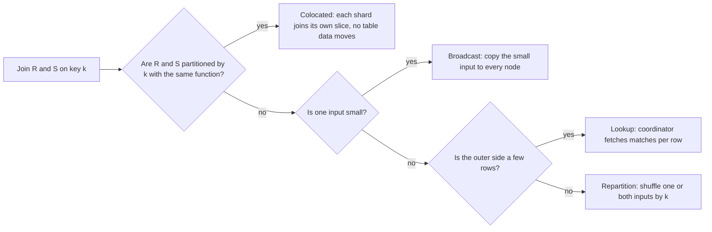
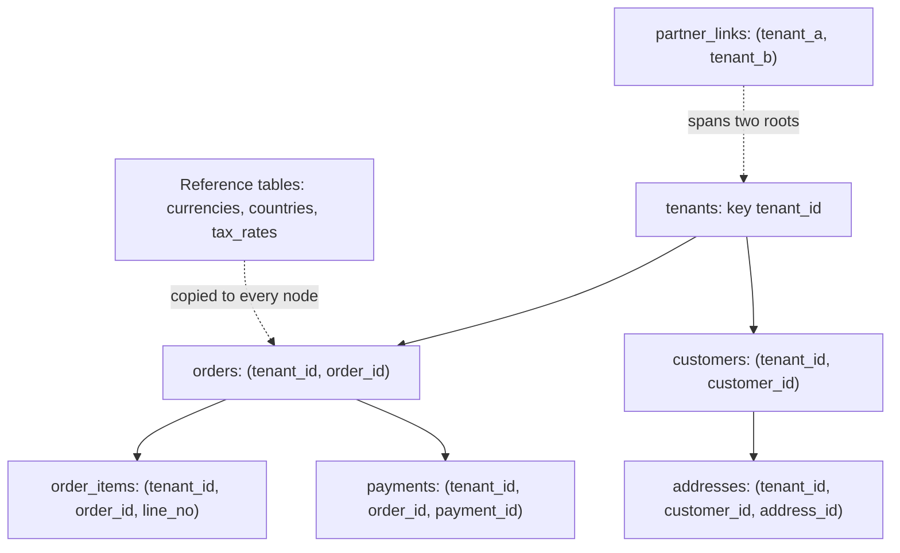
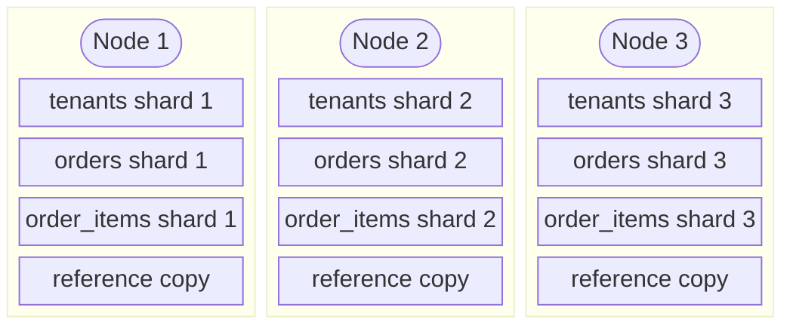
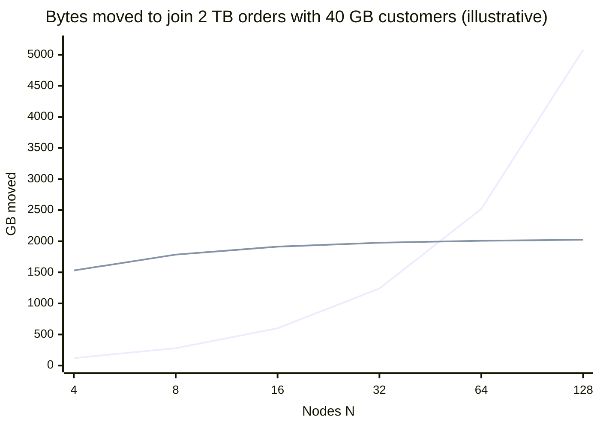
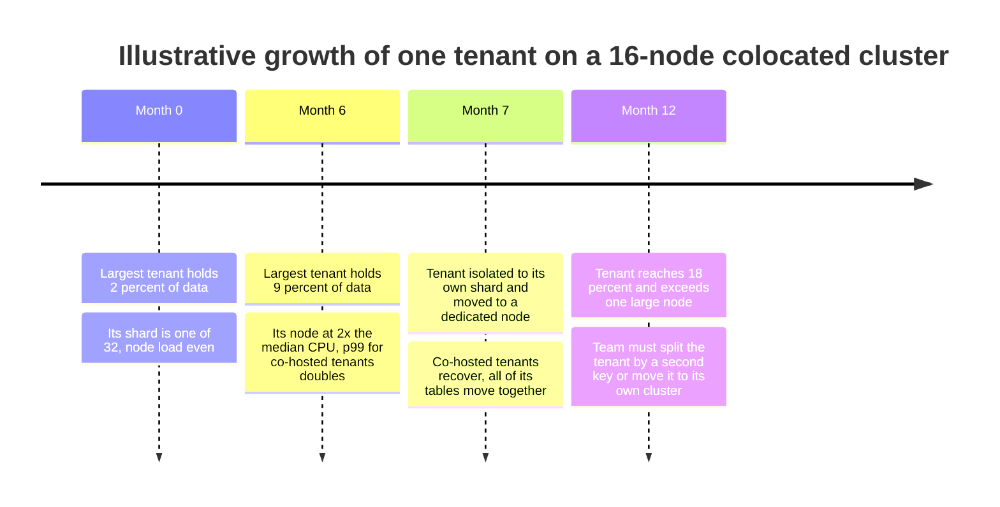

Colocation (birlikte yerleşim), birlikte okunan, join edilen ya da birlikte yazılan farklı tablolardaki satırların, hepsi aynı anahtarın aynı fonksiyonuyla bölümlenerek aynı shard'a yerleştirilmesidir. İki tablo bir anahtar üzerinde colocated olduğunda ve bir sorgu onları o anahtar üzerinde eşitlikle join ettiğinde, eşleşen her satır çifti zaten tek bir node'da durur; her shard kendi dilimini join eder, coordinator ise yalnızca sonuçları art arda ekler. Join ağ üzerinden hiçbir tablo verisi taşımaz ve anahtarın tek bir değeriyle sınırlı bir transaction tek bir shard'a dokunur, dağıtık commit gerektirmez.

Colocation olmadan, shard'lanmış bir veritabanının iki büyük tabloyu join etmek için üç yolu vardır ve hepsi veri taşır. Girdilerden birini ya da ikisini join anahtarına göre ağ üzerinden yeniden bölümleyebilir (shuffle), küçük girdiyi her node'a kopyalayabilir (broadcast) ya da bir coordinator'ın eşleşen satırları shard shard aramasını sağlayabilir. Her birinin maliyeti tablo boyutuyla, cluster boyutuyla ya da satır sayısıyla büyür; aynı yerleşim problemi çok tablolu yazmaları da [two-phase commit](/distributed-systems/tr/coordination/distributed-transactions/two-phase-commit/)'e dönüştürür. [Ölçekleme ikilemi sayfası](/distributed-systems/tr/foundations/monoliths-to-distributed/scaling-dilemma/), ilişkili anahtarlar birbirinden bağımsız hash'lendiğinde bu verginin yatay ölçeklemeyi ne kadar hızlı aşındırdığını gösterir.

Asıl denge şudur: colocation bir erişim yolunu diğer tüm yolların aleyhine optimize eder. Bir colocation anahtarı seçmek, genellikle bir tenant, müşteri ya da hesap kimliği, o anahtarın tek bir değeriyle sınırlı her sorguyu ve transaction'ı yerel hâle getirir; anahtarın birçok değerine yayılan her işlemi ise bir scatter'a ya da shuffle'a çevirir. Ayrıca normalde bağımsız olacak tabloları birbirine bağlar: aynı shard sayısını, aynı hash fonksiyonunu ve aynı anahtar tipini paylaşmak zorundadırlar, birlikte taşınmaları gerekir ve anahtarın en ağır değeri, yani dev bir tenant (whale tenant), bölünemez bir yük birimine dönüşür. Colocation bir ağ problemini, geri alması pahalı bir veri modelleme taahhüdüne çevirir.


*Dağıtık bir planner'ın bir equi-join için tercih sırasına göre seçtiği dört strateji. Hiçbir girdi verisi taşımayan yalnızca ilkidir.*

Soruların sırası maliyetin sırasıdır. Colocated join, sorgu henüz ortada yokken şema tarafından belirlenir; diğer üçü ise sorgu anında boyut tahminlerinden seçilir ve her biri farklı bir miktarı taşır: broadcast küçük tabloyu node sayısı kadar, repartition büyük tablonun çoğunu bir kez taşır; lookup ise az veri taşır ama dış taraftaki her satır için bir round trip öder, üstelik bu çoğu zaman her shard'a gider. Sayfanın geri kalanı ilk dalı hak etmeyi ve o dal mümkün olmadığında diğer üçünün neye mal olduğunu bilmeyi anlatır.

## Shard'lar Arasında Join Yürütmenin Dört Yolu

`|R|` boyutunda bir `R` ve `|S|` boyutunda bir `S` tablosunun `N` node'a dağıldığını ve `k` sütunu üzerinde bir equi-join yapıldığını düşünün. Planner'ın işi, `k` değeri eşit olan her satır çiftini aynı yere getirmektir. Stratejiler yalnızca bunu nasıl yaptıklarıyla ayrışır.

Colocated join (partition-wise join olarak da anılır), iki tablonun da `k`'ye ya da join koşulunun `k`'ye eşitlediği bir sütuna göre, aynı yerleşim fonksiyonuyla yerleştirilmiş olmasını gerektirir. Her node kendi yerel shard'ları üzerinde sıradan, tek node'luk bir join çalıştırır: hash, merge ya da nested loop. Sonuçlar art arda eklenir. Ağ yalnızca sorguyu ve çıktıyı taşır. Koşulun distribution column için tek bir değeri de sabitlediği duruma Citus router query der; bu sorgu tek bir shard'a düz bir PostgreSQL sorgusu olarak gönderilir.

Broadcast join, `S`'yi `R`'nin shard'larından birini tutan her node'a kopyalar; böylece her node kendi `R` dilimini `S`'nin tamamıyla join edebilir. `|S| * (N - 1)` bayt taşır ve her node'da `S`'nin tam bir kopyasını bellekte ya da diskte tutar. Kalıcı bir broadcast, reference table'dır: önceden her node'a replike edilmiş küçük bir tablo. Böylece ona yapılan join'ler her dağıtık tabloyla colocated hâle gelir. Reference table'lar bedeli yazma anında öder, çünkü her yazmanın her kopyaya ulaşması gerekir; Citus reference table'lara yapılan yazmaları two-phase commit ile uygular.

Repartition join, girdileri `k`'ye göre yeniden dağıtır. `S` zaten `k`'ye göre bölümlenmişse ve `R` değilse yalnızca `R` taşınır (single repartition); düzgün hash'lenmiş bir satır `1 / N` olasılıkla yerinde kaldığı için maliyet yaklaşık `|R| * (N - 1) / N` bayttır. İkisi de `k`'ye göre bölümlenmemişse ikisi de taşınır (dual repartition), yaklaşık `(|R| + |S|) * (N - 1) / N`. Shuffle, [MapReduce](/distributed-systems/tr/data-processing/batch-processing/mapreduce/) sayfasında anlatılan batch işinin shuffle'ıyla aynı mekanizmadır: her node diğer her node'a gönderir, alan taraf ise aldığını tamponlamak, sıralamak ya da diske taşırmak (spill) zorundadır.

Vitess'in sorgu yönlendiricisi VTGate'in nested loop olarak yürüttüğü lookup join, önce dış tarafı çalıştırır, ardından her dış satır için eşleşen iç satırlara bir sorgu gönderir. Dış taraf küçük ve seçiciyken az veri taşır, ama her dış satır bir round trip'e mal olur; iç tablo lookup sütununa göre bölümlenmemişse bu sorguların her biri tüm shard'lara giden bir scatter'dır.

Broadcast ile repartition'ı karşılaştırmak, cluster boyutuna bağlı bir eşik verir. `S`'yi broadcast etmek, yalnızca `R`'yi repartition etmekten `|S| * (N - 1) < |R| * (N - 1) / N` olduğunda, yani sadeleştirince `|S| * N < |R|` olduğunda daha ucuzdur; dual repartition'dan ise `|S| * (N - 1) < |R|` olduğunda. Broadcast maliyeti node sayısıyla doğrusal büyürken shuffle maliyeti ona neredeyse duyarsızdır; bu yüzden 16 node'luk bir cluster'da doğru plan olan bir broadcast, veride hiçbir değişiklik olmadan 64 node'luk bir cluster'da yanlış plana dönüşebilir.

:::tip[Broadcast eşikleri sabit kalmamalı, cluster ile ölçeklenmeli]
Motorlar broadcast kararını genellikle küçük taraf için mutlak bir boyut sınırıyla verir; Spark'ın `spark.sql.autoBroadcastJoinThreshold` değeri varsayılan olarak 10 MB'tır. Maliyet argümanı ise doğru sınırın göreli olduğunu, kabaca büyük tarafın node sayısına bölümü olduğunu söyler. Bir cluster birkaç kat büyüdüğünde ya da "küçük" bir boyut tablosu gigabaytlara ulaştığında hangi join'lerin broadcast edildiğini yeniden kontrol edin; her birinin ağ ve bellek maliyeti node sayısıyla büyümüştür, plan ise değişmemiştir.
:::

### Colocation Neyi Garanti Eder, Neyi Etmez

Aynı anahtar üzerinde aynı fonksiyonla yerleştirilmiş iki tablo için colocation, aynı anahtar değerine sahip her `R` satırının ve her `S` satırının aynı shard'da durduğunu garanti eder; dolayısıyla koşulu o anahtar üzerinde eşitlik içeren her join, semi-join, anti-join ya da outer join, hiç veri taşımadan shard shard hesaplanabilir. Aynısı anahtarı içeren bir `GROUP BY` için de geçerlidir: her grup tümüyle tek bir shard'dadır, bu yüzden aggregate shard'dan çıktığında nihaidir; coordinator'ın aksi hâlde yaptığı önce kısmi, sonra nihai aggregate adımına gerek kalmaz. Yalnızca tek bir anahtar değerine sahip satırlara dokunan bir transaction tek bir shard'a dokunur ve o shard'ın yerel commit protokolüyle commit edilebilir.

Başka bir sütun üzerindeki join için, shard'ını bulmak zorunda olan anahtar dışı bir sütuna göre filtreleyen sorgu için ya da birden fazla anahtar değerine yayılan bir işlem için hiçbir şey garanti etmez: tüm tenant'ları kapsayan bir rapor yine tüm shard'lara giden bir scatter'dır, yalnızca shuffle'sızdır. Dengeyi de garanti etmez: bir anahtar değerinin tüm satırları tek bir shard'a bağlıdır, bu yüzden en büyük değer en büyük shard'ın alt sınırını belirler; bu etki [çarpıklık sayfasında](/distributed-systems/tr/data-management/data-partitioning/skew-hot-spots/) incelenir. Ortak bir hash yerine aşağıda anlatılan anahtar sırası komşuluğuyla kurulan colocation ise yerelliği yalnızca grup tek bir range'e sığdığı sürece garanti eder.

### Yerel Join'lerin Birleşimi Neden Global Join'e Eşittir

Bir satırın yerleşimini `place(row) = f(d(row))` olarak yazalım; burada `d` distribution column'u çıkarır, `f` ise bir değeri bir shard'a eşler. `R` ve `S`'nin aynı `f`'yi kullandığını ve join koşulunun `R.d = S.d`'yi gerektirdiğini varsayalım. Sonuçta yer alması gereken herhangi bir `(r, s)` çiftini alın. Koşul sağlanır, dolayısıyla `r.d = s.d`, dolayısıyla `f(r.d) = f(s.d)`: iki satır da aynı `i` shard'ındadır ve `i` shard'ındaki yerel join bu çifti üretir. Tersine, yerel bir join'in ürettiği her çift koşulu sağlar, çünkü yerel join aynı koşulu değerlendirir. Hiçbir çift iki kez üretilmez, çünkü her `R` satırı tam olarak bir shard'da saklanır ve bir çift yalnızca `R` satırının bulunduğu yerde üretilir. Dolayısıyla `N` yerel sonucun birleşimi tam olarak global sonuçtur.

Argüman kısadır ve içindeki her kelime, gerçek bir sistemin uygulatması gereken bir ön koşuldur. "Aynı `f`", aynı baytlara uygulanan aynı hash fonksiyonu demektir; bu yüzden sütun tiplerinin aynı biçimde hash'lenmesi gerekir. Citus tabloları aynı örtük colocation grubuna ancak distribution column'ları aynı tipte ve shard sayıları aynıysa koyar. Aynı shard sayısı demektir, çünkü `h mod 32` ve `h mod 64` aynı anahtarı farklı shard indekslerine koyar. Ve shard'lar taşınırken de dahil olmak üzere, `R`'nin `i` shard'ı ile `S`'nin `i` shard'ının her an aynı node'da olması demektir. Bu son koşul hash'in bir özelliği değil, cluster çapında bir değişmezdir (invariant) ve operasyonda bozulan da odur.

Range ile bölümlenen depolar colocation'ı farklı kurar. Ortak bir hash yerine, alt satırlara üst satırın anahtarıyla başlayan bir primary key verirler; böylece üst ve alt satırlar anahtar sırasında komşu olur ve aynı range'e düşer. Spanner'ın interleaved table'ları bunu fiziksel olarak yapar: alt satırlar anahtar sırasıyla, doğrudan üst satırın ardından saklanır. Komşuluk, aynı doğruluk argümanını ancak üst satırın tüm hiyerarşisi tek bir range içinde kaldığı sürece verir. Bir range boyuta ve yüke göre bölünür; bir hiyerarşi çok büyüdüğünde ya da sıcak bir satır içerdiğinde depo onun içine bir sınır koymak zorunda kalır ve bundan sonra o üst satır üzerindeki bazı join'ler range'ler arasında yürür. Hash colocation bir fonksiyonun uyguladığı bir garantidir; anahtar öneki colocation'ı ise split politikasının uyguladığı güçlü bir eğilimdir. Motorlar ikisini farklı ele alır: hash ile colocated bir join yerel olarak planlanır, interleaved bir join ise genellikle tek bir split'ten karşılanan ama bunun kanıtlanamadığı bir range taraması olarak planlanır.

## Veriyi Bir Colocation Anahtarı Etrafında Tasarlamak

Colocation, verinin işlemlerin çoğunun kapsamını belirleyen bir kök varlığı (root entity) olduğunda işe yarar. Bir iş uygulamasında kök genellikle tenant ya da müşteri hesabıdır; bir sosyal ya da mesajlaşma uygulamasında çoğu zaman kullanıcı ya da konuşma; bir oyunda maç ya da oyuncu. Tasarım kuralı şudur: satırları bir köke ait olan her tablo, mantıksal model gerektirmese bile kökün anahtarını distribution column olarak taşır. Bir `order_items` satırı mantıksal olarak siparişiyle tanımlanır; ama `order_items` `order_id`'ye, `orders` ise `tenant_id`'ye göre bölümlenmişse ikisi colocated değildir ve uygulamadaki en yaygın join bir shuffle'dır. `order_items`'a `tenant_id` eklemek ve onu primary key'in ilk sütunu yapmak, yani `(tenant_id, order_id, line_no)`, join'i yerel hâle getiren değişikliktir.


*Tenant kökenli bir şema. Düz kenarlar colocated ilişkilerdir; her alt tablo kök anahtarını primary key'in ilk sütunu olarak taşır. Noktalı kenarlar iki kaçış yoludur: replike edilmiş referans verisi ve köklere yayılan ilişkiler.*

Ağaç, colocated bir tasarımın içerdiği üç tür tabloyu gösterir. Köke bağlı tablolar, yani `tenants` altındaki her şey, `tenant_id` taşır ve ona göre dağıtılır; bu yüzden join koşulunda `tenant_id` bulunan, düz bir kenar boyunca yapılan her join yereldir. Reference table'lar tüm köklerin paylaştığı küçük ve yavaş değişen veriyi tutar ve her node'a kopyalanır; köke bağlı bir tabloyu bir reference table ile join etmek her yerde yereldir. Üçüncü tür sorunun kendisidir: satırları iki kökü birbirine bağlayan bir tablo, örneğin iki tenant arasındaki bir bağlantı, iki hesap arasındaki bir transfer ya da iki kullanıcı arasındaki bir takip ilişkisi. Hiçbir yerleşim iki ucu da tek bir shard'a koyamaz. Seçenekler şunlardır: satırı uçlardan birinin altına koymak ve diğer taraftan gelen sorguların shard'lar arası olmasını kabul etmek; satırı iki kez, her ucun altında bir kez saklamak ve kopyaları tutarlı tutmak için shard'lar arası bir yazmayı (ya da asenkron ikinci bir yazmayı) kabul etmek; ya da ilişkiyi diğer yönde bölümlenmiş bir [materialized view](/distributed-systems/tr/microservice-patterns/data-management-patterns/materialized-view/) gibi ayrı bir yapıya taşımak.

Join koşulu yalnızca mantıksal foreign key'i değil, colocation anahtarını da içermelidir. Sipariş kimlikleri global olarak benzersizse `orders JOIN order_items ON orders.order_id = order_items.order_id`, `(tenant_id, order_id)` üzerinden yapılan join ile aynı sonucu verir; ancak bunu kanıtlayamayan bir planner, ki çoğu kanıtlayamaz, distribution column olmayan bir sütun üzerinde equi-join görür ve bir repartition planlar. Uygulama kodunun ve ORM'lerin kök anahtarını her join'e ve her filtreye eklemesi sağlanmalıdır. Colocated bir tasarımın pratikteki en büyük maliyeti budur: kök anahtarı her primary key'de, her foreign key'de, her index'te ve her sorguda yer alır.


*Bir colocation grubunun üç node üzerindeki yerleşimi. Köke bağlı her tablonun i numaralı shard'ı aynı hash aralığını kapsar ve aynı node'da durur; reference table'ların her yerde tam bir kopyası vardır.*

Şekil, colocation'ı bilen bir sistemin koruduğu değişmezi gösterir: aynı indekse sahip shard'lar, node'lar arasında asla bölünmeyen bir birim oluşturur. Citus böyle bir tablo kümesine colocation grubu der ve dokümantasyonu operasyonel sonucu doğrudan belirtir: aynı gruptaki shard'lar birlikte taşınmak zorundadır. Yani `orders`'ın 2 numaralı shard'ını taşıyan bir rebalancer, aynı işlem içinde `tenants`'ın ve `order_items`'ın 2 numaralı shard'larını da taşır. Bu, taşıma birimini büyütür; dokümantasyon da ilgisiz tabloların shard'ları bağımsız taşınabilsin diye onları ayrı gruplara koymayı önerir. Taşımanın mekaniği, yani kopyalama, yetişme (catch-up) ve fence'lenmiş geçiş (cutover), [dinamik yeniden dengeleme](/distributed-systems/tr/data-management/data-partitioning/dynamic-rebalancing/) mekaniğinin birden fazla shard'a tek bir geçiş noktasıyla uygulanmasıdır. Bir tablonun shard'ı diğerininkinden önce geçirilseydi, kaynak ya da hedefteki yerel bir join bir tablonun satırlarını okuyup diğerininkileri kaçırırdı.

### Shard Sayısını Değiştirmek ve Büyük Kökleri Ayırmak

İki işlem, tüm gruba uygulanmadıkça "aynı fonksiyon" ön koşulunu bozar. Shard sayısını değiştirmek `f`'yi değiştirir; bu yüzden gruptaki her tabloya aynı anda uygulanmalıdır. Tek başına yeniden shard'lanan bir tablo gruptan çıkar ve geri kalanıyla yaptığı join'ler repartition'a dönüşür. Büyük bir kökü ayırmak, yani dev bir tenant'ı kendi shard'ına ya da node'una taşımak, `f`'yi tek bir anahtar değeri için değiştirir ve yine o değere ait, köke bağlı her tablonun satırlarını birlikte taşımalıdır. Citus bunu `isolate_tenant_to_new_shard` ile sağlar; fonksiyon tek bir distribution column değerini ayırır ve colocated tablolara da yayma (cascade) seçeneği sunar. Citus 12, her PostgreSQL şemasının tek bir node'a bütün olarak yerleştirilen bir birim olduğu schema-based sharding'i ekledi: "kök bir şemadır" demenin açık bir yolu. Bu yaklaşım, hash dağıtımının satır düzeyindeki yayılımını, her tabloda bir kök sütunu olmadan elde edilen colocation karşılığında bırakır.

### Hesaplı Örnek: Çok Kiracılı Bir Sipariş Deposu

Her biri yaklaşık 1 GB/s kullanılabilir throughput sağlayan 10 Gb/s ağ arayüzüne sahip 16 worker node üzerinde çalışan çok kiracılı (multi-tenant) bir e-ticaret platformu varsayalım. `orders` 2 TB, `order_items` 6 TB, `customers` 40 GB tutuyor. Bu bölümdeki tüm sayılar örnek amaçlıdır.

Analitik yoldan başlayalım: gecelik bir iş, her tenant için `orders`'ı `order_items` ile join ediyor. Özgün şemada `orders` `tenant_id`'ye, `order_items` ise kendi `item_id`'sine göre dağıtılmış; bu yüzden join, `order_items`'ın `(tenant_id, order_id)`'ye göre single repartition'ıdır: ağdan `6 TB * 15 / 16 = 5.625 TB` geçer. Kusursuz her-yerden-her-yere bant genişliğiyle, her biri 1 GB/s gönderen 16 node yalnızca aktarım için yaklaşık 352 saniyeye ihtiyaç duyar. Pratikte alıcılar aldıklarını yazmak ya da diske taşırmak zorundadır ve işin ağı canlı trafikle paylaşılır; bu yüzden shuffle gerçekçi olarak birkaç kat daha uzun sürer ve çalıştığı sürece her arayüzü doyurur. `order_items`'a `tenant_id` eklenip `orders` ile colocated hâle getirildikten sonra aynı join hiç girdi verisi taşımaz; her node kendi 0.5 TB'lık shard'larını okur ve cluster'ın ağı sonuçlar dışında boştur.

Şimdi `customers` ile yapılan join'lere bakalım. Bu tablo 40 GB ve diyelim ki tenant'a göre değil `customer_id`'ye göre dağıtılmış; `orders` ile `customer_id` üzerinden join ediliyor. `customers`'ı broadcast etmek `40 GB * 15 = 600 GB` taşır; `orders`'ı repartition etmek `2 TB * 15 / 16 = 1.875 TB` taşır. Bugün broadcast kazanır. Dual repartition'a karşı kesişme noktası `N - 1 = 2,000 / 40`, yani yaklaşık 51 node'dadır; yalnızca `orders`'ı repartition etmeye karşı ise `N = 2,000 / 40 = 50` node'dadır.


*Yükselen çizgi: customers'ın broadcast'i, 40 GB çarpı (N - 1). Düz çizgi: iki tablonun dual repartition'ı, 2,040 GB çarpı (N - 1) / N. Çizilmeyen colocated plan her N için sıfır bayt taşır.*

Grafik eşik argümanını somutlaştırır. Repartition çizgisi neredeyse düzdür, çünkü node eklemek yalnızca kendi node'unu terk eden satırların oranını %75'ten %99'a çıkarır. Broadcast çizgisi node sayısıyla doğrusaldır ve repartition çizgisini 32 ile 64 node arasında keser. Kapasite için cluster'ını 32'den 64 node'a çıkaran bir ekip, bu join'in her çalışmada iki kat bayt taşıdığını ve 40 GB'lık bir hash tablosunu 32 yerine 64 node'un belleğinde tuttuğunu görür; planner kararı sabit bir boyut eşiğiyle veriyorsa broadcast'i seçmeye devam eder. `customers`'ı `tenant_id`'ye göre dağıtmak ve `(tenant_id, customer_id)` üzerinden join etmek soruyu ortadan kaldırır.

Transaction yolu ikinci faydayı gösterir. Bir sipariş vermek bir `orders` satırı, beş `order_items` satırı ve bir `payments` satırı yazar. Colocated olduğunda yedi satırın hepsi tek bir shard'dadır ve yazma tek bir yerel transaction'dır: coordinator'dan bir round trip, bir write-ahead log flush'ı. `order_items` başka shard'lardayken, her satırın yerleşimi bağımsız olsaydı yedi satır ortalama `16 * (1 - (15/16)^7)`, yani yaklaşık 5.8 farklı shard'a dokunurdu ve commit two-phase commit gerektirirdi: her katılımcıda kalıcı bir flush içeren bir prepare turu, bir commit turu ve iki tur boyunca tutulan kilitler. Örnek olarak round trip başına 0.5 ms ve flush başına 1 ms alınırsa bu, yaklaşık 1.5 ms yerine kabaca 3 ms'lik bir commit yolu ve bir yerine altı shard'lık kilit ve log kapasitesi tüketimi demektir.

Son olarak etkileşimli yol: tek bir siparişi ve kalemlerini gösteren bir sayfa. Colocated olduğunda bu, tek bir shard'a giden tek bir router query'dir. `order_items` `item_id`'ye göre shard'lanmışsa ve `order_id` üzerinde ikincil bir index yoksa, nested loop yürütücüsü siparişi bir shard'dan alır, ardından kalem sorgusunu 16 shard'ın hepsine gönderir. Her shard'ın örnek olarak %1 olasılıkla yavaş yanıt verdiğini varsayarsak, istek `1 - 0.99^16`, yani yaklaşık %15 olasılıkla yavaştır; bu fan-out hesabı [anahtar aralığı sayfasında](/distributed-systems/tr/data-management/data-partitioning/key-range-partitioning/) ayrıntılı olarak işlenir. Cluster ayrıca sayfa görüntüleme başına bir yerine 17 shard sorgusu çalıştırır; yani yalnızca bu sorgu tipi 17 kat shard kapasitesi tüketir.

## Production Sistemlerinde Colocation

Bölümlenmiş her depo colocation için bir yol sunar; aralarındaki fark, colocation'ın bir garanti mi, bir eğilim mi yoksa kullanıcının elle sürdürmesi gereken bir şey mi olduğudur.

Bir PostgreSQL eklentisi olan Citus colocation'ı açık hâle getirir. `create_distributed_table` bir distribution column ve bir `colocate_with` argümanı alır. Varsayılan değer `'default'`, tabloyu aynı distribution column tipine ve shard sayısına sahip diğer tablolarla örtük bir gruba koyar; `'none'` gruptan çıkmayı sağlar; bir tablo adı vermek ise o tablonun grubuna katılmak demektir. Reference table'lar `create_reference_table` ile oluşturulur ve her node'a replike edilir. Colocated tablolar arasındaki distribution column üzerinden join'ler ve herhangi bir dağıtık tablonun bir reference table ile join'leri shard'lara itilir (pushdown). Büyük tablolar üzerindeki colocated olmayan join'ler repartition join'dir ve Citus bunları varsayılan olarak "the query contains a join that requires repartitioning" hatası ve `citus.enable_repartition_joins` ayarını açma ipucuyla reddeder. Bu yararlı bir varsayılandır: terabaytlarca veriyi shuffle edecek bir sorgu production'da ağı doyurmak yerine geliştirme aşamasında hata verir.

```sql
-- Root table, distributed by tenant
SELECT create_distributed_table('orders', 'tenant_id');
-- Same column type and shard count; join the group explicitly anyway
SELECT create_distributed_table('order_items', 'tenant_id',
                                colocate_with => 'orders');
-- Small shared data: one shard, copied to every worker
SELECT create_reference_table('currencies');
-- Verify: tables in one group share a colocation_id
SELECT table_name, colocation_id, distribution_column
FROM citus_tables ORDER BY colocation_id;
```

Örtük kural tabloları zaten gruplayacak olsa bile açık `colocate_with` önemlidir, çünkü iki `CREATE` ifadesi arasında `citus.shard_count` değiştirilmişse örtük kural sessizce farklı bir grup üretir. `citus_tables` içindeki `colocation_id`'yi kontrol etmek, bir ekibin yapabileceği en ucuz denetimdir.

MySQL için bir sharding katmanı olan Vitess, colocation'ı VSchema üzerinden ifade eder. Shard'lanmış her tablonun bir primary vindex'i vardır; bu, bir sütundan bir keyspace ID'ye giden bir fonksiyondur ve shard'ı keyspace ID belirler. Primary vindex'leri aynı değerleri tutan sütunlar üzerinde aynı fonksiyonu kullanan tablolar, ilişkili satırları aynı keyspace ID'ye ve dolayısıyla aynı shard'a eşler; VTGate her iki tarafın da aynı shard'a yönlendiğini kanıtlayabildiğinde join'i MySQL'e iter. Aksi hâlde join'i kendisi, her sol taraf satırı için bir sağ taraf sorgusuyla nested loop olarak yürütür. Reference table'lar `type: reference` ile tanımlanır ve genellikle bir kaynak tablodan çalışan bir Materialize iş akışıyla her shard'da tutulur; shard'lanmış bir tablo ile bir reference table arasındaki join'ler her shard'da yerel olarak çalışır.

Spanner colocation'ı anahtar önekiyle kurar. `INTERLEAVE IN PARENT` ile tanımlanan bir alt tablonun primary key'i, üst tablonun tüm anahtar sütunlarıyla başlamak zorundadır ve satırları fiziksel olarak üst satırın ardından saklanır; `ON DELETE CASCADE`, üst satır silindiğinde alt satırların da silinmesini sağlar. Spanner daha sonra `PARENT` olmadan `INTERLEAVE IN` seçeneğini ekledi: fiziksel colocation korunur ama referans bütünlüğü bırakılır, yani alt satırlar üst satır olmadan var olabilir. Hiyerarşiler en fazla yedi tablo derinliğinde olabilir ve interleaving sonradan kaldırılamaz; değiştirmek, tabloyu yeniden oluşturup veriyi taşımak demektir. Spanner dokümantasyonu yerellik garantisini yukarıda anlatılan zayıf biçimiyle ifade eder: bir üst satır alt satırlarıyla birlikte split boyut sınırının altında kaldığı ve sıcak nokta içermediği sürece yerellik split'ler boyunca korunur; aksi hâlde Spanner hiyerarşinin içine split sınırları ekler. Özgün Spanner makalesi alttaki birimi directory olarak tanımlar: ortak bir öneki paylaşan bitişik anahtarlar kümesi; yerleşim ve taşıma birimi de budur.

```sql
CREATE TABLE Customers (
  CustomerId INT64 NOT NULL,
  Name       STRING(MAX)
) PRIMARY KEY (CustomerId);

CREATE TABLE Orders (
  CustomerId INT64 NOT NULL,   -- parent key repeated as the key prefix
  OrderId    INT64 NOT NULL,
  Total      NUMERIC
) PRIMARY KEY (CustomerId, OrderId),
  INTERLEAVE IN PARENT Customers ON DELETE CASCADE;
```

CockroachDB karşı örnektir. Bir zamanlar aynı özelliği, `INTERLEAVE IN PARENT`'ı sunuyordu; v21.1'de deprecated ilan etti ve v21.2'de kaldırdı. Kaldırma notunun kendisi kısadır, ama yapısal neden tasarımda görülebilir. Zaten primary key'e göre range ile bölümlenen bir depoda, anahtarı üst satırın anahtarıyla başlayan bir alt tablo kendi index aralığında üst anahtara göre sıralanır; bu yüzden üst satır kapsamlı bir join, genellikle az sayıda range'e dokunan iki kısa ve sıralı range okumasıdır. Farklı tabloların satırlarını tek bir aralıkta iç içe geçirmek buna çok az şey eklerken, tablolardan yalnızca birinin taranmasını ve şema değişikliklerini zorlaştırır. Bu sayfanın okumasıyla ders genelleşir: range ile bölümlenen sistemlerde ortak bir anahtar öneki faydanın çoğunu sağlar; fiziksel interleaving geri kalanını, büyük bir uygulamanın sürdürmeye değer bulmadığı bir maliyetle satın alır.

MongoDB'nin iki biçimi vardır. En güçlüsü dokümanın kendisidir: kalemleri gömülü (embedded) tek bir doküman olarak saklanan bir sipariş, yapısı gereği colocated'dır ve atomik olarak güncellenir. Koleksiyonlar arasında ise aynı alana göre shard'lanmış iki koleksiyon colocated değildir; çünkü her koleksiyonun range'leri bağımsız olarak bölünür ve dengelenir. Bu yüzden `orders` içinde müşteri 42'yi tutan range ile `payments` içinde müşteri 42'yi tutan range farklı shard'larda olabilir ve her balancer turunda daha da uzaklaşabilir. MongoDB 5.1'den beri `$lookup`, `from` alanında shard'lanmış bir koleksiyonu kabul eder; bu, böyle join'leri mümkün kılar, ama yerel kılmaz.

:::caution[Aynı shard key aynı yerleşim demek değildir]
MongoDB'de ve her tabloyu ya da koleksiyonu kendi başına dengeleyen her depoda, koleksiyonlar arasında bir shard key paylaşmak her birine aynı türde bir dağılım verir, aynı yerleşimi değil. Tek bir müşteri üzerindeki join'ler ve çok koleksiyonlu transaction'lar yine shard'lar arasında yürür. Veri tek bir dokümana aitse gömün; yerleşimin zorlanması gerekiyorsa iki koleksiyonda da aynı aralıklara sahip zone'lar kullanın ya da colocated tabloları grup olarak taşıyan bir sistem seçin.
:::

DynamoDB ve Cassandra colocation'ı tek bir partition key içinde sağlar. Aynı partition key'e sahip tüm öğeler birlikte saklanan ve sort key'e (Cassandra'da clustering column'lara) göre sıralanan bir item collection (Cassandra'da bir partition) oluşturur. Bu yüzden bir sipariş ile kalemleri arasındaki "join", öğe tipinin sort key'e kodlandığı tek bir partition key üzerinde tek bir sorgudur; bu, [DynamoDB Veri Modeli](/distributed-systems/tr/case-studies/dynamodb-cassandra/dynamodb-data-model/) sayfasında anlatılan single-table tasarımıdır. İki depo da partition key'ler arasında hiç join yapmaz; uygulama ya denormalize eder ya da iki kez sorgular. Local secondary index içeren DynamoDB tabloları ayrıca her item collection'ı 10 GB ile sınırlar; bu, tek bir colocated kökün boyutu üzerinde katı bir sınırdır.

Redis Cluster'ın hash tag'leri aynı fikrin tekil anahtarlar düzeyindeki karşılığıdır: yalnızca süslü parantez içindeki alt dize, örneğin `{user:42}`, hash'lenir; böylece aynı tag'i paylaşan anahtarlar aynı slot'a düşer ve üzerlerindeki çok anahtarlı komutlara izin verilir. Mekanizma [hash bölümleme sayfasında](/distributed-systems/tr/data-management/data-partitioning/hash-partitioning/) anlatılır.

Stream ve batch işlemciler colocation'ı birbirinden bağımsız üretilen veri kümeleri arasında bir sözleşmeye dönüştürür. İki topic arasındaki bir Kafka Streams join'i, bu topic'lerin co-partitioned olmasını gerektirir: aynı partition sayısı, aynı anahtar serileştirmesi ve aynı bölümleme fonksiyonu; böylece aynı anahtara sahip kayıtlar iki topic'te de aynı partition numarasında olur ve aynı task tarafından işlenir. Kafka Streams yalnızca partition sayısını doğrular ve sayılar farklıysa "Topics not co-partitioned" hatasıyla başarısız olur; producer'ların anahtarları nasıl serileştirdiğini ya da hangi partitioner'ı kullandığını göremez. Her instance'ın tamamını okuduğu bir `GlobalKTable`, broadcast alternatifidir ve co-partitioning gerektirmez. Spark'ta aynı bucketing ile (aynı sütunlar ve aynı bucket sayısı) yazılmış tablolar shuffle olmadan join edilebilir; Spark 3.3 ise tablo formatları gibi Data Source V2 kaynaklarının bölümlemelerini bildirmesine izin veren storage-partitioned join'i ekledi, böylece planner iki taraf uyumlu olduğunda shuffle'ı atlayabilir.

| Sistem | Colocation mekanizması | Garantinin gücü | Birlikte taşınır mı | Colocated olmayan join | Ne zaman tercih edilmeli |
|---|---|---|---|---|---|
| Citus | Ortak distribution column, colocation grupları, reference table'lar | Hash ve grup değişmeziyle garanti | Evet, tüm grup | Repartition, varsayılan olarak kapalı | Net bir tenant anahtarı olan, PostgreSQL üzerinde çok kiracılı SaaS |
| Vitess | İlişkili sütunlarda aynı primary vindex fonksiyonu | Keyspace ID başına garanti | Evet, shard'lar birimdir | VTGate'te nested loop | Müşteriye ya da kullanıcıya göre shard'lanmış MySQL filoları |
| Spanner | Anahtar öneki, interleaved table'lar | Hiyerarşi tek bir split'e sığdığı sürece geçerli | Hiyerarşi bir directory olarak taşınır | Motorun dağıtık join'i | Global tutarlı transaction'larla üst-alt verisi |
| CockroachDB | Yalnızca anahtar öneki (interleaving v21.2'de kaldırıldı) | Anahtar sırasında komşuluk | Range'ler tek tek taşınır | Motorun dağıtık join'i | Önek yerelliğinin yettiği, range ile bölümlenmiş SQL |
| MongoDB | Gömülü dokümanlar; zone'lar | Yalnızca bir doküman içinde garanti | Koleksiyonlar bağımsız dengelenir | Shard'lar arası `$lookup` (5.1+) | Tek bir dokümana ait veri |
| DynamoDB, Cassandra | Ortak partition key, içinde sort key | Tek bir partition key içinde garanti | Birim partition'dır | Desteklenmez; uygulama join eder | Önceden bilinen ve tek bir anahtarla sınırlı erişim desenleri |
| Kafka Streams, Spark | Co-partitioned topic'ler; bucket'lanmış ya da storage-partitioned tablolar | Producer'lar arası sözleşme; kısmen denetlenir | Uygulanamaz | Repartition topic'i ya da shuffle | Farklı ekiplerin ürettiği stream'ler ya da tablolar üzerinde join |

:::note[Colocation, denormalizasyon ve global index'ler komşu problemleri çözer]
Colocation, farklı tabloların ilişkili satırlarını tek bir shard'da tutar; böylece tek bir kök üzerindeki join'ler yerel kalır. Denormalizasyon veriyi ona ihtiyaç duyan satıra kopyalar; böylece join'e hiç gerek kalmaz, bedeli kopyaları tutarlı tutmaktır. Bir [global secondary index](/distributed-systems/tr/data-management/data-partitioning/secondary-indexes/), anahtar dışı bir sütuna yapılan sorgunun scatter yerine kendi shard'ını bulmasını sağlar ve temel satırların nerede durduğunu değiştirmez. İki ilgisiz kök üzerinden erişim gerektiren bir şema genellikle bir köke göre colocation'ı, diğeri için bir index ya da [materialized view](/distributed-systems/tr/microservice-patterns/data-management-patterns/materialized-view/) ile birleştirir.
:::

## Hata Modları ve İmzaları

Colocation iki şekilde bozulur. Ya hizalama değişmezi sessizce geçerliliğini yitirir ve yerel olan sorgular shuffle'a dönüşür ya da stream processing'de yanlış sonuç döndürür; ya da değişmez geçerli kalır ve sorun colocation anahtarının kendisi olur.

### Colocation'ın Sessizce Kaybolması

Tetikleyici: bir tablo, mevcut gruba katılmadan oluşturulur, yeniden oluşturulur ya da yeniden shard'lanır. Tipik nedenler, oluşturma anında farklı bir shard sayısı ayarı, farklı tipte tanımlanmış bir distribution column (bir tabloda `bigint`, diğerinde `integer`), bir tabloyu varsayılan seçeneklerle yeniden oluşturan bir migration aracı ya da tabloları bağımsız dengeleyen depolarda düpedüz kaymadır (drift). Belirtiler: metni değişmemiş bir sorgu, bir deploy ya da migration sonrasında bir iki büyüklük mertebesi yavaşlar; worker'lar arası ağ throughput'u artar; Citus'ta çalışan sorgular repartition hatasıyla başarısız olmaya başlar ya da repartition join'ler global olarak açıldıysa yavaşça başarılı olur. Tespit: en sık sorgular için CI'da plan incelemesi (pushdown beklenen yerde repartition, broadcast ya da scatter gösteren `EXPLAIN`), köke bağlı her tablonun tek bir colocation kimliğini paylaştığını kontrol eden periyodik bir denetim (`citus_tables` içindeki `colocation_id`, Vitess VSchema'sındaki vindex tanımları) ve sorgu başına node'lar arası bayt. Azaltma: başıboş tabloyu yeniden gruba dağıtmak; Citus'ta bu, shard sayıları zaten eşleşiyorsa `update_distributed_table_colocation`, eşleşmiyorsa tam bir yeniden dağıtım demektir. Kurtarma, başıboş tablonun tüm boyutu kadar bir veri taşımasıdır.

### Stream'ler Arasında Bozulan Co-Partitioning

Tetikleyici: bir stream işlemcinin join ettiği iki topic, partition sayıları hâlâ eşitken, eşit anahtarları eşit partition numaralarına yerleştirmeyi bırakır. Bir producer anahtarları serileştirme biçimini değiştirir, bir ekip producer'lardan birini varsayılan partitioner'ı farklı olan bir istemci kütüphanesine geçirir ya da iki topic'e de partition eklenir. Sonuncusu inceliklidir: artıştan sonra varsayılan Kafka partitioner'ı yeni kayıtları `hash(key) mod N_new`'e gönderir; oysa tablo tarafında o anahtar için mevcut durum, anahtarın `N_old` altında hash'lendiği partition'dan inşa edilmiştir.

```mermaid
sequenceDiagram
    autonumber
    participant PO as Orders producer
    participant PC as Customers producer
    participant TO as orders topic, 12 partitions
    participant TC as customers topic, 12 partitions
    participant ST as Streams task for partition 7
    PC->>TC: customer 42, key as string "42", lands in partition 7
    TC->>ST: Table state for customer 42 kept by task 7
    PO->>TO: order for 42, key as string "42", partition 7
    TO->>ST: Join finds customer 42, enriched order emitted
    rect rgb(70, 40, 40)
    Note over PO: Deploy changes the key serializer to 8-byte integer
    PO->>TO: order for 42, key bytes differ, lands in partition 3
    TO->>ST: Task 3 has no customer 42, join emits nothing or a null side
    end
    Note over ST: Partition counts still match, startup check passes
```


*Tek bir producer'daki anahtar serileştirme değişikliği, partition sayılarını değiştirmeden co-partitioning'i bozar. Topic boyutları ve partition numaraları örnek amaçlıdır.*

1-4. adımlar çalışan sözleşmedir: iki producer da anahtarı aynı biçimde serileştirir, aynı baytları hash'ler ve kayıt ile tablo girdisi 7 numaralı task'ta buluşur. 5. adımda orders producer'ının aynı mantıksal anahtar için ürettiği baytlar değişir, dolayısıyla hash ve partition da değişir; customers topic'i ise eski yerleşimini korur. 6. adımdan itibaren bu anahtar için join, eşleşen hiçbir tablo durumu tutmayan bir task'ta çalışır. Hiçbir şey hata vermez: inner join bu siparişler için hiçbir şey üretmez, left join onları boş bir müşteri tarafıyla üretir ve Kafka Streams'in yaptığı tek kontrol, yani partition sayılarının eşitliği, geçmeye devam eder. Belirtiler, join çıktı hızının girdi hızına göre düşmesi ya da boş taraflı sonuçların artmasıdır ve bir producer deploy'uyla başlar. Tespit: her join için eşleşen kayıtların eşleşmeyenlere oranını izleyin ve basamak şeklindeki bir değişimde alarm üretin; contract testlerinde her producer'ın ürettiği anahtar baytlarını karşılaştırın. Azaltma: producer'ı geri alın ya da iki girdiyi uygulamanın içinde tek bir serializer ve tek bir partitioner ile yeniden anahtarlayan açık bir repartition adımı ekleyin (Kafka Streams'te `selectKey` ya da `repartition`). Bu, fazladan bir topic'e ve bir ağ sekmesine mal olur ama co-partitioning'i producer'ların değil uygulamanın kendi değişmezi hâline getirir. Kurtarma, etkilenen pencerenin yeniden işlenmesini gerektirir, çünkü kaçırılan join'ler hiç üretilmemiştir.

:::danger[Bozuk co-partitioning sonuçları hata vermeden düşürür]
Girdileri co-partitioned olmayan bir stream join'i başarısız olmaz; daha az ya da daha boş sonuç üretir ve downstream sistemler bu sonuçları eksiksiz olarak kaydeder. Join edilen topic'lerin anahtar serializer'larını ve partitioner'larını CI'da denetlenen ortak bir şema sözleşmesinin parçası olarak ele alın ve join'in eşleşme oranını bir performans sinyali olarak değil, bir doğruluk sinyali olarak izleyin.
:::

### Dev Kök

Tetikleyici: colocation anahtarının tek bir değeri, satırları bir shard'a hâkim olana kadar büyür. Çok kiracılı bir sistemde bu en büyük müşteridir; kullanıcı kökenli bir sistemde ünlü bir hesap. Colocation kökün tüm tablolarını tek bir shard'a bağladığı için kök taşınabilir, ama onun için colocation'dan vazgeçmeden bölünemez. Belirtiler: cluster ortalaması sağlıklıyken bir node CPU, disk ve kilit beklemelerinde ısınır; önce tenant'ın kendi sorguları, ardından node'u paylaşan her tenant yavaşlar. Tespit: shard başına boyut ve sorgu süresi, tenant başına sorgu sayıları ve baytlar (Citus yeni sürümlerinde `citus_stat_tenants` içinde tenant başına istatistik sunar; diğer sistemlerde sorguları tenant ile etiketleyip toplayın) ve en büyük kökün toplam veri içindeki payı.


*Dev bir tenant'a ait varsayımsal bir zaman çizelgesi; gerçek bir olay değildir.*

Zaman çizelgesi, müdahalenin neden aşamalı olduğunu gösterir. 7. ayda tenant'ı kendi shard'ına ve node'una ayırmak colocation'ı korur ve yan hasarı ortadan kaldırır, çünkü sorun artık sıcak bir makineyi paylaşan birçok tenant değil, tek bir makinedeki tek bir tenant'tır. Tavanı ise kaldırmaz: tenant en büyük node'u aştığında, o tenant için colocation'dan vazgeçmek gerekir; ya verisi bölge ya da hesap gibi ikinci bir anahtara göre alt bölümlere ayrılır ve tenant içinde shard'lar arası join'ler kabul edilir, ya da tenant ayrılmış bir cluster'a taşınır. Azaltma planlamadır: en büyük kökün toplam kapasite içindeki payını izleyin, bu pay tek bir node'un büyük bir kısmına ulaşmadan karar verin ve ayırma prosedürünü test edilmiş hâlde tutun. Ağır anahtarlar için genel çareler [çarpıklık sayfasındadır](/distributed-systems/tr/data-management/data-partitioning/skew-hot-spots/).

### Köklerarası Sızma

Tetikleyici: ürün, tek bir köke ait olmayan özellikler kazanır: tenant'lar arası arama, yönetim panoları, alıcıların ve satıcıların farklı kökler olduğu pazar yerleri, tüm müşteriler üzerinde analitik. Colocated bir şemada bunların her biri bir scatter ya da shuffle'dır. Belirtiler: çok shard'lı sorguların payı sürümden sürüme artar; coordinator CPU'su tırmanır; router query'ler hızlı kalırken yeni özelliklerin kuyruk gecikmesi en yavaş shard'ı izler. Tespit: sorguları yürütücüye ya da plan tipine göre sınıflandırıp çok shard'lı payı ve maliyetini izleyin; örneğin Citus'un `citus_stat_statements` görünümünde router ve çok shard'lı sorgular ya da Vitess'in sorgu planlarındaki ve `vtexplain` çıktısındaki plan opcode'ları (tek shard'a karşı scatter). Azaltma: köklerarası okumaları [change data capture](/distributed-systems/tr/data-processing/hybrid-architectures/change-data-capture/) ile beslenen ayrı bir depoya taşıyın, ihtiyaç duyan aramalar için global bir index ekleyin ve transaction yolunu köke bağlı tutun. En kötü tepki, colocation anahtarını yeni özelliğe uyacak şekilde değiştirmektir; bu, scatter'ı eski özelliklere taşır.

### Artık Sığmayan Broadcast Planları

Tetikleyici: broadcast olarak planlanmış bir join, broadcast tarafı ya da cluster büyürken bu planı korur veya tablo istatistikleri küçük tarafı olduğundan küçük tahmin eder. Belirtiler: executor'larda ya da driver'da bellek baskısı veya out-of-memory hataları, bir cluster genişlemesinden sonra yavaşlayan işler, iş başlangıcında ağ tepeleri. Tespit: sorgu planlarında ve iş metriklerinde broadcast edilen ilişkilerin boyutu, büyük tarafın node sayısına bölümüyle karşılaştırılarak. Azaltma: istatistikleri yenileyin, eşiği mutlak bir boyut yerine göreli kurala göre belirleyin ya da boyut tablosunu colocated hâle getirerek join'in iki stratejiye de ihtiyaç duymamasını sağlayın.

### Hata İmzalarına Toplu Bakış

| Hata | Dışarıdan görünen belirti | Tespit sinyali | Azaltma |
|---|---|---|---|
| Colocation'ın sessizce kaybolması | Değişmemiş sorgu bir migration sonrası çok yavaşlar | Plan repartition ya da scatter gösterir; colocation ID'leri farklıdır | Başıboş tabloyu yeniden gruba dağıtmak |
| Bozuk co-partitioning | Stream join daha az ya da boş taraflı sonuç üretir | Bir producer deploy'unda join eşleşme oranı düşer | Geri almak ya da iki girdiyi uygulama içinde yeniden anahtarlamak |
| Dev kök | Bir node sıcak, aynı node'daki tenant'lar yavaş | Shard ve tenant başına yük; en büyük kökün payı | Kökü ayırmak, sonra alt bölümlere ayırmak ya da kendi cluster'ına taşımak |
| Köklerarası sızma | Yeni özellikler yavaş, coordinator CPU'su artar | Sorguların ve maliyetin çok shard'lı payı | Ayrı okuma deposu, global index, yazmaları köke bağlı tutmak |
| Artık sığmayan broadcast | Bellek hataları, genişleme sonrası yavaşlayan işler | Broadcast boyutu ile büyük taraf bölü N karşılaştırması | Göreli eşik, güncel istatistikler, boyut tablosunu colocated yapmak |
| Aşırı büyük interleaved hiyerarşi | Üst satır kapsamlı sorgular birden çok split'e dokunur | Kök başına satır ve bayt; kök başına split sayısı | Üst satır başına alt satırları sınırlamak, sınırsız alt satırları kendi tablolarına taşımak |

Son satır anahtar öneki colocation'ına özgüdür: bir üst satır, müşteri satırının altına interleave edilmiş, müşterinin ürettiği her olay gibi sınırsız sayıda alt satır biriktirdiğinde, depo sonunda hiyerarşinin içinden böler ve üst satır kapsamlı sorgular tek split'li olmaktan çıkar. Sınırlı alt satırlar üst satırın altına aittir; sınırsız olanlar ise üst anahtar artı zamanla anahtarlanan kendi tablolarına aittir ve geçmiş sorgularının range'lere yayılması kabul edilir.

## Colocation Anahtarını Seçmek ve Ne Zaman Seçmemek

Üç koşul sağlandığında colocation yapın. Birincisi, işlemlerin ve gecikmeye duyarlı sorguların çoğunun kapsamını belirleyen bir kök varlık vardır; bu, koşulları aday anahtarın tek bir değerini sabitleyen ifadelerin oranı ölçülerek kontrol edilebilir. Oran yüksekse colocation bu ifadeleri tek shard'lı işlemlere çevirir. İkincisi, kökün çok sayıda değeri vardır ve planlama ufku içinde hiçbirinin tek bir node'un kapasitesine yaklaşması beklenmez. Üçüncüsü, şema kök anahtarını her primary key'de ve her join koşulunda taşıyabilir; bu, baştan tasarlandığında en ucuz, mevcut bir şemaya ve onun ORM katmanına sonradan eklendiğinde ise pahalıdır. Çok kiracılı iş uygulamaları bu koşulları o kadar sık sağlar ki Citus ve Vitess büyük ölçüde onlar tarafından şekillendirilmiştir.

Her kökün join ettiği küçük ve nadiren yazılan veriler için reference table kullanın: para birimleri, ülkeler, planlar, özellik tanımları. Onları küçük tutun, çünkü her yazma her node'a ulaşır; yazma hızlarını düşük tutun, çünkü her yazma dağıtık bir transaction'dır.

Baskın erişim desenleri farklı köklerle sınırlıysa colocation yapmayın; örneğin alıcıya ve satıcıya göre eşit sıklıkta sorgulanan bir pazar yeri. Birine göre colocation yapmak diğer tarafın sorgularını scatter'a çevirir; genellikle her erişim deseni için ayrı bir depo ve aralarında change data capture daha iyidir. En büyük değeri bir node'u aşacak bir anahtar üzerinde, o değer için planlanmış bir çıkış yolunuz yoksa colocation yapmayın. Nadiren join edilen tabloları yalnızca bir anahtarı paylaştıkları için colocated yapmayın: gruba eklenen her tablo her taşımayı büyütür ve her yeniden shard'lamayı birbirine bağlar; Citus dokümantasyonu da tam bu nedenle ilgisiz tablolar için ayrı gruplar önerir. Bir colocation anahtarını yalnızca kardinalitesine bakarak seçmeyin; hiçbir sorgunun filtrelemediği, rastgele bir satır kimliği gibi yüksek kardinaliteli bir anahtar yükü kusursuz yayar ve her join'i bir shuffle'a çevirir. Ve sözleşme denetlenmedikçe, başka ekiplerin yazdığı topic'ler gibi kontrol etmediğiniz sistemler arasında doğruluk için colocation'a güvenmeyin: kendi uygulamanızın içinde yeniden anahtarlamak, sonuçların sessizce kaybolmasından ucuzdur.

Son olarak yararlı bir test: en sık on sorgu ve en önemli beş transaction için, aday anahtar altında her birinin dokunduğu shard sayısını yazın. Neredeyse hepsi birse anahtar doğrudur. Önemli olanlar çok sayıda shard'a dokunuyorsa, join stratejilerini ne kadar ayarlarsanız ayarlayın yerleşimin elden çıkardığını geri kazanamazsınız.

## İleri Okuma

- Umur Cubukcu, Ozgun Erdogan, Sumedh Pathak, Sudhakar Sannakkayala, and Marco Slot, *Citus: Distributed PostgreSQL for Data-Intensive Applications*, ACM SIGMOD, 2021.
- James C. Corbett et al., *Spanner: Google's Globally-Distributed Database*, USENIX OSDI, 2012.
- Jason Baker et al., *Megastore: Providing Scalable, Highly Available Storage for Interactive Services*, CIDR, 2011.
- Citus Data, *Creating and Modifying Distributed Objects (DDL)* and *Table Co-Location*, Citus documentation, continuously updated.
- Google Cloud, *Schemas overview* (interleaved tables), Spanner documentation, continuously updated.
- Martin Kleppmann, *Designing Data-Intensive Applications*, O'Reilly Media, 2017 (chapters 6 and 10).
