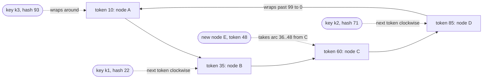
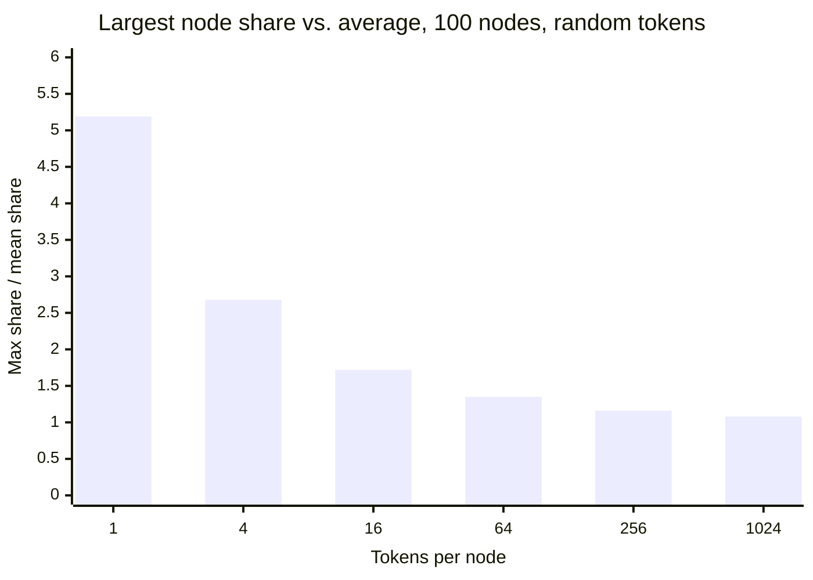
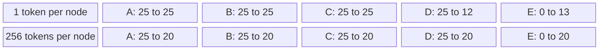
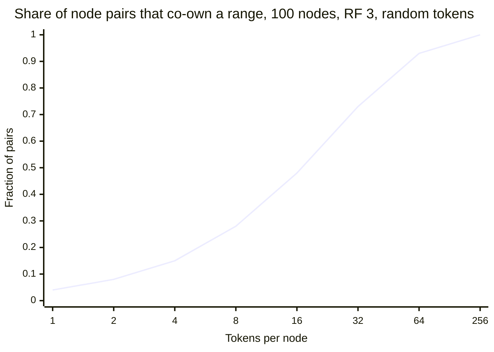
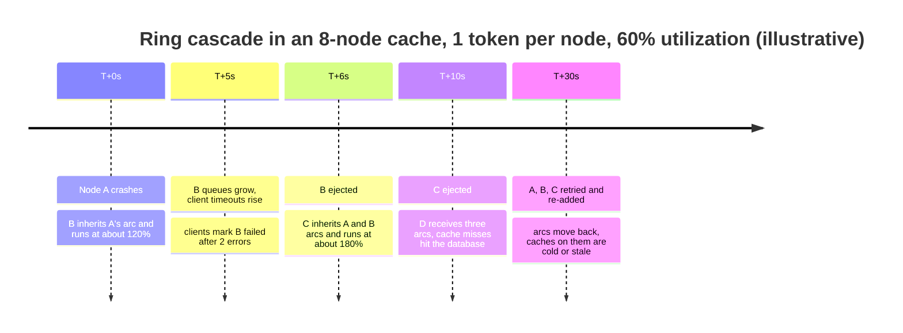
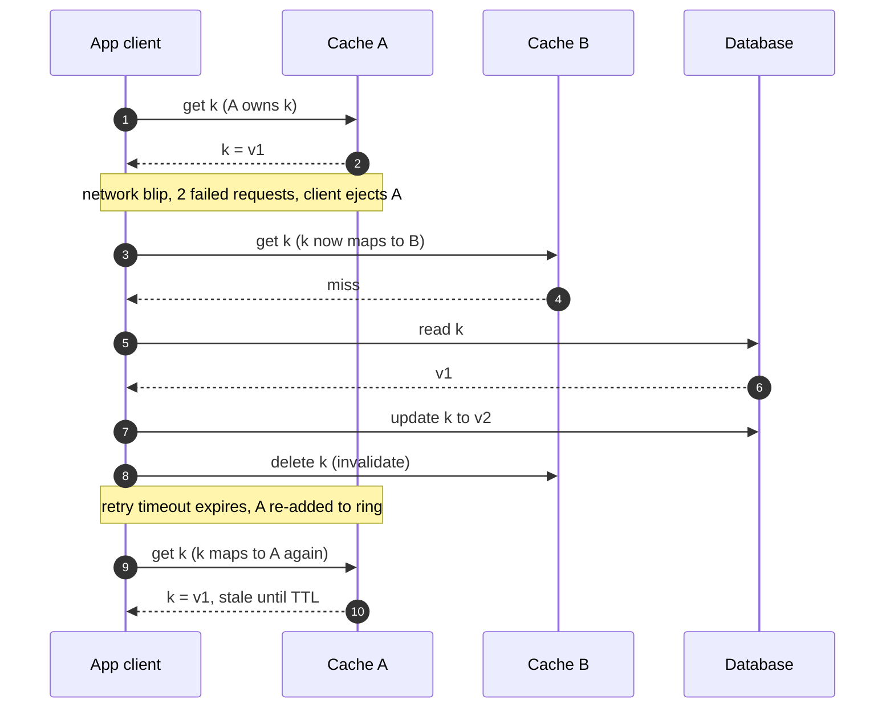

Consistent hashing, anahtarları ve node'ları bir çember olarak düzenlenmiş aynı hash uzayına yerleştirir ve her anahtarı, anahtarın hash değerinden saat yönünde ilerlerken karşılaşılan ilk node'a atar. Bir anahtarın sahibi yalnızca anahtar ile bir sonraki nokta arasında hangi node noktalarının bulunduğuna bağlı olduğundan, bir node eklemek ya da çıkarmak yalnızca o node'un noktalarına bitişik yaylardaki anahtarların sahibini değiştirir; diğer her anahtar sahibini korur. `N` node'lu bir kümede tek bir katılma ya da ayrılmada taşınan anahtarların beklenen payı yaklaşık `1 / N`'dir. Bu, dengeli herhangi bir atamanın ulaşabileceği alt sınırdır: katılan node o payı almak, ayrılan node da o payı devretmek zorundadır.

Çözdüğü problem, `hash(key) mod N`'in yarattığı problemdir. Modulo ile yerleşim iyi dengeler ama her anahtarın adresini node sayısına bağlar; [Hash Bölümleme](/distributed-systems/tr/data-management/data-partitioning/hash-partitioning/) sayfasında türetildiği gibi 10 node'dan 11'e büyümek anahtarların %91'ini taşır. Bir önbellek için bu neredeyse tamamen soğuk bir başlangıçtır; bir veri deposu içinse verinin neredeyse tamamının, tüm client'lar arasında aynı anda koordine edilen bir kopyasıdır. Consistent hashing, 1997'de Karger ve arkadaşları tarafından tam da bu önbellek senaryosu için tanıtıldı: üyeliği sürekli değişen ve client'ları bu üyeliğin tek bir görünümü üzerinde anlaşamayan web önbellekleri. Daha sonra Amazon'un Dynamo'su ve ondan türeyen depolar (Cassandra, Riak, tablet'lerden önceki ScyllaDB, Voldemort) tarafından yerleşim fonksiyonu olarak benimsendi.

Asıl denge, denge ile node başına düşen durum ve koordinasyon miktarı arasındadır. Node başına tek nokta ile halka asgari taşınmayı garanti eder ama son derece eşitsiz bir sahiplik üretir: 100 node'luk bir halkada en büyük node ortalamanın yaklaşık beş katına sahip olur. Denge, her node'a çok sayıda nokta vererek, yani başlıktaki sanal düğümlerle (virtual nodes, vnodes), ya da noktaları rastgele değil bilinçli olarak seçerek satın alınır. Daha fazla nokta; saklanacak ve gossip ile yayılacak daha büyük bir halka, stream edilecek ve onarılacak daha fazla bağımsız aralık ve daha az belirgin olarak, bir replica kümesini paylaşan çok daha fazla node çifti demektir. Sonuncusu, herhangi iki eşzamanlı arızanın bir kısım veriyi erişilemez kılma olasılığını artırır. Consistent hashing'in her üretim yapılandırması bu eğri üzerinde bir konumdur.

## Halka: Ardıl Üzerinden Sahiplik

String'leri `[0, 2^64)` aralığındaki tamsayılara eşleyen bir hash fonksiyonu alın ve aralığı bir çember olarak düşünün; en büyük değerden sonra sıfır gelsin. Her node, genellikle adı ya da adresi hash'lenerek çembere yerleştirilir ve ortaya çıkan konuma o node'un token'ı denir. Bir anahtar aynı fonksiyonla hash'lenir; sahibi, anahtarın konumunda ya da ondan sonra gelen ilk token'a sahip node'dur ve tepeye ulaşınca başa sarılır. Eşdeğer bir ifadeyle, her node kendi token'ında biten ve çember üzerindeki bir önceki token'ın hemen ardından başlayan yayın sahibidir.


*Hash uzayı 0 ile 99 arasında olan ve her biri tek token'a sahip dört node'lu bir halka. Düz oklar token'ların saat yönündeki sırasını, noktalı oklar her anahtarın sahibini ve E node'unun 48'de katılmasının etkisini gösterir.*

Noktalı okları izleyin. 22'deki k1 anahtarı saat yönünde ilerler ve 35'te B'nin token'ına rastlar, dolayısıyla sahibi B'dir; 93'teki k3 uzayın tepesini geçer ve 10'da A'ya rastlar. E node'u 48 token'ıyla katıldığında C'nin yayını böler: 36 ile 48 arasındaki anahtarlar artık C'den önce E'ye rastlar ve E'ye taşınır, 49 ile 60 arasındakiler ise hâlâ C'ye rastlar. A, B, C ve D arasında hiçbir anahtar yer değiştirmez ve tek bağışçı C'dir. Bu son özellik, halkanın doğruluk argümanının minyatür hâlidir ve aynı zamanda ilk zayıflığıdır: tek bir bağışçı ve token'ın şans eseri kestiği pay ne kadarsa o kadarı.

### Neden Yalnızca Bitişik Yay Taşınır

Asgari taşınma garantisi, sahibin bir ardıl olarak tanımlanmasından çıkar. Her `k` anahtarı için `owner(k)`, sarma dikkate alınarak `h(k)`'den büyük ya da ona eşit olan en küçük token'dır. Yeni bir `t` token'ı eklemek, tam olarak önceki token `pred(t)` ile `t` arasındaki hash değerlerinin ardılını değiştirir: bu değerler için `t` artık saat yönündeki en yakın token'dır; diğer her değer için en yakın token değişmez, çünkü `t` o değer ile eski ardılı arasında değildir. Dolayısıyla taşınan anahtarlar tam olarak `(pred(t), t]` aralığındakilerdir ve yeni node'a taşınırlar, asla eski node'lar arasında taşınmazlar. Bir token'ı çıkarmak bunun ayna görüntüsüdür: yayını ardılı devralır ve başka hiçbir şey değişmez. Karger'in makalesi bu özelliğe monotonluk (monotonicity) der: node'lar eklendiğinde anahtarlar yalnızca eski node'lardan yenilere taşınır.

Özellik her client için bağımsız olarak geçerlidir. Aynı hash fonksiyonuna ve aynı token kümesine sahip iki taraf, haberleşmeden aynı sahibi hesaplar; token kümeleri tek bir node kadar farklı olan iki taraf ise yalnızca o node'un yayları üzerinde anlaşmazlığa düşer. Orijinal makalenin amacı da buydu: önbellek filosuna dair biraz farklı görünümlere sahip web client'ları, bir nesne için gelen isteklerin çoğunu yine aynı önbelleğe gönderiyordu ve filo bütün olarak az sayıda kopya saklıyordu. Bir veritabanında ise herhangi bir anahtar üzerindeki anlaşmazlık bir doğruluk problemidir; halkayı kullanan depoların halkanın kendisini de dağıtıp sürümlemesinin nedeni budur.

```text
# Ring lookup and replica placement (tokens sorted ascending)
lookup(key):
    h = hash(key)
    i = first index with tokens[i].value >= h     # binary search
    if i == len(tokens): i = 0                     # wrap around
    return i

replicas(key, RF):
    i = lookup(key); owners = []
    while len(owners) < RF:                        # walk clockwise
        n = tokens[i].node
        if n not in owners: owners.append(n)       # skip repeat vnodes of one node
        i = (i + 1) mod len(tokens)
    return owners
```

Arama, `T` token için `O(log T)` maliyetli, sıralı bir token dizisi üzerinde ikili aramadır: her biri 256 token'lı 100 node, yani 25.600 token için yaklaşık 15 karşılaştırma ve birkaç yüz kilobaytlık bir dizi. İkinci fonksiyon, Dynamo'nun getirdiği replikasyon kuralıdır: bir anahtarın replica'ları, hash değerinden saat yönünde karşılaşılan ilk `RF` farklı node'dur ve bu listeye anahtarın tercih listesi (preference list) denir. `not in owners` kontrolü, node'ların birden fazla token'ı olduğunda önem kazanır; bu kontrol olmadan aynı node'un bitişik iki token'ı tek bir makineye iki replica yerleştirirdi.

### Halkanın Garanti Ettikleri ve Etmedikleri

Sabit bir token kümesi ve hash fonksiyonu için halka, her anahtar için tek bir sahip ve tek bir tercih listesi garanti eder; bunu token kümesine sahip herkes hesaplayabilir. Tek bir üyelik değişikliği boyunca yalnızca değişen token'lara bitişik yaylardaki anahtarların taşınacağını ve bunların yalnızca değişen node'a ya da ondan taşınacağını garanti eder. Node başına çok sayıda token olduğunda, bir node'un sahip olduğu anahtarların beklenen payı token sayısıyla orantılıdır.

Az sayıda token ile dengeyi garanti etmez; bir sonraki bölüm bunu gösterir. Yükü değil, yalnızca hash uzayını dengeler: ağır bir anahtarın hâlâ tek bir sahibi vardır ve bu problem [Çarpıklık ve Hot-Spot Problemleri](/distributed-systems/tr/data-management/data-partitioning/skew-hot-spots/) sayfasında ele alınır. Veriyi taşımaz; yalnızca verinin nerede olması gerektiğini söyler. Bir katılmayı güvenli kılan streaming, çift sahiplik penceresi ve geçiş adımı [Dinamik Yeniden Dengeleme](/distributed-systems/tr/data-management/data-partitioning/dynamic-rebalancing/) sayfasına aittir. Bir node'un ne zaman üye olduğuna karar vermez: bir health check başarısız olduğu anda bir node'u düşüren halka, her geçici ağ arızasını bir yeniden eşlemeye dönüştürür; bu, sayfanın ilerleyen kısmında incelenen bozulma biçimidir. Token kümesi üzerinde uzlaşmayı da sağlamaz; bu ayrı bir mekanizmadan gelir: Cassandra ve Riak'ta gossip, client tarafı önbellek kütüphanelerinde yapılandırma ya da consensus destekli bir metadata deposu.

## Sanal Düğümler: Noktalarla Denge Satın Almak

Node başına tek rastgele token ile bir node'un halkadaki payı, kendi token'ı ile bir öncekinin arasındaki boşluğun uzunluğudur. Çember üzerindeki `N` rastgele nokta arasındaki boşluklar eşit olmaktan çok uzaktır: dağılımları üstele yakındır, bu yüzden bazı boşluklar çok küçük, birkaçı ise ortalamanın birkaç katıdır. `N` rastgele nokta arasındaki en büyük boşluğun beklenen değeri yaklaşık `H_N / N`'dir; burada `H_N`, `N`'inci harmonik sayıdır ve kabaca `ln N + 0.58` eder. 100 node'da bu ortalama payın 5,2 katıdır ve en küçük node neredeyse hiçbir şeye sahip değildir.

Sanal düğümler her fiziksel node'a bir yerine `v` token verir; böylece node'un payı `v` bağımsız boşluğun toplamı olur. Bağımsız boşlukların toplamı yoğunlaşır: bir node'un payının göreli standart sapması `1 / sqrt(v)` oranında düşer ve `v` büyük olduğunda `N` node arasındaki en büyük pay yaklaşık olarak ortalamanın `1 + sqrt(2 ln N / v)` katıdır. `ln N` terimi, daha büyük bir kümenin aynı en kötü durum için node başına daha fazla token'a ihtiyaç duyduğu anlamına gelir; çünkü şanssız olabilecek daha fazla node vardır.


*En büyük node'un sahipliğinin ortalamaya oranının ortalaması; bu sayfa için çalıştırılan rastgele token yerleşimi simülasyonundan (nokta başına 200 deneme, en büyük iki nokta için 50). 100 yerine 10 node ile aynı noktalar 2,86, 1,88, 1,42, 1,20, 1,09 ve 1,05 verir.*

Grafik, Cassandra'nın 2.0 sürümünden itibaren node başına varsayılan olarak 256 rastgele token kullanmasının nedenidir: bu sayıda 100 node'un en sıcağı ortalamadan yaklaşık %16, 95. yüzdelik çekiliş ise yaklaşık %21 daha fazlasına sahiptir. Sola doğru okuyunca az sayıda rastgele token'ın maliyeti görünür hâle gelir. On altı rastgele token, en sıcak node'u ortalamanın %72 üzerinde bırakır; bu da kümenin tamamını ortalama yükünün 1,7 katına göre boyutlandırmak demektir. İlişki eğrinin neden yataylaştığını da açıklar: 256'dan 1.024 token'a çıkmak halkayı dört katına çıkarır ve yalnızca 8 yüzde puanlık bir kazanç getirir.

### Katılmalar, Ayrılmalar ve Bedeli Kim Öder

Sanal düğümler dengeden fazlasını değiştirir. Üyelik değiştiğinde kaç node'un sürece katıldığını değiştirirler; bu da bir katılmanın ne kadar sürdüğünü ve bir arızanın yükünün nasıl emildiğini belirler.


*E node'u eşit paylara sahip dört node'lu bir halkaya katılmadan önce ve sonra her node'un sahip olduğu hash uzayı yüzdesi. Üst satır: E'nin tek token'ı D'nin yayının içine düşer ve onun bir kısmını alır, dolayısıyla tek bağışçı D'dir. Alt satır: E'nin token'ları her node'un yaylarına düşer, bu yüzden her biri kendi payının beşte birini paralel olarak bağışlar. Değerler örnek amaçlıdır.*

Node başına tek token ile katılan node tam olarak tek bir yayın bir kısmını alır; dolayısıyla yalnızca bir mevcut node veri verir ve yalnızca o node rahatlar, diğerleri yüklerini korur. Katılanın payı, rastgele konumunun kestiği kadardır; bu yüzden bir katılma kümeyi öncekinden daha dengesiz bırakabilir. Node başına `v` token ile katılanın token'ları neredeyse her mevcut node'a ait yaylara düşer; her biri verisinin yaklaşık `1 / (N + 1)`'ini bağışlar, tüm node'lar paralel olarak stream eder ve her node rahatlar. Bir ayrılma ya da arıza simetriktir: tek token ile ölen node'un yayının tamamı tek ardılına düşer; çok sayıda token ile yayları tüm hayatta kalanlara dağılır.

### Uygulamalı Örnek: 12 Node'dan 13'e Büyümek

Toplam 24 TB sahip olunan veri, yani node başına ortalama 2 TB tutan 12 node'luk bir küme ve herhangi bir node'un ön plan gecikmesine zarar vermeden 250 MB/s hızla veri gönderebildiğini ya da alabildiğini varsayın. Tüm sayılar örnek amaçlıdır; gerçek streaming hızı disklere, compaction'a ve deponun kısıtlayıcılarına bağlıdır.

Yeni node, denge için tutması gereken pay olan `24 / 13 = 1,85` TB ile sonlanmalıdır. `hash mod N` altında bir anahtarın sahibi, hash'inin 12 ve 13'e göre kalanları eşleşmedikçe değişir; dolayısıyla anahtarların `12 / 13 = %92`'si, yaklaşık 22 TB, node değiştirir ve eşleme tüm anahtarlar için aynı anda değişir.

Node başına tek rastgele token ile taşınan verinin beklenen miktarı aynı 1,85 TB'tır ama tek bir bağışçıdan gelir. 250 MB/s ile bu `1,85e12 / 2,5e8 = 7.400` saniye, yani bağışçının diski ve ağının normal trafiğinin üzerine stream'i taşıdığı yaklaşık iki saattir. Miktar aynı zamanda bir piyangodur: katılan node, uzunluğuyla orantılı olasılıkla seçilen bir yaya düşer ve onun düzgün dağılımlı rastgele bir kısmını alır; yeni node neredeyse hiçbir şeye ya da adil payının iki katından fazlasına sahip olabilir ve diğer on bir node hiç rahatlamaz. Tek token'lı kümelerin operatörleri bundan token'ları elle hesaplayarak ve kümeyi ikiye katlayarak kaçınırdı; böylece her yeni token mevcut bir yayı tam ortadan bölerdi.

Node başına 256 token ile katılanın 256 token'ı 12 node'un hepsine ait yaylara düşer. Her biri yaklaşık `2 TB / 13 = 154` GB bağışlar. Darboğaz artık gönderenler değil, katılanın veri alma kapasitesidir. Node başına aynı 250 MB/s ile katılanın yine iki saate ihtiyacı vardır; ancak katılan paralel stream'lerden 1 GB/s alabiliyorsa kopya `1,85e12 / 1e9 = 1.850` saniye, yaklaşık 31 dakika sürer ve her bağışçı bütçesinin dörtte biriyle gönderir. Sonrasında her node verinin `1 / 13`'üne yakın bir paya sahip olur; sapma yukarıdaki grafiğin öngördüğü aralıktadır.

Şimdi bunun yerine bir node'u çıkarın. Tek token ile ardılı yayının tamamını devralır ve yaylar eşitse verisini ve istek hızını ikiye katlar: 2 TB'tan 4 TB'a ve örneğin %60'tan %120 CPU'ya. 256 token ile 11 hayatta kalanın her biri kaybedilen node'un payının yaklaşık `1 / 11`'ini emer; bu %9'luk bir artıştır, %60'tan yaklaşık %65'e. İlk durum, arıza bölümünde gösterilen çığın tetikleyicisidir; ikincisi ise vnode'lar lehine ana operasyonel argümandır.

### Token'ları Çekmek Yerine Seçmek

Rastgele token'ların dengeli olması için node başına yüzlercesi gerekir. Alternatif, yayların yapı gereği dengeli olacağı şekilde token'ları seçmektir ve üretim sistemleri bunun iki yolunda birleşmiştir.

Dynamo makalesi değerlendirdiği üç stratejiyi anlatır. Birincisinde her node'un `T` rastgele token'ı vardır ve partition'lar bunların arasındaki yaylardır; şimdiye kadar anlatılan şema budur. Operasyonel problemi denge değil veri yönetimiydi: bir node her katıldığında yayların sınırları değişir, dolayısıyla bir node'u başlatmak (bootstrap), çalınan yaylardaki anahtarları bulmak için bağışçıların yerel depolarını taramayı, anahtar uzayının bir snapshot'ını arşivlemek de her node'u taramayı gerektirir. Amazon'un benimsediği üçüncü strateji, hash uzayını `Q` adet eşit ve sabit partition'a böler ve `S` node'un her birine bunların `Q / S` tanesini verir; her üyelik değişikliğinde bütün partition'ları taşıyarak bu oranı korur. Partition sınırları hiç değişmediğinden her partition kendi dosyası olarak saklanabilir ve tarama yapmadan kopyalanarak taşınabilir. Bu artık rastgele noktalı bir halka değil, [Hash Bölümleme](/distributed-systems/tr/data-management/data-partitioning/hash-partitioning/) sayfasında anlatılan sabit slot şemasıdır; halka yalnızca tercih listelerini oluşturmak için kullanılan sıra olarak yaşamaya devam eder. Riak da aynı tasarımı benimsedi: varsayılan olarak 64 (`ring_creation_size`) sabit sayıda eşit partition'dan oluşan ve node'ların sahiplendiği bir halka. Dokümantasyonu bu boyutun küme veri almaya başlamadan önce belirlenmesini ister.

Cassandra ise diğer yolu seçti: node başına token'ları korudu ama onları rastgele seçmeyi bıraktı. 3.0 sürümü, bir node katıldığında token'larını mevcut token'lar ve replikasyon faktörü göz önüne alınarak replike sahipliğin varyansını en aza indirecek şekilde seçen bir token tahsis algoritması ekledi (CASSANDRA-7032). Cassandra 4.0 varsayılanları buna göre değiştirdi: `num_tokens` 256'dan 16'ya indi (CASSANDRA-13701) ve tahsis algoritmasının yeni kümelerde etkin olması için `allocate_tokens_for_local_replication_factor` 3'e ayarlandı (CASSANDRA-15260). Seçilmiş on altı token, rastgele on altı token'ın veremeyeceği bir denge sağlar; yukarıdaki grafiğin anlattığı da budur: eğri rastgele yerleşimi tarif eder, tahsis edilmiş yerleşimi değil.

## Replica Yerleşimi ve Çok Sayıda Vnode'un Gizli Maliyeti

Replica'lar pseudocode'da gösterilen yürüyüşle yerleştirilir: anahtardan saat yönündeki ilk `RF` farklı node. Üretim depoları bu yürüyüşü topolojiyle inceltir. Cassandra'nın `NetworkTopologyStrategy`'si halkayı her veri merkezi için ayrı ayrı yürür ve henüz kullanmadığı rack'lerdeki node'ları tercih eder; böylece en az `RF` rack varsa bir aralığın `RF` replica'sı farklı rack'lere düşer. Bir okuma ya da yazmanın bu replica'lardan kaçına ulaşması gerektiğini belirleyen quorum aritmetiği [Lidersiz Replikasyon](/distributed-systems/tr/data-management/replication/leaderless-replication/) sayfasında ele alınır; bu sayfa, her replica kümesini hangi node'ların oluşturduğuyla ilgilidir.

Her farklı replica kümesi, ortak arızası bir aralığı erişilemez kılan bir node kümesidir. Node başına tek token ve `RF = 3` ile replica kümeleri halka üzerindeki ardışık üçlülerdir; dolayısıyla her node yalnızca iki öncülü ve iki ardılıyla bir aralık paylaşır. Node başına çok sayıda token ile her node'un token'ları neredeyse diğer her node'un token'larının yanında durur; bu yüzden farklı replica kümelerinin sayısı olası üçlülerin sayısına doğru büyür. Sonucu, iki node aynı anda kapalıyken ortaya çıkar; bu da tek bir host arızasıyla çakışan bir rolling restart sırasında sıradan bir olaydır.


*4.950 node çiftinden en az bir replica kümesinde birlikte bulunanların oranı; bu sayfa için çalıştırılan bir simülasyondan (nokta başına 5 halka). Bu kümedeki bir çift için her iki node'un kaybı, RF 3'te en az bir aralığın QUORUM'unu kaybetmesine yol açar.*

Node başına tek token ile 100 node arasındaki iki eşzamanlı arıza, vakaların %4'ünde bir aralık için QUORUM'u bozar. On altı rastgele token ile %48. 256 ile neredeyse her çift bir aralığı birlikte sahiplenir; dolayısıyla herhangi iki arıza bir kısım veriyi QUORUM'da erişilemez kılar. The Last Pickle'ın node başına üç token'lı altı node'luk bir küme üzerindeki testi, iki node'u kaybetmenin verinin üçte birini `LOCAL_QUORUM`'da erişilemez kıldığını buldu; token sayısı arttıkça böyle bir sonuç daha kesin hâle gelir, ama her olay daha az veriyi kapsar.

Erişilemeyen verinin beklenen miktarı ise token sayısına hiç bağlı değildir. Her aralığın replica kümesi olası 4.950 çiftin 3'ünü içerir; dolayısıyla farklı replica'lı her yerleşim için rastgele bir arıza çifti ortalama olarak aralıkların `3 / 4.950 = %0,06`'sını devre dışı bırakır. Vnode'lar bu beklentiyi yeniden dağıtır: node başına tek token olayı seyrek ve büyük yapar (arızalanan iki node komşu olduğunda anahtar uzayının yaklaşık %1 ile %2'si quorum'unu kaybeder), 256 token ise neredeyse kesin ve küçük. Hangisinin daha kötü olduğu, isteklerin veriye nasıl dokunduğuna bağlıdır. İşlemleri çok sayıda anahtara yayılan bir iş yükü (bir tarama, çok anahtarlı bir batch, fan-out bir okuma), dokunduğu herhangi bir anahtar erişilemezse başarısız olur; onun için sık ve küçük kesinti fiilen tam bir kesintidir. Cidon ve arkadaşları aynı gözlemi replike depolamada veri kaybı için yaptı ve farklı replica kümelerinin sayısını sınırlamayı önerdi; bu yaklaşıma copyset denir.

Rack farkındalıklı yerleşim, en yaygın korelasyonlu arızalar için bu bağımlılığı ortadan kaldırır. Replica'lar her zaman `RF` rack'e yayılıyorsa, tek bir rack'le sınırlı herhangi sayıda arıza her aralığı `RF - 1` replica ile bırakır ve rolling restart'lar rack rack ilerleyebilir. Ortak arıza riski o zaman yalnızca farklı rack'lerdeki arızalar için geçerlidir; aksi hâlde ihtiyaç duymayacak kümelerde bile rack sayısını replikasyon faktörüne eşit yapılandırmanın nedeni budur.

:::tip[Node node değil, rack rack yeniden başlatın]
Node başına çok sayıda token varken, her seferinde rastgele sırayla bir node'u kapatan bir rolling restart ancak başka herhangi bir yerde ikinci bir node arızalanana kadar güvenlidir. Replica'lar rack'lere yayılıyorsa, bütün bir rack'i aynı anda yeniden başlatmak her aralığı `RF - 1` replica'da tutar ve başka bir rack'teki ilgisiz bir arıza için tam bir replica'lık pay bırakır. Buna güvenmeden önce rack atamasını `nodetool status` ile kontrol edin.
:::

## Varyantlar ve Üretim Uygulamaları

Halka, asgari taşınma hedefini paylaşan ve arama maliyeti, denge, durum ve desteklediği üyelik değişikliği türleri bakımından farklılaşan bir yerleşim fonksiyonları ailesinin bir üyesidir. Bunların birkaçı öncelikle istek yönlendirme için kullanılır ve kendi uygulamalı örnekleriyle birlikte [Yük Dengeleme Algoritmaları](/distributed-systems/tr/communication/load-balancing/algorithms/) sayfasında açıklanır: her anahtar için her node'u puanlayıp en yükseğini seçen rendezvous hashing; node'ların sırayla slot sahiplenmesine izin vererek asal boyutlu sabit bir tabloyu dolduran Maglev; ve her node'u ortalamanın bir katıyla sınırlayıp fazlasını saat yönünde aktaran bounded loads ile consistent hashing. Orada ele alınmayan iki varyant veri yerleşimi için önemlidir.

Google'dan Lamping ve Veach'in 2014'te yayımladığı jump consistent hash, 64 bitlik bir anahtardan birkaç satırlık bir döngüyle bucket numarası hesaplar; saklanan bir durum yoktur ve `n` bucket için beklenen döngü sayısı `ln n + 1`'in altındadır. Dengesi neredeyse kusursuzdur ve yazarlar onu bir halkadan birkaç kat hızlı ölçmüştür. Kısıtı yapısaldır: bucket'lar `0` ile `n - 1` arasında numaralandırılır, dolayısıyla bucket'lar yalnızca sondan eklenip çıkarılabilir. Bu, anahtarları her biri replike bir grup olan, sayısı artan mantıksal shard'lara eşleyen bir depoya uyar; herhangi bir sunucunun arızalanabileceği bir önbellek filosuna uymaz. Appleton ve O'Reilly'nin 2015'te önerdiği multi-probe consistent hashing node başına tek noktayı korur ve bunun yerine her anahtarı birkaç kez hash'leyerek tüm denemeler arasında en yakın noktaya sahip node'a atar; halka belleğini arama başına ek hash hesaplamasıyla takas eder.

| Şema | Arama maliyeti | Durum | Denge | Desteklenen değişiklikler | Ne zaman tercih edilmeli |
|---|---|---|---|---|---|
| Halka, node başına 1 rastgele token | `O(log N)` | `N` token | Zayıf: en büyük yaklaşık ortalamanın `H_N` katı | Herhangi bir node katılır ya da ayrılır | Neredeyse hiçbir zaman; küçük statik kümelerde elle atanmış token'lar |
| Halka, çok sayıda rastgele vnode | `O(log Nv)` | `N * v` token | Yüzlerce `v` ile iyi | Herhangi bir node | Merkezi metadata'sı olmayan eşler arası depolar ve client tarafı önbellekler |
| Halka, tahsis edilmiş token'lar | `O(log Nv)` | `N * v` token artı tahsis algoritması | 16 civarı `v` ile iyi | Herhangi bir node; tahsis katılmada çalışır | Cassandra 4.0 ve sonrası; onarılacak ve stream edilecek daha az aralık |
| Sabit eşit partition'lar (Dynamo strateji 3, Riak) | Partition için `O(1)`, ardından tablo | `Q` partition sahibi | Neredeyse eşit partition sayıları | Herhangi bir node; `Q` sabit | Bütün partition dosyalarını taşıyan ve basit snapshot isteyen depolar |
| Jump consistent hash | `O(log n)`, bellek yok | Yalnızca bucket sayısı | Neredeyse kusursuz | Yalnızca son bucket'ı ekleme ya da çıkarma | Anahtarları numaralı, replike shard'lara eşlemek |
| Rendezvous (HRW) | Anahtar başına `O(N)` | Node listesi | İstatistiksel, vnode gerekmez | Herhangi bir node, tam asgari taşınma | Küçük node kümeleri, anahtar başına `N` hash'in karşılanabildiği yerleşim |
| Maglev tablosu | `O(1)` | Asal `M` boyutlu tablo | Neredeyse eşit slot sayıları | Herhangi bir node, asgarinin biraz üzerinde taşınma | Yüksek hızlı istek yönlendirme |
| Halka üzerinde bounded loads | `O(log Nv)` artı yoklama | Halka artı node başına yük | Yük ortalamanın `c` katıyla sınırlı | Herhangi bir node | Sıcak anahtarların aşırı yüklemek yerine taşması gereken önbellekler |

Tablo, sıklıkla karıştırılan iki aileyi ayırır. Halka varyantları ve rendezvous, anahtarları isimlendirilmiş rastgele node'lara yerleştirir ve herhangi bir node'un katılmasını ya da ayrılmasını tolere eder. Jump hash ve sabit partition'lar ise anahtarları sayısı nadiren değişen numaralı mantıksal birimlere yerleştirir ve birimlerin makinelere eşlenmesini ayrı, değişebilir bir tabloya bırakır. Modern depoların çoğu ikinci aileyi kullanır, çünkü kararlı soruyu (anahtarı hangi birim tutuyor) sık değişenden (birimi hangi makine tutuyor) ayırır.

### Gerçek Sistemler Halkayı Nasıl Kullanır

Cassandra token'ları node başına saklar, bunları gossip ile her node'a yayar ve coordinator'ların ve token-aware driver'ların tercih listelerini `Murmur3Partitioner` token uzayıyla yerel olarak hesaplamasına izin verir. Token sayısı bir node ilk kez bootstrap olduğunda sabitlenir; sonradan değiştirmek, yeni ayarla yeni bir veri merkezi ekleyip ona geçiş yapmak anlamına gelir. Bu yüzden bir kümenin 2.x döneminden kalma 256 token'lık düzeni böyle bir geçişe kadar sürer. Token metadata'sı ve bootstrap sırasındaki bekleyen aralıklar (pending ranges) dahil Cassandra'nın tam halka mekaniği, [Cassandra'nın Consistent Hashing Halkası](/distributed-systems/tr/case-studies/dynamodb-cassandra/cassandra-hashing-ring/) vaka çalışmasının konusudur.

Memcached client'ları, libketama kütüphanesinden gelen ketama şemasını yaygınlaştırdı: her sunucunun 0'dan 39'a kadar `n` için `ip:port-n` string'i MD5 ile hash'lenir ve her 16 baytlık özet dört adet 32 bitlik nokta üretir; sunucu başına 160 nokta eder ve ağırlıklı varyantlarda ağırlıkla ölçeklenir. Sunucunun adresi hash'lenen string'in parçası olduğundan, bir sunucunun adresini değiştirmek tüm noktalarını taşır; bunun yerine kararlı bir isim hash'leyen kütüphaneler bu durumdan kaçınır. Twemproxy, hash fonksiyonu seçeneğiyle birlikte `distribution: ketama` sunar; `auto_eject_hosts` seçeneği (varsayılan olarak kapalı) bir sunucuyu `server_failure_limit` ardışık hatadan (varsayılan 2) sonra halkadan çıkarır ve `server_retry_timeout` (varsayılan 30 saniye) sonra yeniden dener. Bu, aşağıda incelenen keskin bir kenarı olan kullanışlı bir davranıştır. Envoy'un `RING_HASH` yük dengeleyicisi, xxHash kullanarak `minimum_ring_size` (varsayılan 1.024 giriş) ile `maximum_ring_size` (8M) arasında bir halka kurar ve her host'un girişlerini ağırlığıyla ölçekler.

ScyllaDB, 6.0 sürümü yeni keyspace'ler için tablet'leri varsayılan yapana kadar Cassandra ile aynı token halkasını kullandı: tablet'ler, anahtar aralığı sistemlerinin yaptığına benzer şekilde bir yük dengeleyici tarafından tek tek bölünen, birleştirilen ve taşınan tablo başına veri birimleridir. DynamoDB ise Dynamo'dan türemiş olmasına rağmen veriyi bir üyelik halkasıyla değil, boyut ve verim için bölünen hash aralıklarıyla yerleştirir. Her iki geçiş de halkanın aynı sınırını yansıtır: halka yükü ya da baytları değil, hash uzayını atar ve sıcak ya da büyük bir aralıkta yapılacak her ayarlama, node'un tüm token'larını değiştirmek demektir.

### Önemli Olan Yapılandırma

Davranışı belirleyen ayarlar azdır ve en kritik olanı ilk açılışta sabitlenir.

```yaml
# cassandra.yaml (4.0+ defaults shown); applies when a node first bootstraps
num_tokens: 16                                    # vnodes per node; cannot change in place later
allocate_tokens_for_local_replication_factor: 3   # choose tokens for balance at this RF
partitioner: org.apache.cassandra.dht.Murmur3Partitioner
```

Token sayısı dengeyi aralık sayısıyla takas eder. Rastgele token'larla denge yüzlerce token gerektirir; bir tahsis algoritmasıyla çoğu küme için 8 ile 16 yeterlidir. Daha az aralık, node başına daha az onarım ve streaming oturumu ve yukarıda gösterildiği gibi ortak arızası quorum kaybettiren daha az node çifti demektir. Tahsis algoritmasına verilen replikasyon faktörü, verinin çoğunu tutan keyspace'lerle eşleşmelidir; çünkü algoritma ham token sahipliğini değil, replike sahipliği dengeler. Client tarafı halkalarda eşdeğer kararlar şunlardır: sunucu başına nokta sayısı, hash fonksiyonu, her sunucu için hash'lenen string ve sunucu listesinin sıralaması. Her client birebir aynı değerleri kullanmalıdır; aksi hâlde anahtarlar sessizce farklı sunuculara düşer. Ağırlıklar kapasiteyle orantılı nokta sayıları olarak ifade edilmelidir; böylece iki kat belleğe sahip bir node iki kat yay tutar.

:::caution[Token düzeni bir veri formatıdır]
Token'lar mevcut verinin nerede yaşadığına karar verir. Zaten veri tutan bir node'da `num_tokens`'ı değiştirmek, partitioner değiştirmek ya da client tarafı bir halkada hash fonksiyonunu veya sunucu başına string'i değiştirmek hiçbir şeyi yeniden dengelemez; veri olduğu yerde kalırken sahipliği başka yere taşır. Bir depoda bu, yeni sahiplerde hiçbir şey bulamayan okumalar demektir; bir önbellekte filo çapında soğuk bir başlangıç. Token ayarlarını ve client hash yapılandırmasını disk üzerindeki formatın parçası olarak ele alın ve yalnızca yeni bir kümeye ya da veri merkezine geçiş yaparak değiştirin.
:::

## Bozulma Biçimleri ve İmzaları

Halkanın arızaları üç kaynaktan gelir: çok az ya da kötü seçilmiş noktalardan doğan dengesizlik, üyelik üzerindeki anlaşmazlık ve üyelik ile arıza tespiti arasındaki bağ.

### Çok Az Rastgele Token'dan Doğan Dengesizlik

Tetikleyici: node başına bir ya da birkaç rastgele token'lı bir halka; çoğu zaman düşük bir `num_tokens` ile ama tahsis algoritması olmadan kurulmuş bir küme ya da sunucu başına bir avuç noktayla yapılandırılmış bir client tarafı halka. Belirtiler: küme ortalaması sağlıklı görünürken bir ya da iki node diskini ya da CPU'sunu ilk tüketir; node eklemek sıcak olanları rahatlatmaz. Tespit: `nodetool status`'ta node başına sahiplik (bir keyspace verildiğinde "Owns (effective)" sütunu), node'lar arasında veri boyutu ve istek hızının yayılımı ve Envoy için host başına en az ve en çok hash sayısına ilişkin ring-hash istatistikleri. Hafifletme: açıkça seçilmiş token'larla sıcak yaylara yönelik kapasite eklemek ya da tahsis edilmiş token'lı bir düzene geçmek. Kurtarma bir geçiştir, çünkü mevcut node'ların token'ları yerinde değiştirilemez.

### Ardılın Aşırı Yüklenmesi ve Halka Çığı

Tetikleyici: node başına bir ya da az sayıda token'lı bir halkada bir node arızalanır ve ardılı yayının tamamını devralır. Ardıl %50 kullanımın üzerindeyse artık aşırı yüklüdür; zaman aşımları client'ların ya da üyelik katmanının onu çıkarmasına yol açar ve onun yayı ile devraldığı yay bir sonraki node'a geçer. Mekanizma genel [zincirleme arızadır](/distributed-systems/tr/foundations/system-models/cascading-failure/), ama halka ona bir yön verir: saat yönünde ilerler.


*Çığ saat yönünde ilerler, çünkü her arıza yayının tamamını tek bir ardıla devreder. Node başına çok sayıda token ile A'nın yükü yedi hayatta kalana yaklaşık %69 düzeyinde dağılır ve dizi ilk satırda dururdu.*

Zaman çizelgesi, çığın dışarıdan neden zor teşhis edildiğini gösterir: her adım bağımsız bir node arızası gibi görünür ve önbelleğin arkasındaki veritabanı, ancak birkaç node devre dışı kaldıktan sonra zirveye ulaşan artan bir miss oranı görür. Tespit arızaların sırasıdır: node'ların halka sırasıyla, saniyeler içinde, her birinin öncülünden sonra arızalanması imzadır. Hafifletme yapısaldır: bir arızanın tüm hayatta kalanlara yayılması için çok sayıda ya da tahsis edilmiş token, aşırı yüklenen bir node'un arızalanmak yerine taşması için bounded loads ve aşırı yüklenen bir node'un zaman aşımına düşmek yerine yük atması için node başına kabul kontrolü (admission control). Kurtarma, node'ları yavaş yavaş, birer birer yeniden eklemek ve veritabanını miss fırtınasına karşı [Cache Stampede ve Thundering Herd](/distributed-systems/tr/data-management/distributed-caching/cache-stampede/) sayfasındaki tekniklerle korumaktır.

### Çıkarılan Bir Node Geri Döndüğünde Bayat Veri

Tetikleyici: arızada bir node'u çıkaran ve iyileşmede yeniden ekleyen, girdileri yazma sırasında geçersizleştirilen bir önbelleğin önündeki client tarafı bir halka. Node ölü değildir, yalnızca bir süre erişilemez durumdadır; bu yüzden belleğini korur. Dışarıdayken anahtarlarına diğer node'lar hizmet eder; yazmalar kopyaları yalnızca orada geçersizleştirir. Geri döndüğünde halka bu anahtarları yeniden ona eşler ve node ayrılmadan önce tuttuğu değerleri sunar.


*Çıkarılmış ama canlı bir önbellek node'u, halkanın dışındayken gönderilen geçersizleştirmeleri kaçırmış girdilerle geri döner. 9. ve 10. adımlar veritabanını günceller ve halkanın o anda gösterdiği kopyayı geçersizleştirir; bu, 11. adımda okunacak kopya değildir.*

Problem consistent hashing'in kendisi değil, başarısız bir health check'i üyelik değişikliği olarak ele alma kararıdır. 3. ile 10. adımlar kendi başlarına doğrudur; hata 11. adımdadır: halka, geri dönen node'un tuttuklarını temizlemeden terk edilmiş bir görünüme geri döner. Belirtiler, uygulama deploy'larıyla değil ağ kesintileriyle ilişkili, aralıklı bayat okumalardır. Tespit: client'ların çıkarma ve yeniden ekleme logları ve tek bir node'a ait anahtarlarda kümelenen bayat okuma raporları. Hafifletme: bayatlığın önemli olduğu verinin önünde otomatik çıkarma yapmamak ve erişilemeyen bir node'a giden isteklerin başarısız olmasına ya da veritabanına düşmesine izin vermek; ya da bir node'u yeniden katılmadan önce boşaltmak; ya da hasarı kısa TTL'lerle sınırlamak; ya da [Önbellek Geçersizleştirme](/distributed-systems/tr/data-management/distributed-caching/cache-invalidation/) sayfasında tartışıldığı gibi eski bir girdinin yeni bir okumayı karşılayamaması için versiyonlu anahtarlar kullanmak.

:::danger[Üyelik dalgalanmaları okumaları sessizce bozar]
Bir arızada sahipliği taşıyan ve iyileşmede geri taşıyan her halka, yazmaların geçici bir sahibe gittiği ve asıl sahibin daha eski bir kopyayı tuttuğu bir pencere yaratır. Bir önbellekte bu bayat okumalar üretir; anti-entropy'si olmayan bir depoda ise eski kopya daha sonra güncelmiş gibi ele alındığında kaybolan güncellemeler üretir. Dynamo tarzı depolar bundan, üyelik değişikliklerini açık ve yönetimsel tutarak ve geçici arızaları halkayı hiç oynatmadan hinted handoff ve onarımla ele alarak kaçınır. Aynı ayrımı client tarafı halkalarda da kurun: arıza tespiti bir isteğin şimdi nereye gönderileceğine karar verir, bir anahtarın sahibinin kim olduğuna değil.
:::

### Farklılaşan Halka Görünümleri

Tetikleyici: yerleşimi yerel olarak hesaplayan ama üyeliğin tek ve sürümlü bir görünümünü paylaşmayan client'lar: sunucu listesini değiştiren kademeli bir yapılandırma deploy'u, farklı hash fonksiyonlarına ya da nokta sayılarına sahip iki client kütüphanesi ya da bir servisin sıraladığı ama diğerinin sıralamadığı bir sunucu listesi. Belirtiler: görünümlerin farklılaştığı yaylardaki anahtarlar için, yani farklılaşan her node başına anahtarların yaklaşık `1 / N`'i için, bir client bir node'a yazarken diğeri farklı bir node'dan okur; bir önbellekte bu düşen hit oranı ve kaçırılan geçersizleştirmeler, bir depoda ise eksik yazmalar gibi görünür. Tespit: her client'ta halkanın bir parmak izini (sıralı token listesinin hash'i) hesaplayıp metrik ya da log alanı olarak dışa aktarmak; kararlı durumda birden fazla parmak izi görülmesi sinyaldir. Hafifletme: üyelik listesini sürümlü olarak tek bir kaynaktan dağıtmak, bilinen en son sürümden eski bir halkayla hizmet vermeyi reddetmek ve [Hash Bölümleme](/distributed-systems/tr/data-management/data-partitioning/hash-partitioning/) sayfasında anlatılan diller arası partitioner kontrolleriyle aynı şekilde, hash ve nokta üretiminin diller arasında tek, paylaşılan ve test edilmiş bir uygulamasını tutmak.

### Çok Sayıda Vnode ile Korelasyonlu Replica Kaybı

Tetikleyici: node başına çok sayıda token'lı bir kümede farklı rack'lerdeki iki ya da daha fazla node'un aynı anda erişilemez olması; örneğin bir donanım arızasıyla çakışan bir rolling restart. Belirtiler: QUORUM işlemleri küçük ve dağınık bir anahtar kümesi için başarısız olur; çok anahtarlı işlemler tek anahtarlılardan çok daha sık başarısız olur. Tespit: coordinator'daki unavailable istisnası ve zaman aşımı sayılarının, tutarlılık seviyesine göre ayrılmış olarak, iki node aynı anda kapalıyken artması. Hafifletme: replikasyon faktörüne eşit sayıda rack ve rack rack bakım, yeni kümeler için daha az ve tahsis edilmiş token ve bu davranış göz önünde tutularak seçilmiş tutarlılık seviyeleri. Kurtarma, node'lardan herhangi birinin geri dönmesidir; bir aralığı paylaşan `RF` node kalıcı olarak arızalanmadıkça veri kaybolmaz ve bunun olasılığını da ortak sahiplik grafiğindeki aritmetik belirler.

| Arıza | Belirti | Tespit | Hafifletme |
|---|---|---|---|
| Az sayıda rastgele token | Bir node ilk dolar ya da doyar | Node başına sahiplik, node başına boyut ve hız | Tahsis edilmiş token'lar, daha fazla vnode, geçiş |
| Halka çığı | Node'lar halka sırasıyla düşer, miss'ler fırlar | Arıza sırası, bir kayıptan sonra ardılın CPU'su | Çok sayıda token, bounded loads, kabul kontrolü |
| Bayat dönüş | Kesintilerden sonra aralıklı bayat okumalar | Çıkarma ve yeniden ekleme logları, node başına bayat anahtarlar | Otomatik çıkarma yok, dönüşte boşaltma, TTL, versiyonlu anahtarlar |
| Farklılaşan görünümler | Düşük hit oranı, eksik yazmalar | Client'lar arasında halka parmak izi metriği | Tek sürümlü üyelik kaynağı, tek hash uygulaması |
| Korelasyonlu replica kaybı | İki node kapalıyken dağınık QUORUM hataları | Tutarlılık seviyesine göre unavailable hataları | Rack farkındalıklı yerleşim, daha az tahsis edilmiş token |

## Consistent Hashing'i ve Vnode Sayısını Seçmek

Node'ların yerleşimi merkezi bir dizin olmadan hesaplaması gerektiğinde ve üyelik zamanla değiştiğinde bir consistent hash halkası kullanın: client tarafı bir önbellek filosu, node'ları token'larını gossip ile yayan eşler arası bir depo, değişen bir backend kümesi boyunca yakınlık (affinity) gerektiren bir istek yönlendirici. Bu ortamlarda halka, bir değişiklik boyunca anahtarların çoğunu yerinde tutan en basit fonksiyondur. Her node'a ya çok sayıda rastgele nokta verin (onlarca ila yüzlerce node'luk kümeler için en az birkaç yüz) ya da bir tahsis algoritmasının seçtiği daha küçük bir sayı; nokta sayılarını kapasiteye göre ağırlıklandırın. Bir adresi değil, kararlı bir node adını hash'leyin. Üyelik değişikliklerini bilinçli tutun ve arıza tespitinden ayırın.

Anahtarlar sayısı nadiren değişen numaralı birimlere eşlenebiliyorsa ve küçük, sürümlü bir tablo birimleri makinelere eşleyebiliyorsa sabit mantıksal partition'ları ya da jump hash'i tercih edin. Bu, Redis Cluster'ın, Riak'ın, Couchbase'in ve Dynamo'nun kendi üçüncü stratejisinin tasarımıdır ve yerleşimin kararlı ve değişen parçalarını ayrı tutar. Veri büyüklük mertebeleriyle büyüyorsa ya da tek tek aralıklar ısınıyorsa, hash değerlerine uygulanmış [Anahtar Aralığı Bölümleme](/distributed-systems/tr/data-management/data-partitioning/key-range-partitioning/) gibi bölünen hash aralıklarını tercih edin; çünkü bir halka sıcak bir yayı ancak bütün bir node'un token'larını değiştirerek rahatlatabilir.

Node sayısı verinin ömrü boyunca sabitse halka kullanmayın; modulo ya da sabit bir tablo daha basittir ve kusursuz dengelidir. Bir halkanın çarpık anahtar ağırlıklarını düzeltmesini beklemeyin; halka hash uzayını dengeler ve ağır bir anahtar, çarpıklık sayfasındaki tekniklere ihtiyaç duyar. Bayat okumaların yanlış olduğu verinin önünde otomatik çıkarmalı client tarafı halkalar kullanmayın. Ve vnode sayısını yalnızca dengeye bakarak seçmeyin: onaracağınız ve stream edeceğiniz aralıkları ve ortak arızası bir quorum'a mal olacak node çiftlerini de sayın.

:::note[Dağıtık hash tabloları farklı bir problemdir]
Chord gibi eşler arası dağıtık hash tabloları (DHT) aynı ardıl kuralını kullanır ama hiçbir node'un üyeliğin tamamını bilmediğini varsayar; her node `O(log N)` yönlendirme girdisi tutar ve bir arama `O(log N)` atlama sürer. Bir veri merkezindeki veri depoları ve önbellekler tüm halkayı her node'da ya da client'ta tutar ve bir anahtarı tek bir yerel hesaplamayla çözer; dolayısıyla DHT'lerin yönlendirme mekanizması onlar için geçerli değildir.
:::

## İleri Okuma

- David Karger, Eric Lehman, Tom Leighton, Rina Panigrahy, Matthew Levine, Daniel Lewin, *Consistent Hashing and Random Trees: Distributed Caching Protocols for Relieving Hot Spots on the World Wide Web*, ACM Symposium on Theory of Computing (STOC), 1997.
- Giuseppe DeCandia et al., *Dynamo: Amazon's Highly Available Key-value Store*, ACM Symposium on Operating Systems Principles (SOSP), 2007.
- John Lamping, Eric Veach, *A Fast, Minimal Memory, Consistent Hash Algorithm*, arXiv:1406.2294, 2014. https://arxiv.org/abs/1406.2294
- Asaf Cidon, Stephen Rumble, Ryan Stutsman, Sachin Katti, John Ousterhout, Mendel Rosenblum, *Copysets: Reducing the Frequency of Data Loss in Cloud Storage*, USENIX Annual Technical Conference, 2013.
- The Last Pickle, *The Impacts of Changing the Number of VNodes in Apache Cassandra*, 2021. https://thelastpickle.com/blog/2021/01/29/impacts-of-changing-the-number-of-vnodes.html
- Apache Cassandra, *cassandra.yaml configuration reference* (`num_tokens`, `allocate_tokens_for_local_replication_factor`), version 4.0 documentation.
