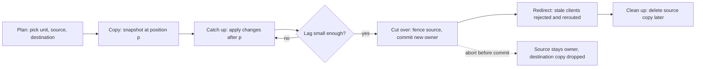
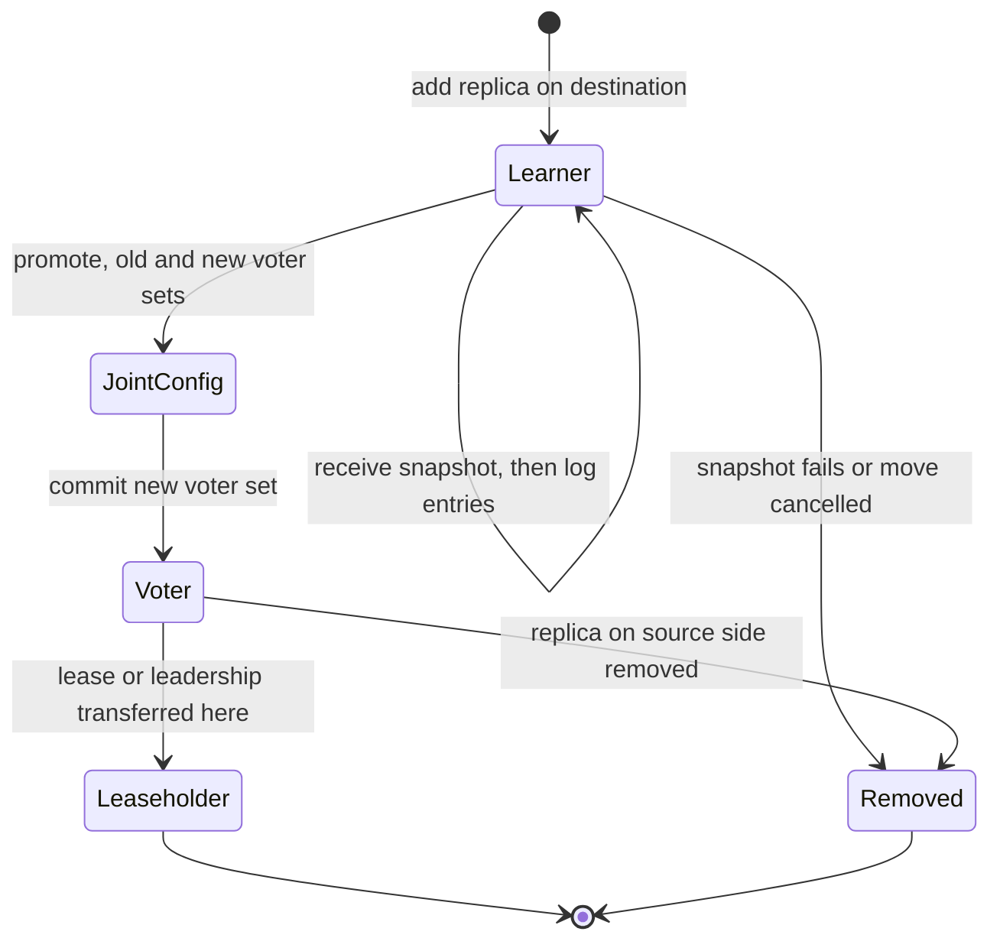
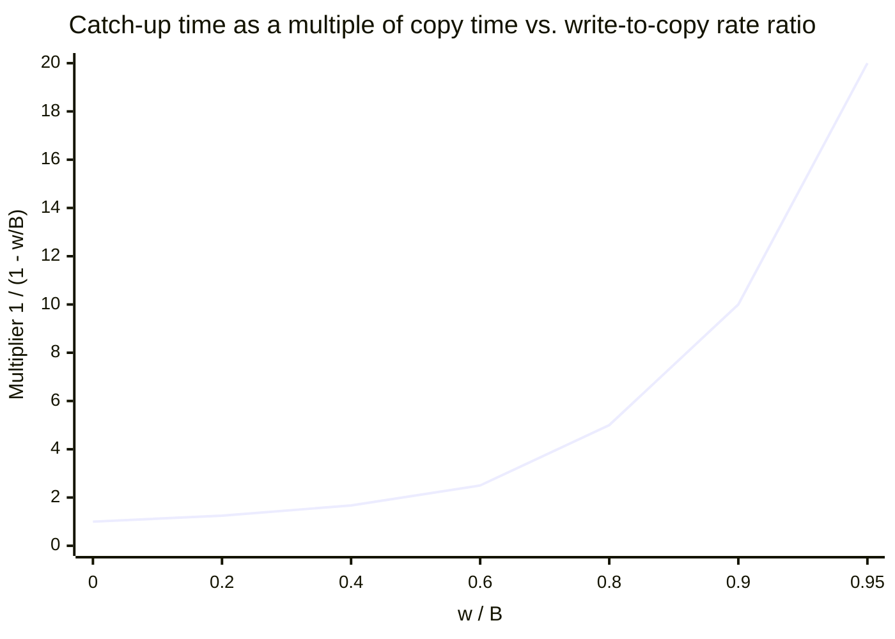
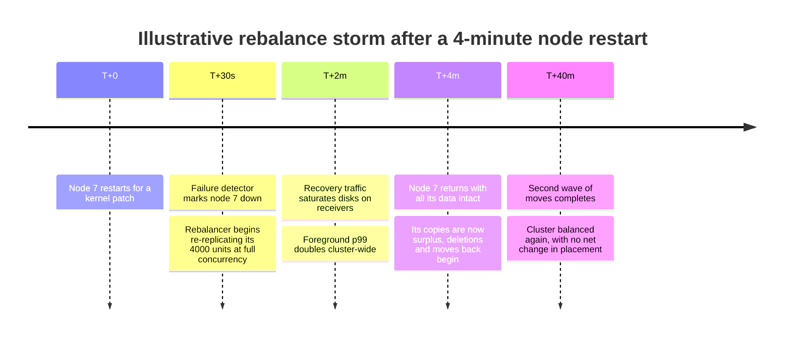

Dinamik yeniden dengeleme (dynamic rebalancing), bir partition'ın, range'in, slot'un ya da shard replica'sının sahipliğini, o partition okuma ve yazma kabul etmeye devam ederken bir node'dan diğerine aktarmaktır. Yerleşim fonksiyonu, ister bir [hash şeması](/distributed-systems/tr/data-management/data-partitioning/hash-partitioning/), ister [sanal düğümlü bir halka](/distributed-systems/tr/data-management/data-partitioning/consistent-hashing/), ister bir [range dizini](/distributed-systems/tr/data-management/data-partitioning/key-range-partitioning/) olsun, yalnızca verinin nerede yaşaması gerektiğini söyler. Yeniden dengeleme, verinin gerçekten orada yaşamasını sağlayan protokoldür: hâlâ değişmekte olan baytları kopyalar, yeni sahibin yetkili hâle geldiği anı belirler, değişiklikten haberi olmayan client'ları yönlendirir ve hâlâ ihtiyaç duyulan hiçbir şeyi silmeden eski kopyayı siler.

Her bölümlenmiş depo buna ihtiyaç duyar, çünkü ilk yerleşimi belirleyen koşullar kalıcı değildir. Node'lar kapasite için eklenir, bakım için ya da arıza sonrasında çıkarılır; partition'lar eşitsiz büyür; yük tenant'lar ve günün saatleri arasında kayar. Çevrim içi taşıma olmadan bu olayların her biri ya bir bakım penceresine ya da en sıcak node'una göre boyutlandırılmış, kalıcı olarak dengesiz bir kümeye dönüşür. Zor olan veriyi kopyalamak değildir; o bir toplu aktarımdır. Zor olan, kopyalama sırasında yazılmaya devam eden veriyi kopyalamak ve ardından sahipliği, aynı anahtar için iki node'un yazma kabul ettiği ya da hiçbir node'un kabul etmediği bir an oluşmadan değiştirmektir.

Asıl denge, bir taşımanın hızı, canlı trafiğe müdahalesi ve taşıma sürerken verinin sahip olduğu yedeklilik arasındadır. Bir taşıma, partition'ı kaynakta diskten okur, ağ üzerinden gönderir, hedefte diske yazar ve daha sonra kaynakta siler; bu işin her baytı ön plan istekleriyle yarışır. Yavaş taşımak gecikmeyi korur ama kümenin dengesiz kaldığı pencereyi, arızalı bir node'un verisinin tasarlanandan az kopyayla kaldığı pencereyi ve sıcak bir partition için, hedefin throttle edilmiş kopyadan daha hızlı gelen yazmalara yetişmesi için gereken süreyi uzatır. Hızlı taşımak bu pencereleri kısaltır ve gecikme bütçesini harcar. İkinci bir denge devrin (cutover) içindedir: yazmaları hiç durdurmayan protokoller consensus ya da çift yazma ve daha fazla mekanizma gerektirir; yazmaları kısa bir kritik bölge boyunca durduran protokoller daha basittir ve bedelini, uzunluğu hedefin ne kadar geride olduğuna bağlı bir duraklamayla öder.

## Bir Taşımanın Anatomisi: Planla, Kopyala, Yetiş, Devret, Temizle

Üretimdeki her yeniden dengeleme protokolü, farklı terimler kullansa da aynı beş aşamayı yürütür: bir planlayıcı bir birim, bir kaynak ve bir hedef seçer; hedef, birimin geçmişindeki belirli bir konum itibarıyla tutarlı bir kopya alır; o konumdan sonra yapılan değişiklikleri uygular; yetki tek ve sıralı bir noktada devredilir; ve kaynağın kopyası, onu hâlâ kullanabilecek hiçbir okuyucu kalmadığında silinir.


*Yeniden dengeleme protokollerinde ortak olan beş aşama. Yetişme ile gecikme kontrolü arasındaki döngü, sıcak partition'ların takıldığı yerdir; iptal kenarı yalnızca commit noktasından önce vardır.*

Diyagram, her tasarımın koruması gereken iki özelliği gösterir. Birincisi, tam olarak bir commit noktası vardır: devre giren ok. Ondan önce sahip kaynaktır, ondan sonra hedeftir. Ondan önceki her şey sonuçsuz biçimde terk edilebilir: kopyalama sırasında çöken bir hedef yalnızca kendi üzerinde çöp bırakır. Ondan sonraki her şey tamamlanmak zorundadır: sahip hedefse, verinin kendisi onun kopyasıdır. İkincisi, kopyalama ve yetişme farklı maliyetleri olan farklı etkinliklerdir. Kopyalamayı birimin boyutu ve aktarım hızı sınırlar. Yetişmeyi ise birime gelen yazma hızının bu aktarım hızına oranı sınırlar; küçük ve sıcak bir partition'ın büyük ve soğuk bir partition'dan daha zor taşınabilmesinin nedeni budur.

### Bir Taşımanın Garanti Ettikleri ve Etmedikleri

Doğru bir yeniden dengeleme protokolü dört şeyi garanti eder. Onaylanmış her yazma, hedef sahip olduğu anda hedefte bulunur. Her an, deponun tutarlılık modeli altında belirli bir anahtar için yazma kabul edebilen en fazla bir node vardır; lidersiz depolarda ise yazma alan node kümesi, bir okuyucunun başvurabileceği her kümenin üst kümesidir. Bayat (stale) bir rotaya sahip client, yanlış kopyadan yanıt almak yerine reddedilir ya da yönlendirilir. Ve iyi tasarlanmış protokollerde verinin kalıcı kopya sayısı, taşımanın kendisi yüzünden yapılandırılmış replikasyon faktörünün altına hiç düşmez.

Ön plan gecikmesinin etkilenmeyeceğini garanti etmez; taşıma her iki uçta da disk, ağ, CPU ve cache tüketir. Sonrasında dengeyi garanti etmez, çünkü planlayıcı zaten bayatlamış olabilecek ölçümlerle çalışır ve tek bir ağır anahtarı bölemez; bu problem [Çarpıklık ve Hot-Spot Problemleri](/distributed-systems/tr/data-management/data-partitioning/skew-hot-spots/) sayfasında ele alınır. Çok birimli bir taşımayı atomik yapmaz: on range'i taşımak on bağımsız taşımadır ve taşıma sırasında bunlara yayılan bir sorgu bir kısmını eski sahipte, bir kısmını yenisinde görür. Ve partition sınırlarını değiştirmez; range'leri bölmek ve birleştirmek, [anahtar aralığı bölümleme sayfasında](/distributed-systems/tr/data-management/data-partitioning/key-range-partitioning/) anlatılan ayrı bir işlemdir; yeniden dengeleyiciler bir range'in yarısını taşımadan hemen önce onu sık sık bölse de.

### Kopyalama ve Yetişme: Bir Snapshot Artı Sonrasındaki Değişiklikler

Bir birim yazılırken bayt bayt kopyalanamaz, çünkü kopya farklı anlara ait durumları karıştırır. Bu yüzden her protokol, birimin geçmişindeki bir `p` konumu itibarıyla tutarlı bir snapshot kopyalar (bir Raft log index'i, bir replikasyon log offset'i, bir LSM sıra numarası, bir oplog zaman damgası) ve `p`'den sonraki her değişikliği ayrıca aktarır. Snapshot, zaten değişmez dosyalar tutan depolama motorlarında ucuza üretilir: LSM-tree motoru SSTable'larını olduğu gibi gönderir, Raft tabanlı bir depo ise uygulanmış bir index'teki durum makinesinin snapshot'ını yollar. Yerinde güncelleme yapan motorlar, sabit bir zaman damgasında bir okuma transaction'ına ya da Redis'in replikasyon snapshot'larında yaptığı gibi bir fork'a ihtiyaç duyar.

Değişiklik akışı, kaynakta yazmaları zaten sıralayan mekanizmadan gelir. Raft tabanlı depoların ayrı bir mekanizmaya ihtiyacı yoktur: hedef replikasyon grubuna katılır ve yeni log kayıtlarını normal replikasyon yolu üzerinden alır. Primary tabanlı depolar kendi log'larını izler: MongoDB kopyalama sırasında taşınan range'e yapılan değişiklikleri okur, Vitess'in VReplication'ı MySQL binary log'unu okur ve Redis 8.4'ün atomik slot taşıması, snapshot birinci bağlantı üzerinden gönderilirken artımlı yazmaları ikinci bir bağlantı üzerinden akıtır. Lidersiz depolar akışı tümüyle atlar: eski veri stream edilirken yeni yazmaları doğrudan hedefe gönderirler; bu da aşağıda gösterileceği gibi devir problemini değiştirir.

Yetişme aşaması yalnızca hedef değişiklikleri geldiklerinden daha hızlı uyguladığında yakınsar. `S` baytlık kopya saniyede `B` bayt hızla ilerlerken birim saniyede `w` bayt yazma alıyorsa, ilk geçişten sonraki birikim `S * w / B`, ikinciden sonra `S * (w / B)^2` olur ve böyle devam eder. Toplam süre `S / (B - w)`'dir; bu, kopyalama süresinin `1 / (1 - w / B)` ile çarpımıdır. `w`, `B`'ye yaklaştıkça çarpan sınırsız büyür; `w`, `B`'yi aştığında ise birikim küçülmek yerine büyür.

### Devir: Yetkiyi Fence'lenmiş Bir Noktada Aktarmak

Yetişme yalnızca kalan açığı küçültür; yazmalar gelmeye devam ettikçe onu kendi başına asla kapatmaz. Devir, açığı tek bir sahiplik değişikliğini her yazmaya göre sıralayarak kapatır. Kaynak, birim için yazma kabul etmeyi bir `f` konumunda (fence) durdurur, hedef `f`'ye kadar her şeyi uygular ve hedefi sahip olarak adlandıran bir metadata kaydı commit edilir. Bu commit, taşımanın doğrusallaştırma (linearization) noktasıdır. Fence'den sonra kaynağa ulaşan istekler, client'a rotasını yenilemesini söyleyen bir hatayla reddedilir; commit'ten önce hedefe ulaşan istekler de aynı nedenle reddedilir. Bayat rotaları zararsız kılan sunucu tarafı sahiplik kontrolleri, descriptor sürümleri ve epoch numaralarıyla birlikte, bölme protokolüyle beraber [anahtar aralığı bölümleme sayfasında](/distributed-systems/tr/data-management/data-partitioning/key-range-partitioning/) açıklanır; bir taşıma da aynı kontrollere dayanır.

```mermaid
sequenceDiagram
    autonumber
    participant C as Client
    participant S as Source owner
    participant D as Destination
    participant M as Metadata store
    S->>D: Snapshot of unit at position p
    S->>D: Changes after p, repeated batches
    Note over S,D: Backlog shrinks while w is below B
    rect rgb(70, 50, 50)
    Note over S: Fence: stop writes to unit at position f
    C->>S: Write k=x
    S-->>C: Retry later, unit in critical section
    S->>D: Final changes up to f
    D-->>S: Applied through f
    S->>M: Commit owner = Destination, version v+1
    end
    C->>S: Retry write k=x
    S-->>C: Stale route, owner is Destination v+1
    C->>D: Write k=x with version v+1
    D-->>C: OK
```


*Snapshot, yetişme ve kritik bölgeli bir devir. Gölgeli blok, birime yapılan yazmaların reddedildiği ya da bekletildiği tek aralıktır; uzunluğu, son birikimi boşaltma ve tek bir metadata kaydını commit etme süresidir.*

1. ve 2. adımlar, kaynak trafiğe normal biçimde hizmet verirken çalışır ve dakikalar ya da saatler sürebilir. Gölgeli blok, yani 3. ila 7. adımlar, kritik bölgedir ve iyi protokoller bu bölgeye yalnızca kalan birikim küçükken girer: MongoDB 5.0 ve sonrası bu eşiği, altına inildiğinde yazmaların bloke edilebileceği, henüz aktarılmamış range payı olarak `maxCatchUpPercentageBeforeBlockingWrites` ile sunar; Vitess ise replikasyon gecikmesi `--max-replication-lag-allowed` değerini aştığında primary trafiğini devretmeyi reddeder. 4. adım, client'ların kritik bölge sırasında gördüğünü gösterir: yeniden denemeleri gereken bir hata ya da bir proxy tarafından bekletilen bir istek. Vitess'in VTGate'i devir sırasında sorguları tamponlayabilir, böylece uygulamalar hata yerine gecikme görür. 8. ila 10. adımlar commit sonrasındaki yönlendirmedir; taşınan her birim için client başına bir ek round trip'e mal olur ve bu maliyet ancak çok sayıda birim aynı anda taşındığında problem hâline gelir.

### Protokol Neden Doğru

Sistemin bir client'a onayladığı herhangi bir `x` yazmasını ele alalım. Üç durumdan tam olarak biri geçerlidir. Kaynak `x`'i `p`'den önceki bir konumda uyguladıysa, `x` snapshot'tadır. `x`'i `p` ile fence `f` arasındaki bir konumda uyguladıysa, değişiklik akışındadır ve hedef, onu uygulamadan "`f`'ye kadar uygulandı" demez. `x` commit'ten sonra uygulandıysa, onu hedef uygulamıştır, çünkü kaynak `f`'den sonraki her şeyi, hedef de commit'ten önceki her şeyi reddeder. Onaylanmış hiçbir yazma bu durumların arasına düşmez, çünkü fence ve commit, yazmalarla aynı tarihçe içinde sıralanır: fence kaynağın log'unda bir konumdur ve commit ancak hedef o konumu doğruladıktan sonra gerçekleşir.

Aynı argüman sahipliğin neden münhasır olduğunu da gösterir. Commit'ten önce hedef istekleri reddeder, dolayısıyla yazma kabul edebilen yalnızca kaynaktır; fence'den sonra kaynak da edemez. Commit'ten sonra kaynak reddeder, çünkü fence'i kalıcıdır ve metadata'sı artık başka bir sahibi gösterir. Fence ile commit arasındaki aralıkta hiç yazan yoktur, kritik bölgenin bedeli budur; ama asla iki yazan yoktur.

Arızalar, commit'in hangi tarafına düştüklerine göre ele alınır. Commit kaydı kalıcı hâle gelmeden önce kaynak, hedef ya da koordinatör arızalanırsa taşıma iptal edilir: kaynak fence'ini kaldırır ve sahip olarak kalır, hedefin kısmi kopyası atılır. Arıza commit'ten sonra olursa sahip hedeftir ve taşıma temizlik dışında tamamlanmıştır; kaynağın kopyası silinmesi gereken ama asla hizmet verilmemesi gereken sahipsiz (orphaned) veriye dönüşmüştür. Commit'in güçlü tutarlı bir depoda (bir config sunucusu replica set'i, bir Raft grubu, consensus destekli bir topoloji servisi) tek bir kayıt olması gerekmesinin ve "commit"i birkaç router'a yapılan bağımsız güncellemelerden oluşan bir protokolün güncelleme sırasında iyi tanımlanmış bir sahibi olmamasının nedeni budur.

:::danger[Kaynağı fence'lemeden rotaları değiştirmek yazma kaybettirir]
Bir tabloyu yeni bir shard'a kopyalayan, değişiklikleri izleyen ve ardından yönlendirme yapılandırmasını güncelleyen ev yapımı bir taşıma aracında, bazı router'ların yazmaları hâlâ kaynağa, diğerlerinin ise hedefe gönderdiği bir pencere vardır. Son değişiklik izlendikten sonra kaynağa düşen yazmalar onaylanır ve hiçbir zaman kopyalanmaz; aynı satıra iki tarafta yapılan yazmalar sessizce ayrışır. Herhangi bir router hedefe yönlendirilmeden önce kaynak, kaydedilmiş bir konumda birim için yazmaları reddetmeli ve hedef ilk yazmasını kabul etmeden önce o konuma kadar her şeyi uygulamış olmalıdır.
:::

## Üretimdeki Dört Protokol Ailesi

Üretim sistemleri beş aşamayı esaslı biçimde farklı dört yolla uygular. Bu yollar, değişiklik akışının nereden geldiği, yazmaların hiç duraklayıp duraklamadığı ve taşıma sırasında yedekliliğin düşüp düşmediği bakımından ayrışır.

### Önce Replica Ekle, Sonra Birini Çıkar: Raft Depoları ve Kafka

Her birimin zaten replike bir grup olduğu bir depoda taşıma bir üyelik değişikliğidir: hedefte bir replica ekle, yetişmesini bekle ve kaynaktaki replica'yı çıkar. CockroachDB ve TiKV her range ya da region için Raft grupları kullanır; Kafka ise her partition için bir leader ve bir in-sync replica kümesi (ISR) kullanır. Yazmalar için ayrı bir devir protokolü yoktur, çünkü grubun replikasyonu her yazmayı zaten her üyeye gönderir; commit noktası, grubun kendi log'undaki yapılandırma değişikliğidir.


*Bir yeniden dengeleyicinin bir range'i taşımak için eklediği replica'nın yaşam döngüsü. Kaynak replica aynı makineyi tersinden izler: çıkarılmadan önce leadership ondan uzaklaştırılır.*

Yeni replica bir learner (oy vermeyen üye) olarak başlar: durum makinesinin snapshot'ını ve ardından snapshot index'inden sonraki log kayıtlarını alır, ama commit quorum'una sayılmaz. Bu hem doğruluk hem erişilebilirlik açısından önemlidir. Üç üyeli bir grup, verisi olmayan dördüncü bir voter ekleseydi, quorum dörtte üç olurdu ve orijinal üyelerden birinin yavaşlaması ya da arızalanması, boş voter yardım edemezken grubu commit edemez hâle getirirdi. Learner olarak yeni replica, quorum'u zayıflatmadan yetişmek için ihtiyaç duyduğu kadar zaman harcayabilir. Yetiştiğinde terfi ettirilir. Birden fazla voter'ı aynı anda değiştirmek (hedefi eklemek ve kaynağı tek adımda çıkarmak), kararların hem eski hem yeni voter kümesinin çoğunluğunu gerektirdiği ara bir yapılandırma olan joint consensus ile yapılır; böylece değişiklik sırasında birbirinden ayrık iki çoğunluk oluşamaz. Mekanizma [Raft üyelik değişikliklerinin](/distributed-systems/tr/coordination/consensus-algorithms/raft/) bir parçasıdır. CockroachDB, learner replica'ları v19.2'de, joint consensus üzerinden atomik replikasyon değişikliklerini ise v20.1'de getirdi. TiKV'nin zamanlayıcısı Placement Driver (PD), aynı taşımayı "hedef store'a learner ekle, onu voter'a terfi ettir, kaynak store'daki peer'ı çıkar" adımlarından oluşan bir operator olarak ifade eder; kaynak leadership'i tutuyorsa araya leader transferi eklenir.

Kaynak replica çıkarılmadan önce lease ya da Raft leadership'i ondan alınmalıdır, çünkü okumalara leaseholder hizmet verir ve yazmaları o koordine eder. Lease transferi ucuzdur; veri taşıma değil, bir metadata işlemidir ve sık sık tek başına kullanılır: bir node veri yüzünden değil istekler yüzünden aşırı yüklendiğinde, leaseholder'ları mevcut replica'lar arasında taşımak tek bir bayt kopyalamadan yükü dengeler.

Kafka'nın partition yeniden ataması (reassignment) aynı sırayı farklı mekanizmalarla izler. Yeniden atama, partition'ın replica listesini eski ve yeni replica'ların birleşimine ayarlar; dolayısıyla replikasyon faktörü geçici olarak artar. Yeni replica'lar leader'dan herhangi bir follower gibi fetch eder ve yetiştiklerinde ISR'a eklenir; ardından gerekirse leadership tercih edilen yeni replica'ya geçer ve hedef listede artık bulunmayan replica'lar çıkarılıp log'ları silinir. Kafka 2.4'ten (KIP-455) bu yana yeniden atamalar, controller'ın toplu olarak işlediği tek bir ZooKeeper düğümü yerine, eklenen ve çıkarılan replica'ları açıkça izleyen ve devam eden bir yeniden atamanın iptal edilmesine izin veren bir Admin API üzerinden gönderilir. Kafka bir partition'ın verisini daha küçük birimler hâlinde taşımaz; bu yüzden büyük bir partition'ın kopyası, tüm log'unun throttle edilmiş hızda aktarılması kadar sürer.

Bu ailenin belirleyici özelliği yedekliliğin hiç düşmemesidir: replica sayısı üçten dörde çıkar ve tekrar üçe iner. Bedeli, kaynakta herhangi bir şey serbest bırakılmadan önce hedefin tam bir kopya tutmak zorunda olması ve hedefteki diskin, kaynaktaki disk boşalmadan önce dolmasıdır.

### Snapshot, Akış ve Kısa Bir Yazma Duraklaması: MongoDB, Vitess, Redis 8.4

Her birimin tek bir primary'si olduğu ve hedefin farklı bir primary olduğu depolar, yukarıdaki sıralama diyagramındaki tam snapshot, yetişme ve kritik bölge protokolüne ihtiyaç duyar.

MongoDB'nin balancer'ı her seferinde bir range'i bir donör shard'dan bir alıcı shard'a taşır. Belgelenmiş prosedür şöyledir: balancer kaynağa `moveRange` gönderir; kaynak range için okuma ve yazmalara hizmet vermeye devam eder; hedef eksik index'leri oluşturur, range'in belgelerini ister ve kopyalar, ardından kopyalama sırasında yapılan değişiklikleri senkronize eder; tam senkronize olduğunda kaynak, config sunucularındaki küme metadata'sını yeni konumla günceller; güncellemeden sonra ve range üzerinde açık cursor kalmadığında kaynak kendi kopyasını siler. Range'e yapılan yazmalar yalnızca son senkronizasyon ve metadata commit'i boyunca bloke edilir. Silme kasıtlı olarak asenkron ve gecikmelidir: commit'ten sonra donörde kalan belgeler sahipsiz belgelerdir (orphaned documents); shard'ın yönlendirme sürümü kontrolleriyle okumalardan filtrelenir ve daha sonra bir range deleter tarafından parti parti silinir, çünkü büyük bir range'i silmek cache ve I/O için canlı trafikle yarışır.

Vitess bir keyspace'i bir VReplication iş akışıyla yeniden shard'lar. Hedef shard'lar, kaynak tabloları okuyan bir kopyalama aşaması ve onu izleyen, kaynaktan gelen bir binary log olay akışıyla doldurulur. Trafik tablet türüne göre devredilir: replica ve salt okunur trafik önce devredilebilir; böylece yeni shard'lar okumalara hizmet verirken yazmalar hâlâ eskilerine gider. Primary trafiğini devretmek kaynak primary'lerde yazmaları durdurur, hedeflerin yetişmesini bekler, topoloji servisindeki yönlendirme kurallarını günceller ve varsayılan olarak yeni shard'lardan eskilerine doğru ters bir replikasyon akışı başlatır. Vitess'i ayıran özellik bu ters akıştır: devirden sonra eski shard'lar güncel kalır, dolayısıyla yeni shard'lar sorun çıkarırsa `ReverseTraffic` taşımayı geri alabilir. İş akışı, eski shard'ları ve replikasyon artıklarını kaldıran ayrı bir `Complete` adımıyla sonlandırılır; o ana kadar geri dönmek ucuzdur.

Redis 8.4, Redis Cluster için atomik slot taşımasını (atomic slot migration) getirdi. Bu yöntem bir hash slot aralığını, fork edilmiş bir snapshot'ı bir bağlantı üzerinden gönderip artımlı yazmaları diğer bağlantı üzerinden akıtarak taşır; ardından kaynakta yazmaları kısa süre duraklatır, kalanları iletir ve slot'ların sahipliğini, hedefin cluster bus üzerinden yayımladığı tek bir adımda devreder. 8.4 ve sonrasını çalıştıran kümelerde aşağıda anlatılan anahtar anahtar yöntemin yerini alır.

Bu aile bedelini, kalan birikimle boyutlanan bir yazma duraklaması ve commit'ten sonra temizlenmesi gereken bir kaynak kopyasıyla öder; yedeklilik düşmez, çünkü her shard kendi replica'larını korur.

### Eski ve Yeni Sahiplere Birlikte Yazmak: Cassandra'da Bekleyen Range'ler

Lidersiz depolarda yazmaların fence'leneceği tek bir node yoktur, bu yüzden protokolü tersine çevirirler: hedef, eski veriye sahip olmadan önce yeni yazmaları almaya başlar. Bir Cassandra node'u bootstrap olduğunda, sahip olacağı token range'leri onun için bekleyen range'ler (pending ranges) hâline gelir. Koordinatörler, bekleyen bir range'e yapılan her yazmayı doğal replica'lara ve bekleyen node'a gönderir ve gereken onay sayısını bekleyen replica sayısı kadar artırır; böylece tutarlılık seviyesini karşılayan bir yazma, hem eski hem yeni yerleşim altında yeterli sayıda node'da kalıcı olur. Asıl problem ve çözümü CASSANDRA-833'te kayıtlıdır: ek onaylar olmadan bir yazma, range'i kaybetmek üzere olan replica'lar tarafından karşılanabilirdi ve bootstrap tamamlanıp eski replica'lar temizlendiğinde yazma çok az sahipte kalırdı.

Eski veri daha sonra stream ile gelir: mevcut replica'lar SSTable'ları ya da bunların aktarılan range'leri kapsayan kısımlarını katılan node'a gönderir. Stream bittiğinde node, gossip üzerinden normal bir üye olduğunu duyurur ve koordinatörler ondan okumaya başlar. Hiç yazma duraklaması yoktur, çünkü duraklatılacak tek bir yazan yoktur ve okumalar, katılan node'a verisi tamamlanmadan asla başvurmaz. Bedeli şudur: eski sahipler, bir operatör her birinde `nodetool cleanup` çalıştırana kadar devrettikleri range'lerin verisini tutmaya devam eder (bu komut SSTable'larını artık sahip olmadıkları range'ler olmadan yeniden yazar) ve ek onaylar, bekleyen range'lere yapılan yazmaları bu süre boyunca daha yavaş ve daha az erişilebilir kılar. Cassandra ayrıca varsayılan olarak çakışan range'lere birden fazla node'un eşzamanlı bootstrap olmasını reddeder, çünkü birkaç eşzamanlı taşımayla bekleyen range aritmetiği, doğruluğun kırılganlaştığı yerdir.

### Anahtarları Tek Tek Yönlendirmelerle Taşımak: Klasik Redis Cluster

Atomik slot taşımasından önce Redis Cluster bir hash slot'u her seferinde bir anahtar taşıyarak aktarıyordu. Operatör slot'u önce hedefte `IMPORTING`, sonra kaynakta `MIGRATING` olarak işaretler; bu sıra, kaynak herhangi bir yönlendirme göndermeden önce hedefin yönlendirilen istekleri kabul etmeye hazır olmasını sağlar. Ardından bir araç slot'taki anahtarları listeler ve onları `MIGRATE` ile partiler hâlinde taşır; bu komut her anahtarı serileştirir, hedefte geri yükler ve kaynaktan siler, hepsini her iki uçta da bloke eden tek bir işlem olarak yapar. Slot taşınırken kaynak, hâlâ sahip olduğu anahtarlar için komutlara hizmet verir ve sahip olmadıkları için `ASK` yanıtı döner; client o tek komutu, önüne `ASKING` koyarak hedefte yeniden dener ve slot haritasını güncellemez. Anahtarları iki node arasında bölünmüş çok anahtarlı bir komut `TRYAGAIN` alır. Slot kaynakta boşaldığında `CLUSTER SETSLOT ... NODE` slot'u hedefe atar; önce hedefte, sonra kaynakta, çünkü önce kaynağı güncellemek ve değişikliği öğrenmeden önce hedefi kaybetmek slot'u sahipsiz bırakır.

Protokol slot'u hiç duraklatmaz ve her anahtarın her an tam olarak bir konumu vardır; protokolü fence olmadan doğru kılan da budur. Zayıflıkları; her client'ın yönlendirme bedeli ödediği uzun bir karışık konum aralığı, geçici olarak başarısız olan çok anahtarlı işlemler ve tek bir `MIGRATE` işlemi serileştirme süresince her iki node'u bloke eden çok büyük anahtarlardır.

### Ailelerin Karşılaştırması

| Aile | Sistemler | Yazma duraklaması | Taşıma sırasında yedeklilik | Temizlik | Ne zaman tercih edilmeli |
|---|---|---|---|---|---|
| Önce ekle, sonra çıkar | CockroachDB, TiKV, Kafka | Yok; leadership transferi kısa | Hedefin üstünde (RF + 1) | Kaynak replica yapılandırma değişikliğiyle çıkarılır | Birimler zaten replike gruplar; sürekli erişilebilirlik geçici diskten daha önemli |
| Snapshot, akış, kritik bölge | MongoDB, Vitess, Redis 8.4 | Kısa, kalan birikimle boyutlanır | Değişmez (her shard replica'larını korur) | Sahipsiz kaynak verisinin gecikmeli silinmesi | Tek primary'li shard'lar; saniyenin altında bir duraklama kabul edilebilir ve geri dönüş mümkün olmalı |
| Bekleyen sahibe çift yazma | Cassandra | Yok | Yazmalar ek onay gerektirir | Eski sahiplerde elle `nodetool cleanup` | Tek bir yazanın bulunmadığı lidersiz quorum depoları |
| Yönlendirmelerle anahtar anahtar | 8.4 öncesi Redis Cluster | Slot başına yok; büyük anahtarlarda anahtar başına bloke | Değişmez | Örtük, anahtarlar taşındıkça silinir | Küçük değerler ve az sayıda çok anahtarlı işlem; eski kümeler |

Taşıma sırasında bedeli her zaman biri öder: ilk ailede hedef diski ve geçici bir dördüncü kopya; ikincide bir duraklama; üçüncüde bekleyen range'lerde yazma gecikmesi ve erişilebilirlik; dördüncüde yönlendirmeler ve başarısız çok anahtarlı komutlar.

## Neyin, Ne Hızda Taşınacağına Karar Vermek

Protokol tek bir taşımayı güvenli kılar; kaç taşıma yapılacağına planlayıcı karar verir ve yeniden dengelemeyle ilgili operasyonel problemlerin çoğu çok fazla, çok hızlı ya da yanlış bir nedenle taşımaktan kaynaklanır.

Bir planlayıcı mevcut yerleşimi, kısıtlar ve hedefler olarak ifade edilmiş bir hedefle karşılaştırır. Kısıtlar sağlanmak zorundadır: bir birimin replica'ları farklı rack'lerde ya da zone'larda, hiçbir node bir disk doluluk eşiğinin üstünde değil, birim sayıları sınırlar içinde. Hedefler optimize edilir: eşit veri, eşit istek hızı ya da CPU, eşit leaseholder sayısı. Planlayıcı daha sonra hiçbir kısıtı ihlal etmeden hedefe olan mesafeyi azaltan sınırlı sayıda taşıma üretir. MongoDB'nin balancer'ı, herhangi iki shard arasındaki veri boyutu farkı yapılandırılmış range boyutunun üç katının altında kaldığı sürece bir koleksiyonu dengeli kabul eder (varsayılan 128 MB range için 384 MB) ve bir shard'ın aynı anda yalnızca bir taşımaya katılmasına izin verir; dolayısıyla `n` shard'lı bir küme eşzamanlı olarak en fazla `n / 2` taşıma çalıştırır. CockroachDB'nin allocator'ı replica sayılarını, disk kullanımını ve yükü dengeler ve lease'leri replica'lardan ayrı taşır. LinkedIn'in Cruise Control'ü, yerleşik bir yeniden dengeleyicisi olmayan Kafka için aynı rolü üstlenir: öncelikli hedefleri (rack farkındalığı, disk kapasitesi, ağ ve CPU dengesi) karşılayan bir yeniden atama hesaplar ve onu throttle edilmiş partiler hâlinde yürütür.

Davranışa üç planlayıcı parametresi hâkimdir. Eşik, yani histerezis, bir taşımadan önce ne kadar dengesizliğe tolerans gösterileceğini belirler: çok sıkı olursa planlayıcı birimleri ölçüm gürültüsü yüzünden ileri geri taşır; çok gevşek olursa node'lar eşitsiz dolar. Eşzamanlılık sınırı node başına ve küme başına kaç taşıma çalışacağını belirler: Elasticsearch varsayılan olarak node başına iki eşzamanlı gelen ve iki giden shard recovery'sine izin verir; TiKV'nin store limit'i ise peer ekleme ve çıkarma için store başına bir token bucket'tır, böylece operator'ler store'un snapshot'ları sindirebileceğinden daha hızlı tüketilmez. Bant genişliği throttle'ı her taşımanın saniyede kaç bayt kullanabileceğini belirler: Elasticsearch'ün `indices.recovery.max_bytes_per_sec` ayarı (uzun süredir geçerli varsayılanında node başına saniyede 40 MB) bir node'a giren ve çıkan tüm recovery trafiğini kapsar; CockroachDB yeniden dengeleme snapshot'ları için `kv.snapshot_rebalance.max_rate` ayarını sunar; Cassandra node başına giden stream'i sınırlar ve Kafka bir replikasyon kotasını yalnızca yeniden atanan replica'lara uygular.

Bir taşımanın maliyeti bayt sayısından fazladır. Kaynak birimi diskten okur ve çoğu zaman sıcak veriyi page cache'inden çıkarır. Hedef onu yazar ve LSM-tree motorunda alınan dosyaların daha sonra seviyelerine compact edilmesi gerekir; dolayısıyla [SSTables, Memtable ve Compaction Stratejileri](/distributed-systems/tr/data-management/storage-engines/sstables-memtable-compaction/) sayfasında anlatılan yazma amplifikasyonu taşıma bittikten sonra gelir. Lease ya da leadership taşındığında okumalar, cache'i birimin çalışma kümesini henüz tutmayan bir node'a gider ve o birimin gecikmesi cache ısınana kadar yükselir. Yalnızca baytları sayan bir planlayıcı sıcak birimleri taşımanın etkisini olduğundan düşük tahmin eder; birçok planlayıcının aynı veri dengesine ulaşmak için soğuk birimleri taşımayı tercih etmesinin nedeni budur.

Node kaybına tepki vermek en zor zamanlama kararıdır. Kalıcı olarak ölmüş bir node'un birimleri mümkün olan en kısa sürede yeniden replike edilmelidir, çünkü her dakika bir kopya eksikle geçen bir dakikadır. Bir kernel güncellemesi için yeniden başlayan bir node ise birkaç dakika içinde tüm verisiyle geri döner ve bu arada terabaytları yeniden replike etmek, sonradan geri alınması da gereken saf bir israftır. Sistemler bunu, bir node'u gitmiş saymadan önce bir gecikmeyle çözer: Elasticsearch ayrılan bir node'un replica'larını yeniden yerleştirmeden önce varsayılanı bir dakika olan `index.unassigned.node_left.delayed_timeout` kadar bekler; CockroachDB de heartbeat göndermeyi bırakan bir node'dan replica'ları taşımadan önce varsayılanı beş dakika olan `server.time_until_store_dead` kadar bekler. Gecikme, kısa bir azaltılmış yedeklilik penceresini bir yeniden dengeleme fırtınasının yokluğuyla takas eder.

### Sayısal Örnek: Bir Node'u Boşaltmak ve Yetişemeyen Bir Range

Her biri 512 MiB'lık range'lerde 3 TB replica verisi tutan on node'lu, Raft tabanlı bir depo ve node 10'u devreden çıkaran (decommission) bir operatör varsayalım. Yeniden dengeleyicinin, ön plan p99 gecikmesini hedefinde tutmak için (örnek amaçlı) seçilmiş olarak, alıcı node başına saniyede 100 MB gelen snapshot bant genişliği ve boşaltılan node'da saniyede 400 MB giden bant genişliği kullanabildiğini varsayalım. Bu örnekteki tüm sayılar örnek amaçlıdır.

Node 10'daki 3 TB yaklaşık `3e12 / 5.37e8`, yani kabaca 5.600 range replica'sıdır ve her birinin node 10'daki replica'sı çıkarılmadan önce başka bir yerde bir learner kazanması gerekir. Dokuz alıcı `9 * 100 = 900` MB/s sindirebilir, ama kaynak boşaltmayı 400 MB/s ile sınırlar; dolayısıyla kopya `3e12 / 4e8 = 7.500` saniye, yani iki saatten biraz fazla sürer. Diğer node'lardaki replica'lar da snapshot gönderen olarak davranabiliyorsa (daha yeni CockroachDB sürümleri bunu delegated snapshot'larla sağlar), kaynak sınırı ortadan kalkar ve sınır alıcılar olur: `3e12 / 9e8 = 3.333` saniye, yaklaşık 56 dakika. Darboğazın gönderenden alıcıya kayması, vnode sayısının node katılımları üzerindeki etkisiyle aynı etkidir; bu etki [Consistent Hashing](/distributed-systems/tr/data-management/data-partitioning/consistent-hashing/) sayfasında incelenir.

Range'lerin çoğu az yazma alır ve hemen yetişir. Saniyede `w` = 4 MB yazma alan ve snapshot akışı `B` = 50 MB/s ile sınırlanan bir range düşünelim. 512 MiB'lık snapshot `537 / 50 = 10.7` saniye sürer; `w / B = 0.08` ile toplam yetişme süresi `10.7 / (1 - 0.08) = 11.7` saniyedir. Şimdi saniyede 40 MB alan sıcak bir range düşünelim. `w / B = 0.8` ile çarpan 5'tir ve primary tabanlı bir protokol, birikim kritik bölge eşiğine inmeden önce 54 saniyelik bir yetişmeye ihtiyaç duyar. Yoğun bir saatte ön plan gecikmesini korumak için throttle 30 MB/s'ye düşürülürse `w`, `B`'yi aşar ve birikim her geçişte büyür: taşıma asla yakınsamaz.


*Kopyala-sonra-yetiş protokolü için yakınsama çarpanı `1 / (1 - w / B)`. 0.8'den sonra eğri keskin biçimde yükselir; 1.0'ın üstünde taşıma ıraksar.*

Eğri, sıcak birimler için throttle'ların neden node başına değil taşıma başına ayarlanması gerektiğini açıklar. On eşzamanlı taşımanın paylaştığı node başına bir throttle her birine bütçenin %10'unu verir; bu soğuk range'ler için bol, sıcak bir range için ölümcüldür. Raft deposunda sıcak range yakınsar, çünkü yeni log kayıtları learner'a snapshot akışından bağımsız olarak normal replikasyonla ulaşır; ama yavaş bir snapshot yoldayken leader log'unu snapshot'ın index'inin ötesine kadar kırpabilir, bu durumda learner'ın yeni bir snapshot'a ihtiyacı olur; range sıcak kaldıkça tekrarlanabilen bir döngü. Primary tabanlı bir protokol için çareler; sıcak birimi tam bütçeyle tek başına taşımak, önce bölerek her yarının yazmaların bir kısmını almasını sağlamak ya da daha uzun bir kritik bölgeyi kabul etmektir.

Yedeklilik aritmetiği de aynı ölçüde önemlidir. Önce ekle, sonra çıkar yaklaşımıyla her range iki saat boyunca üç replica'yı korur. Operatör bunun yerine node 10'u durdurup kümenin yeniden replike etmesine izin verseydi (yani "ölü node" yolu), 5.600 range'in her biri kopya süresini iki replica ile geçirirdi ve bu pencerede ikinci bir node arızası, her iki arızalı node'un paylaştığı range'leri tek replica ile, yani Raft'ın commit için ihtiyaç duyduğu çoğunluğun altında bırakırdı. Canlı bir node'u devreden çıkarmak ile ölü bir node'u değiştirmek, farklı risklere sahip farklı işlemlerdir; depoların "node'u durdur"u bir yeniden dengeleme gibi ele almak yerine açık bir drain ya da decommission komutu sunmasının nedeni budur.

### Üretimde Önem Taşıyan Yapılandırma

Aşağıdaki komutlar, taşımaların tümüyle operatör tarafından yürütüldüğü yaygın tek sistem olan Kafka'da throttle edilmiş bir yeniden atamanın şeklini gösterir.

```shell
# Generate a plan moving topic partitions off broker 5 (JSON lists topics)
kafka-reassign-partitions.sh --bootstrap-server b1:9092 \
  --topics-to-move-json-file topics.json --broker-list 1,2,3,4,6 --generate
# Execute with a replication throttle in bytes/s for the moving replicas only
kafka-reassign-partitions.sh --bootstrap-server b1:9092 \
  --reassignment-json-file plan.json --execute --throttle 50000000
# Poll until done; when complete, --verify also removes the throttle configs
kafka-reassign-partitions.sh --bootstrap-server b1:9092 \
  --reassignment-json-file plan.json --verify
```

Throttle, topic düzeyindeki throttle edilen replica listelerine uygulanan broker düzeyindeki hızlar (`leader.replication.throttled.rate`, `follower.replication.throttled.rate`) olarak uygulanır ve `--verify` tamamlanmış bir yeniden atamayı görüp onu kaldırana kadar yerinde kalır. Aynı kalıp, yani node başına bir hız artı bu hızın hangi aktarımlara uygulandığını belirten bir liste, başka sistemlerde başka adlarla tekrar karşımıza çıkar. Önemli olan, hızın taşınan en sıcak birimin yakınsamasına yetecek kadar yüksek, alıcının ön plan p99'unu hedefinde tutacak kadar düşük olması ve taşıma bittiğinde kaldırılmasıdır.

## Hata Modları ve İmzaları

Yeniden dengeleme hataları üç gruba ayrılır: devirdeki doğruluk hataları, yetişme sırasındaki yakınsama hataları ve taşımaların bir olayı daha da kötüleştirdiği amplifikasyon hataları.

### Fence'lenmemiş Bir Devirde Kaybolan ya da Ayrışan Yazmalar

Tetikleyici: kaynağı fence'lemeden yönlendirmeyi değiştiren bir taşıma; genellikle ev yapımı bir kopyala-ve-izle aracı ya da sırası karıştırılarak yürütülen bir dizi elle yapılan adım. Belirtiler: client'ların onaylandığını gördüğü ama yeni shard'da bulunmayan satırlar; eski ve yeni kopyalar arasında farklı olan satırlar; taşımayla örtüşen bir döneme ait "kayıp güncelleme" raporları. Sonradan tespit zordur; yukarıdaki danger kutusunun var olma nedeni budur. Güvenilir yöntem, kaynak silinmeden önce bilinen bir konumda kaynak ile hedef arasında bir veri karşılaştırması yapmaktır; Vitess'te `VDiff`'in rolü budur.

```mermaid
sequenceDiagram
    autonumber
    participant R1 as Router 1
    participant R2 as Router 2
    participant S as Old shard
    participant T as Tailer
    participant N as New shard
    T->>N: Changes up to position 900 applied
    Note over R1,R2: Config push begins, routers update one by one
    R1->>N: Write order 42 status=paid
    N-->>R1: OK
    R2->>S: Write order 42 status=cancelled, old route
    S-->>R2: OK at position 901
    Note over T: Tailer stopped at 900 when cutover started
    rect rgb(80, 40, 40)
    Note over S,N: Position 901 never reaches the new shard
    R2->>N: Read order 42 after its config updates
    N-->>R2: status=paid, the cancellation is gone
    end
```


*Fence'siz bir devir. Router 2 yazarken hâlâ eski rotayı tutar, eski shard yazmayı kabul eder ve hiçbir şey onu kopyalamaz. Sipariş numaraları ve konumlar örnek amaçlıdır.*

Hata üç bileşen gerektirir ve üçü de 5. adımda mevcuttur: bayat bir router, hâlâ yazma kabul eden bir kaynak ve durmuş bir izleyici (tailer). Hatayı her durumda yalnızca kaynağı fence'lemek ortadan kaldırır, çünkü router güncellemeleri asla anlık değildir ve bir izleyici son bayat router'ın ne zaman işini bitirdiğini bilemez. Olay sonrası çare, kaynak henüz silinmemişse kaynağın 900. konumdan sonraki log'undan yapılan bir uzlaştırmadır (reconciliation); her devirden sonra kaynağı ve log'unu bir süre saklamanın gerekçesi de budur.

### Asla Yakınsamayan Yetişme

Tetikleyici: yazma hızı aktarım hızına yaklaşan ya da onu aşan bir birim; çoğu zaman node başına bir throttle'ın birçok eşzamanlı taşıma tarafından paylaşılması ya da birimin [Çarpıklık ve Hot-Spot Problemleri](/distributed-systems/tr/data-management/data-partitioning/skew-hot-spots/) sayfasında anlatılan sıcak range'lerden biri olması nedeniyle. Belirtiler: boyutunun öngördüğünden çok daha uzun süre yetişme durumunda takılı kalan bir taşıma; MongoDB log'larında ve `config.changelog` içinde tekrarlanan kritik bölge zaman aşımları ve iptal edilen taşımalar; Raft depolarında aynı learner'a tekrarlanan snapshot'lar. Tespit: birim başına taşıma süresi, zaman içindeki yetişme birikimi (geçişler arasında küçülmeyen bir birikim imzadır) ve range başına snapshot sayıları. Hafifletme: o birimi daha yüksek bir taşıma başı bütçeyle tek başına taşımak, önce bölmek, daha düşük trafikli bir saatte taşımak ya da daha uzun bir kritik bölgeyi kabul etmek. Throttle'ı daha da düşürmeyin; bu oranı yanlış yöne iter.

### Geçici Bir Node Kaybından Sonra Yeniden Dengeleme Fırtınası

Tetikleyici: bir node birkaç dakika erişilemez olur (yeniden başlatma, ağ kesintisi, uzun bir garbage collection duraklaması) ve yeniden dengeleyici onu kalıcı olarak kaybolmuş sayar. Belirtiler: küme genelinde replikasyon ya da recovery trafiğinde ani artış; yalnızca etkilenen node'da değil her node'da yükselen ön plan gecikmesi; node geri döndüğünde planlayıcının artık boş ya da fazlalık olan replica'larını geri dengelemesiyle ikinci bir taşıma dalgası.


*Kısa bir arıza tespit gecikmesinin neden olduğu varsayımsal bir fırtına. Aynı iş zıt yönlerde iki kez yapılır; gerçek bir olay değildir.*

Fırtına yerleşimde kalıcı hiçbir değişiklik üretmedi ve küme genelinde iki I/O dalgasına mal oldu. Tespit: üyelik olaylarıyla ilişkili replica ya da shard recovery sayıları ve bir node'dan yapılan taşımaların kısa süre sonra aynı node'a geri taşımalarla izlenmesi. Hafifletme, bir node'dan şüphelenmek ile verisini yeniden replike etmek arasında, planlı yeniden başlatmaların gerçekte ne kadar sürdüğüne göre boyutlandırılmış bir gecikme (yukarıdaki varsayılanlarda bir ila beş dakika) ve operatörlerin kümeye bir node'un geçici olarak gideceğini bildirdiği bir bakım modudur. Gecikme, gerçekten ölmüş bir node'un birimleri uzun süre eksik replike bırakmayacağı kadar kısa kalmalıdır; tek bir arızayı tolere eden bir depo, gecikme artı kopya süresi boyunca veri kaybına açıktır.

### Rahatlatmaları Gereken Kümeyi Aşırı Yükleyen Taşımalar

Tetikleyici: aşırı yüklenmiş bir node'a, aşırı yük taşımanın tükettiği kaynaklardan kaynaklanıyorken veri taşıyarak yanıt veren bir planlayıcı ya da ön plan yüküne bakılmadan ayarlanmış bir throttle. Belirtiler: yeniden dengeleme gecikme zaten yüksekken başlar ve gecikme daha da yükselir; alıcılarda disk kuyruk derinliği büyür; LSM motorlarında, alınan dosyalar compaction beklerken hedeflerde seviye-0 dosya sayıları tırmanır ve yazma duraklamalarını (write stall) tetikler. Tespit: ön plan p99'u ve gönderen ile alıcılardaki disk kullanımıyla birlikte çizilmiş saniye başına yeniden dengeleme baytları; hedeflerdeki compaction birikimi. Hafifletme: istek kaynaklı aşırı yük için veri taşımayan lease ya da leadership transferlerini tercih etmek; yeniden dengeleme eşzamanlılığını ve hızını sınırlamak; olaylar sırasında otomatik yeniden dengelemeyi duraklatmak. Bu dinamik, [Retry Fırtınaları ve Metastabil Hatalar](/distributed-systems/tr/resilience/flow-control/retry-storms-metastable-failures/) sayfasında anlatılan geri beslemenin bir biçimidir: kapasiteyi geri getirmek için yapılan iş, eksik olan kapasitenin kendisini tüketir.

Bir varyantı, hiçbir node onu sindirecek kadar boş kapasiteye sahip olmadığı için sıcak bir birimi node'dan node'a taşıyan yeniden dengeleyicidir; mekaniği ve çareleri [çarpıklık sayfasına](/distributed-systems/tr/data-management/data-partitioning/skew-hot-spots/) aittir. Bir başka varyantı, binlerce birim aynı anda taşındıktan sonra metadata servisini aşırı yükleyen bayat rota sorguları patlamasıdır; bu, [anahtar aralığı bölümleme sayfasında](/distributed-systems/tr/data-management/data-partitioning/key-range-partitioning/) dizin aşırı yükü olarak anlatılır.

### Yarım Kalan Taşımalar ve Unutulan Artıklar

Tetikleyici: bir taşımanın koordinatörü, bir operatörün script'i ya da bir hedef node taşımanın ortasında arızalanır ya da taşıma tamamlanır ama son adımı hiç çalıştırılmaz. Belirtiler sisteme göre değişir. `MIGRATING` ve `IMPORTING` durumunda kalmış bir Redis Cluster slot'u süresiz olarak `ASK` yönlendirmeleri üretmeye devam eder; `redis-cli --cluster fix` bu durumu çözer. Hedef broker'ı kapalı olan bir Kafka yeniden ataması asla tamamlanmaz, çünkü yeni replica hiçbir zaman ISR'a katılmaz ve partition şişirilmiş bir replica listesiyle çalışır. Kimsenin `--verify` ile kaldırmadığı bir Kafka replikasyon throttle'ı, taşımadan çok sonra sıradan follower yetişmesini sınırlar; böylece bir sonraki broker yeniden başlatması ISR'ı geri getirmek için çok daha uzun sürer. `nodetool cleanup` hiç çalıştırılmamış Cassandra node'ları artık sahip olmadıkları range'lerin verisini tutar; bu diski boşa harcar ve o range'ler daha sonra onlara geri taşınırsa, silmeleri başka yerde uygulanmış ve tombstone'ları o arada temizlenmiş verinin geri dönmesi riskini doğurur.

Tespit: devam eden taşımaların envanteri (bekleyen yeniden atamalar, geçiş durumundaki slot'lar, config sunucusunun changelog'undaki MongoDB taşıma kayıtları), aktif yeniden atama olmadığı hâlde broker'larda bulunan throttle yapılandırmaları ve node başına diskteki boyutun sahip olunan boyutla karşılaştırılması. Kurtarma: her taşımayı sistemin kendi komutlarıyla açıkça tamamlamak ya da iptal etmek, throttle'ların kaldırılmasını ve temizlik adımını isteğe bağlı bir takip işi olarak değil taşımanın parçası olarak ele almak.

:::caution[Unutulan bir throttle, gizli bir olaydır]
Kafka'daki yeniden atama throttle'ları yeniden atamanın özellikleri değil, sıradan broker ve topic yapılandırmalarıdır ve broker yeniden başlatmalarından sağ çıkarlar. Büyük bir taşımadan sonra yerinde bırakılan bir throttle, o topic'lerdeki replica'ların sonraki herhangi bir kesintiden sonra ne kadar hızlı yetişebileceğini sessizce sınırlar. Broker'lardaki throttle yapılandırmalarını her taşıma sonrası kontrol listesinin ve rutin yapılandırma denetimlerinin parçası olarak kontrol edin.
:::

### Bir Bakışta Hata İmzaları

| Hata | Dışarıdan görünen belirti | Tespit sinyali | Hafifletme |
|---|---|---|---|
| Fence'siz devir | Taşımadan sonra onaylanmış yazmalar eksik ya da ayrışmış | Bilinen bir konumda kaynak ile hedef farkı | Rotaları değiştirmeden önce bir log konumunda fence; kaynağı ve log'unu bir süre sakla |
| Yakınsamayan yetişme | Taşıma boyut tahmininin çok ötesinde takılı | Geçişler arasında küçülmeyen birikim; tekrarlanan snapshot'lar | Daha yüksek taşıma başı bütçe, önce böl, yoğun olmayan saatte taşı |
| Yeniden dengeleme fırtınası | Kısa bir node kaybından sonra küme genelinde gecikme, ardından geri taşımalar | Üyelik olaylarıyla ilişkili recovery'ler | Gecikmeli yeniden yerleştirme, bakım modu |
| Kendi amacını baltalayan taşımalar | Yeniden dengeleme başlayınca gecikme kötüleşir | p99 ve disk kuyruk derinliğine karşı yeniden dengeleme baytları | Önce lease transferleri, hız ve eşzamanlılık sınırları, olay sırasında duraklat |
| Yarım kalan taşımalar | Bitmeyen yönlendirmeler, şişmiş replica listeleri, sonraki yavaş recovery | Aktif taşıma olmadan geçiş durumları ve throttle'lar | Açıkça tamamla ya da iptal et; temizlik taşımanın parçası |
| Sıcak birimi kovalayan yeniden dengeleyici | Hot spot node'dan node'a geçer | Aynı birimin tekrarlanan taşımaları | Bölme ya da anahtar düzeyinde çare (çarpıklık sayfası) |

## Bir Yeniden Dengeleme Stratejisi Seçmek

Deponun birimleri, tek bir taşıma saniyeler ile dakikalar sürecek kadar küçükse, protokol yerleşik ve fence'liyse ve küme birkaç ya da daha fazla node'dan oluşuyorsa otomatik yeniden dengeleme kullanın; aksi hâlde dengesizlik, operatörlerin düzeltebileceğinden daha hızlı birikir. Birim başına yüzlerce megabayt ve birim başına replikasyon kullanan range depoları (CockroachDB, TiKV, balancer'ıyla MongoDB) bunun için tasarlanmıştır ve balancer'larını kapatmak genellikle akıcı bir arka plan sürecini periyodik elle müdahale gerektiren acil durumlara dönüştürür.

Birimler büyük ve taşıma pahalıysa operatör tarafından yürütülen ya da planlayıcı destekli yeniden dengeleme kullanın: günlerce retention tutan Kafka partition'ları, onlarca gigabaytlık Elasticsearch shard'ları, terabaytlarca veri tutan Cassandra node'ları. Burada her taşıma, öngörülebilir süreye sahip bir kapasite planlama olayıdır ve doğru araç; bir plan öneren Cruise Control gibi bir planlayıcı, müdahalesini sınırlayan bir throttle ve onu yoğun saatlerin dışında tutan bir takvimdir.

Depo destekliyorsa her zaman önce ekle, sonra çıkar yaklaşımını tercih edin, çünkü taşıma boyunca yedekliliği hedefte ya da üstünde tutar. Birimlerin tek bir primary'si varsa ve saniyenin altında bir duraklama kabul edilebilirse kısa kritik bölgeli bir protokolü; taşıma geri alınması gerekebilecek tek yönlü bir mimari değişiklikse (daha fazla shard'a yeniden shard'lama) Vitess'in sağladığı gibi ters replikasyonlu bir protokolü tercih edin. Dengesizlik depolamada değil istek yükündeyse veriyi taşımadan önce lease'leri ya da leadership'i taşıyın, çünkü lease transferi bir kopya yerine bir metadata yazmasına mal olur.

Sıcak bir anahtarı düzeltmek için yeniden dengeleme yapmayın: anahtarın sahibi değişir ve sıcaklık onu izler. Otomatik bir yeniden dengeleyicinin bir node arızasına gecikme olmadan tepki vermesine izin vermeyin ve bu gecikmeyi deponun bir kopya eksikle çalışmayı göze alabileceği süreden uzun tutmayın. Kaynak kaydedilmiş bir konumda fence'lenmedikçe ve hedef yazma kabul etmeden önce o konuma kadar uygulamadıkça, kopyalayan, izleyen ve rotaları değiştiren ev yapımı bir taşıma kurmayın. Doygunluktan kaynaklanan bir olay sırasında, taşımanın kendisi doygun kaynağı rahatlatmıyorsa yeniden dengeleme yapmayın. Ve bu mekanizmayı aynı adı paylaşan diğer ikisiyle karıştırmayın: [Kafka consumer group yeniden dengelemesi](/distributed-systems/tr/case-studies/apache-kafka/consumer-group-rebalancing/) hangi consumer'ın hangi partition'ı okuyacağını yeniden atar ve hiç veri taşımaz; [sıfır kesintili veritabanı migration'ları](/distributed-systems/tr/deployment/deployment-patterns/zero-downtime-db-migrations/) ise yerleşimi değil, şemayı yerinde değiştirir.

:::tip[Taşımaları birinci sınıf işlemler olarak ölçün]
Her taşıma için birimini, kaynağını, hedefini, baytlarını, başlangıç ve bitiş zamanını, yetişme geçişlerini ve kritik bölge süresini dışa aktarın. Yeniden dengeleme olaylarının çoğu, bunlar ile ön plan gecikmesi arasındaki ilişkiden teşhis edilir ve çoğu depo varsayılan olarak yalnızca toplu sayıları kaydeder. Taşıma başına kayıt, bir throttle'ın çok düşük mü (soğuk birim taşımalarının boyutlarının öngördüğünden çok daha uzun sürmesi) yoksa çok yüksek mi (her partiyle yükselen ön plan p99'u) olduğunu da size söyler.
:::

:::note[Komşu mekanizmaların ele alındığı yerler]
Range'leri bölme ve birleştirme ile bayat rotaları reddeden sunucu tarafı epoch kontrolleri [Anahtar Aralığı Bölümleme](/distributed-systems/tr/data-management/data-partitioning/key-range-partitioning/) sayfasında ele alınır. Bir halkada üyelik değişikliğinin ne kadar veri taşıması gerektiği [Consistent Hashing](/distributed-systems/tr/data-management/data-partitioning/consistent-hashing/) sayfasında ele alınır. Yerleşim değişikliği olmadan arıza sonrası replica'nın yeniden oluşturulması ile replica'ları tutarlı tutan hint'ler ve onarım ise [Anti-Entropy: Okuma Onarımı ve Merkle Ağaçları](/distributed-systems/tr/data-management/replication/anti-entropy-merkle/) sayfasında ele alınır.
:::

## İleri Okuma

- Diego Ongaro and John Ousterhout, *In Search of an Understandable Consensus Algorithm*, USENIX Annual Technical Conference, 2014.
- Giuseppe DeCandia et al., *Dynamo: Amazon's Highly Available Key-value Store*, ACM SOSP, 2007.
- Martin Kleppmann, *Designing Data-Intensive Applications*, O'Reilly Media, 2017 (chapter 6, Partitioning).
- MongoDB, *Balancer Administration and Range Migration*, MongoDB Manual.
- Vitess, *Reshard* and *SwitchTraffic* reference, Vitess documentation.
- Apache Kafka, *KIP-455: Create an Administrative API for Replica Reassignment*, Apache Kafka wiki, 2019.
