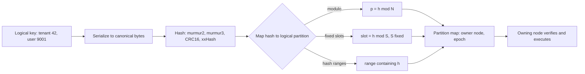
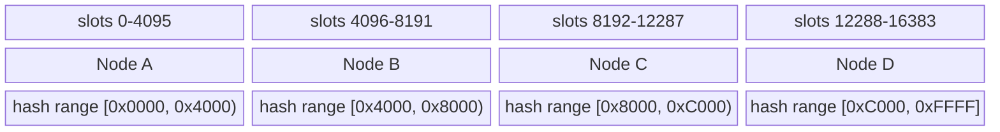
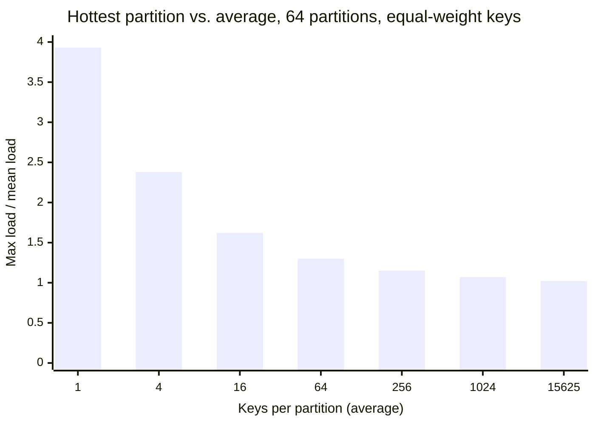
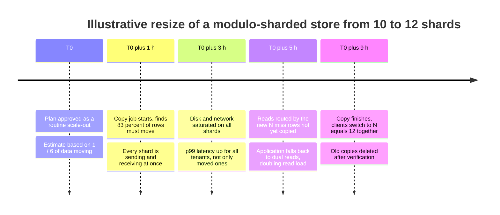
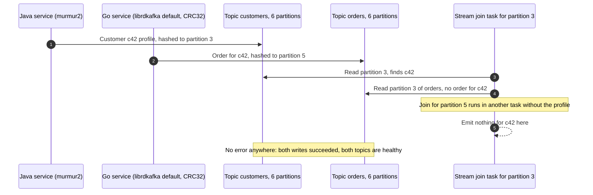

Hash bölümleme (hash partitioning), her anahtarı bir partition'a atarken anahtarın kendisini değil, anahtar üzerinde hesaplanan hash değerini partition kümesine eşler. Tek bir karakterle farklılaşan iki anahtar birbiriyle ilgisiz hash değerleri üretir ve dolayısıyla birbiriyle ilgisiz partition'lara düşer; herhangi bir yapı taşıyan anahtar akışı (ardışık ID'ler, zaman damgaları, ortak öneki paylaşan isimler) rastgeleymiş gibi dağıtılır. Yerleşim, hash fonksiyonunu ve partition haritasını bilen her client tarafından, range başına tutulan bir dizinde arama yapmadan hesaplanabilir.

Çözdüğü problem yoğunlaşmadır. Anahtarları sıralama düzenine göre yerleştirmek, yani [Anahtar Aralığı Bölümleme](/distributed-systems/tr/data-management/data-partitioning/key-range-partitioning/) yaklaşımı, monoton artan anahtarlı her insert'i son range'e, popüler bir öneke gelen her sorguyu da tek bir node'a gönderir. Hash, anahtarın neye benzediği ile nerede yaşadığı arasındaki bağı koparır; böylece bir dizinin yazma yükü, bir milyon tenant'ın verisi ve bir kullanıcı kitlesinin nokta okumaları partition'lar arasında sayılarıyla orantılı biçimde paylaştırılır. Kafka, Redis Cluster, Cassandra, DynamoDB, Elasticsearch, Citus ile MongoDB ve YugabyteDB'nin hash modları bunu birincil yerleşim şeması olarak kullanır.

Asıl denge, düzgünlük ile yerellik arasındadır. Hash anahtarların ağırlığını değil sayısını dengeler ve komşuluğu yok eder: bitişik bir anahtar aralığını isteyen ya da tam partition anahtarı üzerinde eşitlik eşleşmesi olmayan her sorgu, her partition'a sormak zorundadır. İkinci denge eşleme adımındadır. En basit eşleme olan `hash mod N` neredeyse kusursuz denge verir, ama `N` her değiştiğinde anahtarların çoğunu yerinden oynatır; yeniden boyutlandırmaya dayanan eşlemeler ise ya önceden belirlenmiş sabit sayıda mantıksal partition'a ya da hash'in kaçınmak istediği mekanizmanın bir kısmını geri getiren bir hash aralıkları dizinine ihtiyaç duyar.

## Anahtardan Partition'a: Hash Hattı

Hash ile bölümlenmiş her sistem aynı dört adımı işletir ve her adımın kendine özgü bir bozulma biçimi vardır. Anahtar önce kanonik bir byte dizisine dönüştürülür; byte'lar sabit genişlikte bir tamsayıya hash'lenir; bu tamsayı mantıksal bir partition'a eşlenir; mantıksal partition da o anda ona sahip olan node'u gösteren bir partition haritasında aranır.


*Hash hattı. İlk üç adım anahtarın ve yapılandırmanın saf bir fonksiyonudur; yalnızca son adım değişebilen duruma başvurur.*

Diyagramın sol yarısı saf bir fonksiyondur ve bu, hem şemanın gücünün hem de en tehlikeli hatasının kaynağıdır. Yerleşim yalnızca anahtar byte'larına, hash fonksiyonuna ve eşleme parametrelerine bağlı olduğundan, her client koordinasyon olmadan aynı cevabı hesaplar; bu yönlendirmeyi ucuzlatır ve Kafka'daki producer'ların bir broker'a sormadan partition seçmesine izin verir. Aynı nedenle iki client arasında bu üç girdiden herhangi birindeki fark, yani farklı bir serializer, farklı bir hash ya da farklı bir partition sayısı, hiçbir yerde hata üretmeden farklı bir cevap üretir. Sağ yarı ise sıradan değişebilen metadata'dır: epoch ya da sürüm numarası taşıyan bir partition-node tablosu. Aralık bölümlemeli bir depodaki range descriptor'larla tamamen aynı biçimde ele alınır: client'lar önbelleğe alır, sunucular doğrular.

### Hash Fonksiyonunun Sağlaması Gerekenler

Bölümleme için kullanılan bir hash'in dört özelliğe ihtiyacı vardır ve kriptografik güç bunlardan biri değildir. Süreçler, diller ve sürümler arasında deterministik olmalıdır; çünkü bir client'ın yazdığı ve bir başkasının okuduğu anahtar, veri yaşadığı sürece aynı biçimde hash'lenmelidir. Anahtarın kanonik bir kodlaması üzerinden hesaplanmalıdır; çünkü 42 tamsayısını sekiz big-endian byte olarak, `"42"` ASCII dizesi olarak ya da UTF-16 kod birimleri olarak hash'lemek birbiriyle ilgisiz üç sonuç verir. İyi bir çığ etkisi (avalanche) davranışı olmalıdır: herhangi bir girdi bitini çevirmek, her çıktı bitini yaklaşık yarı olasılıkla çevirmelidir ki yapılı girdiler bağımsız görünen çıktılar üretsin. Ve hızlı olmalıdır, çünkü her istekte çalışır.

Üretim sistemlerinin kriptografik olmayan hash'ler kullanmasının nedeni budur. Kafka'nın Java producer'ı 32 bitlik murmur2 kullanır; Cassandra'nın varsayılan `Murmur3Partitioner`'ı, ilk sürümlerdeki MD5 tabanlı `RandomPartitioner`'ın yerine 64 bitlik MurmurHash3 çıktısını token olarak kullanır; Redis Cluster CRC16 kullanır; Elasticsearch, routing dizesinin UTF-16LE kodlaması üzerinde 32 bitlik MurmurHash3 kullanır. Determinizm gereksinimi uygun görünen bazı fonksiyonları dışarıda bırakır. Python'un yerleşik `hash()` fonksiyonu, `PYTHONHASHSEED` sabitlenmedikçe Python 3.3'ten beri dizeler için her süreçte rastgeleleştirilir; dolayısıyla aynı servisin iki worker'ı aynı fikirde olmaz. Genel olarak dil runtime'larının hash kodları bellek içi hash tabloları için tasarlanmıştır, sürümler arasında değişebilir ve çoğu zaman alt bitleri zayıftır.

Zayıf alt bitler önemlidir, çünkü eşleme adımı genellikle geri kalan her şeyi atar. Bir hash'in ikinin kuvvetine göre modulo'sunu almak yalnızca alt bitlerini tutar. "Hash" anahtarın kendisiyse ya da alt bitleri olduğu gibi geçiren bir fonksiyonsa, partition'ı anahtarın alt bitlerinde hangi yapı varsa o belirler.

:::caution[İkinin kuvveti modulo ile birim (identity) hash, anahtarın en alt bitlerine göre bölümler]
Snowflake tarzı bir ID, milisaniye başına artan bir dizi sayacıyla biter ve az yüklü bir worker'da ID'lerin çoğunda bu sayaç sıfırdır. Ham ID'nin 1.024'e göre modulo'sunu partition olarak kullanmak yalnızca alt 10 biti, yani dizi sayacını tutar; böylece neredeyse her ID partition 0'a düşer. Bloklar hâlinde ya da sabit adımla ayrılan ID'lerde de aynısı olur. Anahtarlar zaten tamsayı olsa bile modulo'dan önce onları her zaman gerçek bir hash'ten geçirin; bu tür ID'lerin yapısı [Dağıtık ID Üretimi](/distributed-systems/tr/foundations/time-and-ordering/distributed-id-generation/) sayfasında ele alınır.
:::

İki özellik daha isteğe bağlıdır ve duruma göre önem kazanır. Gizli bir seed ile SipHash gibi anahtarlı (keyed) bir hash, anahtarları kontrol eden bir saldırganın hepsi aynı partition'a düşen anahtarlar seçmesini engeller; bu, Crosby ve Wallach'ın 2003'te bellek içi hash tablolarına karşı tanımladığı hash-flooding saldırılarının partition düzeyindeki biçimidir. Veri yerleşiminde nadiren kullanılır, çünkü her client'ın sırrı paylaşması gerekir ve seed, tüm veri taşınmadan asla değiştirilemez. Diğeri, hash'in veritabanının kendi index sıralamasıyla tutarlılığıdır: Citus, MongoDB ve YugabyteDB hash'i sunucuda hesaplar ve chunk ile tablet sınırları da bu hash değeri cinsinden ifade edilir.

### Bir Hash'i Partition'a Eşlemenin Üç Yolu

Cluster boyut değiştirdiğinde ne olacağını eşleme adımı belirler ve gerçek sistemlerin en çok ayrıştığı yer burasıdır.

**Node sayısı üzerinden modulo.** Partition `h mod N` olur ve partition `i`, node `i` üzerinde yaşar. Denge, hash ne kadar iyiyse o kadar iyidir. Zayıflığı yeniden boyutlandırmadır: `N`, `N + 1`'e büyüdüğünde bir anahtar sahibini ancak `h mod N` ile `h mod (N + 1)` eşitse korur; bu her `N(N + 1)` kalanın yalnızca `N` tanesi için geçerlidir, dolayısıyla tüm anahtarların `N / (N + 1)` oranı taşınır. 10 node'dan 11'e büyümek anahtarların %91'ini, 10'dan 12'ye büyümek %83'ünü taşır. Dengeli bir sonuç için mümkün olan en az taşıma, yeni node'ların tutması gereken paydır; ikinci durumda yaklaşık %17.

**Sabit mantıksal slot'lar.** Hash, beklenen her node sayısından çok daha büyük seçilmiş sabit bir `S` değerine göre modulo'ya alınır ve bir slot tablosu `S` slot'un her birini bir node'a eşler. Yeniden boyutlandırma `S`'yi asla değiştirmez; dolayısıyla hiçbir anahtar slot değiştirmez, yalnızca slot'ların tamamı sahip değiştirir ve en az sayıda slot'u taşımak verinin en az oranını taşımak demektir. Redis Cluster 16.384 slot, Couchbase 1.024 vBucket kullanır; Elasticsearch ise primary shard sayısını index oluşturulurken sabitler ve arkasında daha büyük bir routing shard sayısı tutar. Kafka partition'ları consumer'lar için aynı rolü oynar, ancak Kafka anahtarları partition sayısı üzerinden modulo ile eşler; bu yüzden asla değişmemesi gereken `N`, partition sayısının ta kendisidir.

**Hash aralıkları.** Hash çıktı uzayı, örneğin Cassandra'da `[-2^63, 2^63)` ya da YugabyteDB'de `[0x0000, 0xFFFF]`, sıralı bir anahtar uzayı gibi ele alınır ve her biri tek bir replika grubunun sahipliğinde olan bitişik aralıklara bölünür; sınırlar bir dizinde tutulur. Bu, anahtarlar yerine hash değerlerine uygulanmış anahtar aralığı bölümlemedir: aralıklar büyüdüğünde ya da ısındığında bölünebilir, dolayısıyla partition sayısı önceden sabitlenmek yerine veriyi izler. DynamoDB, MongoDB hashed sharding, Citus ve YugabyteDB bu şekilde çalışır; Cassandra'nın token'ları da bölme yerine node üyeliğiyle yerleştirilen hash aralığı sınırlarıdır.

Dördüncü aile olan consistent hashing, partition'ları ya da node'ları bir hash halkasının noktalarına yerleştirir; böylece yeni bir node yalnızca kendi noktalarına komşu yayları devralır. Halkanın kurulumu, sanal node'lar ve kaç nokta gerektiğini belirleyen varyans [Consistent Hashing ve Sanal Düğümler](/distributed-systems/tr/data-management/data-partitioning/consistent-hashing/) sayfasına aittir; bu sayfada karşılaştırmanın bir satırıdır.

```text
# Mapping a 64-bit hash h to an owner (S, N, ranges are configuration)
modulo:       owner = nodes[h mod N]               # N changes -> most keys move
fixed slots:  slot  = h mod S                      # S never changes
              owner = slot_table[slot]             # moving a slot = data copy + table update
hash ranges:  r     = first range with end > h     # binary search over sorted boundaries
              owner = range_table[r]               # ranges split and move independently
```

Pseudocode, durumdaki farkı görünür kılar. Modulo yalnızca `N`'e ihtiyaç duyar. Sabit slot'lar `S` girdili, küçük ve tamamı kolayca gossip ile yayılabilen ya da önbelleğe alınabilen bir tablo gerektirir (Redis Cluster için 16.384 girdi). Hash aralıkları ise boyutu aralık sayısıyla büyüyen bir dizin gerektirir; sistem bu dizini, tıpkı aralık bölümlemeli bir depo gibi, sürümlemek, önbelleğe almak ve bayatladığında düzeltmek zorundadır.


*Üstteki iki satır: dört node'a bitişik bloklar hâlinde atanmış 16.384 sabit slot. Alt satır: dört hash aralığına bölünmüş 16 bitlik bir hash uzayı. Sınırlar temsilîdir.*

Tek bir anda iki yerleşim de birbirine benzer; sık karıştırılmalarının nedeni budur. Fark, neyin değişebildiğindedir. Slot yerleşiminde 16.384 sınır kalıcıdır ve yalnızca alt satırdaki sahiplik değişir; slot 4.095 ile slot 4.096 farklı node'lara taşınabilir ama slot 4.095 asla bölünemez, dolayısıyla slot sonsuza dek en küçük denge birimidir. Hash aralığı yerleşiminde ise `[0x4000, 0x8000)` gibi bir aralık büyüdüğünde `0x6000` noktasından bölünebilir; böylece hash uzayının sıcak ya da büyük bir bölgesi tek bir hash değerine kadar alt bölümlere ayrılabilir. Bu esnekliğin bedeli, çalışma zamanında değişen bir dizindir.

### Hash'in Garanti Ettikleri ve Etmedikleri

Sabit bir yapılandırma için hash bölümleme şunları garanti eder: her anahtarın tam olarak bir sahip partition'ı vardır, yerleşimi aynı fonksiyon ve yapılandırmayla hesaplayan her client aynı cevabı alır ve partition başına beklenen farklı anahtar sayısı eşittir. İyi karıştıran bir hash ile bu garanti, anahtar kümesinin yapısından bağımsız olarak geçerlidir: ardışık, kümelenmiş ve önek paylaşan anahtarlar rastgele anahtarlar kadar iyi dağıtılır. Bir anahtar her zaman tek bir partition'a eşlendiğinden, bir anahtar üzerindeki tüm işlemler o partition'ın sahibi tarafından sıraya konur; Kafka'nın anahtar başına sıralaması ve Cassandra'nın tek partition'lık lightweight transaction'ları buna dayanır.

Eşit yükü garanti etmez. Anahtarlar tartılmaz, sayılır: ortalama bir anahtarın bin katı trafik ya da byte taşıyan bir anahtar partition'ını ısıtır ve hiçbir hash fonksiyonu tek bir anahtarı bölemez. Az sayıda anahtarla dengeyi garanti etmez; bir sonraki bölüm bunu sayısallaştırır. Uygulama, ilişkili anahtarları eşit kılan bir partition anahtarı seçmedikçe onları bir arada tutmaz. Partition'lar arasında sıra sağlamaz; dolayısıyla aralık sorguları, sıralı sayfalama ve "anahtara göre ilk N" sorguları scatter-gather işlemlerine dönüşür. Ve yerleşimin bir yapılandırma değişikliğinden sağ çıkacağını garanti etmez: modulo eşlemesinde yapılandırma `N`'i de içerir ve onu değiştirmek neredeyse her şeyi değiştirir.

## Düzgün Ne Kadar Düzgün: Hash Yerleşiminin İstatistiği

İyi bir hash, her anahtarı `N` partition'dan birine bağımsız ve rastgele atmak gibi davranır; olasılık kuramındaki toplar-ve-kutular (balls-into-bins) modeli. Bu durumda tek bir partition'daki anahtar sayısı, `K` anahtar için ortalaması `K / N` ve standart sapması `sqrt(K / N)`'e yakın bir binom dağılımı izler. Göreli sapma dolayısıyla yaklaşık `1 / sqrt(K / N)` olur: toplam anahtar sayısına değil, partition başına düşen anahtar sayısına bağlıdır. 10.000 anahtar tutması beklenen bir partition yaklaşık %1 oynar; 16 anahtar tutması beklenen bir partition ise %25.

Kapasiteyi ortalama değil en yüklü partition belirler ve bu tür `N` değişkenin maksimumu ortalamanın üzerinde durur. `K`, `N log N`'den çok büyük olduğunda Raab ve Steger'in analizi maksimumu yaklaşık `K / N + sqrt(2 (K / N) ln N)` olarak verir; yani maksimumun ortalamaya oranı yaklaşık `1 + sqrt(2 ln N / (K / N))` olur. 64 partition için `2 ln 64` 8,3'tür ve en sıcak partition'ın fazlası, partition başına anahtar sayısının karekökü ile küçülür.


*Düzgün rastgele yerleşim simülasyonundan, en sıcak partition yükünün ortalamaya oranının ortalaması (her nokta için 200 deneme; en büyük noktada 20). Yukarıdaki formül aynı noktalar için 3,88, 2,44, 1,72, 1,36, 1,18, 1,09 ve 1,02 verir.*

Grafiği sağdan okuyun. 64 partition üzerinde bir milyon anahtarla, yani partition başına yaklaşık 15.600 anahtarla, en sıcak partition ortalamadan %2 fazla yük taşır ve hash fiilen kusursuzdur. Partition anahtarı bir tenant, bir bölge ya da bir cihaz modeli olduğunda gerçekçi bir değer olan partition başına 64 anahtarda, en sıcak partition %30 fazla taşır; yani anahtar ağırlığındaki çarpıklık hesaba katılmadan önce bile cluster'ın ortalama yükünün %30 üzerine göre kapasite planlaması gerekir. Partition başına bir anahtarda, ki bir ekip 64 müşteriyi 64 shard'a hash'lediğinde olan budur, en sıcak shard'da dört anahtar vardır ve pek çok shard boştur. Pratik kural şudur: hash, düzgünlüğü ancak farklı partition anahtarı değerlerinin sayısı partition sayısını iki büyüklük mertebesi ya da daha fazla aştığında sağlar.

### Ağırlıklı Anahtarlar: Sayıda Düzgün, Yükte Çarpık

Gerçek anahtarlar eşit değildir. Tenant'lar, hesaplar, ürünler ve dokümanlar genellikle ağır kuyruklu boyutlara ve istek hızlarına sahiptir; çoğu zaman `i`'inci en büyük anahtarın `1 / i` ile orantılı ağırlık taşıdığı bir Zipf dağılımına yakındır. Bu durumda hash, anahtarların sayısını düzgün, ağırlığını ise düzensiz dağıtır; çünkü en büyük anahtarlar azdır ve her biri tam olarak bir partition'a düşer. En sıcak partition'ın yükü, partition sayısı ne olursa olsun, en ağır tek anahtarın ağırlığıyla alttan sınırlıdır. Bu etkinin, key salting ve write sharding gibi tespit ve azaltma desenleriyle birlikte kanonik ele alınışı [Çarpıklık ve Hot-Spot Problemleri](/distributed-systems/tr/data-management/data-partitioning/skew-hot-spots/) sayfasındadır; aşağıdaki sayısal örnek, bu etkinin hash'in istatistiksel gürültüsüne göre ne kadar büyük olduğunu gösterir.

### Sayısal Örnek: 50 Milyon Kullanıcılık Bir Profil Deposunu Shard'lamak

50 milyon kullanıcıyı kullanıcı başına ortalama 2 KB ile, toplamda 100 GB olarak tutan, saniyede 120.000 nokta okuma ve yazma sunan, 10 node üzerinde çalışan ve 12 node'a büyümek üzere olan bir profil deposu varsayın. Bu bölümdeki tüm sayılar temsilîdir.

Kullanıcı ID'si 64 bitlik bir hash ve 1.024 sabit slot üzerinden anahtar olarak kullanıldığında, her slot ortalama `50,000,000 / 1,024 = 48,828` kullanıcı tutar ve bu sayıdaki hash gürültüsü yaklaşık `sqrt(48,828) = 221` kullanıcı, yani %0,45'tir. On node 1.024 slot'u eşit bölemez: altı node 102, dört node 103 slot alır ve 103 slot'lu node'lar `103 / 102.4` oranında, yani ortalamadan %0,6 fazla taşır. Dengesizliğin büyük kaynağı hash değil slot taneciğidir (granularity) ve her ikisi de ihmal edilebilir düzeydedir.

Slot şemasında 12 node'a büyürken her node sonunda 85 ya da 86 slot tutmalıdır. Eski 10 node'un her biri yaklaşık 17 slot bırakır; toplam yaklaşık 170 slot: verinin `170 / 1,024 = %16,6`'sı, 16,6 GB, slot slot taşınır ve anahtarların kalan %83,4'ü sahip değiştirmez. `hash mod N` yerleşiminde aynı büyüme anahtarların `10 / 12 = %83,3`'ünü, yani 83 GB'ı taşır.

Karşılaştırma, 5'e 1'lik byte oranının düşündürdüğü kadar açık değildir. Modulo yerleşiminde her node aynı anda hem gönderici hem alıcıdır; dolayısıyla kopyalama 12 bağlantıya yayılır ve duvar saati açısından beş kat uzun sürmesi gerekmez. Modulo'nun yapamadığı şey artımlı taşımadır. `N` değiştiğinde eşleme tüm anahtarlar için aynı anda değişir; ya her client, verinin %83'ünün kopyası hazırken hep birlikte geçiş yapar ya da kopyalama bitene kadar okumalar hem eski hem yeni sahibe bakmak zorunda kalır. Slot'lar ise teker teker, her biri kendi kısa devriyle taşınır ve başarısız olan ya da duraklatılan bir taşıma geçerli bir tablo bırakır. Büyümeyi bekleyen depoların node sayısı üzerinden modulo kullanmamasının nedeni, byte'lardan çok bu operasyonel farktır.

Şimdi partition anahtarını değiştirin. Aynı deponun, trafiği Zipf dağılımı izleyen 2.000 tenant ile tenant ID'sine göre anahtarlandığını varsayın. En büyük tenant tüm isteklerin %12,2'sini, en büyük on tenant ise %35,8'ini taşır. 12 node'da ortalama bir node %8,3 taşır; dolayısıyla en büyük tenant'ı tutan node yalnızca o tenant yüzünden en az `12.2 / 8.3 = 1.47` kat ortalama yükte çalışır. 2.000 tenant'ın tamamının rastgele slot yerleşimini simüle etmek, tipik bir çekilişte ortalamanın 2,35 katında, 95. yüzdelikte ise neredeyse 3 katında bir en sıcak node verir. Kullanıcı anahtarıyla aynı cluster yerleşim dengesizliği için yaklaşık %1 pay gerektirir; tenant anahtarıyla yaklaşık %200. Hash fonksiyonu iki durumda da aynıdır; sonucu partition anahtarının kardinalitesi ve ağırlığı belirlemiştir.

## Hash Sonrası Sorgular: Aramalar, Scatter-Gather ve Bileşik Anahtarlar

Tam partition anahtarı üzerinde bir nokta işlemi, hash'in optimize ettiği durumdur. Client ya da bir koordinatör anahtarı hash'ler, slot'u ya da aralığı bulur ve sahibe tek bir istek gönderir. Cassandra driver'ları ve Redis Cluster client'ları yerleşimi kendileri hesaplar ve istekleri doğrudan sahip node'a gönderir; MongoDB'nin `mongos`'u, Citus'un koordinatörü ve DynamoDB'nin istek yönlendiricileri ise kendilerine istek gönderen client'lar için bunu sunucu tarafında hesaplar. Bir client'ın partition haritası bayatladığında, isteği alan node isteği reddetmeli ve anahtarın sahibini söylemelidir; Redis Cluster bunu `MOVED` ve slot taşıması sırasında `ASK` yönlendirmeleriyle yapar ve bu mekanizma [Redis Cluster Mimarisi](/distributed-systems/tr/data-management/distributed-caching/redis-cluster/) sayfasında anlatılır. Doğruluk argümanı, anahtar aralığı sayfasında range descriptor'ları için kurulanla aynıdır: sahip, sahiplik değişikliklerini uygulayan sıralamanın aynısı altında sahipliği doğruladığı sürece bayat bir önbellek yalnızca bir round trip'e mal olur.

Diğer her sorgu biçimi kaybedilen sıranın bedelini öder. Partition anahtarı üzerindeki bir aralık koşulu, başka herhangi bir sütun üzerindeki bir sorgu ve sıralı bir tarama her partition'a ya da partition tutan her node'a gönderilmek zorundadır ve yanıt en yavaşını bekler. Partition başına %1'lik yavaş yanıt olasılığının 64 partition'da %47'ye dönüştüğü bu fan-out'un kuyruk gecikmesi hesabı [anahtar aralığı sayfasında](/distributed-systems/tr/data-management/data-partitioning/key-range-partitioning/) adım adım çıkarılır. İkincil indeksler, anahtar dışı sorgulardaki fan-out'u dağıtık indeks bakımı pahasına azaltır; bu konu [Bölümlenmiş Veride İkincil İndeksler](/distributed-systems/tr/data-management/data-partitioning/secondary-indexes/) sayfasındadır.

:::tip[Partition sayısı yalnızca anahtar başına yayılımı değil, sorgu başına işi de çarpar]
Bir scatter sorgusunu partition başına bir kez çalıştıran motorlar, örneğin bir index'in her shard'ında arama yapan Elasticsearch ya da shard başına bir görev çalıştıran Citus, bir sorgunun sabit partition başı maliyetini, yani ayrıştırma, zamanlama ve sonuç birleştirmeyi, partition başına bir kez öder. Partition sayısını artırmak dengeyi ve yeniden boyutlandırma taneciğini iyileştirir, ama her broadcast sorgusunu pahalılaştırır. Sayıyı beklenen en büyük node sayısından ve partition başına boyuttan seçin; trafiğinde çok sayıda broadcast sorgusu olan bir cluster'da onu "denge için" daha da artırmayın.
:::

### Bileşik Anahtarlar: Varlığı Hash'le, İçinde Sırala

Yerellik kaybından çıkış yolu, anahtarın yalnızca bir kısmını hash'lemektir. Öndeki bir bileşeni hash'leyen ve geri kalanını partition içinde sıralı tutan bileşik bir birincil anahtar, varlıklar arasında düzgün dağılım ve tek bir varlık içinde sıralı, bitişik erişim sağlar. Cassandra bu parçalara partition key ve clustering column'lar der; DynamoDB partition key ve sort key der; MongoDB'nin bileşik hashed shard key'leri ve YugabyteDB'nin `HASH` ile `ASC` ya da `DESC` sütunları aynı yerleşimi ifade eder.

```sql
-- Cassandra CQL. The partition key (sensor_id, day) is hashed to choose the replicas;
-- ts orders rows inside the partition, so one sensor-day is one contiguous read.
CREATE TABLE readings (
  sensor_id uuid,
  day date,
  ts timestamp,
  value double,
  PRIMARY KEY ((sensor_id, day), ts)
) WITH CLUSTERING ORDER BY (ts DESC);
```

Tasarım kararı, anahtarın ne kadarının hash'leneceğidir. Yalnızca `sensor_id`'yi hash'lemek, her sensörün geçmişini sonsuza dek büyüyen tek bir partition yapardı; `day` eklemek her partition'ı bir sensörün bir gününe sınırlar, bedeli ise bir haftalık sorgunun yedi partition okuması gerektirmesidir. Aynı kaldıraç colocation'ı da yönetir: ortak bir bileşeni hash'lemek, örneğin yalnızca süslü parantez içindeki alt dizenin hash'lendiği Redis Cluster hash tag'leri ya da Citus'un colocated dağıtım sütunları, birlikte okunması ya da yazılması gereken anahtarları tek bir partition'a yerleştirir; bu konu [Colocated Joins](/distributed-systems/tr/data-management/data-partitioning/colocated-joins/) sayfasında ele alınır. Bu tür her seçim denge noktasını kaydırır: hash'lenen bileşenin farklı değer sayısı ne kadar azsa, yerleşim yukarıdaki grafiğin düşük kardinalite bölgesine o kadar yaklaşır.

## Yerleşim Şemaları ve Uygulamaları

Dört eşleme şeması, yeniden boyutlandırma maliyetini, metadata'yı ve denge taneciğini birbirine karşı takas eder.

| Şema | N'den N+1 node'a büyürken taşınan anahtarlar | Metadata | En küçük denge birimi | Anahtar üzerinde aralık taraması | Ne zaman tercih edilmeli |
|---|---|---|---|---|---|
| Node'lar üzerinden `hash mod N` | `N / (N+1)`, hepsi aynı anda | N dışında yok | Bir anahtarın hash kalanı | Her partition | Asla yeniden boyutlanmayan sabit boyutlu cluster'lar ya da tam soğuk başlangıca dayanabilen cache'ler |
| Sabit slot'lar (`hash mod S`, slot tablosu) | Yaklaşık `1 / (N+1)`, slot slot | S girdili tablo | Bir slot; S sonsuza dek sabit | Her partition | Node sayısının bilinen bir üst sınırı olan depolar ve cache'ler (Redis Cluster, Couchbase) |
| Bölünen hash aralıkları | Yaklaşık `1 / (N+1)`, aralık aralık | Sürümlenmiş aralık dizini | Tek bir hash değerine kadar | Her partition | Büyüklük mertebeleriyle büyüyen veri, yönetilen servisler (DynamoDB, MongoDB hashed, YugabyteDB) |
| Consistent hashing halkası | Yaklaşık `1 / (N+1)`, yay yay | Node ya da vnode noktalarından halka | Bir yay; vnode'larla denge iyileşir | Her partition | Merkezî dizin olmadan eşler arası üyelik (Dynamo tarzı depolar) |
| Anahtar aralığı (hash yok) | Yalnızca dengeleyicinin seçtiği aralıklar taşınır | Sürümlenmiş aralık dizini | Tek bir anahtara kadar | Yalnızca kesişen aralıklar | Aralık sorguları ve sıralı taramalar baskınsa |

Kararı tablonun son sütunu verir. Modulo ancak `N` bir sabit olduğunda savunulabilir: topic'in ömrü boyunca seçilmiş sabit sayıda Kafka partition'ı ya da bir kez sabit sayıda mantıksal shard'a bölünüp sonra bu shard'ları node'lara yerleştiren bir veritabanı; ikincisi, başka bir adla sabit slot şemasıdır. Sabit slot'lar basit ve sağlamdır ama cluster'a tavan koyar: Redis Cluster dokümantasyonu yaklaşık 1.000 node'luk pratik bir üst sınır önerir ve bir Elasticsearch index'i primary shard sayısını ancak split işlemiyle, oluşturulurken seçilen routing shard sayısının bölenlerine kadar büyütebilir. Hash aralıkları bu tavanı dizin mekanizması pahasına kaldırır.

### Gerçek Sistemler Bunu Nasıl Uygular

| Sistem | Hash ve girdi | Eşleme | Yerleşimi kim hesaplar | Partition sayısını değiştirmek |
|---|---|---|---|---|
| Kafka (Java producer) | Serileştirilmiş anahtar byte'larının 32 bitlik murmur2'si, işaret biti temizlenmiş | Partition sayısı üzerinden modulo | Producer | Partition eklemek anahtarları yeniden eşler; mevcut kayıtlar yerinde kalır |
| librdkafka tabanlı producer'lar | Varsayılan CRC32 (`consistent_random`); `murmur2_random` Java ile eşleşir | Partition sayısı üzerinden modulo | Producer | Kafka ile aynı |
| Redis Cluster | Anahtarın ya da süslü parantez içindeki hash tag'in CRC16'sı | 16.384 sabit slot | `MOVED` ve `ASK` yönlendirmeleriyle client | Slot'lar node'lar arasında taşınır; slot sayısı sabit |
| Cassandra | 64 bitlik Murmur3 token (`Murmur3Partitioner`, varsayılan) | Node'ların ya da vnode'ların sahip olduğu token aralıkları | Koordinatör ya da token-aware driver | Node katılır ya da ayrılırken aralıklar yeniden atanır |
| DynamoDB | Partition key'in dahili hash'i | Boyut ve throughput'a göre bölünen hash aralıkları | Servisin istek yönlendiricisi | Otomatik bölmeler; kullanıcıya görünmez |
| MongoDB hashed sharding | Alanın 64 bitlik hash'i; float'lar önce tamsayıya kırpılır | Balancer'ın taşıdığı hash aralıkları (chunk'lar) | `mongos` yönlendiricisi | Balancer aralıkları taşır; resharding anahtarı değiştirir |
| Elasticsearch | UTF-16LE routing dizesinin 32 bitlik Murmur3'ü, varsayılan `_id` | `(hash mod routing_shards) / factor` | Koordine eden node | Sabit primary'ler; yalnızca katlarına split |
| Citus | Dağıtım sütununun PostgreSQL hash fonksiyonu | Shard başına 32 bitlik hash aralıkları, `citus.shard_count` (varsayılan 32) | Koordinatör | Shard'lar node'lar arasında taşınır; sayıyı değiştirmek için resharding |
| YugabyteDB | Hash sütunlarının 16 bitlik hash'i, `[0x0000, 0xFFFF]` | Tablet başına hash aralıkları | Tablet sunucusu ya da smart driver | Tablet bölme |

Tablodaki üç ayrıntı üretimdeki sürprizlerin çoğuna yol açar. Kafka partition sayısı üzerinden modulo ile eşler; dolayısıyla partition sayısı anahtarın adresinin bir parçasıdır ve onu artırmanın anahtar başına sıralamaya etkileri [Kafka Mimarisi](/distributed-systems/tr/communication/async-messaging/kafka-architecture/) sayfasında ele alınır. librdkafka üzerine kurulan client'lar (pek çok Go, Python, .NET ve Node.js Kafka client'ının altındaki C kütüphanesi) varsayılan olarak CRC32 tabanlı bir partitioner kullanırken Java producer murmur2 kullanır; dolayısıyla Java dışındaki her client `partitioner=murmur2_random` ayarlamadıkça çok dilli bir filo aynı anahtarı farklı partition'lara gönderir. MongoDB, hashed index'lerin hash'lemeden önce float değerleri 64 bitlik tamsayılara kırptığını belgeler; bu yüzden 2,2, 2,3 ve 2,9 aynı hash'i verir ve `2^53` üzerindeki değerler desteklenmez.

Elasticsearch'ün eşlemesi kılık değiştirmiş bir sabit slot şemasıdır. Routing değeri hash'lenir ve index oluşturulurken belirlenen gizli bir slot sayısı olan `number_of_routing_shards` değerine göre modulo'ya alınır (altı shard'lı bir index için 768); her primary shard, `routing_shards / primaries` slot'luk bitişik bir bloğa sahiptir. Bir shard'ı split etmek bu bloğu böler; bir index'in yalnızca routing shard sayısını bölen primary sayılarına büyüyebilmesinin nedeni budur. Elasticsearch routing'ini Elasticsearch dışında yeniden uygulamak, dizenin UTF-8 byte'larını değil UTF-16LE byte'larını hash'lemeyi gerektirir; kanonik kodlama gereksiniminin kolayca yanlış yapılan bir örneği.

Cassandra'nın hash aralığı sahipliğini bölmeler değil üyelik belirler: her node ya da her sanal node'u, kendi token'larında biten token aralıklarına sahiptir; dolayısıyla dengeyi token'ların sayısı ve yerleşimi belirler. Bu, [Consistent Hashing ve Sanal Düğümler](/distributed-systems/tr/data-management/data-partitioning/consistent-hashing/) sayfasının ve [Cassandra'nın Consistent Hashing Halkası](/distributed-systems/tr/case-studies/dynamodb-cassandra/cassandra-hashing-ring/) vaka çalışmasının konusudur. DynamoDB partition'ları tamamen gizler ama saniyede 3.000 read capacity unit ve 1.000 write capacity unit'lik partition başı throughput sınırlarını belgeler; dolayısıyla bir tablonun trafiğinin sağlanan throughput'u kullanıp kullanamayacağını yine hash'lenen partition key belirler. Bu durum [Hot Partition Problemi](/distributed-systems/tr/case-studies/dynamodb-cassandra/hot-partition-problem/) sayfasında incelenir.

### Üretimde Önem Taşıyan Yapılandırma

Dört karar baskındır ve sonradan değiştirilmesi en zor olan ilkidir. Partition anahtarı kardinaliteyi ve ağırlık dağılımını belirler; dolayısıyla dengeyi başka herhangi bir ayardan fazla belirler. Onu değiştirmek, MongoDB resharding, bir Kafka topic taşıması ya da bir tablo kopyası yoluyla veriyi yeniden yazmak demektir. Eşleme şeması büyümenin maliyetini belirler: değişen bir `N` üzerinden modulo dışında her şey. Sabit olduğu yerde slot ya da partition sayısı, verinin ömrü boyunca beklenen en büyük node sayısının dengelemeye yer bırakan bir çarpanla çarpımından seçilmelidir; örneğin planlanan en büyük boyutta node başına onlarca slot. Çok az slot büyümeye tavan koyar ve denge taneciğini sınırlar; çok fazla slot partition başı ek yükü ve broadcast sorgu maliyetini çarpar. Son olarak hash fonksiyonu ve anahtar serileştirmesi veri formatının bir parçası olarak sabitlenmeli ve belgelenmelidir; her client dilinde sabit bir anahtar kümesini hash'leyip sonuçları sunucunun hesapladığı değerlerle karşılaştıran bir uyumluluk testiyle birlikte.

## Hata Modları ve İmzaları

Hash bölümleme nadiren gürültülü biçimde bozulur. Hataları, hiçbir bileşenin raporlamadığı yanlış yerleşim, cluster ortalamalarının içinde saklanan dengesizlik ve kimsenin planladığından çok daha fazla veri taşıyan yeniden düzenlemelerdir.

### Modulo ile Yeniden Boyutlandırma: Kimsenin Planlamadığı Yeniden Düzenleme

Tetikleyici: `hash mod N` ile yerleştirilmiş bir cluster ya da cache katmanı yeniden boyutlandırılır veya bir hatadan sonra listeden bir node çıkarılır. Belirtiler: bir cache'te hit oranı çöker ve origin trafiğin çoğunu alır; bu, [Algoritmalar](/distributed-systems/tr/communication/load-balancing/algorithms/) sayfasında incelenen yeniden eşleme fırtınasıdır. Bir depoda ise verinin altıda birini taşıması beklenen bir taşıma çoğunu taşır ve taşıma sırasında okumalar henüz eski konumunda duran satırları kaçırır.


*Varsayımsal bir zaman çizelgesi; gerçek bir olay değildir. Sayılar yukarıdaki sayısal örneği izler.*

Zaman çizelgesi, modulo ile yeniden boyutlandırmayı bir bakım işi olmaktan çıkarıp bir olaya dönüştüren iki özelliği gösterir. İş küreseldir; dolayısıyla onu emecek sakin bir cluster bölümü ve tek bir tenant için yavaşlatma imkânı yoktur. Ve geçiş tüm anahtarlar için atomiktir; dolayısıyla sistem uzun bir çift okuma penceresi ile her şeyi durduran bir geçiş arasında seçim yapmak zorundadır. Tespit: planlanan oranın çok üzerinde seyreden taşınan satır sayaçları, bir ölçeklendirme sırasında node başına değil cluster genelinde kaynak doygunluğu ve yeni eşlemeyle yönlendirilen okumalardaki kaçırma oranları. Azaltma, modulus'u asla yeniden boyutlandırmamaktır: bir kez sabit mantıksal shard'lar (node başına çok sayıda) oluşturun ve bundan sonra shard'ları taşıyın. Halihazırda devam eden bir yeniden boyutlandırmadan kurtulmanın yolu, onu geri almak değil çift okumalarla ve kısıtlama (throttling) altında tamamlamaktır; geri almak aynı taşımayı ters yönde tekrarlar.

### Farklı Hash'leyen Client'lar

Tetikleyici: iki yazıcı ya da bir yazıcı ile bir okuyucu yerleşimi farklı hesaplar: farklı hash fonksiyonları (librdkafka'nın CRC32 varsayılanı ile Java'nın murmur2'si), aynı mantıksal anahtarın farklı serileştirmeleri (bir tamsayı ile onun ondalık dizesi, UTF-8 ile UTF-16), süreç başına rastgeleleştirilen bir dil runtime hash'i ya da varsayılanı değiştiren bir client kütüphanesi güncellemesi. Belirtiler, sunucunun sahipliği doğrulayıp doğrulamadığına bağlıdır. Redis Cluster'daki gibi doğruladığı yerde, uyumsuz client yönlendirmeler ya da hatalar görür. Kafka'nın producer tarafından seçilen partition'larında ya da kendi yazdığınız bir sharding katmanında olduğu gibi client'ın seçiminin nihai olduğu yerde ise hiçbir şey başarısız olmaz: bir anahtarın kayıtları partition'lara bölünür, anahtar başına sıra kaybolur ve partition'a göre anahtarlanmış join'ler ile aggregation'lar girdilerinin yarısını bulamaz.


*Farklı varsayılan partitioner'lara sahip iki producer tarafından bozulan, ortak partition'lanmış (co-partitioned) bir stream join. Topic boyutları ve anahtarlar temsilîdir.*

Diyagramdaki join, ancak bir anahtar iki topic'te de aynı partition numarasına düşerse doğrudur; co-partitioning bunu varsayar ama hiçbir şey bunu zorunlu kılmaz. 2. adım bu varsayımı sessizce bozar: Go producer'ın yazması başarılı olur ve kayıt kalıcıdır, yalnızca join için yanlış yerdedir. 3. ile 5. adımlar arası, her join görevinin anahtarın verisinin yarısını gördüğünü gösterir; dolayısıyla çıktıda eksik ya da null ile zenginleştirilmiş satırlar olur. Bu, Confluent'in Kafka Streams ve ksqlDB join'lerini besleyen karışık Java ve librdkafka producer'ları için tarif ettiği belirtidir. Tespit: örneklenen kayıtların beklenen partition'ını anahtarlarından referans fonksiyonla hesaplayın ve bulundukları partition ile karşılaştırın; sıfırın üzerindeki her uyumsuzluk oranı hatanın kendisidir. Azaltma: partitioner'ı her client yapılandırmasında sabitleyin, yukarıda anlatılan diller arası hash uyumluluk testini CI'a ekleyin ve producer'lar kontrol edilemiyorsa yeniden partition'lamayı tek bir güvenilir bileşen üzerinden yapın. Kurtarma, yanlış yerleştirilmiş kayıtların doğru partition'lara yeniden yazılmasını gerektirir; ardından consumer'lar ilk yanlış yerleştirilmiş kayıttan öncesinden itibaren yeniden işlemelidir.

:::danger[Sunucu tarafı doğrulama olmadan client tarafı yerleşim sessizce bozulur]
Kafka producer'ları ve uygulama düzeyindeki sharding kütüphanelerinin çoğu dahil, partition'ı client'ın seçtiği ve sunucunun kendisine gönderilen her şeyi kabul ettiği her tasarım, bir hash uyumsuzluğunu okuyucuların bakmadığı bir yerde saklanan veriye dönüştürür. Hiçbir şey kaybolmaz ve hiçbir şey hata raporlamaz; bu daha kötüdür. Hash fonksiyonunu, anahtar serileştirmesini ve partition sayısını veri formatının bir parçası olarak ele alın, sistemin izin verdiği yerde sunucuda doğrulayın ve her client dilinde test edin.
:::

### Çok Az Anahtar ya da Çok Ağır Anahtarlar

Tetikleyici: düşük kardinaliteli bir partition anahtarı (ülke, durum, küçük bir tenant kümesi) ya da ağır kuyruklu bir ağırlık dağılımı. Belirtiler: ilk günden itibaren bazı partition'lar boş, diğerleri dolu; node eklemek ortalamayı iyileştirir ama maksimumu iyileştirmez; node başı kullanım dağılımı geniş kalır. Tespit: farklı partition anahtarı değeri sayısının partition sayısına oranı (kabaca 100'ün altındaysa yalnızca hash yüzünden görünür dengesizlik bekleyin), partition başı byte ve istek hızının maksimumunun medyana oranı ve örneklenmiş bir anahtar histogramından en üst anahtarların taşıdığı yük payı. Azaltma: daha yüksek kardinaliteli bir anahtar, iyi dağılan bir bileşen ekleyen bileşik bir anahtar ya da bilinen birkaç ağır anahtar için bu anahtarları açıkça bölmek. Hash tek bir ağır anahtarı onaramaz; bu konu [Çarpıklık ve Hot-Spot Problemleri](/distributed-systems/tr/data-management/data-partitioning/skew-hot-spots/) sayfasına aittir.

### Değiştirilemeyen Bir Partition Sayısı

Tetikleyici: sabit slot ya da partition sayısı bugünkü cluster'a göre seçilmiştir. Belirtiler: slot sayısının ötesinde node eklenemez ya da her node o kadar az slot tutar ki tek bir slot yükünün büyük bir payıdır ve denge kaba kalır; Kafka'da consumer paralelliği partition sayısıyla sınırlanır. Tespit: planlanan en büyük cluster boyutunda node başına slot sayısı, slot başı boyut ve yükün bir node'un kapasitesiyle karşılaştırılması. Azaltma sisteme bağlıdır: Elasticsearch'te primary sayısının bir katına split, Citus ya da MongoDB'de resharding veya Kafka'da kontrollü bir geçişle yeni bir topic. Hepsi veriyi yeniden yazar; dolayısıyla sayı, oluşturma anında verinin ömrü için planlanmalıdır.

### Cluster ile Büyüyen Broadcast Sorgular

Tetikleyici: nokta okumalarıyla başlayan bir iş yükü zamanla aralık sorguları, anahtar dışı filtreler ya da "X için her şeyi listele" sayfaları edinir. Belirtiler: nokta okumaları hızlı kalırken bu sorgular cluster büyüdükçe yavaşlar; koordinatör CPU'su artar; broadcast sorgularının kuyruk gecikmesi en yavaş partition'ı izler. Tespit: sorgu başına fan-out (istek başına temas edilen partition sayısı) ve bunun toplam istek işindeki payı. Azaltma: sorgunun tek bir partition'ı hedeflemesini sağlayan bileşik bir anahtar ya da colocation, bir ikincil indeks veya sorgu için kurulmuş ayrı bir okuma modeli; örneğin [CQRS](/distributed-systems/tr/microservice-patterns/event-sourcing-cqrs/cqrs/) yoluyla.

### Bir Bakışta Hata İmzaları

| Hata | Dışarıdan görünen belirti | Tespit sinyali | Azaltma |
|---|---|---|---|
| Modulo ile yeniden boyutlandırma | Verinin çoğu taşınır, cluster genelinde doygunluk, cache soğuk başlar | Plana göre taşınan satırlar, hit oranı, kopyalama sırasında kaçan okumalar | Sabit mantıksal shard'lar; modulus'u değil shard'ları taşıyın |
| Uyumsuz client hash'leri | Eksik join sonuçları, kaybolan anahtar başına sıra, hata yok | Örneklenen kayıtlarda beklenen ve gerçek partition | Partitioner ve serializer'ı sabitleyin, diller arası hash testleri |
| Düşük kardinalite ya da ağır anahtarlar | Boş ve dolu partition'lar, node eklemek işe yaramaz | Partition başına farklı anahtar, maksimum/medyan, en üst anahtar payı | Daha yüksek kardinaliteli ya da bileşik anahtar, ağır anahtarları bölün |
| İkinin kuvveti modulo ile birim hash | İlk günden anahtarların çoğu tek partition'da | Partition başına anahtar sayısı | Modulo'dan önce gerçek bir hash |
| Çok küçük sabit sayı | Node eklenemez, kaba denge, consumer paralelliği sınırlı | Planlanan boyutta node başına slot | Split ya da resharding; sayıyı oluştururken planlayın |
| Broadcast sorgu büyümesi | Cluster büyüdükçe anahtar dışı sorgular yavaşlar | Sorgu başına temas edilen partition | Bileşik anahtar, ikincil indeks, okuma modeli |

## Hash Bölümlemeyi Seçmek

Baskın işlemler çok sayıda farklı değeri olan bir anahtar üzerindeki nokta okuma ve yazmalarıysa, anahtarlar aralık bölümlemede yükü yoğunlaştıracak bir yapı taşıyorsa (diziler, zaman damgaları, çok sayıda anahtarın paylaştığı önekler) ve önemli sorgular "tek bir varlık için her şey" biçiminde ifade edilebiliyorsa hash bölümlemeyi kullanın; sonuncusunu, varlık bileşenini hash'leyen bileşik bir anahtar tek partition'da karşılar. Kullanıcı, oturum, cihaz ve sipariş depoları, varlığa göre anahtarlanmış olay logları ve cache'ler için doğru varsayılandır. Hash, serileştirme ve partition sayısı sabitlendiği sürece, client'ların dizin araması yapmadan yönlendirmesi gereken sistemlere de uyar.

Karar vermeden önce iki sayıyı kontrol edin: planlanan en büyük boyutta partition başına farklı partition anahtarı değeri, ki yüzlerle ya da daha fazlasıyla ifade edilmelidir; ve en ağır anahtarın taşıdığı yük payı, ki en sıcak partition için hiçbir partition sayısının kaldıramayacağı bir taban koyar. Birincisi küçük ya da ikincisi büyükse, şema ne olursa olsun anahtar yanlıştır.

Önemli sorgular aralıklar, sıralı taramalar ya da "tüm varlıklar genelinde son N" ise hash bölümlemeyi kullanmayın; bunlar anahtar aralığı bölümlemeye ya da aralık tek bir varlık içindeyse, içinde sıra tutan bir hash önekine aittir. Bir gün yeniden boyutlandırılacak durum taşıyan hiçbir şey için fiziksel node'lar üzerinden `hash mod N` kullanmayın. Ülke ya da durum gibi düşük kardinaliteli bir niteliği hash'leyip denge beklemeyin. Veriyi birden fazla kod tabanı yazıyorsa, bir dil runtime'ının yerleşik hash'ine ya da diller arası test olmadan herhangi bir client tarafı yerleşime güvenmeyin. Ve tek bir sıcak anahtarı düzeltmek için hash bölümlemeyi seçmeyin: hash anahtarları yayar, sıcak bir anahtar ise tek bir anahtar olarak kalır.

Konuya genel bakış sayfası [Veri Bölümleme / Sharding](/distributed-systems/tr/data-management/data-partitioning/), bu sayfayı partition'ları kesintisiz taşımayı ele alan [Dinamik Yeniden Dengeleme](/distributed-systems/tr/data-management/data-partitioning/dynamic-rebalancing/) sayfasına ve anahtarların nasıl yerleştirildiğinden bağımsız olan her partition'ın replikasyonuna bağlar.

## İleri Okuma

- Martin Kleppmann, *Designing Data-Intensive Applications*, O'Reilly Media, 2017 (6. bölüm, Partitioning).
- Giuseppe DeCandia et al., *Dynamo: Amazon's Highly Available Key-value Store*, ACM SOSP, 2007.
- Avinash Lakshman ve Prashant Malik, *Cassandra: A Decentralized Structured Storage System*, ACM SIGOPS Operating Systems Review, 2010.
- Martin Raab ve Angelika Steger, *"Balls into Bins": A Simple and Tight Analysis*, RANDOM, 1998.
- Scott A. Crosby ve Dan S. Wallach, *Denial of Service via Algorithmic Complexity Attacks*, USENIX Security Symposium, 2003.
- Redis, *Redis Cluster Specification*, Redis dokümantasyonu, sürekli güncellenir.
