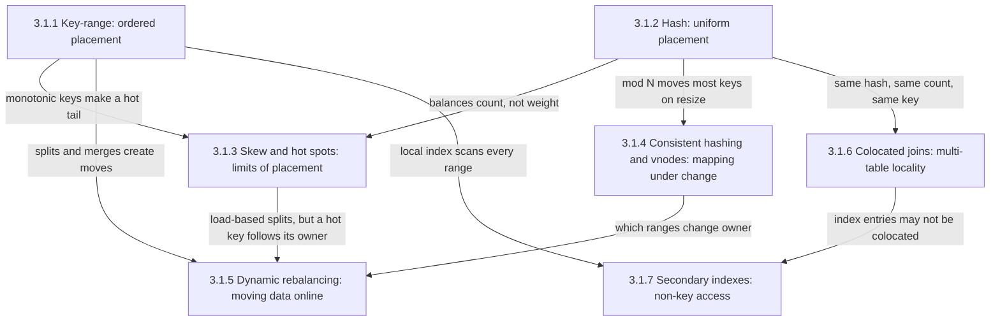
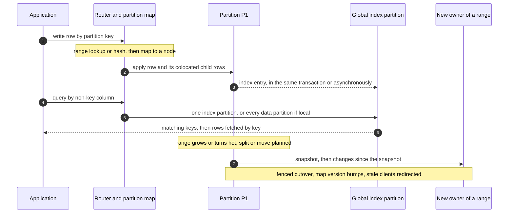
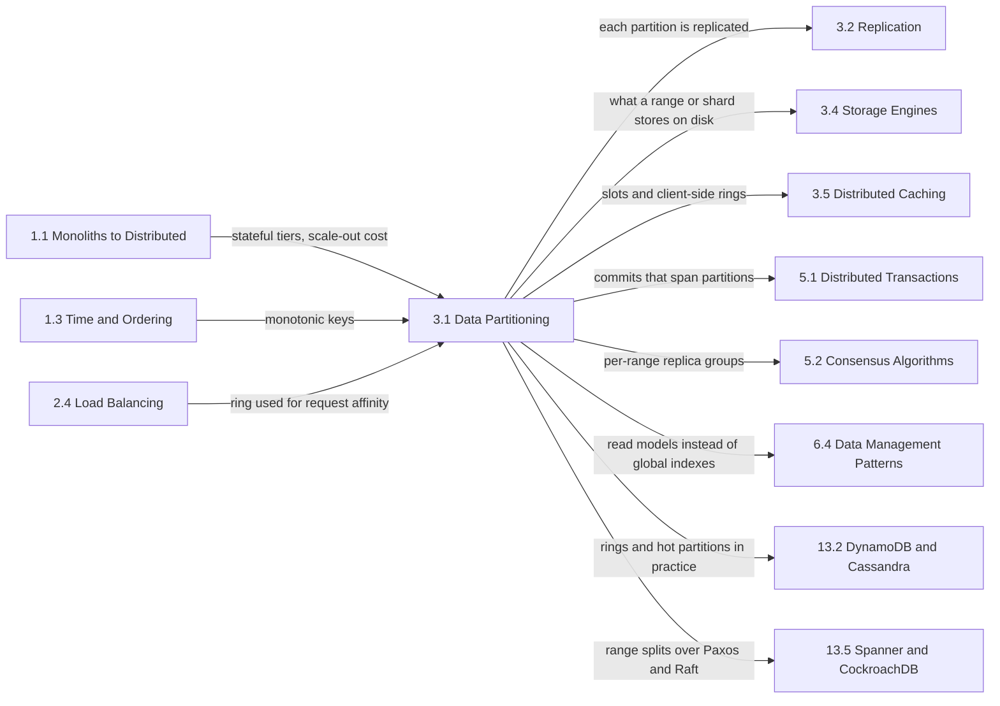

Bölümleme (partitioning), diğer adıyla sharding, bir veri kümesini node'lara böler; böylece her anahtarın herhangi bir anda sahibi tam olarak bir partition olur ve her partition'a bir replika grubu hizmet verir. Yazmaları ve saklanan byte'ları tek bir makinenin ötesine ölçekleyen tek mekanizma budur: replikasyon okuma kapasitesini çoğaltır, ama her replika yine her yazmayı karşılar ve her byte'ı tutar. Bir tablonun yazma hızı, boyutu ya da indekslerinin çalışma kümesi tek bir node'un taşıyabileceğini aştığında veri bölünmek zorundadır; [Ölçekleme İkilemi](/distributed-systems/tr/foundations/monoliths-to-distributed/scaling-dilemma/) sayfasında yatay ölçeklenen her stateful tasarım bunu varsayar.

Bu bölümün ele aldığı tek problem yerleşim kararıdır: bir anahtar verildiğinde ona hangi partition sahiptir ve sistem trafiğe hizmet vermeyi sürdürürken bu cevap nasıl değişebilir? Bu kararın bir fonksiyonu (anahtarı sıralı sınırlarla karşılaştırmak ya da hash'lemek), bir sınırı (tek bir anahtar yerleşimle asla bölünemez), üyelik değiştiğinde ne kadar verinin taşınacağına karar veren bir eşleme katmanı, veriyi fiilen taşıyan bir protokolü ve birden fazla anahtara dokunan her işlem için sonuçları vardır: join'ler, çok satırlı transaction'lar ve partition anahtarı dışındaki herhangi bir özniteliğe göre yapılan sorgular.

Yedi konunun hepsinden geçen gerilim, yerellik ile dağılım arasındadır. Birlikte okunan, join edilen ya da yazılan anahtarlar bir arada durmalıdır, çünkü tek bir partition'la sınırlı bir işlem scatter-gather'a, ağ üzerinden shuffle'a ve dağıtık commit'e ihtiyaç duymaz. Yük ise dağıtılmalıdır, çünkü partition'lı bir sistemin kapasitesini ortalama değil, en sıcak partition belirler. Her yerleşim bir erişim yoluna diğerlerinin aleyhine hizmet eder: aralık yerleşimi bitişik anahtarları bir arada tutar ve ardışık insert'leri tek bir range'e yığar; hash yerleşimi anahtarları düzgün dağıtır, ama her aralık sorgusunu ve anahtar dışı bir sütuna göre yapılan her sorguyu her partition'a sorulan bir sorguya dönüştürür.

İkinci bir gerilim, bölümün hata modlarının çoğunu üretir: yerleşim bir fonksiyon olarak tanımlanır, ama girdileri yerinde durmaz. Veri eşitsiz büyür, bir tenant sıcaklaşır, node'lar katılır ve çöker. Değişemeyen bir yerleşim, en sıcak node'una göre boyutlandırılmış bir cluster bırakır; özensizce değişen bir yerleşim ise verinin çoğunu bir anda taşır ya da bir cutover sırasında iki sahip üzerinde yazma kabul eder.

## Tek Anahtarın Arkasındaki Yedi Karar: Konular Nasıl Birbirine Bağlanır

İki yerleşim fonksiyonu köklerdir, çünkü sonraki her sayfa bir anahtarın sahibinin şu ya da bu yolla zaten hesaplandığını varsayar.

*Bölümdeki konular arasındaki bağımlılıklar. Her ok, bir sayfanın işaret ettiği sayfaya ne devrettiğini ya da ona ne dayattığını adlandırır.*

Bölümün akıl yürütmesinin büyük kısmını dört ok taşır. Çarpıklığa giren iki ok, iki yerleşim fonksiyonunun da yük yoğunlaşmasına karşı koruma sağlamadığını gösterir: aralık yerleşimi monoton artan bir anahtarı anahtar uzayının kuyruğunda bir hot spot'a çevirir; hash yerleşimi partition başına anahtar sayısını eşitler, ama en ağır anahtarın ağırlığını eşitlemez ve bu ağırlığı hiçbir partition sayısı bölemez. Çarpıklıktan yeniden dengelemeye giden ok, bölümdeki en yaygın yanlış teşhistir: sıcak bir anahtarı tutan partition'ı taşımak ya da bölmek anahtara yeni bir sahip verir, ama sıcaklığa dokunmaz. Colocation'dan ikincil indekslere giden ok ise join'ler için kazanılan yerelliğin, colocation anahtarıyla anahtarlanmamış her erişim yolunda kaybolduğunu gösterir; global bir indeks, aslında farklı bir anahtarla bölümlenmiş ikinci bir tablodur.

## Her Konunun Yanıtladığı Soru

[Anahtar Aralığı Bölümleme: Avantajlar ve Aralık Taramaları](/distributed-systems/tr/data-management/data-partitioning/key-range-partitioning/), sıralı bir anahtar uzayının bitişik range'lere nasıl kesildiğini, client'ların bayat olabilecek bir range tanımlayıcıları dizini üzerinden nasıl yönlendirme yaptığını, range'lerin canlı trafik altında nasıl bölünüp birleştiğini ve taramaları ucuzlatan sıralamanın ardışık bir anahtarı neden tek bir sıcak range'e dönüştürdüğünü yanıtlar. Önemli sorgular bitişik aralıkları ya da önekleri okuduğunda veya zamana göre anahtarlanan insert'ler tek bir node'a yığıldığında açın.

[Hash Bölümleme: Düzgün Dağılım](/distributed-systems/tr/data-management/data-partitioning/hash-partitioning/), bir anahtarın modulo, sabit slot'lar ya da hash aralıkları üzerinden kanonik byte'lara, bir hash değerine ve sahip partition'a nasıl dönüştüğünü, sonucun belirli bir anahtar sayısı için ne kadar düzgün olduğunu ve client'lar arasında uyumsuz hash fonksiyonlarının ve `hash mod N` altında yeniden boyutlandırmanın onu nasıl bozduğunu yanıtlar. Nokta okumalı bir depo için partition anahtarı seçerken, iki client bir anahtarın nerede durduğu konusunda anlaşamadığında ya da sabit bir partition sayısı artık yetmediğinde açın.

[Çarpıklık ve Hot-Spot Problemleri: Gerçek Dünya Senaryoları](/distributed-systems/tr/data-management/data-partitioning/skew-hot-spots/), partition'lı bir sistemin neden en sıcak partition'ıyla sınırlı olduğunu, ağır anahtarların sınırlı bellekle nasıl bulunduğunu ve hangi hot spot'a hangi çarenin uyduğunu yanıtlar: salting, sıcak anahtar replikasyonu ve cache'leme, ön toplama, yüke dayalı bölme ya da izolasyon. Ortalama sağlıklı görünürken bir node doyduğunda, node eklemek throughput'u artırmadığında ya da sınırsız büyüyebilecek bir sayacı veya tenant'ı modellemeden önce açın.

[Consistent Hashing ve Sanal Düğümler (vnodes)](/distributed-systems/tr/data-management/data-partitioning/consistent-hashing/), bir hash halkasının üyelik değişikliği boyunca anahtarların çoğunu nasıl yerinde tuttuğunu, node başına tek noktanın neden ciddi biçimde çarpık bir sahiplik ürettiğini ve sanal düğüm sayısının dengeyi akış paralelliğine, onarım maliyetine ve iki hatanın bir quorum'u kaybettirme olasılığına karşı nasıl tarttığını yanıtlar. Node'ların yerleşimi bir dizin olmadan hesaplaması gerektiğinde ya da vnode sayısı seçerken veya halka ile sabit slot'lar arasında karar verirken açın.

[Dinamik Yeniden Dengeleme: Sıfır Kesinti Stratejileri](/distributed-systems/tr/data-management/data-partitioning/dynamic-rebalancing/), bir partition'ın okuma ve yazma kabul etmeyi sürdürürken kopyalama, yetişme, fence'lenmiş bir cutover ve temizlik aşamalarıyla başka bir node'a nasıl taşındığını ve üretimde kullanılan protokol ailelerinin nasıl farklılaştığını yanıtlar. Node eklerken ya da boşaltırken, bir taşıma hiçbir zaman yetişemediğinde, geçici bir node kaybı bir taşıma fırtınası tetiklediğinde ya da shard'lar arasında kendi göçünüzü kurmadan önce açın.

[Colocated Joins: İlgili Verileri Aynı Shard'a Yerleştirmek](/distributed-systems/tr/data-management/data-partitioning/colocated-joins/), ilişkili tabloları aynı anahtarın aynı fonksiyonuyla bölümlemenin dağıtık join'leri ve transaction'ları nasıl yerel hale getirdiğini, bunun hangi hizalamayı gerektirdiğini ve bu hizalamanın nasıl sessizce kaybolduğunu yanıtlar. Çok tenant'lı bir şema tasarlarken ya da tek bir tenant shard'ına sığmaz hale geldiğinde açın.

[Bölümlenmiş Veride İkincil İndeksler: Local ve Global](/distributed-systems/tr/data-management/data-partitioning/secondary-indexes/), anahtar dışı bir sorgunun partition'lar arası maliyetinin nereye düştüğünü yanıtlar: satırlarıyla birlikte saklanan bir indekste her okumaya, indekslenen değere göre bölümlenmiş bir indekste her indeksli yazmaya. Global bir indeksin tablosuyla nasıl uyumlu tutulduğunu da anlatır. Anahtar dışı bir sorgu her partition'a yayıldığında, bir indeks artık eşleşmeyen satırlar döndürdüğünde ya da benzersizliğin tablonun tamamında geçerli olması gerektiğinde açın.

| Konu | Yanıtladığı soru | Ne zaman açılmalı |
|---|---|---|
| [Anahtar aralığı bölümleme](/distributed-systems/tr/data-management/data-partitioning/key-range-partitioning/) | Sıralı anahtarlar nasıl yerleştirilir, yönlendirilir ve bölünür? | Aralık taramaları önemli, zaman sıralı insert'ler tek node'a düşüyor |
| [Hash bölümleme](/distributed-systems/tr/data-management/data-partitioning/hash-partitioning/) | Bir anahtar bir partition'a düzgün biçimde nasıl eşlenir? | Partition anahtarı seçimi, client'lar arası yerleşim hataları, sabit partition sayısı |
| [Çarpıklık ve hot spot'lar](/distributed-systems/tr/data-management/data-partitioning/skew-hot-spots/) | Bir partition neden doyar ve bunu ne giderir? | Tek sıcak node, kazançsız yatay ölçekleme, viral anahtarlar ve dev tenant'lar |
| [Consistent hashing ve vnodes](/distributed-systems/tr/data-management/data-partitioning/consistent-hashing/) | Üyelik değiştiğinde ne kadar az şey taşınabilir? | Dizinsiz yerleşim, vnode sayısı, halka ve slot karşılaştırması |
| [Dinamik yeniden dengeleme](/distributed-systems/tr/data-management/data-partitioning/dynamic-rebalancing/) | Veri kesintisiz ve yazma kaybetmeden nasıl taşınır? | Node ekleme ya da boşaltma, takılan taşımalar, yeniden dengeleme fırtınaları |
| [Colocated joins](/distributed-systems/tr/data-management/data-partitioning/colocated-joins/) | İlişkili tablolar tek shard'da nasıl kalır? | Çok tenant'lı şemalar, shuffle yapan join'ler, istek başına dağıtık commit'ler |
| [İkincil indeksler](/distributed-systems/tr/data-management/data-partitioning/secondary-indexes/) | Anahtar dışı sütuna göre sorguların bedelini kim öder? | Scatter sorguları, bayat indeks sonuçları, global benzersizlik |

Bölüm, tek bir tablonun yaşamı boyunca da okunabilir: her kararın sahibi hangi sayfadır?

*Yedi karardan geçen tek bir tablo. 1. ve 2. adımlar arasındaki arama yerleşim sayfalarına, 2. adımda hangi satırların birlikte yerleştiği colocation sayfasına, 3-6. adımlar ikincil indeks sayfasına, sıcaklaşan partition'ın tek bir anahtar yüzünden mi sıcak olduğu çarpıklık sayfasına, 7. adım ve ardından gelen cutover ise yeniden dengeleme sayfasına aittir; bir üyelik değişikliğinin bu taşımalardan kaç tane doğurduğuna consistent hashing sayfası karar verir.*

Dizinin iki özelliği, sayfaların işi nasıl paylaştığını açıklar. Her adım, partition haritasının yönlendirme yapan herkes tarafından doğru biçimde paylaşılmasına bağlıdır: farklı hash'leyen ya da 7. adımın ardından gelen cutover'dan önceki bir haritayı tutan bir client, işi artık anahtarın sahibi olmayan bir node'a gönderir. Ayrıca partition'lar arasında geçen adımlar, yani 3. adımdaki indeks güncellemesi ve 5. adımdaki scatter, bölümleme seçiminin bedelinin her istekte ödendiği yerlerdir; 7. adımdaki taşıma ise bu bedelin toptan ödendiği yerdir.

## Okuma Sırası ve Gerekçesi

İlk okumada bölümü sidebar sırasıyla okuyun. Anahtar aralığı bölümleme önce gelir, çünkü sonraki sayfaların yeniden kullandığı kavramları tanıtır: sürümlü bir tanımlayıcıya sahip bir aralık olarak partition, client'ların cache'leyip bayat gördüğü bir yönlendirme dizini ve değişimin birimi olarak bölmeler. Hash bölümleme onun ayna görüntüsü olarak izler. Çarpıklık üçüncü sıradadır, çünkü iki fonksiyonun da sınırıdır. Ardından consistent hashing, hash'lemenin eşleme adımını değişen bir üyelik için inceltir; yeniden dengeleme ise eşlemenin taşınması gerektiğine karar verdiği her şeyi yürüten protokolü anlatır. Colocated joins ve ikincil indeksler en sona kalır, çünkü ikisi de seçilen yerleşimin birden fazla anahtara dokunan işlemler için bedelini hesaplar.

Üç kısayol makuldür. Yeni bir depo için partition anahtarı seçerken aralık ve hash sayfalarını, ardından çarpıklık sayfasının tasarım zamanı önerilerini, ardından anahtarın karşılamayacağı sorgular için ikincil indeksleri okuyun. Shard'lanmış, çok tenant'lı bir şema tasarlarken colocated joins ile başlayın, ardından ikincil indeksleri ve çarpıklık sayfasının dev tenant bölümlerini okuyun. Bir node doyduğunda ya da bir genişleme hata ürettiğinde, anahtar düzeyindeki sıcaklığı partition düzeyindeki dengesizlikten ayırmak için doğrudan çarpıklık sayfasına, ardından dinamik yeniden dengelemeye gidin.

## Bölümün El Kitabındaki Yeri

Ön koşullar önceki üç bölümden gelir. [Stateful ve Stateless Servisler](/distributed-systems/tr/foundations/monoliths-to-distributed/stateful-vs-stateless/), stateful katmanların neden birbirinin yerine geçebilen replikalar eklenerek ölçeklenemediğini açıklar; bölümlemenin var olma nedeni budur. [Algoritmalar: Round Robin, En Az Bağlantı, Ağırlıklı, Consistent Hashing](/distributed-systems/tr/communication/load-balancing/algorithms/), bu bölümdeki halkayı istek yönlendirmesine uygular; halkanın kendisinin sahibi bu bölümdür. Aralık bölümlemeli bir tablonun sıcak kuyruğunu yaratan zaman sıralı tanımlayıcılar ise [Dağıtık ID Üretimi](/distributed-systems/tr/foundations/time-and-ordering/distributed-id-generation/) sayfasında tasarlanır.

*Solda ön koşullar, sağda bu bölümün üzerine kurulan ya da bu bölümün dayandığı mekanizmaların sahibi olan bölümler. Her ok, devredilen şeyi adlandırır.*

Sonraki bölüm, [Replikasyon Stratejileri](/distributed-systems/tr/data-management/replication/), her partition'ın anahtarların nasıl yerleştirildiğinden bağımsız olarak nasıl kopyalandığını anlatır: bir aralık deposu her range'i [Raft](/distributed-systems/tr/coordination/consensus-algorithms/raft/) ile, bir halka deposu ise her yayı leaderless quorum'larla replike edebilir. Senkron bir global indeks güncellemesi dahil, birden fazla partition'a atomik olarak yazan işlemler [İki Aşamalı Commit](/distributed-systems/tr/coordination/distributed-transactions/two-phase-commit/) mekanizmasına dayanır. Tek bir partition'ın altındaki sıralı depolama [LSM-Tree ve B-Tree](/distributed-systems/tr/data-management/storage-engines/lsm-tree-vs-b-tree/) sayfasında ele alınır. [Redis Cluster Mimarisi](/distributed-systems/tr/data-management/distributed-caching/redis-cluster/), sabit hash slot'larının somut bir kullanımıdır. Vaka çalışmaları bölümü pratikte gösterir: [Cassandra'nın Consistent Hashing Halkası](/distributed-systems/tr/case-studies/dynamodb-cassandra/cassandra-hashing-ring/), DynamoDB'nin hot partition yönetiminin evrimi için [Hot Partition Problemi](/distributed-systems/tr/case-studies/dynamodb-cassandra/hot-partition-problem/) ve Paxos gruplarıyla birleşen range bölmeleri için [Spanner](/distributed-systems/tr/case-studies/distributed-sql/spanner-architecture/).

Üç sınır sık sık bulanıklaşır. Bölümleme replikasyon değildir: replikası olmayan shard'lar her node ile birlikte veri kaybeder, shard'ı olmayan replikalar ise yine her yazmayı alır. Verinin yeniden dengelenmesi, hangi consumer'ın hangi partition'ı okuduğunu yeniden atayan ve hiç veri taşımayan [Kafka consumer group yeniden dengelemesi](/distributed-systems/tr/case-studies/apache-kafka/consumer-group-rebalancing/) değildir; yerleşimi değil şemayı değiştiren [sıfır kesintili veritabanı migration'ı](/distributed-systems/tr/deployment/deployment-patterns/zero-downtime-db-migrations/) da değildir. Son olarak, tek bir servisin verisini node'lara bölmek, veriyi servisler arasında bölmek değildir: [Servis Başına Veritabanı](/distributed-systems/tr/microservice-patterns/data-management-patterns/database-per-service/) ekipler arasında sahiplik sınırları çizer ve bu sınırları aşan sorgulara veritabanının tuttuğu bir ikincil indeks değil, [değişiklik verisi yakalama (CDC)](/distributed-systems/tr/data-processing/hybrid-architectures/change-data-capture/) ile beslenen [materialized view'lar](/distributed-systems/tr/microservice-patterns/data-management-patterns/materialized-view/) hizmet eder.
