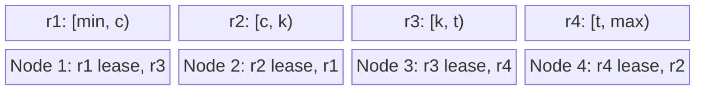
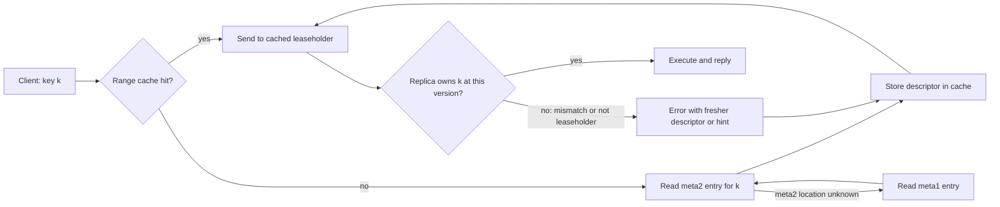
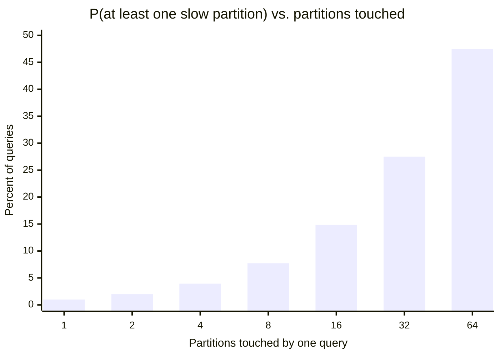
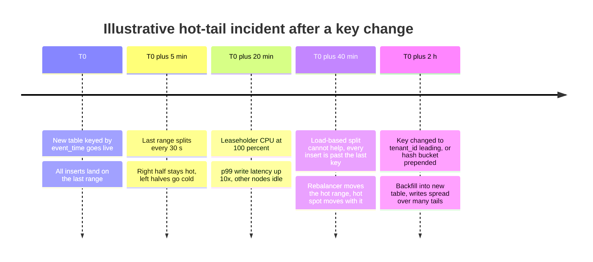

Anahtar aralığı bölümleme (key-range partitioning), her anahtarı sıralı bir sınır anahtarları listesiyle karşılaştırarak bir partition'a atar. Anahtar uzayı tek bir sıralı dizi olarak ele alınır; bitişik ve çakışmayan aralıklara bölünür. Bu aralıklar CockroachDB'de range, HBase ve TiKV'de region, Bigtable'da tablet, Spanner'da split, MongoDB'de chunk olarak adlandırılır ve her aralık belirli bir anda tek bir replika grubunun sahipliğindedir. Sıralamada yan yana gelen iki anahtar neredeyse her zaman aynı partition'da bulunur; "`a` ile `b` arasındaki tüm anahtarlar" sorusu da yalnızca aralıkları bu açıklıkla kesişen birkaç partition tarafından yanıtlanır.

Çözdüğü problem, sıralamayı makineler arasında korumaktır. Tek node'lu bir B-tree ya da LSM-tree; aralık sorgularını, önek (prefix) sorgularını ve sıralı sayfalamayı komşu anahtarlar üzerinde yürüyerek yanıtlar. Anahtarları hash ile yerleştirmek bu komşuluğu yok eder ve aynı sorgu her partition'a dağılan bir scatter-gather işlemine dönüşür. Anahtar aralığı bölümleme komşuluğu cluster ölçeğinde korur; Bigtable, HBase, Spanner, CockroachDB, TiKV, YugabyteDB'nin range-sharded tabloları ve MongoDB'nin ranged sharding'i bu yüzden onu birincil yerleşim şeması ya da bir seçenek olarak kullanır.

Asıl denge, yerellik ile yük düzgünlüğü arasındadır. Partitioner anahtarları tam olarak sıralamanın koyduğu yere yerleştirir ve yükü yaymak için hiçbir şey yapmaz; bu yüzden anahtar uzayının dar bir bölgesinde yoğunlaşan her erişim deseni, özellikle de monoton artan anahtarlı insert'ler, cluster'da kaç node olursa olsun tek bir partition'a düşer. Hash bölümleme tersini seçer: çoğu anahtar dağılımı için düzgün yük, karşılığında her aralık sorgusunun her partition'a dokunması; bu konu [Hash Bölümleme](/distributed-systems/tr/data-management/data-partitioning/hash-partitioning/) sayfasında ele alınır. İkinci bedel, range sınırlarının bir formülden hesaplanamamasıdır: sınırlar veridir, sistem çalışırken değişir ve her client onları sorgulamak ve bayat (stale) görmekle başa çıkmak zorundadır.

## Range'lere Bölünmüş Sıralı Bir Anahtar Uzayı

Bir range, anahtar uzayının yarı açık bir aralığıdır, `[start, end)`; yanında bir descriptor taşır: range kimliği, onu saklayan replikaların kümesi ve aralık ya da replika kümesi her değiştiğinde artan bir sürüm numarası. İlk range boş anahtarla başlar, son range ise olası tüm anahtarların üzerindeki bir sentinel değerde biter; böylece descriptor'ların toplamı anahtar uzayını boşluksuz ve çakışmasız biçimde örter. Bu örtme özelliği, mekanizmanın geri kalanının korumak için var olduğu invariant'tır: metadata'nın commit edilmiş her sürümünde her anahtar tam olarak bir range'e aittir.


*Tek bir sıralı anahtar uzayının dört range'i ve dört node üzerindeki yerleşimleri. Her range'in birden fazla replikası vardır; bunlardan biri lease'i tutar ve okuma ile yazmalara hizmet eder. Sınırlar örnek amaçlı tek harflerdir.*

Üst satır, client'ın üzerinde akıl yürüttüğü mantıksal görünümdür: `c`, `k` ve `t` noktalarından kesilmiş tek bir sıralı dizi. Alt satır ise sıralamadan bağımsız olan fiziksel yerleşimdir: `r1` range'i node 1'den yönetilirken anahtar sıralamasında ondan çok uzak olan `r3` aynı makineyi paylaşabilir. Komşuluk yalnızca bir range'in içinde korunur; komşu range'ler aralarında özel bir ilişki olmayan ayrı replika gruplarıdır, bu yüzden cluster onları birbirinden bağımsız taşıyabilir. Üretim sistemleri her range'i kendi başına bir replikasyon grubu yapar: CockroachDB ve TiKV'de genellikle bir [Raft](/distributed-systems/tr/coordination/consensus-algorithms/raft/) grubu, Spanner'da bir Paxos grubu. Böylece range aynı anda yerleşimin, replikasyonun ve failover'ın birimi olur.

Bir range'in içinde anahtarlar, node'un yerel depolama motoru tarafından, tipik olarak yazma yolu ve okuma amplifikasyonu [LSM-Tree ve B-Tree](/distributed-systems/tr/data-management/storage-engines/lsm-tree-vs-b-tree/) sayfasında anlatılan bir LSM-tree tarafından, sıralı olarak saklanır. Partitioner kendi başına hiçbir yapı eklemez: bir range, yerel motorun anahtar uzayının iki sınır arasına düşen alt kümesinden ibarettir. Bu yüzden bir range'i bölmek veriyi yeniden yazmak değil, bir metadata işlemidir; dinamik bölmeyi karşılanabilir kılan özellik de budur.

### Şemanın Garanti Ettikleri ve Etmedikleri

Şema; her anahtarın her metadata sürümünde tam olarak bir sahip range'i olduğunu, bir range içindeki anahtarların sıralı saklandığını ve sıralı döndürüldüğünü, ve bir aralık sorgusunun yalnızca o aralıkla kesişen range'lere başvurması gerektiğini garanti eder. Her range içindeki replikasyonla birleştiğinde, tek anahtarlı işlemler range'in replikasyon protokolünün izin verdiği ölçüde güçlü tutarlıdır.

Düzgün yükü garanti etmez: bir range içine düşen anahtarlar neyse onları tutar ve sistem dengesizliği ancak gözlemledikten sonra sınırları kaydırarak dengeler. Range'ler arası atomikliği garanti etmez; iki range'e dokunan bir yazma, dağıtık bir transaction protokolü gerektirir. CockroachDB ve Spanner bunu consensus grupları üzerinde iki aşamalı commit olarak çalıştırır; bu konu [Pratikte Dağıtık İşlemler: Consensus Üzerinde 2PC](/distributed-systems/tr/case-studies/distributed-sql/transactions-2pc-over-consensus/) sayfasında ele alınır. Sınırların sabit kalacağını garanti etmez; bu yüzden uygulama mantığı hangi anahtarların aynı range'i paylaştığına asla bağımlı olmamalıdır. Bir range'in hedef boyutuna yakın kalacağını da garanti etmez: tek bir anahtar ya da satır bölünemez, dolayısıyla aşırı büyük tek bir değer ya da çok sıcak tek bir anahtar bölmeyi tamamen etkisiz bırakır.

### Anahtarı Tasarlamak: Başta Ne Varsa Veri Oraya Yerleşir

Yerleşim sıralamayı izlediği için anahtarın baştaki bileşeni hangi verinin komşu olacağına, dolayısıyla hangi sorguların ucuz olacağına ve hangi yazmaların çakışacağına karar verir. `(tenant_id, event_time, event_id)` gibi bileşik bir anahtar, her tenant'ın olaylarını bir arada kümeler ve tenant içinde zamana göre sıralar; böylece "tenant 42'nin son bir saatteki olayları" tek bir bitişik aralık olur. Aynı kolonlar `(event_time, tenant_id, event_id)` sırasıyla kullanılırsa bunun yerine "son bir saatteki tüm olaylar" bitişik hâle gelir; ayrıca her tenant'tan gelen her yeni olay anahtar uzayının sonuna gönderilir.

Kodlama (encoding) en az kolon sırası kadar önemlidir. Depolama katmanı anahtarları bayt dizisi olarak karşılaştırır; dolayısıyla bir veritabanı tipli değerleri, sözlüksel (lexicographic) sırası tipin mantıksal sırasıyla örtüşen baytlara kodlamak zorundadır: işaret biti ters çevrilmiş, big-endian işaretli tamsayılar; her baytı ters çevrilmiş azalan (descending) kolonlar. Ham bir key-value deposunda anahtarları elle oluşturan mühendisler bunu sıkça yanlış yapar; örneğin ondalık string'leri birleştirerek `"10"` değerinin `"9"`'dan önce sıralanmasına yol açarlar ya da little-endian tamsayı kullanırlar. Veri doğru saklanır, aralık taramaları ise sessizce yanlış sonuç döndürür.

## İstekleri Sahip Range'e Yönlendirmek

Hash partitioner sahibi anahtardan hesaplar; range partitioner ise onu sorgulamak zorundadır. Sınırlar, kendisi de sıralı bir anahtar uzayı olan ve her range'in bitiş anahtarıyla anahtarlanmış bir metadata tablosunda yaşar; böylece `k` anahtarının range'ini bulmak, bitiş anahtarı `k`'den büyük olan ilk girdiye seek yapmaktır. Bu tablo büyüyebileceği için sistemler onu kendi range'lerinde saklar ve üstüne bir indeks ekler.

Kanonik üç seviyeli tasarımı Bigtable getirdi. Google'ın kilit servisi Chubby'deki bir dosya kök tablet'in konumunu belirtir; kök tablet tüm METADATA tablet'lerinin konumlarını tutar; her METADATA tablet'i de bir grup kullanıcı tablet'inin konumlarını tutar. CockroachDB aynı şekli iki meta seviyesiyle kurar (`meta1`, `meta2`'yi; `meta2` kullanıcı range'lerini adresler) ve ilk range'in konumunu node'lar arasında gossip ile yayar. HBase, konumu ZooKeeper üzerinden bulunan tek bir katalog tablosu, `hbase:meta`, kullanır. TiKV ise dizini veri yolundan tamamen çıkarıp Placement Driver'a (PD) taşır: her client'ın region konumlarını sorduğu, Raft ile replike edilen ayrı bir servis.


*CockroachDB tarzında, client tarafı önbellek ve iki seviyeli meta indeksiyle range arama. Bigtable üçüncü bir seviye ekler; TiKV meta range'lerinin yerine PD servisini koyar.*

Önemli yol alttaki döngüdür. Önbelleğe asla güvenilmez: her istek, yönlendirilirken kullanılan descriptor'ı taşır ve isteği alan replika, anahtarın hâlâ kendi güncel aralığına düştüğünü ve lease'i hâlâ kendisinin tuttuğunu kontrol eder. Bu yüzden bayat bir önbellek gecikmeye mal olur, doğruluğa asla. Hata genellikle daha güncel descriptor'ı ya da yeni leaseholder'ı belirten bir ipucunu döndürür; client önbelleğini tam bir arama yapmadan onarır. Bigtable makalesi bunun maliyetini sayılarla verir: boş bir önbellekle arama üç ağ round trip'i sürer, bayat bir önbellekle altıya kadar çıkar, çünkü bayat girdiler ancak bir ıskalamada (miss) fark edilir. Bigtable beklenen maliyeti, metadata tablosunu her okuduğunda birden fazla tablet konumunu önceden getirerek (prefetch) azalttı.

Metadata, bütünüyle önbelleğe alınabilecek kadar küçüktür. Bigtable METADATA satırı başına yaklaşık 1 KB bellek kullanır ve METADATA tablet'lerini 128 MB ile sınırlar; dolayısıyla tek bir METADATA tablet'i `2^27 / 2^10 = 2^17` kullanıcı tablet'ini indeksler, kök tablet `2^17` METADATA tablet'ini indeksler ve hiyerarşi `2^34` tablet'i adresler. Gerçek kurulumlar bundan kat kat küçüktür; bu yüzden bir üretim client'ı genellikle ihtiyaç duyduğu her descriptor'ı elinde tutar.

### Aralık Taramaları: Sıralamanın Karşılığını Verdiği Yer

`[a, b)` için bir aralık taraması, bir dizi alt tarama olarak çalıştırılır: `a`'yı içeren range'i bul, `a`'dan `b` ile o range'in bitiş anahtarından küçük olanına kadar tara, ardından `b`'ye ulaşana kadar bir sonraki range'in başlangıç anahtarından devam et. Client ya da onun adına hareket eden bir gateway node'u, tüm sonuçları istediğinde bu alt taramaları paralel çalıştırabilir; sorguda bir `LIMIT` varsa ve sıra önemliyse ise kesinlikle art arda çalıştırır, çünkü ilk range limiti zaten karşılayabilir. Ters taramalar aynı deseni sondan başlayarak izler. Her iki durumda da başvurulan range sayısı cluster'ın boyutuyla değil, sonucun boyutuyla orantılıdır.

Sınırlar hareket ederken bunu güvenli kılan iki özellik vardır. Birincisi, her alt tarama beklediği bitiş anahtarını taşır; range bu arada bölünmüşse replika yalnızca hâlâ sahibi olduğu kısmı ve bir devam anahtarı (resume key) döndürür, client da oradan devam eder. İkincisi, range'lere yayılan bir tarama tek bir MVCC (multi-version concurrency control) zaman damgasında okur; böylece ayrı ayrı çalıştırılan alt taramalar, her range'de yazmalar sürerken bile tek bir tutarlı snapshot görür. Snapshot semantiği [Zayıf İzolasyon ve MVCC](/distributed-systems/tr/data-management/consistency-models/weak-isolation-mvcc/) sayfasında ele alınır.

## Trafiği Durdurmadan Bölme ve Birleştirme

Sınırlar iki kaynaktan gelir. Ön bölme (pre-splitting), sınırları tablo oluşturulurken anahtar dağılımı hakkındaki bilgiye dayanarak seçer. Dinamik bölme ise sınırları sistem çalışırken gözleme dayanarak seçer. Üretim sistemlerinin tamamı esas olarak dinamik bölmeye dayanır, çünkü hiç kimse bir anahtar dağılımını önceden bilmez ve dağılımlar zamanla kayar.

Klasik tetikleyici boyuttur. Bir eşiğin ötesine büyüyen range, tarama yapılarak değil depolama motorunun indeksinden hesaplanan orta anahtarının yakınından bölünür: HBase, en büyük store'daki en büyük store dosyasının blok indeksinin orta noktasını alır. İkinci tetikleyici yüktür. Belirli bir süre boyunca bir eşikten fazla istek, ya da yeni CockroachDB sürümlerinde daha fazla istek CPU zamanı alan bir range, baytları değil gözlenen yükü bölen bir anahtardan bölünür: splitter son isteklerin anahtarlarından örnek alır, iki tarafta da kabaca eşit yük bırakan bir nokta seçer ve çok fazla isteğin iki tarafa yayılacağı adayları atlar. Yüke dayalı bölme, küçük bir sıcak range'e karşı tek savunmadır; sıcak range'in yaygın hâli de zaten küçük olanıdır.

Tersi işlem, yani birleşik boyutu ve yükü düşük olan iki komşu range'i birleştirmek (merge), silmelerden, süresi dolan veriden ya da geçmiş bir yük sıçramasından sonra range sayısının sınırsız büyümesini önler. Birleştirme bölmeden daha zordur: iki range genellikle farklı replika kümelerinde yaşar; bu yüzden sistem önce replikaları her iki range aynı node'ları paylaşana kadar yeniden yerleştirir, ardından sağdaki range'i tek bir replike işlemle soldakinin içine alır.

### Eşzamanlı Yazmalar Altında Bölme Neden Güvenli

Bölme, havada olan istekler de dahil olmak üzere örtme invariant'ını her an korumak zorundadır. Her sistem bunu, bölmeyi range üzerindeki her yazmaya göre sıralayıp ardından atomik olarak yayımlayarak sağlar.

TiKV'de bölme, region'ın kendi Raft log'una önerilen yönetimsel bir komuttur. Her replika onu aynı log indeksinde uygular: o indeksten önceki yazmalar parent'a uygulanmıştır, sonrakiler çocuk region'ların aralıklarına göre kontrol edilir ve region epoch'unun `version` alanı artar; böylece eski epoch'u taşıyan istekler `EpochNotMatch` hatasıyla reddedilir. CockroachDB'de bölme, soldaki range descriptor'ını yeniden yazan, sağdakini oluşturan ve `meta2` kayıtlarını güncelleyen bir transaction'dır; range'in Raft log'u üzerinden commit edilir ve bu sırada bölme işlemi sağdaki aralık üzerinde bir latch tutar. HBase bölmeyi, commit noktası çocuk region'ları listeleyen `hbase:meta` güncellemesi olan bir prosedür olarak çalıştırır; çocuk region'lar başlangıçta parent'ın dosyalarının üst ve alt yarılarını gösteren referans dosyalarını tutar, dolayısıyla veri sonraki compaction'lara kadar yeniden yazılmaz.

```mermaid
sequenceDiagram
    autonumber
    participant C as Client
    participant A as Node A, leaseholder r3
    participant M as Meta ranges
    participant B as Node B
    C->>A: Put k=p, routed with r3 [k, t) v7
    A-->>C: OK
    rect rgb(60, 60, 90)
    Note over A: Split r3 at n, applied at one Raft index
    A->>M: Commit r3 [k, n) v8 and r9 [n, t) v1
    end
    A->>B: Lease for r9 transferred to node B
    C->>A: Put k=q, routed with stale r3 [k, t) v7
    A-->>C: Mismatch: key outside [k, n), here is r9 [n, t) v1
    C->>C: Update cache, record lease hint
    C->>B: Put k=q, routed with r9 v1
    B-->>C: OK
```


*Tek bir client'ın iki yazması arasında gerçekleşen bir bölme ve bir lease transferi. 5. adımdaki bayat istek yanlış uygulanmaz, reddedilir; hata, meta araması yapmadan yeniden yönlendirmeye yetecek bilgiyi taşır.*

Doğruluk argümanı, 3. adımın range'in replike edilmiş geçmişinde tek bir atomik olay olmasına dayanır. Öncesinde parent `[k, t)` aralığına sahiptir; sonrasında parent `[k, n)` aralığına, `r9` ise `[n, t)` aralığına sahiptir; `q`'ya ikisinin birden sahip olduğu ya da hiçbirinin sahip olmadığı bir durum yoktur. Her yazma, uygulandığı andaki güncel aralık ve sürüme göre, bölmeyi sıralayan aynı serileştirme (Raft log sırası, latch) altında kontrol edilir; bu yüzden 5. adımdaki istek kontrolün yanından sızamaz. Client'ın önbelleği yalnızca bir optimizasyondur ve bayatlığının bedeli bir ek round trip'tir, yani 6. ile 9. adımlar arası. Diyagramın göstermediği bir şeye dikkat edin: bölmeden önceki bir zaman damgasındaki okuma, bölmeden önce `r3`'e yazılmış veri için `r9`'a gelebilir; her iki sistem de bunu karşılar, çünkü bölme sağdaki aralığın MVCC geçmişini descriptor ile birlikte taşır.

### Sayısal Örnek: Çok Tenant'lı Bir Olay Deposu İçin Range Boyutlandırma

`(tenant_id, event_time, event_id)` ile anahtarlanmış, 20 TiB mantıksal veri tutan çok tenant'lı bir olay deposu varsayalım. Sistem CockroachDB tarzında, varsayılan 512 MiB azami range boyutuyla, replikasyon faktörü 3 ile ve 30 node üzerinde çalışıyor. Bu bölümdeki tüm iş yükü sayıları örnek amaçlıdır.

Range'ler azami boyutta bölünür ve bölmenin hemen ardından yaklaşık yarı doludur; bu yüzden range başına ortalama 384 MiB varsayalım. Cluster bu durumda `20 TiB / 384 MiB = 54.613` range, yaklaşık 164.000 replika, yani node başına kabaca 5.500 replika tutar. Bir client'ın önbelleğindeki her descriptor yaklaşık 300 bayt tutuyorsa (bir varsayım), her range'e dokunmuş bir client yaklaşık 16 MB yönlendirme durumu taşır. Bu, bir önbellek ıskalamasının gerçekçi maliyetinin bellek değil ek round trip olduğu kadar küçük bir rakamdır.

Şimdi anahtar tasarımını motive eden sorguya gelelim: tek bir tenant'ın son 24 saatteki olayları; 400 baytlık 50.000 olay, toplam 20 MB varsayalım. Tenant'ın olayları bitişik ve zamana göre sıralı olduğu için `[(42, now - 24h), (42, now))` aralığı 384 MiB'lık bir range'in 20 MB'ıdır: bir sınırın üzerine denk gelmedikçe tek bir range'in içinde kalır, denk gelirse iki range'e dokunur. Tarama, bir ya da iki node'dan sıralı olarak 20 MB okur.

Tam anahtar üzerinde 64 partition'a hash bölümlemede ise aynı sorgunun okuyabileceği bitişik bir aralık yoktur. Ya eşleşen satırlar için her partition'ı tarar ya da girdileri kendileri de bölümlenmiş bir ikincil indekse başvurur; bu konu [Bölümlenmiş Veride İkincil İndeksler](/distributed-systems/tr/data-management/data-partitioning/secondary-indexes/) sayfasında tartışılır. Her partition hızlı yanıt verse bile istek en yavaşını bekler. Her partition'ın birbirinden bağımsız olarak %1 olasılıkla yavaş yanıt verdiğini varsayarsak, başvurulan `n` partition'dan en az birinin yavaş olma olasılığı `1 - 0.99^n` olur.


*Her partition'ın varsayılan, bağımsız %1 yavaş yanıt olasılığı var. Bitişik verinin aralık taraması solda, 64 partition'lı hash yerleşiminde scatter-gather ise sağda yer alır.*

Bir ya da iki range'e dokunan aralık taraması, partition başına kuyruk olasılığını neredeyse değişmeden görür: %1 ile %2 arası. 64 hash partition'ı üzerindeki scatter-gather ise %1'lik bir kuyruk olayını sorguların %47'sini etkileyen bir olaya dönüştürür; bu, Dean ve Barroso'nun *The Tail at Scale* makalesinde tanımladığı fan-out etkisidir. Aralık bölümlemenin lehindeki argümanın sayısal çekirdeği budur: bir sorgunun maliyeti cluster'ın boyutunu değil, yanıtının boyutunu izler.

Aynı yerleşimin yazma tarafında bir bedeli vardır. Ingest hızının tüm tenant'lar genelinde saniyede 50.000 olay, yani saniyede 20 MB olduğunu varsayalım. `tenant_id` başta olduğunda her tenant kendi aralığının sonuna yazar; dolayısıyla aktif tenant sayısı kadar ekleme noktası vardır ve bir tenant'ın son range'i dolduğunda bölünür. Anahtar bunun yerine `event_time` ile başlasaydı saniyede 20 MB'ın tamamı tablonun son range'ine düşerdi; bu range 512 MiB'a ulaşıp her `512 MiB / 20 MB/s = 27` saniyede bir bölünürdü ve her bölme soğuk bir sol yarı ile son kısmı tutmaya devam eden sıcak bir sağ yarı üretirdi. 30 node'dan kaçı boşta olursa olsun throughput tek bir leaseholder'ın yazma kapasitesiyle sınırlı kalırdı. Tenant ile başlayan anahtar bunu önler, ama tenant boyutlarının dağılımını devralır: en büyük tenant yazmaların %30'unu üretiyorsa, onun son range'i cluster ingest'inin %30'unu alır. Anahtar başına bu yoğunlaşma, [Çarpıklık ve Hot-Spot Problemleri](/distributed-systems/tr/data-management/data-partitioning/skew-hot-spots/) sayfasının konusudur.

## Aralık, Hash ve Hibrit Yerleşim

Yerleşim şemaları hangi işlemi ucuzlattıkları ve hangi patolojiye davetiye çıkardıkları bakımından ayrışır. Tablo, anahtar aralığı bölümlemeyi bir tasarımcının gerçekten arasında seçim yapacağı alternatiflerle karşılaştırır.

| Şema | Yerleşim fonksiyonu | Baştaki anahtarda aralık taraması | Yük yayılımı | Monoton insert anahtarı | Sınır metadata'sı | Ne zaman tercih edilmeli |
|---|---|---|---|---|---|---|
| Anahtar aralığı | Sıralı sınır listesi | Yalnızca kesişen range'lere dokunur | Anahtar dağılımını izler; bölmeyle düzeltilir | Tek bir sıcak son range | Range başına, dinamik, sorgulanması gerekir | Aralık sorguları, sıralı sayfalama, önek taramaları, bir varlık içinde zamana göre sıralı okumalar |
| Hash | `hash(key) mod` partition'lar ya da ring | Her partition'a dokunur | Çarpık olmayan anahtarlarda düzgün | Eşit yayılır | Formül artı partition haritası | Nokta okumaları baskınsa ve hiçbir sorgu anahtarlar arası sıralama gerektirmiyorsa |
| Hash önek, içeride aralık | Baştaki kolonun hash'i, ardından sıralı | Tek önek değeri içinde ucuz, önekler arasında scatter | Önek değerleri arasında düzgün | Önek değerlerine yayılır | Partition haritası artı partition içi sıralama | Varlık başına zaman serileri ve akışlar (DynamoDB ve Cassandra partition artı sort key) |
| Kovalı aralık (hash-sharded index) | Sıralı anahtarın başına `hash(key) mod B` eklenir | B paralel alt tarama | B kovaya yayılır | B son range'e yayılır | Anahtar aralığıyla aynı | Kaçınılamayan monoton anahtarlı, aralık bölümlemeli bir depo |
| Dizin (directory) | Açık anahtar-partition eşlemesi | Dizinin taneciklik düzeyine bağlı | Tamamen kontrol edilebilir | Kontrol edilebilir | Büyük, anahtar ya da grup başına bir girdi | Tenant başına yerleşim, veri yerleşikliği (data residency), büyük tenant'ların elle taşınması |

Hibrit satırlar, seçimin nadiren saf olduğunu gösterir. DynamoDB ve Cassandra, node'u seçmek için partition anahtarını hash'ler ve satırları onun içinde sort key'e ya da clustering kolonlarına göre sıralı tutar; böylece "tek bir varlık içindeki aralık taramaları" ucuzdur, varlıklar arasındaki aralık taramaları ise hiç verimli desteklenmez. YugabyteDB her tablo için hem hash hem range sharding sunar ve kolon `ASC` ya da `DESC` olarak tanımlanmadıkça birincil anahtarın ilk kolonu için varsayılan olarak hash'i seçer. Kovalama (bucketing) ters yönden gelir: range partitioner'ı korur ama başa küçük bir hash ekler; böylece monoton bir anahtar tek bir son range yerine `B` son range'e yazar, bedeli de aralık sorgusu başına `B` alt taramadır. CockroachDB bunu hash-sharded index olarak sunar; Spanner'ın dokümantasyonu da aynı nedenle hash'lenmiş ya da bit'leri ters çevrilmiş (bit-reversed) bir önek önerir.

Aralık bölümleme yeniden dengelemenin işleyişini de değiştirir. Sanal node'lu bir hash ring, [Consistent Hashing ve Sanal Düğümler](/distributed-systems/tr/data-management/data-partitioning/consistent-hashing/) sayfasında anlatıldığı gibi hash uzayının sabit dilimlerini taşır; bir range sistemi ise range'leri bütün birimler olarak taşır ve sayılarını bölerek ve birleştirerek değiştirir. Dolayısıyla yeniden dengeleme yereldir ve üyelik değişiklikleriyle değil, ölçülen boyut ve yükle yönlendirilir. Bir range'i kesintisiz taşıma prosedürleri [Dinamik Yeniden Dengeleme](/distributed-systems/tr/data-management/data-partitioning/dynamic-rebalancing/) sayfasında ele alınır.

:::note[Aralık bölümleme ile colocation aynı kaldıraçtır]
Komşuluk anahtar sırasını izlediği için baştaki anahtar kolonlarını seçmek, aynı zamanda neyin bir arada yerleşeceğini seçmektir. Spanner'ın interleaved tabloları ve çocuk satırların başına parent'ın anahtarını ekleme pratiği, bir parent'ı ve çocuklarını aynı range'e yerleştirir; böylece tek bir parent üzerindeki join'ler ve transaction'lar yerel kalır. Bu anahtarların tasarımı [Colocated Joins](/distributed-systems/tr/data-management/data-partitioning/colocated-joins/) sayfasında ele alınır.
:::

## Gerçek Sistemler Bunu Nasıl Uygular

Ders kitabındaki şema her yerde aynıdır; varsayılanlar, bölme tetikleyicileri ve bayat yönlendirme davranışı ise bir olay sırasında önem taşıyan biçimlerde farklılaşır.

| Sistem | Birim | Bölme tetikleyicisi ve varsayılan boyut | Dizin | Bayat yönlendirme sinyali |
|---|---|---|---|---|
| Bigtable (2006 makalesi) | Tablet | Boyut; makalede varsayılan olarak tablet başına 100 ile 200 MB | Chubby dosyası, kök tablet, METADATA tablet'leri | Önbellekteki konumda ıskalama, client metadata'yı yeniden okur |
| HBase 2.x | Region | Boyut; `hbase.hregion.max.filesize` (10 GB) ile sınırlı `SteppingSplitPolicy` (2.0'dan beri varsayılan) | ZooKeeper üzerinden bulunan `hbase:meta` | `NotServingRegionException` |
| CockroachDB | Range | Boyut, v20.1'den beri azami 512 MiB ve asgari 128 MiB (önceden 64 ve 16 MiB); yük, `kv.range_split.load_qps_threshold` 2.500 ya da bir CPU eşiği | `meta1` ve `meta2` range'leri | Daha güncel descriptor'lar içeren range key mismatch hatası |
| TiKV | Region | Boyut, TiDB 8.4'ten beri `coprocessor.region-split-size` 256 MiB (önceden 96 MiB); yüke dayalı bölme | PD servisi | `EpochNotMatch`, `NotLeader` |
| MongoDB ranged sharding | Chunk (range) | Boyut, varsayılan range boyutu 128 MB; 6.0.3'ten beri otomatik bölme yok | `mongos` tarafından önbelleğe alınan config sunucuları | Bayat yapılandırma hatası, router yeniler |
| Spanner | Split | Boyut ve yük, servis tarafından yönetilir | Dahili; kullanıcıya görünmez | Client kütüphanesi içinde ele alınır |

Bigtable terminolojiyi ve üç seviyeli dizini sabitledi; tablet'leri sonraki standartlara göre küçüktü, çünkü o boyutta kurtarma ve taşıma ucuzdu. HBase tasarımı çok daha büyük region'larla devraldı. Varsayılan `SteppingSplitPolicy`, bir tablonun bir sunucudaki ilk region'ını erkenden (memstore flush boyutunun iki katında), sonrasında ise azami dosya boyutunda böler; böylece yeni bir tablo 10 GB'a ulaşana kadar tek bir region'da beklemek yerine cluster'a hızla yayılır. HBase'de bölme sırasında parent region kısa bir süre çevrim dışı kalır ve client'lar `NotServingRegionException` görüp yeniden dener; yazma yoğun HBase tablolarının genellikle önceden bölünmesinin nedeni budur.

CockroachDB, v20.1'de varsayılan range boyutunu 64 MiB'tan 512 MiB'a çıkardı; bu, aynı veri için range sayısında sekiz katlık bir azalmadır. Gerekçe, büyük node'larda range başına ek yükün (Raft durumu, heartbeat'ler, arka plan kuyrukları) baskın hâle gelmesiydi. Boyutun yanında yüke göre de böler; yeni sürümlerde yük sinyali, rebalancing hedefi CPU olduğunda saniyedeki sorgu sayısı yerine `kv.range_split.load_cpu_threshold` ile ayarlanan istek CPU zamanı olabilir. `SPLIT AT` ile yapılan elle bölmeler bir son kullanma süresi taşıyabilir; bu süreden sonra merge kuyruğu onları geri almakta serbesttir.

TiKV vurguyu ters yöne taşıdı: bir region, metadata'sı PD'de yaşayan bir Raft grubudur; PD hem yönlendirme sorgularını yanıtlar hem de her region'ın gönderdiği heartbeat'lere dayanarak bölmeleri, birleştirmeleri ve leader transferlerini planlar. Varsayılan region boyutu TiDB 8.4'te 96 MiB'tan 256 MiB'a çıktı. PingCAP'in region boyutu rehberi dengeyi açıkça adlandırır: küçük region'lar paralellik ve region başına ek yük getirir; büyük region'lar ise snapshot transferini, yeniden dengelemeyi ve kurtarmayı yavaşlatır ve sıcak region'ları bölmeyi zorlaştırır.

MongoDB, ranged sharding için farklı bir yön seçti: 6.0.3'ten beri balancer veriyi shard'lar arasında boyuta göre dağıtır ve chunk'lar artık otomatik olarak bölünmez; auto-split komutları hâlâ vardır ama hiçbir şey yapmaz. Dolayısıyla shard anahtarı monoton olan bir koleksiyon, sıcak shard'ından kurtulmak için bölmeye güvenemez; hash'lenmiş bir shard anahtarına ya da baştaki alanı iyi yayılmış bileşik bir anahtara ihtiyaç duyar. Spanner ne range boyutunu ne de bölme eşiklerini dışarı açar; boyuta ve yüke göre dahili olarak böler ve şema rehberi, [Dağıtık ID Üretimi](/distributed-systems/tr/foundations/time-and-ordering/distributed-id-generation/) sayfasında tartışıldığı gibi, monoton değerleri baştaki anahtar konumlarından uzak tutmaya odaklanır.

### Üretimde Önem Taşıyan Yapılandırma

Dört karar baskındır. Anahtar sırası, hangi taramaların bitişik olacağına ve insert'lerin nereye düşeceğine karar verir; tablo yeniden yazılmadan değiştirilemez. Range boyutu, range başına ek yük ile taşıma ve kurtarma tanecikliği arasında bir takastır: boyutu yarıya indirmek replikasyon grubu, arka plan kuyruğu girdisi ve yönlendirme girdisi sayısını ikiye katlar; iki katına çıkarmak ise bir range'i taşıma ya da yeniden oluşturma süresini ikiye katlar ve yükün dengelenebildiği tanecikliği yarıya düşürür. Yüke dayalı bölme, var olduğu her yerde etkinleştirilmelidir, çünkü yalnızca boyuta bakan bir splitter küçük sıcak bir range'i asla bölmez. Toplu yükleme ya da lansman günü patlaması alacak her tablo için ön bölme yapmaya değer, çünkü dinamik bölme ancak bir range zaten aşırı yüklendikten sonra tepki verir.

```sql
-- CockroachDB. Pre-split a new table at tenant boundaries before a bulk load.
-- The expiration lets the merge queue remove splits that turn out unnecessary.
ALTER TABLE events SPLIT AT VALUES (1000), (2000), (3000)
  WITH EXPIRATION '2026-12-01 00:00:00+00';

-- Inspect boundaries, sizes and leaseholders after the load.
SHOW RANGES FROM TABLE events WITH DETAILS;

-- A monotonic key that cannot be avoided: prepend a hash bucket (v22.1+ syntax).
-- Writes spread over 16 tails; a time-range scan becomes 16 sub-scans.
CREATE TABLE readings (
  ts TIMESTAMPTZ NOT NULL,
  sensor_id INT8 NOT NULL,
  value FLOAT8,
  PRIMARY KEY (ts, sensor_id) USING HASH WITH (bucket_count = 16)
);
```

`WITH DETAILS` seçeneği ve `SHOW RANGES` çıktısının kolonları CockroachDB sürümleri arasında değişti; bu yüzden ona karşı script yazmadan önce kullanılan sürümün çıktı formatını kontrol edin. Ön bölme noktaları gerçek anahtar dağılımından gelmelidir; örneğin bir kaynak tablodan örneklenmeli ya da tenant boyutlarının quantile'ları olarak hesaplanmalıdır. Eşit aralıklı değerlerden bölmek, yalnızca anahtarlar kodlanmış bayt uzayına eşit yayılmışsa işe yarar.

:::caution[Tekdüze bölme algoritmaları tekdüze anahtar varsayar]
HBase'in `HexStringSplit` ve `UniformSplit` algoritmaları sınırları hex string ya da ham bayt uzayına eşit aralıklarla yerleştirir. Gerçekte ondalık string, okunabilir isim ya da ortak öneki olan tamsayı olan anahtarlara uygulandıklarında verinin neredeyse tamamını bir ya da iki region'a koyar ve geri kalanını boş bırakırlar. Bölme noktalarını gerçek anahtarlardan alınmış bir örnekten üretin, ardından yüklemenin hemen sonrasında verinin region'lara dağılımını doğrulayın.
:::

## Hata Modları ve İmzaları

Aralık bölümleme çoğunlukla yoğunlaşma yoluyla başarısız olur: yazmaların bir son range'de, yükün bölünemeyen bir anahtarda, metadata trafiğinin dizinde yoğunlaşması. Bu hataların çoğu cluster ortalamasına bakıldığında sağlıklı görünür; bu yüzden tespit, range başına metriklere dayanır.

### Hareket Eden Sıcak Son Range

Tetikleyici: zaman damgası, sequence, Snowflake ID ya da UUIDv7 gibi monoton artan bir baştaki anahtar bileşeni. Belirtiler: bir node yüksek CPU ve yazma gecikmesiyle çalışırken eşleri boşta durur; node eklemek hiçbir şeyi değiştirmez; sıcak range tekrar tekrar bölünür ve hot spot en yeni sağdaki range'e taşınır, çoğu zaman aynı node'da kalarak, çünkü yeni bölünmüş bir range parent'ının replikalarında başlar. Tespit: range başına yazma hızı ya da CPU (CockroachDB'de Hot Ranges sayfası, TiKV'de PD hot-region istatistikleri, HBase'de region başına istek sayıları) ve ingest hızını izleyen bir bölme hızı.


*Monoton anahtar kaynaklı bir olayın varsayımsal zaman çizelgesi; gerçek bir olay değildir.*

Ortadaki girdiler dersi taşır. Bölme, sistemin yüke verdiği olağan tepkidir ve burada işe yaramaz: her yeni anahtar mevcut her anahtardan büyüktür; dolayısıyla anahtar uzayının sonunu hangi range tutuyorsa her insert'i o alır ve bir bölme yalnızca o range'in adını değiştirir. Yeniden dengeleme de aynı ölçüde işe yaramaz, çünkü sıcak range'i bölmek yerine başka bir node'a taşır. Çözüm anahtar değişikliğidir: başa iyi yayılmış bir bileşen koyun, bir hash kovası ekleyin ya da bir sequence'ın bit'lerini ters çevirin. Kurtarma, mevcut verinin yeni yerleşime yeniden yazılmasını gerektirir; bu yüzden problemi yakalamanın en ucuz zamanı şema incelemesidir.

### Bölünemeyen Sıcak ya da Aşırı Büyük Range

Tetikleyici: tek bir anahtarın trafiğin büyük bir payını alması (global bir sayaç, ünlü bir hesap, her istekte okunan bir yapılandırma satırı) ya da tek bir satırın veya anahtar önekinin azami range boyutunu aşacak kadar büyümesi; örneğin tek bir anahtar altında saklanan sınırsız bir liste. Belirtiler: yüke dayalı bölme eşiğinin sürekli üzerinde olup bölünmeyen bir range ya da yapılandırılan azami boyuttan çok daha büyük bir range. Tespit: bölme gecikmesinden sonra da range başına yükün yüksek kalması; range boyutunun azaminin üzerinde olması; CockroachDB, azami boyutunu çok aşmış range'lere yazmalara backpressure uygular ve bu, o range'de yazma duraksamaları olarak görünür. Çözüm: mantıksal anahtarı bölmek (sharded sayaçlar, liste elemanı başına bir satır), sıcak okumaları önbelleğe almak ya da anahtarı buna uygun tasarlanmış bir depoya taşımak. Yüke dayalı bölme yükü anahtarlar arasında bölebilir; tek bir anahtarı asla bölemez.

### Bölme ve Birleştirme Çalkantısı ve Çok Fazla Range

Tetikleyici: çok küçük ayarlanmış bir range boyutu, bir sıçrama sırasında agresif yüke dayalı bölmeler ya da toplu elle ön bölme. Yük azaldığında merge kuyruğu bölmeleri geri alır ve bir sonraki sıçrama onları tekrarlar. Belirtiler: yüksek bölme ve birleştirme hızları, Raft heartbeat'lerine ve arka plan kuyruklarına harcanan artan CPU, taşınacak birim sayısı arttığı için yavaşlayan yeniden dengeleme ve kurtarma. Tespit: node başına range ya da region sayısı, zaman içindeki bölme ve birleştirme sayıları ve arka plan işinin CPU içindeki payı. Çözüm: daha büyük range'ler, kalıcı yerine süreli elle bölmeler, yüke göre bölünmüş range'leri birleştirmeden önce daha uzun gecikmeler, TiKV'de ise region merge ve boştaki region'ların hibernation'ı. Tavan gerçektir: her range bir replikasyon grubudur ve bir node'un kapasitesi bayt kadar grup sayısıyla da sınırlıdır.

### Toplu Taşıma Sonrası Dizin Aşırı Yüklenmesi

Tetikleyici: büyük bir yeniden dengeleme, binlerce lease'i taşıyan bir node yeniden başlatması ya da birlikte yeniden başlayan bir client filosu. Her client'ın önbelleği aynı anda bayatlar ve her istek, meta range'lerinde bir aramaya ya da PD'ye bir çağrıya dönüşür. Belirtiler: kullanıcı range'leri sağlıklıyken gecikme her yerde artar; meta range'leri ya da PD normalin çok üzerinde istek hızları gösterir. Tespit: client tarafındaki arama ve önbellek ıskalama hızları, dizine gelen istek hızı ve saniyedeki bayat yönlendirme türü hatalar. Çözüm: her aramada komşu descriptor'ları önceden getirmek (Bigtable'ın yaptığı gibi), meta'yı yeniden okumak yerine mismatch hatalarında dönen descriptor'ları kullanmak, jitter'lı backoff ile yeniden denemek ve lease transferlerinin hızını ayarlamak. Hata kendini besler, çünkü yavaş bir dizin önbelleklerin bayat kaldığı pencereyi uzatır; bu dinamik [Retry Fırtınaları ve Metastabil Hatalar](/distributed-systems/tr/resilience/flow-control/retry-storms-metastable-failures/) sayfasında anlatılır.

:::danger[Sunucu tarafı sahiplik kontrolü olmadan yazmaları asla önbellekten yönlendirmeyin]
Yazmaları client tarafındaki bir sınır haritasıyla yönlendiren ve isteği alan node'un kendisine gönderilen her anahtarı uygulamasına izin veren, evde geliştirilmiş range-sharded bir sistem, bir bölme ya da taşıma bir istekle ilk yarıştığında yanlış sahibe yazar. Veri kaybolmaz; hiçbir okuyucunun bakmadığı bir yerde saklanır, ki bu daha kötüdür. Sahip node, anahtarı bölmeleri uygulayan aynı sıralama altında güncel aralığına ve descriptor sürümüne karşı doğrulamalı ve geri kalan her şeyi reddetmelidir.
:::

### Nokta Trafiğiyle Yarışan Uzun Taramalar

Tetikleyici: analitik ya da dışa aktarma amaçlı bir işin, aralık bölümlemeli bir OLTP tablosunun geniş bir aralığını taraması. Tarama range'leri sırayla dolaştığı için her range sırası geldiğinde ön plan trafiğiyle yarışan bir sıralı okuma patlaması alır; eski bir MVCC zaman damgasındaki tarama da eski sürümlerin garbage collection'ını geciktirebilir. Belirtiler: range'ler arasında anahtar sırasıyla ilerleyen bir gecikme dalgası. Tespit: range başına okunan bayt, tarama süresi ve en eski aktif okuma zaman damgasının yaşı. Çözüm: taramaları follower replikalara ya da ayrı bir analitik kopyaya yöneltmek, sınırlı batch boyutlarıyla sayfalamak ve veritabanı sunuyorsa admission control'e dayanmak.

### Bir Bakışta Hata İmzaları

| Hata | Dışarıdan belirti | Tespit sinyali | Çözüm |
|---|---|---|---|
| Hareket eden sıcak son range | Bir node doymuş, node eklemek işe yaramıyor | Range başına yazma hızı; ingest'i izleyen bölme hızı | Anahtarı yeniden tasarlamak, hash kovası, bit-reversed sequence |
| Bölünemeyen sıcak anahtar | Range bölme gecikmesinden sonra da sıcak | Bölünmeden eşiğin üzerinde kalan range yükü | Mantıksal anahtarı bölmek, önbellek, ayrı depo |
| Aşırı büyük range | Tek bir range'de yazma duraksamaları | Azaminin çok üzerinde range boyutu | Büyük satırı ya da öneki parçalamak |
| Bölme ve birleştirme çalkantısı | Artan arka plan CPU'su, yavaşlayan kurtarma | Node başına range, bölme ve birleştirme sayıları | Daha büyük range'ler, süreli bölmeler, birleştirme gecikmeleri |
| Dizin aşırı yüklenmesi | Genel gecikme artışı, kullanıcı range'leri sağlıklı | Meta ya da PD istek hızı, client önbellek ıskalamaları | Prefetch, mismatch ipuçlarını kullanmak, jitter'lı retry, kontrollü lease taşıma |
| Hatalı ön bölme | Toplu yüklemeden sonra veri birkaç range'de | Yükleme sonrası range boyutu dağılımı | Örneklenmiş anahtarlardan bölme noktaları |
| Tarama girişimi | Anahtar sırasıyla ilerleyen gecikme dalgası | Range başına okunan bayt, en eski okuma zaman damgası | Follower okumaları, sayfalama, admission control |

Yönetilen bir servisin tek bir partition'ı throttle ettiği sıcak anahtar hatasının DynamoDB varyantı, [Hot Partition Problemi](/distributed-systems/tr/case-studies/dynamodb-cassandra/hot-partition-problem/) sayfasında incelenir.

:::tip[Bölme hızını erken uyarı olarak izleyin]
Ingest hızıyla orantılı, sabit bir bölme hızı ve yeni oluşturulan range'lerin hep aynı node'da olması, o node doymadan çok önce monoton bir anahtarın imzasıdır. Tablo başına bölme hızına alarm kurmak, hatalı bir anahtarı staging'de ya da lansman gününde, anahtar değişikliği hâlâ ucuzken yakalar.
:::

## Anahtar Aralığı Bölümlemeyi Seçmek

İş yükünün önemli sorguları anahtarın bitişik aralıklarını okuyorsa kullanın: bir varlık içinde zamana göre sıralı olaylar, hiyerarşik anahtarlar üzerinde önek taramaları, sıralı sayfalama, baştaki anahtar üzerinde aralık koşulları ya da parent başına "son N" sorguları. Sistemin yerleşimi global bir yeniden karıştırma olmadan gözlenen boyuta ve yüke uyarlamasını istediğinizde ve depo kat kat büyüyecekse kullanın, çünkü bölme partition sayısını veriyle birlikte ölçekler. Transaction'ların tek bir parent'ın verisi içinde kalması gerektiğinde de doğru seçimdir, çünkü bir anahtar öneki parent'ı ve çocuklarını bir arada yerleştirir.

Karar, yazma iş yükü altında doğal olarak yayılan bir baştaki anahtar bileşenine sahip olmaya bağlıdır. Taahhüt etmeden önce, aday anahtarın en sıcak değerine ya da son range'ine yazmaların ne kadarının düşeceğini ve sorguların ne kadarının onun bitişik bir aralığını okuduğunu ölçün. Birinci sayı küçük ve ikincisi büyükse aralık bölümleme daha iyi uyar. İkisi de küçükse hash bölümleme daha sadedir.

Yazma throughput'u sistemin ömrü boyunca tek bir range'in leaseholder'ına rahatça sığmıyorsa monoton bir baştaki anahtarla kullanmayın. Her sorgu opak bir kimlikle yapılan nokta okumasıysa kullanmayın, çünkü dinamik bir dizinin ve bölme mekanizmasının bedelini ödersiniz ve kullanacağınız hiçbir tarama kazanmazsınız. Tek bir sıcak anahtarın çaresi olarak kullanmayın: hiçbir partitioner tek bir anahtarın trafiğini bölmez. Otomatik bölmesi olmayan MongoDB ranged sharding gibi, platformun dinamik parçaları kaldırdığı yerlerde, anahtar dağılımı iyi anlaşılmadıkça ve önceden bölünmedikçe kaçının. Ve bunu sıradan bir key-value deposunun üzerine, sunucu tarafında sahiplik kontrolleri olmadan kendiniz kurmayın, çünkü bir yazmayla yarışan bir bölme, ters gidecek ilk şeydir.

Aralık bölümleme yalnızca yerleşim katmanıdır. Her range'in replikasyonu, range'ler arası transaction'lar ve range'ler üzerindeki ikincil indeksler kendi sayfaları olan ayrı mekanizmalardır; [Veri Bölümleme / Sharding](/distributed-systems/tr/data-management/data-partitioning/) bölümüne genel bakış onları birbirine bağlar. Spanner'ın range split'lerini, Paxos gruplarını ve TrueTime'ı nasıl birleştirdiği [Spanner: TrueTime, Paxos Grupları ve External Consistency](/distributed-systems/tr/case-studies/distributed-sql/spanner-architecture/) sayfasında, CockroachDB'nin range uygulaması ise [CockroachDB: Raft, HLC ve Parallel Commits](/distributed-systems/tr/case-studies/distributed-sql/cockroachdb-raft-hlc/) sayfasında ele alınır.

## İleri Okuma

- Fay Chang, Jeffrey Dean, Sanjay Ghemawat, Wilson C. Hsieh, Deborah A. Wallach, Mike Burrows, Tushar Chandra, Andrew Fikes, and Robert E. Gruber, *Bigtable: A Distributed Storage System for Structured Data*, OSDI, 2006.
- James C. Corbett et al., *Spanner: Google's Globally-Distributed Database*, OSDI, 2012.
- Rebecca Taft et al., *CockroachDB: The Resilient Geo-Distributed SQL Database*, ACM SIGMOD, 2020.
- Martin Kleppmann, *Designing Data-Intensive Applications*, O'Reilly Media, 2017 (bölüm 6, Partitioning).
- Jeffrey Dean and Luiz André Barroso, *The Tail at Scale*, Communications of the ACM, 2013.
- Google Cloud, *Schema design best practices*, Spanner dokümantasyonu, sürekli güncellenir.
