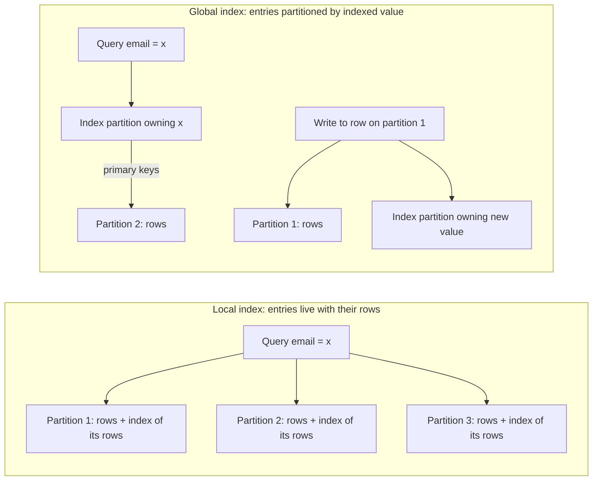
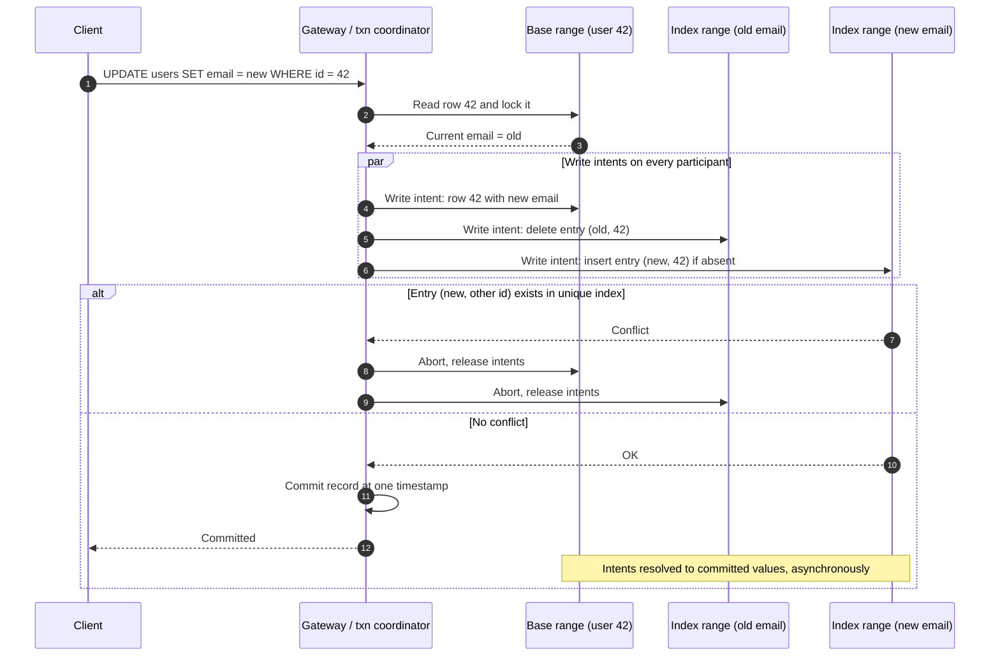
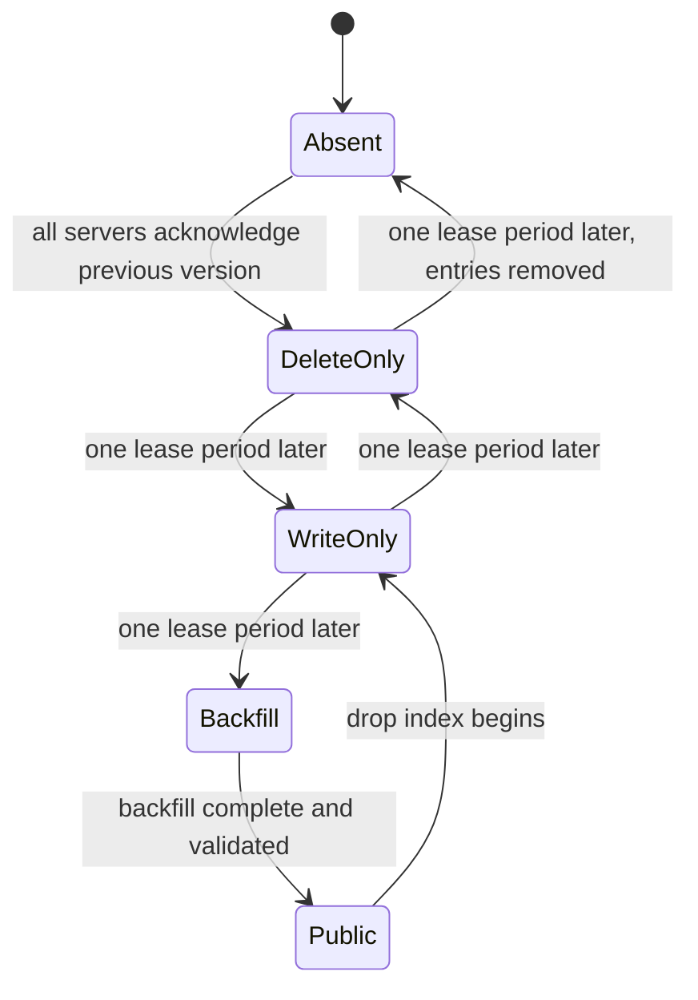
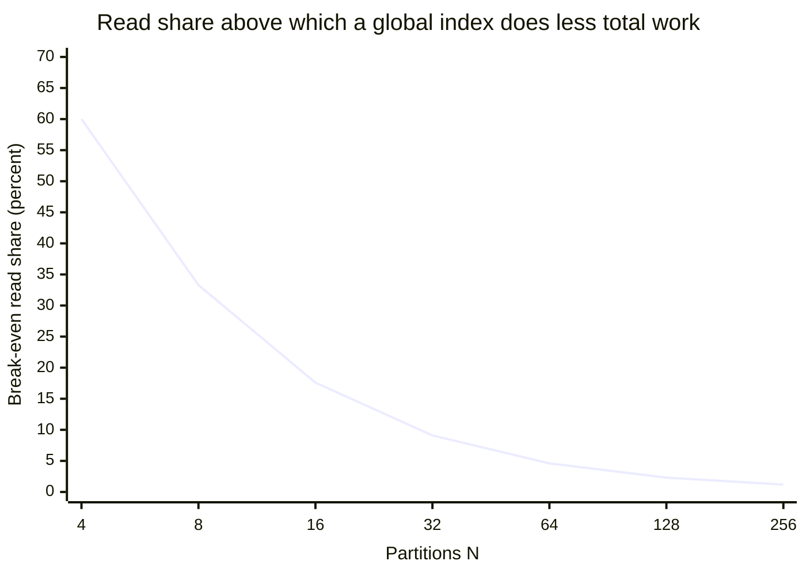
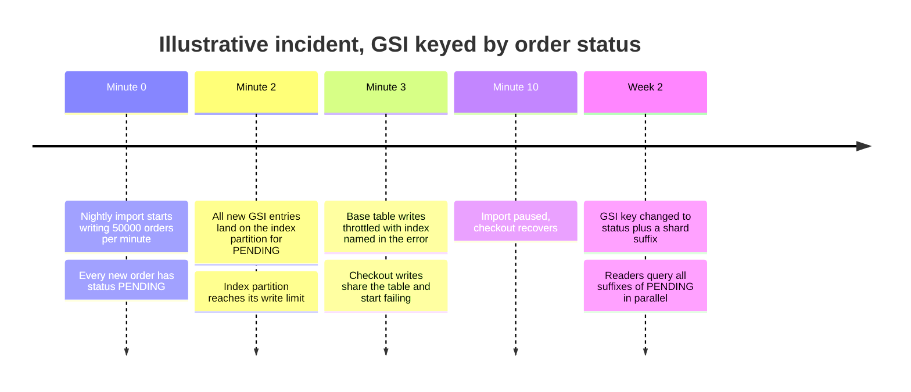

İkincil indeks (secondary index), partition anahtarı dışındaki bir kolonun değerlerini o değerleri taşıyan satırlara geri eşler. Tek node'lu bir veritabanında bu, tabloyla aynı transaction içinde güncellenen ikinci bir B-tree ya da LSM yapısıdır; e-postaya ya da duruma göre yapılan bir sorgu birkaç indeks sayfası okur, sonra eşleşen satırlara gider. Tablo `user_id` gibi bir anahtarla bölümlendiği anda aynı e-postayı ya da aynı durumu paylaşan satırlar bütün partition'lara dağılır ve indeksin de bölümlenmesi gerekir. Bunun iki yolu vardır. Local indeks (document-partitioned, belge bazlı bölümlenmiş olarak da anılır) her partition'da yalnızca o partition'ın satırlarının indeksini tutar. Global indeks (term-partitioned, terim bazlı bölümlenmiş) ise indekslenen değerin kendisine göre bölümlenir; bir değere ait bütün girdiler tek bir indeks partition'ında birlikte durur ve bu partition çoğu zaman satırları tutan partition değildir.

İki yerleşim de bedelsiz değildir, çünkü yazmaları ve nokta aramalarını yerel kılan bölümleme, anahtar dışı erişimi tam da yerel olmaktan çıkaran şeydir. Local indeks her yazmayı yerel ve atomik tutar: satır ve indeks girdileri tek bir partition'da, tek bir transaction içinde değişir. Bedeli okumada ödenir: partition anahtarını da belirtmeyen bir sorgu bütün partition'lara sormak zorundadır, çünkü herhangi biri eşleşme tutuyor olabilir; gecikmeyi de en yavaş partition belirler. Global indeks bunu tersine çevirir. Bir arama, değerin sahibi olan tek indeks partition'ına, ardından eşleşen satırları tutan birkaç partition'a gider; ama indekslenmiş bir kolona yapılan her yazma artık base partition'a ek olarak başka yerlerdeki bir ya da iki indeks partition'ına da dokunur. Bu yazma ya commit gecikmesi ve koordinasyon hata modlarıyla birlikte gelen dağıtık bir transaction'dır ya da indeks ile tablonun birbirini tutmadığı bir pencere bırakan asenkron bir güncellemedir.

Dolayısıyla asıl denge, partition'lar arası maliyetin nereye düştüğüdür: local indeksler bu maliyeti her anahtar dışı okumaya yükler, yazmaları ucuz ve tutarlı tutar; global indeksler maliyeti indekslenmiş her yazmaya yükler ve seçici okumaları ucuzlatır, karşılığında ya dağıtık commit'ler ya da bayat indeks okumaları getirir. Üçüncü bir seçenek, bir değişiklik akışından ayrı bir okuma deposu kurmak, maliyeti veritabanının tamamen dışına taşır; bu konu [materialized view pattern'i](/distributed-systems/tr/microservice-patterns/data-management-patterns/materialized-view/) ve [CQRS](/distributed-systems/tr/microservice-patterns/event-sourcing-cqrs/cqrs/) sayfalarında ele alınır. Bu sayfa, deponun kendisinin tuttuğu indekslerle ilgilidir.


*Aynı sorgu ve aynı yazma, iki yerleşim altında. Local: bir yazma, N okuma. Global: bir ya da iki okuma, farklı partition'larda iki ya da daha fazla yazma.*

Sol taraf local indekslere neden belge bazlı bölümlenmiş dendiğini gösterir: her partition sahibi olduğu belgeleri indeksler ve diğerleri hakkında hiçbir şey bilmez; bu yüzden sorgu üç partition'ın hepsine yayılır. Sağ taraf global yerleşimi gösterir: indeks partition'ı aranan değere göre seçilir, sorgu tek bir yerden başlar ve primary key'leri izleyerek satırlara ulaşır. Sağdaki yazma ise bedeldir: partition 1'deki bir satırı değiştirmek, yeni değere göre seçilen bir indeks partition'ını da, değer değiştiyse eski değere göre seçilen bir başkasını da değiştirir. Bu sayfadaki her tasarım sorusu, bu iki oktan biriyle ilgili bir sorudur.

## Local ve Global Yerleşimler, Adım Adım

### Local İndeksler: Tek Yazma, Okumada Bütün Partition'lar

Yazma yolunda local indeks, tek node'daki bir indeksle birebir aynı davranır. Satırın sahibi olan partition, satır değişikliğini ve indeks değişikliğini tek bir yerel transaction'da ya da tek bir atomik batch'te uygular; bu yüzden o partition'daki indeks hiçbir zaman kendi satırlarıyla çelişemez ve yazma başka hiçbir partition'ı içermez. Bir satır oluşturmak, güncellemek ya da silmek, indeks sayısı ne olursa olsun, sahibine tek bir round trip'e mal olur.

Okuma yolunda, yalnızca indekslenen kolon üzerindeki bir sorgu bütün partition'lara gönderilir (scatter), her partition kendi indeksini yoklar ve eşleşmelerini döner, bir coordinator da sonuçları birleştirir (gather). Sırasız bir filtre için birleştirme basit bir art arda eklemedir. Sıralı ve sayfalı bir sorgu için ise göründüğünden pahalıdır: bir kolona göre sıralanmış ilk `k` sonucu döndürmek için `N` partition'ın her biri kendi ilk `k` sonucunu dönmek zorundadır, çünkü coordinator global ilk `k`'nın nasıl dağıldığını önceden bilemez; böylece coordinator `k * N` aday alır ve `k` tanesi dışındakileri atar. `k` boyutlu `p`. sayfa, her partition'ın `p * k` satır dönmesini gerektirir. Shard'larının her biri bağımsız bir Lucene indeksi olan, dolayısıyla saf bir local indeks olan Elasticsearch bunu `index.max_result_window` ile sınırlar; varsayılan değer 10.000'dir: daha derin `from + size` sayfalaması reddedilir, önerilen alternatif ise cursor tarzı `search_after`'dır.

Local indeks, sorgu partition anahtarını da kısıtladığında scatter yapmayı bırakır. Müşteriye göre bölümlenmiş bir tabloda "42 numaralı müşterinin durumu shipped olan siparişleri" sorgusu tek bir partition'a gider ve o partition'ın durum indeksini kullanır. Local indekslerin asıl hedeflediği durum budur ve DynamoDB'nin kendi versiyonuna local secondary index demesinin nedeni de budur: tek bir partition anahtarı içinde alternatif bir sıralama düzeni.

### Global İndeksler: İndeksin Kendi Partition Anahtarı Vardır

Global indeks, partition anahtarı indekslenen değer olan ve satırları indeks girdileri olan ikinci bir tablodur: indekslenen değer, base satırın primary key'i ve isteğe bağlı olarak diğer kolonların kopyaları. Her tablo gibi bölümlenir: sorgular eşitlik aramasıysa indekslenen değerin hash'ine göre, sorgular değer aralıklarını tarıyorsa aralığa göre; kullanılan şemalar [hash bölümleme](/distributed-systems/tr/data-management/data-partitioning/hash-partitioning/) ve [anahtar aralığı bölümleme](/distributed-systems/tr/data-management/data-partitioning/key-range-partitioning/) sayfalarında anlatılanlarla aynıdır.

Okuma yolunda bir eşitlik araması, değerin sahibi olan tek indeks partition'ına gider (aralığa göre bölümlenmiş bir indeks ve bir aralık koşulu söz konusuysa bitişik birkaç partition'a); bu partition eşleşen satırların primary key'lerini döner. İndeks sorgunun ihtiyaç duyduğu her kolonu tutuyorsa, yani covering index ise, sorgu orada biter. Aksi hâlde coordinator eşleşen her satırı kendi base partition'ından getirir. Bu ikinci adım cluster boyutuyla değil eşleşme sayısıyla sınırlıdır. Global indeksin e-posta ya da sipariş numarası gibi seçici koşullar için belirleyici, tablonun büyük bir kısmıyla eşleşen koşullar için ise neredeyse işe yaramaz olmasının nedeni budur: kullanıcı kimliğine göre dağılmış 200.000 eşleşen satırı olan bir değer zaten bütün base partition'lara dokunur.

Yazma yolunda bir satır eklemek, satırı kendi base partition'ına ve her global indeks için bir girdiyi indekslenen değerlerin sahibi olan partition'lara yazmak demektir. İndekslenmiş bir kolonu güncellemek, eski değerin girdisini silip yeni değer için bir girdi eklemek demektir; bunlar iki farklı indeks partition'ı olabilir, dolayısıyla tek satırlık bir güncelleme indeks başına üç partition'a dokunabilir. Bir satırı silmek, girdilerini de siler. Bir girdiyi silmek ya da taşımak için yazanın eski değeri bilmesi gerekir; bu yüzden global indeks bakımı ya base satırı yazmadan önce okumayı (read-before-write) ya da eski değeri değişiklik kaydında taşımayı gerektirir.

### Her Yerleşim Neyi Garanti Eder, Neyi Etmez

Local indeks, her partition'ın indeksinin commit edilmiş her durumda o partition'ın satırlarını tam olarak tarif ettiğini garanti eder, çünkü ikisi de tek bir yerel atomik işlemle değişir. Bir sorgunun partition'lar arasında tutarlı bir snapshot görmesini garanti etmez; depo bütün partition'ları tek bir timestamp'te okumuyorsa, çok partition'lı snapshot'ı olmayan bir depodaki scatter, yeniden dengeleme sırasında partition'lar arasında taşınan bir satırı iki kez görebilir ya da hiç göremeyebilir. Partition'lar arası benzersizliği garanti etmez: iki partition aynı e-postayı ayrı ayrı kabul edebilir, çünkü hiçbiri diğerine danışmaz. Sınırlı okuma maliyetini de garanti etmez: her anahtar dışı sorgunun maliyeti partition sayısıyla birlikte büyür.

Global indeks, cevabın boyutuyla orantılı bir okuma maliyeti garanti eder. Tabloyla uyumlu olup olmadığı ise tamamen nasıl bakıldığına bağlıdır. Senkron bakılan bir global indeks, yani satırla aynı dağıtık transaction içinde güncellenen bir indeks, bir snapshot'taki indeks okumasının tablonun o snapshot'ta tuttuğu satırları tam olarak gördüğünü garanti eder ve koşullu bir ekleme ile benzersizliği zorlayabilir. Asenkron bakılan bir indeks ise yalnızca yakınsamayı (convergence) garanti eder: yazmalar durursa indeks eninde sonunda tabloyla eşleşir. O zamana kadar yeni yazılmış satırları kaçırabilir, artık eşleşmeyen satırları döndürebilir ve güncelliğini yitirmiş öznitelik değerleri raporlayabilir. İki varyant da ucuz yazmayı garanti etmez, dengeyi de garanti etmez: indeks, uygulamanın dağılım için değil anlam için seçtiği değerlere göre bölümlenir; base tablo ne kadar iyi dengelenmiş olursa olsun popüler bir değer sıcak bir indeks partition'ı demektir.

### Her Yerleşim Neden Doğru Satırları Döndürür

Local indekste tamlık bir bölümleme argümanından çıkar. Her satır tam olarak bir partition'da yaşar ve her partition'ın indeksi tam olarak kendi satırları için girdi içerir. Dolayısıyla partition başına cevapların birleşimi, tablonun tamamı üzerindeki cevaptır ve tekrar içermez; yeter ki coordinator her partition'dan cevap alsın ve bütün partition'lar aynı mantıksal anda okunsun. Pratikte local indeksler tam da bu iki koşulda bozulur: cevap vermeyen bir partition sonucu sessizce eksik bırakır, ortak bir snapshot olmadan yapılan scatter da yeniden dengeleme sırasında taşınan satırları iki kez sayabilir ya da kaçırabilir; taşıma protokolü [dinamik yeniden dengeleme](/distributed-systems/tr/data-management/data-partitioning/dynamic-rebalancing/) sayfasında anlatılır.

Global indekste değişmez (invariant) şudur: `(v, pk)` girdisi ancak ve ancak `pk` satırı şu anda `v` değerine sahipse vardır. Senkron bir indeks bunu satır yazmasını ve girdi yazmalarını tek bir atomik transaction'a koyarak korur: [two-phase commit](/distributed-systems/tr/coordination/distributed-transactions/two-phase-commit/) (ya da consensus destekli varyantı) hepsini tek bir commit timestamp'inde görünür kılar ya da hiçbirini kılmaz; böylece aynı timestamp'te yapılan indeks snapshot okuması ile tablo snapshot okuması birbirini tutar. Asenkron bir indeks daha zayıf bir değişmezi korur: her base değişikliği eninde sonunda indekse etkisi bakımından tam bir kez uygulanır ve aynı satıra ait değişiklikler satırın kendi sırasıyla uygulanır. Bu, yayılım yolunun üç özelliğe sahip olmasını gerektirir. Birincisi kalıcılık: değişiklik kaydı satırla atomik olarak yazılır (satırın log girdisidir ya da bir outbox kaydıdır), böylece commit edilmiş hiçbir satır değişikliği yayılmadan önce kaybolamaz. İkincisi satır başına idempotent ve sıralı uygulama: her girdi onu üreten satır versiyonunu taşır ve indeks bir değişikliği ancak versiyonu kendi tuttuğundan yeniyse uygular; böylece yeniden teslim ve sıra bozulması bir girdiyi geri saramaz. Üçüncüsü, silmeler, daha eski bir versiyonun gecikmiş bir eklemesi silinmiş bir girdiyi diriltemeyecek kadar uzun süre yaşayan versiyonlu tombstone'lar bırakır. Bu üçünden birini eksik olan bir yayılım yolu yakınsamaz, sürüklenir.

```text
apply(change):                    # change = (pk, version, old_value, new_value)
  if old_value != null:
    e = index.get(old_value, pk)
    if e == null or e.version < change.version:
      index.put_tombstone(old_value, pk, change.version)   # delete, keep version
  if new_value != null:
    e = index.get(new_value, pk)
    if e == null or e.version < change.version:
      index.put(new_value, pk, change.version, projected_columns)
# Redelivered or reordered changes are no-ops: an older version never overwrites.
# Tombstones are purged only after the maximum propagation delay has passed.
```

Bu pseudocode, depo tarafından içeride çalıştırılsın ya da bir uygulama tarafından bir değişiklik akışı üzerinden çalıştırılsın, her asenkron indeksin çekirdeğidir. At-least-once teslimi güvenli kılan, versiyon karşılaştırmasıdır; o olmadan, daha yeni bir değişiklikten sonra gelen yeniden denenmiş eski bir değişiklik bayat bir girdiyi sessizce geri getirir ve elle kurulmuş indekslerdeki kalıcı sapmanın en yaygın kaynağı budur.

## Global İndeksi Tabloyla Eşzamanlı Tutmak

Gerçek sistemler global indekslere üç yoldan biriyle bakar ve hata davranışını yerleşimden çok bu seçim belirler.

### Senkron: İndeks Yazması Transaction'ın Parçasıdır

Spanner, CockroachDB, YugabyteDB ve TiDB her ikincil indeksi kendi anahtar uzayı olarak saklar, tablodan bağımsız olarak range'lere böler ve indeks girdilerini kullanıcının transaction'ının parçası olarak yazar. Girdi çoğu zaman satırdan farklı bir range'de durduğu için bir ekleme çok range'li bir transaction'a dönüşür ve commit protokolü katılımcılar arasında çalışır.


*Senkron global indeks bakımı altında indekslenmiş bir değeri değiştiren bir güncelleme: üç range, bir okuma, bir commit kararı.*

Adım 2, read-before-write'tır: coordinator, eski değeri bir kilit altında okumadan hangi indeks girdisini sileceğini bilemez. Adım 4 ile 6 paralel çalışır; dolayısıyla tek range'li bir yazmaya göre ek gecikme, sıralı üç tur yerine kabaca bir ek yazma turu ve bir commit turudur. CockroachDB'nin parallel commits'i ve Spanner'ın commit protokolü bunu daha da azaltmak için tasarlanmıştır; ayrıntılar [consensus üzerinde 2PC](/distributed-systems/tr/case-studies/distributed-sql/transactions-2pc-over-consensus/) sayfasındadır. Adım 7'deki benzersiz indeks dalı, yalnızca bu bakım tarzının sahip olduğu yetenektir: `(new, 42)` eklemesi koşulludur ve değeri başka bir satır zaten tutuyorsa transaction'ın tamamı, hiçbir şey görünür olmadan abort edilir. Bedeli ise indekslenmiş bir kolona yapılan her yazmanın dağıtık bir transaction olmasıdır: yazmanın gecikmesi en yavaş katılımcınınkidir ve popüler bir indeks değeri üzerindeki çekişme, o değere sahip her satıra yapılan yazmalar üzerindeki çekişmeye dönüşür.

Spanner'ın dokümantasyonu bu dengeyi doğrudan söyler: interleaved olmayan bir indeksin girdileri genellikle satırlarla aynı split'lerde değildir; bu da her yazmaya iş ve gecikme, okumalara ise danışılacak ek split'ler ekler. Spanner'ın cevabı, bir parent tabloya `INTERLEAVE IN` ile tanımlanan interleaved indekstir: girdileri parent ile bir anahtar önekini paylaşır ve bu yüzden parent'ın split'lerinde kalır. Yani indeks bazında seçilen bir local indeks.

```sql
-- Global: entries split by Email, independent of Users' splits.
-- STORING copies DisplayName into the index, so lookups need no base fetch.
CREATE UNIQUE INDEX UsersByEmail ON Users(Email) STORING (DisplayName);

-- Local: entries keyed by (UserId, Status) live in the same splits as the user.
-- Queries must name UserId; uniqueness and cost are scoped to one user.
CREATE INDEX OrdersByStatus ON Orders(UserId, Status), INTERLEAVE IN Users;
```

İki ifade, kararı şema düzeyinde gösterir. Birincisi, e-postanın bütün veritabanı genelinde benzersizliğini zorlayabilen ve bir giriş (login) aramasını tek bir indeks okumasıyla cevaplayabilen global bir indekstir; bedeli her kayıtta ve her e-posta değişikliğinde split'ler arası bir yazmadır. İkincisi, split'ler arasında bakımı fazladan hiçbir şeye mal olmayan, yalnızca tek bir kullanıcıyla sınırlı sorgularda kullanılabilen ve o kullanıcının siparişlerini duruma göre sıralayan local bir indekstir.

### Asenkron: İndeks Tablonun Log'unu İzler

DynamoDB global secondary index'leri (GSI), Cassandra materialized view'ları ve bir uygulamanın [change data capture](/distributed-systems/tr/data-processing/hybrid-architectures/change-data-capture/) ile kurduğu her indeks tam tersi çalışır: base partition satırı tek başına commit eder, istemciye onay verir ve değişikliği indeks partition'larına sonradan yayar. Yazmanın gecikmesi ve erişilebilirliği tek bir partition'ınkidir; benzersizlik ise zorlanamaz, çünkü indeks çakışan bir değeri gördüğünde iki satır da çoktan commit edilmiştir.

İndeks tablonun yayılım gecikmesi kadar gerisinde kalır ve okuyucu bu gecikmeyi üç ayrı anomali olarak görür. Az önce yazılan bir satır indekste yoktur ([replication lag](/distributed-systems/tr/data-management/replication/replication-lag/) için anlatılan oturum problemiyle aynı read-your-writes ihlali). İndekslenen değeri değişen bir satır hâlâ eski değerin altında görünür; buna hayalet girdi (ghost entry) denir. Covering bir indeks de satırdan daha eski projeksiyon kolonları döndürür. İlk ikisini okuyucu, base satırı getirip koşulu yeniden kontrol ederek tespit edebilir; üçüncüsü o getirme olmadan tespit edilemez ve bu da projeksiyon yapmanın gerekçesini ortadan kaldırır.

İkinci maliyet ters yöndeki bağımlılıktır. DynamoDB, bir GSI güncelleme hacmini karşılayamazsa tablonun bol kapasitesi olsa bile base tabloya yapılan yazmaları kıstığını (throttle) belgeler ve bu davranışa GSI back-pressure der; hata indeksi işaret eder ama kısılan işlem base yazmadır. Asenkron bir indeks gecikmeyi ayırır, kapasiteyi ayırmaz: indeksin throughput'u hâlâ tablonun yazmaları için bir sınırdır, çünkü alternatif, yani sınırsız bir birikim, gecikmeyi de sınırsız kılardı.

### Dağıtık Transaction Olmadan Sıralı Commit'ler

Vitess, lookup indeksleri için üçüncü bir yaklaşım gösterir. Lookup vindex, genellikle aranan kolona göre shard'lanmış sıradan bir tablodur ve bir değeri, onu tutan satırın shard'ına (keyspace ID) eşler. Consistent lookup vindex, ifade başına üç bağlantı kullanıp bunları sabit bir sırayla commit ederek tabloyu two-phase commit olmadan eşzamanlı tutar: lookup tablosuna eklemeler "Pre" bağlantısında, base satır değişikliği "Main"de, lookup tablosundan silmeler "Post"ta. Yarıda kalan bir hata yalnızca tek tür tutarsızlık bırakır: satırın bulunmadığı bir shard'ı işaret eden bir lookup girdisi, yani bir yetim (orphan). Yetimler okumalar için zararsızdır, çünkü sorgu o shard'a yönlendirilir ve hiçbir şey bulamaz; cevap yine doğrudur. Temizlik de tembel yapılır: sonraki bir ekleme yetimle çakıştığında onu kilitler, base satırın bulunmadığını doğrular ve girdiyi yeniden yönlendirir. Tasarım, okuma yolunun base satıra karşı doğrulayarak tolere ettiği sarkan bir işaretçiyi, bir coordinator'ın ve belirsiz durumdaki (in-doubt) transaction'ların yokluğuyla takas eder. Bu, sıralaması indeksin tabloyu yalnızca fazladan kapsayabileceği, asla eksik kapsayamayacağı şekilde seçilmiş asenkron değişmezdir.

### Canlı Bir Tabloda İndeks Oluşturmak

Hâlihazırda veri tutan bir tabloya global indeks eklemenin kendi doğruluk problemi vardır. Backfill yeni yazmalar sürerken mevcut satırları okur ve farklı sunucular yeni indeksi farklı anlarda öğrenir. Bir sunucu indeksten okuma sunmaya başlarken bir diğeri hâlâ indeks girdisi olmadan satır yazıyorsa indeks satır kaçırır; bir sunucu girdi eklediği satırları indeksten habersiz başka bir sunucu girdileri silmeden silerse indeks yetimler tutar. Google'ın F1 sistemi (Rae ve arkadaşları, VLDB 2013) bunu, şemanın hiçbir zaman yok durumundan doğrudan kullanılabilir duruma atlamasına izin vermeyerek ve schema lease'ler aracılığıyla herhangi bir anda en fazla iki komşu şema versiyonunun kullanımda olmasını garanti ederek çözdü.


*F1 tarzında, çevrimiçi oluşturma ve kaldırma sırasında bir indeksin durumları. Her geçiş, hiçbir sunucunun iki durum geride kalamayacağı ana kadar bekler.*

Argüman ikili durumlar üzerinden kurulur. Bazı sunucular `Absent`, diğerleri `DeleteOnly` iken kimse girdi yazmaz; dolayısıyla yetim oluşamaz ve var olmayan girdileri silmek zararsızdır. Bazıları `DeleteOnly`, diğerleri `WriteOnly` iken write-only bir sunucu bir girdi ekleyebilir; satırı silen her sunucu en az delete-only olduğu için girdiyi de kaldırır, yani yetimler yine oluşamaz. Eksik girdilere izin verilir, çünkü indeksi henüz kimse okumaz. Her sunucu `WriteOnly` olduğunda her yeni yazma indeksi günceller; böylece backfill'in yalnızca o andan önce var olan satırları kapsaması gerekir ve bunları kendi hızında tarayabilir. İndeks ancak backfill tamamlandıktan sonra `Public` ve okunabilir olur. CockroachDB şema değişiklikleri için bu protokolü kullanır; DynamoDB ise backfill'i backfilling bayrağı taşıyan `CREATING` indeks durumu olarak gösterir ve çalıştığı süre boyunca yeni indeksin yazma kapasitesini tüketir. Operasyonel sonuç her yerde aynıdır: büyük bir tabloda global indeks oluşturmak, indeks partition'larına uzun süren, kısılmış bir toplu yazmadır ve onların kapasitesi için canlı trafikle yarışır. Böyle bir indekse bağımlı şema değişikliklerini devreye almanın expand/contract disiplini [sıfır kesintili veritabanı migration'ları](/distributed-systems/tr/deployment/deployment-patterns/zero-downtime-db-migrations/) sayfasında anlatılır.

## Hesaplı Örnek: E-postaya ve Şehre Göre Sorgulanan 64 Partition'lı Bir Kullanıcı Deposu

`user_id`'ye göre 64 partition'a hash ile bölümlenmiş, 400 milyon satırlık bir kullanıcı tablosu varsayalım; partition başına 6,25 milyon satır. İş yükünde iki anahtar dışı sorgu var: saniyede 12.000 isteklik e-postaya göre giriş araması ve bir destek aracının saniyede birkaç kez çalıştırdığı "bu şehirdeki kullanıcılar" listesi. Yazmalar saniyede 4.000: 1.000 yeni kayıt ve 3.000 profil güncellemesi; bunların varsayılan %5'i e-postayı değiştiriyor. Bu bölümdeki bütün sayılar örnek amaçlıdır.

Local bir e-posta indeksiyle her giriş 64 partition'a giden bir scatter'dır ve bunların 63'ü hiçbir şey bulmaz. Bu, 12.000 soruyu cevaplamak için cluster genelinde saniyede `12,000 * 64 = 768,000` indeks yoklaması demektir. Iskalayan bir yoklama varsayımsal olarak 30 mikrosaniye CPU'ya mal oluyorsa (önbellekteki birkaç sayfalık bir B-tree inişi artı istek işleme), yalnızca ıskalamalar yaklaşık 23 çekirdeklik CPU tüketir. Gecikme, CPU faturasından da kötüdür: her partition bağımsız olarak isteklerin %1'inde yavaşsa, 64 yönlü bir scatter girişlerin `1 - 0.99^64`'ünde, yani yaklaşık %47'sinde en az bir yavaş partition'a denk gelir; bu fan-out aritmetiği [anahtar aralığı sayfasında](/distributed-systems/tr/data-management/data-partitioning/key-range-partitioning/) ayrıntılı olarak hesaplanır. Yazmalar ucuzdur: indeks dâhil saniyede 4.000 tek partition'lı yazma.

E-posta üzerinde, kendi 64 indeks partition'ına hash'lenmiş senkron bir global indeksle her giriş bir indeks partition'ı ve, indeks girişin ihtiyaç duyduğu kolonları tutmuyorsa, bir base partition okur: saniyede 768.000 yerine 24.000 partition isteği ve 64 değil iki partition'ın belirlediği bir kuyruk gecikmesi. Yazmalar ise artık daha pahalıdır. Yeni bir kayıt satırı ve bir indeks girdisini yazar; 64 indeks partition'ıyla bu ikisi 63/64 olasılıkla farklı partition'lara düşer, yani pratikte her kayıt iki katılımcılı dağıtık bir transaction'dır. Bir e-posta değişikliği base partition'a ve eski ile yeni girdilerin partition'larına dokunur: saniyede 150 böyle yazma, her biri üç katılımcılı. Kalan 2.850 profil güncellemesi ne e-postaya ne de indekste saklanan herhangi bir kolona dokunur; eski ve yeni değerleri karşılaştıran bir motor indeksi tamamen atlar. Yazmaları katılımcı bazında sayarsak cluster saniyede 4.000 yerine `1,000 * 2 + 150 * 3 + 2,850 * 1 = 5,300` partition yazması yapar ve saniyedeki 4.000 yazmanın 1.150'si artık dağıtık commit gecikmesini ve onun hata modlarını öder. Okuma işinin %97'sini ortadan kaldırmak için yazma işinde %33'lük bir artışa katlanmak, bu okuma-yazma oranında iyi bir takastır.

Şehir listesi ise tam ters cevabı verir. En büyük şehrin kullanıcıların %2'sini, yani 8 milyon satırı tuttuğunu varsayalım. Şehir üzerinde global bir indeks, o şehrin 8 milyon girdisinin hepsini tek bir indeks partition'ına koyar; bu tek başına bütün indeks girdilerinden o partition'a düşmesi gereken adil payı (1/64, yaklaşık %1,6) aşar ve o şehirdeki her yeni kayıt o tek partition'a yazar. Şehrin kullanıcılarını listelemek yine de 64 base partition'ın hepsinden satır getirmeyi gerektirir, çünkü 8 milyon kullanıcı kimliği hash ile düzgün biçimde dağılmıştır. Global indeks listelemeyi hiç ucuzlatmamış, üstüne bir hot spot yaratmıştır; bu, [çarpıklık ve hot spot'lar](/distributed-systems/tr/data-management/data-partitioning/skew-hot-spots/) sayfasında incelenen çarpıklığın düşük kardinaliteli biçimidir. Doğru seçim local bir şehir indeksidir: scatter 64 yoklamaya mal olur ama her yoklama cevabın işe yarar bir dilimini döner; yani iş, her iki durumda da sonuç boyutuyla orantılıdır.

Genel kural karşılaştırmanın içinde saklıdır. İşlem başına local bir indeks okuma başına yaklaşık `N`, yazma başına bir partition isteğine mal olur; global bir indeks ise okuma başına yaklaşık iki ve, dağıtık bir commit varsayımsal olarak dört istek birimi sayılırsa (iki katılımcı, iki faz), yazma başına yaklaşık dört isteğe mal olur. Okuma payı `r` ile ikisi `r * (N - 2) = (1 - r) * 3` olduğunda eşitlenir; dolayısıyla başa baş okuma payı `3 / (N + 1)`'dir.


*Örnek amaçlı maliyet modeli altında başa baş okuma payı 3 / (N + 1): local okuma = N istek, global okuma = 2, local yazma = 1, global yazma = 4.*

Dört partition'da global indeks ancak işlemlerin %60'ından fazlası indekslenen kolona göre okumaysa kendini amorti eder; 64 partition'da yaklaşık %5'in üzerindeki bir okuma payı onu toplam iş bakımından zaten daha ucuz yerleşim yapar. Eğri pratikte görülen bir örüntüyü açıklar: cluster küçükken seçilen local bir indeks, uygulamada hiçbir değişiklik olmadan, cluster büyüdükçe yanlış yerleşime dönüşür; çünkü maliyetin okuma tarafı `N` ile büyür, yazma tarafı büyümez. Model gecikmeyi ya da erişilebilirliği değil işi sayar; yazma yolunda dağıtık commit'lere ya da asenkron bir indeksin bayatlığına tahammül edemeyen bir ekip, başa baş noktasının çok ötesinde de scatter'ın bedelini makul biçimde ödeyebilir.

## Production Sistemlerinde İkincil İndeksler

Local ve global şeklindeki ders kitabı ayrımı, depoların indekslere nasıl baktığı, okuyuculara hangi tutarlılığı verdiği ve hangi sınırları dayattığı konusundaki büyük farkları gizler.

| Sistem | Local indeks | Global indeks | Global bakım | Dikkat çeken sınır |
|---|---|---|---|---|
| DynamoDB | LSI: aynı partition anahtarı, farklı sort key | GSI: kendi partition ve sort key'i | Asenkron, yalnızca eventually consistent okumalar | LSI item collection'ı 10 GB ile sınırlı; LSI'lar tablo oluşturulurken tanımlanır; GSI back-pressure base yazmaları kısar |
| Cassandra | Yerleşik 2i, SASI, SAI (5.0): node başına | Materialized view'lar | Asenkron, base replica'dan view replica'ya | MV'ler 3.0.16 / 3.11.2'den beri deneysel ve sonraki yapılandırmalarda varsayılan olarak kapalı |
| Elasticsearch / OpenSearch | Her indeks: shard başına bir Lucene indeksi | Yok | Uygulanmaz | Derin sayfalama `index.max_result_window` ile sınırlı |
| MongoDB | Bütün indeksler, shard başına | Yok (yalnızca shard key) | Uygulanmaz | Shard'lar arası benzersizlik yalnızca shard key benzersiz indeksin öneki ise |
| Citus | Her shard'da oluşturulan indeksler | Yok | Uygulanmaz | Benzersiz kısıtlar dağıtım kolonunu içermek zorunda |
| Spanner | Interleaved indeks | Interleaved olmayan indeks | Senkron, aynı transaction | Interleaved indeks parent anahtar önekini paylaşmak zorunda |
| CockroachDB, YugabyteDB, TiDB | Partition önekli indeks | Varsayılan ikincil indeks | Senkron, aynı transaction | İndekslenmiş her yazma çok range'li bir transaction |
| Vitess | Shard başına MySQL indeksleri | Lookup vindex (shard'lanmış bir tablo) | Sıralı commit'ler, yetimler tolere edilir | Lookup kolonunun güncellenmesi Pre ile Post arasında kilit beklemelerine yol açabilir |

DynamoDB iki yerleşimi de açık isimlerle sunar. Local secondary index tablonun partition anahtarını paylaşır ve alternatif bir sort key ekler; dolayısıyla girdileri öğelerle aynı partition'da durur, aynı işlemde yazılır ve strongly consistent okumaları destekler. Bedeli, tablonun throughput'unu paylaşması, tablo oluşturulurken tanımlanmak zorunda olması ve her item collection'ı (bir partition anahtarı değerini paylaşan bütün öğeler ve indeks girdileri) 10 GB ile sınırlamasıdır. Çarpıklık sayfası bir maliyeti daha not eder: tabloda bir LSI varsa DynamoDB sıcak bir item collection'ı sort key'e göre bölemez. Global secondary index'in kendi anahtar şeması ve kendi kapasitesi vardır, sonradan bir backfill ile eklenebilir, yalnızca eventually consistent okumaları destekler ve yukarıda anlatılan back-pressure'ı uygular. Bir GSI anahtar özniteliğini değiştiren bir güncelleme iki indeks yazmasına mal olur: bir silme ve bir ekleme. GSI'ın anahtar özniteliklerine sahip olmayan öğeler ondan basitçe yoktur; bu da isteğe bağlı bir öznitelik üzerindeki bir GSI'ı "X durumundaki öğeler" için ucuz, seyrek (sparse) bir indekse çevirir. Veri modeline yansımaları [DynamoDB veri modeli](/distributed-systems/tr/case-studies/dynamodb-cassandra/dynamodb-data-model/) sayfasında ele alınır.

Cassandra'nın yerleşik ikincil indeksleri, eski SASI uygulaması ve Cassandra 5.0 ile gelen Storage-Attached Indexing (SAI) hepsi local'dir: her node kendi tuttuğu veriyi indeksler; SAI indeks yapılarını node'un memtable'larına ve SSTable'larına bağlar, böylece bunlar veriyle birlikte oluşturulur, compact edilir ve stream edilir. Partition anahtarını kısıtlayan bir sorgu indeksi tek bir replica kümesinde kullanır; yalnızca indekslenen kolonu kısıtlayan bir sorgu ise bütün token halkası üzerinde, her aralığı kapsayacak kadar node'a başvurularak değerlendirilmek zorundadır, dolayısıyla maliyeti cluster ile büyür. Materialized view'lar Cassandra'nın global yerleşimiydi: bir view farklı bir anahtarla bölümlenmiş bir tablodur ve her base replica, eski değeri öğrenmek için mevcut satırı okuduktan sonra hesapladığı view değişikliğini eşlenmiş bir view replica'sına asenkron olarak gönderir. Doğruluk problemleri projenin view'ları 3.0.16 ve 3.11.2'de deneysel olarak işaretlemesine yol açtı (CASSANDRA-13959); 4.0 ile gelen cassandra.yaml da onları varsayılan olarak kapatır. Bunları destekleyen yönetilen hizmetler, bir view'ın senkron dışı kalıp kalmadığını anlamanın bir yolu olmadığı, senkronizasyon gecikmesi için bir üst sınır bulunmadığı ve view'ı silip yeniden oluşturmaktan başka bir onarım yolu olmadığı konusunda uyarır. Yaygın ikame, uygulama düzeyinde denormalizasyondur: base tabloyu ve bir sorgu tablosunu tek bir logged batch içinde yazmak.

Elasticsearch en saf local indeks sistemidir. Her indeks shard'lara bölünür; her biri kendi inverted index'i olan kendi kendine yeten bir Lucene indeksidir. Bir arama iki fazda çalışır: her shard'ın kendi ilk `from + size` isabetinin kimliklerini ve sıralama değerlerini döndüğü bir sorgu fazı ve koordine eden node'un birleştirilmiş ilk isabetlerin belgelerini onları tutan shard'lardan getirdiği bir fetch fazı. İndeksleme tek bir shard'a yereldir ve bir sonraki refresh'ten sonra aranabilir hâle gelir; aktif indekslerde varsayılan olarak saniyede bir. Yani indeks yapısı yazma log'undan ayrı tamponlandığında local bir indeksin bile görünürlük gecikmesi vardır. Özel bir routing değeri, bir tenant'a ya da kullanıcıya ait hem yazmaları hem aramaları tek bir shard'a gönderir; bu, partition anahtarını belirtmenin local indeksteki karşılığıdır. Arama sonuçları kaç shard'ın başarılı ve kaçının başarısız olduğunu raporlar ve varsayılan olarak (`allow_partial_search_results`, cluster genelinde `search.default_allow_partial_results` ile değiştirilebilir) başarısız shard'ları olan bir arama hata yerine kısmi sonuç döner.

MongoDB indeksleri her shard'a yereldir. Router (`mongos`), sorgu shard key'i içeriyorsa sorguyu eşleşme tutabilecek shard'lara, içermiyorsa bütün shard'lara gönderir. Benzersizlik sonucu açıkça belgelenmiştir: shard'lanmış bir cluster, shard'lar arasında benzersiz kısıtı yalnızca benzersiz indeks shard key üzerindeyse ya da onu önek olarak içeriyorsa zorlar; `_id` shard key değilse `_id` indeksi bile benzersizliği yalnızca shard başına zorlar. Citus aynı kuralı PostgreSQL'e uygular: dağıtık bir tablodaki benzersiz ve primary key kısıtları dağıtım kolonunu içermek zorundadır, çünkü her shard'ın indeksi yalnızca kendi satırlarını kontrol edebilir.

Spanner, CockroachDB, YugabyteDB ve TiDB, transaction katmanları çok range'li commit'leri zaten sıradan hâle getirdiği için varsayılan olarak global ve senkron bakılan indeksler kullanır. CockroachDB'de bir ikincil indeks, tablonun anahtar uzayında ayrı bir anahtar aralığıdır; diğer her şey gibi range'lere bölünür ve yeniden dengelenir, girdileri de satırla aynı transaction'da intent olarak yazılır; `STORING` ifadesi onu covering yapar. Bu sistemler yerellik için local yerleşimleri bir seçenek olarak sunar: Spanner'da interleaving ile ya da indeksin önüne bölümleme kolonunu koyarak. Çok bölgeli (multi-region) kurulumlar da aynı yöne iter, çünkü girdileri herhangi bir bölgede durabilen benzersiz bir indeks her eklemede bölgeler arası bir kontrol gerektirir. Commit mekanizması [Spanner mimarisi](/distributed-systems/tr/case-studies/distributed-sql/spanner-architecture/) ve [CockroachDB](/distributed-systems/tr/case-studies/distributed-sql/cockroachdb-raft-hlc/) sayfalarında anlatılır.

### Yerleşimler Arasında Seçim

| Yaklaşım | Yazma maliyeti | Anahtar dışı okuma maliyeti | Okuma tutarlılığı | Benzersizlik | Ne zaman tercih edilmeli |
|---|---|---|---|---|---|
| Local indeks | Tek partition, atomik | Bütün partition'lara scatter; kuyruk `N` ile büyür | Partition başına tabloyla eşleşir | Yalnızca partition anahtarı indeksin parçasıysa | Sorgular genellikle partition anahtarını belirtiyorsa, çok satırla eşleşiyorsa ya da cluster küçükse |
| Global, senkron | İndekslenmiş her yazmada dağıtık transaction | Bir indeks partition'ı artı eşleşen base partition'lar | Tabloyla snapshot tutarlı | Zorlanabilir | Doğruluğun ve benzersizliğin önemli olduğu, yazmaların dağıtık commit'i ödeyebildiği seçici aramalar (e-posta, sipariş numarası) |
| Global, asenkron | Commit'te tek partition; yayılım sonradan | Senkron ile aynı | Yayılım gecikmesi kadar bayat; hayaletler ve ıskalamalar mümkün | Zorlanamaz | Bayatlığa tahammül eden seçici aramalar, tek partition'da kalması gereken yazma yolları |
| Sıralı commit'li lookup tablosu | Sabit sırada birkaç yerel commit | Lookup artı base shard'da doğrulama | İndeks fazladan kapsar; okumalar doğrular | Lookup tablosunda zorlanabilir | 2PC'siz shard'lanmış ilişkisel depolar, birkaç sıcak anahtar dışı sorguyu yönlendirme |
| Harici okuma modeli (CDC ile beslenen arama ya da view) | Tek partition; pipeline sonradan | Okuma deposu ne için kurulduysa | Pipeline gecikmesi kadar bayat | Zorlanamaz | Tam metin, facet'li ya da çok öznitelikli sorgular; başka bir ekibin sahip olduğu erişim örüntüleri |

:::tip[Yaygın sorgunun partition anahtarını belirtmesini sağlayın]
En ucuz indeks, partition anahtarını zaten bilen bir sorgu üzerindeki local indekstir. Global bir indeks eklemeden önce erişim yolunun anahtarı taşıyıp taşıyamayacağını kontrol edin: bir giriş işlemi e-postayı bir kez kullanıcı kimliğine çözüp önbelleğe alabilir, bir destek aracı önce tenant'ı sorabilir, bir URL sahip kimliğini içerebilir. Partition anahtarını belirtecek şekilde yeniden yazılabilen her sorgu, bir scatter'ı ya da dağıtık bir yazmayı tek partition'lı bir işleme çevirir.
:::

## Hata Modları ve İmzaları

İndeks hataları nadiren indeksten gelen hatalar olarak ortaya çıkar. Eskiden hızlı olan yavaş sorgular, eksik ya da fazla sonuçlar veya boş kapasitesi olan bir tablodaki kısılmış yazmalar olarak ortaya çıkar.

### Cluster ile Büyüyen Scatter Maliyeti

Tetikleyici: local bir indeksle sunulan anahtar dışı bir sorgu sıklaşır ya da cluster büyür. Belirtiler: nokta aramaları sabit kalırken sorgunun gecikmesi eklenen her partition ile artar; coordinator CPU'su yükselir; sorgunun p99'u en yavaş partition'ı izler. Bir partition çöktüğünde ya da timeout'u aşacak kadar yavaşladığında, kısmi sonuç dönen depolar hata yerine daha az satırla cevap verir ve bu daha kötüdür: çağıran taraf başarılı ama eksik bir cevap görür. Tespit: istek başına başvurulan partition sayısı ve bunun toplam istek işi içindeki payı (Citus ve Vitess çok shard'lı ve tek shard'lı sorgu sayılarını raporlar; Elasticsearch her cevapta `_shards.total`, `successful` ve `failed` değerlerini raporlar). Tamlığı önemli olan sorgular için başarısız shard içeren her cevapta alarm üretin. Azaltma: sorguyu partition anahtarını belirtecek şekilde yeniden yazın, sorgu seçiciyse global bir indeks ekleyin ya da sorguyu bir okuma modeline taşıyın. Doğruluğa duyarlı scatter'larda kısmi sonuçları kapatın ki eksik bir shard hata olsun.

### Asenkron İndeksten Bayat Okumalar ve Hayalet Girdiler

Tetikleyici: bir istemci yazar ve hemen ardından asenkron bir global indeks üzerinden sorgular ya da projeksiyon özniteliklerine güvenir. Belirtiler: "az önce kaydettim ama yok"; eski e-postasıyla hâlâ bulunan bir kullanıcı; duruma göre filtrelenmiş ve durumu değişmiş öğeleri içeren bir liste.

```mermaid
sequenceDiagram
    autonumber
    participant C as Client
    participant B as Base partition (user 42)
    participant L as Propagation queue
    participant I as Index partitions (by email)
    C->>B: Update user 42: email old to new
    B-->>C: OK (committed on base only)
    B->>L: Change record (42, v8, old, new)
    rect rgb(70, 40, 40)
    Note over L,I: Propagation lag, index still holds (old, 42, v7)
    C->>I: Query email = new
    I-->>C: No match, login fails
    C->>I: Query email = old
    I-->>C: Match 42 with projected email = old
    end
    L->>I: Apply v8: tombstone (old, 42), insert (new, 42)
    C->>I: Query email = new
    I-->>C: Match 42
```


*Asenkron bir indeksin yayılım penceresi içinde bir read-your-writes ihlali ve bir hayalet girdi. Zamanlamalar örnek amaçlıdır.*

Tehlike adım 2'de başlar: istemcinin elinde bir onay vardır ama değişikliği yalnızca base partition bilir. Adım 4 ile 7 gölgeli pencerenin içinde gerçekleşir: yeni değerle yapılan arama ıskalar, eski değerle yapılan arama başarılı olur ve projeksiyon özniteliği olarak eski değeri bile döner; dolayısıyla indekse güvenen bir istemcinin bunu fark etmesinin hiçbir yolu yoktur. Adım 8'den sonra indeks yakınsar. Tespit: yönetilen bir indeks için çoğu zaman doğrudan bir gecikme metriği yoktur, bu yüzden onu ölçün: periyodik olarak bir canary satır yazın ve indeks onu dönene kadar geçen süreyi ölçün; görünür olduğu yerde yayılım yolunun birikimini izleyin (CDC ile beslenen bir indeks için consumer lag). Azaltma: bir indeks aramasından sonra base satırı primary key ile okuyup koşulu yeniden kontrol edin, read-your-writes yollarını primary key'e yönlendirin (istemci az önce yazdığı kimliği bilir) ve asenkron bir indeksi benzersizlik ya da yetkilendirme gibi kararlar için asla kullanmayın.

### İndeks Back-Pressure'ı ve Sıcak İndeks Partition'ları

Tetikleyici: `status`, `country` ya da bir tarih gibi düşük kardinaliteli veya ani patlamalı bir öznitelik üzerindeki bir indeksin bir toplu iş ya da trafik sıçraması altında kalması veya kapasitesi okumalara göre boyutlandırılmış bir indeksin yazmalar büyürken geride kalması. Belirtiler: tablonun kendi partition'ları sınırlarının çok altındayken base tabloya yapılan yazmalar kısılır ya da yavaşlar; DynamoDB'de base yazmalarda indeksi adıyla anan throttling hataları; senkron depolarda popüler değerin sahibi olan indeks range'inde kilit çekişmesi ve transaction yeniden denemeleri.


*Sıcak bir indeks değerinin aksi hâlde sağlıklı bir tablonun yazmalarını nasıl kıstığını gösteren varsayımsal bir zaman çizelgesi; gerçek bir olay değildir.*

İçe aktarma hiçbir zaman sıcak bir base partition'a dokunmadı: siparişler sipariş kimliğine göre dağılmıştır. Hot spot indekstedir, çünkü her yeni girdi aynı indekslenen değeri taşır ve indeksin sınırı back-pressure yoluyla tablonun sınırı olur. 3. dakikadaki checkout kesintisi ortak kaderin (shared fate) sonucudur: kısma içe aktarmanın değil tablonun yazmalarına uygulanır. Tespit: indeks başına yazma tüketimi ve throttle sayıları (DynamoDB, CloudWatch'ta throttling'i GSI başına raporlar) ve senkron depolarda range başına yazma oranları. Azaltma: düşük kardinaliteli indeks anahtarlarına küçük bir shard numarası soneki ekleyin ve bütün sonekleri sorgulayın; bu, [çarpıklık sayfasındaki](/distributed-systems/tr/data-management/data-partitioning/skew-hot-spots/) salting tekniğinin aynısıdır. Düşük kardinaliteli filtreleri local indekslerde tutun; indeks kapasitesini indeksin okuma oranına göre değil base tablonun yazma oranına göre boyutlandırın ve toplu işleri indeksin sınırının altında kısın. DynamoDB'ye özgü mekanizma [sıcak partition problemi](/distributed-systems/tr/case-studies/dynamodb-cassandra/hot-partition-problem/) sayfasında incelenir.

### Uygulamanın Baktığı İndeksin Sessizce Sapması

Tetikleyici: bir uygulama kendi global indeksine, bir lookup tablosuna ya da bir arama indeksine, base depoya ve ardından indekse iki ayrı işlemle yazarak (dual write) ya da bir değişiklik akışını versiyonsuz uygulayarak bakar. İki yazma arasındaki bir çökme, onları yeniden sıralayan bir retry ya da eski bir olayı yeniden teslim eden bir consumer, indeksi tablodan kalıcı olarak farklı bırakır. Belirtiler: var olan ama indeksle asla bulunamayan satırlar, silinmiş satırları işaret eden indeks isabetleri ve iki depo arasında tutmayan sayımlar; yayılım gecikmesinin aksine, bu fark yazmalar durduğunda kapanmaz. Tespit: iki tarafı primary key'e göre, dilimler hâlinde tarayan ve uyuşmazlıkları bir metrik olarak raporlayan bir uzlaştırma (reconciliation) işi; CDC ile beslenen bir indeks için partition başına satır sayılarını karşılaştırmak ucuz bir ilk sinyaldir. Azaltma: indeksi base deponun log'undan [outbox pattern'i](/distributed-systems/tr/coordination/distributed-transactions/outbox-pattern/) ya da CDC ile türetin, değişiklikleri yukarıda gösterilen versiyon kuralıyla uygulayın ve indeksi bir snapshot artı log'dan yeniden oluşturabilen bir yeniden kurma yolunu hazır tutun.

:::danger[Dual write ile yazılan bir indeks kalıcı olarak sapar ve kimseye haber verilmez]
Uygulama kodundan önce satırı, sonra indeks girdisini yazmak iki bağımsız commit'tir. Aralarındaki herhangi bir çökme, timeout ya da retry, bir satırı eksik olan ya da bayat bir satırı işaret eden bir indeks üretir ve sonraki hiçbir yazma bunu onarmaz, çünkü her yazma yalnızca dokunduğu girdiyi düzeltir. Bir uzlaştırma işi yoksa ilk sinyal çoğu zaman kendi e-postasıyla bulunamayan bir müşteridir. İndeksleri base deponun commit edilmiş log'undan besleyin, uygulamayı versiyona göre idempotent yapın ve uzlaştırmayı sürekli çalıştırın.
:::

### Yalnızca Partition Başına Geçerli Olan Benzersizlik

Tetikleyici: partition anahtarı olmayan bir kolon üzerinde (e-posta, kullanıcı adı, harici kimlik) benzersizlik gereksiniminin benzersiz bir local indeksle ya da asenkron bir global indeksle uygulanması. Belirtiler: aynı saniye içinde farklı partition'larda oluşturulmuş, aynı e-postaya sahip iki hesap; e-postaya göre anahtarlanmış aşağı akış sistemlerin kayıtları birleştirmesi ya da üzerine yazması. Tespit: benzersiz kolona göre periyodik bir toplama ile birden fazla satırı olan değerlerin sayılması. Azaltma: benzersizliği senkron bakılan global bir benzersiz indeksle ya da değere göre anahtarlanmış ayrı bir benzersizlik kaydını satırla aynı transaction içinde yazarak zorlayın (DynamoDB'de, e-postaya göre anahtarlanmış bir öğeyi koşullu olarak oluşturan transactional bir yazma). Kurtarma teknik değil bir veri temizleme kararıdır: tekrarlar iş kurallarıyla birleştirilmeli ya da yeniden adlandırılmalıdır.

:::caution[Partition anahtarını içermeyen benzersiz bir indeks shard başına benzersizdir]
İndeksleri local tutan depolar böyle bir indeksi ya reddeder (MongoDB, Citus) ya da shard başına anlamlarla kabul eder (shard key olmadığında MongoDB'nin `_id`'si, PostgreSQL tarzı bölümlenmiş tablolar, elle shard'lanmış her MySQL). Tek node'dan taşınan bir şema `UNIQUE` tanımlarını korur ve garantilerini de koruyor gibi görünür; korumaz. Bir tabloyu shard'larken her benzersiz kısıtı denetleyin ve her biri için partition anahtarına mı, global bir benzersiz indekse mi yoksa ayrı bir benzersizlik kaydına mı taşınacağına karar verin.
:::

### Hata İmzalarına Toplu Bakış

| Hata | Yerleşim | Dışarıdan görünen belirti | Tespit sinyali | Azaltma |
|---|---|---|---|---|
| Scatter büyümesi | Local | Cluster büyüdükçe anahtar dışı sorgular yavaşlar | İstek başına başvurulan partition'lar; çok shard'lı sorgu payı | Partition anahtarını belirtmek, seçici sorgular için global indeks |
| Kısmi sonuçlar | Local | Daha az sonuç, hata yok | Cevaplardaki başarısız shard sayısı | Doğruluğa duyarlı sorgularda kısmi sonuçları kapatmak |
| Bayat okuma, hayalet girdi | Global, asenkron | Yeni yazılan satır yok; satır eski değerin altında | Canary yazmadan görünür olmaya kadar geçen süre; yayılım birikimi | Base satıra karşı doğrulama; primary key ile read-your-writes |
| Back-pressure | Global, asenkron | Tablo kapasitesi boşken base yazmalar kısılır | İndeks başına throttle'lar ve yazma tüketimi | İndeks kapasitesini base yazmalara göre boyutlandırmak; toplu işleri kısmak |
| Sıcak indeks değeri | Global | Tek bir değerin satırlarına yazmalar yavaş ya da kısılmış | İndeks partition'ı başına yazma oranı | Düşük kardinaliteli anahtarlara sonek; onları local tutmak |
| Kalıcı sapma | Uygulamanın baktığı | Hiç iyileşmeyen eksik ya da sarkan girdiler | Uzlaştırma uyuşmazlıkları | Versiyonlu, log beslemeli bakım; yeniden kurma yolu |
| Shard başına benzersizlik | Local ya da asenkron | Partition'lar arasında tekrarlanan değerler | Birden fazla satırı olan değer sayısı | Senkron global benzersiz indeks ya da benzersizlik kaydı |
| Uzun backfill | Global | Yeni indeks saatlerce kullanılamaz; kapasite tüketilir | İndeks oluşturma durumu ve backfill hızı | Backfill'i kısmak; ona ihtiyaç duyan özellikten önce oluşturmak |

## İndeks Yerleşimini Seçmek ve Ne Zaman İndekslememek

Kolonlardan değil sorgulardan başlayın. Anahtar dışı her sorgu için şunları belirleyin: partition anahtarını belirtebiliyor mu, tabloya göre kaç satır döndürüyor, indekslenen kolona yapılan yazmalara göre ne sıklıkla çalışıyor ve cevabı taze mi, tam mı, benzersiz mi olmalı.

Sorgu partition anahtarını belirtiyorsa, koşul satırların büyük bir kısmıyla eşleşiyor ve cevap zaten her partition'a yayılıyorsa, cluster scatter'ın ucuz kalacağı kadar küçükse ya da yazmaların tek partition'lı ve tam tutarlı kalması gerekiyorsa local bir indeks kullanın. Düşük kardinaliteli filtreler (durum, tip, ülke) neredeyse her zaman buraya aittir, çünkü bunlar üzerindeki global bir indeks girdileri birkaç partition'da yoğunlaştırır ve cevabı hiç küçültmez.

Koşul seçiciyse, sorgu indekslenen kolona yapılan yazmalara göre sıksa, deponun transaction katmanı çok partition'lı commit'leri sıradan hâle getiriyorsa ve uygulama doğru sonuçlara ya da benzersizliğe ihtiyaç duyuyorsa senkron bir global indeks kullanın: e-postalar, kullanıcı adları, harici referanslar, sipariş numaraları.

Koşul seçici ve sık, yazma yolunun tek partition'lı gecikmeyi ve erişilebilirliği koruması gerekiyor ve her okuyucu yayılım penceresinin anomalilerine tahammül edebiliyor ya da base satıra karşı doğrulama yapabiliyorsa asenkron bir global indeks kullanın. Benzersizlik, yetkilendirme, envanter ya da bir satır eksik olduğunda veya eski bir değer döndüğünde yanlış olacak herhangi bir karar için kullanmayın.

Sorgu bir tarama ya da scatter olarak çalıştırılacak kadar seyrekse, erişim örüntüsü tam metin, facet'li ya da çok öznitelikliyse (bunlara CDC ile beslenen özel bir arama deposu daha iyi hizmet eder) ya da sorgu kendi [okuma modeline](/distributed-systems/tr/microservice-patterns/data-management-patterns/materialized-view/) sahip olması gereken başka bir servise aitse hiç ikincil indeks eklemeyin. Yazma yolu zaten kapasitesinin sınırında olan bir tabloya global indeks eklemeyin, çünkü her indeks her yazmanın işini katlar. Bir yerleşimi bir kez seçip unutmayın da: local ile global arasındaki başa baş noktası partition sayısıyla birlikte kayar; 8 partition için doğru olan cevap 128 için yanlış olabilir.

:::note[İkincil indeksler, colocation ve okuma modelleri komşu problemleri çözer]
İkincil indeks, anahtar dışı bir kolon üzerindeki sorgunun satırların nerede durduğunu değiştirmeden satırlarını bulmasını sağlar. [Colocation](/distributed-systems/tr/data-management/data-partitioning/colocated-joins/), farklı tabloların ilişkili satırları aynı partition'ı paylaşsın ve tek bir kök üzerindeki join'ler yerel kalsın diye satırların nerede durduğunu değiştirir. Bir okuma modeli ya da [CQRS](/distributed-systems/tr/microservice-patterns/event-sourcing-cqrs/cqrs/) projeksiyonu, bir değişiklik akışıyla bakılan, bir sorguya göre şekillenmiş ayrı bir depo kurar. Birbiriyle ilgisiz iki kök üzerinden erişilen bir şema genellikle üçünü birleştirir: baskın kök üzerinde colocation, diğer kök üzerinden yapılan birkaç seçici arama için global bir indeks ve ikisi de olmayan her şey için bir okuma modeli.
:::

## İleri Okuma

- Martin Kleppmann, *Designing Data-Intensive Applications*, O'Reilly Media, 2017 (6. bölüm, bölümleme ve ikincil indeksler).
- Ian Rae, Eric Rollins, Jeff Shute, Sukhdeep Sodhi ve Radek Vingralek, *Online, Asynchronous Schema Change in F1*, Proceedings of the VLDB Endowment, 2013.
- James C. Corbett ve arkadaşları, *Spanner: Google's Globally-Distributed Database*, USENIX OSDI, 2012.
- Amazon Web Services, *Amazon DynamoDB Developer Guide*: ikincil indeksler ve GSI yazma kısıtlaması ile back-pressure, sürekli güncellenir.
- MongoDB, Inc., *MongoDB Manual*: shard'lanmış cluster'larda benzersizliği korumak, sürekli güncellenir.
- PlanetScale, *Vitess consistent lookup vindex*, PlanetScale mühendislik blogu.
