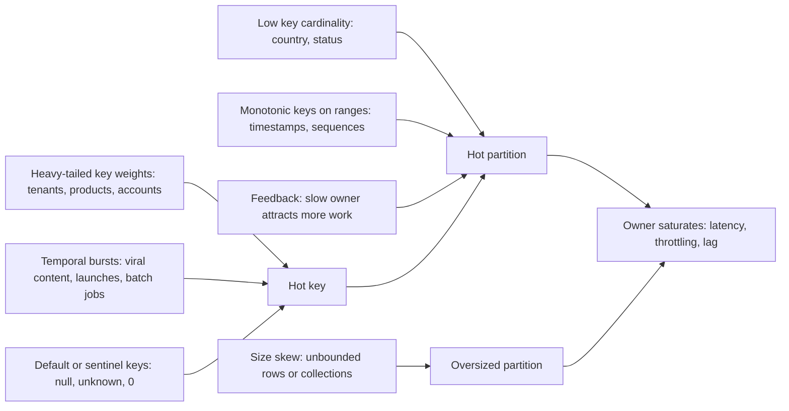
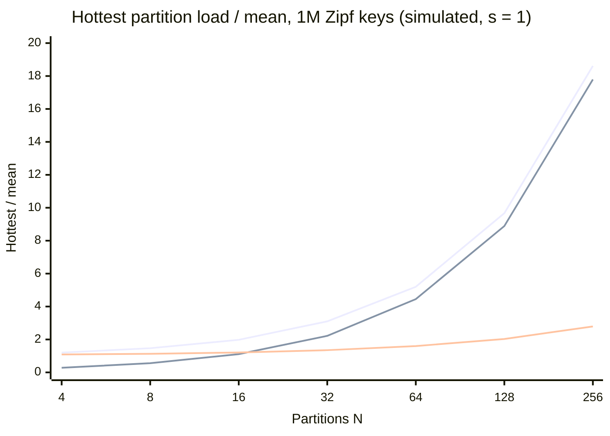
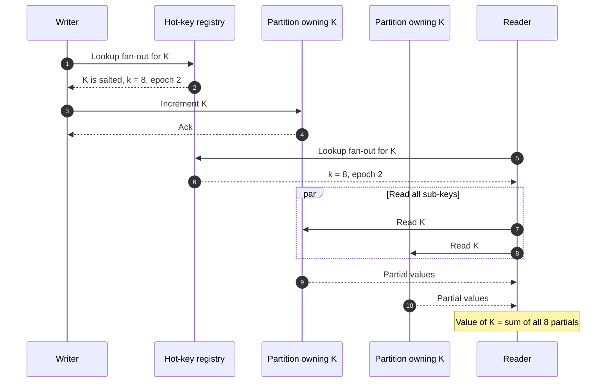
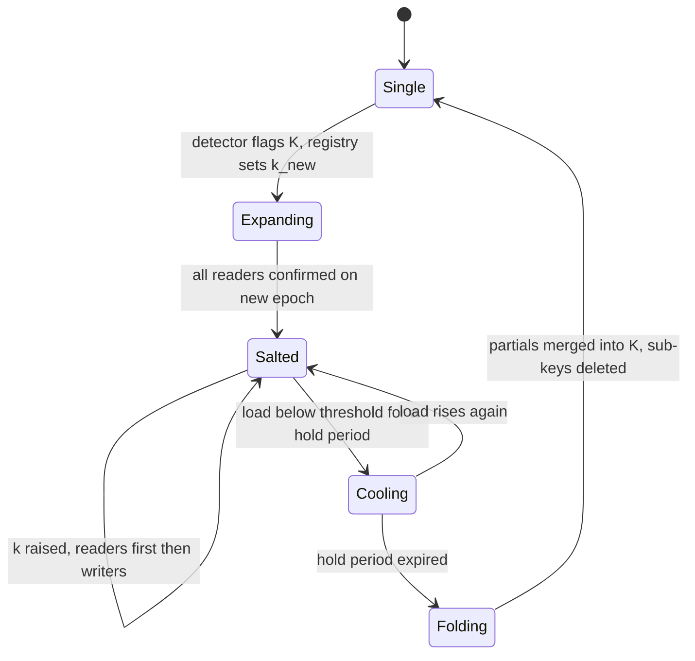
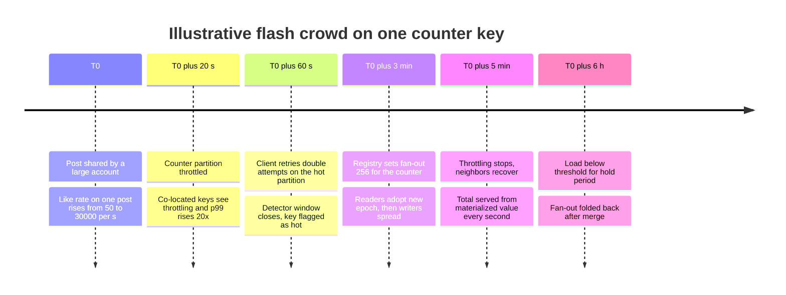

Çarpıklık (skew), yükü eşit paylaştırmak üzere tasarlanmış bir sistemin partition'ları arasındaki eşitsiz yüktür. Hot spot ise bunun görünen sonucudur: bir partition ve dolayısıyla bir node, bir disk ya da bir consumer doygunlukta çalışırken cluster'ın geri kalanında pay vardır. Bir anahtar üzerindeki her işlem o anahtarın sahibi olan tek partition'da yürütüldüğü için, partition'lı bir sistemin kapasitesi partition'larının toplamı değildir; en sıcak partition'ın doyduğu yükün, o partition'ın toplam yükten aldığı paya bölümüdür. En sıcak partition'ı trafiğin %7'sini taşıyan 100 node'luk bir cluster, dashboard'lar ortalama CPU için ne gösterirse göstersin, yaklaşık 14 node'luk throughput'a sahiptir.

Problem yalnızca yerleşim fonksiyonuyla çözülemez. [Hash bölümleme](/distributed-systems/tr/data-management/data-partitioning/hash-partitioning/) anahtarların sayısını eşit dağıtır, [anahtar aralığı bölümleme](/distributed-systems/tr/data-management/data-partitioning/key-range-partitioning/) ise yükün yoğunlaştığı aralıkları bölebilir; ancak ikisi de her anahtarı tam olarak tek bir sahibe yerleştirir. Tek bir anahtar bir partition'ın sunabileceğinden fazla iş taşıdığında hiçbir yerleşim, bölme ya da yeniden dengeleme yardımcı olamaz, çünkü yerleşim birimi zaten olabileceği en küçük hâldedir. Çözümler bunun yerine birimi değiştirir: bir mantıksal anahtarı birkaç fiziksel anahtara böler, onu birkaç sahibe kopyalar, işlemlerini sahibe ulaşmadan önce birleştirir ya da yükünün komşularına zarar vermesini durdurmak için onu izole eder.

Asıl denge şudur: çarpıklığa karşı her çözüm, tek sahipliğin bedavaya sağladığı bir özellikten vazgeçer. Bir anahtarı alt anahtarlara bölmek atomik read-modify-write'tan ve anahtar başına sıralamadan vazgeçer, okumaları da fan-out'a dönüştürür. Sıcak bir anahtarı replike etmek tek kopya tutarlılığından vazgeçer ve her yazmayı bir invalidation yayınına çevirir. Ön toplama (pre-aggregation), daha az yazma karşılığında dayanıklılık ve tazelikten ödün verir. İzolasyon, öngörülebilirlik karşılığında kullanım oranından ödün verir. Doğru çözüm, iş yükünün hangi özelliği kaybetmeyi göze alabildiğine ve hot spot'un okuma yolunda mı, yazma yolunda mı yoksa bir partition'ın saklanan boyutunda mı olduğuna bağlıdır. Yeniden dengeleme mekanizması [Dinamik Yeniden Dengeleme](/distributed-systems/tr/data-management/data-partitioning/dynamic-rebalancing/) sayfasında ele alınır; DynamoDB'ye özgü hot partition yönetiminin evrimi ise [Hot Partition Problemi](/distributed-systems/tr/case-studies/dynamodb-cassandra/hot-partition-problem/) sayfasında vaka çalışması olarak incelenir.

## Çarpıklık Nereden Gelir ve Yatay Ölçekleme Neden Düzeltemez

Bir partition'ın yükü, sahip olduğu anahtarların ürettiği işin toplamıdır; burada iş, ilk doyan kaynak neyse odur: istek hızı, yazılan bayt, istek başına CPU ya da saklanan bayt. Partition'lı bir sistemin asla ihlal etmediği bir invariant'ı vardır: her anahtarın herhangi bir anda tam olarak bir sahibi olur. Bu invariant'tan bir alt sınır çıkar. En ağır anahtar tüm işin `w1` oranındaki kısmını üretiyorsa, en sıcak partition en az `w1` taşır; `N` partition varken en az `1 / N` de taşır. Dolayısıyla en sıcak yükün ortalamaya oranı en az `max(1, N * w1)` olur. Partition eklemek ortalamayı, yani `1 / N`'i düşürür ama `w1` tabanına dokunmaz; bu yüzden `N = 1 / w1`'in ötesinde eklenen her partition dengesizlik oranını artırır ve kullanılabilir kapasiteye hiçbir şey eklemez.

Çarpıklık bir sisteme az sayıda farklı mekanizmayla girer ve hangisinin işlediğini belirlemek çözümü belirler.


*Çarpıklığın kaynakları ve ürettikleri üç şekil. Sıcak anahtar bölünemeyen durumdur; sıcak partition taşınarak ya da bölünerek düzeltilebilir; aşırı büyük partition ise zararını istek hızı yerine depolama işlemleri üzerinden verir.*

Soldaki sütun, dışarıdan aynı görünen nedenleri birbirinden ayırır. Ağır kuyruklu (heavy-tailed) ağırlıklar gerçek verinin olağan hâlidir: tenant boyutları, ürün popülerliği ve hesap aktivitesi, `i`'nci en popüler anahtarın `1 / i^s` ile orantılı ağırlık aldığı ve `s`'nin 1'e yakın olduğu bir Zipf dağılımına yakındır. Zamansal patlamalar, bir saat önce var olmayan sıcak anahtarlardır: viral olan bir gönderi, açılan bir bilet satışı, tek bir tenant'ın birikmiş işini yazan bir batch job. Varsayılan anahtarlar kendi kendine yaratılan özel bir durumdur: gerçek anahtarı eksik olan her kayıt aynı yer tutucu değerin altına yönlendirilir ve ağırlığı sistemin hata oranına eşit olan bir sıcak anahtar ortaya çıkar. Ülkeye göre partition'lama gibi düşük kardinalite, hiçbir anahtar tek başına patolojik olmadan sıcak partition'lar üretir; sebebi yalnızca hash'in ortalamasını alabileceği kadar anahtar olmamasıdır. Aralık bölümlemeli depolarda monoton artan anahtarlar tüm eklemeleri son aralıkta toplar; bu mekanizma [anahtar aralığı sayfasında](/distributed-systems/tr/data-management/data-partitioning/key-range-partitioning/) hareket eden sıcak kuyruk olarak anlatılır ve burada tekrarlanmaz. Yavaş bir sahibin, tam da yavaş olduğu için daha fazla iş aldığı geri besleme çarpıklığı, en az sezgisel kaynaktır ve aşağıdaki gerçek dünya bölümünde incelenir. Boyut çarpıklığı ise türce farklıdır: bir partition istekler açısından soğuk olup yine de compaction, repair ve yeniden dengeleme süresi üzerinden olaylara yol açabilir.

### Yerleşimin Düşüremediği Taban

Bir sayısal dağılım, tabanın ne kadar çabuk baskın hâle geldiğini gösterir. İstek hızları `s = 1` olan bir Zipf dağılımına uyan bir milyon anahtar varsayalım. Normalleştirme sabiti, yaklaşık 14.39 olan harmonik sayı `H(1,000,000)`'dur; dolayısıyla en ağır anahtar tüm trafiğin `1 / 14.39`'unu, yani %6.95'ini, en ağır on anahtar %20.4'ünü, en ağır yüz anahtar ise %36.0'ını taşır. Bu sayılar herhangi bir sistemin değil, dağılımın özelliğidir; aşağıdaki eğri ise aynı anahtarların `N` partition'a rastgele yerleştirilmesinin bir simülasyonudur.


*Üst: anahtarların bütün olarak yerleştirildiği 40 rastgele yerleşimin medyanı. Orta: yalnızca en ağır anahtarın belirlediği N * w1 tabanı. Alt: en ağır on anahtarın her biri N alt anahtara bölünmüş ve onlar da rastgele yerleştirilmiş. Bu oturumda simüle edilmiştir; değerler herhangi bir ürünü değil, eğrinin şeklini örnekler.*

Yaklaşık 16 partition'a kadar üst eğri büyük ölçüde birkaç ağır anahtarın hash'lenmesinden doğan istatistiksel gürültüdür; 32 partition'dan itibaren tabana yapışır, çünkü en ağır anahtarı alan partition en sıcak partition'dır ve öyle kalır. 256 partition'da en sıcak partition ortalamanın 18.6 katında çalışır; yani cluster, toplam yük `256 / 18.6`'ya, yaklaşık 13.8 partition'lık işe ulaştığında doyar: sağlanan kapasitenin %95'i bu iş yükü için kullanılamaz. Anahtar uzayının %0.001'i olan yalnızca en ağır on anahtarı bölmek sistemi alt eğriye taşır; orada 256 partition yaklaşık `256 / 2.79 = 92` partition'lık iş verir. Alt eğrideki kalan dengesizlik, on birinci en ağır anahtardan ve bölünmüş anahtarların alt anahtarlarının aynı partition'da çakışmasından gelir; bu etki sayfanın ilerisindeki sayısal örnekte hesaplanır.

### Okuma Hot Spot'ları ile Yazma Hot Spot'ları Farklı Problemlerdir

Sıcak bir anahtarın okuma yolu ile yazma yolu farklı serbestlik derecelerine sahiptir. Bir okuma, yeterince taze olan herhangi bir kopya tarafından yanıtlanabilir; dolayısıyla sıcak bir okuma, değeri daha fazla yere kopyalayarak yayılabilir: follower replikalar, bir cache katmanı, her uygulama process'inin içindeki bir cache. Bir yazma ise aynı anahtardaki diğer yazmalara göre sıralanmalıdır; tek sahipli bir sistemde bu, sahibe ulaşması gerektiği anlamına gelir. Bu yüzden sıcak bir yazma kopyalayarak yayılamaz; ancak anahtarın ne olduğunu değiştirerek yayılabilir ya da birçok yazma bire birleştirilerek azaltılabilir.

Çarpıklığın cache üzerinde de asimetrik bir etkisi vardır ve okuma hot spot'larına karşı ilk savunma hattının cache olmasının nedeni budur. `s = 1` olan bir Zipf dağılımında anahtarların en sıcak %1'i, isteklerin %1'inden çok daha büyük bir pay çeker (yukarıdaki dağılımda bir milyon anahtarın en sıcak 10.000'i isteklerin yaklaşık %68'ini alır); dolayısıyla partition'lı deponun önüne konan küçük bir cache, hot spot üretecek trafiğin çoğunu emer. Bir partition'ı aşırı yükleyen çarpıklık, cache'i etkili kılan çarpıklığın ta kendisidir. Yazma hot spot'larının buna denk bir kestirmesi yoktur ve bu sayfadaki mekanizmanın çoğunun yazmalarla ilgili olmasının nedeni budur.

## Ağır Anahtarları Sınırlı Bellekle Bulmak

Cluster ortalaması bir hot spot'u doğası gereği gizler; bu yüzden tespit, partition'lar arasındaki dağılımdan başlar. İlk sinyal, partition başına istek hızı, yazılan bayt, CPU ve saklanan boyutun maksimumunun medyana oranıdır; node eklendiğinde büyüyen bir oran, anahtar düzeyindeki bir tabanın imzasıdır. İkinci sinyal, sorumlu anahtarların kimliğidir ve bunu partition başına metrikler sağlayamaz: medyanın üç katında çalışan bir partition, yükünün %60'ını taşıyan tek bir anahtarı da, ortalamanın biraz üzerindeki bin anahtarı da tutuyor olabilir ve ikisi farklı çözümler gerektirir.

Her anahtarı tam olarak saymak, farklı anahtar sayısıyla orantılı bellek gerektirir; node başına ve dakika başına milyonlarca anahtarda bu, bir istek yolunda tutulamayacak kadar fazladır. İki akış özeti bu soruyu sabit bellekle yanıtlar ve ikisi de production araçlarında kullanılır. Space-Saving algoritması `m` sayaç tutar. Zaten sayacı olan bir anahtar onu artırır; yeni bir anahtar en küçük değerli sayacı devralır ve o değerin bir fazlasını miras alır. Garantisi bir sayma argümanından çıkar: sayaçların toplamı her zaman `n` olduğu için `n` güncellemeden sonra en küçük sayaç hiçbir zaman `n / m`'yi aşamaz; dolayısıyla gerçek frekansı `n / m`'yi aşan bir anahtar asla dışarı atılamaz, özette her zaman bulunur ve sayısı en fazla `n / m` kadar fazla tahmin edilir. `m = 1,000` sayaçla trafiğin %0.1'inin üzerindeki her anahtarın raporlanması garantidir. Count-Min sketch ise her satır için bağımsız bir hash ile `d` satır ve `w` sütunluk sayaç tutar; her güncelleme satır başına bir sayacı artırır ve bir sorgu satırlar arasındaki minimumu döndürür. Çakışmalar yalnızca ekleme yapabildiği için tahmin asla eksik saymaz; `w = ceil(e / epsilon)` ve `d = ceil(ln(1 / delta))` ile `epsilon * n`'den fazla fazla tahmin etme olasılığı en fazla `delta` olur. `epsilon = 0.001` ve `delta = 0.01` için bu, 5 satırın her birinde 2.719 sayaç, anahtar sayısından bağımsız olarak yaklaşık 13.600 sayaç demektir; en büyük tahminleri tutan küçük bir heap ardından ağır anahtarları verir.

Production sistemleri örneklenmiş ya da sketch tabanlı ağır anahtar tespitini doğrudan sunar ve belirli bir depo için hangi aracın bulunduğunu bilmek bir olayı kayda değer biçimde kısaltır.

```shell
# Cassandra: sample the hottest partitions on one node for 10 s (per table)
nodetool toppartitions -s 20 app messages 10000
# Redis: approximate hottest keys; requires an LFU maxmemory-policy
redis-cli --hotkeys
# Kafka: per-partition bytes-in on a broker (JMX MBean, use with a JMX exporter)
# kafka.server:type=BrokerTopicMetrics,name=BytesInPerSec,topic=orders
# DynamoDB: CloudWatch Contributor Insights reports most-accessed and
# most-throttled partition keys once enabled on the table
```

Redis komutu, LFU eviction politikalarının tuttuğu erişim frekansı sayacına dayanır ve diğer politikalarda hata verir; LRU eviction kullanan bir cache'te alternatif, birkaç saniye boyunca bir replika üzerinde `MONITOR` ile komut örneklemektir. Bu pahalıdır ve meşgul bir primary üzerinde asla çalıştırılmamalıdır. Bigtable'ın Key Visualizer'ı ve CockroachDB'nin Hot Ranges sayfası aynı bilgiyi anahtar uzayı üzerinde ısı haritaları olarak gösterir; sıcak bir anahtarı sıcak bir aralıktan ayırmanın en hızlı yolu budur. Kafka'nın broker metrikleri varsayılan olarak topic başınadır; partition başına görünürlük, partition başına log boyutu artışından ya da partition başına consumer lag'den gelir ve sıcak bir partition genellikle ilk orada görünür.

Tespitin bir gecikmesi vardır ve bu gecikme, herhangi bir otomatik çözümün hangi hot spot'ları yakalayabileceğini belirler. 60 saniyelik pencerelerle toplayan ve eşiğin üzerinde art arda iki pencere isteyen bir dedektör bir ila iki dakika sonra tepki verir; veriyi taşıyan ya da bölen bir çözüm de kendi dakikalarını ekler. Saatlerce süren hot spot'lar (büyük bir tenant, popüler bir ürün) bu döngünün rahatça içinde kalır. Milyonlarca cihaza gönderilen bir push bildirimi gibi saniyeler içinde zirveye çıkan bir ani kalabalık (flash crowd) ise döngünün dışındadır: dedektör tetiklendiğinde sahip zaten doymuş, retry'lar yükü katlamış ve olay önlemeden çok toparlanmaya dönüşmüştür. Bu tür hot spot'lar tasarımla öngörülmelidir; örneğin push gönderilecek içeriğin sayaçları, push çıkmadan önce salt'lanabilir.

## Çözümler ve Her Birinin Neden İşe Yaradığı

Aşağıdaki her çözüm yük sınırından belirli bir terimi kaldırır: salting `w1`'i birkaç sahip arasında böler, replikasyon `w1`'in okuma payını böler, ön toplama `w1`'in kendisini küçültür, yüke dayalı bölme ısısı birçok anahtardan gelen sıcak partition'ları düzeltir, izolasyon ise sıcak bir anahtarın komşularının kapasitesini tüketmesini engeller.

### Salting: Bir Mantıksal Anahtarı Birçok Fiziksel Anahtara Bölmek

Write sharding ya da anahtar yayma olarak da bilinen salting, sıcak bir mantıksal anahtar `K`'yı `K#0`'dan `K#(k-1)`'e kadar `k` fiziksel anahtarla değiştirir. Bir yazıcı rastgele ya da round-robin seçilen bir salt ekler; böylece her fiziksel anahtar yazmaların yaklaşık `1 / k`'sını alır ve hash bölümlemeli bir depoda yüksek olasılıkla kendi partition'ına düşer. `K`'nın değerine ihtiyaç duyan bir okuyucu `k` fiziksel anahtarın tamamını okur ve birleştirir. Desen, sharded counter'larda kanonik bir örneği olacak kadar eskidir: saniyede binlerce kez artırılan bir sayaç, her biri `1 / k` hızında artırılan `k` sayaca dönüşür ve raporlanan değer bunların toplamıdır.


*Salt'lanmış bir sayaç. Yazıcılar tek bir alt anahtara, okuyucular hepsine dokunur. Sahip partition'lardan yalnızca ikisi çizilmiştir.*

Diyagram maliyetin nereye taşındığını gösterir. 3. adımdaki bir yazma eskisi gibi tek bir partition'a dokunur ve `K`'nın yazma yükü artık sekize kadar sahibe yayılmıştır. Bir okuma ise artık 7. ve 8. adımlarda `k` arama yapar ve en yavaşını beklemek zorundadır; okuma, kuyruk gecikmesi `k` ile büyüyen bir scatter-gather'a dönüşmüştür ve bunun fan-out aritmetiği [anahtar aralığı sayfasında](/distributed-systems/tr/data-management/data-partitioning/key-range-partitioning/) gösterilir. Bu yüzden salting, tam olarak anahtar okunduğundan çok daha sık yazıldığında ya da okumaları her istekte yeniden hesaplanmak yerine periyodik olarak materyalize edilen bir toplamdan sunulabildiğinde caziptir.

Hangi işlemlerin salt'lanabileceğini doğruluk argümanı belirler. `K`'nın değeri kısmi değerler birleştirilerek yeniden kurulur; dolayısıyla alt anahtar başına işlemler, uygulamanın amaçladığı işleme birleşmelidir. Artırmalar, bir kümeye eklemeler, daha sonra zaman damgasına göre birleştirilen bir log'a eklemeler ve maksimumlar bu koşulu sağlar, çünkü değişmeli ve birleşmelidirler (commutative ve associative): yazmaların farklı alt anahtarlara hangi sırayla ulaştığı birleşik sonucu etkilemez. "Bakiyeyi X yap", "yalnızca pozitifse azalt" ya da "yoksa ekle" gibi bu koşulu sağlamayan işlemler anlamını yitirir, çünkü doğrulukları anahtarın tamamının güncel değerini görmeye bağlıdır ve hiçbir alt anahtar bunu tutmaz. Salting anahtar başına sıralamayı da ortadan kaldırır. Aynı client'tan `K`'ya yapılan iki yazma farklı alt anahtarlara düşebilir ve her iki sırada da geri okunabilir; yazmalar sürerken kısmi değerleri toplayan bir okuyucu, hiçbir anda var olmamış bir değer görür. Bir beğeni sayacı için bu kabul edilebilir; eksi bakiye kontrolü olan bir hesap bakiyesi için edilemez. Böyle anahtarlar farklı bir çözüme ihtiyaç duyar: genellikle izolasyon ya da invariant'ın kendisini bölen bir yeniden tasarım, örneğin escrow tarzında bir bakiyeyi bağımsız bütçelere ayırmak.

### Veri Kaybetmeden Fan-Out'u Değiştirmek

Her anahtarın her zaman `k` parçaya bölündüğü statik salting, birkaç anahtarı etkileyen bir problemi düzeltmek için her anahtarın okuma maliyetini katlar. Production tasarımları yalnızca sıcak olduğu bilinen anahtarları salt'lar ve her salt'lanmış anahtarın fan-out'unu küçük bir registry'de kaydeder; bu registry, yazıcıların ve okuyucuların danıştığı ve cache'lediği bir tablo ya da yapılandırma girdisidir. Registry salting'i bir durum makinesine çevirir ve geçişler yanlış sırayla uygulandığında verinin kaybolduğu yerlerdir.


*Salt'lanmış tek bir anahtarın yaşam döngüsü. Bekleme süreleri histerezis sağlar; böylece yükü eşik çevresinde salınan bir anahtar tekrar tekrar katlanıp yeniden bölünmez.*

Invariant şudur: bir okuyucu her zaman herhangi bir yazıcının yazmış olabileceği fiziksel anahtarların bir üst kümesini okumalıdır. Bir anahtar `Expanding` durumuna girdiğinde, herhangi bir yazıcı yeni alt anahtarlara yazmaya başlamadan önce okuyucular `k_new` alt anahtarın tamamını ve özgün anahtarı okumaya geçmelidir; aksi hâlde cache'inde daha eski bir fan-out bulunan bir okuyucu, bilmediği alt anahtarlara yapılan yazmaları kaçırır. Registry'nin bir epoch taşımasının, okuyucuların yeni epoch'u yazıcılardan önce benimsemesinin ve `Salted` durumuna geçişin okuyucu cache'lerinin süresinin dolduğuna dair onayı beklemesinin nedeni budur. `k`'yı artırmak aynı sırayı izler. Azaltmak tehlikeli yöndür: yazıcılar kaldırılacak alt anahtarlara yazmayı bırakmalı, ardından bu anahtarların kısmi değerleri tek bir process tarafından kalan anahtarlara birleştirilmeli ve okuyucular ancak bundan sonra onları okumayı bırakabilmelidir. Tek bir anahtara geri katlamak, `k = 1` ile aynı prosedürdür. Yazıcıların ve okuyucuların fan-out'u birbirinden bağımsız öğrenmesine izin veren bir tasarım, örneğin onu yerel bir yük tahmininden yeniden hesaplayan bir tasarım, er ya da geç yazılandan daha az alt anahtar okur.

```text
# Salted counter with registry-driven fan-out (illustrative)
write(K, delta):
    e = registry.lookup(K)              # cached; {k, epoch}; k = 1 if not salted
    s = random(0, e.k - 1)
    store.increment(K + "#" + s, delta) # commutative op only

read(K):
    e = registry.lookup_for_read(K)     # returns max k of current and previous epoch
    parts = parallel_get(K + "#" + i for i in 0 .. e.k - 1)
    return sum(parts) + store.get(K)    # unsalted residue from before expansion
```

Okuma yolu güncel ve önceki epoch'un büyük olan fan-out'unu ister; bu, üst küme kuralının koddaki karşılığıdır. Ayrıca salt'lanmamış kalıntıyı da okur; böylece genişlemeden önce yazılan değerler, katlama prosedürü onları birleştirene kadar kaybolmaz.

:::caution[Fan-out değişikliği bir ayar düğmesi değil, şema migrasyonudur]
Salting yüzünden kaybolan verinin çoğu aslında kaybolmamıştır: yazıcılar ile okuyucular `k` konusunda anlaşamadığı için okuyucuların artık sorgulamadığı alt anahtarlarda durur. Belirti, bir yapılandırma değişikliğinden sonra sessizce küçülen ve değişiklik geri alındığında toparlanan bir sayaç ya da koleksiyondur. Fan-out'u anahtar başına tek bir yerde saklayın, versiyonlayın ve yukarıdaki okuyucu-önce sırasıyla değiştirin; onu asla her client'ta yerel yük ölçümlerinden türetmeyin.
:::

### Okumaları Yaymak: Sıcak Anahtar Replikasyonu ve Cache

Okuma hot spot'larında kopyalamak bölmekten ucuzdur, çünkü okuyucuların birleştirme adımına ihtiyacı yoktur. Replike edilmiş bir partition'daki follower'lar, uygulama [replikasyon gecikmesine](/distributed-systems/tr/data-management/replication/replication-lag/) tahammül edebiliyorsa okuma sunabilir; bu, sıcak bir anahtarın okumalarını genellikle üç olan replikasyon faktörüne yayar. Bunun ötesinde bir cache katmanı ek kopyalar tutar; her uygulama process'inin içindeki yerel cache ise process başına bir tane olmak üzere en fazla kopyayı tutar. Bedeli invalidation erişimi ve bayatlıktır ve bunlar [Dağıtık ve Yerel Önbellek](/distributed-systems/tr/data-management/distributed-caching/distributed-vs-local/) sayfasında incelenir.

Belirgin olmayan bir nokta, hangi anahtarların replike edileceğiyle ilgilidir. Facebook'un memcache makalesi (Nishtala ve diğerleri, NSDI 2013), anahtar kategorilerinin tamamını daha fazla partition'lamak yerine bir pool içinde replike etmeyi üç koşulda anlatır: uygulama rutin olarak aynı anda çok sayıda anahtar çeker, veri setinin tamamı bir ya da iki sunucuya sığar ve istek hızı tek bir sunucunun kaldırabileceğini aşar. Makalenin örneğinde 100 öğe tutan ve saniyede 500.000 istek karşılayan bir sunucu vardır ve her istek 100 anahtarın tamamını ister: anahtarları iki sunucuya bölmek her isteği yine ikisine de gönderir, dolayısıyla her sunucu yaklaşık aynı istek hızını karşılamaya devam eder; 100 anahtarın tamamını iki sunucuya replike etmek ise her isteğin bunlardan birine gitmesini sağlar ve sunucu başına yükü yarıya indirir. Partition'lama sunucu başına yükü yalnızca tek bir partition'a dokunan istekler için azaltır; zaten her partition'a dokunan çok anahtarlı okumalarda istekleri bölmek yerine çoğaltır ve tek çözüm replikasyondur. Bedeli, her yazmanın her replikayı invalidate etmesidir; bu, çoğunlukla okunan anahtarlar için kabul edilebilir, yazma tarafında da sıcak olan anahtarlar için ise karşılanamaz. Her iki yolda da sıcak olan anahtarlar için aynı makale, eksik bir anahtarı yalnızca tek bir client'ın yeniden doldurmasına izin verip diğerlerini kısa süre bekleten lease'leri kullanır; böylece cache'in arkasındaki veritabanı her miss'i karşılamak zorunda kalmaz.

Sıcak bir anahtarın cache'lenmiş değerinin süresi dolduğunda, aynı anda miss alan tüm okuyucular sahibe birlikte gider. Bu izdiham (stampede), hot spot'un okuma tarafındaki biçimidir ve önleme teknikleri (lease'ler, istek birleştirme, erken olasılıksal yenileme) [Cache Stampede ve Thundering Herd](/distributed-systems/tr/data-management/distributed-caching/cache-stampede/) sayfasında ele alınır. İstek birleştirme (request coalescing) cache olmadan da işe yarar: Discord'un yaptığı gibi (aşağıya bakın), deponun önünde eşzamanlı özdeş okumaları tek bir sorguda birleştiren bir servis, kaç client sorarsa sorsun sahibin sıcak bir anahtar için aldığı okuma hızını uçuştaki pencere başına tek sorguya indirir.

:::tip[Sıcak bir anahtarı sunmanın en ucuz yolu, sıcak hâle geldiği yerden bir adım önce sunmaktır]
Okuma tarafında sıcak anahtarlar için, en ağır birkaç yüz anahtar üzerinde TTL'i bir ya da iki saniye olan küçük bir process içi cache çoğu zaman hot spot'u tamamen ortadan kaldırır, çünkü sahip bu durumda anahtar başına, process başına ve TTL başına en fazla bir okuma alır. 200 uygulama process'i ve 1 s TTL ile saniyede 100.000 kez okunan bir anahtar sahibe saniyede 200 okumaya mal olur. Bayatlık sınırı açık ve kısadır, cache'in de bir invalidation yoluna ihtiyacı yoktur.
:::

### Ön Toplama: Daha Fazla Partition Yerine Daha Az Yazma

Sıcak bir anahtara yapılan yazmalar birleşebiliyorsa, en etkili çözüm onları yola çıkmadan önce birleştirmektir. Her üretici, bir anahtara yapılan güncellemeleri kısa bir aralık boyunca yerel olarak biriktirir ve tek bir birleşik güncelleme yayar: saniyede 40.000 artırmayı karşılayan ve saniyede bir flush eden 50 uygulama sunucusu, sahibe saniyede 40.000 yerine 50 yazma gönderir. Aynı fikir batch işlemede MapReduce combiner'ı, akış işlemede ise iki aşamalı toplama olarak karşımıza çıkar; burada yukarı akıştaki bir operatör shuffle'dan önce anahtar başına ön toplama yapar, aşağı akıştaki bir operatör de kısmi sonuçları birleştirir. Flink SQL bunu local-global aggregation olarak uygular; `table.optimizer.agg-phase-strategy` değeri `TWO_PHASE` yapılarak etkinleştirilir ve group aggregation için varsayılan olarak kapalı olan mini-batch yürütmesine bağlıdır. Yerel ön toplamanın az şey kazandırdığı, seyrek bir distinct anahtar üzerindeki `COUNT DISTINCT` için ise split distinct aggregation'ı ekler; bu, distinct anahtarı önce bucket'lara (varsayılan 1.024) yayar, sonra birleştirir.

Ön toplama tek sahipli modeli tamamen korur: hâlâ tek bir anahtar, tek bir sahip ve sahipte atomik güncellemeler vardır. Vazgeçtiği şey tazeliktir, çünkü sahip en fazla bir flush aralığı kadar geridedir; bir de flush edilene kadar yalnızca üretici belleğinde bulunan tamponlanmış güncellemelerin dayanıklılığıdır.

:::danger[Tamponlanmış artırmalar process ile birlikte kaybolur]
Bellek içi bir ön toplama tamponu, write-ahead log'u olmayan bir write-back cache'tir. Çöken, bellek yetersizliği nedeniyle öldürülen ya da kapanışta flush yapmadan sonlandırılan bir process, son flush'ından bu yana tamponladığı her artırmayı kaybeder ve kaybı hiçbir şey raporlamaz. Bunu yalnızca toplamın dayanıklı kaynak kayıtlardan (beğeni kayıtlarının kendisi, bir olay log'u) yeniden hesaplanabildiği yerlerde kullanın, düzgün sonlandırmada flush edin ve en kötü durumdaki kaybın bilinen bir miktar olması için aralığı sınırlayın.
:::

### Yüke Dayalı Bölme ve İzolasyon

Bir partition orta derecede sıcak çok sayıda anahtar tuttuğu için sıcaksa, depo bunu kendisi düzeltebilir: partition'ı boyuta göre değil gözlenen yüke göre seçilen bir noktadan böler ve yarısını başka bir yere taşır. CockroachDB ve TiKV aralıkları yüke göre böler; DynamoDB'nin "split for heat" mekanizması sürekli yüksek throughput alan bir partition'ı son trafikten seçilen ve nadiren anahtar aralığının ortasına düşen bir noktadan böler; tabloda local secondary index yoksa tek bir partition anahtarının item collection'ını sort key kullanarak da bölebilir. Bunların hepsinin ortak bir sınırı vardır: bölme sınırı iki anahtarın arasına düşmek zorundadır; dolayısıyla bir bölme sıcak anahtarları birbirinden ayırabilir ama tek bir anahtarı bölemez. DynamoDB ayrıca bölmenin yardımcı olmayacağı durumlarda, örneğin yazmalar sürekli artan bir sort key'e geldiğinde ve aynı yarıya düşmeye devam edeceğinde, bölmeyi reddeder.

İzolasyon, bölünemeyen ve salt'lanmaması gereken hot spot'ları ele alır; örneğin iş yükü kendi verisi genelinde transaction semantiği gerektiren bir balina (whale) tenant. Tenant, yüküne göre boyutlandırılmış kendi partition'larını, node'larını ya da hücresini (cell) alır; böylece zirveleri binlerce küçük tenant'la paylaşılan kapasiteyi tüketmez. Bedeli kullanım oranıdır: ayrılmış kapasite tenant'ın zirvesine göre sağlanır ve geri kalan zamanda boşta kalır. Daha zayıf ama daha ucuz bir izolasyon biçimi, sahipte anahtar başına ya da tenant başına admission control'dür: anahtar başına bir [rate limit](/distributed-systems/tr/resilience/flow-control/rate-limiting/), tek bir anahtarın bir partition'ın kapasitesinin ne kadarını tüketebileceğini sınırlar; böylece sıcak anahtar throttle edilirken aynı partition'daki komşuları gecikmelerini korur. Böyle bir sınır yoksa partition düzeyindeki bir throttle, tek bir anahtarın davranışı yüzünden partition'daki her anahtarı cezalandırır.

### Sayısal Örnek: Viral Bir Beğeni Sayacı

Beğenileri, her biri saniyede 1.000 yazma kaldırabilen 200 partition'lı, hash bölümlemeli bir key-value deposunda saklayan bir sosyal uygulama varsayalım; bu sınır, DynamoDB'nin belgelenmiş partition başına yazma sınırıyla aynı mertebededir. Bir gönderi viral olur ve zirvede saniyede 40.000 beğeni alır; trafiği 50 uygulama sunucusu karşılar. Her beğeni `(post_id, user_id)` anahtarlı bir beğeni kaydı oluşturur ve `post_id` anahtarlı bir sayacı artırır. Buradaki tüm sayılar örnek amaçlıdır.

Salt'lanmamış sayaç tek bir partition'daki tek bir anahtardır: saniyede 1.000 artırma kabul edebilir, dolayısıyla artırmaların %97.5'i throttle edilip retry edilir ve o partition'daki diğer her anahtar, yani uygulama verisinin yaklaşık 1/200'ü de artık throttling görür. Beğeni kayıtları farklıdır: depo, DynamoDB'nin local secondary index olmadan yapabildiği gibi bir partition anahtarının içini sort key ile bölebiliyorsa kullanıcı kimliği onları yayar ve yüke dayalı bölme onları zamanla ayırır; yerleşimi yalnızca partition anahtarı belirliyorsa, sayaç kadar sıcaktırlar.

Sayacı `k = 80` ile salt'lamak, her alt anahtar kendi partition'ına düşerse alt anahtar başına saniyede 500 artırma, yani bir partition'ın kapasitesinin yarısını verir. Hash bölümlemeli bir depoda yerleşim rastgeledir ve 200 partition üzerindeki 80 alt anahtar ortalama `200 * (1 - (1 - 1/200)^80)`, yaklaşık 66 farklı partition'ı işgal eder. Yerleşimi simüle etmek, en meşgul partition'ın medyan durumda üç, 95. yüzdelikte dört alt anahtar aldığını, yani saniyede 1.500 ila 2.000 artırma taşıdığını gösterir; en meşgul partition hâlâ throttle edilir. Bu, [hash bölümleme sayfasındaki](/distributed-systems/tr/data-management/data-partitioning/hash-partitioning/) balls-into-bins etkisinin salt'lara uygulanmış hâlidir. Rastgele yerleşimde en meşgul partition'ı 95. yüzdelikte kapasitenin %90'ının altında tutmak için `k`'nın yaklaşık 320'ye çıkması gerekir: en meşgul partition bu durumda her biri saniyede 125 artırma alan yedi alt anahtar, yani saniyede 875 artırma tutar. Yerleşimi uygulamanın kontrol etmesine izin veren bir depo, örneğin salt'ın aralık sınırlarıyla hizalı bir anahtar öneki olduğu aralık bölümlemeli bir depo ya da farklı node'lardaki farklı slot'lara düşecek şekilde seçilmiş açık hash tag'leriyle Redis Cluster, aynı sonuca `k = 80` ile ulaşır.

Okuma tarafı tasarımı değiştirir. Gönderi saniyede 200.000 kez görüntüleniyorsa ve her görüntüleme 320 alt anahtarı topluyorsa, depo tek bir sayaç için saniyede 64 milyon okuma alır. Bunun yerine her sıcak anahtar için bir arka plan görevi alt anahtarları saniyede bir toplar ve toplamı cache'lenmiş bir değere yazar; böylece izleyiciler tek bir anahtar okur (o da okuma tarafında sıcaktır ve yukarıdaki process içi cache'ten sunulur) ve depo saniyede 320 okuma görür. Gösterilen sayı en fazla yaklaşık iki saniye eskidir.

Ön toplama ise problemi kaynağında ortadan kaldırır. 50 uygulama sunucusunun her biri bir saniye boyunca artırmaları biriktirir ve tek bir birleşik artırma yazar; böylece sayaç saniyede 50 yazma, yani tek bir partition'ın %5'ini alır; salting, registry ya da okuma fan-out'u gerekmez. Beğeni kayıtları dayanıklı doğruluk kaynağı olarak kalır; çöken bir sunucunun tamponlanmış artırmaları bunlardan periyodik bir yeniden sayımla kurtarılabilir. Bu iş yükü için ilk tercih edilecek çözüm ön toplamadır; salting ise yazıcıları tampon tutamayacak kadar çok ya da kısa ömürlü olan anahtarların çözümüdür, örneğin yönetilen bir depoya doğrudan yazan milyonlarca mobil client.

### Çözümler Arasında Seçim

| Çözüm | Kaldırdığı | Vazgeçtiği | Okuma maliyeti | Ne zaman tercih edilmeli |
|---|---|---|---|---|
| Salting (write sharding) | Tek bir anahtarın yazma yükü | Atomik read-modify-write, anahtar başına sıra | Mantıksal okuma başına `k` okuma ya da materyalize toplam | Çok sayıda bağımsız yazıcıdan gelen değişmeli yazmalar; anahtar önceden biliniyor ya da tespit edilebiliyor |
| Sıcak anahtar replikasyonu | Tek bir anahtarın okuma yükü | Tek kopya tazeliği; yazmalar her kopyayı invalidate eder | Herhangi bir kopyadan tek okuma | Çoğunlukla okunan anahtarlar; her partition'a dokunan çok anahtarlı okumalar |
| Process içi cache, birleştirme | Okuma yükü, izdihamlar | TTL kadar tazelik | Tek yerel arama | Okuma tarafında çok sıcak az sayıda anahtar; sınırlı bayatlık kabul edilebilir |
| Ön toplama | Tek bir anahtarın yazma sayısı | Tazelik ve tamponlanmış güncellemelerin dayanıklılığı | Değişmez | Birleştirilebilir güncellemeler; yazıcılar uzun ömürlü process'ler; dayanıklı kaynak kayıtlar var |
| Yüke dayalı bölme | Birçok anahtardan oluşan sıcak partition'lar | Bölme ve taşıma çalkantısı; tek anahtara etkisi yok | Değişmez | Yüke göre bölen aralık ya da hash depoları; ısı birçok anahtara yayılmış |
| İzolasyon, anahtar başına sınırlar | Komşulara verilen yan hasar | Kullanım oranı; sıcak anahtar throttle edilir ya da kapasitenin bedelini öder | Değişmez | Balina tenant'lar, değişmeli olmayan sıcak anahtarlar, kötüye kullanan client'lar |

Yalnızca yüke dayalı bölmeye, yani çoğu yönetilen deponun otomatik olarak sağladığı şeye dayanan bir sistem, en sıcak durum olan tek bir anahtar dışında her şeye karşı korunur.

## Gerçek Dünya Senaryoları

Aşağıdaki vakalar ilgili kuruluşlar tarafından belgelenmiştir; Facebook memcache vakası yukarıda sıcak anahtar replikasyonu başlığı altında anlatılmıştır.

### Discord: Quorum Okumaları Altında Okuma Tarafında Sıcak Partition'lar

Discord'un mesaj tablosu, kanal ile birlikte statik bir zaman penceresi olan bir bucket'a göre partition'lanır; bu, bir kanalın son mesajlarını bir arada tutarken her partition'ın boyutunu sınırlar. Bo Ingram'ın Cassandra'dan ScyllaDB'ye geçişi anlatan 2023 tarihli yazısı, yoğun eşzamanlı okuma alan bir kanal ve bucket çiftinin nasıl sıcak bir partition'a dönüştüğünü ve neden sıcak kanaldan fazlasına zarar verdiğini anlatır: okumalar ve yazmalar quorum tutarlılığı kullanıyordu; dolayısıyla sıcak bir partition'ı sunan node'ların gecikmesi, bu node'lara dokunan her quorum sorgusuna ekleniyor ve bozulmayı ilgisiz kanallara yayıyordu. Çözüm veritabanında değildi. Discord, API'si ile veritabanı arasında Rust ile yazılmış veri servisleri kurdu; bu servisler istekleri consistent hashing ile kanal kimliğine göre yönlendirir, böylece bir kanala ait tüm istekler aynı servis instance'ına ulaşır ve aynı satır için gelen eşzamanlı istekleri tek bir veritabanı sorgusunda birleştirir. Sıcak anahtara göre yönlendirmek, kopyaları birleştirilebilecekleri tek bir yerde toplar; bu, yükü yayma içgüdüsünün tersidir ve okuma hot spot'ları için doğru olanıdır. Yazı, geçiş sonrası cluster'ın 177 Cassandra node'u yerine 72 ScyllaDB node'u üzerinde çalıştığını ve geçmiş mesaj okumalarının p99 gecikmesinin önceki 40 ila 125 ms yerine 15 ms olduğunu bildirir; veritabanı değişikliği ile birleştirme katmanı birlikte devreye alındığı için yazı iyileşmeyi bunlardan yalnızca birine bağlamaz.

### Kafka: Yavaş Broker'ları Ödüllendiren Bir Partitioner

Kafka'ya anahtarsız üretilen kayıtlar, KIP-480 ile gelen sticky partitioner tarafından yerleştiriliyordu; bu partitioner daha büyük batch'ler oluşturmak için kayıtları bir batch tamamlanana kadar tek bir partition'a gönderir, sonra geçiş yapar. KIP-794 bunun neden düzgün olmadığını belgeler: yavaş bir broker batch'lerini yavaş boşaltır, dolayısıyla producer onun partition'larında daha uzun kalır ve onlara daha fazla kayıt gönderir; bu da broker'ı daha da yavaşlatır. KIP'te raporlanan ölçümde yavaşlatılmış bir broker'daki partition bir saatte yaklaşık 25.9 MB alırken sağlıklı broker'lardaki iki partition yaklaşık 7.8 MB'şer almıştır. Bu geri besleme çarpıklığıdır: yerleşim fonksiyonu, kimse istemeden sahibin yavaşlığını bir girdi olarak kullanmıştır. Kafka 3.3 ile gelen KIP-794, partition'ı her batch'te değil `batch.size` bayt gönderildikten sonra değiştirir ve broker'ının kuyruğu daha kısa olan partition'ları kayıran, `partitioner.adaptive.partitioning.enable` ile kontrol edilen adaptif partition'lamayı ekler. Anahtarlı kayıtlar bunların hiçbirinden etkilenmez; onların çarpıklığı anahtarın çarpıklığıdır.

```mermaid
sequenceDiagram
    autonumber
    participant Pr as Producer
    participant B0 as Broker 0 (slowed)
    participant B1 as Broker 1
    Pr->>B1: Batch for partition 1 fills quickly, sent
    Note over Pr: Switch partition only when a new batch is created
    Pr->>B0: Batch for partition 0 starts
    Note over B0: In-flight requests drain slowly
    Pr->>Pr: Batch for partition 0 still open, keep appending
    Pr->>B0: Larger batch finally sent
    rect rgb(70, 40, 40)
    Note over Pr,B0: More bytes per switch go to the slow broker
    B0-->>Pr: Higher latency, queue grows further
    end
    Pr->>B1: Healthy broker receives smaller share
```


*Sticky bir partitioner'da geri besleme çarpıklığı; KIP-794'te anlatılan mekanizmadan sadeleştirilmiştir.*

Döngü 2. ile 5. adımlar arasında görünür: producer'ın bir partition'da kalma kararı, o partition'ın broker'ının kuyruğu ne kadar hızlı boşalttığına bağlıdır; dolayısıyla daha yavaş broker daha büyük payı alır. Kuyruk durumunu, bağlantı durumunu ya da batch tamamlanmasını örtük bir sinyal olarak kullanan her yerleşim ya da yönlendirme kararı bu döngüyü yaratabilir ve çözüm her zaman bağımlılığı açık ve ters yönlü hâle getirmektir; böylece daha yavaş bir sahip daha az iş alır.

### Batch Join'lerde Shuffle Çarpıklığı

Dağıtık bir join'de iki girdi de join anahtarına göre partition'lanır ve aynı anahtara sahip her satır aynı göreve gider. Çoğu zaman null ya da varsayılan bir değer olan, on milyonlarca satırlık tek bir anahtar, yüzlerce görev dakikalar içinde biterken bir saat çalışan tek bir görev üretir. Bu görev yavaş bir makine değildir; [Yavaş Kalan Görevler](/distributed-systems/tr/data-processing/batch-processing/straggler-speculative-execution/) sayfasında ele alınan spekülatif yürütme onu aynı veri ve aynı süreyle başka bir yerde yeniden çalıştırır. Spark'ın adaptive query execution'ı çarpıklığı shuffle istatistiklerinden tespit eder: bir partition, medyanın `spark.sql.adaptive.skewJoin.skewedPartitionFactor` katından (varsayılan 5) ve `spark.sql.adaptive.skewJoin.skewedPartitionThresholdInBytes` değerinden (varsayılan 256 MB) büyükse çarpıktır. Ardından çarpık partition'ı birkaç göreve böler ve diğer tarafın eşleşen partition'ını her birine replike eder; bu, salting ile replikasyonun tek bir join içinde birlikte uygulanmasıdır. Teknik yalnızca shuffle join'lere ve yalnızca join türünün izin verdiği taraflara uygulanır; full outer join her iki tarafta da optimize edilmez.

:::note[Çarpıklık, straggler'lar ve hash kaynaklı dengesizlik farklı problemlerdir]
Straggler, girdisiyle ilgisi olmayan nedenlerle yavaş olan bir görev ya da node'dur; onu başka bir yerde yeniden çalıştırmak yardımcı olur. Çarpıklık eşit olmayan girdidir; yeniden çalıştırmak yardımcı olmaz, girdiyi bölmek olur. Az sayıda anahtarı hash'lemekten doğan dengesizlik, partition başına daha fazla anahtarla kaybolan istatistiksel gürültüdür ve [hash bölümleme sayfasında](/distributed-systems/tr/data-management/data-partitioning/hash-partitioning/) incelenir; ağır anahtarlardan gelen çarpıklık ise kaybolmaz ve partition sayısı arttıkça göreli olarak kötüleşir.
:::

## Hata Modları ve İmzaları

Hot spot'lar nadiren tek başına çöker. Yaygın şekil, tek bir sahip üzerinde başlangıçtaki bir aşırı yük ve ardından gelen bir yükselticidir: retry'lar, yeniden dengeleme, quorum yayılımı ya da yanlış anahtarları cezalandıran bir koruma mekanizması.

### Tek Bir Anahtarda Ani Kalabalık

Tetikleyici: sıradan bir anahtar saniyeler içinde trafiğin büyük bir payının hedefi olur; örneğin ünlü biri tarafından yayılan bir gönderi ya da bir push bildirimiyle duyurulan bir ürün. Belirtiler: önce bir partition'da, ardından onunla aynı yerde bulunan tüm anahtarlarda throttling ya da artan gecikme; client hata oranlarının küçük bir endpoint kümesinde yoğunlaşması; retry'ların bir dakika içinde sıcak partition'daki istek hızını ikiye katlaması. Tespit: partition başına throttle sayıları ve gecikme, ağır anahtar özetleri ve throttle edilen isteklerin aynı partition anahtarını taşıyan payı. Hafifletme: sıcak okuma yolunun process içinde cache'lenmesi, değişmeli yazma yolları için registry üzerinden acil salting, komşuları korumak için anahtar başına admission sınırları ve throttle edilen isteklerin çoğalmaması için client'larda retry bütçeleri; bu konu [Retry Fırtınaları ve Metastabil Hatalar](/distributed-systems/tr/resilience/flow-control/retry-storms-metastable-failures/) sayfasında ele alınır. Kalabalık dağıldığında toparlanma genellikle kendiliğinden olur; retry'lar sahibi özgün yükte toparlanamayacağı bir duruma itmemişse.


*Bir ani kalabalığın ve registry güdümlü bir salting yanıtının varsayımsal zaman çizelgesi; gerçek bir olay değildir.*

İlk iki dakika hiçbir otomatik çözümün önleyemediği kısımdır: tespit ve okuyucu-önce epoch değişikliği zaman alır ve bu süre boyunca partition'ın komşuları sıcak anahtarın bedelini öder. İki tasarım tercihi hasarı kısaltır. Anahtar başına admission sınırları throttling'i ilk saniyeden itibaren sıcak anahtarla sınırlar; böylece olay veri setinin %0.5'ini değil tek bir gönderiyi etkiler. Planlı bir kampanyada öne çıkarılan öğeler gibi sıcak olacağı öngörülebilen içeriği önceden salt'lamak, epoch değişikliğini trafikten önceye taşır.

### Partition Düzeyindeki Korumanın Yan Hasarı

Tetikleyici: bir depo sınırları anahtar başına değil partition başına uygular ve tek bir anahtar partition'ın bütçesini tüketir. Belirtiler: normal trafiğe sahip anahtarlar throttle edilir ya da yavaşlar ve sahipleri kendi trafiklerindeki hiçbir şeyle ilişkilendirilemeyen hatalar görür. Tespit: anahtara göre gruplanmış throttle edilen istekler; çok sayıda farklı anahtar throttle edilirken partition'ın kabul edilen isteklerine tek bir anahtarın hâkim olduğunu gösterir. Hafifletme: partition içinde anahtar başına sınırlar, sıcak anahtarı yüke dayalı bölmeyle kendi partition'ına taşımak ya da onu izole etmek. Bu durum kolayca kurbanların kapasite problemi olarak yanlış teşhis edilir; kurbanlar da işe yaramayan ek kapasite talep eder.

### Hot Spot'u Yayan Quorum ve Replikasyon

Tetikleyici: işlemleri birkaç replikayı bekleyen replike bir depoda sıcak bir partition. Belirtiler: replikaları aynı node'larda bulunan her partition yavaşlar; virtual node'larla bu, Discord vakasında olduğu gibi cluster'ın çoğu olabilir. Tespit: sıcak partition'ın replika yerleşimiyle ilişkili node başına gecikme. Hafifletme: deponun önünde birleştirme ve cache, uygulamanın izin verdiği yerlerde daha düşük okuma tutarlılığı ve diğer replikalara spekülatif okumalar; sonuncusu yalnızca o replikalar aynı ölçüde yüklü değilse yardımcı olur.

### Boyut Çarpıklığı: Compaction'ı Hiç Bitmeyen Partition

Tetikleyici: altında sınırsız bir koleksiyon bulunan bir partition anahtarı; örneğin zaman bucket'ı olmayan bir kanalın tüm mesajları ya da zaman bileşeni olmayan bir cihazın tüm olayları. Belirtiler: bir partition gigabaytlara büyür; o partition'ın compaction'ı, repair'i ve streaming'i saatler sürer; okumaları büyük miktarda bellek ayırır; node değiştirme ve yeniden dengeleme onu taşımanın süresiyle sınırlanır. Tespit: partition başına boyut histogramları (Cassandra tablo başına partition boyutu istatistikleri raporlar ve bir compaction yapılandırılmış bir boyutun üzerinde bir partition yazdığında uyarı log'lar), partition boyutunun maksimumu ile medyanı ve tek bir token aralığının domine ettiği repair ya da streaming süreleri. Hafifletme: partition anahtarına sabit bir zaman penceresi ya da sayıya dayalı bir sayfa olan bir bucket eklemek, böylece her partition'ın boyutu sınırlı olur; Discord'un mesajları bucket'lara ayırması bu düzeltmedir. Toparlanma, mevcut verinin bucket'lı düzene yeniden yazılmasını gerektirir.

### Hot Spot'un Peşinden Koşan Yeniden Dengeleyici

Tetikleyici: otomatik yeniden dengeleme, sıcak bir partition'ı ya da aralığı aşırı yüklü bir node'dan taşır ve hedef node da sırası gelince aşırı yüklenir. Belirtiler: hot spot birkaç dakikada bir node'lar arasında göç eder; her taşıma zaten sıcak olan partition'a veri aktarımının maliyetini ekler; genel gecikme, yeniden dengeleme hiç olmamasından daha kötüdür. Tespit: aynı partition için tekrarlanan taşıma ya da lease aktarım olayları ve bunları izleyen bir desende salınan node başına yük. Hafifletme: herhangi bir node'un boş kapasitesinden daha sıcak bir partition'ın hiçbir yere yerleştirilemeyeceğini kabul etmek; ısısı birkaç anahtardan geliyorsa onu bölmek, tek bir anahtardan geliyorsa anahtar düzeyinde bir çözüm uygulamak ve o partition için yeniden dengeleyiciyi yavaşlatmak. Taşımaların mekaniği ve throttle edilmeleri [Dinamik Yeniden Dengeleme](/distributed-systems/tr/data-management/data-partitioning/dynamic-rebalancing/) sayfasında ele alınır.

### Bir Bakışta Hata İmzaları

| Hata | Dışarıdan belirti | Tespit sinyali | Hafifletme |
|---|---|---|---|
| Tek anahtarda ani kalabalık | Önce bir partition, sonra komşular throttle ediliyor | Partition anahtarına göre gruplanmış throttle'lar; ağır anahtar özeti | Process içi cache, acil salting, anahtar başına sınırlar, retry bütçeleri |
| Statik ağır anahtar | Node eklendikçe en sıcak/medyan oranı büyüyor | Partition başına maksimum/medyan; en üst anahtarın payı | Salting, ön toplama, izolasyon |
| Yan hasar | Normal anahtarlar throttle ediliyor | Çok sayıda throttle edilen anahtar, kabul edilenlerde baskın tek anahtar | Anahtar başına sınırlar, sıcak anahtarı bölmek ya da izole etmek |
| Quorum yayılımı | Replika paylaşan tüm partition'larda gecikme artıyor | Node başına gecikme ve replika yerleşimi | Birleştirme, cache, izin verilen yerlerde düşük okuma tutarlılığı |
| Geri besleme çarpıklığı | En yavaş sahip en fazla işi alıyor | Sahip başına pay ve sahip başına gecikme | Sinyali tersine çevirmek: yavaş sahiplere daha az iş |
| Boyut çarpıklığı | Tek bir aralıkta yavaş compaction, repair ve taşıma | Partition boyutu histogramları ve uyarılar | Partition anahtarını bucket'lamak; veriyi yeniden yazmak |
| Shuffle çarpıklığı | Bir görev aşama medyanından çok daha uzun sürüyor | Görev girdi boyutu ve süre dağılımı | Skew join yönetimi, join anahtarını salt'lamak |
| Yeniden dengeleyici kovalamacası | Hot spot node'lar arasında dolaşıyor | Aynı partition'ın tekrarlanan taşımaları | Bölme ya da anahtar düzeyinde çözüm; yeniden dengelemeyi yavaşlatmak |

## Çarpıklığa Ne Zaman Müdahale Edilir, Ne Zaman Edilmez

Önce ölçün: partition başına en sıcak/medyan oranını ve en üst anahtarların ağır anahtar özetini çıkarın, ardından tabanı hesaplayın: en ağır anahtarın payı çarpı partition sayısı. Bu taban cluster'ın sağlandığı paydan düşükse çarpıklık bir risk değil bir maliyettir ve bu sayfadaki çözümler kaldırdıklarından fazla karmaşıklık ekler. Pek çok sistem, en sıcak partition'ı ortalamanın iki katında olacak şekilde yıllarca çalışır ve kendi hâline bırakılması doğrudur.

Veri modeli sıcak bir anahtarı öngörülebilir kıldığında tasarım aşamasında müdahale edin: viral olabilecek içeriğin sayaçları, balina müşterileri olan çok kiracılı bir sistemde tenant başına toplamlar, her istekte okunan global yapılandırma satırları, varsayılan ya da null anahtarlı kayıtlar ve tek bir anahtar altında sınırsız büyüyen koleksiyonlar. Bunların her birinin, ilk olaydan önce olay sırasında olduğundan çok daha ucuz olan bilinen bir çözümü vardır: partition anahtarında bucket'lar, yazıcıda ön toplama, yapılandırma için process içi cache ve anahtarı eksik kayıtlara paylaşılan bir varsayılan vermek yerine onları reddetmek ya da başka yere yönlendirmek.

Çözümleri tek sahipli modelin ne kadarını koruduklarına göre sıralayarak tercih edin: önce cache ve birleştirme, sonra ön toplama, sonra yüke dayalı bölme ve izolasyon; salting'i en sona, yalnızca işlemleri değişmeli olan ve yazıcıları tampon tutamayan anahtarlar için bırakın.

İşlemleri güncel değere ihtiyaç duyan anahtarları (kontrollü bakiyeler, benzersizlik kısıtları, compare-and-set durum makineleri) salt'lamayın; onları izole edin ya da invariant'ı yeniden tasarlayın. Birkaç ağır anahtara karşı korunmak için her anahtarı statik olarak salt'lamayın, çünkü bu durumda sistemdeki her okuma fan-out'un bedelini öder. Anahtar düzeyindeki bir hot spot'u düzeltmek için partition ya da node eklemeyin, çünkü taban yerinden oynamaz. Tek bir ağır anahtar için otomatik yeniden dengelemeye ya da bölmeye güvenmeyin ve yavaşlığı ödüllendiren yük sinyallerine göre yönlendirme yapmayın. Son olarak, yalnızca bir shuffle'da ya da join'de görünen bir hot spot'u yavaş makine problemi gibi ele almayın, çünkü aynı girdiyi başka bir yerde yeniden çalıştırmak aynı süreyi üretir.

## İleri Okuma

- Ahmed Metwally, Divyakant Agrawal ve Amr El Abbadi, *Efficient Computation of Frequent and Top-k Elements in Data Streams*, International Conference on Database Theory (ICDT), 2005.
- Graham Cormode ve S. Muthukrishnan, *An Improved Data Stream Summary: The Count-Min Sketch and Its Applications*, Journal of Algorithms, 2005.
- Rajesh Nishtala ve diğerleri, *Scaling Memcache at Facebook*, USENIX NSDI, 2013.
- Mostafa Elhemali ve diğerleri, *Amazon DynamoDB: A Scalable, Predictably Performant, and Fully Managed NoSQL Database Service*, USENIX ATC, 2022.
- Bo Ingram, *How Discord Stores Trillions of Messages*, Discord Engineering Blog, 2023.
- Apache Kafka, *KIP-794: Strictly Uniform Sticky Partitioner*, Apache Kafka Improvement Proposals, 2022.
