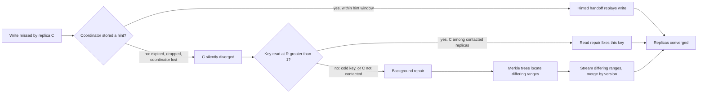
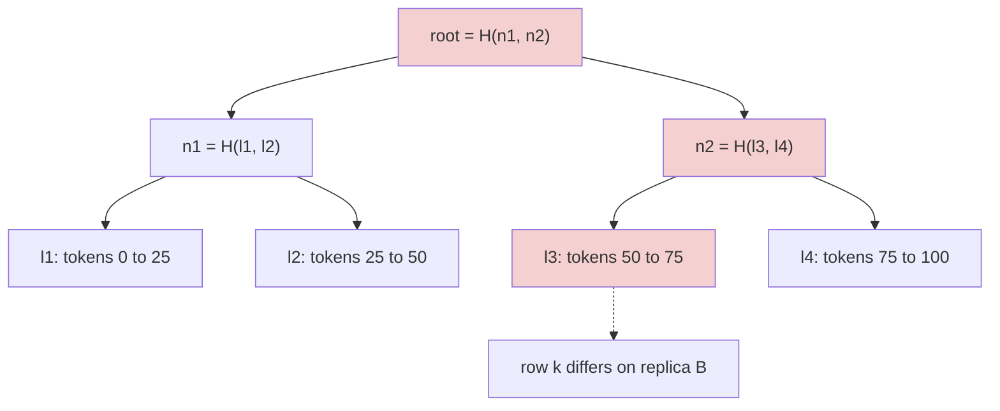
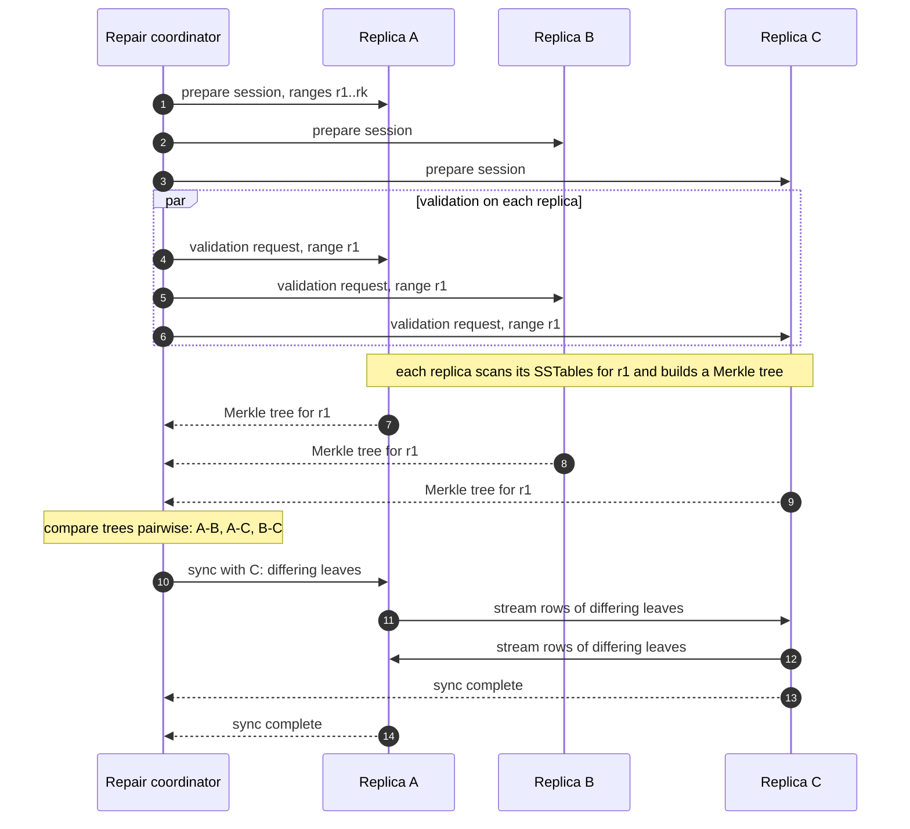
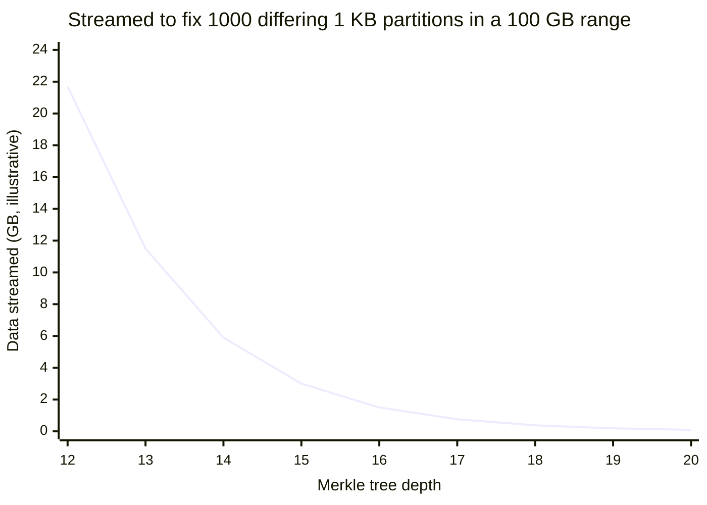
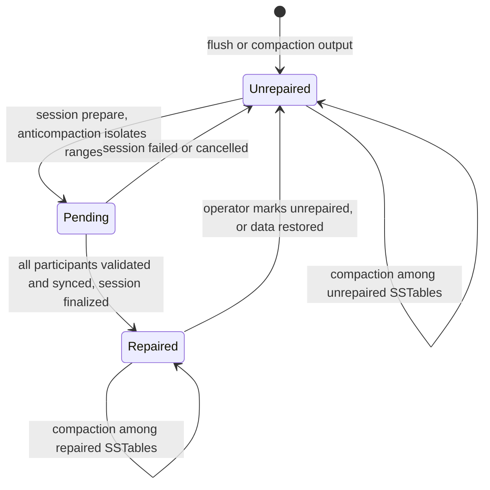
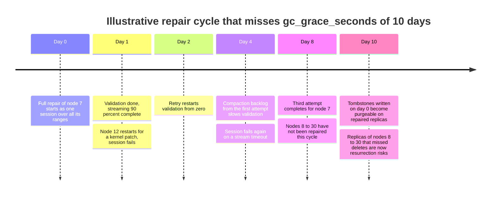

Anti-entropy, sessizce birbirinden ayrışmış replikaların, doğru durumun ne olduğunu onlara söyleyen bir leader olmadan yeniden aynı içeriğe getirilmesini sağlayan mekanizmaların bütünüdür. [Lidersiz bir depoda](/distributed-systems/tr/data-management/replication/leaderless-replication/) `N` replikanın `W` tanesinin onayladığı bir yazmanın kalan `N - W` replikaya ulaşacağının garantisi yoktur: yük altında bir mutation düşürülebilir, bir replika hint penceresinden daha uzun süre kapalı kalabilir, hint'leri tutan bir koordinatör diskini kaybedebilir ve bir silme işlemi bir replikayı tamamen ıskalayabilir. Yazma yolunda hangi replikanın hangi anahtarda geride kaldığını kaydeden hiçbir şey yoktur. Anti-entropy bu farkları sonradan bulup onaran süreçtir ve iki biçimi vardır: bir okumanın tesadüfen dokunduğu anahtarları düzelten okuma onarımı (read repair) ve replikaları bütünüyle, genellikle Merkle ağaçlarıyla karşılaştırıp geri kalan her şeyi düzelten arka plan onarımı.

Anti-entropy olmadan ayrışma monoton biçimde birikir. Kaçırılan her yazma, bir replikanın eski veri tuttuğu anahtarlara bir yenisini ekler ve quorum örtüşme argümanı bunu gizlemeye devam eder, çünkü quorum okuması danıştığı replikalar arasından en yeni sürümü seçer. Hasar daha sonra ve dolaylı olarak ortaya çıkar: yazma kaçırmış bir düğüm `ONE` okumalarına eski veriyle yanıt verir, onaylanmış bir yazmanın dayanıklılığı `N` yerine `W` kopyada kalır ve bu `W` düğümün kaybı yazmayı da götürür; tombstone'u her replikaya ulaşmadan temizlenen bir silme ise geri gelir. Lider tabanlı sistemlerde bu sorun aynı biçimde yoktur, çünkü her follower leader'ın sıralı log'unu yeniden oynatır ve tam olarak ne kadar geride olduğunu bilir. Lidersiz bir replikanın karşılaştırabileceği bir log konumu yoktur; neyi kaçırdığını öğrenmenin tek yolu, verisini başka bir replikanın verisiyle karşılaştırmaktır.

Asıl denge, farkları bulmanın maliyeti ile veri aktarmanın maliyeti arasındadır. İki replikayı anahtar anahtar karşılaştırmak kesindir ama her anahtarı okur ve gönderir; her replikanın tek bir hash'ini karşılaştırmak ucuzdur ama yalnızca farklı olduklarını söyler, nerede farklı olduklarını değil. Merkle ağaçları bu ikisinin arasında durur: hash'lerden oluşan bir hiyerarşi, iki replikanın farklı bölgeleri, fark sayısı çarpı ağaç derinliğiyle orantılı bir trafikle bulmasını sağlar; ancak onarımın birimi bir yaprağın kapsadığı bölgedir, dolayısıyla kaba bir ağaç gerçekte farklı olandan çok daha fazla veri aktarır, ince bir ağaç ise bellek ve doğrulama I/O'su ister. Okuma onarımı daha da ucuzdur, çünkü zaten gerçekleşen okumaların üzerinden işler; ama yalnızca okunan veriyi kapsar ve bu, sorun olma ihtimali en düşük olan veridir.

## Yakınsamanın Üç Yolu: Hint'ler, Okuma Onarımı, Arka Plan Onarımı

Dynamo tarzı depolar, ne zaman çalıştıkları, neyi kapsadıkları ve neye mal oldukları bakımından farklılaşan üç mekanizmayı üst üste koyar. Hinted handoff, bir koordinatörün bir replikanın kaçırdığını bildiği yazmaları yeniden oynatır; okuma onarımı bir okumanın keşfettiği ayrışmayı düzeltir; arka plan onarımı ise neyin yazıldığına ya da okunduğuna bakmadan replikaları karşılaştırır. Her biri diğerlerinin kaçırdığı bir arıza sınıfını kapsar ve deponun operasyonel sözleşmesi, sonuncusunun her şeyi yakalayacak sıklıkta çalışmasıdır.


*Kaçırılmış tek bir yazma için üç yakınsama yolu. Hint'ler koordinatörün gözlemlediği arızaları, okuma onarımı okunan anahtarları kapsar; geri kalan her şeyi yalnızca arka plan onarımı kapsar.*

Diyagram soldan sağa, giderek daralan ağlar dizisi olarak okunur. Yaşam döngüsü ve sınırları [lidersiz replikasyon](/distributed-systems/tr/data-management/replication/leaderless-replication/) sayfasında anlatılan hinted handoff, yalnızca koordinatör arızayı fark edip hint'i sakladığında işe yarar: aşırı yüklü bir replikanın aldıktan sonra düşürdüğü bir mutation ya da hint penceresinden uzun süren bir replika kesintisi hiç hint üretmez. Okuma onarımı yalnızca bir istemcinin birden fazla replikaya başvuran bir tutarlılık seviyesinde okuduğu anahtarlar için ve yalnızca eski veriyi tutan replika başvurulanlar arasındaysa çalışır. Hiçbir ön koşulu olmayan tek yol arka plan onarımıdır; zamanlamasının bir doğruluk parametresi olmasının nedeni de budur: herhangi bir anahtarın ne kadar süre ayrışık kalabileceğini yalnızca o sınırlar.

### Okuma Onarımı: Okumaların Yan Etkisi Olarak Yakınsama

Okuma onarımı şöyle çalışır. Aynı anahtar için birkaç replikaya soru sormuş bir koordinatör yanıtları karşılaştırır. Uyuşmuyorlarsa uzlaştırılmış değeri hesaplar; bu, last-write-wins altında en yeni sürüm, version vector'ler altında ise eşzamanlı sürümlerin birleşimidir. Ardından bu değeri daha eski bir şey ya da hiçbir şey döndürmemiş replikalara gönderir. İstemci uzlaştırılmış değeri alır. İstemcinin onarım yazmalarını bekleyip beklemediği sisteme bağlıdır: Cassandra 4.0'dan beri quorum okumalarını varsayılan olarak onarım tamamlanana kadar bekletir; bu, okuma onarımını monoton quorum okumaları sağlayan geri yazma aşamasına dönüştürür ve tablo bazında bu garantinin bedeli ödenerek kapatılabilir. Bu ön plan varyantı, digest isteği tabanlı okuma yolu ve tutarlılık üzerindeki etkisi [lidersiz replikasyon](/distributed-systems/tr/data-management/replication/leaderless-replication/) sayfasında ele alınır; bu sayfa okuma onarımını bir anti-entropy mekanizması olarak inceler ve bu farklı sorular doğurur.

İlk soru kapsamdır. Okuma onarımı yalnızca okunanı ve yalnızca sorulan replikalarda onarır. Replikasyon faktörü 3 iken bir Cassandra `QUORUM` okuması iki replikaya başvurur; eski veriyi tutan üçüncü replikaysa okuma uyum görür ve hiçbir şey onarmaz. Belirli kolonları ya da bir partition'ın bir dilimini seçen bir okuma, partition'ın geri kalanını değil yalnızca o satırları ve kolonları onarır. `ONE` seviyesindeki bir okuma tek replikaya başvurur ve hiçbir zaman onarım yapamaz. Dynamo'nun tasarımı daha agresif onarıyordu: koordinatör istemciye yanıt verdikten sonra kısa bir süre geç gelen yanıtları toplamaya devam ediyor ve eski sürüm döndürmüş replikaları güncelliyordu; böylece tek bir okuma `N` replikanın hepsini onarabiliyordu. Riak, bir vnode eski bir değer ya da diğer vnode'ların tuttuğu bir nesne için not-found döndürdüğünde her okumada onarım yapar; Riak'ın `anti_entropy` ayarındaki `passive` değeri tam olarak budur: arka plan süreci olmadan, yalnızca okumada onarım.

İkinci soru, bu kapsamın ne anlama geldiğidir. Okuma trafiği çarpıktır: çoğu iş yükünde anahtarların küçük bir kısmı okumaların büyük kısmını alır. Bu yüzden okuma onarımı sıcak anahtarları hızla yakınsatır, soğuk anahtarları ise hiç yakınsatmaz; oysa silmeler ve dayanıklılık açısından ayrışmanın en çok önem taşıdığı yer soğuk anahtarlardır, çünkü onları fark edecek kimse okumaz. Cassandra 4.0 öncesinde okuma onarımının ağını `read_repair_chance` ve `dclocal_read_repair_chance` tablo seçenekleriyle genişletmeye çalışıyordu; bunlar okumaların bir kısmını arka planda tüm replikalara gönderiyordu. Ayrışmayla değil okuma trafiğiyle orantılı yük ekliyor, okunmayan veriyi yine kaçırıyorlardı ve 4.0'da kaldırıldılar. Ders genellenebilir: okuma onarımı sıcak verinin yakınsaması için bir gecikme optimizasyonudur, arka plan onarımının yerine asla geçmez.

:::note[Gossip'teki anti-entropy, aynı fikrin küme durumuna uygulanmasıdır]
Demers ve arkadaşları anti-entropy terimini 1987'de, her düğümün periyodik olarak bir eş seçip replike edilmiş bir veritabanını bütünüyle onunla uzlaştırdığı bir protokol için kullandılar; bunun karşıtı yalnızca son güncellemeleri yayan rumor mongering'dir. Gossip tabanlı üyelik ve metadata yayılımı bu kalıbı hâlâ kullanır ve [Gossip Protokolleri](/distributed-systems/tr/resilience/failure-detection/gossip-protocols/) sayfasında ele alınır. Bu sayfa veri onarımı tarafını kapsar: karşılaştırmanın kendi maliyetinin tasarım problemi olduğu büyük replika içeriklerinin uzlaştırılmasını.
:::

## Merkle Ağaçları: Replikaları Göndermeden Karşılaştırmak

500 GB'lık bir token aralığının iki replikası, farklı oldukları birkaç bin satırı bulmak için verilerini birbirine gönderemez; karşılaştırma tam bir kopya kadar pahalıya gelir. Tüm aralığın tek bir hash'ini karşılaştırmak da işe yaramaz, çünkü uyuşmazlık o durumda yalnızca bir yerde bir şeyin farklı olduğunu söyler. Gereken şey küçük, ucuza karşılaştırılabilen ve uyuşmadığında farkın yerini bulmak için inceltilebilen bir özettir. Ralph Merkle'ın 1987'de dijital imzalar için ortaya koyduğu hash ağacı tam olarak bu özelliğe sahiptir.

### Yapı ve İnşa

Aralığın anahtar uzayını, token sırasına göre `L` adet bitişik alt aralığa bölün; her iki replika da aynı sınırları kullansın. Ağacın her yaprağı, anahtarı kendi alt aralığına düşen tüm satırların hash'ini tutar; bu hash, sürüm metadata'sı (timestamp'ler, tombstone'lar) dahil her satırın kanonik serileştirmesi üzerinden hesaplanır. Her iç düğüm, çocuklarının hash'lerinin hash'ini tutar. Böylece kök tüm aralığı, her iç düğüm kendi yapraklarının birleşimini özetler ve ikili bir ağaç için derinlik `d = log2(L)` olur.


*Bir token aralığı üzerinde dört yapraklı, derinliği 2 olan bir Merkle ağacı. Tek bir farklı satır, tam olarak bir kökten-yaprağa yol üzerindeki hash'leri değiştirir; bu yol gölgeli gösterilmiştir.*

Yapının bütün amacı bu gölgeli yoldur. `k` satırındaki bir fark `l3` yaprağının, dolayısıyla `n2`'nin, dolayısıyla kökün hash'ini değiştirir; başka hiçbir şeyi değil. Ağaçlarını kökten aşağı doğru karşılaştıran iki replika, hash'leri eşleşen her alt ağacı atlar; böylece `n1` ve yaprakları hiç incelenmez ve yalnızca hash'lerin farklı olduğu yerlere inilir. Farklı yapraklara dağılmış `m` farklı satır varsa karşılaştırma en fazla `d` uzunluğunda `m` yolu inceler; değiş tokuş edilen hash sayısı `2 m d` mertebesindedir ve aralığın boyutundan bağımsızdır. Hiç fark yoksa kökteki tek bir hash karşılaştırması replikaların aynı olduğunu kanıtlar.

Pahalı olan kısım ağacı inşa etmektir. Her replika aralığın her satırını diskten okumak, satır sürümlerini tüm disk dosyaları boyunca tıpkı bir okumanın yaptığı gibi birleştirmek, sonucu kanonik biçimde serileştirmek ve kendi alt aralığının yaprak hash'ine beslemek zorundadır. Cassandra'da buna validation compaction denir: aralığın tüm SSTable'ları (sorted string table) üzerinde yeni bir dosya yerine bir Merkle ağacı üreten, compaction benzeri bir tarama; `nodetool compactionstats` çıktısında `Validation` görevi olarak görünür. I/O maliyeti, replikanın o aralıktaki verisinin tamamen okunmasıdır; büyük ölçüde senkron olan bir kümede arka plan onarımının ağ bant genişliğiyle değil disk okuma bant genişliğiyle sınırlı olmasının nedeni budur. SSTable'ların okumalar ve compaction'lar sırasında nasıl birleştirildiği [SSTables, Memtable ve Compaction Stratejileri](/distributed-systems/tr/data-management/storage-engines/sstables-memtable-compaction/) sayfasında ele alınır.

### Merkle Onarımı Neden Yakınsar

Doğruluk argümanının üç parçası vardır. Birincisi tespit: iki replika bir alt aralık için farklı içerik tutuyorsa, hash fonksiyonu çakışmadıkça o aralığın yaprak hash'leri farklıdır ve çakışmaya dayanıklı bir hash bu olasılığı ihmal edilebilir kılar (iyi bir 64 bitlik hash için karşılaştırma başına `2^-64` mertebesinde, 256 bitlik için çok daha az). Farklı bir yaprak köke kadar her atasını değiştirir; dolayısıyla yalnızca uyuşmazlıklarda aşağı inen yukarıdan aşağı bir karşılaştırma onu atlayamaz. Bir Merkle karşılaştırmasında çakışmalar dışında yanlış negatif yoktur; yaprak seviyesinde yanlış pozitif ise yapı gereği sıfırdır: uyuşmayan bir yaprak gerçekten bir fark içerir.

İkincisi onarım: bir yaprak uyuşmadığında replikalar o alt aralıktaki tüm satırları değiş tokuş eder ve her biri aldığını elindekiyle birleştirir. Birleştirme değişmeli, birleşmeli ve idempotent olmalıdır; böylece değiş tokuşun sırası önemli olmaz ve zaten tuttuğu bir satırı almak hiçbir şeyi değiştirmez. Hücre bazlı timestamp'lerle last-write-wins, tombstone'lar da hücre olarak ele alındığında, bu özelliklere sahiptir; version vector'ler altında sibling birleştirme de öyle. Biçimsel olarak replika durumları bir join-semilattice oluşturur ve onarım join'i hesaplar; bu, [CRDT'lerin](/distributed-systems/tr/data-management/consistency-models/crdts/) üzerine kurulduğu özelliğin aynısıdır. Her iki replika da bir alt aralığın her iki yönünü birleştirdikten sonra içeriklerinin join'ini tutar ve o alt aralık için aynı hale gelir.

Üçüncüsü bütünlük: yapraklar aralığı bölümler; dolayısıyla uyuşmayan her yaprağı onarmak, replikaları aralık boyunca, her birinin hash'lediği anlık görüntü itibarıyla aynı hale getirir. Bu son kayıt, Merkle onarımının neyi garanti etmediğini tanımlar. Doğrulama sırasında ya da sonrasında gelen yazmalar kapsanmaz ve bir sonraki oturumda uyuşmazlık üretebilir. Onarım hangi değerin anlamsal olarak doğru olduğuna karar vermez: replikaları birleştirme kuralının kazananında yakınsatır; last-write-wins altında saat kayması yüzünden kaybolan bir yazma her replikada kayıp kalır. Hiçbir replikanın tutmadığı veriyi geri getiremez. Ve oturuma katılmayan replikalar hakkında hiçbir şey söylemez.

### Uçtan Uca Bir Onarım Oturumu

Cassandra'nın onarım protokolü en yaygın kullanılan uygulamadır ve Merkle tabanlı her onarımın sahip olması gereken aşamaları gösterir: aralıklar ve anlık görüntü üzerinde anlaşma, bağımsız doğrulama, ağaç değişimi, fark hesaplama ve streaming.


*Üç replika arasında tek bir aralık için bir Cassandra onarım işi. Doğrulama tüm replikalarda paralel çalışır; koordinatör tüm ağaçları tutar ve yalnızca ağaçları farklı olan replika çiftleri arasında streaming başlatır.*

I/O maliyetinin düştüğü yer 4-6. adımlardır: her replika doğrulama taramasını bağımsız olarak yürütür, dolayısıyla anlık görüntüler birbirinden biraz farklı zamanlarda alınır ve arada gelen yazmalar fark olarak görünür. Replikalar sağlıklı olsa bile yoğun yazma alan bir tabloda onarımın her zaman bir miktar uyuşmazlık bulmasının bir nedeni budur. 7-9. adımlar, yukarıda anlatılan yukarıdan aşağı etkileşimli değişimden farklı bir tasarım tercihini gösterir: Cassandra ağaçları seviye seviye dolaşmak yerine bütün halinde koordinatöre gönderir ve tek bir round trip karşılığında bellek ve ağ harcar. Koordinatör her aralık için her replikanın ağacını bellekte tuttuğundan ağaç boyutu replikasyon faktörüyle çarpılır; bu aşağıda bir arıza biçimine dönüşür. 10-14. adımlarda yalnızca A ve C çiftinin streaming'e ihtiyacı oldu; B'nin ağacı da A'nınkinden farklı olsaydı ikinci bir senkronizasyon görevi çalışırdı. Streaming çift yönlüdür, çünkü koordinatör her satırın daha yeni sürümünü hangi tarafın tuttuğunu bilmez ve birleştirme kuralı yönü önemsiz kılar.

### Hesaplanmış Örnek: Ağaç Derinliği, Overstreaming ve Bellek

Bir replikanın, her biri 1 KB olan `10^8` partition'lık, toplam 100 GB'lık bir token aralığı tuttuğunu ve iki replika arasında aralığa düzgün dağılmış 1.000 partition'ın farklı olduğunu varsayın. Bu örnekteki her sayı açıklayıcıdır ve hesap kolaylığı için seçilmiştir.

`L` yaprakla her yaprak `10^8 / L` partition'ı kapsar. 1.000 farktan en az birini içeren yaprakların beklenen sayısı `L (1 - e^(-1000/L))`'dir ve bu yaprakların her biri bütünüyle aktarılır; dolayısıyla aktarılan hacim `100 GB x (1 - e^(-1000/L))` olur. Derinlik 15'te `L = 32,768`'dir; her yaprak yaklaşık 3.050 partition'ı, yani 3 MB'ı kapsar, yaklaşık 985 yaprak kirlidir ve onarım 1 MB'lık gerçek farkı düzeltmek için kabaca 3 GB aktarır: yaklaşık 3.000 katlık bir overstreaming (gereğinden fazla veri aktarımı) çarpanı. Derinlik 20'de `L = 1,048,576`'dır; her yaprak yaklaşık 95 partition'ı kapsar, neredeyse her fark kendi yaprağında yalnız kalır ve onarım yaklaşık 95 MB aktarır.


*Yukarıdaki modele göre ağaç derinliğine bağlı aktarılan hacim. Farklar yapraklardan seyrek olduğunda her ek seviye hacmi yarıya indirir; derinlik 13'ün altında birden fazla fark aynı yaprağı paylaşır ve eğri tam 100 GB'a doğru yataylaşır.*

Eğrinin iki rejimi vardır. Yapraklar farklardan çok olduğunda her kirli yaprak yaklaşık bir fark içerir; aktarılan hacim fark sayısı çarpı yaprak boyutudur ve her derinlik seviyesi onu yarıya indirir. Farklar yapraklardan çok olduğunda ise neredeyse her yaprak kirlidir ve onarım aralığı kopyalamaya dönüşür. İkinci rejim egzotik değildir: yoğun yazma alan bir tabloda bir gün kapalı kalmış bir replika milyonlarca partition'da farklı olabilir; bu noktada hiçbir pratik ağaç derinliği aralığın büyük kısmını aktarmaktan kaçınamaz ve düğümü taze bir kopya aktararak değiştirmek onu onarmak kadar ucuzdur.

Derinliğin bedeli bellek ve karşılaştırma işidir. `L` yapraklı bir ikili ağacın `2L - 1` düğümü vardır. Hash ve yardımcı bilgiler için düğüm başına 32 byte varsayıldığında (açıklayıcı; bellekteki temsil uygulamaya göre değişir) derinlik 15'teki bir ağaç yaklaşık 2 MB, derinlik 20'deki bir ağaç yaklaşık 64 MB tutar. Replikasyon faktörü 3 ile tek bir aralığı onaran bir Cassandra koordinatörü bu ağaçlardan üç tane tutar, derinlik 20'de 192 MB; birçok aralık ve tablo üzerindeki bir onarım ise aynı anda birkaçı için ağaç inşa eder. Cassandra'nın tarihsel olarak azami derinliği 15'e sabitlemesinin, sonraki sürümlerin ağaçları aralığın tahmini partition sayısından boyutlandırmasının ve 4.0'ın bir oturumun ağaçlarının kullanabileceği belleği sınırlamak için `repair_session_space`'i getirmesinin nedeni budur. Pratikteki ayar kolu derinlik değil aralığın boyutudur: bir aralığı birçok küçük alt aralıkta onarmak, her ağaca daha az partition üzerinde aynı sayıda yaprak verir ve overstreaming aynı oranda düşer.

:::tip[Onarmadan önce ayrışmayı ölçün]
`nodetool repair --preview` (Cassandra 4.0 ve sonrası) Merkle ağaçlarını inşa eder ve streaming yapmadan ne kadar veri aktarılacağını raporlar. Uzun bir aradan sonraki ilk onarımdan önce bir tabloda çalıştırmak, yarıya inme rejiminde mi yoksa kopyalama rejiminde mi olduğunuzu söyler; ikincisindeyseniz ayrışmış düğümü yeniden inşa etmek ya da değiştirmek, verisinin çoğunu hem doğrulayıp hem aktaran bir onarımdan çoğu zaman daha hızlı ve daha az yıkıcıdır.
:::

## Üretim Sistemlerinde Onarım

Her üretim uygulaması üç bileşeni korur: anahtar uzayının deterministik bir bölümlenmesi, kanonik satır içerikleri üzerinde hash'ler ve değişmeli bir birleştirme. Geri kalan her şey değişir: ağaçların ne zaman inşa edildiği, kalıcı olup olmadıkları, yaprakların ne kadar ince olduğu ve her seferinde ne kadar verinin yeniden doğrulandığı.

### Cassandra: Tam, Artımlı, Alt Aralık ve Önizleme Onarımı

Cassandra her onarım oturumunda ağaçları talep üzerine inşa eder ve sonra atar. Tam onarım (full repair), onarılan aralıklardaki tüm veriyi doğrular. `-pr` (primary range) ile her düğümde çalıştırıldığında her aralık replika başına bir kez değil, onun ilk replikası olan düğümden tam bir kez onarılır. Daha önce onarılmış olarak işaretlenmiş veriyi yeniden kontrol eden tek biçim tam onarımdır; bu yüzden bit çürümesini (bit rot), kaybolan SSTable'ları ve operatör hatalarını yakalayan da odur.

Artımlı onarım (incremental repair), 2.2 serisinden beri `nodetool repair`'in varsayılanıdır ve önceki bir onarımın zaten doğruladığı veriyi yeniden doğrulamaktan kaçınır. Her SSTable bir repaired-at işareti taşır. Artımlı bir oturum yalnızca onarılmamış SSTable'ları doğrular ve başarı durumunda onları onarılmış olarak işaretler; compaction, işaretin anlamlı kalması için onarılmış ve onarılmamış SSTable'ları ayrı tutar. Bir SSTable oturumun içindeki ve dışındaki aralıklara yayılıyorsa oturum önce onu böler; bu adıma anticompaction denir. 4.0 öncesinde bu tasarımda, veriyi bir replikada onarılmış, diğerinde onarılmamış olarak işaretleyebilen yarış durumları vardı; bundan sonra iki replikanın onarılmış kümeleri farklılaşıyor ve hiçbir sonraki artımlı onarım onları karşılaştırmıyordu. Cassandra 4.0 bunu, bir oturumdaki SSTable'ların önce pending durumunda yalıtılacağı ve yalnızca her katılımcı başarılı olduktan sonra onarılmış durumuna yükseltileceği şekilde yeniden tasarladı.


*Cassandra 4.0 artımlı onarımında SSTable onarım durumları. Pending veri tam olarak bir oturuma aittir ve o oturum başarısız olursa Unrepaired durumuna döner.*

4.0 yeniden tasarımının eklediği şey Pending durumudur. Öncesinde veri, katılımcılardan biri bitirir bitirmez onarılmış olarak işaretleniyordu; dolayısıyla yarıda başarısız olan bir oturum replikaları farklı onarılmış kümelerle bırakıyordu ve oturum sırasında yazılan veri karşılaştırılmadan onarılmış olarak işaretlenebiliyordu. Pending ile Repaired'a geçiş yalnızca sonlandırmada, tüm katılımcılar anlaştıktan sonra gerçekleşir; bir başarısızlık veriyi Unrepaired'a geri gönderir ve bir sonraki oturum onu alır. Diyagram geriye kalan sınırlamayı da gösterir: veriyi Repaired'dan bir operatör eylemi dışında hiçbir şey çıkarmaz. Onarılmış bir SSTable bir replikada kaybolur ya da bozulursa hiçbir artımlı onarım bunu görmez; dokümantasyonun artımlı onarımların yanında ara sıra tam onarım önermesinin ve onarılmış kümeleri streaming yapmadan replikalar arasında karşılaştıran `nodetool repair --validate`'in var olmasının nedeni budur.

Açık başlangıç ve bitiş token'larıyla yapılan alt aralık onarımı (subrange repair), bir düğümün aralıklarını her biri ayrı bir oturum olan çok sayıda küçük parçaya böler. Büyük düğümler için ana operasyonel araçtır: küçük oturumlar daha küçük ya da daha ince ağaçlar inşa eder, bağımsız olarak başarısız olup yeniden denenir ve yükü yaymak için zamanlanabilir. En yaygın kullanılan harici zamanlayıcı olan Cassandra Reaper onarımı bu şekilde yürütür ve her segmentin en son ne zaman başarılı olduğunu kaydeder. Cassandra 6.0, yapılandırılmış aralıklarla tam, artımlı ve önizleme onarımlarını çalıştıran, her düğümün aralıklarını veri boyutuna ve partition sayısına göre görevlere bölen ve paralel onarım yapan düğüm sayısını sınırlayan yerleşik bir otomatik onarım zamanlayıcısı ekler (CEP-37; 5.0.8'e bir başlangıç bayrağı arkasında geri taşındı); bu yazının yazıldığı sırada dokümantasyonu hâlâ pre-release olarak işaretliydi.

### Riak: Kalıcı Hash Ağaçları ve TicTac AAE

Riak'ın active anti-entropy'si (AAE), ağaç ömrü konusunda tersi bir yaklaşım izler: ağaçlar diskte kalıcıdır ve her yazmada güncellenir. Eski (legacy) AAE, her partition için ayrı bir LevelDB deposunda, nesneler yazıldıkça güncellenen bir hash ağacı tutar ve her partition'ı replike eden vnode'lar arasında ağaçları periyodik olarak değiş tokuş eder; farklı anahtarları onlar üzerinde okuma onarımını tetikleyerek düzeltir. Ağaçlar artımlı olarak bakıldığı için bir değişim tam tarama değil yalnızca ağaç karşılaştırması maliyetindedir ve farklar oluştuktan sonraki dakikalar içinde bulunur. Bedeli ikinci bir yazma yolu ve kendisi de veriden kayabilen ikinci bir disk yapısıdır: eski AAE ağaçları bir takvime göre süresi doldurup tam taramayla yeniden inşa eder (`anti_entropy.tree.expiry`, varsayılan bir hafta) ve bu inşalar varsayılan olarak düğüm başına saatte bir ile sınırlandırılır.

Riak KV 2.9'dan itibaren kullanılabilen TicTac AAE, yaprak hash'lerini anahtar sırasına göre hash'lemek yerine XOR ile birleştirir. XOR değişmeli ve kendi kendinin tersi olduğundan bir yazma, eski nesnenin hash'ini XOR ile çıkarıp yenisininkini XOR ile ekleyerek, anahtarların sırasını bilmeden ağacı güncelleyebilir; farklı partition'ların ağaçları da XOR ile daha büyük bir anahtar kümesinin ağacına birleştirilebilir. Ağacı 4096 çarpı 1024 yapraklıdır, yani Cassandra'nın tarihsel sınırından çok daha incedir; varsayılan olarak birkaç dakikada bir değişim yapar (`tictacaae_exchangetick`, 240.000 ms) ve değişim başına en fazla `tictacaae_maxresults` kadar, varsayılan 256, farkı onarır; böylece büyük bir ayrışma tek bir patlama yerine kademeli olarak giderilir.

### ScyllaDB: Ağaçsız Satır Düzeyinde Onarım

ScyllaDB 3.1, aralık başına checksum tabanlı onarımını satır düzeyinde onarımla (row-level repair) değiştirdi. Her replika bir ağaç inşa etmek yerine bir aralık için satır başına bir hash hesaplar, replikalar tam olarak farklı satırları bulmak için bu satır hash'i kümelerini uzlaştırır ve yalnızca o satırlar aktarılır. Veri, hem hash'leme hem gönderme için kullanılan bir tampona bir kez okunur. ScyllaDB'nin önceki şemaya ilişkin kendi açıklaması overstreaming problemini doğrudan adlandırır: yaklaşık 100 partition'lık alt aralıklar, tek bir farklı satırın 100 partition'ın aktarılmasına yol açması demekti. Üç düğümlü, 1 TB veri içeren bir kümede yayımladığı benchmark, yüzde 99,9 senkron bir veri kümesinin onarımının 96,4 dakikadan 14,2 dakikaya düştüğünü ve ağ aktarımının önceki hacmin yaklaşık yüzde 3,6'sına indiğini bildirir. Satır düzeyinde uzlaştırma overstreaming'i ortadan kaldırır; bedeli, fark sayısıyla değil satır sayısıyla orantılı olan satır başına hash değişimidir; dolayısıyla avantajı ayrışma küçük ve satırlar büyük olduğunda en fazladır.

### Dynamo: Anahtar Aralığı Başına Ağaçlar ve Topoloji Değişikliğinin Maliyeti

Dynamo makalesi, bir düğümün barındırdığı her anahtar aralığı için bir Merkle ağacı kullanıyor ve bunu aralığın replikaları arasında değiş tokuş ediyordu. Makale yapısal zayıflığı da kaydetti: bir düğüm katıldığında ya da ayrıldığında anahtar aralıkları değişir ve değişen bir aralık üzerindeki her ağaç bir taramayla yeniden hesaplanmalıdır. Dynamo'nun token konumlarıyla tanımlanan aralıklar yerine düğümlere atanan sabit, eşit boyutlu partition'lara geçmesi bu maliyeti azalttı, çünkü üyelik değiştiğinde partition sınırları artık yer değiştirmiyordu. Aynı baskı her uygulamayı biçimlendirir: ağaç sınırları replikalar arasında eşleşmelidir; dolayısıyla sınırları hareket ettiren her şey, bir yeniden dengeleme, bir token değişikliği, [vnode](/distributed-systems/tr/data-management/data-partitioning/consistent-hashing/) atamasındaki bir değişiklik, önceden hesaplanmış ağaçları geçersiz kılar. Yeniden dengelemenin veriyi en başta nasıl taşıdığı [Dinamik Yeniden Dengeleme](/distributed-systems/tr/data-management/data-partitioning/dynamic-rebalancing/) sayfasında ele alınır.

### Yaklaşımların Karşılaştırılması

| Yaklaşım | Farkları nerede bulur | Replikalar uyumluyken maliyet | Overstreaming | Ana zayıflık | Ne zaman tercih edilir |
|---|---|---|---|---|---|
| Okuma onarımı | R 1'den büyükken okunan anahtarlar | Okumanın ötesinde yok | Yok, tam anahtarlar | Soğuk veriye hiç dokunmaz | Her zaman açık, sıcak veri için tamamlayıcı olarak |
| Talep üzerine Merkle (Cassandra tam) | Aralıkların tamamı | Her replikanın tam okunması | Yaprak boyutunda; kaba ağaçlarda büyük | Doğrulama I/O'su, ağaç belleği | Bit çürümesi dahil periyodik tam doğrulama |
| Artımlı talep üzerine Merkle | Son onarımdan beri yazılan veri | Yalnızca onarılmamış verinin okunması | Yaprak boyutunda | Onarılmış küme asla yeniden kontrol edilmez | Büyük, çoğunlukla durağan tablolarda sık onarım |
| Kalıcı ağaçlar (Riak AAE, TicTac) | Partition'ların tamamı, sürekli | Yalnızca ağaç karşılaştırması | Değişimden sonra anahtar düzeyinde | İkinci yazma yolu; ağaçlar kayar ve yeniden inşa gerekir | Düşük tespit gecikmeli sürekli yakınsama |
| Satır düzeyinde uzlaştırma (ScyllaDB) | Aralıkların tamamı | Tam okuma artı satır başına hash değişimi | Yok, tam satırlar | Hash trafiği satır sayısıyla ölçeklenir | Büyük satırlar, küçük ayrışma |
| Log tabanlı yetişme (lider tabanlı) | Bir log konumundan sonraki her şey | Yok | Yok | Sıralı bir log gerektirir; lidersizde yoktur | Replike log'u olan her sistem |

Son satır sınırdır. [Lider tabanlı replikasyondaki](/distributed-systems/tr/data-management/replication/leader-based-replication/) bir follower ya da bir Raft grubu üyesi log konumunu bilir ve ondan sonraki her şeyi ister; bu yüzden veriyi hiç karşılaştırması gerekmez. Anti-entropy, bu konuma sahip olmamanın bedelidir; lidersiz replikasyonun yazma yolunda ucuz, arka planda pahalı olmasının nedeni de budur.

## Onarımı Zamanlamak ve Yapılandırmak

Onarım sıklığını ayrışma değil silmeler belirler. Bir silme, compaction onu `gc_grace_seconds` (Cassandra'da varsayılan on gün) sonrasında temizlemeden önce her replikaya ulaşması gereken bir tombstone'dur; silmeyi kaçırmış bir replika bu pencere içinde onarılmazsa silinen değer geri gelir; [lidersiz replikasyon](/distributed-systems/tr/data-management/replication/leaderless-replication/) sayfasındaki zaman çizelgesi bunu gösterir. Cassandra dokümantasyonu bunu bir kurala dönüştürür: varsayılan grace süresiyle her düğümü en az yedi günde bir onarın; başarısız oturumlar için üç günlük pay kalsın. Yeni kümeler için bir ila üç günde bir artımlı, bir ila üç haftada bir tam onarım önerir.

Zamanlama, kümenin doğrulama bant genişliğine de sığmalıdır. Replikasyon faktörü 3 olan, düğüm başına 1 TB veri tutan 30 düğümlü bir küme düşünün ve doğrulamanın, diskleri üretim trafiğiyle paylaşırken düğüm başına efektif 50 MB/s hızla çalıştığını varsayın (açıklayıcı). Bir düğümün birincil aralıklarının `-pr` ile tam onarımı bu aralıkları üç replikada paralel olarak doğrular; her birinde bir düğümün verisinin yaklaşık üçte biri, kabaca 333 GB okunur ve bu yaklaşık 1,9 saat sürer. 30 düğümü art arda onarmak yaklaşık 56 saat, 2,3 gün sürer; bu, yeniden denemelere yer bırakarak yedi güne sığar. Düğüm başına veriyi iki katına çıkarıp efektif doğrulama hızını yarıya indirin, döngü 9,3 güne çıkar: kâğıt üzerinde hâlâ on günlük grace süresinin içinde, ama başarısız bir oturum, yavaş bir düğüm ya da onarımın bir yükseltme için duraklatıldığı bir hafta için hiç pay yok. Çakışmayan birkaç replika kümesini paralel çalıştırmak, aynı anda daha fazla doğrulama yükü pahasına döngüyü kısaltır; artımlı onarım yalnızca onarılmamış veriyi okuyarak onu daha da kısaltır.

Önemli olan komutlar azdır ve anlamın çoğunu bayraklar taşır:

```shell
# Full repair of this node's primary ranges only; run on every node in every DC
nodetool repair --full -pr my_keyspace

# Incremental repair (the default mode) of one table
nodetool repair my_keyspace my_table

# Subrange repair: one segment of the ring, retried independently on failure
nodetool repair --full -st -9223372036854775808 -et -9150000000000000000 my_keyspace

# Estimate streaming without repairing; add --full to estimate a full repair
nodetool repair --preview my_keyspace

# Compare repaired data across replicas without streaming
nodetool repair --validate my_keyspace
```

Bu komutların arkasındaki parametreler onarım hızını üretim etkisine karşı dengeler. Paralellik (`-seq` her seferinde bir replikayı, `-dcpar` veri merkezi başına birini doğrular; varsayılan olan paralel mod hepsini aynı anda doğrular), aynı anda kaç replikanın doğrulama I/O'su ödeyeceğini belirler; sıralı modlar diğer replikaları tam hızla okuma sunmak için serbest bırakır. `concurrent_validations` bir düğümün aynı anda kaç validation compaction çalıştıracağını sınırlar ve compaction throughput sınırları doğrulamaya da sıradan compaction'a uygulandığı gibi uygulanır. Stream throughput sınırları ağ tarafını sınırlar; bu, bir onarımın kopyalama rejiminde olduğu ortaya çıktığında önem kazanır. Ağaç belleği 4.0 ve sonrasında `repair_session_space` ile sınırlanır; eski `repair_session_max_tree_depth` kullanımdan kaldırılmıştır (deprecated). Tablo düzeyindeki `gc_grace_seconds`, bu ayarların her birinin uyması gereken son tarihtir; tombstone birikimini azaltmak için onu düşürmek onarım son tarihini aynı miktarda kısaltır.

:::caution[Birincil aralık onarımı halkayı ancak her yerde çalışırsa kapsar]
`-pr` yalnızca düğümün ilk replika olduğu aralıkları onarır. Tüm halkayı ancak her veri merkezindeki her düğümde çalıştığında kapsar; bir düğümü ya da bir veri merkezini atlamak, o aralıkların diğer her replikası temiz bir takvim raporlarken onun birincil aralıklarını onarılmamış bırakır. Tersi hata da yaygındır: `--full` olmadan çalıştırılan `nodetool repair` artımlı onarım yapar; dolayısıyla periyodik tam doğrulama amaçlayıp bayrağı unutan bir runbook onarılmış veriyi hiçbir zaman yeniden kontrol etmez.
:::

## Arıza Biçimleri ve Nasıl Göründükleri

Anti-entropy arızaları nadiren hata olarak görünür. Ya yük olarak ortaya çıkarlar: streaming sıçramaları, compaction birikmesi, garbage collection duraklamaları; ya da günler sonra geri gelen silmeler veya kaybolan dayanıklılık olarak yüzeye çıkan bir doğruluk kayması olarak.

### Overstreaming ve Ardından Gelen Compaction Fırtınası

Tetikleyici: bir onarım kaba bir ağacın birçok yaprağında fark bulur; tipik olarak bir düğüm uzun süre kapalı kaldıktan sonraki ilk onarımda ya da geniş partition'lı bir tabloda büyük bir aralık üzerindeki onarımda. Belirtiler: beklenen ayrışmanın çok üzerinde streaming hacmi, alıcı replikalarda küçük SSTable patlaması, artan bekleyen compaction'lar ve okumaların daha fazla dosyayı birleştirmesi gerektiği için o replikalarda yükselen okuma gecikmesi. Tespit: oturum sırasında `nodetool netstats` streaming toplamları, `SyncTime` ve `BytesValidated` tablo metrikleri ve bekleyen compaction görevleri; önceden alınmış bir önizleme onarımı tahmini. Hafifletme: her ağacın daha az partition kapsaması için alt aralıklarla onarın, stream throughput'u sınırlayın ve kopyalama rejimindeki bir düğümü onarmak yerine değiştirin ya da yeniden inşa edin. Kurtarma: bir sonraki oturumdan önce compaction'ın yetişmesini bekleyin; birikme yüksekken aynı replikalarda başka bir onarım başlatmayın, aksi halde sonraki doğrulama şişmiş dosya kümesini okur.

### Merkle Ağaçlarının Koordinatör Belleğini Tüketmesi

Tetikleyici: vnode'lu, çok tablolu ya da yüksek replikasyon faktörlü bir kümede `-pr` olmadan çalışan bir onarım oturumu; koordinatör aynı anda birçok aralık için her replikadan ağaç alır. Cassandra hata takipçisi bu kalıbı kaydeder: `repair_session_space` tek bir doğrulama isteği için inşa edilen ağaçları sınırlar, ama bir koordinatör aralık başına RF replikadan ve birçok aralık grubu için eşzamanlı olarak doğrulama yanıtı alabilir; bildirilen bir vakada 11 düğüm, replikasyon faktörü 3 ve 256 token, 132 eşzamanlı doğrulama isteği ve bir out-of-memory çökmesi üretti. Belirtiler: onarım sırasında koordinatörde uzun garbage collection duraklamaları ve heap büyümesi, ardından bir çökme ya da düğümün down olarak işaretlenmesi. Tespit: aktif onarım oturumlarıyla ilişkilendirilmiş heap kullanımı ve GC duraklama metrikleri; meşgul `AntiEntropyStage` ve `ValidationExecutor` thread pool'ları. Hafifletme: `-pr` ya da alt aralık onarımı kullanın, oturum başına daha az tablo onarın, `repair_session_space`'i ihtiyatlı tutun ve düzeltmeyi içeren sürümlere yükseltin. Kurtarma: koordinatörü yeniden başlatın; başarısız oturum pending veriyi onarılmamış bırakır ve sonraki oturum işi tekrarlar.

### Grace Süresi İçinde Hiç Bitmeyen Onarım

Tetikleyici: büyük bir düğümün onarımı birkaç uzun oturum olarak çalışır; bir replika yeniden başladığı, bir stream zaman aşımına uğradığı ya da bir operatör iptal ettiği için bir oturum sona yakın başarısız olur ve yeniden deneme oturumu baştan başlatır. Belirtiler: onarım her zaman çalışmaktadır, ama bazı aralıkların son başarılı onarımının yaşı büyümeye devam eder. Bu en tehlikeli anti-entropy arızasıdır, çünkü sağlıklı ve meşgul bir onarım süreci gibi görünür.


*Tekrarlanan oturum başarısızlıklarının grace süresini tükettiği varsayımsal bir onarım döngüsü; gerçek bir olay değildir.*

Zaman çizelgesinin belirleyici noktası, ilerlemenin aralık başına değil oturum başına ölçülmesidir. İlk deneme işin çoğunu tamamlamış ve çöpe atılmıştır; yeniden deneme onu daha kötü koşullar altında tekrarlamıştır. 10. güne gelindiğinde küme doğrulama bütçesinin çoğunu tek bir düğüme harcamıştır ve halkanın geri kalanı güvenli pencerenin dışındadır. Tespit: Reaper'ın kaydettiği şekliyle token aralığı ya da segment başına son başarılı onarımdan bu yana geçen sürenin `gc_grace_seconds` ile karşılaştırılması; artımlı onarım için `PercentRepaired` tablo metriği; ve log'lardaki onarım oturumu başarısızlık sayıları. "Herhangi bir aralığın en eski başarılı onarımı `gc_grace_seconds`'in yüzde 70'inden eski" üzerine kurulan bir alarm bu kalıbı hâlâ kurtarılabilirken yakalar. Hafifletme: bir başarısızlığın günleri değil dakikaları kaybettirmesi için küçük alt aralıklarla onarın; onarımı planlı bakımların dışına zamanlayın ve bir onarım döngüsü gerideyken düğüm yeniden başlatmalarını duraklatın. Kurtarma: bazı aralıklar için pencere kaçırıldıysa, onarım yetişmeden tombstone'lar temizlenmesin diye etkilenen tablolarda `gc_grace_seconds`'i geçici olarak yükseltin ve döngü tamamlandığında yeniden düşürün.

:::danger[Onarılmış kümeye veri geri yüklemek onu artımlı onarımdan gizler]
Bir düğüme yedekten ya da başka bir düğümden SSTable kopyalamak veya kaybolan bir diskten dosyaları geri yükleyerek kurtarmak, diğer replikaların hiç karşılaştırmadığı veriyi onarılmış olarak işaretli bırakabilir. Artımlı onarım ona bakmaz; dolayısıyla içindeki ayrışma ya da eksik veri, bir tam onarım ya da bir quorum okuması tesadüfen ona dokunana kadar sessiz kalır. Herhangi bir geri yükleme ya da elle yapılan SSTable işleminden sonra, artımlı onarıma yeniden güvenmeden önce geri yüklenen veriyi onarılmamış olarak işaretleyin ya da etkilenen aralıkların tam onarımını çalıştırın.
:::

### Replikalar Arasında Onarılmış Kümelerin Ayrışması

Tetikleyici: Cassandra 4.0 öncesi sürümlerde bazı katılımcıların veriyi onarılmış olarak işaretlemesinden sonra başarısız olan artımlı bir oturum ya da yazmalarla yarışan anticompaction; herhangi bir sürümde, bir replikada kaybolan ya da bozulan onarılmış bir SSTable. Belirtiler: artımlı onarım başarı raporlar ve hiçbir şey aktarmaz, oysa quorum okumaları aynı tablolarda okuma onarımını tetiklemeye devam eder ve `ONE` okumaları farklı replikalardan farklı değerler döndürür. Tespit: onarılmış veriyi replikalar arasında karşılaştıran `nodetool repair --validate`; yeni onarılmış tablolarda yüksek kalan okuma onarımı oranları (`ReadRepair` metriklerinden `RepairedBlocking` ve `ReconcileRead`). Hafifletme: 4.0 ya da sonrasında çalışın ve takvimde bir tam onarım tutun. Kurtarma: etkilenen SSTable'ları onarılmamış olarak işaretleyip artımlı onarım çalıştırın ya da aralıkların tam onarımını yapın.

### Ayrışmış Sıcak Anahtarlarda Okuma Onarımı Çoğalması

Tetikleyici: bir replika, örneğin bir kesintiden sonra, sıcak bir partition'da eski veri tutar ve o partition'ın onu içeren her quorum okuması bir uyuşmazlık bulup bekletici (blocking) bir onarım yazması yapar. Belirtiler: belirli partition'lar için `QUORUM` okuma gecikmesi yükselir ve eski replikaya ek yazma trafiği gider; dilimlerle okunan geniş bir partition'da her okuma yalnızca kendi dilimini onarır, dolayısıyla uyuşmazlık binlerce okuma boyunca sürer. Tespit: `RepairedBlocking` okuma onarımı metriği, dropped-message metrikleri altındaki düşürülmüş `READ_REPAIR` mesajları ve partition başına gecikme aykırı değerleri. Hafifletme: okumaların onu dilim dilim onarmasına izin vermek yerine etkilenen aralığın arka plan onarımını çalıştırın. Kurtarma: aralık onarıldıktan sonra gerekmez; uyuşmazlıklar kayboldukça gecikme normale döner.

| Arıza | İlk belirti | Birincil sinyal | İlk eylem |
|---|---|---|---|
| Overstreaming | Beklenen ayrışmanın çok üzerinde streaming | `nodetool netstats`, önizleme tahmini | Alt aralık onarımı, stream throughput sınırı |
| Koordinatörde bellek tükenmesi | Onarım sırasında GC duraklamaları | Aktif oturumlara karşı heap ve GC metrikleri | `-pr` ya da alt aralıklar, oturum başına daha az tablo |
| Onarım döngüsünün grace süresini kaçırması | Hep çalışıyor, hiç bitmiyor | En eski başarılı aralık onarımının yaşı | Daha küçük segmentler, `gc_grace_seconds`'i geçici yükseltme |
| Onarılmış kümelerin ayrışması | Temiz onarımlar, kalıcı okuma onarımları | `--validate`, okuma onarımı metrikleri | Tam onarım, 4.0 ya da sonrasına yükseltme |
| Okuma onarımı çoğalması | Sıcak partition'larda yavaş quorum okumaları | `RepairedBlocking`, düşürülmüş `READ_REPAIR` | Aralığın arka plan onarımı |

## Arka Plan Anti-Entropy Ne Zaman Gerekir, Ne Zaman Gerekmez

Replikalar paylaşılan sıralı bir log olmadan yazma kabul ettiğinde arka plan anti-entropy zorunludur: Cassandra, ScyllaDB ve Riak gibi Dynamo tarzı depolarda ve her replika uygulamadan bir yazmanın onaylanabildiği her özel replikasyon düzeninde. Bu sistemlerde bir optimizasyon değil, dayanıklılık ve silme sözleşmesinin bir parçasıdır. Log'u olan sistemlerde de replikaları sessiz bozulmaya karşı doğrulamak için doğru araçtır, çünkü log'u yeniden oynatmak follower'ın mevcut durumunun sağlam olduğunu varsayar; bir follower'ın leader'ına karşı ya da bir yedeğin kaynağına karşı periyodik Merkle karşılaştırması, replikasyonun asla fark etmeyeceği bit çürümesini tespit eder.

Okuma onarımı, var olduğu her yerde açık tutulmaya değer, çünkü sıcak anahtarları neredeyse maliyetsiz yakınsatır; ama silinen, nadiren okunan ya da `N` kopyaya ulaşması gereken veri için asla tek mekanizma olmamalıdır. Bir kez yazılıp hiç okunmayan tablolar, örneğin denetim log'ları ve sorgu penceresini geçmiş zaman serileri, okuma onarımından hiç fayda görmez ve tamamen arka plan onarımına ya da onarımı daha az kritik kılan bir tutarlılık seviyesinde yazılmaya bağımlıdır.

Replike bir log'u olan bir sisteme Merkle ağacı onarımı inşa etmeyin; log konumunu bilen bir follower eksik son kısmı getirmeli, bu kesin ve ucuzdur; son kısım artık yoksa bir snapshot aktarımına geri dönmelidir. Verisinin çoğunda ayrışmış bir replikayı düzeltmek için Merkle onarımına güvenmeyin; farkların yapraklardan çok olduğu noktadan sonra onarım bir yeniden inşa kadar tutar ve üstüne doğrulama I/O'su ekler. Başarılı bir onarımı verinin doğru olduğunun kanıtı saymayın; yalnızca replikaların birleştirme kuralının kazananında anlaştığını kanıtlar ve [Nihai Tutarlılık: Son Yazı Kazanır](/distributed-systems/tr/data-management/consistency-models/eventual-consistency/) sayfasında tartışılan kural zayıflıkları geçerliliğini korur. Ve anti-entropy Merkle ağaçlarını dosya sistemlerinde, içerik adresli depolamada ya da şeffaflık log'larında bütünlük doğrulaması için kullanılan hash ağaçlarıyla karıştırmayın: onlar verinin bilinen bir köke uyduğunu kanıtlar; anti-entropy ise aynı yapıyı iki değişebilir replikanın nerede anlaşmadığını bulmak için kullanır. Cassandra onarımının token halkası ve tutarlılık seviyeleriyle gündelik operasyonda nasıl bir araya geldiği [Pratikte Cassandra](/distributed-systems/tr/case-studies/dynamodb-cassandra/cassandra-hashing-ring/) vaka çalışmasında ele alınır.

## İleri Okuma

- Alan Demers, Dan Greene, Carl Hauser, et al., *Epidemic Algorithms for Replicated Database Maintenance*, PODC, 1987.
- Ralph C. Merkle, *A Digital Signature Based on a Conventional Encryption Function*, CRYPTO, 1987.
- Giuseppe DeCandia, Deniz Hastorun, Madan Jampani, et al., *Dynamo: Amazon's Highly Available Key-value Store*, SOSP, 2007.
- Apache Cassandra Dokümantasyonu, *Repair* ve *Auto Repair*, cassandra.apache.org, 4.0 ile 6.0 arası sürümler.
- ScyllaDB, *Scylla Open Source 3.1: Efficiently Maintaining Consistency with Row-Level Repair*, scylladb.com blog, 2019.
- Riak KV Dokümantasyonu, *Active Anti-Entropy* ve *TicTac Active Anti-Entropy*, 2.9 ve 3.0 sürümleri.
