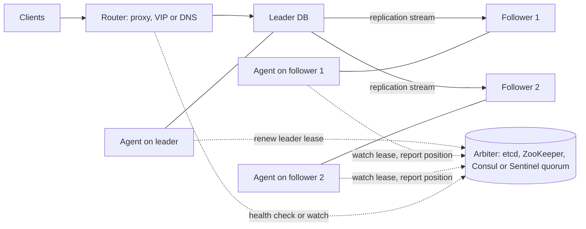
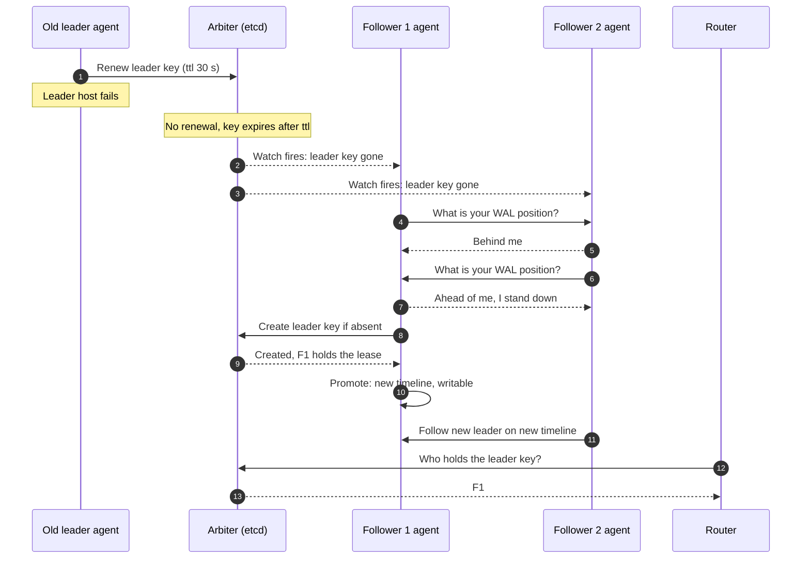
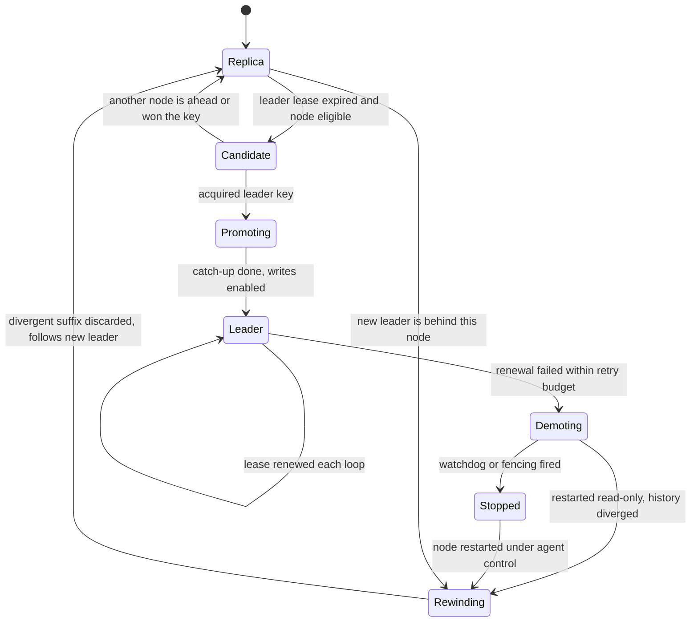
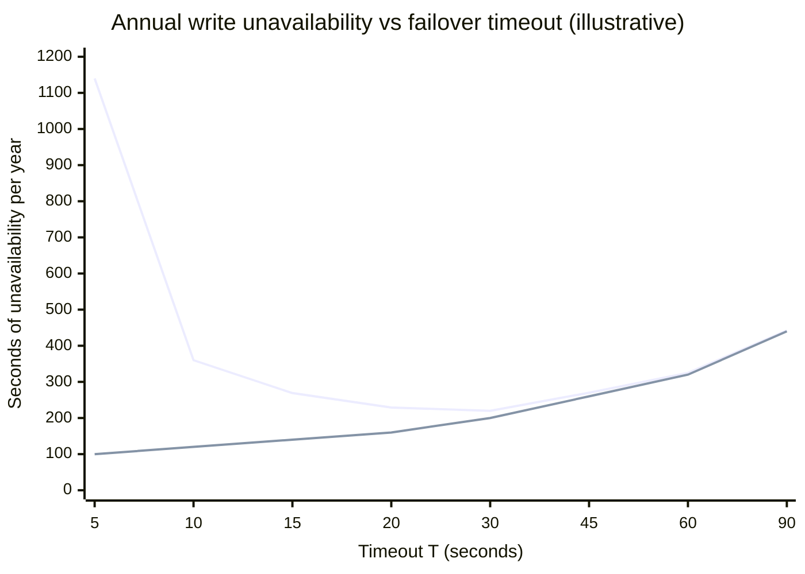
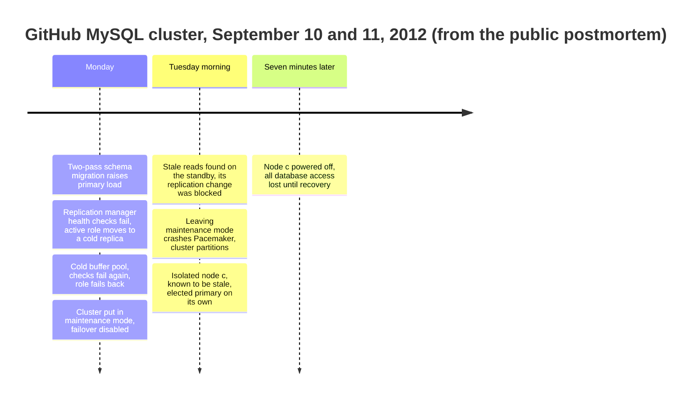

Failover, lider tabanlı replike bir sistemde arızalanan leader'ı follower'larından biriyle değiştirerek yazmaların yeniden başlamasını sağlayan prosedürdür. Beş parçası vardır: leader'ın arızalandığına karar vermek, yerine hangi follower'ın geçeceğini seçmek, o follower'ı yazılabilir bir leader'a terfi ettirmek, istemcileri ve kalan follower'ları ona yönlendirmek ve eski leader'ın artık yazma kabul edemeyeceğinden emin olmak. Lider seçimi bunların ikincisidir, ama diğerlerinden ayrı tasarlanamaz: seçilen düğüm, istemcilerin yazabildiği tek düğüm olmalı ve istemcilere commit edildiği söylenen her yazmayı tutmalıdır.

Prosedür, lider tabanlı bir veritabanının leader'ı durduğu andan yenisi yerine geçene kadar yazma kabul edememesi yüzünden vardır. Elle yapıldığında bu süre, bir mühendisin çağrılması, durumun teşhis edilmesi ve adımların uygulanması kadar sürer: en iyi ihtimalle dakikalar, çoğu zaman bir saat. Otomasyon kesintiyi saniyelere indirir ve failover'ı zorlaştıran asıl sorunu beraberinde getirir. Otomasyon yalnızca leader'ın yanıt vermeyi bıraktığını görür; dışarıdan bakıldığında çökmüş bir leader, garbage collection yüzünden duraklamış bir leader, bir ağ partition'ının öbür tarafında kalmış bir leader ve yalnızca izleme yolu bozulmuş bir leader [Ağ Modelleri](/distributed-systems/tr/foundations/system-models/network-models/) sayfasında anlatıldığı gibi birbirinin aynısıdır. Bu dört leader'dan üçü hâlâ hayattadır ve hâlâ yazma kabul ediyor olabilir.

Asıl denge, bir failover'ın ne kadar hızlı başladığı ile ne sıklıkla yanlış başladığı arasındadır. Kısa zaman aşımları gerçek bir arızadan sonraki kesintiyi kısaltır, ama her duraklamayı, takılmayı ve ağ dalgalanmasını bir failover'a çevirir. Her failover yazmaları keser, asenkron replikasyonda onaylanmış veriyi çöpe atabilir ve eski leader durdurulmazsa her biri diğerinin hiç görmediği yazmaları kabul eden iki leader yaratır. Bu son durum split-brain'dir. Seçimin içinde ikinci bir denge daha vardır: en güncel follower'ı hemen terfi ettirmek ya da geride kalan birinin yetişmesini beklemek, saniyelerce süren erişilemezliği aksi hâlde kaybolacak yazmalarla takas eder.

Bu sayfa, replike veritabanlarındaki failover prosedürünün ve onu güvenli kılan koşulların kanonik sayfasıdır. Genel split-brain problemi ve depolama katmanının eski bir leader'ı reddetmesini sağlayan fencing token'lar [Fencing Tokens: Eski Kilit Sahiplerini Engellemek](/distributed-systems/tr/coordination/distributed-locking/fencing-tokens/) sayfasında; bir mutabakat protokolünün parçası olarak lider seçimi [Raft](/distributed-systems/tr/coordination/consensus-algorithms/raft/) sayfasında; heartbeat aralıkları ve zaman aşımlarının seçimi [Heartbeats ve Zaman Aşımı Yapılandırması](/distributed-systems/tr/resilience/failure-detection/heartbeats-timeouts/) sayfasında; her commit modunda hangi yazmaların failover'dan sağ çıktığı ise [Lider Tabanlı Replikasyon](/distributed-systems/tr/data-management/replication/leader-based-replication/) sayfasında ele alınır.


*Dışarıdan yönetilen bir failover'ın kontrol düzlemi: her veritabanının yanında bir agent, leader lease'ini tutan ve çoğunlukla replike edilen bir hakem (arbiter) ve hakem ne derse onu izleyen bir yönlendirici.*

Diyagram iki düzlemi birbirinden ayırır. Düz oklarla gösterilen veri düzlemi sıradan replikasyondur ve seçimlerden habersizdir. Noktalı oklarla gösterilen kontrol düzlemi leader'ın kim olduğuna karar verir ve bu kararı yalnızca kendisi de bir çoğunluk protokolüyle replike edilen hakem verebilir; yönlendirici asla karar vermez, yalnızca izler. Failover olaylarının çoğu bu kurallardan birinin çiğnenmesine dayanır: kendi gözlemine göre hareket eden bir agent, tek bir süreçten ibaret bir hakem ya da hakemin çoktan değiştirdiği bir düğüme trafik göndermeyi sürdüren bir yönlendirici.

## Bir Failover'ın Anatomisi: Tespit, Seçim, Terfi, Yönlendirme, Devreden Çıkarma

### Tespit: Şüphe Arıza Değildir

Bir failover, bir gözlemcinin leader'ın gittiği sonucuna varmasıyla başlar. Hiçbir gözlemci bunu bilemez; yalnızca leader'ın bir zaman aşımı içinde bir şeyi yapmadığını fark edebilir: bir probe'a yanıt vermedi, bir lease'i yenilemedi ya da bir replikasyon heartbeat'i göndermedi. Kime sorulduğu, yanlış durumların ne kadarının elendiğini belirler.

Leader'ı yoklayan tek bir monitör en zayıf tasarımdır: monitör ile leader arasındaki, istemcilerin fark etmediği bir ağ sorunu sağlıklı bir leader'ın failover'ını tetikler. Oylayan birden fazla monitör bunu iyileştirir. Redis Sentinel, leader'ın nesnel olarak düşmüş (objectively down) sayılması için yapılandırılabilir sayıda Sentinel'in, yani quorum'un, leader'a ulaşılamadığında hemfikir olmasını ister. GitHub'da kullanılan MySQL topoloji yöneticisi Orchestrator ise leader'a kendi attığı probe'a hiç güvenmez: bir primary'yi ancak primary'ye ulaşılamıyorsa ve tüm replikaları da ondan replikasyonlarının koptuğunu bildiriyorsa ölü ilan eder; çünkü kendi replikalarının hâlâ ulaşabildiği bir primary, önemli olan her açıdan hayattadır. Patroni gibi lease tabanlı tasarımlar soruyu tersine çevirir: leader hakemdeki bir anahtarı yenileyerek hayatta olduğunu sürekli kanıtlamak zorundadır ve sinyal başarısız bir probe değil, yenilemenin yokluğudur. Bu, tespit noktasını replike olan ve her düğümün ulaşabildiği hakeme taşır ve failover açısından "leader hakeme ulaşamıyor" ile "leader arızalandı" ifadelerini eşdeğer kılar; bu seçimin sonuçları hata modlarında tartışılıyor.

### Seçim: Tek Karar, Tam Olarak Bir Kez

Leader'dan şüphelenildiğinde, birden fazla follower arızayı aynı anda fark etse ve her biri kendini en iyi aday sansa bile tam olarak bir halef seçilmelidir. Çökebilen ya da partition'a düşebilen süreçler arasında bir kararı tekil kılmanın tek genel yolu, kararın sabit bir seçmen kümesinin çoğunluğu tarafından kabul edilmesidir: herhangi iki çoğunluk en az bir seçmeni paylaşır ve o seçmen aynı tur için iki farklı kararı kabul etmez.

Gerçek sistemler bunu üç yoldan biriyle uygular. Birincisinde karar, mutabakatla replike edilen bir depodaki atomik bir işlemdir: Patroni adayları etcd, ZooKeeper, Consul ya da Kubernetes API'sinde leader anahtarını "yoksa oluştur" işlemiyle yaratmak için yarışır ve deponun kendi mutabakat protokolü yalnızca bir oluşturmanın başarılı olmasını sağlar. İkincisinde monitörler kendi aralarında oylama yapar: leader'ı nesnel olarak düşmüş gören bir Sentinel diğer Sentinel'lerden yetki ister ve ancak tüm Sentinel süreçlerinin çoğunluğunun oyunu alırsa ilerler; ardından yeni yapılandırmayı sürümleyen ve başka hiçbir Sentinel'in alamayacağı bir sayı olan configuration epoch'u alır. Üçüncüsünde replikalar kendi aralarında mutabakat tarzı bir seçim yürütür: MongoDB replica set'leri Raft'takine benzer term'ler ve oylar kullanır, MySQL Group Replication ise Paxos tabanlı grup iletişim katmanının üzerinde anlaştığı üyelik görünümünden bir primary seçer. Üçünde de azınlıktaki bir partition seçim yapamaz; seçimi yapan tarafta ikinci bir leader'ı imkânsız kılan özellik budur.

### Aday Seçimi: Uygunluk, Sıralama ve Yetişme

Tekillik, seçilen follower'ın iyi bir seçim olup olmadığı hakkında hiçbir şey söylemez. Seçim üç aşamada yürür. İlki uygun olmayan follower'ları eler: yapılandırılmış bir miktardan fazla geride kalan replikalar (Patroni'nin WAL byte'ı cinsinden `maximum_lag_on_failover` ayarı), commit'ler senkronken senkron kümenin dışında kalan replikalar, asla terfi ettirilmemek üzere etiketlenmiş replikalar (gecikmeli replikalar, analitik replikaları, yedekler), politikanın dışladığı bir veri merkezindeki replikalar (Orchestrator'ın `PreventCrossDataCenterMasterFailover` ayarı) ve güvenilemeyecek kadar uzun süre bağlantısız kalmış replikalar (Sentinel, `down-after-milliseconds` değerinin on katı artı leader düştüğünden beri geçen süreden uzun bağlantısız kalanları dışarıda bırakır).

İkinci aşama kalanları sıralar. Temel ölçüt replikasyon konumudur: tek liderli bir log'un önek (prefix) özelliği gereği en yüksek konumdaki follower, hayatta kalan herhangi bir follower'ın tuttuğu her yazmayı tutar; dolayısıyla başka birini terfi ettirmek, elde mevcut olan veriyi kaybetmek demektir. Sistemler bunun üzerine operatör tercihini ekler: Sentinel önce `replica-priority`'ye, sonra replikasyon offset'ine, sonra run ID'ye göre sıralar; MongoDB yüksek önceliğe sahip üyelerin seçimi daha erken başlatmasına izin verir, ama görünür üyeler arasında en yüksek optime'a sahip olmayan hiçbir üyenin primary olmasına izin vermez; MySQL Group Replication önce en düşük sunucu sürümüne, sonra `group_replication_member_weight` değerine, sonra sunucu UUID'sine bakar. Önceliği konumun önüne koymak bilinçli bir takastır: leader'ı tercih edilen bir zone'da ya da donanımda tutar, bedeli de tercih edilen replika geride ise aradaki farkın kaybolmasıdır.

Üçüncü aşama yetişmedir. Bir follower'ın aldığı konum ile uyguladığı konum farklıdır: bir MySQL replikası relay log'una binary log olayları almış ama applier'ı bunları henüz çalıştırmamış olabilir; bir PostgreSQL standby'ı da henüz replay etmediği WAL'ı almış olabilir. Uygulamadan terfi ettirmek ya alınan veriyi çöpe atar ya da yeni leader'ın okumaları log'undan daha eski bir durumdan yanıtlamasına yol açar. Orchestrator bu seçimi açıkça sunar: terfiyi SQL thread'i yetişene kadar geciktirmek ya da yetişmemişse terfiyi reddetmek. MySQL Group Replication'ın varsayılan `group_replication_consistency` değeri olan `BEFORE_ON_PRIMARY_FAILOVER`, yeni seçilmiş bir primary'de birikmiş değişiklikler uygulanana kadar yeni transaction'ları bekletir. MongoDB'de ise yeni seçilen primary, yazma kabul etmeden önce kendisinden ileride olan üyelerden yazmaları çektiği bir yetişme (catch-up) aşamasından geçer; bu aşamayı sınırlayan `catchUpTimeoutMillis`, dokümantasyonda daha hızlı failover ile `w:1` yazmalarının korunması arasındaki dengeyi ayarlayan düğme olarak tanımlanır.

### Terfi ve Yönlendirme

Terfi, salt okunur bir follower'ı yazılabilir bir leader'a dönüştürür ve yazdığı geçmişin kimliğini değiştirir. PostgreSQL terfide timeline ID'sini bir artırır: sonrasında yazılan WAL yeni timeline'a aittir ve bir geçmiş dosyası timeline'ın ayrıldığı log konumunu tam olarak kaydeder. GTID kullanan MySQL'de timeline yoktur; ama yeni primary replikasyon thread'lerini durdurur, replikasyon yapılandırmasını temizler ve `read_only` ile `super_read_only` ayarlarını kapatır; bundan sonra yeni üretilen GTID'lerde kendi sunucu UUID'si görünür. Her ikisinde de bu ayrılma noktası, daha sonra eski leader'ın ayrışan sonekinin belirlenmesini sağlar.

Kalan follower'lar ardından yeni leader'dan replike etmelidir. GTID auto-positioning ile bir MySQL replikası yeni kaynağa hangi transaction'lara zaten sahip olduğunu söyler, kaynak da gerisini gönderir; PostgreSQL standby'ları ise PostgreSQL 12'den beri `recovery_target_timeline` varsayılan olarak `latest` olduğu için yeni timeline'ı izler. Yeni leader'dan ileride olan bir follower, ki leader konum yerine öncelik nedeniyle terfi ettirildiyse bu mümkündür, onu izleyemez ve geri sarılmalı (rewind) ya da yeniden kurulmalıdır.

İstemciler, başlıca farkı bir istemcinin görüşünün ne kadar bayat kalabileceği olan dört mekanizmadan biriyle yönlendirilir. Gratuitous ARP ile yeni leader'a taşınan sanal bir IP, tek bir layer-2 segmenti içinde hızlıdır ve zone'lar arasında işe yaramaz. Yeni leader'ın adresine çevrilen bir DNS kaydı, yol üzerindeki her resolver ve istemci önbelleğiyle sınırlıdır. Bir proxy (her düğümün Patroni REST endpoint'ini kontrol eden HAProxy, ProxySQL ya da bir bulut yük dengeleyicisi) sağlık kontrolü değişikliği gördüğü anda geçiş yapar. Topolojiden haberdar istemciler, yani MongoDB sürücüleri ve Sentinel'i tanıyan Redis istemcileri, cluster'a leader'ın kim olduğunu sorar ve hata aldıklarında yeniden sorar. Her durumda, eski leader'a açılmış mevcut bağlantılar bir şey onları kapatana kadar değişiklikten sağ çıkar.

### Devreden Çıkarma ve Yeniden Katılma

Eski leader yazma kabul etmeyi bırakmalı ve sonunda bir follower olarak geri dönmelidir. Durdurmak, failover sisteminin fencing'inin işidir: Patroni leader anahtarını güncelleyemediği anda PostgreSQL'i salt okunur moda indirir (demote), Patroni'nin kendisi takılırsa bir donanım ya da yazılım watchdog'u makineyi sıfırlar, Pacemaker gibi cluster yöneticileri ise düğümü STONITH ("shoot the other node in the head", öbür düğümü vur) ile, yani altyapı seviyesinde gücü ya da ağı kesen bir fencing agent'ı ile kapatır. Fencing'in genel teorisi ve yalnızca depolama katmanındaki bir kontrolün neden sızdırmaz olduğu [Fencing Tokens: Eski Kilit Sahiplerini Engellemek](/distributed-systems/tr/coordination/distributed-locking/fencing-tokens/) sayfasının konusudur.

Yeniden katılmak, eski leader'ın ayrılma noktasından sonra yazdığı her şeyi atmayı gerektirir. PostgreSQL'in `pg_rewind` aracı ayrışma noktasını bulmak için timeline geçmişlerini okur, o noktadan önceki son checkpoint'ten itibaren eski leader'ın WAL'ını tarayarak o zamandan beri değişen her bloğu bulur ve bu blokları yeni leader'dan kopyalar; eski leader'da `wal_log_hints` ya da data checksum'lar açık olmalıdır; bunlar PostgreSQL 18 `initdb`'de checksum'ları varsayılan olarak açana kadar varsayılan olarak kapalıydı. Başka hiçbir üyede olmayan transaction'lara sahip eski bir MySQL primary'si errant GTID'ler, yani yeni primary'nin yürütülmüş kümesinin dışında kalan transaction kimlikleri taşır; bunlar silinmeli ya da replika yeniden kurulmalıdır, aksi hâlde bu replika ileride primary olduğunda onları herkese gönderir. Bir MongoDB üyesi, çoğunluğun hiç onaylamadığı yazmaları geri alır (rollback) ve rollback dosyalarına kaydeder. Üçünde de atılan yazmalar otomatik olarak birleştirilmez, çünkü yeni leader'ın kabul ettikleriyle çakışabilirler.


*Patroni tarzı, dış hakemli bir failover. Adaylar anahtar için yarışmadan önce konumlarını karşılaştırır; bu yüzden yarış normalde çekişmesizdir, çekişmeli olduğunda ise kararı atomik oluşturma verir.*

Dizide iki mekanizma farklı işler görür. 6-9. adımlar sıralamadır: her aday diğerlerine konumlarını sorar ve önde biri varsa çekilir; en ileri follower'ın kazanmasını sağlayan budur. Seçimi güvenli kılan bu adımlar değildir, çünkü bir eşine ulaşamayan aday yanlışlıkla en iyisinin kendisi olduğu sonucuna varabilir. 10. ve 11. adımlar karardır ve sıralama ne sonuca varmış olursa olsun güvenlidir, çünkü hakem yalnızca tek bir oluşturmayı kabul eder; her iki follower da 10. adıma ulaşmış olsaydı biri başarısız olur ve follower olarak kalırdı. 14. ve 15. adımlardaki yönlendirici sonucu veritabanlarından değil hakemden öğrenir; böylece eski leader'a ulaşılamadığı sırada bile karara tutarlı kalır.

## Prosedür Neden Güvenli: İki Değişmez ve Dayandıkları Koşullar

Bir failover iki özelliği koruyorsa doğrudur. Birincisi tek yazıcıdır: hiçbir anda iki düğüm birden istemcilere commit edildiği söylenen yazmaları kabul etmez. İkincisi onaylanmış yazma kaybının olmamasıdır: yeni leader, failover'dan önce onaylanmış her yazmayı tutar. Hiçbiri tek başına failover prosedürü tarafından garanti edilmez ve her birinin neye dayandığını kesin olarak söylemek gerekir.

### Tek Yazıcı: Zamanla Sınırlanmış Lease'ler

Hakem, hakemin bakış açısından iki düğümün leader anahtarını asla aynı anda tutmamasını garanti eder. Veritabanı ise her yazmada hakeme danışmaz; agent'ı durmasını söyleyene kadar yazma kabul etmeyi sürdürür. Bu yüzden tek yazıcı özelliği, eski leader'ın yenisi başlamadan durmasına bağlıdır ve bunu iletişim olmadan sağlayan tek araç zamandır. Leader anahtarı bir lease olarak, yani yenilenmezse sabit bir süre sonra sona eren bir hak olarak tutar; bu mekanizma [Kiralama Tabanlı Kilitleme](/distributed-systems/tr/coordination/distributed-locking/lease-based-locking/) sayfasında anlatılır. Leader'ın agent'ı yenileyemediği anda veritabanını devreden çıkarır; hakem ise anahtarı başkasının almasına ancak lease sona erdikten sonra izin verir. Agent'ın son tarihi hakemin sona erme anından güvenli biçimde önce düşerse iki pencere çakışamaz.

```mermaid
gantt
    title Leader key timing, ttl 30 s, loop_wait 10 s, retry_timeout 10 s
    dateFormat X
    axisFormat %S
    section Old leader
    Last renewal succeeds at t 0          :milestone, m1, 0, 0s
    Sleeps one loop_wait                  :a1, 0, 10s
    Renewal fails, retrying               :crit, a2, after a1, 10s
    Demoted to read-only                  :done, a3, after a2, 25s
    section DCS
    Leader key valid                      :b1, 0, 30s
    Key expired, free to acquire          :b2, after b1, 15s
    section Replica
    Following, key still present          :c1, 0, 30s
    Notices expiry, wins race, promotes   :crit, c2, after c1, 5s
    Accepting writes                      :c3, after c2, 10s
```


*Patroni'nin varsayılan zamanlamasıyla, başarılı bir yenilemenin hemen ardından hakemden kopan bir leader. Eski leader 20. saniyeden itibaren salt okunurdur; anahtar 30. saniyede sona erer.*

Grafik, eski leader için en kötü durumu gösterir: 0. saniyede yeniledi, hemen ardından hakemden partition ile koptu, tam bir döngü uyudu ve ardından tüm yeniden deneme bütçesini hakeme ulaşmaya çalışarak harcadı. 20. saniyede devreden çıkar. 0. saniyede yazdığı anahtar 30. saniyeden önce alınamaz. Patroni bu boşluğu pozitif tutan kısıtı `loop_wait + 2 * retry_timeout <= ttl` olarak belgeler; 10, 10 ve 30 saniyelik varsayılanlarla eşitsizlik tam olarak sınırdadır ve gösterilen boşluk, eşitsizliğin ilk okumada düşündürebileceği tam pay değil, tek bir yeniden deneme penceresidir. Devreden çıkma ile sona erme arasındaki on saniye, argümanın sessizce yok saydığı payı emer: leader'ın makinesi ile hakem arasındaki saat hızı farkları, agent'taki zamanlama gecikmeleri ve PostgreSQL'in devreden çıkmayı tamamlaması için geçen süre.

Argümanın genel olarak geçerli olmayan iki varsayımı vardır. Leader'da ve hakemde ölçülen geçen sürenin pay içinde uyuştuğunu varsayar; yüzde birin altında farklı hızlarda işleyen saatler zararsızdır, ama NTP tarafından ileri-geri atlatılan bir saat ya da askıya alınıp devam ettirilen bir sanal makine, [Fiziksel Saatler](/distributed-systems/tr/foundations/time-and-ordering/physical-clocks/) sayfasında açıklandığı gibi payın tamamını tüketebilir. Ve agent'ın çalıştığını varsayar: agent süreci son başarılı yenilemesinden sonra donarsa, veritabanını devreden çıkaracağı noktaya hiç ulaşmaz ve PostgreSQL sona erme anından sonra da yazma kabul etmeyi sürdürür. Bu ikinci boşluk, Patroni'nin terfiden önce bir watchdog kurabilmesinin nedenidir; varsayılan olarak watchdog TTL'nin dolmasından beş saniye önce tetiklenir ve agent kendini bildirmemişse makineyi sıfırlar. Hiçbir zamanlama argümanı keyfi uzunluktaki bir duraklamaya dayanamadığı için, tam güvenli bir tasarım her liderlik değişikliğinde artan ve depolama katmanının her yazmada kontrol ettiği bir sayı olan fencing token'ı ekler; bu, [Fencing Tokens](/distributed-systems/tr/coordination/distributed-locking/fencing-tokens/) sayfasının kanonik konusudur.

:::danger[Veritabanı lease'ini kaybettiğini bilmez]
Leader lease'i hakemde ve failover agent'ında yaşar, veritabanında değil. PostgreSQL, MySQL ve Redis, hakem ne derse desin, primary olarak yapılandırıldıkları sürece yazma kabul eder. Bayat bir primary'yi yazılabilir tutan her yol, yani duraklamış ya da çökmüş bir agent, bakım için devre dışı bırakılmış bir agent, agent'ın denetimi dışında elle başlatılmış bir düğüm, hiçbir hata mesajı üretmeden split-brain yaratır. Platform sunuyorsa watchdog'u required modda çalıştırın, eski bir primary'yi asla elle primary olarak başlatmayın ve "yazılabilir veritabanı olan bir düğümde agent çalışmıyor" durumunu çağrı gerektiren bir alarm olarak ele alın.
:::

### Onaylanmış Yazma Kaybı Yok: Commit Kümesi ile Seçim Kümesinin Kesişimi

İkinci değişmez, lider tabanlı replikasyon sayfasında belirlenen commit moduna ve burada belirlenen aday kuralına bağlıdır. Onaylanmış bir yazma belirli bir düğüm kümesinde, yani commit kümesinde bulunur. Seçilen düğümün olası her commit kümesinde bulunması ya da yazmayı bulunan bir düğümden çekebilmesi garanti ediliyorsa failover kayıpsızdır.

Asenkron replikasyonda commit kümesi yalnızca leader'dır ve leader'ı dışlayan hiçbir kural değişmezi sağlayamaz: her failover leader'ın replike edilmemiş sonekini atar ve yönetilebilecek tek büyüklük o sonekin boyutudur. Bilinen bir standby'a senkron replikasyonda kural basittir: o standby'ı terfi ettirin, başkasını değil. Patroni senkron modda senkron standby'ları hakemdeki bir anahtara kaydeder ve leader anahtarını yalnızca bu düğümlerin almasına izin verir; nedeni budur. Herhangi `k` tane standby'ın bir yazmayı onaylamış olabileceği quorum commit'te kural, mutabakat protokollerinin kullandığı sayma argümanına dönüşür. Her commit `k` standby'a ulaşıyorsa ve seçim bunlardan en az `n - k + 1` tanesini inceleyip en ileridekini seçiyorsa, incelenen küme her commit kümesinden en az bir standby içermek zorundadır ve incelenen en ileri standby onaylanmış her yazmayı tutar. İki standby'dan `ANY 1` ile seçim ikisini de görmelidir; biri erişilemezse kayıpsız bir failover imkânsızdır ve doğru davranış beklemek ya da bir insana sormaktır.

Mutabakat protokolleri bu argümanı oylamanın içine yerleştirir: bir Raft seçmeni log'u kendisininkinden daha az güncel olan bir adayı reddeder ve commit edilmiş her kayıt bir çoğunlukta bulunduğu için kazanan hepsini tutar. Dış failover araçları argümanı, ondan hiç haberi olmayan bir replikasyon protokolünün üzerine kendileri uygulamak zorundadır; bu yüzden aday kuralları da seçim mekanizmaları kadar dikkatle incelenmeyi hak eder.


*Dış bir failover agent'ı altında bir veritabanı düğümünün rol geçişleri. Yalnızca Promoting durumuna geçiş hakemin kararını gerektirir.*

Durum makinesi iki değişmezin nerede yaşadığını gösterir. Tek yazıcı özelliği, başka bir düğüm Promoting geçişini tamamlamadan önce bir düğümün Demoting'e ulaşması ya da zorla Stopped'a sokulması gerekliliğidir; ikisini sıralayan, yukarıdaki lease aritmetiğidir. Kayıpsızlık özelliği, Replica'dan Candidate'e giden kenardaki "node eligible" koşulu ile başka bir düğüm öndeyken Candidate'ten Replica'ya geri dönen kenardır. Rewinding durumu iki kez görünür ve bunun bir nedeni vardır: eski bir leader'ın buna her zaman ihtiyacı olur; sıradan bir follower'ın da daha az ileride bir düğüm terfi ettirildiyse ihtiyacı olur ve bu, veri atan bir failover'ın görünür izidir.

## Hesaplanmış Örnek: Failover Süresi, Yanlış Failover'lar ve İki Site Tuzağı

Patroni ile yönetilen, etcd hakemli, üç zone'da üç düğümlü, tipik gecikmesi 100 ms olan asenkron replikasyonlu ve saniyede 5.000 commit işleyen bir PostgreSQL cluster'ı varsayın. Aksi belirtilmedikçe aşağıdaki tüm sayılar örnek amaçlıdır.

### Failover Süre Bütçesi

Patroni'nin varsayılan zamanlamasında, yani `ttl` 30 sn ve `loop_wait` 10 sn ile, leader anahtarını her döngüde yeniler; dolayısıyla çökme anında son yenilemesi 0 ile 10 saniye öncedir. Anahtar bu yüzden çökmeden 20 ile 30 saniye sonra sona erer. Follower'lar anahtarı döngü başına bir kez kontrol eder; ilk follower sona ermeyi gerçekleşmesinden 0 ile 10 saniye sonra fark eder. Yalnızca tespit 20 ile 40 saniye, ortalama 30 saniye kadar sürer. Bir PostgreSQL standby'ının end-of-recovery checkpoint'i olmadan terfisi bir iki saniye mertebesindedir (2 sn varsayın). İstemciler leader'a, her düğümün Patroni endpoint'ini 3 saniyede bir yoklayan ve bir düğümü up işaretlemek için iki başarı isteyen HAProxy üzerinden ulaşıyorsa, yeni leader terfiden 3 ile 6 saniye sonra trafik almaya başlar. Toplam, çökme başına kabaca 25 ile 50 saniyelik yazma erişilemezliğidir; buna uygulamanın bağlantı havuzunun bozuk bağlantıları atması için geçen süre eklenir.

Zamanlamayı `ttl` 15, `loop_wait` 3, `retry_timeout` 6 olarak sıkılaştırmak hâlâ `3 + 2 * 6 = 15 <= 15` koşulunu sağlar ve tespiti 12 ile 18 saniyeye indirir. Varsayılan `electionTimeoutMillis` değeri 10 saniye olan MongoDB, yeni bir primary seçmek için medyan sürenin "should not typically exceed 12 seconds" olduğunu belgeler. Standby'a bir DNS kaydı çeviren Amazon RDS Multi-AZ DB instance'ları ise tipik failover sürelerini 60 ile 120 saniye olarak belgeler. Bu yayılım bir kalite sıralaması değildir; her sistemin yanlış failover'lar için ne kadar bedel ödemeye razı olduğunu yansıtır.

### Zaman Aşımını Yanlış Failover'ların Maliyetinden Seçmek

Sağlıklı bir leader'ın sergilediği en uzun duraklamadan kısa her zaman aşımı, sağlıklı bir leader'ı failover'a sokar. Leader'ın bir yıl boyunca ölçüldüğünde 2 saniyeden uzun takılmaları (fsync takılmaları, agent'taki garbage collection, hakeme giden ağ dalgalanmaları, yavaş hakem yazmaları) yaklaşık günde bir, 5 saniyeden uzun olanları haftada bir, 10 saniyeden uzun olanları ayda bir, 30 saniyeden uzun olanları yılda bir ve 60 saniyeden uzun olanları dört yılda bir gösterdiğini ve gerçek leader arızalarının yılda 4 kez yaşandığını varsayın. Gerçek ya da yanlış her failover, terfi ve yönlendirme için 20 saniyelik yazma erişilemezliğine mal olur. Gerçek bir arıza ayrıca tespit süresi `T`'ye mal olur; yanlış bir arıza olmaz, çünkü leader zaten toparlanacaktı.

Yıllık yazma erişilemezliği, gerçek arızalardan gelen `4 * (T + 20)` saniye ile yanlışlardan gelen `f(T) * 20` saniyenin toplamıdır; burada `f(T)`, `T`'den uzun takılmaların yıllık sayısıdır. `T = 5` sn'de gerçek arızalar 100 sn, 52 yanlış failover 1.040 sn tutar; toplam 1.140 sn. `T = 10` sn'de toplam 120 + 240 = 360 sn, 20 sn'de 160 + 69 = 229 sn, 30 sn'de 200 + 20 = 220 sn ve 60 sn'de 320 + 5 = 325 sn'dir. Asenkron replikasyonda her yanlış failover ayrıca yaklaşık `5,000 * 0.1 = 500` onaylanmış transaction'ı atar; yani 5 saniyede yılda gerçekleşen 52 yanlış failover, gerçek bir arızadan hiç risk altında olmayan 26.000 kadar transaction'ı çöpe atar.


*Üstteki çizgi: toplam erişilemezlik. Alttaki çizgi: yalnızca gerçek arızaların neden olduğu kısım. Aradaki fark yanlış failover'ların maliyetidir. Metinde varsayılan takılma oranlarından hesaplanmıştır.*

Ders eğrinin şeklindedir; sayılar varsayılan takılma dağılımından gelir. Dirseğin altında yanlış failover'lar baskındır ve zaman aşımını kısaltmak erişilebilirliği kötüleştirir. Üstünde ise zaman aşımının kendisi baskındır. Optimum, sağlıklı bir leader'ın sık ürettiği takılmaların hemen üzerindedir; çok farklı sistemlerde varsayılanların 10 ile 30 saniye arasında toplanmasının nedeni budur. Daha hızlı failover isteyen bir ekip, zaman aşımını düşürmekten çok uzun takılmaları ortadan kaldırarak (hakem için ayrılmış düşük gecikmeli diskler, veritabanı yükünden yalıtılmış bir agent) kazanır. Eğri saniye cinsinden görünmeyen bir maliyeti de dışarıda bırakır: her yanlış failover, aşağıdaki split-brain ve yanlış aday arızaları için bir fırsat daha demektir.

### İki Veri Merkezi Oylayamaz

Şimdi cluster'ı iki veri merkezine yerleştirin: birincil sitede iki veritabanı düğümü ve iki etcd üyesi, ikincil sitede her birinden bir tane. etcd'nin üç üyesi vardır ve çoğunluk ikidir. İkincil site çökerse birincil site çoğunluğu korur ve hiçbir şey olmaz. Birincil site çökerse ikincil site üç üyeden birini tutar, çoğunluk yoktur, hiçbir düğüm leader anahtarını alamaz ve otomatik failover gerçekleşmez. Bu bir hata değil, amaçlanan davranıştır: ikincil site "birincil site çöktü" ile "siteler arasındaki bağlantı koptu" durumlarını ayırt edemez ve ikinci durumda terfi iki leader yaratır. İki site olduğu sürece üye eklemek işe yaramaz, çünkü sitelerden biri her zaman en az yarısını tutar.

Standart çözüm, yalnızca bir hakem üyesi barındıran, veritabanı olmayan bir tanık (witness) içeren üçüncü bir sitedir. etcd üyeleri üç siteye iki, iki ve bir olarak dağıtıldığında herhangi bir sitenin kaybı beşten üçünü bırakır ve iki veritabanı sitesinden her biri devralabilir. Tanığın gecikmesi beklenenden az önemlidir: ona veritabanı commit'lerinde değil, lease yenilemelerinde (her `loop_wait`'te bir) ve seçimlerde başvurulur. Üçüncü bir site yoksa dürüst seçenekler şunlardır: site kaybında, diğer sitenin gerçekten çöktüğünü doğrulayabilecek bir insanın verdiği kararla elle failover ya da bir bağlantı arızasının split-brain'e yol açabileceğini kabul etmek.

## Üretimdeki Uygulamaların Karşılaştırması

| Sistem | Kim karar verir | Kararı tekil kılan nedir | Aday kuralı | Eski leader nasıl durur | İstemci yönlendirme | Ne zaman tercih edilmeli |
|---|---|---|---|---|---|---|
| Patroni (PostgreSQL) | Bir anahtar için yarışan agent'lar | etcd, Consul, ZooKeeper ya da Kubernetes'te atomik oluşturma | `maximum_lag_on_failover` sınırı içinde WAL konumuna göre en sağlıklısı; senkron modda yalnızca senkron standby'lar | Yenileme başarısız olunca agent devreden çıkarır; isteğe bağlı watchdog | REST API üzerinde proxy sağlık kontrolleri ya da DCS'den haberdar yönlendirme | Mevcut bir mutabakat deposu olan, kendi yönettiğiniz PostgreSQL |
| Orchestrator (MySQL) | Seçilmiş tek bir Orchestrator düğümü | Orchestrator'ın kendi Raft'ı ya da paylaşılan bir backend | Terfi kuralları ve veri merkezi kısıtlarıyla en güncel replika | Erişilebilirse `read_only` ayarlanır; fencing için dış hook'lar | Bir proxy'yi, DNS'i ya da servis keşfini güncelleyen hook'lar | Asenkron ya da yarı senkron replikasyonlu büyük MySQL filoları |
| Redis Sentinel | Sentinel'lerin çoğunluğunca seçilen Sentinel | Çoğunluk oyu artı benzersiz configuration epoch | `replica-priority`, sonra replikasyon offset'i, sonra run ID | Yeniden göründüğünde replika olarak yapılandırılır; yalıtılmışken `min-replicas-to-write` yazmaları sınırlar | Sentinel'i tanıyan istemciler güncel primary'yi sorgular | Bir yazma penceresini kaybetmenin kabul edilebildiği, cluster modu olmayan Redis |
| MongoDB replica set | Üyeler | Raft benzeri term'ler ve çoğunluk oyları | Görünür en yüksek optime'a sahip olmalı; öncelik kimin önce başlatacağını etkiler | Çoğunluğu yoksa geri çekilir; onaylanmamış yazmalar geri alınır | Sürücüler primary'yi keşfeder ve yazmaları bir kez yeniden dener | MongoDB; failover yerleşiktir ve değiştirilmemelidir |
| MySQL Group Replication | Grup | Paxos tabanlı üyelik görünümü | En düşük sunucu sürümü, sonra üye ağırlığı, sonra sunucu UUID'si | Çoğunluktan atılan üyeler salt okunur olur | MySQL Router ya da InnoDB Cluster metadata'sı | Dış araç olmadan mutabakat düzeyinde garanti isteyen MySQL |
| Pacemaker ile Corosync | Cluster kaynak yöneticisi | Corosync üyelik quorum'u | Yapılandırılmış kısıtlar ve puanlar | STONITH ile güç ya da ağ fencing'i | Kaynakla birlikte taşınan sanal IP | Güvenilir bant dışı fencing donanımı olan şirket içi çiftler |
| Amazon RDS Multi-AZ | Yönetilen kontrol düzlemi | Servisin iç işleyişi | Tek standby | Servis tarafından yönetilir | Standby'a çevrilen DNS kaydı | 60-120 sn'lik failover'ların kabul edilebildiği yönetilen veritabanları |

Tablo iki aileye ayrılır. MongoDB, Group Replication ve Raft tabanlı her depoda replikalar kendi aralarında seçim yapar ve kazananın commit edilmiş her yazmayı tutması kuralı, veriyi replike eden protokolün kendisi tarafından uygulanır. Patroni, Orchestrator, Sentinel ve Pacemaker'da ise kararı ayrı bir sistem verir, alttaki replikasyon karardan habersizdir ve aday kuralının doğruluğu, aracın konumları doğru anda doğru okumasına bağlıdır.

**Patroni** tüm durumu dağıtık yapılandırma deposunda (distributed configuration store, DCS) tutar: leader anahtarı, her üyenin konumu ve etiketleri, senkron standby listesi ve dinamik yapılandırma. Dokümantasyonu `retry_timeout`'tan kısa DCS ya da ağ sorunlarının devreden çıkarmaya yol açmadığını belirtir; ama anahtarını bu süre içinde güncelleyemeyen bir leader devreden çıkarılır, bu da DCS'yi yazma erişilebilirliğinin bir bağımlılığı yapar. Patroni 3.0'da eklenen ve varsayılan olarak kapalı olan DCS failsafe modu, primary bilinen her üyeye REST API'leri üzerinden ulaşabiliyor ve her biri onu onaylıyorsa bir DCS kesintisi sırasında primary'nin çalışmayı sürdürmesine izin verir.

**Orchestrator**, bir kurtarmadan sonra aynı cluster'ın sonraki otomatik kurtarmalarını `RecoveryPeriodBlockSeconds` boyunca engeller; belgelenen örnekte bu 3.600 saniyedir ve dokümantasyonu bunu bir anti-flapping mekanizması olarak adlandırır. Asenkron ve yarı senkron MySQL'i hedeflediği için terfi kuralları veri kaybını ortadan kaldırmaz, ne kadarının kabul edilebilir olduğuna karar verir; [GitHub 2018](/distributed-systems/tr/case-studies/famous-outages/github-2018-split-brain/) sayfasında incelenen GitHub'ın Ekim 2018'deki bölgeler arası terfisi, böyle bir terfinin neye mal olabileceğini gösterir.

**Redis Sentinel** dokümantasyonu asenkron replikasyon konusunda açık sözlüdür: Sentinel ile Redis, birleştirme fonksiyonu "last failover wins" olan, nihai tutarlı (eventually consistent) bir sistemdir ve istemcileriyle birlikte yalıtılmış bir primary, yeniden katıldığında atılacak yazmaları kabul etmeyi sürdürür. `min-replicas-max-lag 10` ile birlikte `min-replicas-to-write 1`, yalıtılmış primary'nin yaklaşık 10 saniye sonra yazma kabul etmeyi bırakmasını sağlar; bedeli, tüm replikalar düştüğünde yazmaların reddedilmesidir. **MongoDB**, secondary'ler primary ile `electionTimeoutMillis` (varsayılan 10 saniye) boyunca temasını kaybettiğinde seçim başlatır, seçim tamamlanana kadar yazma kabul etmez ve sürücüleri desteklenen yazmaları bir kez yeniden dener; bu, kısa bir seçimi pek çok uygulamadan gizler. **MySQL Group Replication** her secondary'yi `super_read_only=ON` durumunda tutar; grup bir mutabakat sistemi olduğu için zorluk split-brain'i önlemekten, yeni primary'nin birikmiş değişikliklerini uygulamadan yazma sunmasını engellemeye kayar ve bunu varsayılan tutarlılık seviyesi halleder.

### Failover Davranışını Belirleyen Ayarlar

Patroni'de şimdiye kadar tartışılan her özellik bir avuç dinamik ayara karşılık gelir. Aşağıdaki örnek, senkron replikasyon ve watchdog kullanan üç zone'lu bir cluster için bir yapılandırmayı gösterir; değerler varsayılan değil, örnek amaçlı seçimlerdir.

```yaml
ttl: 30                    # leader lease; failover cannot start sooner
loop_wait: 10              # agent cycle; renewals and checks happen this often
retry_timeout: 10          # DCS/PG hiccups shorter than this do not demote
                           # must hold: loop_wait + 2 * retry_timeout <= ttl
maximum_lag_on_failover: 1048576   # bytes; more lag makes a replica ineligible
synchronous_mode: true     # only standbys in the /sync key may be promoted
synchronous_mode_strict: false     # true: stall writes rather than drop to async
failsafe_mode: false       # true: survive a DCS outage if all members reachable
watchdog:
  mode: required           # refuse leadership if the watchdog cannot be armed
  safety_margin: 5         # watchdog fires this many seconds before ttl expiry
```

`maximum_lag_on_failover`, asenkron cluster'lar için açık RPO sınırıdır: daha geride olan hiçbir replika otomatik olarak terfi ettirilmez ve tüm replikalar daha gerideyse cluster bir insan karar verene kadar leader'sız kalır. `synchronous_mode` seçimi değil aday kuralını değiştirir ve anahtarı onaylanmış her yazmayı tutan düğümlerle sınırlar. `failsafe_mode` bir hakem kesintisinin anlamını değiştirir: kapalıyken hakem, yazma erişilebilirliğinin katı bir bağımlılığıdır; açıkken primary tüm eşlerini görebildiği sürece ayakta kalır.

:::tip[Failover değil switchover pratiği yapın]
Switchover planlı bir liderlik değişikliğidir: önce eski leader temiz biçimde devreden çıkarılır, aday tamamen yetişir ve ancak ondan sonra terfi ettirilir; dolayısıyla hiçbir şey kaybolmaz. Switchover'ları, örneğin yama dönemlerinde, düzenli çalıştırmak bir failover'ın dayandığı her adımı, yani aday seçimini, terfiyi, follower'ların yeniden yönlendirilmesini, istemci yönlendirmesini ve bağlantı havuzu davranışını veri kaybı riski olmadan sınar. Yalnızca gerçek olaylar sırasında failover yapan bir ekip, yönlendirmesinin ve havuzlarının nasıl davrandığını mümkün olan en kötü anda öğrenir.
:::

## Hata Modları

### Yanlış Failover ve Flapping

Tetikleyici: sağlıklı bir leader, yük, bir fsync takılması, agent'ta uzun bir garbage collection duraklaması ya da hakeme olan gecikme yüzünden tespit zaman aşımından uzun süre takılır. Belirtiler: arkasında hiçbir donanım arızası olmayan bir failover, terfi sırasında bir yazma kesintisi ve asenkron replikasyonda kaybolan yazmalar. Yeni leader çoğu zaman eskisinden kötü performans gösterir, çünkü buffer cache'i bir replikanın okuma desenine göre ısınmıştır ya da hiç ısınmamıştır; aynı sağlık kontrolü onda da başarısız olur ve sistem yeniden failover yapar.

GitHub'ın Eylül 2012 olayı bu döngüyü gösterir. Bir şema migration'ı, Pacemaker ile yönetilen bir MySQL cluster'ının primary'sine ekibin daha önce görmediği kadar yük bindirdi, sağlık kontrolleri başarısız oldu ve cluster aktif rolü, postmortem'in ifadesiyle "a cold InnoDB buffer pool" ile "performed rather poorly" olan bir replikaya taşıdı; sağlık kontrolleri yeniden başarısız oldu ve rol geri taşındı. Ardından mühendis cluster'ı sağlık kontrollerini ve failover'ı devre dışı bırakan bakım moduna aldı; sonrasında yaşanan sorunlar bir sonraki hata modunda anlatılıyor.


*Olay sırası Jesse Newland'in "GitHub availability this week" yazısından alınmıştır (GitHub Blog, 14 Eylül 2012). Postmortem, node c'nin seçilmesini 8:19, kapatılmasını 8:26 (PDT) olarak verir.*

Zaman çizelgesi, bir hata modu için alınan önlemin nasıl bir başkasına yol açtığını gösterir. Bakım modu flapping'i durdurdu, ama cluster'ın yapılandırmasını artık gerçeklikle örtüşmeyen bir durumda dondurdu ve bu moddan çıkmak cluster'ı partition'a sokan bir çökmeye neden oldu. GitHub'ın açıkladığı düzeltme, aktif rolün failover'ını operatör tarafından başlatılan failover ile sınırlamak oldu. Flapping tespiti: cluster başına liderlik değişikliklerini sayın (PostgreSQL timeline artışları, Orchestrator'ın kurtarma denetim kaydı, Sentinel'in `+switch-master` olayları) ve bir saatte birden fazlası için alarm üretin. Hafifletme: Orchestrator'ın kurtarma engeli gibi anti-flapping pencereleri, leader'ın yük altındaki yanıt süresini değil commit edebilme yeteneğini sınayan sağlık kontrolleri, adaylarda önbellek ısıtma (PostgreSQL'de `pg_prewarm`, InnoDB'de buffer pool dump ve load) ve hesaplanmış örnekteki gibi ölçülmüş takılma sürelerinden seçilen zaman aşımları. Kurtarma: otomatik failover'ı dondurun, leader'ı elle seçin ve yeniden etkinleştirmeden önce takılmanın kaynağını bulun.

### Azınlık Tarafındaki Seçimden Doğan Split-Brain

Tetikleyici: seçimi yapan taraf çoğunluğu tutmuyordur; ya tasarım hiç çoğunluk gerektirmemiştir (tek bir monitör, quorum'u devre dışı bırakılmış iki düğümlü bir cluster, veritabanlarından biriyle aynı yerde duran bir monitör) ya da eski leader çoğunluk onu değiştirdikten sonra da yazma kabul etmeyi sürdürür. Belirtiler: iki düğüm kendini primary olarak bildirir; yazmalar ikisinde de başarılı olur; kimlikler ayrışır ve partition iyileştikten sonra bir tarafın yazmaları atılmalı ya da elle uzlaştırılmalıdır. GitHub'ın 2012 olayında, partition'a düşmüş üç düğümlü bir cluster'ın iki yarısı "without proper coordination" seçim yaptı ve yalıtılmış düğüm, eski olduğu zaten bilinirken seçildi; bu yedi dakika içinde oluşturulan MySQL ve Redis kayıtları senkronizasyonunu yitirdi ve o pencerede oluşturulan bazı repository'ler yanlış yönlendirildi.

```mermaid
sequenceDiagram
    autonumber
    participant CA as Clients in zone A
    participant OL as Old primary (zone A)
    participant S as Sentinels (majority in B, C)
    participant NL as Replica (zone B)
    participant CB as Clients in zone B
    rect rgb(70, 40, 40)
    Note over OL,S: Partition isolates zone A
    S->>S: Quorum agrees primary is down, majority authorizes failover
    S->>NL: REPLICAOF NO ONE (epoch 8)
    CB->>NL: SET cart:42 = B
    NL-->>CB: OK
    CA->>OL: SET cart:42 = A
    OL-->>CA: OK, still primary in its view
    Note over OL: With min-replicas-to-write 1 and max-lag 10, writes stop after about 10 s
    end
    Note over OL,S: Partition heals
    S->>OL: REPLICAOF new primary (epoch 8 wins)
    OL->>OL: Full resync, cart:42 = A discarded
```


*Sentinel çoğunluğu bir replikayı terfi ettirirken, yalıtılmış bir Redis primary'si kendi zone'undaki istemcilerden yazma kabul etmeyi sürdürür. Anahtarlar ve zone'lar örnek amaçlıdır; davranış Sentinel dokümantasyonunun anlattığı davranıştır.*

Dizi, seçimin kendisinin doğru olduğunu gösterir: 1. ve 2. adımlarda yalnızca Sentinel çoğunluğunu tutan taraf harekete geçti ve 9. adımdaki configuration epoch hangi primary'nin hayatta kalacağına kesin olarak karar verir. Yine de split-brain yaşandı, çünkü 5. ve 6. adımlarda eski primary'yi hiçbir şey durdurmadı. Seçim, seçimi yapan tarafı korur; diğer tarafı yalnızca fencing korur. `min-replicas-to-write`, yerel bir gözleme, yani hiçbir replikanın onay vermemesine dayanan bir öz-fencing biçimidir ve pencereyi kapatmaz, yalnızca kısaltır. Tespit: yönlendiriciye güvenmek yerine her düğümü doğrudan sorgulayan izlemede birden fazla düğümün primary rolünü bildirmesi (Redis'te `role`, PostgreSQL'de `pg_is_in_recovery()` değerinin false dönmesi, MySQL'de `read_only=OFF`); hakemin leader olarak göstermediği bir düğüme yazma gelmesi. Hafifletme: en az üç hata alanına (failure domain) yayılmış üyeleri olan çoğunluk tabanlı bir hakem, hakem kaybında kendini devreden çıkarma, bir watchdog ve depolama ya da ağ katmanında fencing. Kurtarma: hakemin tanımadığı düğümde yazmaları durdurun, ayrışan yazmalarını çıkarın (yeniden senkronize olmadan önce binary log'lar, WAL ya da Redis AOF) ve bilinçli olarak uzlaştırın; otomatik yeniden katılma onları atar.

### Lease'ini Aşacak Kadar Duraklayan Agent

Tetikleyici: veritabanı süreci çalışmaya devam ederken leader'daki agent süreci başarılı bir yenilemeden sonra donar; nedeni bir sanal makine duraklaması, bellek baskısı altında agent'ı swap'e atan bir makine ya da agent'ın runtime'ında bir stop-the-world duraklaması olabilir. Belirtiler: eski veritabanı hâlâ yazma kabul ederken hakem lease'i sona erdirir ve yeni bir leader terfi ettirilir; agent devam ettiğinde yenileyemez ve devreden çıkarır, yani pencere tam olarak duraklama süresi eksi paydır. Tespit: kernel log'undaki watchdog sıfırlamaları, agent log zaman damgalarındaki boşluklar ve her düğümün rol metriğinden oluşturulan bir zaman çizelgesinde çakışan primary dönemleri. Hafifletme: agent tarafından kurulan ve lease sona ermeden tetiklenecek şekilde ayarlanan bir donanım ya da kernel watchdog'u ve depolamanın kontrol edebildiği yerlerde fencing token'lar; tek başına bir zamanlama payı sınırsız uzunluktaki bir duraklamayı karşılayamaz. Kurtarma, herhangi bir split-brain'deki gibidir.

### Hakem Kesintisi Her Leader'ı Devreden Çıkarır

Tetikleyici: mutabakat deposu çoğunluğunu kaybeder ya da yazmaları yeniden deneme penceresi içinde kabul edemeyecek kadar yavaşlar; nedeni başarısız bir yükseltme, üyelerindeki disk gecikmesi ya da aşırı yüklenmiş paylaşımlı bir cluster olabilir. Belirtiler: agent'ı o depoyu kullanan her veritabanı, hiçbir veritabanı arızalanmamışken, kabaca aynı anda primary'sini salt okunur moda indirir; elli PostgreSQL cluster'ına hizmet veren tek bir etcd cluster'ında tek bir etcd sorunu elli eşzamanlı yazma kesintisine dönüşür. Tespit: etcd'nin leader değişiklikleri ve proposal hataları, agent log'larındaki DCS istek gecikmesi ve aynı anda leader'sız olduğunu bildiren çok sayıda cluster. Hafifletme: kritik cluster'lar için ayrılmış bir hakem, fsync gecikmesi öngörülebilir disklerde hakem üyeleri, erişilebilirlik koşulunun kabul edilebildiği yerlerde Patroni'nin failsafe modu ve hakemi kendi kapasite planlaması olan sıfırıncı katman (tier-zero) altyapı olarak ele almak. Hakemin kendi hata modları deponun hata modlarıdır ve [etcd](/distributed-systems/tr/coordination/consensus-algorithms/etcd/) sayfasında ele alınır; bir koordinasyon katmanının bütün bir platform için çökmesinin sonuçları [Roblox 2021](/distributed-systems/tr/case-studies/famous-outages/roblox-2021-consul/) sayfasında incelenir.

### Yanlış Adayın Terfi Ettirilmesi

Tetikleyici: araç, onaylanmış her yazmayı ya da alınmış her yazmayı tutmayan bir replikayı terfi ettirir: öncelik nedeniyle seçilen geride kalmış bir asenkron replika, araca bildirilmediği için senkron kümenin dışında kalan bir replika, relay log'unu uygulamadan terfi ettirilen bir replika ya da standby'lardan biri erişilemezken failover yapılan bir quorum commit cluster'ı. Belirtiler: failover sonrası eksik onaylanmış yazmalar, yeni leader'dan ileride olduğu için onu izleyemeyen diğer follower'lar ve eski üyeler yeniden katılırken keşfedilen errant GTID'ler ya da ayrışan timeline'lar. Tespit: karar anında her üyenin konumunu kaydedin ve terfi ettirilen konumu en yüksek konumla karşılaştırın; eski leader olmadığı bir failover'dan sonra geri sarılması gereken her follower için alarm üretin. Hafifletme: konumu tercihin önüne koyan aday kuralları, `maximum_lag_on_failover` gibi uygunluk eşikleri, hakemde senkron standby takibi ve applier yetişene kadar geciktirilen terfi. Kurtarma: eski leader ya da daha ileri bir follower hâlâ sağlamsa, geri sarılmadan önce eksik transaction'ları ondan çıkarın.

### Hâlâ Eski Leader ile Konuşan İstemciler

Tetikleyici: yönlendirici değişti, ama istemciler izlemedi. TTL'lerinin ötesinde resolver'lar ya da runtime'lar tarafından önbellekte tutulan DNS yanıtları; eski leader'a kurulmuş bağlantıları tutan bağlantı havuzları; ARP kayıtları switch'lerde ya da makinelerde önbellekte duran sanal IP'ler. Belirtiler: failover tamamlandı ilan edildikten sonra uzun bir hata kuyruğu, devreden çıkarılmış bir leader'dan gelen salt okunur hatalarıyla başarısız olan yazmalar ya da eski leader devreden çıkarılmadıysa onda başarılı olan yazmalar.

:::caution[DNS tabanlı failover en yavaş önbellek kadar hızlıdır]
Bir DNS geçişi, son istemci adı yeniden çözdüğünde tamamlanır. RDS Multi-AZ için AWS dokümantasyonu JVM DNS önbellek TTL'sinin en fazla 60 saniye olmasını önerir ve bazı Java yapılandırmalarının sorgu sonuçlarını JVM yeniden başlayana kadar önbellekte tuttuğu konusunda uyarır. Bağlantı havuzları ikinci bir katman ekler: bağlantıları yalnızca ödünç verirken doğrulayan ya da hiç doğrulamayan bir havuz, eski leader'a açılmış soketleri başarısız olana kadar kullanmayı sürdürür. `networkaddress.cache.ttl` ayarını ya da muadilini açıkça belirleyin, havuzlara azami bir bağlantı ömrü verin ve bağlantıları zaman aşımına bırakmak yerine veritabanının devreden çıkarıldığında yazmaları reddetmesini sağlayın.
:::

Tespit: failover zaman damgasından sonra istemci başına yazma hataları ve eski leader'da hâlâ açık olan bağlantılar (devreden çıkarılmış bir PostgreSQL düğümünde `pg_stat_activity`). Hafifletme: gecikmeye duyarlı servisler için DNS yerine proxy'ler ya da topolojiden haberdar istemciler ve bayat bağlantıların hızla başarısız olması için devreden çıkarılan ya da öldürülen bir eski leader. Kurtarma: havuzları yenileyin ya da etkilenen istemcileri yeniden başlatın.

| Arıza | İlk belirti | Temel sinyal | Birincil hafifletme |
|---|---|---|---|
| Yanlış failover, flapping | Arıza olmadan, tekrarlanan failover | Saat başına liderlik değişikliği | Ölçülmüş takılmaların üzerinde zaman aşımı, anti-flap penceresi, ısıtılmış adaylar |
| Azınlık tarafında seçim | İki primary | Birden fazla düğümde primary rolü | Üç alana yayılmış çoğunluk hakemi, öz-devreden çıkarma, fencing |
| Duraklayan agent | Çakışan primary dönemleri | Watchdog sıfırlamaları, agent log boşlukları | Required modda watchdog, fencing token'lar |
| Hakem kesintisi | Tüm cluster'lar aynı anda salt okunur | DCS gecikmesi ve hataları | Ayrılmış hakem, failsafe modu, sıfırıncı katman operasyonu |
| Yanlış aday | Eksik yazmalar, leader'dan ileride follower'lar | Terfi edilen konumun en yüksekten düşük olması | Konum öncelikli aday kuralı, senkron takibi, applier yetişmesi |
| Bayat istemci yönlendirmesi | Failover'dan uzun süre sonra hatalar | Eski leader'da kalan bağlantılar | Proxy'ler ya da topolojiden haberdar istemciler, sınırlı DNS ve havuz ömürleri |

## Failover Stratejisi Seçimi

İlk karar, failover'ın hiç otomatik olup olmaması gerektiğidir ve üç olguya bağlıdır: hakemin üç bağımsız hata alanına yerleştirilip yerleştirilemeyeceği, commit modunun bir terfinin kayıpsız olmasına izin verip vermediği ve ekibin prosedürü prova edip etmediği.

Otomatik failover'ı şu durumlarda kullanın: bir hakem çoğunluğu herhangi bir hata alanının kaybından sağ çıkıyorsa; replikasyon senkron ya da quorum tabanlıysa ve araç yalnızca onaylanmış her yazmayı tutan replikaları terfi ettiriyorsa, ya da veri bir gecikme eşiğiyle uygulanan sınırlı bir kaybı tolere ediyorsa; ve switchover'lar yönlendirmenin ve havuzların izlediğinin bilinmesine yetecek sıklıkta çalıştırılıyorsa. Tek bölgeli, üç zone'lu dağıtımların çoğu üç koşulu da karşılar ve onlarca saniyelik bir kesinti bir insanı bekleyen bir kesintiden iyidir.

Veritabanı üçüncü site tanığı olmadan tam olarak iki siteye yayılıyorsa, replikasyon asenkronsa ve kaybolan her yazma pahalıysa (ödemeler, siparişler, envanter) ve iş yükünün kabul edilebilir her zaman aşımından uzun bilinen takılmaları varsa elle ya da operatör onaylı failover'ı tercih edin. Elle yapmak yavaş olmak demek değildir: bir insan onayladıktan sonra tek bir komut çalıştıran bir runbook dakikalar sürer ve onay adımı tam olarak otomasyonun güvenle yapamayacağı kısımdır.

Yeni bir dağıtımda seçim şansı varsa, replikaların kendi aralarında seçim yaptığı bir sistemi (MongoDB replica set'leri, MySQL Group Replication, Raft tabanlı dağıtık SQL veritabanları, yönetilen servisler) dış araçlara tercih edin; çünkü o zaman aday kuralı ile replikasyon protokolü aynı mekanizmadır ve yukarıdaki hata modlarının çoğu ortadan kalkar. Failover mekanizmasını tek bir monitör, quorum'u devre dışı bırakılmış iki düğümlü bir cluster ya da veritabanı makinelerinde çalışan bir hakem üzerine kurmayın, çünkü bunların her biri bir azınlığın karar vermesine izin verir. Ve kötü bir migration ya da toplu silme gibi mantıksal bir hataya karşı failover'a güvenmeyin: hata her follower'a replike edilir ve failover yalnızca hasarlı veriyi hangi düğümün tuttuğunu değiştirir.

:::note[Failover ve protokol içindeki lider seçimi]
"Seçim" kelimesi bu el kitabında iki farklı şey için kullanılır. [Raft](/distributed-systems/tr/coordination/consensus-algorithms/raft/) ve [Zab](/distributed-systems/tr/coordination/consensus-algorithms/zab-zookeeper/) gibi mutabakat protokollerinde seçim, replikasyon protokolünün bir adımıdır ve güvenliği log replikasyonuyla birlikte kanıtlanır. Bu sayfadaki failover sistemlerinde ise seçim, katılmayan bir replikasyon protokolünün üzerine konmuş dış bir karardır ve güvenliği yukarıdaki lease ve aday kurallarıyla ayrıca gerekçelendirilmelidir. Uygulama süreçleri için lider seçimi, yani pek çok worker arasından birini seçmek, [ZooKeeper ve etcd Tarifleri](/distributed-systems/tr/coordination/distributed-locking/zookeeper-etcd-recipes/) sayfasında ele alınan bir kilitleme problemidir.
:::

## İleri Okuma

- Martin Kleppmann, *Designing Data-Intensive Applications*, O'Reilly Media, 2017 (bölüm 5, Handling Node Outages, ve bölüm 8, The Truth Is Defined by the Majority).
- Cary G. Gray ve David R. Cheriton, *Leases: An Efficient Fault-Tolerant Mechanism for Distributed File Cache Consistency*, ACM SOSP, 1989.
- Tushar Deepak Chandra ve Sam Toueg, *Unreliable Failure Detectors for Reliable Distributed Systems*, Journal of the ACM, 1996.
- Patroni katkıcıları, *Patroni Documentation: Dynamic Configuration Settings, Watchdog Support, DCS Failsafe Mode*, patroni.readthedocs.io.
- Redis Ltd., *High Availability with Redis Sentinel*, redis.io dokümantasyonu.
- Jesse Newland, *GitHub availability this week*, GitHub Blog, 2012.
