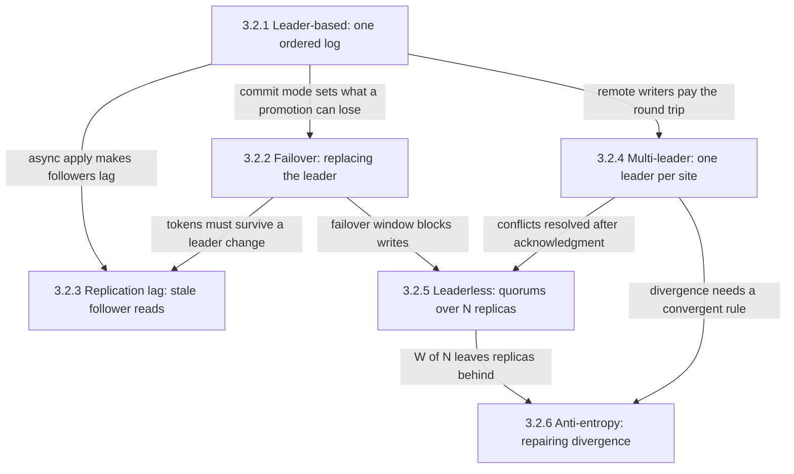
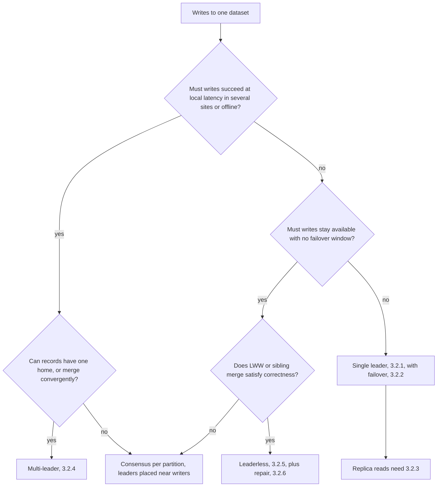
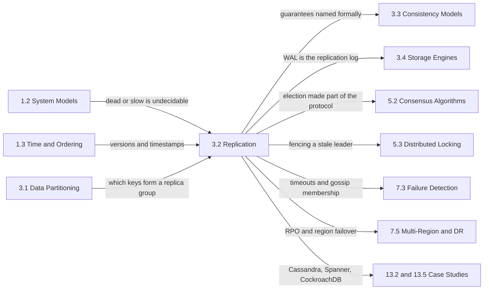

Replikasyon, aynı verinin birkaç kopyasını farklı makinelerde tutar; böylece bir diskin, bir node'un ya da bir zone'un kaybı veriyi kaybettirmez ya da hizmet dışı bırakmaz, okumalar da birden fazla sunucuya dağıtılabilir. Byte'ları kopyalamak işin kolay kısmıdır. Bu bölümün ele aldığı problem, yazmalar sürerken kopyaları eşdeğer tutmaktır; üstelik herhangi bir kopya yavaş, erişilemez ya da ölü olabilir ve node'lar bu üç durumu birbirinden ayırt edemez.

Her replikasyon tasarımı aynı iki soruyu yanıtlar. Birincisi, belirli bir anahtar için yazmayı kimin kabul edebileceğidir: tam olarak bir node, her site için bir node ya da replikaların herhangi biri. Bu yanıt, yazmaların tek bir sırası olup olmadığını belirler. Tek yazarla sıralama bedavadır ve replikaların yalnızca bir log'u yeniden oynatması yeterlidir; birden fazla yazarla aynı anahtara yapılan iki yazma eşzamanlı olarak kabul edilebilir ve sistemin bunu tespit edip, ikisi de onaylandıktan sonra tek bir sonuçta buluşması gerekir. İkinci soru, bir yazmanın ne zaman tamamlanmış sayılacağıdır: ilk kopya kalıcı hâle geldiğinde mi, bazı follower'lar onu aldığında mı, yoksa bir quorum onayladığında mı? Bu da bir hatanın onaylanmış yazmalardan kaçını çöpe atabileceğini ve her commit'in ne kadar gecikme ödeyeceğini belirler.

Altı konunun hepsinden geçen gerilim bu iki sorudan doğar. Tek bir yazma sırası, eşzamanlılık denetimini, benzersizliği ve failover üzerine akıl yürütmeyi yönetilebilir kılar; ama her yazmanın yoluna tek bir node'u ve o node'a giden round trip'i koyar ve o node değiştirilirken yazmaları erişilemez bırakır. Tek sıradan vazgeçmek, yerel gecikmeli yazmalar ve hatalar boyunca erişilebilirlik kazandırır; bedel ise çakışma çözümüne, sürümlemeye ve arka plan onarımına taşınır. Hangi topoloji seçilirse seçilsin ikinci bir denge tekrar eder: onaylamadan önce daha fazla kopyayı beklemek gecikmeye ve yazma erişilebilirliğine mal olur, daha azını beklemek ise bir node öldüğünde onaylanmış veriye.

Bölümdeki hata modlarının çoğu, bir replikanın inandığı ile gerçek arasındaki boşluktan gelir. Bir follower dakikalarca geride kalmışken güncel olduğuna inanır; otomatik bir monitör duraklamış bir leader'ın öldüğüne inanır; iki leader kendi kabul ettiği yazmanın en son yazma olduğuna inanır; bir quorum okuması, gördüğü en yeni sürümün var olan en yeni sürüm olduğuna inanır.

## Altı Sayfa, İki Soru: Konular Nasıl Birbirine Bağlanır

Bölüm, iki soruya verilebilecek en basit yanıtla, yani tek bir leader ile başlar; sonraki her sayfa ya bu yanıtın bir zayıflığını onarır ya da tek leader'ı kaldırıp bunun bedelini öder.

*Bölümdeki konular arasındaki bağımlılıklar. Her ok, bir sayfanın işaret ettiği sayfaya ne devrettiğini ya da ona ne dayattığını adlandırır.*

Akıl yürütmenin büyük kısmını üç ok taşır. Lider tabanlı replikasyondan failover'a giden ok, pratikte en sık gözden kaçandır: bir terfinin onaylanmış yazmaları kaybedip kaybetmeyeceğine failover aracı değil, hatadan çok önce seçilmiş commit modu karar verir. Lidersiz replikasyona giren iki ok, onun neden var olduğunu gösterir: hem failover penceresini hem de tek yazma yolunu ortadan kaldırır, karşılığında ise çok liderli replikasyonun eşzamanlı yazma problemini devralır; üstelik bu problem artık yalnızca siteler arasında değil, her anahtarda ortaya çıkar. Anti-entropy'ye giren oklar ise yazmalar her replika onları tek bir sırayla uygulamadan onaylanabildiği anda replikaların neyi eksik tuttuklarını artık bilmediklerini ve bunu ancak verilerini karşılaştırarak öğrenebileceklerini gösterir.

## Her Konunun Yanıtladığı Soru

[Lider Tabanlı Replikasyon: Senkron ve Asenkron](/distributed-systems/tr/data-management/replication/leader-based-replication/), leader'ın follower'lara ne gönderdiğini, sıralı bir log'u sırasıyla yeniden oynatmanın neden her follower'ı leader'ın bir öneki olarak tuttuğunu ve onay noktasının asenkron, yarı senkron, senkron ve quorum commit arasında nerede durduğunu yanıtlar. Her noktanın commit gecikmesi, sıcak satır throughput'u ve kurtarma noktası hedefi (recovery point objective, RPO), yani bir failover'ın çöpe atabileceği onaylanmış veri miktarı açısından neye mal olduğunu sayılarla ortaya koyar. Bir commit modu seçerken, bir standby'ın kesintisi yazmaları durdurduğunda ya da gecikme bir follower'ın yetişmek için ihtiyaç duyduğu log saklama süresini tehdit ettiğinde açın.

[Failover ve Lider Seçimi: Split-Brain Riski](/distributed-systems/tr/data-management/replication/failover-leader-election/), çökmüş bir leader'ın nasıl tespit edildiğini, tam olarak bir halefin nasıl seçilip terfi ettirildiğini ve eski leader'ın yazma kabul etmesinin nasıl engellendiğini yanıtlar. Sayfanın iki değişmezi, lease'lerle sınırlanan tek yazar ve commit kümesiyle kesişen seçim kümesi, bunlardan biri bozulduğunda split-brain'in ve kayıp yazmaların neden ortaya çıktığını açıklar. Failover araçlarını ya da zaman aşımlarını yapılandırırken, bir dağıtım tam olarak iki siteye yayıldığında ya da yanlış replikayı terfi ettiren veya client'ları eski leader'a yazar hâlde bırakan bir failover'dan sonra açın.

[Replikasyon Gecikme Sorunları: Kendi Yazılarını Okuma](/distributed-systems/tr/data-management/replication/replication-lag/), bir client yazmalarını henüz uygulamamış bir follower'dan okuduğunda ne gördüğünü ve yönlendirme kurallarının, zaman pencerelerinin, konum token'larının ve bekleyen yazmaların o client için kendi yazılarını okumayı, monoton okumaları ve tutarlı önek okumalarını nasıl geri getirdiğini yanıtlar. Kullanıcılar kaybolan ya da yeniden beliren değişiklikler bildirdiğinde, kullanıcıya dönük okumaları replikalara yönlendirmeden önce ya da bir gecikme sıçraması tüm okumaları leader'a geri ittiğinde açın.

[Çok Liderli Replikasyon: Yazma Çakışmaları ve Çözümü](/distributed-systems/tr/data-management/replication/multi-leader-replication/), birkaç leader'ın yazmaları yerel olarak nasıl kabul edip birbirine replike ettiğini, iki yazmayı neyin çakıştırdığını ve tespitin neyi görebildiğini, hangi çözüm stratejilerinin tek bir sonuçta buluştuğunu yanıtlar: her kayda bir ev vermek, son yazı kazanır (last write wins, LWW), birleştirme fonksiyonları ya da çözülemeyen değişmezleri tasarım dışında bırakmak. Birkaç bölgedeki yazarlar ya da çevrimdışı cihazlar yerel gecikmeyle yazmak zorunda olduğunda ya da bir partition iyileştikten sonra replikalar sessizce ayrıştığında açın.

[Lidersiz Replikasyon (Dynamo tarzı): Quorum R + W > N](/distributed-systems/tr/data-management/replication/leaderless-replication/), `N` replikanın tamamına gönderilen ve `W` tanesinin onayladığı bir yazmanın yavaş ve çökmüş node'lar boyunca nasıl erişilebilir kaldığını, `R + W > N` koşulunun neden yalnızca okuma ve yazma kümelerinin kesişmesini garanti ettiğini ve bu kesişmenin neyi sağlamadığını yanıtlar: linearizability'yi, atomik oku-değiştir-yaz işlemini ya da sloppy quorum'lara karşı korumayı. Tutarlılık seviyelerini seçerken, silinen kayıtlar geri geldiğinde ya da bir tasarım doğruluk için quorum aritmetiğine dayandığında açın.

[Anti-Entropy: Okuma Onarımı ve Merkle Ağaçları](/distributed-systems/tr/data-management/replication/anti-entropy-merkle/), ortak bir log'u olmayan replikaların farklılaştıkları anahtarları istek yolundaki okuma onarımıyla ve arka planda Merkle ağacı karşılaştırmasıyla nasıl bulup onardığını ve ağacın yaprak boyutunun belleği aşırı veri akışına (overstreaming) karşı neden tarttığını yanıtlar. Onarımı bir tombstone bekleme süresine göre zamanlarken, onarım farklı olandan çok daha fazla veri akıttığında ya da hiç bitmediğinde açın.

| Konu | Yanıtladığı soru | Ne zaman açılmalı |
|---|---|---|
| [Lider tabanlı replikasyon](/distributed-systems/tr/data-management/replication/leader-based-replication/) | Bir yazma ne zaman tamamlanır, failover neyi kaybettirebilir? | Commit modu seçimi, duran yazmalar, log saklama sınırı |
| [Failover ve lider seçimi](/distributed-systems/tr/data-management/replication/failover-leader-election/) | Leader tam olarak bir kez ve güvenle nasıl değiştirilir? | Failover araçları, zaman aşımları, iki siteli dağıtımlar, split-brain |
| [Replikasyon gecikmesi](/distributed-systems/tr/data-management/replication/replication-lag/) | Geride kalan bir follower'da client ne görür? | Kaybolan düzenlemeler, replika okumaları, leader'a geri düşme fırtınaları |
| [Çok liderli replikasyon](/distributed-systems/tr/data-management/replication/multi-leader-replication/) | Birkaç leader'daki eşzamanlı yazmalar nasıl tek sonuçta buluşur? | Çok bölgeli yazmalar, çevrimdışı client'lar, partition sonrası ayrışma |
| [Lidersiz replikasyon](/distributed-systems/tr/data-management/replication/leaderless-replication/) | Leader olmadan quorum'lar neyi garanti eder? | Tutarlılık seviyeleri, geri gelen silmeler, quorum'a dayalı doğruluk |
| [Anti-entropy](/distributed-systems/tr/data-management/replication/anti-entropy-merkle/) | Log'u olmayan replikalar eksiklerini nasıl bulur? | Onarım zamanlaması, overstreaming, bitmeyen onarım |

Üç topoloji arasındaki seçim genellikle ilk karardır ve yazma gereksinimlerinden sabit bir sırayla çıkar.

*Yazma gereksinimlerinden topoloji seçmek. Consensus dalı bu bölümün bir replikasyon topolojisi değildir; üç topolojinin hiçbirinin karşılayamadığı gereksinimlerin Kısım V'e devredildiği yerdir.*

Birkaç sitede yerel gecikmeli yazma ilk sorulur, çünkü anahtar başına tek yazarlı her tasarımı dışarıda bırakır. Consensus'a giden iki dal, bu bölümün replikasyon katmanının karşılayamadığı gereksinimleri işaretler: kayıtlara ne bir ev verilebiliyor ne de birleştirilebiliyorsa ya da doğruluk tek bir sıra gerektirirken yazmaların harici olarak yönetilen bir failover olmadan node hatalarından da sağ çıkması gerekiyorsa, yanıt bir çoğunluğun üzerinde anlaştığı, anahtara göre shard'lanmış replike bir log'dur; [Raft](/distributed-systems/tr/coordination/consensus-algorithms/raft/) bunun örneğidir. Bu yanıt protokolün içinde kısa bir seçim penceresi bırakır; tek sıranın bedeli budur. Tek leader yolu replikasyon gecikmesiyle biter, çünkü follower'lardan okumak, doğru çalışan tek liderli bir tasarımı client'ın görebildiği anomalileri olan bir tasarıma dönüştüren adımdır.

## Okuma Sırası ve Gerekçesi

İlk okumada bölümü sidebar sırasıyla okuyun. Lider tabanlı replikasyon önce gelir, çünkü diğer sayfaların yeniden kullandığı kavramları tanımlar: replikasyon log'u, follower'ların önek özelliği, onay noktası ve RPO. Failover ve replikasyon gecikmesi onu izler, çünkü commit modu seçildikten sonra tek bir leader'ın kalan iki zayıflığıdır: onu değiştirmek ve follower'larından okumak. Ardından çok liderli replikasyon siteler arasındaki tek yazarı, lidersiz replikasyon ise tek yazarı tamamen kaldırır; bu sırayla okunduğunda ikincisi, birincinin çakışma probleminin her anahtara yayılmış hâlini gösterir. Anti-entropy en sona kalır, çünkü lidersiz yazmaları ve onların quorum okuma yolunu varsayar.

Üç kısayol makuldür. Tek bölgeli yeni bir ilişkisel dağıtım tasarlarken lider tabanlı replikasyonu ve failover'ı birlikte okuyun, çünkü commit modu ile terfi kuralı tek bir karar olarak seçilmelidir; replika okumalarını açmadan önce de replikasyon gecikmesini okuyun. Aktif-aktif çok bölgeli bir tasarımı değerlendirirken çok liderli replikasyonu, ardından lidersiz sayfanın kesişmenin neyi garanti etmediğini anlatan bölümlerini, ardından [Aktif-Pasif ve Aktif-Aktif Çok Bölgeli Mimari](/distributed-systems/tr/resilience/multi-region-dr/active-passive-vs-active-active/) sayfasını okuyun. Cassandra, ScyllaDB ya da Riak işletiyorsanız lidersiz replikasyonu ve anti-entropy'yi art arda okuyun.

## Bölümün El Kitabındaki Yeri

Ön koşullar üç yerden gelir. [Hata Modelleri](/distributed-systems/tr/foundations/system-models/failure-models/) ve [Ağ Modelleri](/distributed-systems/tr/foundations/system-models/network-models/), bir replikanın ölü bir eşi yavaş bir eşten neden ayırt edemediğini açıklar; buradaki her failover ve quorum kararının kökü budur. [Vektör Saatler](/distributed-systems/tr/foundations/time-and-ordering/vector-clocks/) ve [Hibrit Mantıksal Saatler](/distributed-systems/tr/foundations/time-and-ordering/hybrid-logical-clocks/), çok liderli ve lidersiz depoların eşzamanlılığı tespit etmek ve kazananı seçmek için kullandığı sürüm ve zaman damgası mekanizmalarını sağlar. [Veri Bölümleme](/distributed-systems/tr/data-management/data-partitioning/) hangi anahtarların bir replika grubu oluşturduğuna karar verir; halka tabanlı depolarda bir anahtarın replika kümesi [consistent hashing](/distributed-systems/tr/data-management/data-partitioning/consistent-hashing/) ile hesaplanır.

*Solda ön koşullar, sağda bu bölümün üzerine kurulan ya da bu bölümün dayandığı mekanizmaların sahibi olan bölümler. Her ok, devredilen şeyi adlandırır.*

Sonraki bölüm, [Tutarlılık Modelleri](/distributed-systems/tr/data-management/consistency-models/), bu bölümdeki mekanizmaların neyi sağladığını biçimsel olarak adlandırır: quorum'ların tek başına ulaşamadığı [linearizability](/distributed-systems/tr/data-management/consistency-models/linearizability/), replikasyon gecikmesine karşı alınan önlemlerin geri getirdiği [oturum garantileri](/distributed-systems/tr/data-management/consistency-models/causal-consistency-session-guarantees/), çok liderli ve lidersiz çözümün arkasındaki [son yazı kazanır yaklaşımının zayıflıkları](/distributed-systems/tr/data-management/consistency-models/eventual-consistency/) ve [CRDT'ler](/distributed-systems/tr/data-management/consistency-models/crdts/). Bir leader'ın gönderdiği log genellikle onun [write-ahead log'udur](/distributed-systems/tr/data-management/storage-engines/write-ahead-log/). Görevden alınmış bir leader'ın fence'lenmesinin sahibi [Fencing Tokens](/distributed-systems/tr/coordination/distributed-locking/fencing-tokens/), zaman aşımı seçiminin sahibi [Heartbeats ve Zaman Aşımı Yapılandırması](/distributed-systems/tr/resilience/failure-detection/heartbeats-timeouts/) sayfasıdır; RPO'nun bölgeler arasında kurtarma süresi hedefleriyle nasıl birleştiği ise [RPO, RTO ve Erişilebilirlik Hesabı](/distributed-systems/tr/resilience/multi-region-dr/availability-math-rpo-rto/) sayfasında ele alınır. Vaka çalışmaları bölümü üretimde gösterir: [Pratikte Cassandra](/distributed-systems/tr/case-studies/dynamodb-cassandra/cassandra-hashing-ring/), consensus ile replike edilen alternatifler için [Spanner](/distributed-systems/tr/case-studies/distributed-sql/spanner-architecture/) ve [Follower Reads ve Bounded Staleness](/distributed-systems/tr/case-studies/distributed-sql/follower-reads-bounded-staleness/), bölgeler arası bir terfi ve bedeli için de [GitHub 2018](/distributed-systems/tr/case-studies/famous-outages/github-2018-split-brain/).

Üç sınır sık sık bulanıklaşır. Replikasyon consensus değildir: bu bölümdeki failover sistemleri, kendisi sürece katılmayan bir replikasyon protokolünün üzerine harici bir seçim katmanı ekler; [Raft](/distributed-systems/tr/coordination/consensus-algorithms/raft/) ve [Paxos](/distributed-systems/tr/coordination/consensus-algorithms/paxos/) ise seçimi ve log üzerinde anlaşmayı kanıtlanmış tek bir mekanizmada birleştirir. Replikasyon yedekleme değildir: hatalı bir silme ya da kötü bir migration, gecikme süresi içinde her kopyaya replike edilir ve bunu yalnızca [yedekler ve belirli bir ana geri dönüş (PITR)](/distributed-systems/tr/resilience/multi-region-dr/backup-pitr-restore/) geri alabilir. Son olarak, veritabanı replikasyonu, aynı log'u başka şemalarla başka sistemleri beslemek için okuyan [değişiklik verisi yakalama (CDC)](/distributed-systems/tr/data-processing/hybrid-architectures/change-data-capture/) değildir; aynı leader ve follower tasarımını bir mesaj log'una uygulayan [Kafka](/distributed-systems/tr/communication/async-messaging/kafka-architecture/) partition replikasyonu da değildir.
