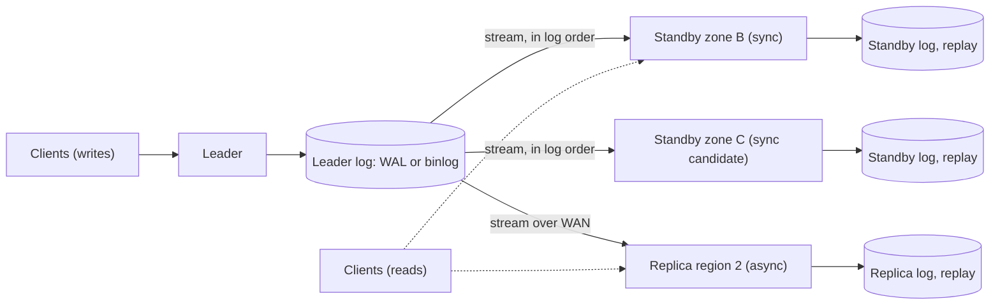
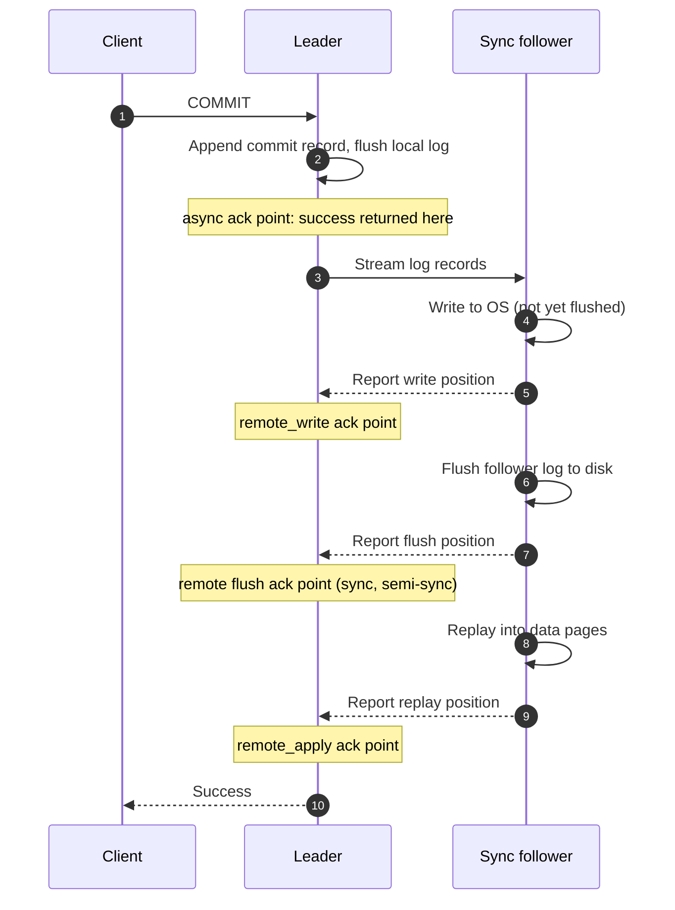
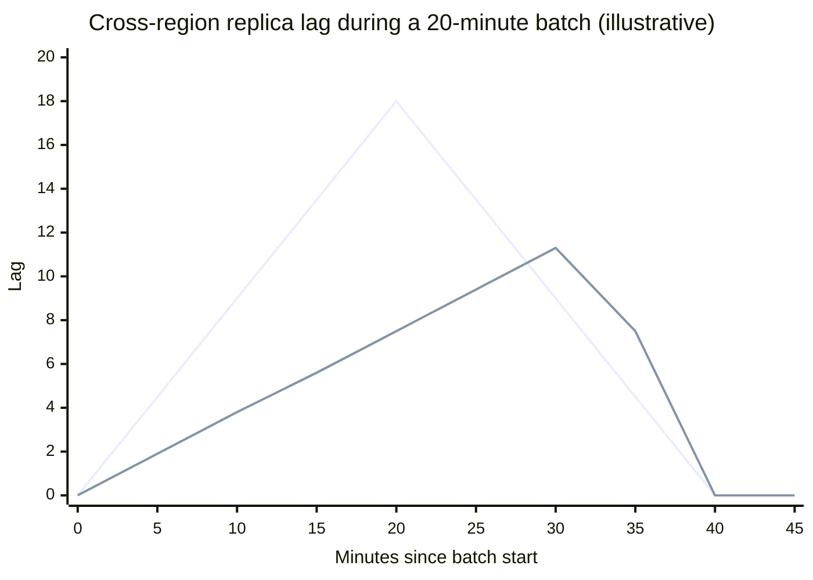
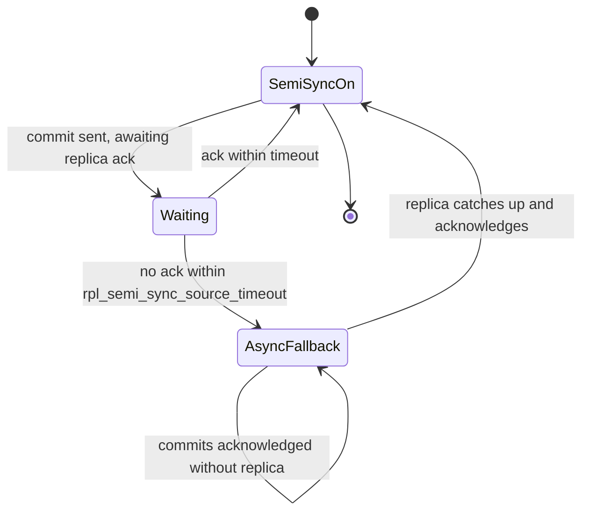
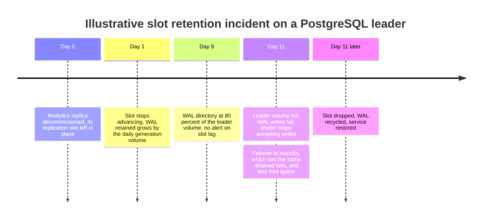

Lider tabanlı replikasyon (primary-backup ya da tek liderli replikasyon olarak da anılır), bir veri kümesinin replikalarından birini leader olarak belirler. Her yazmayı leader yürütür; yazmayı sıralı bir log'a kaydeder ve bu log'u diğer replikalara, yani follower'lara gönderir; follower'lar kayıtları aynı sırayla uygular. Okumalar leader'a da follower'lara da gidebilir. Bu düzen iki nedenle vardır: verinin tek bir kopyası, kayba ya da erişilemezliğe tek bir disk, tek bir makine ve tek bir zone uzaklıktadır; ve tek bir makine bir noktadan sonra tüm okumaları karşılayamaz. Veriyi kopyalamak kolaydır; zor olan, yazmalar sürerken kopyaları özdeş tutmaktır. Tek bir leader bu sorunu, yazmaların sırasına birden fazla düğümün karar vermesine izin vermeyerek çözer.

Bu yüzden sıralama bedavaya gelir; geriye kalan tasarım sorusu, leader'ın istemciye bir yazmanın tamamlandığını ne zaman söyleyeceğidir. Kendi log'u kalıcı hâle gelir gelmez yanıt verirse (asenkron replikasyon), commit gecikmesi tek bir makineninkine eşittir; ancak leader ölür ve yerine bir follower geçerse, follower'ın aldığı son yazmadan sonra onaylanan her yazma kaybolur. Yalnızca bir ya da daha fazla follower yazmayı aldıktan sonra yanıt verirse (senkron replikasyon), onaylanmış yazmalar leader'ın kaybından sağ çıkar; ama her commit bir ağ round trip'i öder ve gerekli follower'lara ulaşılamadığı sürece leader hiç commit edemez. Asıl denge, bir yanda commit gecikmesi ve yazma erişilebilirliği, diğer yanda kurtarma noktası hedefi (recovery point objective, RPO), yani bir failover'ın çöpe atabileceği onaylanmış veri miktarı arasındadır. Bu sayfadaki her yapılandırma bu doğru üzerinde bir noktadır.

Üç konu burada karara bağlanmaz. Yeni bir leader'ı güvenle seçmek ve terfi ettirmek ile iki leader'ın aynı anda yazma kabul etmesini önlemek [Failover ve Lider Seçimi](/distributed-systems/tr/data-management/replication/failover-leader-election/) sayfasında ele alınır. Geride kalan follower'lardan okuyan istemcilerin gördüğü anomaliler [Replikasyon Gecikme Sorunları](/distributed-systems/tr/data-management/replication/replication-lag/) sayfasında işlenir. Birden fazla düğümde yazma kabul eden tasarımlar ise [Çok Liderli Replikasyon](/distributed-systems/tr/data-management/replication/multi-leader-replication/) ve [Lidersiz Replikasyon](/distributed-systems/tr/data-management/replication/leaderless-replication/) sayfalarındadır.


*Senkron onay adayı olan iki bölge içi standby ve her zaman asenkron kalan bir bölgeler arası replika ile tipik bir leader.*

Topoloji birbirinden ayrı iki kararı kodlar. Leader'ın log'undan çıkan oklar üç follower için de aynıdır: her biri aynı kayıtları aynı sırayla alır ve kendi kopyasına yeniden oynatır (replay). Fark, leader'ın bir commit'i onaylamadan önce bunlardan herhangi birini bekleyip beklemediğindedir; bu, follower'ların değil leader yapılandırmasının bir özelliğidir. Modları follower bazında karıştırmak üretimdeki yaygın şekildir: bir ya da iki yakın follower, milisaniyenin altında bir bedelle onaylanmış yazmaları korur; uzaktaki follower'lar ise her commit'e geniş alan ağı (WAN) round trip'i eklemeden felaket kurtarmaya ve yerel okumalara hizmet eder.

## Replikasyon Log'u: Leader Ne Gönderir ve Sıra Neden Yeterlidir

Bir follower, leader ile ancak aynı değişiklikleri aynı sırayla uygularsa ve her değişiklik iki tarafta da aynı sonucu üretirse özdeş kalabilir. Sistemler, ikinci koşulu sağlamak için log'a ne koydukları konusunda ayrışır.

### Üç Log Biçimi

**Statement tabanlı replikasyon**, leader'ın yürüttüğü SQL ifadelerini gönderir. Log kompakttır; bir milyon satıra dokunan tek bir `UPDATE` tek bir kayıttır. Ancak bir ifadeyi yeniden oynatmak leader'ın sonucunu yalnızca ifade aynı önceki durum verildiğinde deterministikse üretir. `NOW()`, `RAND()` ya da `UUID()` çağrıları, eşzamanlı insert'ler altında atanan auto-increment değerleri, `ORDER BY` içermeyen `UPDATE ... LIMIT` ve yan etkili trigger'lar ya da stored procedure'ler bu varsayımı bozar. MySQL'in statement biçimi bu tür ifadeleri güvensiz (unsafe) olarak işaretler ve `MIXED` biçimi bunlar için satır görüntülerine geçer; ama sunucunun yakalayamadığı her nondeterminizm, leader ile follower arasında sessiz bir ayrışmaya dönüşür.

**Fiziksel log gönderimi**, depolama motorunun write-ahead log'unu (WAL) gönderir; bu, motorun veri dosyalarını değiştirmeden önce yazdığı bayt düzeyindeki sayfa değişikliklerinin kaydıdır ve [Write-Ahead Log](/distributed-systems/tr/data-management/storage-engines/write-ahead-log/) sayfasında anlatılır. PostgreSQL streaming replikasyonu bu şekilde çalışır: leader üzerindeki bir `walsender` süreci, WAL'ı her standby'daki bir `walreceiver`'a akıtır; walreceiver onu kendi WAL'ına yazar ve crash recovery için kullanılan aynı redo koduyla yeniden oynatır. Replay tamamen deterministiktir, çünkü log niyetleri değil sonuçları tarif eder; follower, index'ler ve free-space map'ler dâhil bayt bayt özdeş bir kopyadır. Bedeli bağımlılıktır: leader ve follower aynı major sürümü ve mimariyi çalıştırmak zorundadır; dolayısıyla fiziksel bir standby kesintisiz major sürüm yükseltmesi için kullanılamaz ve log, mantıksal bir tüketicinin ihtiyaç duymadığı index ve vacuum gürültüsünü de taşır.

**Mantıksal (satır tabanlı) replikasyon**, değişen her satır için satırın anahtarını ve yeni değerlerini (yapılandırmaya bağlı olarak eski değerlerini de) içeren bir kayıt gönderir. 5.7.7'den beri varsayılan olan `ROW` biçimindeki MySQL binary log'u, PostgreSQL mantıksal replikasyonu (PostgreSQL 10'dan beri publication ve subscription'lar) ve MongoDB'nin oplog'u mantıksaldır. Satır görüntüleri deterministiktir ve depolama biçiminden bağımsızdır; bu yüzden follower'lar farklı bir sürüm, hatta farklı bir motor çalıştırabilir ve aynı akış [değişiklik verisi yakalamayı (CDC)](/distributed-systems/tr/data-processing/hybrid-architectures/change-data-capture/) besler. Toplu güncellemelerde ifadelerden büyüktürler ve index değişikliklerini taşımazlar; her follower bunları kendisi hesaplar. Dördüncü bir varyant olan trigger tabanlı replikasyon, değişiklikleri harici bir sürecin kopyaladığı bir yan tabloya yazar; esnek ve yavaştır, çoğunlukla eski araçlarda görülür.

### Önek Değişmezi

Biçim ne olursa olsun doğruluk tek bir özelliğe dayanır: her an, her follower'ın durumu, leader'ın log'unun bir önekini (prefix) uyguladıktan sonra sahip olduğu duruma eşittir. Bir follower geride olabilir, ama leader'ın hiç bulunmadığı bir durumda asla bulunmaz. Bu değişmezi üç mekanizma korur. Konumları yalnızca leader atar (PostgreSQL'de log sequence number, LSN; MySQL'de 5.6'dan beri global transaction identifier, GTID; MongoDB'de optime), dolayısıyla tek bir sıra vardır. Taşıma sıralı ve boşluksuzdur: follower akışı elindeki son konumdan sonraki konumdan ister ve oradan devam etmeyen her şeyi reddeder. Replay ise deterministiktir; pratikte bu değişmezi en sık ihlal eden biçimin statement tabanlı log olmasının nedeni budur.

Önek özelliği, failover hakkında akıl yürütmeyi mümkün kılan şeydir. Her follower tek bir geçmişin bir önekini tutuyorsa follower'lar konuma göre sıralanabilir; en ileride olan hayatta kalan replika, hayatta kalanlardan herhangi birinin sahip olduğu her yazmaya sahiptir ve tek soru, eski leader'ın son ekinin (suffix) ne kadarının hiçbirine ulaşmadığıdır. Tek bir sıra yoksa (iki leader ya da farklı sıralarla uygulayan replikalar), konumlar karşılaştırılamaz ve "en ileri" replika diye bir şey yoktur; çok liderli ve lidersiz tasarımların temel zorluğu budur.

Değişmez, hangi transaction'ların onaylandığıyla değil, follower'ların durumuyla ilgilidir. LSN 1.000'e kadar replay etmiş bir follower, 1.000 ve altındaki her değişikliği tutar; log abort'ları da kaydediyorsa (WAL kaydeder) leader'ın daha sonra geri aldığı transaction'lar da buna dâhildir. Ama 990 numaralı transaction'ın istemcisine "commit edildi" denip denmediği hakkında hiçbir şey söylemez. İkisini birbirine bağlamak commit noktasının işidir.

### Bir Follower'ı Başlatmak: Snapshot Artı Konum

Yeni bir follower log'u baştan yeniden oynatamaz, çünkü leader log'un büyük kısmını çoktan atmıştır. Follower, tam olarak hangi log konumunu yansıttığı etiketlenmiş tutarlı bir snapshot'tan başlar ve o konumdan itibaren akışı alır. PostgreSQL'in `pg_basebackup` aracı, leader yazmaya devam ederken veri dizinini kopyalar ve kopyalamayı kapsayan WAL aralığını kaydeder; standby, akışa geçmeden önce tutarlı bir duruma ulaşmak için bu aralığı yeniden oynatır. MySQL clone'ları GTID kümesiyle birlikte bir snapshot alır; MongoDB'nin initial sync'i koleksiyonları kopyalar, ardından kopyalama sırasında yazılan oplog kayıtlarını uygular. Snapshot ile konum tam olarak eşleşmelidir: fazla erken bir konum değişiklikleri iki kez oynatır ki bu yalnızca idempotent fiziksel kayıtlar için zararsızdır; fazla geç bir konum ise değişiklikleri sessizce atlar.

Başlatma süreci, pek çok replikasyon kesintisine yol açan saklama gereksinimini de doğurur. Leader, bir follower'ın henüz almadığı her log segmentini tutmak zorundadır; aksi hâlde follower asla yetişemez ve yeni bir snapshot'tan yeniden kurulmalıdır. PostgreSQL bunu ifade etmenin iki yolunu sunar: sabit bir saklama miktarı (`wal_keep_size`) ya da leader'ın WAL'ı o tüketici onaylayana kadar tutmasını sağlayan bir replication slot. Slot bir follower'ın yerini asla kaybetmez; aynı nedenle ölü bir follower'ın slot'u WAL'ı sınırsızca tutar. İki sonuç da aşağıdaki hata modlarında karşımıza çıkar.

## Commit Noktasının Yeri

Bir commit sabit bir boru hattından geçer: leader transaction'ın log kaydını yerel olarak yazar ve flush eder, kaydı follower'lara gönderir; her follower kaydı kendi log'una yazar, flush eder ve yeniden oynatır, böylece kayıt o follower'daki okumalara görünür hâle gelir. Replikasyon modu, leader'ın başarıyı bildirmeden önce hangi adımı bekleyeceğinin seçimidir.


*PostgreSQL'in `synchronous_commit` ile sunduğu onay noktalarıyla commit boru hattı. Diğer sistemler aynı nokta kümesinden farklı adlarla seçim yapar.*

Diyagram, modların yalnızca 12. adımdaki yanıtın nerede verilmesine izin verildiği konusunda ayrıştığını gösterir. Asenkron replikasyonda leader 2. adımdan hemen sonra yanıt verir; 3 ile 11 arasındaki adımlar birkaç milisaniye sonra yine gerçekleşir, ama kimse onları beklemez. PostgreSQL'in `synchronous_commit = remote_write` ayarı, standby'ın veriyi alıp işletim sistemine teslim ettiği 6. adımı bekler. Varsayılan değer olan `on`, standby'ın flush ettiği 9. adımı bekler. PostgreSQL 9.6'da eklenen `remote_apply` ise değişikliğin standby'daki sorgulara görünür olduğu 11. adımı bekler. MySQL yarı senkron (semi-synchronous) replikasyonu, replikanın kaydı relay log'una aldığını onaylamasını bekler; relay log onaydan önce yazılır ve sync edilir. MongoDB'de `w: "majority"` içeren `writeConcern`, oy veren üyelerin çoğunluğunu bekler; `j: true` ise bu üyelerin journal'larının flush edilmiş olması anlamına gelir.

### Her Onay Noktasının Garantisi

Garanti, onaylanmış bir yazmanın hangi arızalardan sağ çıktığına dair bir önermedir ve onay anındaki kalıcı kopyaların sayılmasından çıkar.

**Asenkron.** Yazma tek bir makinede kalıcıdır. Leader çöküp aynı leader yeniden başlarsa yazma korunur, çünkü leader'ın log'u flush edilmiştir. Leader'ın diskinin kaybından ya da bir failover'dan ise sağ çıkmaz: yerine terfi ettirilen her follower log'un bir önekine sahiptir ve o önekten sonraki her onaylanmış transaction kaybolur. Arıza anındaki boşluğun büyüklüğü, log baytı cinsinden ölçülen replikasyon gecikmesidir (lag); dolayısıyla asenkron bir kurulumun RPO'su sabit değildir, leader öldüğü anda gecikme neyse odur.

**Remote write.** Yazma iki makinededir, ama bunlardan birinde yalnızca işletim sisteminin page cache'indedir. Yalnızca leader'ın kaybından sağ çıkar. Leader ile standby'ın işletim sistemi birlikte çökerse, örneğin ikisini de barındıran bir rack'te güç kesildiğinde, kaybolur. Bu ayarın, leader ile aynı güç kaynağını paylaşan follower'lara değil ayrı bir hata alanındaki follower'lara uymasının nedeni budur.

**Remote flush (senkron).** Yazma leader'da ve gerekli her standby'da flush edilmiştir. Bu kopyalardan en az birini geride bırakan herhangi bir makine kümesinin kalıcı kaybından sağ çıkar; yeter ki failover yazmayı tutan bir replikayı terfi ettirsin. En sık atlanan adım bu şarttır: failover aracı yazmayı hiç almamış asenkron bir replikayı terfi ettirirse senkron commit hiçbir şeyi korumaz. Araç senkron standby'lardan birini ya da log konumuna göre en ileri replikayı terfi ettirmelidir.

**Remote apply.** Remote flush ile aynıdır; ek olarak istemci onayını aldığında yazma gerekli standby'lardaki okumalara görünür durumdadır. Bu, o standby'lara kendi yazılarını okuma (read-your-writes) garantisi ekler; bedeli replay'i beklemektir ve sorgularla meşgul ya da uzun süren replay yapan bir follower'da bu, flush'tan çok daha yavaş olabilir.

Bu modların hiçbiri follower'lardan yapılan okumaları [Linearizability](/distributed-systems/tr/data-management/consistency-models/linearizability/) sayfasında tanımlanan anlamda linearizable yapmaz: gerekli küme dışındaki follower'lar keyfi ölçüde geride kalabilir ve remote flush modunda gerekli follower'lar bile yazmayı henüz replay etmemiştir. Hiçbiri leader seçmez ya da iki leader'ı önlemez; güvensiz bir failover prosedürüyle senkron replikasyon da veri kaybeder. Ve hiçbiri mantıksal bir hataya karşı koruma sağlamaz: `WHERE` içermeyen bir `DELETE`, milisaniyeler içinde her follower'a sadakatle replike edilir; replikaların yedek olmamasının nedeni budur.

### Onaydan Önce Görünürlük

Daha ince bir soru, onayını bekleyen bir transaction'ı diğer istemcilerin ne zaman görebileceğidir. Follower kaydı almadan önce görebiliyorlarsa, yazan istemciye commit'in başarılı olduğu hiç söylenmemiş olsa bile, bir failover istemcilerin zaten okuduğu ve üzerine işlem yaptığı veriyi ortadan kaldırabilir.

MySQL bu seçimi `rpl_semi_sync_source_wait_point` ile açık hâle getirir. `AFTER_COMMIT` ile leader storage engine'e commit eder ve ardından replikanın onayını bekler; bekleme sırasında diğer oturumlar transaction'ı görür ve leader replika kaydı almadan önce çökerse, MySQL kılavuzunun belirttiği gibi bu istemciler kaynakta gördüklerine göre bir veri kaybı gözlemleyebilir. Varsayılan olan `AFTER_SYNC` ile leader binary log'u yazar ve sync eder, onayı bekler ve ancak ondan sonra storage engine'e commit eder; böylece tüm istemciler transaction'ı aynı anda, replikaya ulaştıktan sonra görür. Kılavuz bu moddaki failover'ı, eski kaynak yeniden kullanılmadığı sürece kayıpsız olarak tanımlar.

PostgreSQL, commit kaydı flush edildikten ve transaction commit log'unda commit edilmiş olarak işaretlendikten sonra bekler; ama bu sırada transaction diğer oturumlara hâlâ çalışıyor görünür ve kilitlerini tutmaya devam eder. Dolayısıyla diğer oturumlar onu standby onaylamadan önce görmez. Yine de yerel commit gerçekleşmiştir ve bu bir boşluk bırakır.

:::danger[İptal edilen senkron bekleme, commit edilmiş ama replike edilmemiş bir transaction bırakır]
Senkron onay bekleyen bir PostgreSQL backend'i iptal edilirse (istemci zaman aşımına uğrayıp cancel gönderir, bir statement timeout tetiklenir ya da bir yönetici oturumu sonlandırır), sunucu `canceling wait for synchronous replication due to user request` mesajını "The transaction has already committed locally, but might not have been replicated to the standby." ayrıntısıyla loglar. Transaction leader'da görünür hâle gelir ve leader ardından failover'a uğrarsa ortadan kaybolur. Transaction'lar beklerken leader yeniden başlarsa da aynısı olur: recovery sonrasında yerel olarak commit edilmiş sayılırlar. Bu uyarıyı bir dayanıklılık alarmı olarak ele alın, bir standby kesintisi sırasında uygulamayı "kurtarmak" için bekleyen commit'leri iptal etmeyin ve failover araçlarının, bu uyarıyı loglamış bir leader'ın hiçbir standby'da olmayan veri tuttuğunu bilmesini sağlayın.
:::

### Standby'lar Arasında Quorum Commit

Tek bir adlandırılmış standby'ı beklemek, o standby'ı yazmalar için tek hata noktası yapar: kapalı ya da yavaşsa her commit takılır. PostgreSQL'in `synchronous_standby_names` ayarı bunu önlemek için iki yöntem kabul eder. Öncelik tabanlı ve 9.6'dan beri mevcut olan `FIRST 1 (s1, s2)` (düz liste biçimi bunun eski eşdeğeridir), bağlı en yüksek öncelikli standby'ı bekler ve o koptuğunda listedeki bir sonrakine geçer. Quorum tabanlı ve PostgreSQL 10'dan beri mevcut olan `ANY 1 (s1, s2)`, listedeki standby'lardan hangisi önce onaylarsa onu bekler. `ANY 2 (s1, s2, s3)` üçten herhangi ikisini bekler. MySQL'in `rpl_semi_sync_source_wait_for_replica_count` ayarı (varsayılan 1) aynı fikirdir: kaynak, yarı senkron replikalardan herhangi birinden o sayıda onay bekler.

Quorum commit failover gereksinimini değiştirir. `ANY 1 (s1, s2)` ile onaylanmış bir yazma leader'da ve iki standby'dan en az birindedir, ama hangisinde olduğunu kimse kaydetmez. Leader kaybedildikten sonra failover iki standby'ın log konumlarını karşılaştırmalı ve daha ileride olanı terfi ettirmelidir; diğerini terfi ettirmek, her yazma senkron olarak replike edilmiş olsa bile yazma kaybettirir. Patroni gibi araçların hangi standby'ların terfiye uygun olduğunu tam da bu nedenle izlemesi gerekir.

## Hesaplı Örnek: Gecikme, Kilit Tutma Süresi ve Gecikme Bütçesi

Bölge 1'in A zone'unda bir PostgreSQL leader'ı, B ve C zone'larında standby'lar (round-trip süreleri 0.5 ms ve 0.8 ms) ve bölge 2'de asenkron bir replika (round-trip süresi 60 ms) olduğunu varsayalım. Leader'ın NVMe cihazında yerel bir WAL flush'ı 0.2 ms sürüyor; her standby'daki flush da öyle. İş yükü saniyede 5.000 transaction commit ediyor ve her biri 2 KB WAL üretiyor; yani 10 MB/s. Bu bölümdeki tüm sayılar açıklama amaçlıdır.

### Onay Noktasına Göre Commit Gecikmesi

Asenkron commit, yerel flush'ın maliyeti kadardır, yaklaşık 0.2 ms. B zone'undaki standby'a senkron commit kabaca yerel flush, bir round trip ve standby'ın flush'ı kadar sürer: `0.2 + 0.5 + 0.2 = 0.9` ms; çünkü leader yerel olarak flush ederken WAL'ı akıtır ve uzak iş, yerel flush'tan sonra başlamak yerine onunla örtüşür. `ANY 1 (sB, sC)` ile medyan aynı 0.9 ms'dir, çünkü genellikle önce B zone'u yanıt verir; ama kuyruk (tail) iyileşir: bir commit yalnızca iki standby aynı anda takıldığında takılır. `FIRST 2 (sB, sC)` ile her commit ikisinden yavaş olanı bekler: medyanda 1.2 ms ve iki kuyruğun kötüsü. Bölgeler arası replikayı senkron yapmak commit başına `0.2 + 60 + 0.2 = 60.4` ms'ye mal olur.

Gecikme, Little yasası ile gerekli eşzamanlılığa dönüşür: uçuştaki commit sayısı throughput ile gecikmenin çarpımına eşittir. Saniyede 5.000 commit'te bölge içi senkron commit ortalamada `5,000 * 0.0009 = 4.5` commit'i bekletir ve group commit bunları birkaç flush'ta toplar. Bölgeler arası senkron commit ise `5,000 * 0.0604 = 302` commit'i bekletir; yani aynı hızı sürdürmek için, sorgu süresi hesaba katılmadan önce, commit aşamasında en az 302 eşzamanlı bağlantı gerekir.

Daha az görünen maliyet kilit tutma süresidir. PostgreSQL satır kilitlerini senkron bekleme bitene kadar tutar; bu yüzden her transaction'ın güncellediği bir satır, örneğin bir sayaç ya da hesap bakiyesi, commit gecikmesi başına en fazla bir kez güncellenebilir. Asenkron ya da bölge içi senkron commit ile bu, satır başına saniyede birkaç yüz ile birkaç bin güncelleme demektir. Bölgeler arası senkron commit ile donanımdan bağımsız olarak `1 / 0.0604`, yani saniyede yaklaşık 16 güncellemedir.

:::tip[Senkron commit sıcak satırları throughput tavanına çevirir]
Bir commit'i yavaş bir bağlantı üzerinden senkron yapmadan önce en sık güncellenen tekil satırları bulun (sayaçlar, bakiyeler, sequence tabloları, bir üst satırdaki "son güncelleme" alanları). Her biri saniyede `1 / commit_latency` güncellemeyle sınırlanır, çünkü kilidi bekleme boyunca tutulur. PostgreSQL `synchronous_commit` ayarının transaction bazında verilmesine izin verir; böylece bir yazma yolu, kaybı tolere edilebilir veriler için ayarı gevşetip geri kalanlar için koruyabilir.
:::

### Ani Yük Sırasında Gecikme

Şimdi bir batch işinin WAL üretimini 20 dakika boyunca 10 MB/s'den 40 MB/s'ye çıkardığını varsayalım. Bölgeler arası bağlantı replikasyon için 25 MB/s taşıyabiliyor ve replika 30 MB/s replay edebiliyor; dolayısıyla akış `min(25, 30) = 25` MB/s hızla ilerler. Batch boyunca birikim (backlog) `40 - 25 = 15` MB/s büyür ve batch bittiğinde `15 * 1,200 = 18` GB'a ulaşır. Sonrasında üretim 10 MB/s'ye döndüğünde birikim 15 MB/s ile erir ve 20 dakika daha sürer.

Zaman cinsinden ölçülen gecikme, bayt cinsinden gecikmeden farklı davranır. Batch sırasında replika 40 MB/s ile üretilen bir akışın 25 MB'ını işler; yani saniyede leader geçmişinin 0.625 saniyesi kadar ilerler ve her saniye 0.375 saniye geri düşer: batch sonunda 7.5 dakika geridedir. Batch bittikten sonra 12 dakika daha (25 MB/s ile 18 GB'lık birikim) batch dönemine ait WAL'ı replay etmeye devam eder ve bu 12 dakika boyunca aynı hızla geri düşmeyi sürdürür; 32. dakikada 12 dakika geride olarak zirveye ulaşır. Ancak 10 MB/s ile üretilmiş batch sonrası WAL'a ulaştığında saniyede 1.5 saniye kazanır ve 40. dakikada yetişir.


*20. dakikada zirve yapan üst çizgi: GB cinsinden WAL birikimi. 32. dakika civarında zirve yapan alt çizgi: leader geçmişinin dakikası cinsinden gecikme. İkisi de metindeki hızlardan türetilmiştir.*

İki eğri farklı zamanlarda zirve yapar ve ikisi de önemlidir. Bayt birikimi, leader'ın bu replika için tutması gereken disk alanı ve hâlâ borçlu olunan aktarımdır. Zaman gecikmesi ise RPO'dur: bölge 1 32. dakikada kaybedilirse replika leader'dan 7.2 GB daha az WAL tutar; bu, 12 dakikalık commit edilmiş transaction demektir. Yalnızca bayt gecikmesini gösteren bir dashboard, maruziyet hâlâ büyürken durumu 20. dakikadan itibaren iyileşiyor gösterir. Ortalamada yeterince hızlı olan bir replika ani yükler sırasında yeterince hızlı değildir ve en kötü durumdaki RPO'yu ani yük belirler.

### Senkron Commit Altında Yazma Erişilebilirliği

Her standby'ın çökmeler, bakım ya da ağ sorunları nedeniyle zamanın %0.2'sinde, birbirinden bağımsız olarak erişilemez olduğunu varsayalım. Tek bir adlandırılmış senkron standby ile leader, kendi kesintilerine ek olarak zamanın %0.2'sinde, yılda yaklaşık 17.5 saat commit edemez. `ANY 1 (sB, sC)` ile commit'ler yalnızca ikisi birden kapalıyken takılır: `0.002^2 = 4 * 10^-6`, yılda yaklaşık iki dakika. `ANY 2 (sB, sC)` ile herhangi biri kapalıyken yazmalar takılır: `1 - 0.998^2`, yaklaşık %0.4; bu tek standby'dan bile kötüdür. Gerekli sayıyı artırmadan aday listesine standby eklemek yazma erişilebilirliği satın alır; sayıyı artırmak eşzamanlı kayıplara karşı dayanıklılık satın alır ve erişilebilirliğe mal olur. Pratikte bozulan varsayım bağımsızlıktır: zone çapındaki olaylar ve ortak deployment pipeline'ları standby kesintilerini ilişkilendirir.

## Uygulamalar ve Ders Kitabından Sapmaları

| Mod | Commit neyi bekler | Leader kaybında kaybolan yazmalar | Senkron follower'lar kapalıyken leader yazılabilir mi | Eklenen commit gecikmesi | Ne zaman tercih edilmeli |
|---|---|---|---|---|---|
| Asenkron | Yerel flush | Terfi ettirilen follower'ın konumundan sonraki her şey | Evet | Yok | Bölgeler arası replikalar, okuma ölçekleme, saniyelerden dakikalara RPO'yu tolere eden veri |
| Zaman aşımlı yarı senkron (MySQL) | Zaman aşımına kadar N replikanın alımı | Onaylar geldiği sürece yok; sessiz düşüşten sonra sınırsız | Evet, zaman aşımından sonra asenkron olarak | Bir round trip ya da kesinti sırasında zaman aşımı süresi | Sıfıra yakın RPO isteyen ama yazmaları durduramayan, düşüşü izlenen MySQL filoları |
| Senkron, tek adlandırılmış standby | O standby'da flush | Failover onu terfi ettirirse yok | Hayır | Bir round trip artı uzak flush | Yazma kaybetmenin takılmaktan kötü olduğu iki düğümlü kurulumlar |
| Senkron quorum (`ANY k`) | Listelenen standby'lardan herhangi `k` tanesinde flush | Failover en ileridekini terfi ettirirse yok | Evet, `k` standby kaldıkça | k'inci en hızlıya round trip | Otomatik failover'lı bölge içi dayanıklılık için varsayılan |
| Consensus log'u (Raft, Multi-Paxos) | Sabit bir üyeliğin çoğunluğu | Yok; seçim protokolün parçasıdır | Evet, çoğunluk kaldıkça | Medyan follower'a round trip | Doğru kurulması gereken harici araç olmadan otomatik failover isteyen sistemler |

Son satır bu sayfanın sınırıdır. [Raft](/distributed-systems/tr/coordination/consensus-algorithms/raft/) gibi bir consensus protokolü, iki eklemeyle lider tabanlı replikasyondur: commit kuralı bilinen bir üyeliğin çoğunluğudur ve leader seçimi, yeni leader'ın commit edilmiş her kaydı tutmasını garanti edecek şekilde protokolün içine yerleştirilmiştir. Senkron standby'lı lider tabanlı replikasyon aynı commit dayanıklılığını verir, ama seçim, doğruluğu replikasyon protokolü tarafından garanti edilmeyen harici bir araca bırakılmıştır.

**PostgreSQL**, yüksek erişilebilirlik için yukarıda anlatılan modlarla fiziksel streaming replikasyonu, sürümler arası ve seçici kopyalama için mantıksal replikasyonu kullanır. Standby'lar salt okunur sorgulara hizmet edebilir (hot standby); WAL replay'inin silmesi gereken satırları okuyan bir sorgu çakışma yaratır: replay `max_standby_streaming_delay` süresi kadar (varsayılan 30 saniye) bekler ve ardından sorguyu iptal eder. `hot_standby_feedback`, standby sorgularının hâlâ hangi satırlara ihtiyaç duyduğunu leader'a bildirerek iptalleri önler; bedeli leader'da tablo şişmesidir (bloat). Failover yerleşik değildir; onu Patroni, repmgr ve bulut kontrol düzlemleri sağlar.

**MySQL** binary log'u replike eder. Replikalar onu bir I/O thread'i ile relay log'a alır ve bir ya da daha fazla applier thread'i ile uygular; 8.0.27'den beri varsayılan, commit sırasını koruyan dört paralel worker'dır. Bu, çok sayıda eşzamanlı yazarı olan leader'ların gerisinde kalan replikalara yol açan, tarihsel olarak tek thread'li applier sorununa yanıttır. Yarı senkron replikasyon, 8.0.26'da `source` ve `replica` terminolojisiyle yeniden adlandırılan bir eklentidir (plugin); zaman aşımı (`rpl_semi_sync_source_timeout`, varsayılan 10.000 ms) süresi içinde onay gelmezse kaynağı asenkron replikasyona döndürür. Group Replication ve InnoDB Cluster farklı bir tasarımdır, Paxos tabanlı bir grup iletişim katmanıdır ve consensus satırına aittir.

**MongoDB** replica set'leri lider tabanlıdır (tek bir primary, oplog'u çekip uygulayan secondary'ler), ama seçimler Raft benzeri bir protokol kullanır ve varsayılan write concern MongoDB 5.0'dan beri `w: "majority"`dir; dolayısıyla varsayılan yapılandırma consensus satırı gibi davranır. `w: 1` ile yazmak asenkron anlambilime döner: yalnızca primary'nin onayladığı bir yazma, o primary çoğunluk yazmayı almadan önce görevi bırakırsa geri alınır (rollback) ve bir rollback dosyasına yazılır.

**Redis** replikasyonu asenkrondur. `WAIT` komutu, önceki yazmaları belirli sayıda replika onaylayana kadar bekler; ama Redis dokümantasyonu bunun Redis'i güçlü tutarlı yapmadığını belirtir, çünkü bir failover yine de yazmayı almamış bir replikayı terfi ettirebilir. `min-replicas-to-write` ile `min-replicas-max-lag`, bağlı ve güncel replika sayısı az olduğunda primary'nin yazmaları reddetmesini sağlar; bu, kayıp penceresini kapatmaz, sınırlar.

**Kafka** her partition'ı bir leader'dan follower'lara replike eder; commit, sabit bir quorum yerine dinamik bir küme olan in-sync replica kümesi ve high watermark ile tanımlanır. Mekanizma [Kafka Mimarisi](/distributed-systems/tr/communication/async-messaging/kafka-architecture/) sayfasında anlatılır. **Amazon Aurora** replikasyonu veritabanının altına taşır: writer, redo log kayıtlarını üç availability zone'a yayılmış altı kopya tutan bir depolama katmanına gönderir ve bir yazmayı dört onayda kalıcı sayar; okuma replikaları bu depolamayı paylaşır ve yalnızca cache'lerini redo akışından tazeler. Bu yüzden Aurora okuma replikaları görünürlük açısından asenkron, dayanıklılık açısından değildir; klasik lider tabanlı replikasyonda bu ayrım yoktur.

Yazmaların zincirin başından (head) girdiği, her replikadan geçtiği ve kuyruktan (tail) onaylandığı chain replication, leader'ın gönderim yükünü zincir boyunca dağıtan ve güçlü tutarlı okumaları kuyruktan sunan senkron bir varyanttır; bu el kitabında ayrı bir sayfası yoktur.

### Commit Noktasını Yapılandırmak ve İzlemek

PostgreSQL'de politikanın tamamı leader üzerindeki iki ayardır; replikasyon görünümü ise her standby'ın commit durumunu ve boru hattının her aşamasındaki gecikmesini gösterir.

```sql
-- Durability: any 1 of the two in-region standbys must flush each commit
ALTER SYSTEM SET synchronous_standby_names = 'ANY 1 (pg_b, pg_c)';
ALTER SYSTEM SET synchronous_commit = 'on';  -- remote flush
SELECT pg_reload_conf();
-- Relax per transaction for loss-tolerant writes
SET LOCAL synchronous_commit = 'local';
-- Per standby: sync_state is 'quorum', 'sync', 'potential' or 'async'
SELECT application_name, sync_state,
       pg_wal_lsn_diff(pg_current_wal_lsn(), replay_lsn) AS replay_lag_bytes,
       write_lag, flush_lag, replay_lag
FROM pg_stat_replication;
```

`write_lag`, `flush_lag` ve `replay_lag` sütunları (PostgreSQL 10 ve sonrası), leader'ın WAL'ı flush etmesi ile standby'ın her aşamayı raporlaması arasındaki süredir; hesaplı örneğin zaman boyutu budur. LSN farkı ise bayt boyutudur. İkisine birden alarm kurmak, birikim küçülürken RPO'nun hâlâ büyüdüğü durumu yakalar. MySQL'deki karşılık gelen sinyaller yarı senkron durum değişkenleri (`Rpl_semi_sync_source_status` ve bir replikanın onaylamadığı commit'leri sayan `Rpl_semi_sync_source_no_tx`) ile kaynak ve replika arasında karşılaştırılan GTID kümeleridir.

:::caution[Replikasyon bozukken sıfır gösteren gecikme metrikleri]
MySQL'in `Seconds_Behind_Source` değeri, uygulanmakta olan olayın zaman damgasını şimdiki zamanla karşılaştırır. Applier relay log'a yetiştiğinde, I/O thread'i çok geride ya da yeniden bağlanıyor olsa bile 0 raporlar; replikasyon thread'leri durduğunda ise NULL döner ve pek çok dashboard bunu 0 olarak gösterir ya da tamamen düşürür. Log konumlarından hesaplanan gecikme ya da leader'da her saniye yazılıp replikada okunan bir heartbeat satırı, önemli olanı ölçer: replikadaki en yeni değişikliğin ne kadar eski olduğunu.
:::

## Hata Modları

### Senkron Standby Ortadan Kaybolur

Tetikleyici: gerekli tek standby çöker, ağdan kopar ya da yavaş bir diske takılır. Belirtiler: PostgreSQL commit'leri süresiz bloklanır; okumalar sürer ve uygulama her yazma yolunda artan bağlantı sayıları ve zaman aşımları görür. Tespit: `pg_stat_replication`, `sync_state` değeri `sync` ya da `quorum` olan hiçbir satır göstermez; oturumlar `pg_stat_activity` içinde `SyncRep` wait event'inde bekler ve commit gecikmesi milisaniyelerden istemci zaman aşımına sıçrar. Hafifletme: gerekli sayıdan fazla aday içeren quorum commit yapılandırın; böylece tek bir standby'ın kaybı yazmaları durdurmaz. Kurtarma: standby'ı geri getirin ya da gereksinimi bilinçli olarak düşürün ve o zamana kadarki yazmaların asenkron replikasyon dayanıklılığında olduğunu kabul edin. Patroni'nin senkron modu bu düşürmeyi otomatik yapar ve hangi düğümlerin terfi ettirilebileceğini kaydeder; katı (strict) varyantı ise düşürmeyi reddeder. Her iki durumda da karar, failover aracının görebileceği bir yere kaydedilmelidir ki araç yazmaları kaçırmış bir düğümü asla terfi ettirmesin.

### Sessizce Asenkrona Düşüş

MySQL yarı senkron replikasyonu takılmayı tasarım gereği önler: zaman aşımı içinde onay gelmezse kaynak asenkron replikasyona geçer ve commit etmeyi sürdürür; bir replika yetişince geri döner.


*Yarı senkron bir MySQL kaynağının durumu. `AsyncFallback` durumunda her commit yalnızca kaynakta onaylanır.*

Bu tasarım kaynağı yazılabilir tutar; bedeli, dayanıklılık garantisini kimsenin izlemiyor olabileceği bir duruma koşullu hâle getirmektir. `AsyncFallback` durumunda onaylanmış transaction'lar tek bir makinededir; kaynak bu pencere içinde çökerse failover onları düz asenkron replikasyondaki gibi kaybeder. Düşüşü yalnızca arıza değil yavaşlık da tetikler: relay log diski zaman aşımından uzun süre takılan bir replika, kaynağı bir çökme kadar etkili biçimde düşürür. Tespit: `Rpl_semi_sync_source_status` OFF olduğunda ve `Rpl_semi_sync_source_no_tx` arttığında alarm üretin. Hafifletme: `rpl_semi_sync_source_wait_for_replica_count` değerinden fazla yarı senkron replika kullanın ki tek bir yavaş replika düşüşü tetiklemesin. Çok büyük bir zaman aşımı vermek davranışı PostgreSQL'deki takılmaya dönüştürür; hangi arızanın tercih edileceği bir iş kararıdır ve varsayılan değer bu kararı örtük olarak verir.

### Kontrolden Çıkan Gecikme ve Saklama Uçurumu

Tetikleyici: WAL üretimi, bir follower'ın alma ya da replay hızını, o follower'ın birikiminin kaldırabileceğinden uzun süre aşar. Nedeni bir batch işi, bir index oluşturma, leader'ınkinden yavaş bir replika diski ya da hot standby'da uzun bir sorgu tarafından bloklanan replay olabilir. Belirtiler: o follower'da bayat okumalar ve büyüyen bir RPO, ardından iki uçurumdan biri. Leader sabit miktarda log tutuyorsa, follower sonunda silinmiş bir segmente ihtiyaç duyar, replikasyon durur ve follower bir snapshot'tan yeniden kurulmalıdır. Follower bir replication slot tutuyorsa, leader her segmenti saklar ve diski dolar; bu da leader'ı durdurur. GitLab'in Ocak 2017 kesintisi ilk uçurumla başladı: artan yük altında secondary geride kaldı ve postmortem'in ifadesiyle replikasyon "as WAL segments needed by the secondary were already removed from the primary" nedeniyle başarısız oldu. Ardından gelen elle yeniden senkronizasyon, primary'nin veri dizininin yanlışlıkla silinmesine ve altı saatlik bir snapshot'tan kurtarmaya yol açtı.


*Terk edilmiş bir replication slot'un nasıl bir leader kesintisine dönüştüğünü gösteren varsayımsal bir zaman çizelgesi; gerçek bir olay değildir.*

Zaman çizelgesi, slot arızasının göründüğünden neden daha kötü olduğunu gösterir. Terk edilmiş tüketici günlerce hiçbir belirti üretmez; arızalanan bileşen leader'dır; ve aynı saklama yükünü devralmış fiziksel bir standby, failover ile aynı duruma düşebilir. Tespit: slot başına tutulan WAL (`pg_replication_slots` içindeki `restart_lsn` ile güncel LSN'in karşılaştırılması), `active` bayrağı false olan slot'lar ve WAL volume'ündeki boş alan. Hafifletme: `max_slot_wal_keep_size` (PostgreSQL 13 ve sonrası), bir slot'un tutabileceği WAL'ı sınırlar ve sınır aşılınca slot'u geçersiz kılar; böylece bir leader kesintisi tek bir follower'ın yeniden kurulmasına dönüşür ki bu neredeyse her zaman doğru takastır. İlk uçurumdan sonraki kurtarma yeni bir snapshot ve akıştır; büyük bir veritabanı için saatler sürer ve bu süre boyunca bir replika eksik kalınır.

### Failover'da Kaybolan Onaylanmış Yazmalar

Tetikleyici: asenkron follower'lar gerideyken leader çöker ya da ağdan kopar ve bir follower terfi ettirilir. Belirtiler: istemcilerin başarılı olduğunu gördüğü yazmalar eksiktir; auto-increment ya da sequence değerleri yeni leader tarafından yeniden verilir, böylece yeni satırlar kaybolan satırların kullandığı ve cache'ler, arama index'leri ve downstream servisler gibi diğer sistemlerin zaten referans vermiş olabileceği kimlikleri yeniden kullanır; eski leader geri döndüğünde ise başka hiçbir düğümde olmayan transaction'lar tutar.

```mermaid
sequenceDiagram
    autonumber
    participant C as Client
    participant L as Old leader (zone A)
    participant F as Async follower (zone B)
    participant O as Failover tool
    C->>L: INSERT order 1001
    L-->>C: Committed (async)
    L->>F: Stream up to order 1000 only
    rect rgb(70, 40, 40)
    Note over L,F: Partition: order 1001 never reaches F
    O->>F: Leader unreachable, promote F
    C->>F: INSERT order (id reissued as 1001)
    F-->>C: Committed
    end
    Note over L,F: Partition heals
    L->>O: Rejoin with order 1001 (original)
    O->>L: Divergent history: rewind to F's log or rebuild
```


*Onaylanmış bir yazmayı kaybeden ve kimliğini yeniden veren asenkron bir failover. Kimlikler ve zamanlama açıklama amaçlıdır.*

Garantinin bozulduğu an 2. adımdır, ama henüz hiçbir şey arızalanmamıştır: istemciye siparişin var olduğu söylenir, oysa sipariş tek bir makinededir. 5 ile 7. adımlar kaybı kalıcı yapar; 6. adım ise onu bir kayıptan da kötü hâle getirir, çünkü artık farklı bir sipariş aynı kimliğe sahiptir. 9. adım uzlaştırma (reconciliation) sorunudur: eski leader'ın fazladan transaction'ları yeni geçmişin üzerine otomatik olarak yeniden oynatılamaz, çünkü yeni leader'ın kabul ettikleriyle çakışabilirler. PostgreSQL'in `pg_rewind` aracı, eski leader'ın ayrışmış son ekini atarak onun follower olarak yeniden katılmasını sağlar; atılan transaction'lar kurtarılmak isteniyorsa önce dışarı çıkarılmalıdır. GitHub'ın Ekim 2018 olayı bu şekli büyük ölçekte izledi: 43 saniyelik bir ağ bölünmesinin (partition) ardından orkestrasyon araçları ABD Batı Yakası'ndaki MySQL primary'lerini terfi ettirdi, Doğu Yakası cluster'ları "a brief period of writes that had not been replicated" tutuyordu ve iki taraf da diğerinde olmayan yazmalara sahip olduğu için GitHub geri dönemedi; replike edilmemiş yazmaları (en yoğun cluster'lardan birinde 954 yazma) binary log'lardan uzlaştırdı. Olayın analizi [GitHub 2018](/distributed-systems/tr/case-studies/famous-outages/github-2018-split-brain/) sayfasında, terfiden sonra eski leader'ın yazma kabul etmesini önleyen fencing ise [Split-Brain Problemi ve Fencing](/distributed-systems/tr/coordination/consensus-algorithms/split-brain-fencing/) sayfasında ele alınır.

Tespit, terfiden önce konumları karşılaştırarak yapılır: failover aracı leader'ın ve her adayın bilinen son konumunu kaydetmeli ve aradaki farkı kaybedilen veri olarak raporlamalıdır. Hafifletme, kaybı kabul edilemez veriler için senkron ya da quorum commit, en ileri uygun replikayı seçen bir terfi kuralı ve tek bir düğümün sayacına bağlı olmayan kimliklerdir (bkz. [Dağıtık ID Üretimi](/distributed-systems/tr/foundations/time-and-ordering/distributed-id-generation/)).

### Follower Ayrışması

Tetikleyici: statement tabanlı replikasyon altında nondeterministik bir ifade, bir follower'a doğrudan uygulanan bir yazma (bir bakım script'i ya da salt okunur yapılmamış bir replikaya yazacak şekilde yanlış yapılandırılmış bir uygulama) veya mantıksal bir replikasyon yolundaki bir hata. Belirtiler: veri farklılaşırken replikasyon çalışmaya devam eder; sorun daha sonra applier'ı durduran bir duplicate-key ya da row-not-found hatası olarak veya okumayı hangi replikanın sunduğuna göre değişen sorgu sonuçları olarak ortaya çıkar. Tespit: leader ve follower'larda tabloların ya da aralıkların periyodik checksum'ları (MySQL için yaygın araç Percona'nın `pt-table-checksum` aracıdır) ve applier hatalarına alarm. Hafifletme: satır tabanlı log, her follower'da `read_only` ve `super_read_only` (MySQL) ya da hot standby (yapısı gereği yazmaları reddeden PostgreSQL standby'ları). Kurtarma, etkilenen satırları yeniden senkronize etmek ya da follower'ı yeniden kurmaktır; replikasyonu yeniden başlatmak için hatalı olayı atlamak ayrışmayı kalıcı hâle getirir.

## Commit Noktasını Seçmek

Karar üç büyüklüğe bağlıdır: onaylanmış yazmaların son saniyelerini kaybetmenin maliyeti, en yakın bağımsız hata alanına round-trip süresi ve en sıcak satırların güncellenme hızı.

Asenkron replikasyonu şu durumlarda kullanın: veri, ortalaması alınarak değil ani yükler sırasında ölçülmesi gereken en kötü gecikmeye eşit bir RPO'yu tolere ediyorsa; senkron commit'in her transaction'a onlarca milisaniye ekleyeceği ve sıcak satırları saniyede birkaç düzine güncellemeyle sınırlayacağı bölgeler arası replikalarda; ve okumalara, analitiğe ya da değişiklik verisi yakalamaya hizmet etmek için var olan replikalarda. Finansal kayıtlar, siparişler ya da geri alınamaz bir dış eylemi tetikleyen herhangi bir yazma için tek koruma olarak kullanmayın; çünkü eylem kalıcı olur, kaydı olmayabilir.

Onaylanmış yazmaların leader'ın kaybından sağ çıkması gerekiyorsa, zone'lar arası mesafe yaklaşık bir milisaniyenin içindeyse ve failover araçları yalnızca onaylanmış her yazmayı tutan replikaları terfi ettiriyorsa, ayrı zone'lardaki iki ya da daha fazla bölge içi standby arasında quorum ile senkron commit kullanın. Kesintisi sırasında yazmaların takılması kabul edilebilir değilse tek bir adlandırılmış senkron standby kullanmayın; iş tarafı bölge kaybına karşı açıkça sıfır RPO istemiyor ve bunun getireceği gecikme ile sıcak satır tavanlarını ölçmemişse bölgeler arası replikayı senkron yapmayın.

MySQL'de yazmaları durdurmak kabul edilebilir değilse yarı senkron replikasyon kullanın, ama yalnızca düşüş durumu izlenirken; bu alarmı olmayan yarı senkron bir kurulum, fazladan gecikmesi olan asenkron bir kurulumdur. `remote_apply` ya da eşdeğerlerini yalnızca belirli replikalardan yapılan okumaların istemcinin kendi yazılarını görmesi gerektiğinde ve [Replikasyon Gecikme Sorunları](/distributed-systems/tr/data-management/replication/replication-lag/) sayfasındaki diğer teknikler kullanılamadığında tercih edin.

Hangi modda olursa olsun lider tabanlı replikasyonu şu durumlarda kullanmayın: yazmaların birden fazla bölgede yerel gecikmeyle kabul edilmesi gerekiyorsa ([çok liderli](/distributed-systems/tr/data-management/replication/multi-leader-replication/) replikasyon ya da bölümlenmiş liderlik gerekir); yazma throughput'u tek bir leader'ı aşıyorsa (partition başına bir leader ile [bölümleme](/distributed-systems/tr/data-management/data-partitioning/) gerekir); ya da ekip failover araçlarını doğru işletemiyorsa. Son durumda, seçimi protokolün parçası yapan consensus tabanlı bir depo, hataya en açık bileşeni ortadan kaldırır.

:::note[Replikalar kapasiteye ancak bir kayıptan sonra sayılır]
İki standby'ı olan bir leader, okumaları yalnızca üçü de sağlıklıyken üç makineden sunar. Okuma trafiği standby'lara dağıtılmışsa, birinin kaybı onun payını, belki bir failover'ın sürmekte olduğu aynı anda diğerlerine kaydırır. Okuma replikalarını, biri kaybedildikten ya da terfi ettirildikten sonra kalanların tepe okuma yükünü taşıyabileceği şekilde boyutlandırın.
:::

## İleri Okuma

- Martin Kleppmann, *Designing Data-Intensive Applications*, O'Reilly Media, 2017 (5. bölüm, Replication).
- The PostgreSQL Global Development Group, *PostgreSQL Documentation: High Availability, Load Balancing, and Replication*, postgresql.org.
- Oracle, *MySQL 8.0 Reference Manual: Semisynchronous Replication*, dev.mysql.com.
- Alexandre Verbitski et al., *Amazon Aurora: Design Considerations for High Throughput Cloud-Native Relational Databases*, ACM SIGMOD, 2017.
- Robbert van Renesse and Fred B. Schneider, *Chain Replication for Supporting High Throughput and Availability*, USENIX OSDI, 2004.
- GitHub, *October 21 post-incident analysis*, GitHub Blog, 2018; GitLab, *Postmortem of database outage of January 31*, GitLab Blog, 2017.
