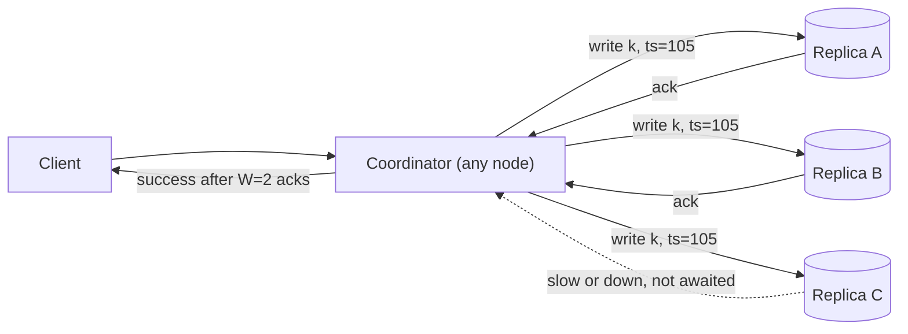
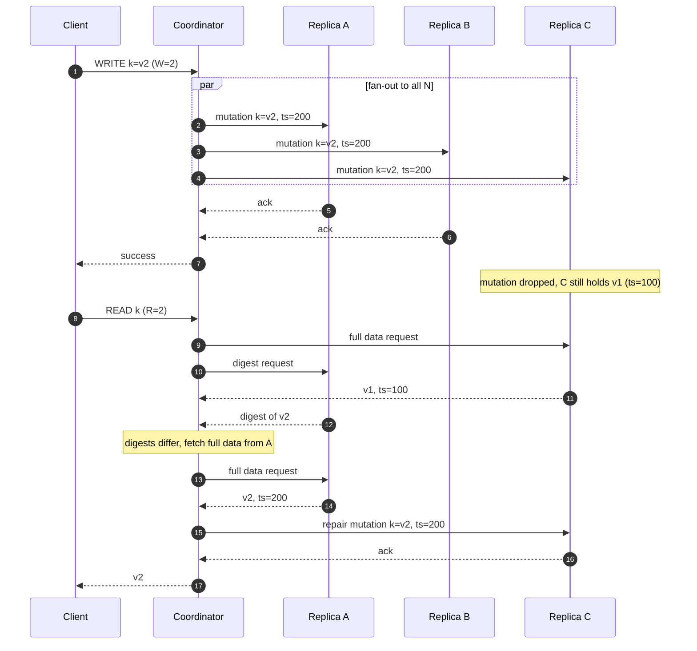
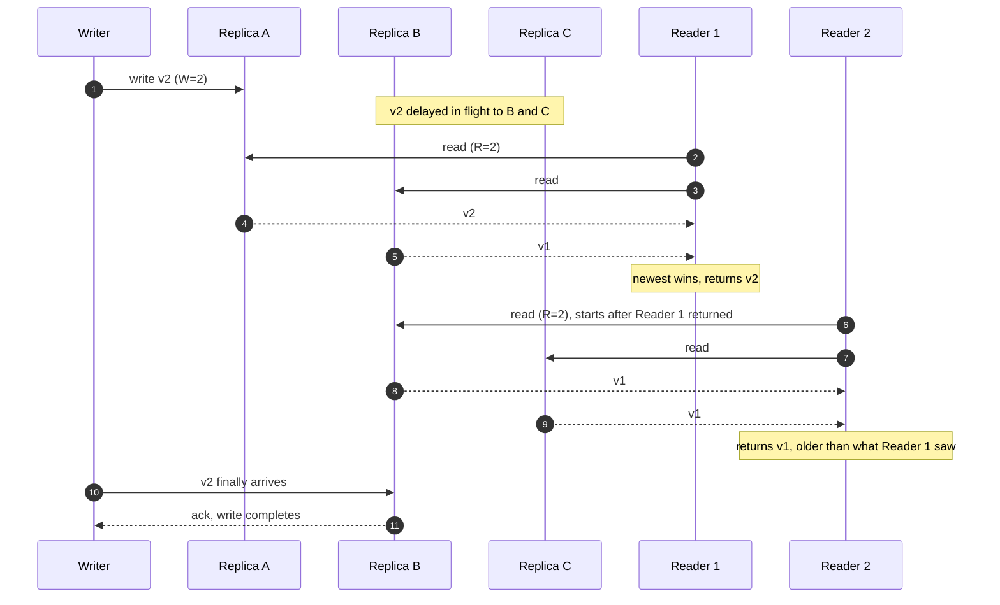
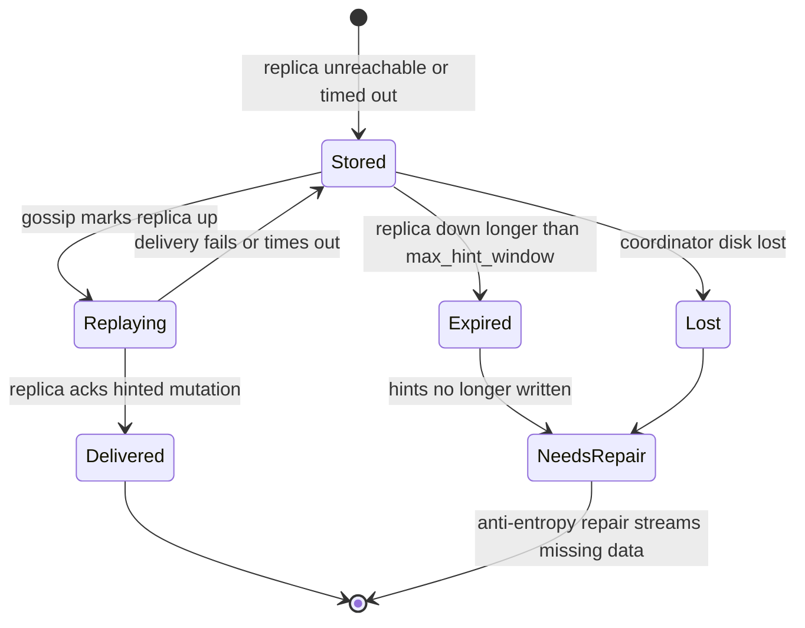
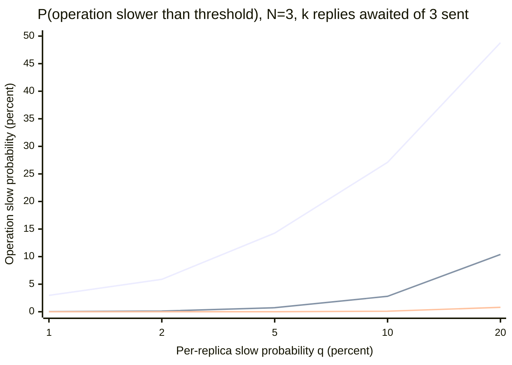
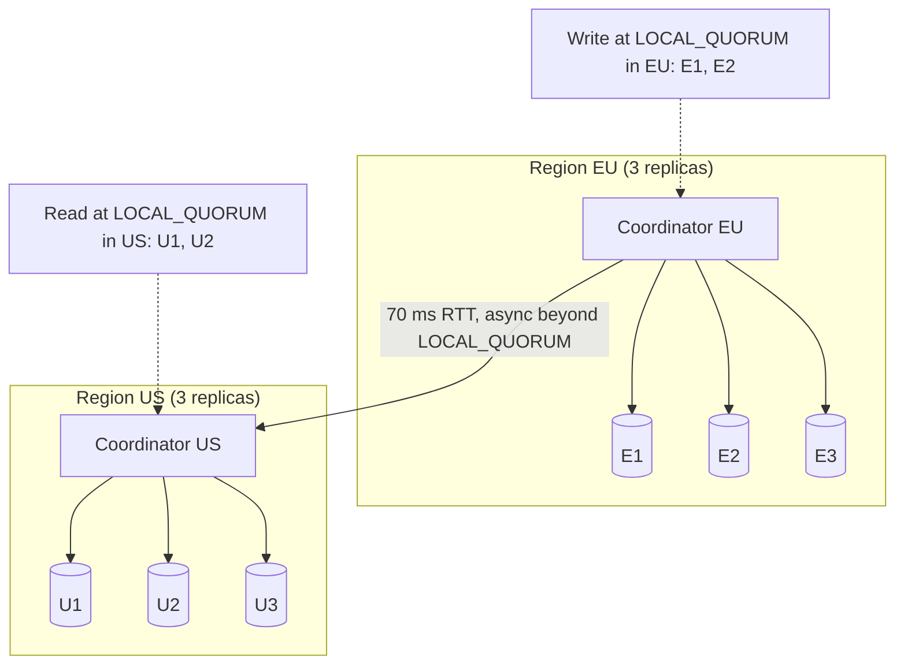
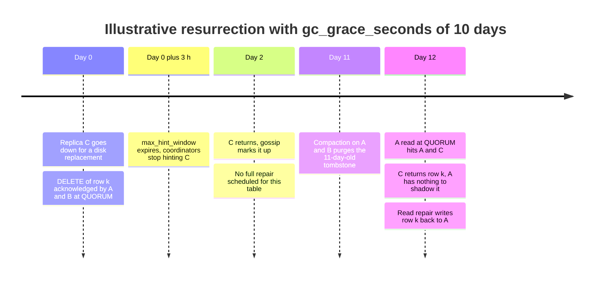

Lidersiz replikasyon (leaderless replication), bir anahtarın `N` replikasından herhangi birinin yazma kabul etmesine izin verir. İstemci ya da onun adına hareket eden bir koordinatör düğüm, yazmayı `N` replikanın hepsine paralel olarak gönderir ve `W` tanesi onay verdiğinde başarı bildirir; okuma ise `R` replikayı sorgular ve gelen yanıtlar arasından en yeni sürümü döndürür. Hiçbir replika diğerleri adına yazmaları sıralamaz, hiçbir şey seçilmez ve failover yoktur: yanıt vermeyi bırakan bir replika, yazmanın onsuz da tamamlanabileceği `N - W` onaydan yalnızca biridir. Tasarım Amazon'un 2007 tarihli Dynamo makalesinden gelir ve farklı varyasyonlarla Apache Cassandra, ScyllaDB, Riak KV ve Voldemort tarafından kullanılır.

Çözdüğü problem, [lider tabanlı replikasyonun](/distributed-systems/tr/data-management/replication/leader-based-replication/) yazma kesinti penceresidir. Veri kümesi başına tek leader olduğunda leader'ın çökmesi ya da onu yalıtan bir ağ bölünmesi, bir [failover](/distributed-systems/tr/data-management/replication/failover-leader-election/) tamamlanana kadar, tipik olarak onlarca saniye boyunca yazmaları imkânsız kılar; yavaş bir leader ise her yazmayı yavaşlatır. Dynamo, herhangi bir tekil arıza sırasında yazma kabul etmek zorunda olan ve gecikme hedefi 99.9. persentilde ölçülen bir alışveriş sepeti için tasarlanmıştı. Quorum yazması, kümede hiçbir durum değişikliği gerektirmeden `N - W` adet erişilemeyen ya da yavaş replikayı tolere eder ve bir işlemin gecikmesi, belirlenmiş tek bir düğümün değil, `W`'inci (ya da `R`'inci) en hızlı replikanın gecikmesidir.

Bedeli tek bir yazma sırasının kaybıdır. Yazmaları hiçbir düğüm sıraya koymadığı için iki istemci aynı anahtarı aynı anda farklı replikalar üzerinden yazabilir; replikalar bu yazmaları farklı sırayla alabilir ya da hiç almayabilir. Bu yüzden depo her değeri sürümlemek, eşzamanlı yazmaları tespit etmek ya da aralarında hakemlik yapmak ve yazma kaçırmış replikaları onarmak zorundadır. `R + W > N` quorum koşulu yalnızca bir okumanın danıştığı replika kümesinin, tamamlanmış bir yazmanın ulaştığı kümeyle örtüştüğünü garanti eder. Depoyu linearizable yapmaz, yazmaları atomik yapmaz ve compare-and-set sağlamaz. Asıl denge şudur: arıza altında erişilebilirlik ve kuyruk gecikmesi (tail latency) kazanılır; karşılığında yalnızca belirtilen koşullarda geçerli bir tutarlılık kabul edilir ve çakışma yönetimi ile replika onarımı replikasyon katmanından sürümlemeye, uygulamaya ve arka plan süreçlerine taşınır.

## İstek Yolu: Dağıtma, Onay ve Sürüm Seçimi

Her anahtarın sabit bir replika kümesi, yani tercih listesi (preference list) vardır ve anahtarın halka üzerindeki konumundan hesaplanır: anahtarın hash'inden saat yönünde ilerlerken karşılaşılan ilk `N` farklı düğüm; bu liste [Consistent Hashing ve Sanal Düğümler](/distributed-systems/tr/data-management/data-partitioning/consistent-hashing/) sayfasında anlatıldığı gibi rack ve veri merkezi yerleşimiyle inceltilir. Herhangi bir düğüm herhangi bir isteği koordine edebilir; tercih listesini, Cassandra ve Riak'ta [gossip](/distributed-systems/tr/resilience/failure-detection/gossip-protocols/) ile öğrendiği halka görünümünden yerel olarak hesaplar. Bazı tasarımlar koordinasyonu istemci kütüphanesine iter: Dynamo, partition'dan haberdar istemcilerin doğrudan bir replikaya yönlenmesine izin veriyordu, Voldemort'un istemcisi ise dağıtmayı kendisi yapıyordu.


*N=3 ve W=2 ile bir yazma. Koordinatör yazmayı üç replikaya da gönderir ve ikinci onaydan sonra istemciye yanıt verir; üçüncü replika erişilebilir durumdaysa yazmayı yine de alır.*

Burada dikkat edilmesi gereken ayrıntı şudur: `W`, yazmayı kaç replikanın alacağını belirlemez; koordinatörün kaç replikayı bekleyeceğini belirler. Erişilebilir her replika yazmayı uygular, dolayısıyla bir yazmanın depolama ve ağ maliyeti `W` ne olursa olsun her zaman `N` kopyadır. Düşük bir `W` daha az iş değil, daha hızlı bir onay ve daha fazla erişilemeyen replikaya tolerans satın alır. Tersine, yalnızca bir onayla zaman aşımına uğrayan bir yazma geri alınmaz: onu uygulayan replika yazmayı saklar ve değer onarım yoluyla yayılır. Cassandra'da bu hata, alınan ve gereken onay sayılarını taşıyan bir `WriteTimeoutException`'dır ve "başarısız" değil, "sonucu bilinmiyor" anlamına gelir.

### Okumalar, Digest'ler ve Okuma Onarımı

Okuma, yazmadan daha tutumludur. Bir Cassandra koordinatörü, dynamic snitch'in en hızlı olarak sıraladığı replikaya tek bir tam veri isteği, gereken sayıya ulaşmaya yetecek kadar diğer replikaya ise sonucun yalnızca hash'ini döndüren digest istekleri gönderir. Digest'ler veriyle eşleşirse okuma yanıtlanır. Farklılarsa koordinatör uyuşmayan replikalardan tam veriyi çeker, sonuçları timestamp'e göre birleştirir, birleşik değeri döndürür ve birleşimi geride kalan replikalara geri yazar. Bu geri yazma okuma onarımıdır (read repair). Birbirinden ayrışmış replikaları yakınsatan mekanizmalar içindeki genel rolü ve kimsenin okumadığı verinin Merkle ağacıyla onarımı [Anti-Entropy: Okuma Onarımı ve Merkle Ağaçları](/distributed-systems/tr/data-management/replication/anti-entropy-merkle/) sayfasında ele alınır; burada önemli olmasının nedeni, bir sonraki bölümde görüleceği gibi quorum okumasının garantisini değiştirmesidir.


*W=2 bir yazma ve ardından yazmayı kaçıran replikaya denk gelen R=2 bir okuma. Okuma, digest uyuşmazlığı sayesinde yeni sürümü keşfeder ve yanıt vermeden önce C replikasını onarır.*

5. adımda yazma, C replikası onu hiç uygulamamış olmasına rağmen onaylanır; kümede C'nin geride olduğunu kaydeden hiçbir şey yoktur, Cassandra'da koordinatörün saklamış olabileceği bir hint dışında (aşağıda ele alınıyor). 7. adımdaki okuma, en kötü durum olarak tam veri için tam da C'yi seçer; yazma quorum'u ile örtüşme A replikasıdır ve onun digest'i 10. adımda uyuşmaz. 11-14. adımlar bu uyuşmazlığın bedelidir: veriyi çekmek için ek bir round trip, onarmak için bir tane daha. Yani eski bir replikaya denk gelen okuma, bir yerine kabaca üç round trip sürer. Kaçırılan yazma oranı yüksek olduğunda okuma gecikmesi de onunla birlikte artar; yük altında mutation düşüren bir kümenin okumada da yavaşlamasının nedenlerinden biri budur.

### R + W > N Neden Örtüşme Sağlar

Garanti bir sayma argümanıdır. Tamamlanmış bir yazma, tercih listesindeki `N` replikanın en az `W` tanesinden oluşan bir kümede tutulur. Okuma aynı `N` içinden `R` replikalık bir kümeye danışır. İki küme ayrık olsaydı, birlikte `W + R` farklı replika içerirlerdi; `W + R > N` olduğunda bu imkânsızdır. Dolayısıyla her okuma kümesi ile her tamamlanmış yazma kümesi en az `W + R - N` replikayı paylaşır. `N = 3, W = 2, R = 2` için örtüşme en az bir replikadır; `N = 5, W = 3, R = 3` için de birdir ve bu yapılandırmaların her biri yazmalarda `N - W`, okumalarda `N - R` replikanın kaybını tolere eder.

Örtüşmenin "okuma yazılan değeri döndürür" sonucuna dönüşmesi için üç koşulun daha sağlanması gerekir. Sürümler tam sıralı (totally ordered) olmalıdır ki koordinatör yanıtlardan hangisinin en yeni olduğunu anlayabilsin; Cassandra hücre başına bir timestamp, Dynamo ve Riak ise aşağıda tartışılan version vector'leri kullanır. Yazma, gerçek zamanda okuma başlamadan önce tamamlanmış olmalıdır; örtüşme hâlâ yolda olan bir yazma hakkında hiçbir şey söylemez. Ve iki işlem de aynı `N` replikayı, yani anahtarın asıl tercih listesini kullanmalıdır; bir yazmanın yedek düğümlere düşmesine izin veren her mekanizma sayma argümanını bozar ve sloppy quorum'ların yaptığı tam olarak budur. Ayrı bir ikinci koşul olan `W > N / 2`, herhangi iki yazma quorum'unun kesişmesini sağlar. Gifford'un ağırlıklı oylamasında (weighted voting) olduğu gibi güncel sürümü bir quorum'dan okuyup sonraki sürümü yazan protokoller için önemlidir, çünkü o zaman eşzamanlı iki yazıcının birbirinin sürümünü görmesi garanti olur. Dynamo tarzı depolar bunu şart koşmaz: Cassandra `W = 1`'i kabul eder ve yazıcılar yazmadan önce okumaz.

## Örtüşmenin Garanti Etmedikleri

Quorum koşulu sıklıkla "güçlü tutarlılık" diye özetlenir. Oysa beş somut açıdan bundan daha zayıftır ve her biri üretim sistemlerinde görülen bir arızaya karşılık gelir.

### Bir Yazmayla Eşzamanlı Okumalar Geriye Gidebilir

Üç replikadan yalnızca birine ulaşmış, hâlâ yolda olan bir yazma düşünün. O replikayı içeren bir quorum okuması yeni değeri döndürür; birincisi döndükten sonra başlayan ikinci bir quorum okuması ise diğer iki replikaya danışır ve eski değeri döndürür. Yazma tamamlanmadığı için her okuma tek başına örtüşme argümanını karşılar, ama ikisi birlikte [linearizability](/distributed-systems/tr/data-management/consistency-models/linearizability/) koşulunu ihlal eder: herhangi bir okuma bir değer döndürdükten sonra, sonraki her okuma o değeri ya da daha yenisini döndürmelidir.


*N=3, W=2, R=2 ile önce-yeni-sonra-eski okuma anomalisi. Her okuma tamamlanmış her yazmayla örtüşür, ama okumalar çalıştığında yazma henüz tamamlanmadığı için Reader 2, Reader 1'in daha önce gördüğünden daha eski bir değer görür.*

7. ve 12. adımlar gözlemlenebilir tersliktir. Çözüm paylaşımlı register teorisinden bilinir: Attiya, Bar-Noy ve Dolev 1995'te, okuyucunun döndüreceği değeri dönmeden önce bir quorum'a geri yazıp onayları beklemesi hâlinde okumanın atomik olduğunu gösterdi. Reader 1 `v2`'yi `W` replikada kalıcı hâle getirdikten sonra Reader 2'nin quorum'u bu kümeyle kesişmek zorundadır ve `v2`'yi görür. Cassandra'nın bloklayan okuma onarımı (blocking read repair), bu geri yazma aşamasının yalnızca replikalar uyuşmadığında uygulanan hâlidir: `TWO`, `THREE`, `QUORUM` ya da `LOCAL_QUORUM` seviyesinde uyuşmazlık bulan bir okuma, onarım mutation'ları tutarlılık seviyesini karşılayacak kadar replikaya ulaşana kadar dönmez. Dokümantasyon ortaya çıkan özelliği monotonic quorum reads (monoton quorum okumaları) olarak adlandırır: sonraki bir quorum okuması hiçbir zaman öncekinden daha eski veri döndürmez. 4.0'dan beri bunu denetleyen tablo seçeneği `read_repair`'dır; varsayılan `BLOCKING`, alternatif ise `NONE`'dır. `ONE` ve `LOCAL_ONE` okumaları tek bir replikaya danışır ve okuma onarımı yapmaz.

Geri yazmanın dokümantasyonda açıkça adı konan bir bedeli vardır. Okuma onarımı yalnızca sorgunun okuduğu satırları geri yazar; bu yüzden bir partition'ın birkaç satırını yazmış bir batch, tek bir satıra dokunup onu onaran bir okuma yoluyla kısmen görünür hâle gelebilir. `NONE`, monoton okumalardan vazgeçme pahasına partition düzeyinde yazma atomikliğini korur. Bir depo bu mekanizmayla ya monoton quorum okumalarını ya da transaction'sız batch'lerin partition düzeyinde atomikliğini verebilir, ikisini birden veremez.

### Eşzamanlı Yazmalara Nedensellik Değil Timestamp Karar Verir

Aynı anahtara yapılan iki yazma zamanda örtüştüğünde sonuç sürümleme şemasına bağlıdır. Cassandra her hücreyi koordinatörün atadığı ya da istemcinin sağladığı mikrosaniye hassasiyetli bir timestamp ile damgalar ve her replika yüksek olanı saklar. Bu, son yazı kazanır (last write wins, LWW) yaklaşımıdır: deterministiktir ve yakınsar, ama daha düşük timestamp'li bir yazma, gerçek zamanda daha sonra gerçekleşmiş olsa bile sessizce atılır ve iki istemcinin oku-değiştir-yaz döngüsü hiçbir hata vermeden bir güncellemeyi kaybeder. Kaymış saatlerin yanlış kazananı nasıl seçtiği ve LWW'nin neden nihai tutarlı depoların belirleyici zayıflığı olduğu [Nihai Tutarlılık: Son Yazı Kazanır](/distributed-systems/tr/data-management/consistency-models/eventual-consistency/) sayfasında, saatlerin davranışı ise [Fiziksel Saatler](/distributed-systems/tr/foundations/time-and-ordering/physical-clocks/) sayfasında ele alınır.

Dynamo ve Riak bunun yerine her değere bir version vector ekler. Bir yazma, istemcinin okuduğu sürümün bağlamını (context) taşır; vektörü kendisininkine ne baskın gelen ne de ondan baskın olunan bir yazma alan replika iki değeri de sibling olarak saklar ve sonraki okuma hepsini uygulamanın birleştirmesi için döndürür. Riak 2.0, aynı replika üzerinden gelen eşzamanlı yazmalarda sibling'lerin çoğalmaması için dotted version vector'leri ekledi. Karşılaştırma kuralları ve sibling patlaması arızası kanonik [Vektör Saatler](/distributed-systems/tr/foundations/time-and-ordering/vector-clocks/) sayfasında, Dynamo makalesinin onları özgül kullanımı [Dynamo Makalesinde Vektör Saatler](/distributed-systems/tr/case-studies/dynamodb-cassandra/vector-clocks-conflict-resolution/) sayfasında, yapısı gereği birleşen veri tipleri ise [CRDT'ler](/distributed-systems/tr/data-management/consistency-models/crdts/) sayfasında bulunur. Quorum argümanı açısından önemli olan, version vector'lerin "en yeni" kavramını tam sıradan kısmi sıraya çevirmesidir: örtüşme, okumanın tamamlanmış her yazmayı görmesini, sibling'ler ise hiçbirinin düşürülmemesini garanti eder; ama okuma birden fazla değer döndürebilir.

### Atomik Oku-Değiştir-Yaz Yok

Quorum okumaları ve yazmaları birbirinden bağımsız işlemlerdir; bir istemcinin okuması ile yazması arasına başka bir yazmanın girmesini hiçbir şey engellemez. Lidersiz depolar compare-and-set'i, benzersizliği ya da sayaçları yalnızca quorum'larla gerçekleyemez, çünkü bu, rakip yazmaların tek bir sırası üzerinde anlaşmayı gerektirir ve bu [konsensüs](/distributed-systems/tr/coordination/consensus-algorithms/paxos/) demektir. Bu yüzden Cassandra lightweight transaction'larını (`INSERT ... IF NOT EXISTS`, `UPDATE ... IF`) anahtarın replikaları arasında `SERIAL` ya da `LOCAL_SERIAL` tutarlılık seviyesiyle çalışan bir Paxos turu olarak yürütür ve bu, sıradan bir yazmanın birkaç katı round trip'e mal olur. Bu yazı yazılırken ön sürüm aşamasında olan Cassandra 6.0, çok anahtarlı ve strict serializable transaction'lar için lidersiz bir konsensüs protokolü olan Accord'u ekler; bu, quorum yolunun yanında duran bir konsensüs katmanıdır, sıradan yazmaların onaylanma biçiminde bir değişiklik değildir. Cassandra sayaçları ayrı ve idempotent olmayan bir yazma yoludur; bu yüzden zaman aşımına uğramış bir sayaç artırımı güvenle yeniden denenemez.

### Kısmi Yazmalar Görünür Kalır

`W`'den az replikaya ulaşan bir yazma istemciye hata ya da zaman aşımı bildirir, ama onu uygulamış replikalarda kalır. Bunlardan birini içeren sonraki bir okuma "başarısız" değeri döndürür ve okuma onarımı onu yayar. İstemci "yazma gerçekleşmedi" ile "yazma daha sonra görünecek" durumlarını birbirinden ayıramaz. Tek güvenli istemci davranışı, yazmaları idempotent yapmak ve onları aynı değerle ve Cassandra'da aynı istemci timestamp'iyle yeniden denemektir; böylece yeniden deneme yalnızca orijinal yazmayı pekiştirebilir. Genel teknik [Idempotency](/distributed-systems/tr/communication/api-gateway/idempotency/) sayfasında ele alınır.

:::note[DynamoDB, Dynamo tarzı değildir]
Amazon DynamoDB, adını 2007 tarihli Dynamo makalesiyle paylaşır ama replikasyon tasarımını paylaşmaz. 2022 tarihli DynamoDB makalesi her partition'ı Multi-Paxos ile bir leader seçen bir replikasyon grubu olarak tanımlar; tüm yazmaları ve güçlü tutarlı okumaları leader sunar. Bu sayfadaki quorum aritmetiği, sloppy quorum'lar ve sibling'ler DynamoDB için değil Cassandra, ScyllaDB, Riak ve Voldemort için geçerlidir; DynamoDB'nin global table'ları [Çok Liderli Replikasyon](/distributed-systems/tr/data-management/replication/multi-leader-replication/) sayfasında ele alınır.
:::

### Sloppy Quorum'lar ve Hinted Handoff

Katı bir quorum (strict quorum) yalnızca anahtarın `N` asıl replikasından gelen onayları sayar. Bunların `N - W`'den fazlası erişilemezse yazma başarısız olur. Dynamo bu kural yerine erişilebilirliği seçti: yazmaları daha uzun bir tercih listesindeki ilk `N` sağlıklı düğüme gider; böylece asıl kümenin dışındaki bir düğüm, erişilemeyen bir asıl replikanın yerine yazma kabul edebilir. Bu yedek düğüm yazmayı, hedeflenen replikayı adlandıran bir hint (ipucu) ile birlikte saklar ve replika yeniden erişilebilir olduğunda yazmayı ona devreder. Buna sloppy quorum (gevşek quorum) denir ve kümenin `W` düğümünü erişilebilir bırakan her arızada yazmaları erişilebilir tutar. Örtüşme argümanını da bozar: `W` yedek düğümün onayladığı bir yazma ile `R` asıl replikanın yanıtladığı bir okuma tamamen ayrık olabilir; bu yüzden başarılı bir yazmanın hemen ardından yapılan bir okuma, `R + W > N` olsa bile onu kaçırabilir.

Cassandra ve Riak bu gerilimi farklı biçimlerde çözer ve bu fark, tutarlılık seviyelerinin ne anlama geldiğine dair en yaygın kafa karışıklığının kaynağıdır.

Cassandra hinted handoff'u korur, ama bir istisna dışında hint'i hiçbir zaman bir tutarlılık seviyesine saymaz. Koordinatör bir replikaya ulaşamadığında ya da replika yazma zaman aşımı içinde onay vermediğinde, koordinatör yerel hints dizinine bir hint yazar ve yazma yine de gerçek replikalardan `W` onaya ihtiyaç duyar. Yalnızca `ANY` tutarlılık seviyesi saklanmış bir hint'i onay olarak sayar; bu yüzden bir `ANY` yazması veriyi hiçbir replika tutmadan başarılı olabilir ve koordinatör teslimattan önce hint dosyalarını kaybederse yazma kaybolur. Dolayısıyla hint'ler, replikaların ayrışık kaldığı süreyi kısaltan bir optimizasyondur; bir dayanıklılık (durability) mekanizması değildir.

Riak bu seçimi istek bazında sunar. `n_val = 3`, `r = quorum`, `w = quorum` ve `pr = pw = 0` varsayılanlarıyla Riak sloppy quorum kullanır: asıl replikalar erişilemez olduğunda yedek (fallback) vnode'lar okuma ve yazma kabul eder. `pw` ya da `pr` değerini sıfırın üzerine çekmek, o sayıda onayın asıl replikalardan gelmesini şart koşar; bu, asıl replikalar çökükken bu işlemleri reddetme pahasına, o işlemler için katı quorum kesişimini geri getirir. Riak ayrıca `w`'yi (bir vnode tarafından onaylandı) `dw`'den (backend tarafından kalıcı olarak yazıldı) ayırır ve ikisinin varsayılanı da quorum'dur.


*Bir Cassandra hint'inin yaşam döngüsü. Replikayı onarım gerektirmeden yakınsatan yalnızca Delivered yoludur; Expired ve Lost, anti-entropy çalışana kadar replikayı yazmalardan yoksun bırakır.*

Operasyonel açıdan önemli geçiş `Expired`'dır. Koordinatör, çökük bir replika için yalnızca replika çöktükten sonraki `max_hint_window` süresince hint yazar; varsayılan üç saattir. Bu süreden sonra o replikaya yönelik yazmalar için hint tutulmaz ve replika döndüğünde kesintinin geri kalanındaki her yazmadan yoksundur. Gossip kümeye düğümün yeniden ayakta olduğunu söyler ve koordinatörler okumaları hemen ona yönlendirir; bu yüzden tam bir onarım tamamlanana kadar düğüm bazı `ONE` okumalarını eski veriyle yanıtlar ve quorum okumalarında okuma onarımını zorlar. `Lost` geçişi koordinatör arızasını kapsar: hint'ler yalnızca onları yazan koordinatörde yaşar, dolayısıyla o düğümün diskini kaybetmek, tuttuğu teslim edilmemiş tüm hint'leri kaybetmek demektir. İki geçiş de quorum'u karşılamış yazmalar için bir dayanıklılık arızası değildir, çünkü diğer replikalar onları tutar; ikisi de onarımı isteğe bağlı olmaktan çıkarıp zorunlu kılan yakınsama arızalarıdır.

## Hesaplı Örnek: Tek Bir Keyspace için Quorum Aritmetiği

Tek bir veri merkezinde `N = 3` ile replike edilen bir anahtar-değer tablosu varsayın; her replikanın herhangi bir anda bağımsız olarak `p = 0.01` olasılıkla erişilemez olduğunu ve herhangi bir istekte bağımsız olarak `q` olasılıkla 10 ms eşiğinden yavaş olduğunu kabul edin. Bu bölümdeki tüm olasılıklar ve gecikmeler örnek amaçlıdır; gerçek arızalar rack, deployment ve yük üzerinden birbirine bağlıdır ve bağımsızlık varsayımı bunu gizler.

### Yapılandırmaya Göre Erişilebilirlik ve Eskimişlik

3 replikadan `k` tanesine ihtiyaç duyan bir işlem, `3 - k`'dan fazlası erişilemez olduğunda başarısız olur. Bir replikaya ihtiyaç duymak `p^3` olasılıkla başarısız olur; iki replikaya ihtiyaç duymak en az ikisi çöktüğünde, yani `3p^2(1 - p) + p^3` olasılıkla; üçüne de ihtiyaç duymak herhangi biri çöktüğünde, yani `1 - (1 - p)^3` olasılıkla.

| `W`, `R` | Örtüşme `W + R - N` | Yazma erişilebilirliği | Okuma erişilebilirliği | Onaylanmış yazmanın hemen ardından eski okuma | Ne zaman tercih edilmeli |
|---|---|---|---|---|---|
| 1, 1 | -1 (yok) | 0.999999 | 0.999999 | en fazla 2/3 | Cache'ler, metrikler, yakın tarihli herhangi bir değerin yeteceği veri |
| 2, 1 | 0 (yok) | 0.99970 | 0.999999 | en fazla 1/3 | Kısa süreli eskimişliğe toleranslı okunan, yazımda dayanıklı veri |
| 1, 2 | 0 (yok) | 0.999999 | 0.99970 | en fazla 1/3 | Nadir; yazmalar asla başarısız olmamalı, okumalar yavaş olabilir |
| 2, 2 | 1 | 0.99970 | 0.99970 | yazma tamamlandıktan sonra 0 | Kendi tamamlanmış yazmalarını okuması gereken veri için varsayılan |
| 3, 1 | 1 | 0.970 | 0.999999 | yazma tamamlandıktan sonra 0 | Herhangi bir kesintide yazmaların başarısız olabileceği, okuma ağırlıklı veri |

Eskimişlik sütunu, onay anındaki en kötü durumdur: yazmayı yalnızca onay veren `W` replikanın tuttuğu varsayılır. Okuma `N` replikadan `R` tanesine düzgün rastgele danışırsa, `W` replikanın hepsini `C(N - W, R) / C(N, R)` olasılıkla kaçırır: `W = R = 1` için bu `C(2,1) / C(3,1) = 2/3`, `W = 2, R = 1` için `C(1,1) / C(3,1) = 1/3`'tür. Pratikte koordinatör yazmayı üç replikaya da göndermiştir; üçüncü kopya genellikle milisaniyeler içinde yerine ulaşır ve gerçek eski okuma oranı yazmadan bu yana geçen süreyle hızla düşer. Bailis ve arkadaşları bu düşüşü 2012 tarihli olasılıksal sınırlı eskimişlik (probabilistically bounded staleness, PBS) çalışmalarında nicelleştirdi ve kısmi quorum'ların genellikle kısa bir pencere içinde tutarlı olduğunu ölçtü. Tablonun vurgusu, yalnızca örtüşen satırların sağladığı "nadiren eski" ile "yazma tamamlandıktan sonra asla eski değil" arasındaki farktır.

Erişilebilirlik sütunları `W = 3`'ün bedelini somutlaştırır: her replikayı şart koşmak, replika başına %1'lik erişilemezliği %3'lük bir yazma hata oranına çevirir; bu, `W = 2`'nin %0.03'ünden yüz kat kötüdür. Bağımsızlık varsayımı altında `W = 2, R = 2` iki işlem için de aynı erişilebilirliği verir; her biri 0.000298 olasılıkla başarısız olur, bu da tek bir replikanın erişilemez olmasından yaklaşık 34 kat daha seyrektir.

### Kuyruk Gecikmesi k'ıncı Sıra İstatistiğidir

Üç replikaya da gönderilen bir yazma `k`'ıncı onay geldiğinde tamamlanır; dolayısıyla eşikten yalnızca en az `3 - k + 1` replika yavaşsa yavaştır. Replika başına yavaşlık olasılığı `q` ile olasılıklar `k = 1` için `q^3`, `k = 2` için `3q^2 - 2q^3`, `k = 3` için `1 - (1 - q)^3`'tür. `q = 0.01` iken `W = 2` bir yazma zamanın yaklaşık %0.03'ünde 10 ms'yi aşar; `W = 3` bir yazma ise yaklaşık %2.97'sinde aşar. Aynı donanımdan yüz katlık bir fark çıkar.


*Üst çizgi: üçünü de bekle (k=3). Orta: 3'ün 2'sini bekle (k=2). Alt: 3'ün 1'ini bekle (k=1). Yukarıdaki bağımsızlık modelinden hesaplanmıştır; örnek amaçlıdır.*

Üst eğri `ALL`'un neden nadiren kullanıldığını gösterir: işlem her replikanın kuyruğunun birleşimini miras alır, dolayısıyla yavaşlık oranı replika başına oranın kabaca üç katıdır. Orta eğri çoğunluk quorum'unun ne satın aldığını gösterir: `q = %5`'te replika başına kuyruk büyük ölçüde gizlenir, %0.73'e iner ve quorum'un kuyruğu ancak her on replikadan biri yavaş olduğunda replika başına orana yaklaşır. Eğri, koordinatörün isteği üç replikaya da gönderdiğini varsayar. Bu yazmalar için doğrudur ama Cassandra okumaları için değildir: bir `QUORUM` okuması bir veri isteği ve bir digest isteği, yani yalnızca iki replikaya istek gönderir; bu yüzden yavaşlık olasılığı `1 - (1 - q)^2`, yaklaşık `2q`'dur ve tek bir replikadan kötüdür. Bu açığı speculative retry kapatır: bir replika tablonun `speculative_retry` eşiği içinde yanıt vermediğinde (varsayılan olarak son okuma gecikmelerinin 99. persentili) koordinatör isteği ek bir replikaya gönderir ve hangisi önce yanıt verirse onu kullanır.

:::tip[QUORUM okuma gecikmesi quorum'a değil speculative retry'a bağlıdır]
Bir Cassandra quorum okuması tam olarak ihtiyaç duyduğu replikalarla iletişim kurar; bu yüzden çiftteki tek bir yavaş replika okumayı yavaşlatır. Quorum'un çağrıştırdığı "üçün en hızlı ikisi" davranışı yalnızca speculative retry sayesinde vardır. `LOCAL_QUORUM` seviyesindeki p99 okuma gecikmesi ikinci en hızlı replikanın değil en yavaş replikanın gecikmesini izliyorsa, düğüm eklemeden önce tablonun `speculative_retry` ayarına ve koordinatörün speculative retry metriklerine bakın.
:::

### İki Veri Merkezi: Hangi Quorum WAN'ı Geçer

Şimdi iki bölgenin her birine üç replika yerleştirin, `N = 6`; bölge içinde 1 ms, bölgeler arasında 70 ms round trip varsayın. Cassandra'nın `QUORUM`'u altı replikanın tamamı üzerinden hesaplanır, `floor(6 / 2) + 1 = 4`; dolayısıyla her `QUORUM` işlemi en az bir uzak replikayı içermek zorundadır ve en az 70 ms'ye mal olur. `LOCAL_QUORUM`, koordinatörün bölgesindeki 3 replikanın 2'sine ihtiyaç duyar ve yaklaşık 1 ms artı yerel işlem süresine mal olur. `EACH_QUORUM` her bölgede 2 replikaya ihtiyaç duyar, dolayısıyla gecikmesi en yavaş bölgeninkidir.


*Her birinde üç replika bulunan iki bölge. EU'da LOCAL_QUORUM ile yapılan bir yazma ve US'te LOCAL_QUORUM ile yapılan bir okuma ayrık replika kümelerine dokunur.*

Diyagram, bölge başına quorum'ların bıraktığı boşluğu gösterir. EU'da `LOCAL_QUORUM` ile yapılan bir yazmayı iki EU replikası onaylar, US'te `LOCAL_QUORUM` ile yapılan bir okuma ise iki US replikasına danışır: `2 + 2 = 4`, bu da 6'dan büyük değildir; dolayısıyla kümelerin örtüşmesi gerekmez ve yazma WAN'ı asenkron olarak geçene kadar US'teki okuyucu eski değeri görebilir. Bir bölgede yazıp hemen ardından diğerine yönlendirilen kullanıcı kendi yazmasını okumaz; bunu ele alan desenler (kullanıcıları bir ev bölgesine yönlendirmek, pozisyon token'ları taşımak) [Replikasyon Gecikme Sorunları](/distributed-systems/tr/data-management/replication/replication-lag/) sayfasında anlatılır. Erişilebilirlik aritmetiği de aynı ölçüde belirgindir: bütün bir bölge kaybedilirse üç replika kalır, bu da `QUORUM`'un ihtiyaç duyduğu dörtten azdır; dolayısıyla `QUORUM` kullanan bir küme hem okuma hem yazma için erişilemez hâle gelir, `LOCAL_QUORUM` kullanan ise hayatta kalan bölgeden hizmet vermeyi sürdürür. `N = 6` için `QUORUM`, her işlemde bir WAN round trip'i ve bölge kaybı sırasında erişilebilirlik pahasına bölgeler arası örtüşme satın alır; `LOCAL_QUORUM` ise bölgeler arası örtüşme pahasına yerel gecikme ve bölge bağımsızlığı satın alır.

## Üretimdeki Dengeler ve Yapılandırma

### Lidersiz Replikasyon ve Alternatifleri

Lidersiz replikasyon bu bölümde ele alınan üç topolojiden biridir ve yine çoğunluklarla çalışan konsensüs tabanlı replikasyonla sıkça karıştırılır.

| Özellik | Tek leader, asenkron follower'lar | Konsensüs grubu (Raft, Multi-Paxos) | Çok liderli | Lidersiz quorum |
|---|---|---|---|---|
| Yazmaları kim sıralar | Tek leader | Seçilmiş leader, replike edilen log | Her leader yerel olarak | Kimse; değer başına sürümler |
| Tek replika kaybında yazma erişilebilirliği | Leader çökerse failover'a kadar kaybolur | Leader çökerse seçime kadar kaybolur (saniyeler) | Diğer sitelerde korunur | `W` replika yanıt verdiği sürece korunur |
| Yazma gecikmesi | Leader commit'i | Leader artı çoğunluk round trip'i | Yerel commit | `W`'inci en hızlı replika |
| Linearizable okumalar | Yalnızca leader'dan | Evet, lease ya da read index ile leader üzerinden | Hayır | Hayır, `R + W > N` olsa bile |
| Eşzamanlı yazma yönetimi | Gerekmez | Gerekmez | Çakışma çözümü | LWW ya da sibling'ler |
| Compare-and-set | Evet | Evet | Siteler arasında hayır | Yalnızca ayrı bir Paxos yoluyla |
| Geride kalan replikanın onarımı | Leader log'unu yeniden oynatır | Leader log'unu yeniden oynatır | Uzak log'u yeniden oynatır | Hint'ler, okuma onarımı, Merkle onarımı |
| Ne zaman tercih edilmeli | İlişkisel iş yükleri, tek bölge | Metadata, kilitler, sıralı log'lar, transactional depolar | Yerel gecikmeyle çok bölgeli yazmalar | Anahtar-değer verisi için yüksek yazma erişilebilirliği ve kuyruk gecikmesi kontrolü |

Konsensüs satırı, en sık bulanıklaşan sınırdır. Bir [Raft](/distributed-systems/tr/coordination/consensus-algorithms/raft/) grubu da bir çoğunluğu bekler, ama her term'de tek bir leader'ın seçtiği tek bir sıradaki log'un çoğunluğunu; her replika aynı diziyi uygular ve log index'i linearizable okumaları ve compare-and-set'i mümkün kılar. Lidersiz bir quorum'un paylaşılan bir dizisi yoktur, yalnızca birbirinden bağımsız, değer başına sürümleri vardır; dolayısıyla bir çoğunluk onayı, bir değerin yeterince replikada saklandığını söyler, diğer değerlere göre sıralandığını değil. Lidersiz yazmaların seçime ihtiyaç duymamasının ve herhangi bir yavaş replika azınlığını durum değişikliği olmadan atlatmasının nedeni bu farktır; konsensüsün sağladığı garantileri sağlayamamalarının nedeni de. [CAP teoremi](/distributed-systems/tr/data-management/consistency-models/cap-theorem/) sözlüğünde düşük `W` ve `R` ile çalışan lidersiz depolar kanonik AP tasarımıdır; [PACELC](/distributed-systems/tr/data-management/consistency-models/pacelc-theorem/) açısından ise normal çalışmada da tutarlılığı gecikmeye karşı takas ederler ve istek başına tutarlılık seviyesi tam olarak bunu açığa çıkarır.

### Lidersiz Bir Depoyu Yapılandırmak

Önemli parametreler, yapılandırma yüzeyinin düşündürdüğünden azdır. Replikasyon faktörü ve yerleşim keyspace başına, tutarlılık istek başına, onarım davranışı ve silme güvenliği tablo başına, hint'ler ise düğüm başına ayarlanır. Cassandra 4.0 ve sonrasında:

```sql
-- RF 3 in each of two data centers
CREATE KEYSPACE orders WITH replication =
  {'class': 'NetworkTopologyStrategy', 'dc_eu': 3, 'dc_us': 3};

-- Per-table read and delete behavior (Cassandra 4.0+ option names)
ALTER TABLE orders.by_id WITH
  speculative_retry = '99p'      -- extra replica if no reply by the table's p99
  AND read_repair = 'BLOCKING'   -- quorum reads write back before returning
  AND gc_grace_seconds = 864000; -- 10 days: repair must finish inside this

-- cqlsh session: consistency is chosen per request, not per table
CONSISTENCY LOCAL_QUORUM;
```

Replikasyon faktörü `N`'yi, dolayısıyla depolama maliyetini ve her yazmanın ürettiği kopya sayısını sabitler. `NetworkTopologyStrategy`, her veri merkezinin replikalarını mümkün olduğunda farklı rack'lere yerleştirir; hesaplı örnekteki bağımsızlık varsayımını tek rack arızaları için yaklaşık olarak doğru kılan budur. Tutarlılık seviyesi, istek başına `W` ya da `R`'dir: yazmalar için `ONE`, `TWO`, `THREE`, `QUORUM`, `ALL`, `LOCAL_ONE`, `LOCAL_QUORUM`, `EACH_QUORUM` ve `ANY`; lightweight transaction'lar için `SERIAL` ve `LOCAL_SERIAL`. Seviyeyi istek başına seçmek, tek bir tablonun hem gecikmeye duyarlı okumaları `LOCAL_ONE` ile hem doğruluğa duyarlı okumaları `LOCAL_QUORUM` ile sunmasını sağlar; ama bu aynı zamanda örtüşme garantisinin verinin değil, her işlem çiftinin özelliği olduğu anlamına gelir: bir quorum yazmasının ardından gelen `ONE` okumasının hiçbir garantisi yoktur.

En çok dikkati `gc_grace_seconds` hak eder, çünkü depolama parametresi kılığına girmiş bir doğruluk parametresidir. Lidersiz bir depoda silme, bir tombstone'un, yani daha eski değerleri gölgeleyen timestamp'li bir işaretin yazılmasıdır; tombstone temizlenmeden önce her replikaya ulaşmalıdır, yoksa onu kaçırmış bir replika silinmiş değeri daha sonra canlıymış gibi sunar. Compaction, `gc_grace_seconds`'tan (varsayılan on gün) eski tombstone'ları temizler; dolayısıyla her replikanın tam bir anti-entropy onarımı bu pencere içinde en az bir kez tamamlanmalıdır. Tombstone'ların ve compaction'ın depolama motoru tarafı [SSTable'lar, Memtable ve Compaction Stratejileri](/distributed-systems/tr/data-management/storage-engines/sstables-memtable-compaction/) sayfasında ele alınır.

Hint parametreleri `cassandra.yaml` içinde yaşar. 4.1 yapılandırması `hinted_handoff_enabled` (varsayılan `true`), `max_hint_window` (varsayılan `3h`), `max_hints_delivery_threads` (varsayılan `2`) ve `hinted_handoff_throttle` (teslimat thread'i başına varsayılan `1024KiB`) kullanır. Daha uzun bir hint penceresi onarım gerektiren kesintilerin sayısını azaltır, ama koordinatörlerin saklaması ve yeniden oynatması gereken hint hacmini artırır. Throttle teslimat thread'i başınadır ve hint gönderen düğümler arasında bölünür; bu yüzden küme büyüdükçe etkin hızı düşer.

:::caution[Arızada tutarlılık seviyesini asla düşürmeyin]
Başarısız bir `QUORUM` isteğini `ONE` ile yeniden gönderen bir retry policy, her kısmi kesintiyi örtüşme garantisinin sessizce kaybına çevirir; üstelik bunu replikaların birbirinden ayrışma olasılığının en yüksek olduğu anda yapar. DataStax Java sürücüsü 3.x böyle bir policy'yi `DowngradingConsistencyRetryPolicy` adıyla sunmuş ve daha sonra deprecate etmiştir. Bir işlem `ONE`'ı tolere edebiliyorsa onu `ONE` ile gönderin; edemiyorsa hatayı yukarı taşıyın. `ANY` tutarlılık seviyesine de aynı şekilde yaklaşın: bir `ANY` yazması, onu tutan sıfır replikayla onaylanabilir.
:::

## Arıza Modları ve Nasıl Göründükleri

Lidersiz depolar nadiren gürültülü biçimde arızalanır. Eksik bir replikayı quorum emer; bu yüzden arızaların çoğu, istemciye herhangi bir hata ulaşmadan çok önce eski ya da dirilmiş veri, gecikme kayması veya bir onarım birikimi olarak görünür.

### Kaçırılan Onarım Sonrası Dirilen Silmeler

Tetikleyici: bir replika, düşürülmüş bir mutation, süresi dolmuş bir hint penceresi ya da `max_hint_window`'dan uzun bir kesinti yüzünden bir silmeyi kaçırır ve diğer replikalardaki tombstone `gc_grace_seconds`'tan eskiyip compaction ile temizlenmeden önce tam bir onarım çalışmaz. Belirtiler: silinmiş satırlar sorgu sonuçlarında, çoğu zaman silmeden günler sonra ve hiçbir istemci yazmadan yeniden belirir. Tespit: tablo başına son başarılı tam onarımdan bu yana geçen sürenin `gc_grace_seconds` ile karşılaştırılması (Cassandra Reaper gibi onarım zamanlayıcıları bunu kaydeder) ve yeniden beliren veri raporlarının bir düğümün daha önceki kesintisiyle ilişkilendirilmesi. Azaltma: onarımı, her token aralığı `gc_grace_seconds`'ın epey içinde onarılacak şekilde zamanlayın; `gc_grace_seconds`'tan uzun bir kesintiden sonra bir düğümü silip yeniden kurmadan kümeye geri döndürmeyin. Kurtarma: silmeleri yeniden gönderin; dirilmiş bir satırı canlı bir satırdan ayırmanın otomatik bir yolu yoktur.


*Silinmiş bir satırın nasıl geri döndüğünü gösteren varsayımsal bir zaman çizelgesi; gerçek bir olay değildir.*

Belirleyici an 0. gün değil, 11. gündür. Compaction tombstone'u temizleyene kadar A'ya ya da B'ye dokunan her okuma tombstone'u bulur, C'nin değerini gölgeler ve C'yi onarırdı. Tombstone gidince C'nin satır kopyası k satırının tek kaydı olur ve lidersiz depoları yakınsatan uzlaştırma kuralı (en yeni sürümü sakla) artık her replikayı silinmiş satır üzerinde yakınsatır. Küme tam olarak tasarlandığı gibi davranır; bozulan, onarımın grace süresi içinde çalışacağına dair operasyonel sözleşmedir.

:::danger[Grace süresinin dışındaki bir düğüm verisiyle geri katılmamalıdır]
Bir replika `gc_grace_seconds`'tan uzun süre çökük kaldıysa ya da onarım onun aralıklarını bu pencere içinde kapsamadıysa, verisi kümenin geri kalanının tombstone'larını çoktan temizlediği değerler içerebilir. Onu olduğu gibi geri getirmek, replike ettiği her aralıkta silinmiş veriyi diriltir. Bunun yerine onu, verisini güncel replikalardan stream eden yeni bir düğüm olarak değiştirin.
:::

### Uzun Bir Kesinti Sonrası Hint Aşırı Yükü

Tetikleyici: bir replika yoğun yazma sırasında bir saat çökük kalır, her koordinatör onun için hint biriktirir; replika döndüğünde tüm koordinatörler aynı anda yeniden oynatır. Belirtiler: sağlıklı düğümler normal yük gösterirken toparlanan düğümde yüksek yazma yükü, compaction birikimi ve yükselmiş okuma gecikmesi görülür; onun sunduğu aralıklarda istemci gecikmesi artar. Tespit: hint metrikleri, yani Storage metrikleri altındaki `TotalHints` ile HintsService metrikleri altındaki `HintsSucceeded`, `HintsFailed` ve `HintsTimedOut`; ayrıca her düğümün hints dizinindeki hint dosyası hacmi. Azaltma: `hinted_handoff_throttle`'ı ihtiyatlı tutun; pencereden uzun planlı bakımlarda, `max_hint_window`'u hint yeniden oynatması kendi başına bir yük olayına dönüşene kadar uzatmak yerine onarım gerekeceğini kabul edin. Kurtarma: yeniden oynatma müdahale olmadan yakınsar; tamamlanmazsa ya da hint'lerin süresi dolduysa düğümün aralıklarının tam onarımını çalıştırın.

### Karışık Tutarlılık Seviyelerinden Ayrık Quorum'lar

Tetikleyici: farklı kod yolları aynı veri için farklı seviyeler kullanır; örneğin bir bölgede `LOCAL_QUORUM` yazma ve başka bir bölgede `LOCAL_QUORUM` okuma ya da örtüşme varsayan `QUORUM` okumalarıyla birlikte `ONE` yazmalar. Belirtiler: yeniden denendiğinde tekrarlanamayan aralıklı eski değer okumaları, çünkü okuma onarımı replikayı ilk okumada düzeltir. Tespit: tutarlılık seviyesiyle etiketlenmiş sürücü tarafı istek metrikleri ve tek tek çağrıların değil, aynı tablo üzerindeki işlem çiftlerinin kod denetimi. Azaltma: tutarlılık seviyesini çağrı noktası başına değil, veri erişim katmanında tablo başına tanımlayın ve hangi çiftlerin örtüşmesi gerektiğini belgeleyin. Kurtarma: veri için gerekmez, çünkü eski okuma bir kayıp değil, bir görünürlük problemiydi.

### Yazma Quorum'unun Altında Düğüm Değişimi

Tetikleyici: `W = 2` ile A ve B replikalarının onayladığı bir yazma; ardından A kalıcı olarak arızalanır ve aralıklarını yazmayı kaçırmış replika olan C'den stream eden yeni bir düğümle değiştirilir. Belirtiler: değişim temiz biçimde tamamlanır, ama yazma artık yalnızca B'de vardır; B onarımdan önce kaybedilirse onaylanmış bir yazma yok olur. Tespit: onarım çalışmadıkça değişim anında hiçbir şey; risk yalnızca "son tam onarımdan bu yana yapılan değişimler" olarak görünür. Azaltma: aynı replika kümesindeki ikinci bir düğümü değiştirmeden önce etkilenen aralıklarda onarım çalıştırın ve tüm replikalardan stream eden ya da ardından onarım yapan değişim prosedürlerini tercih edin. Kurtarma: iki kopya da gittiyse yazmayı yalnızca yedekler geri getirebilir. Lidersiz bir deponun dayanıklılığının onay anında `W` kopya olması ve `N`'ye ancak onarımla ulaşması genel deseni, onarımın ev işi değil dayanıklılık bütçesinin bir parçası olmasının nedenidir.

### LWW Altında Saat Kaymasının Yazma Düşürmesi

Tetikleyici: saati saniyeler kadar ileride olan bir koordinatör ya da istemci bir anahtarı yazar; doğru saatli düğümlerden gelen sonraki yazmalar daha düşük timestamp'ler taşır. Belirtiler: bir anahtara yapılan güncellemeler kabul edilir, onaylanır ve ardından görünmez olur; gerçek zaman kaymış timestamp'i geçene kadar değer değişmez. Tespit: yazma timestamp'lerini (Cassandra bunları bir sütun üzerinde `WRITETIME()` ile açığa çıkarır) koordinatördeki duvar saatiyle karşılaştırın; düğüm başına NTP sapması için alarm kurun. Azaltma: tüm yazıcılar arasındaki saat sapmasını sınırlayın, istemci tarafı timestamp'leri yalnızca iyi senkronize hostlardan kullanın ve sık güncellenen anahtarları yalnızca eklenen (append-only) satırlar ya da [CRDT'ler](/distributed-systems/tr/data-management/consistency-models/crdts/) olarak modelleyin. Kurtarma: etkilenen değerleri kaymış timestamp'in üzerinde bir timestamp ile yeniden yazın. Saatlere dair temel analiz [nihai tutarlılık](/distributed-systems/tr/data-management/consistency-models/eventual-consistency/) sayfasındadır.

## Lidersiz Replikasyon Ne Zaman Seçilmeli

Veri anahtarla erişilen bir anahtar-değer ya da wide-column modeli olduğunda, yazmaların herhangi bir tekil replikanın kaybı ya da yavaşlığı boyunca bir failover penceresi olmadan erişilebilir kalması gerektiğinde ve uygulamanın doğruluğu son-yazı-kazanır yaklaşımını tolere edebildiğinde ya da sibling'leri birleştirebildiğinde lidersiz replikasyonu seçin. Tipik uyumlar kullanıcı etkinliği ve olay verisi, zaman serileri, birleştirilebilir semantiğe sahip sepetler ve oturum benzeri durum ile kuyruk gecikmesinin bölgeler arası yazdığını-okumadan daha önemli olduğu büyük, yazma ağırlıklı veri kümeleridir. Ekip onarımı tombstone grace süresinden kısa bir takvimle çalıştırmayı taahhüt edebiliyorsa iyi bir uyumdur, çünkü bu operasyonel sözleşme bir seçenek değil, tasarımın parçasıdır.

Uygulama benzersizlik, compare-and-set, tam doğru olması gereken monoton sayaçlar ya da çok satırlı değişmezler (invariant) gerektiriyorsa seçmeyin; bunlar tek bir sıra gerektirir ve lidersiz bir depoda bu tür her işlem için Paxos bedeli ödemek, konsensüs tabanlı bir deponun maliyetinden fazladır. Kullanıcıların yönlendirme yakınlığı (affinity) olmadan bölgeler arasında kendi yazmalarını okuması gerekiyorsa seçmeyin, çünkü `LOCAL_QUORUM` veri merkezleri arasında örtüşmez ve `QUORUM` her işleme bir WAN round trip'i ekler. Sık silinen ve nadiren okunan veri için seçmeyin; orada tombstone hacmi ve grace süresi onarımı baskın maliyet hâline gelir. Ve gereksinim linearizability ise `R + W > N`'ye güvenerek seçmeyin: örtüşme tamamlanmış yazmaların görünürlüğünü, bloklayan okuma onarımı ise monoton okumaları ekler; hiçbiri eşzamanlı yazmaları sıralamaz. Gereksinim "hiçbir yazma kaybolmasın, tek sıra olsun, azınlık arızaları tolere edilsin" ise doğru araç anahtara göre shard'lanmış [Raft](/distributed-systems/tr/coordination/consensus-algorithms/raft/) gibi bir konsensüs grubudur; "yazmalar her sitede yerel olarak kabul edilsin" ise açık çakışma çözümüyle [çok liderli replikasyondur](/distributed-systems/tr/data-management/replication/multi-leader-replication/). Cassandra'nın bu replikaları halkasına nasıl yerleştirdiği ve DynamoDB'nin leader tabanlı tasarımının pratikte nasıl ayrıştığı [Cassandra'nın Consistent Hashing Halkası](/distributed-systems/tr/case-studies/dynamodb-cassandra/cassandra-hashing-ring/) ve [SLA Güdümlü Tasarım](/distributed-systems/tr/case-studies/dynamodb-cassandra/sla-driven-design/) sayfalarında ele alınır.

## İleri Okuma

- Giuseppe DeCandia, Deniz Hastorun, Madan Jampani, et al., *Dynamo: Amazon's Highly Available Key-value Store*, SOSP, 2007.
- David K. Gifford, *Weighted Voting for Replicated Data*, SOSP, 1979.
- Hagit Attiya, Amotz Bar-Noy, Danny Dolev, *Sharing Memory Robustly in Message-Passing Systems*, Journal of the ACM, 1995.
- Peter Bailis, Shivaram Venkataraman, Michael J. Franklin, Joseph M. Hellerstein, Ion Stoica, *Probabilistically Bounded Staleness for Practical Partial Quorums*, PVLDB, 2012.
- Mostafa Elhemali, Niall Gallagher, Nicholas Gordon, et al., *Amazon DynamoDB: A Scalable, Predictably Performant, and Fully Managed NoSQL Database Service*, USENIX ATC, 2022.
- Apache Cassandra Documentation, *Read Repair* and *Hints*, cassandra.apache.org, versions 4.0 and 4.1.
