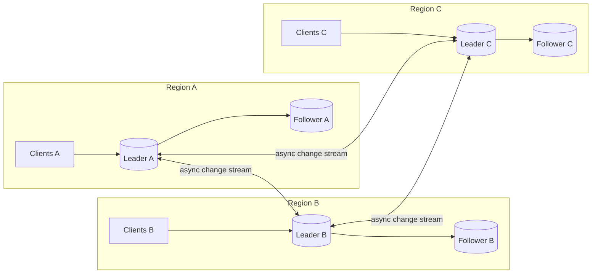
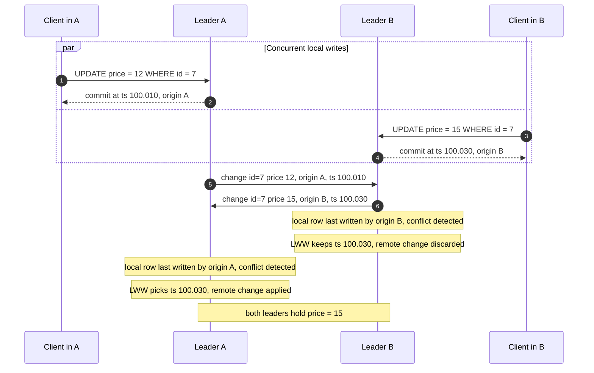
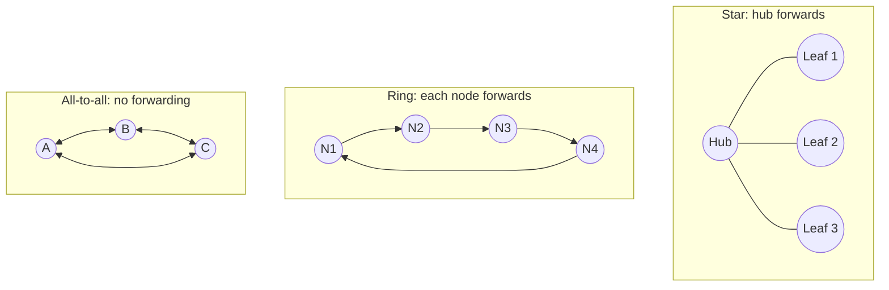
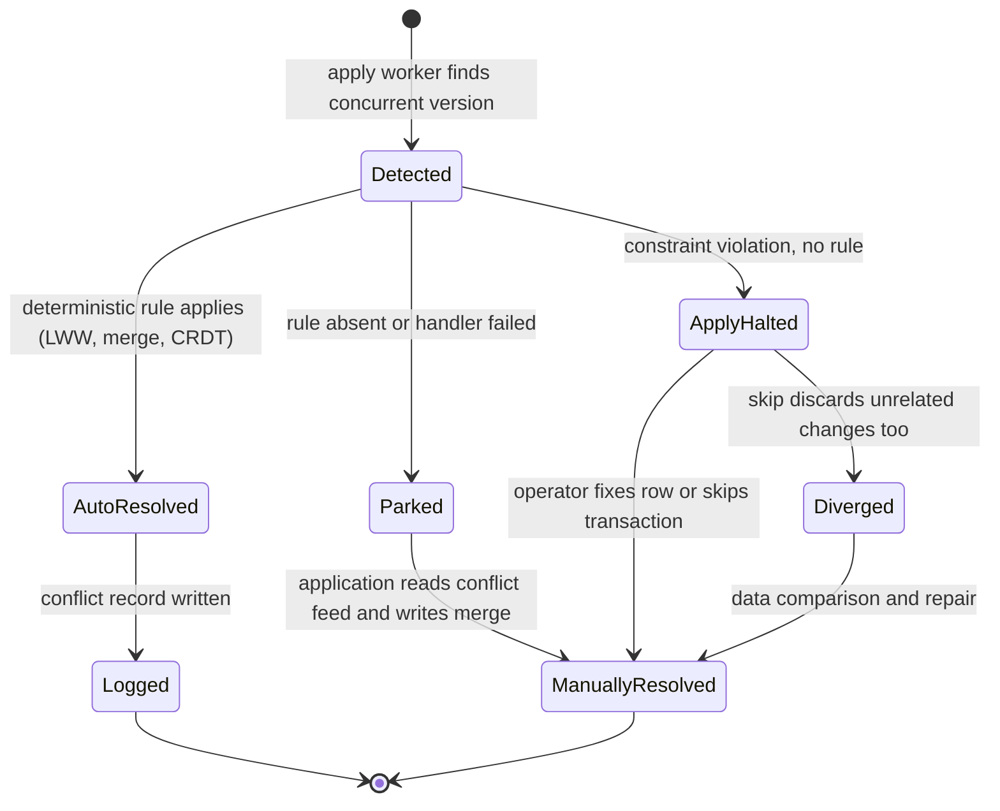
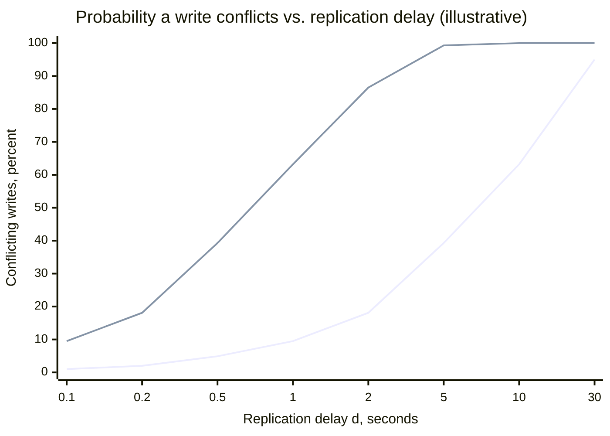
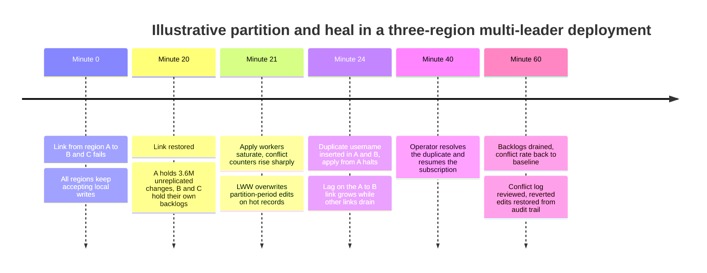

Çok liderli replikasyon (multi-leader replication; active-active ya da multi-master replikasyon olarak da anılır), aynı veri için birden fazla node'un yazma kabul etmesine izin verir. Her leader yazmayı yerelde commit eder, istemciye onay verir ve değişikliği daha sonra diğer tüm leader'lara gönderir; onlar da değişikliği bir follower gibi uygular. Bu yapılandırmanın var olma nedeni, tek bir leader'ın hiçbir follower'ın ortadan kaldıramayacağı iki sınırıdır: her yazma, leader neredeyse oraya kadar olan ağ gidiş-dönüşünü öder ve yazan taraf leader'a ulaşamadığı anda her yazma başarısız olur. 180 ms uzaktaki bir leader'a yazan bir bölgedeki kullanıcı, istemci güdümlü bir transaction'ın her ifadesi için bu gidiş-dönüşü öder; leader'dan kopmuş bir ofis, mobil cihaz ya da veri merkezi ise hiç yazamaz. Her konumda bir leader olduğunda yazmalar yerel gecikmeyle tamamlanır ve siteler arası bir partition sırasında da devam eder.

Bunun bedeli, tüm yazmaları sıralayan tek bir node'un artık olmamasıdır. İki leader aynı anda aynı satıra yazma kabul edebilir, ikisi de diğerinden habersizdir ve ikisi de istemcisine onay verir. Değişiklikler birbiriyle kesiştiğinde her leader, zaten commit ettiği bir yazmayla çakışan bir yazmayla karşılaşır. Bu noktada bir şeyin nihai değere karar vermesi gerekir; üstelik her leader'da deterministik ve özdeş biçimde. Aksi hâlde kopyalar kalıcı olarak ayrışır. Asıl denge şudur: yerel yazma gecikmesi ve yazmalar için partition toleransı, global bir yazma sırasının kaybına karşı takas edilir. Tek bir leader'ın bedavaya sağladığı eşzamanlılık kontrolü, benzersizlik ve satırlar arası değişmezler (invariant), uygulamanın etrafından dolaşacak biçimde tasarlanması gereken sorunlara dönüşür; bunların bir kısmının replikasyon katmanı içinde hiçbir çözümü yoktur.

Çok liderli replikasyon, iki komşusunun arasında duran replikasyon topolojisidir. [Lider tabanlı replikasyon](/distributed-systems/tr/data-management/replication/leader-based-replication/), her veri kümesi için tek bir yazıcı tutar ve çakışmaları yapısı gereği önler; [lidersiz replikasyon](/distributed-systems/tr/data-management/replication/leaderless-replication/) ise her replikanın her yazmayı almasına izin verir ve ayrışmayı okuma anında quorum'larla çözer. Çok liderli model ortadadır: her leader kendi sitesi için sıradan bir tek liderli veritabanıdır ve çakışma yönetimi siteler arasındaki asenkron bağlantılarda gerçekleşir. Aynı yapı, bir istemcinin yazılabilir yerel bir kopya tuttuğu her durumda daha küçük ölçekte de ortaya çıkar; offline-first mobil uygulamalarda ve ortak çalışmalı editörlerde her cihaz, replikasyon bağlantısı çoğu zaman kopuk olan bir leader'dır.


*Üç bölgeli bir çok liderli kurulum. Her bölgenin içinde replikasyon sıradan leader-follower replikasyonudur; bölgeler arasında ise her leader hem değişiklik yayımlar hem de uygular.*

Diyagramda iki ayrı replikasyon sistemi görünür ve özellikleri farklıdır. Bir bölgenin içinde leader o bölgenin tüm yazmalarını sıralar, follower'ları da bunları commit sırasıyla uygular; tek liderli bir sistemin senkron ya da asenkron onay seçenekleri ve gecikme davranışı burada aynen geçerlidir. Bölgeler arasında ise hiçbir şeyi kimse sıralamaz: her çift yönlü ok, her biri tek bir leader'ın kendi commit sırasını taşıyan, birbirinden bağımsız iki asenkron akıştır. Bir satır üç leader'ın herhangi birinde değiştirilebilir ve bu değişikliklerden ikisinin karşılaştığı tek yer, ikisi de onaylandıktan sonra, bir bağlantının uygulama (apply) tarafıdır. Bu sayfada bundan sonra anlatılan her şey o karşılaşma noktasında olanlarla ilgilidir.

## Yazma Yolu: Yerel Commit, Etiketli Değişiklik, Uzak Uygulama

Çok liderli bir sistemdeki yazma, tek bir leader'daki yerel yolun aynısını izler; ardından tek liderli replikasyonda karşılığı olmayan ikinci bir hatta girer. Adım adım:

1. İstemci yazmayı yerel leader'ına gönderir; leader yazmayı kendi yerel eşzamanlılık kontrolüyle çalıştırır. Satır kilitleri, unique indeksler ve foreign key'ler yalnızca yerel kopyaya göre denetlenir.
2. Leader yerelde commit eder ve değişikliği, uzak tarafın ihtiyaç duyacağı metadata ile birlikte log'una (PostgreSQL'de write-ahead log, MySQL'de binary log) yazar: kaynak node'un kimliği, commit timestamp'i ve bazı sistemlerde satır başına bir versiyon ya da version vector.
3. İstemci onayını alır. Bu andan itibaren yazma tek bir sitede kalıcıdır ve başka her yerde görünmezdir.
4. Kaynaktaki bir replikasyon süreci commit edilmiş değişiklikleri satır düzeyindeki olaylara çözer ve bunları kaynağın commit sırasıyla her eşe (peer) akıtır.
5. Her eşte bir apply worker hedef satırı bulur ve onu gelen değişikliğin bulmayı beklediği durumla karşılaştırır. Yerel satır en son aynı kaynak tarafından değiştirilmişse ya da gelen değişiklik yeni bir anahtarın düz bir eklemesiyse çakışma yoktur ve değişiklik uygulanır.
6. Yerel satır, değişikliğin temel aldığı durumdan sonra başka bir kaynak tarafından değiştirilmişse apply worker bir çakışma tespit etmiş olur ve çözüm kuralını çağırır. Kural ya yerel versiyonu tutar, ya uzak versiyonu tutar, ya ikisini birleştirir ya da çakışmayı daha sonra çözülmek üzere kaydeder.
7. Uygulanan değişiklik, eşin kendi log'una orijinal kaynağıyla etiketlenmiş olarak yazılır; böylece eşin follower'ları onu alır ve eş değişikliği geldiği yere geri göndermez.


*İki leader aynı satırı eşzamanlı olarak günceller. İki istemci de başarı yanıtı alır; çakışma ancak değişiklik akışları kesiştiğinde tespit edilir ve last-write-wins kuralı iki tarafın aynı değerde yakınsamasını sağlar.*

Sorunun tamamı 2. ve 4. adımlardadır. İki istemciye de yazmasının başarılı olduğu söylenmiştir ve İstemci A'nın yazması daha sonra her node'da atılır: 2. adımdaki onay "nihai değer bu olacak" anlamına değil, "burada commit edildi" anlamına gelir. 5. ve 6. adımları izleyen tespit, apply worker'ın yerel satırı en son kimin yazdığını bilmesine ve bunu gelen değişikliğin kaynağıyla karşılaştırmasına dayanır; bu metadata satır başına saklanmalı ve eşzamanlı her değişiklik gelene kadar yaşamalıdır. Çözüm yalnızca iki leader aynı iki versiyona aynı kuralı uygulayıp aynı cevaba ulaştığı için yakınsar: biri uzak değişikliği atarak, diğeri uygulayarak. Hangi versiyonun yerel olduğuna göre farklı cevap veren bir kural A'yı 15'te, B'yi 12'de bırakırdı ve bunu düzeltecek başka bir trafik de olmazdı.

### Döngü Önleme ve Replikasyon Topolojileri

7. adımın kendine ait bir doğruluk sonucu vardır. Leader B, A'nın değişikliğini yeni bir yerel yazma olarak log'lasaydı onu A'ya geri replike ederdi; A onu tekrar uygular ve B'ye gönderirdi ve bu sonsuza kadar sürerdi. Her çok liderli sistem değişiklikleri kaynaklarıyla etiketler ve bu etikete göre filtreler. MySQL, her binary log olayına kaynak `server_id`'yi yazar ve bir replika varsayılan olarak kendi server ID'sini taşıyan olayları yok sayar; yanlışlıkla aynı ID ile yapılandırılmış iki sunucu ya birbirinin değişikliklerini düşürür ya da filtre kapatılmışsa döngüye girer. PostgreSQL mantıksal replikasyonu (logical replication) subscriber tarafında replikasyon kaynaklarını (replication origin) izler; PostgreSQL 16'dan beri `origin = none` ile oluşturulan bir subscription yalnızca publisher'ın kendisinde doğmuş değişiklikleri alır. Bu da değişikliklerin node'lar arasında sekmeden çift yönlü replikasyonu mümkün kılar.

Kaynak etiketleme değişikliklerin iletilmesine (forwarding) de izin verir ve yaygın üç topolojiyi birbirinden ayıran budur.


*Üç çok liderli topoloji. All-to-all'da her leader yalnızca kendi yazmalarını gönderir; halka ve yıldız topolojilerinde node'lar aldıkları değişiklikleri iletir ve bir değişikliği evine döndüğünde durdurmak için kaynak etiketleri gerekir.*

Halkada N1'den çıkan bir değişiklik N4'e ulaşmadan önce N2 ve N3'ten geçer; N4 onu N1'e iletmek zorundadır, N1 de kendi kaynağını tanıyıp değişikliği durdurur. Bundan iki özellik çıkar. Yayılım gecikmesi tüm atlamaların toplamıdır; dolayısıyla ileride anlatılan çakışma penceresi halka büyüdükçe genişler. Ve tek bir arızalı node halkayı koparır: N2 kapalıysa halka yeniden yapılandırılana kadar N3 ve N4, N1'den hiçbir şey almaz ve yeniden yapılandırma değişiklikleri ne yeniden oynatmalı ne de atlamalıdır. `log_replica_updates` açık asenkron replikalardan kurulan klasik MySQL dairesel replikasyonu tam olarak bu biçimdedir. Yıldızın hub'ında aynı tekil arıza noktası vardır ama yol her zaman iki atlamadır. All-to-all'da ne iletme ne de tekil arıza noktası vardır; modern sistemlerin varsayılan olarak onu seçmesinin nedeni budur. Ancak bağlantıları bağımsızdır ve farklı hızlarda çalışır; bu yüzden diğer ikisinde olmayan bir sorun doğurur: bir leader'ın değişikliği, nedensel olarak bağlı olduğu başka bir leader'ın değişikliğini geçebilir. Node B, A'dan gelen bir eklemeyi uygular, sonra eklenen satırı günceller; B'den C'ye bağlantı A'dan C'ye bağlantıdan hızlıysa C, henüz var olmayan bir satır için güncelleme alır. Bu anomali, gerçek sistemlerdeki sonucu ve çözümleri aşağıda bir hata modu olarak incelenir.

## Çakışma Nedir ve Tespit Neyi Görebilir

İki yazma, eşzamanlı yapıldıklarında, yani iki leader'dan hiçbiri kendi yazmasını kabul ettiğinde diğerininkini henüz uygulamamışsa ve birleşik etkileri uygulanma sıralarına bağlıysa çakışır. Eşzamanlılığın kesin tanımı, iki yazma arasında bir [happened-before](/distributed-systems/tr/foundations/time-and-ordering/happened-before/) ilişkisinin bulunmamasıdır. Tanımın gözden kaçması kolay bir operasyonel sonucu vardır: çakışma, duvar saatine göre aynı anda olmakla ilgili değildir. Replikasyon bağlantısı bir saat boyunca kopuksa, aralarında bir saat bulunan iki yazma eşzamanlıdır; ikincisi birinciyi zaten uygulamış bir leader'da kabul edilmişse, aralarında bir milisaniye bulunan iki yazma eşzamanlı değildir.

Çakışmalar, replikasyon katmanının onları görüp göremediğine göre farklılaşan sınıflara ayrılır.

| Çakışma sınıfı | Örnek | Apply worker görebilir mi? | Tipik ele alış |
|---|---|---|---|
| Aynı satırda güncelleme-güncelleme | İki bölge aynı ürünün fiyatını değiştirir | Evet, satır başına kaynak ya da versiyon saklanıyorsa | LWW, sütun düzeyinde birleştirme, uygulama birleştirmesi |
| Aynı anahtarda ekleme-ekleme | İki bölge de primary key'i 42 olan bir satır oluşturur | Evet, apply sırasında yinelenen anahtar olarak | Hata verip durmak ya da satırın tamamında LWW |
| Güncelleme-silme | Bir bölge, diğerinin güncellediği bir satırı siler | Yalnızca silmeler tombstone bırakıyorsa | Silme kazanır, güncelleme kazanır ya da atlanır |
| Anahtarlar arası benzersizlik | İki bölge aynı kullanıcı adını farklı satır ID'leriyle kaydeder | İki istemciye de başarı denildikten sonra, apply sırasında unique indeks ihlali olarak | Hata verip durmak; tasarımla ortadan kaldırılmalı |
| Satırlar arası değişmez | İki bölge son koltuğu, her biri farklı bir satırda rezerve eder | Hayır: her satır tek başına geçerlidir | Replikasyonla çözülemez |

Son iki satır, replikasyonun yapabileceklerinin sınırını çizer. Kullanıcı adı durumu tespit edilir, ama ancak iki kullanıcıya da adın kendilerine ait olduğu söylendikten sonra; replikasyon katmanı durabilir ya da satırlardan birini seçebilir, ama bir kullanıcıya söylediğini geri alamaz. Koltuk durumu ise hiç tespit edilmez; çünkü her bölge farklı bir rezervasyon satırı eklemiştir ve iki satır da geçerlidir. İhlal edilen kural (rezervasyonlar koltuk sayısını asla aşmaz) satırlara yayılır ve satır düzeyindeki bir apply worker için görünmezdir. Tek bir veritabanında iki transaction'ın her biri tutarlı bir snapshot okuyup farklı satırlar yazdığında oluşan write skew, aynı anomalinin tek node içindeki hâlidir ve [zayıf izolasyon](/distributed-systems/tr/data-management/consistency-models/weak-isolation-mvcc/) altında incelenir. Leader'lar arasında ise hiçbir izolasyon seviyesi bunu önleyemez, çünkü leader'lar ortak bir snapshot paylaşmaz.

### Tespit Sinyalleri: Kaynak, Timestamp, Versiyon

Görünür sınıflar için apply worker'ın, yerel satır üzerinde yerel versiyonun gelen değişikliğin zaten bildiği bir şey olup olmadığını söyleyen metadata'ya ihtiyacı vardır. Pratikte üç sinyal kullanılır ve kesinlikleri farklıdır.

En ucuzu, yerel satıra yapılan son yazmanın kaynağı ve commit timestamp'idir. Yerel satır en son gelen değişiklikle aynı kaynak tarafından yazılmışsa, kaynağın kendi commit sırası gelen değişikliğin daha yeni olduğunu garanti eder; çakışma yoktur. Farklı bir kaynak tarafından yazılmışsa worker çakışma işaretler. Bu sinyal fazla raporlar: A'dan gelen ve B'nin daha önceki yazmasını zaten içeren bir duruma dayanan bir değişiklik de çakışma gibi görünür, çünkü satırın son yazarı B'dir ve gelen değişiklik A'dan gelir. PostgreSQL, `update_origin_differs` ve `delete_origin_differs` durumlarını bu şekilde, subscriber'da `track_commit_timestamp` açıkken saklanan commit timestamp'lerini kullanarak tespit eder.

İkincisi, değişikliğin taşıdığı satır öncesi görüntüsünü (before-image) mevcut yerel satırla karşılaştırmaktır. İkisi farklıysa satırı başka biri değiştirmiştir. Bu, eşzamanlılığı satır içeriği düzeyinde tespit eder; tesadüfen aynı değerleri üreten iki eşzamanlı yazma özdeş görünür, ki bu zararsızdır. Kontrolün bedeli, her apply'da tam bir satır karşılaştırmasıdır.

Kesin sinyal, satır başına bir [version vector](/distributed-systems/tr/foundations/time-and-ordering/vector-clocks/)'dür: her leader için bir sayaç; her yerel yazma kendi sayacını artırır, apply sırasında vektörler birleştirilir. Gelen vektörü yerel vektörle karşılaştırmak, birinin diğerine baskın olup olmadığını (bu durumda çakışma yoktur) ya da eşzamanlı olup olmadıklarını söyler. Version vector'ler asla fazla raporlamaz ve eşzamanlılığı asla kaçırmaz; bedeli, satırı yazmış her leader için bir girdi saklamaktır. Binlerce cihazın leader gibi davranmasına izin veren sistemler, örneğin revision tree'leriyle CouchDB, bunun yerine düzenleme geçmişini saklar ve aynı bilgiyi oradan çıkarır.

Kaynak olmadan yalnızca timestamp kullanmak en zayıf sinyaldir: yazmaları sıralar ama "B'nin yazması daha yeni ve A'nınkine dayanıyor" ile "B'nin yazması daha yeni ve A'nınkiyle eşzamanlı" durumlarını ayırt edemez. Yalnızca timestamp kullanan bir sistem çakışmaları hiç tespit etmez; her yazma çiftini sıralar ve sonrakinin kazanmasına izin verir. Bu, aşağıda anlatılan last-write-wins kuralıdır. İlgili herkes eşzamanlı yazmaları sessizce attığını bildiği sürece geçerli bir tasarımdır.

Silmeler her şemada ek özen ister. Bir silme satırı metadata'sıyla birlikte kaldırırsa, sonradan gelen eşzamanlı bir güncelleme satırı bulamaz ve satırın hiç oluşturulmadığını mı yoksa eşzamanlı olarak silindiğini mi ayırt edemez. Sistemler, her eş silmeyi görene kadar, silmenin kaynağını ve timestamp'ini taşıyan silinmiş satır işaretleri olan tombstone'ları tutar. PostgreSQL 19, bu amaçla ölü tuple'ları saklayarak `update_deleted` durumunun tespitini ekledi; subscription başına `retain_dead_tuples` ile açılır. Bu olmadan gelen güncelleme `update_missing` olarak raporlanır ve atlanır.

## Yakınsama: Çözümün Koruması Gereken Değişmez

Çok liderli bir sistemin sunabileceği garanti yakınsamadır (convergence): tüm leader'lar aynı yazma kümesini aldıktan sonra, her leader'ın bu yazmaları hangi sırayla aldığından bağımsız olarak aynı veriyi tutarlar. Belirli bir yazmanın hayatta kalacağını, istemcilerin tek bir sıra gözlemleyeceğini, satırlar arası değişmezlerin korunacağını ya da bir okumanın, yazmayı kabul eden leader dışında herhangi bir yerde onaylanmış son yazmayı döndüreceğini garanti etmez. Yakınsama, [nihai tutarlılığın](/distributed-systems/tr/data-management/consistency-models/eventual-consistency/) çok liderli biçimidir.

Bir çözüm kuralı, sonucu yalnızca çakışan versiyonların kümesine bağlıysa, hangi versiyonun yerel olduğuna, apply zamanına ya da başka herhangi bir node'a özgü duruma asla bağlı değilse yakınsamayı korur. En yaygın kuralın sezgisi bunun nedenini gösterir. Bir satırın her versiyonunun bir timestamp taşıdığını, eşitliklerin node ID ile bozulduğunu ve kuralın en büyük `(timestamp, node_id)` çiftine sahip versiyonu tuttuğunu varsayalım. Tam bir sıra altında maksimumu almak değişmeli (commutative), birleşmeli (associative) ve idempotent bir işlemdir: versiyonları hangi sırayla, hangi tekrarlarla uygularsanız uygulayın aynı maksimum çıkar. Bir leader tüm versiyonları aldıktan sonra hepsinin maksimumunu tutar; diğer her leader da öyle. Aynı argüman bu üç cebirsel özelliğe sahip her birleştirme fonksiyonu için geçerlidir; bu, durum tabanlı bir [CRDT](/distributed-systems/tr/data-management/consistency-models/crdts/)'nin tanımıdır ve last-write-wins böyle fonksiyonların en basitidir.

Argüman yakınsamanın nasıl bozulduğunu da gösterir. "Yerel versiyonu tut" kuralı hangi versiyonun yerel olduğuna bağlıdır: A, A'nın yazmasını, B de B'ninkini tutar ve sistem ayrışır. "Her zaman uzak versiyonu uygula" kuralı aynı şekilde, ters yönde bozulur ve değerleri node'lar arasında takas eder. Çözüm sırasında başka satırları okuyan ya da harici bir servisi çağıran özel bir handler yalnızca çakışan versiyonların fonksiyonu değildir ve farklı node'larda farklı cevaplar verir. Her çözüm kuralı, replikasyon ürününün varsayılanları dahil, devreye alınmadan önce bu teste tabi tutulmalıdır.

:::danger[Sessizce ayrışan varsayılan davranış]
PostgreSQL'in yerleşik mantıksal replikasyonu `update_origin_differs` durumunu tespit eder ve ardından her zaman uzak değişikliği uygular. Çift yönlü bir kurulumda bir satıra yapılan iki eşzamanlı güncellemede her node diğerinin değerini uygular ve node'lar birbirlerinin verisiyle, kalıcı olarak ve hiçbir hata vermeden kalır. Yerleşik mantıksal replikasyon bu çakışmaları log'lar ve sayar (PostgreSQL 18 ve sonrası) ama çözmez. Onu çift yönlü olarak yalnızca uygulama satır başına tek yazıcıyı garanti ediyorsa kullanın ve çakışma sayaçlarına, bu garantinin bozulduğunun kanıtı olarak alarm bağlayın.
:::

### Tespit Edilmiş Bir Çakışmanın Yaşam Döngüsü

Çözüm farklı anlarda ve farklı sahipler tarafından gerçekleşebilir; üretimdeki bir sistem genellikle birkaçını birleştirir. Aşağıdaki state machine, tek bir çakışmayı tespitten son durumuna kadar izler.


*Tespit edilmiş bir çakışmanın durumları. Otomatik çözüm replikasyonun akmaya devam etmesini sağlar; park etmek kararı uygulamaya erteler; duran bir apply worker ise bir operatör müdahale edene kadar tüm akışı durdurur.*

`Detected` durumundan çıkan üç yolun operasyonel maliyeti çok farklıdır. Otomatik çözüm akışı sürdürür ve bir log kaydı bırakır; bu kayıt ancak biri onu okursa bir anlam taşır. Park etmek, Cosmos DB'nin conflicts feed'i ve CouchDB'nin kaybeden revizyonları tutması gibi, akışı sürdürür ve kararı uygulama koduna bırakır; bu kodun var olması ve çalışması gerekir. Duran bir apply worker, PostgreSQL ve MySQL'de kısıt ihlallerine verilen varsayılan tepkidir: o kaynaktan gelen replikasyon tamamen durur, o kaynaktan gelen sonraki her değişiklik çakışanın arkasında sıraya girer ve bir operatör harekete geçene kadar gecikme büyür. Bu kurtarmadaki tuzak `Diverged`'e giden yoldur: başarısız transaction'ı atlamak, içindeki çakışmayan değişiklikler dahil her değişikliği atlar.

### Strateji 1: Her Kayda Bir Ev Vererek Çakışmayı Önlemek

En etkili çözüm stratejisi, önemli veri için çakışmayı imkânsız kılmaktır. Her kayda, ya da her kullanıcıya, tenant'a veya hesaba bir ev leader'ı (home leader) atanır ve ona yapılan tüm yazmalar oraya yönlendirilir; diğer leader'lar okuma kopyaları tutar. Tek bir kayıt açısından bu, tek liderli replikasyondur ve çakışma analizi çöker: kayıt başına tek yazıcı, ona eşzamanlı yazma olmaması demektir. Çok liderli model bu durumda yalnızca farklı kayıtların leader'larının farklı yerlerde olması anlamına gelir; bu da çoğunlukla kendi verisini kendi evine yakın yerde yazan kullanıcılara yine yerel yazma gecikmesi sağlar.

Garanti ancak ev yer değiştirmediği sürece geçerlidir. Bir kullanıcı taşındığında ya da bir bölge arızalandığında ev değişir ve eski ile yeni ev kısa bir süre aynı kayıt için yazma kabul edebilir. Güvenli bir devir, eski evde yazmaları durdurur, yeni ev eski evin log'unu durma konumuna kadar uygulayana dek bekler ([replikasyon gecikmesi](/distributed-systems/tr/data-management/replication/replication-lag/) sayfasında anlatılan bir konum token'ı) ve ancak ondan sonra yazma kabul etmeye başlar. Bir bölge arızası bu beklemeye izin vermez: yeni ev, eski evin son değişiklikleri olmadan başlar ve eski bölge geri döndüğünde replike edilmemiş yazmaları yeni evinkilerle çakışır. Dolayısıyla ev yönlendirmesi çakışmaları failover pencerelerine daraltır; bir çözüm kuralına duyulan ihtiyacı ortadan kaldırmaz.

:::tip[Kullanıcının konumuna göre değil, kayda göre yönlendirin]
Ev yönlendirmesi, bir kaydın yazarları belirli bir yerde toplandığında işe yarar: bir kullanıcının profili, bir tenant'ın yapılandırması, bir mağazanın stoğu. Global bir sayaç ya da paylaşılan bir belge gibi her yerden yazılan kayıtlarda yardımcı olmaz. Her isteği en yakın bölgeye yönlendirmek yerine kayıt başına bir ev tutun (çoğu zaman tenant'ta ya da anahtarda kodlanır) ve bir ev her taşındığında devir konumunu kaydedin.
:::

### Strateji 2: Son Yazı Kazanır ve Ayrıntı Düzeyi

Son Yazı Kazanır (Last-Write-Wins, LWW) her versiyona bir timestamp ekler ve en büyüğünü tutar. Her zaman yakınsar ve uygulama kodu gerektirmez; DynamoDB global tables'da, Cosmos DB'de ve çoğu PostgreSQL multi-master eklentisinde varsayılan olmasının nedeni budur. Ayrıca biri dışında tüm eşzamanlı yazmaları kimseye haber vermeden atar ve fiziksel timestamp'lerle "son" yazmaya, yazmalar arasındaki farktan daha fazla ayrışabilen saatler karar verir. Saat kayması (clock skew) ve kayıp güncelleme hesabı dahil LWW'nin tam analizi [Nihai Tutarlılık: Son Yazı Kazanır](/distributed-systems/tr/data-management/consistency-models/eventual-consistency/) sayfasına, saat davranışı ise [Fiziksel Saatler](/distributed-systems/tr/foundations/time-and-ordering/physical-clocks/) sayfasına aittir.

Çok liderli replikasyona özgü olan, kuralın uygulandığı ayrıntı düzeyidir (granularity). Satır düzeyinde LWW tüm satırı tek parça olarak tutar: A bölgesi bir müşterinin e-postasını, B bölgesi de eşzamanlı olarak aynı müşterinin telefon numarasını değiştirirse, timestamp'i büyük olan satır kazanır ve iki yazma farklı sütunlara dokunmuş olsa da diğer değişiklik kaybolur. Sütun düzeyinde çözüm, sütun başına bir timestamp saklar ve LWW'yi sütun sütun uygular; böylece iki değişiklik de hayatta kalır. EDB Postgres Distributed bunu sütun düzeyinde çakışma tespiti (column-level conflict detection) olarak sunar ve değişikliğin eski satırın tamamını taşıması için `REPLICA IDENTITY FULL` gerektirir. Bedeli sütun başına metadata'dır ve iki yazma aynı sütuna dokunduğunda yardımcı olmaz.

### Strateji 3: Birleştirme Fonksiyonları, Kardeş Versiyonlar ve CRDT'ler

Hiçbir yazmanın atılmasına izin verilmediğinde çözüm versiyonları birleştirmelidir. Kullanımda üç biçim vardır. Uygulama birleştirme handler'ı veritabanına kaydedilir ve her çakışmada çağrılır; Cosmos DB'nin özel politikası kayıtlı bir birleştirme stored procedure'ünü çağırır, kayıtlı procedure yoksa ya da exception fırlatırsa çakışma conflicts feed'e gider. Kardeş versiyonlar (siblings) eşzamanlı her versiyonu tutar ve hepsini bir sonraki okuyucuya döndürür; okuyucu bunları birleştirip sonucu geri yazar. CouchDB, kaybeden revizyonları belgenin revision tree'sinde çakışan yapraklar olarak tutar. Çakışmasız çoğaltılmış veri türleri (Conflict-free Replicated Data Types, CRDT), değeri birleştirmesi yapısı gereği değişmeli, birleşmeli ve idempotent olan bir veri yapısıyla değiştirir; leader başına artışları tutan bir sayaç ya da eklemeleri ve çıkarmaları ayrı izleyen bir küme gibi. Üçü de yakınsama testini ancak birleştirmenin kendisi deterministik ve sıradan bağımsızsa geçer; uygulamanın yazdığı handler'larda çoğu zaman bu özellik eksiktir. CRDT'ler, bu özelliğin umulmak yerine kanıtlandığı biçimdir ve [CRDT'ler](/distributed-systems/tr/data-management/consistency-models/crdts/) sayfasında derinlemesine ele alınır.

### Strateji 4: Çözülemeyeni Tasarımla Ortadan Kaldırmak

Benzersizlik ve satırlar arası değişmezler, yazma onaylanmadan önce bir karar verilmesini gerektirir; çok liderli replikasyon bunu sağlayamaz. İşe yarayan tasarımlar bu kararı tek bir sahibi olan bir yere taşır. Tanımlayıcı çakışmaları ID uzayını bölümleyerek önlenir: her leader ID'leri kendi aralığından ya da kendi node bit'leriyle üretir; MySQL'in `auto_increment_increment` ve `auto_increment_offset` ayarlarında olduğu gibi ya da [Dağıtık ID Üretimi](/distributed-systems/tr/foundations/time-and-ordering/distributed-id-generation/) sayfasında anlatılan global olarak benzersiz ID'lerle. Kullanıcı adı ya da e-posta adresi gibi doğal anahtar benzersizliği, talebi anahtarın sahibi olan tek bir leader'a ya da consensus ile replike edilen bir kayıt defterine yönlendirerek zorlanır. Koltuk ya da stok gibi sınırlı kaynaklar leader başına paylara (escrow) bölünür; böylece her leader koordinasyon olmadan kendi payından satabilir ve yalnızca payları yeniden dengelemek için koordinasyon yapar.

:::caution[Unique kısıtlar yerel vaatlerdir]
Çok liderli bir tablodaki unique indeks, benzersizliği yalnızca aynı leader üzerinden yazılan satırlar arasında garanti eder. İki leader aynı e-posta adresini ayrı ayrı kabul edebilir, iki istemci de başarı yanıtı alır ve çakışma, apply sırasında replikasyonu durduran bir yinelenen anahtar hatası olarak ortaya çıkar. İhlali yalnızca tespit edilmesi değil önlenmesi gereken her kısıt, koruduğu anahtar uzayı için tek bir sahibe ihtiyaç duyar.
:::

## Sayısal Örnek: Çakışmalar Ne Sıklıkla Olur

Normal koşullarda leader'lar arası replikasyon gecikmesi `d` 200 ms olan ve en uzak iki bölgesi arasındaki gidiş-dönüş süresi 180 ms olan üç bölgeli bir kurulum varsayalım. Bu bölümdeki tüm sayılar örnek amaçlıdır.

Motivasyon gecikmedir. A bölgesinde tek bir leader varken, C bölgesindeki bir istemcinin dört ifadeyi tek tek gönderdiği bir transaction commit'ten önce dört gidiş-dönüş, yaklaşık 720 ms öder; yerel bir leader ile birkaç milisaniyelik dört yerel gidiş-dönüş öder. Örneğin geri kalanı bu farkın bedelini hesaplar.

Aynı anahtara yapılan iki yazma, her biri diğeri gelmeden kabul edilmişse çakışır; dolayısıyla bir leader'da `t` anındaki bir yazma, başka bir leader'da `t - d` ile `t + d` aralığında yapılan her yazmayla çakışır. Diğer leader'larda bir anahtara yapılan yazmalar toplam `L` hızıyla bir Poisson süreci olarak geliyorsa, belirli bir yazmanın çakışma olasılığı `P = 1 - exp(-2 * d * L)` olur. Dolayısıyla çakışma oranı toplam trafiğe değil, replikasyon gecikmesi ile diğer sitelerden gelen anahtar başına yazma hızının çarpımına bağlıdır.

Ev yönlendirmesi olmayan kullanıcı profillerinde, her biri profilini günde 4 kez yazan 20 milyon kullanıcı ve bir kullanıcının yazmalarının %10'unun geri kalanını işleyen bölgeden farklı bir bölgeye düştüğünü (seyahat, VPN'ler, yanlış yönlendirilmiş istekler) varsayalım. Belirli bir yazma için `L` yaklaşık `0.1 * 4 / 86,400`, yani saniyede `4.6e-6` olur ve `P = 1 - exp(-2 * 0.2 * 4.6e-6)`, yaklaşık `1.9e-6` çıkar. Günde 80 milyon profil yazmasında bu, günde kabaca 150 çakışma demektir. Last-write-wins ile günde 150 kullanıcı bir profil değişikliğinin geri döndüğünü görür; ev yönlendirmesiyle bu sayı failover'lar dışında sıfırdır.

Sıcak ve paylaşılan bir anahtar için, read-modify-write ile saniyede 30 kez, bölge başına 10 kez azaltılan bir stok sayacı varsayalım. Herhangi bir yazma için diğer iki bölge saniyede `L = 20` katkı yapar, `2 * d * L = 8` ve `P = 1 - exp(-8)`, %99.9'un üzerindedir. Neredeyse her azaltma, yaklaşık sekiz diğer azaltmayla eşzamanlıdır ve LWW altında hayatta kalan her yazma, üzerine yazdığı azaltmaları yok sayan bir sayı taşır. Hiçbir çözüm ayrıntı düzeyi bunu düzeltmez; sayaç bir CRDT sayacı olmalı ya da anahtarın tek bir evi olmalıdır.


*Diğer bölgelerden saniyede L = 0.05 (alt çizgi) ve saniyede L = 0.5 (üst çizgi) hızla yazılan, orta düzeyde paylaşılan bir anahtar için `P = 1 - exp(-2dL)`. Hızlar örnek amaçlıdır.*

Eğri, normal işleyişte sessiz olan çok liderli sistemlerin neden çakışma patlamaları ürettiğini açıklar. 200 ms'lik normal gecikmede orta düzeyde paylaşılan anahtar yazmalarının %2'sinde çakışır. Bozulmuş bir bağlantıdan ya da apply worker'ı tıkayan büyük bir transaction'dan kaynaklanan 10 saniyelik bir replikasyon yavaşlaması, trafikte hiçbir değişiklik olmadan bu oranı %63'e çıkarır. Çok liderli bir sistemde gecikme, tek liderli replikasyondaki gibi yalnızca bayatlık değildir; çakışma penceresinin genişliğidir.

Uç durum bir partition'dır. A bölgesinin 20 dakika boyunca koptuğunu, üç bölgenin de yazma kabul etmeye devam ettiğini varsayalım. Partition boyunca kesiti aşan yazmalar için `d` fiilen 1,200 saniyedir. Profil iş yükünde, evi A olan bir kullanıcı bu 20 dakika içinde hem A'da hem başka bir yerde yazdıysa çakışır: kullanıcı başına yaklaşık `(1 - exp(-0.9 * 4 * 1,200 / 86,400)) * (1 - exp(-0.1 * 4 * 1,200 / 86,400))`, yani `2.7e-4`; evi A olan 6.7 milyon kullanıcının kabaca 1,800'ü. Partition ayrıca bir birikim bırakır. A saniyede 3,000 yazma kabul ediyorsa 3.6 milyon replike edilmemiş değişiklik biriktirir; saniyede 6,000 değişiklik uygulayabilen bir eş, A'nın canlı trafiği saniyede 3,000 eklemeye devam ederken birikimi net saniyede 3,000 hızla eritir ve yetişmek için 20 dakika daha ihtiyaç duyar. Çakışma penceresi partition iyileştiğinde kapanmaz; birikim eridiğinde kapanır ve bu örnekte pencere iki katına çıkar.

Gray, Helland, O'Neil ve Shasha aynı dinamiği 1996'da tembel (lazy) her-yerden-güncelleme replikasyonu için analiz etti ve uzlaştırma (reconciliation) oranlarının sistemden çok daha hızlı büyüdüğünü buldu: modellerinde node sayısında ve trafikte on katlık bir artış, uzlaştırmalarda bin katlık bir artış getirir; çünkü her ek node hem daha fazla yazıcı hem de çakışılacak daha fazla eş ekler. Bu kübik büyüme, üç bölge için çalışan çok liderli tasarımların, çakışma önleme anahtar başına yazıcı sayısını bir tutmadıkça otuz leader'a genişletildiğinde neden başarısız olduğunun biçimsel nedenidir.

## Gerçek Uygulamalar ve Nasıl Saptıkları

Multi-master ya da active-active yazma vaat eden ürünler üç farklı mekanizma uygular ve aradaki farklar, çakışmaların çözülüp çözülmediğine, iptal edilip edilmediğine ya da sessizce geçirilip geçirilmediğine karar verir.

| Sistem | Mekanizma | Çakışma tespiti | Varsayılan çözüm | Ne zaman tercih edilmeli |
|---|---|---|---|---|
| MySQL asenkron multi-source ya da dairesel | İki yönde binary log replikasyonu, kaynak `server_id` ile | Yalnızca apply sırasında yinelenen anahtar ya da eksik satır hataları | Yok: apply hata durumunda durur, mevcut satırlara güncellemeler üzerine yazar | Katı tek yazıcı disiplinine sahip eski iki siteli kurulumlar |
| MySQL Group Replication multi-primary, Galera | Grup iletişimiyle sıralanan ve her node'da sertifikalanan write set'ler | Commit sırasında write set kesişimi | Toplam sırada ilk olan kazanır; diğer transaction iptal edilir | Kayıp güncelleme olmadan her node'da yazma isteyen düşük gecikmeli LAN cluster'ları |
| PostgreSQL yerleşik mantıksal replikasyon | `origin = none` ile çift yönlü subscription'lar (16+) | Satır başına kaynak ve commit timestamp'i, kısıt ihlalleri | Log'lanır ve sayılır (18+); kaynak çakışmalarında uzak uygulanır; kısıt çakışmaları durdurur | Uygulamanın satır başına tek yazıcıyı garanti ettiği ve çakışma alarmı olan kurulumlar |
| EDB Postgres Distributed | Çakışma yönetimli mantıksal replikasyon ağı | Satır ya da sütun düzeyinde, commit timestamp'leriyle | Yapılandırılabilir; varsayılan olarak daha yeni commit timestamp'i; CRDT sütun tipleri | Otomatik çözüm gerektiren PostgreSQL active-active |
| DynamoDB global tables (MREC) | Region replikaları arasında asenkron replikasyon | Item başına | Dahili timestamp üzerinde LWW | Item başına LWW'nin kabul edilebilir olduğu global key-value verisi |
| Cosmos DB çoklu bölge yazma | Yazma bölgeleri arasında asenkron replikasyon | Ekleme, değiştirme ve silme çakışmaları | `_ts` ya da sayısal bir yol üzerinde LWW; özel birleştirme procedure'ü | Birleştirme kancası ya da conflicts feed gerektiren belge verisi |
| CouchDB ve PouchDB | Revision tree'ler, eşler arası replikasyon | Ayrışan revizyon dalları | Deterministik kazanan, kaybedenler çakışma olarak tutulur | Hiçbir düzenlemeyi kaybetmemesi gereken offline-first istemciler |

### Çözümsüz Asenkron Replikasyon

MySQL'in klasik active-active kurulumları, sıradan asenkron replikasyonla birbirine replike eden iki ya da daha fazla sunucudur. Döngüler `server_id` ile, auto-increment çakışmaları da `auto_increment_increment` ve `auto_increment_offset` ile aralıklı üretimle önlenir. Apply thread'inin karşılaştığı hataların ötesinde çakışma tespiti yoktur: satır tabanlı replikasyonda yinelenen bir anahtar ya da eksik bir satır applier'ı hatayla durdurur, var olan bir satıra yapılan güncelleme ise uygulanır ve eşzamanlı yerel değişikliğin üzerine yazar. Bu kurulumu çalıştırabilen operatörler, tek bir aktif yazıcıyı teamülle zorlar ve ikinci sunucuyu tesadüfen yazılabilir olan bir hot standby olarak kullanır.

PostgreSQL'in yerleşik mantıksal replikasyonu 16. sürümde `origin = none` ile benzer bir noktaya geldi; 18 ve 19. sürümler, daha önce listelenen çakışma sınıflandırmasını, yerel ve uzak satır versiyonlarını içeren log kayıtlarını ve `pg_stat_subscription_stats` içinde subscription başına sayaçları ekledi. Hâlâ sağlamadığı şey çözümdür: kaynak çakışmaları yukarıdaki danger kutusunda anlatıldığı gibi uygulanır, eksik satırlar atlanır ve unique kısıt çakışmaları, bir operatör satırı düzeltene ya da transaction'ı atlayana kadar apply worker'ı durdurur.

```sql
-- On node A (node B mirrors this with the names swapped)
CREATE PUBLICATION pub_a FOR TABLE accounts, orders;
CREATE SUBSCRIPTION sub_from_b
    CONNECTION 'host=node-b dbname=app'
    PUBLICATION pub_b
    WITH (origin = none,           -- do not re-send changes that came from A
          copy_data = false,       -- initial data already present on both nodes
          disable_on_error = true); -- stop cleanly instead of retrying in a loop
-- Conflict evidence; requires track_commit_timestamp = on for origin conflicts
SELECT subname, confl_insert_exists, confl_update_origin_differs,
       confl_update_missing, confl_delete_missing
FROM pg_stat_subscription_stats;
```

Çift yönlü kurulumlarda `copy_data = false` satırı önemlidir: başlangıç verisini iki yönde de kopyalamak veriyi çoğaltır. Satır başına tek yazıcı için tasarlanmış bir kurulumda sıfırdan farklı bir `confl_update_origin_differs`, yönlendirme varsayımının ihlal edildiğinin kanıtıdır ve her artış potansiyel bir takas ayrışmasıdır.

### Sertifikasyon: Asenkron Çakışmasız Multi-Primary

Multi-primary modundaki MySQL Group Replication ve Galera Cluster, istemci tarafından bakıldığında çok liderli replikasyon gibi görünür, çünkü her node yazma kabul eder; ancak asenkron replike etmezler ve çakışmaları çözmezler. Commit sırasında bir node, transaction'ın write set'ini, yani değiştirdiği satırların tanımlayıcılarını, tüm write set'leri tüm node'lara tek bir toplam sırayla teslim eden bir grup iletişim katmanı üzerinden yayınlar. Ardından her node her transaction'ı deterministik olarak sertifikalar: write set'i, toplam sırada daha önce gelen ve kendi snapshot'ında görünmeyen bir transaction'ınkiyle kesişiyorsa transaction iptal edilir. Her node aynı diziyi aynı kuralla sertifikaladığı için, oy alışverişi yapmadan aynı kararlara ulaşırlar. Toplam sırada ilk yazan kazanır; kaybedenin istemcisi commit sırasında bir hata alır ve yeniden denemek zorundadır.

Bu, toplam sıralı yayınla (total-order broadcast) replike edilen iyimser eşzamanlılık kontrolüdür ve dengeleri çok liderli sistemlerinkine değil, [consensus](/distributed-systems/tr/coordination/consensus-algorithms/raft/) destekli sistemlerinkine benzer: her commit bir grup gidiş-dönüşünü bekler, bu yüzden node'lar birbirine yakın olmalıdır ve bir partition azınlık tarafını commit edemez hâlde bırakır. Group Replication ayrıca `group_replication_enforce_update_everywhere_checks` açıkken multi-primary modunda bazı işlemleri reddeder; örneğin `SERIALIZABLE` izolasyon seviyesindeki transaction'ları ve cascading foreign key'li tabloları. Sertifikasyon aynı satırdaki kayıp güncellemeleri ortadan kaldırır; satırlar arası write skew'i önlemez, çünkü sertifikasyon okuma kümelerini değil write set'leri karşılaştırır.

:::note[Multi-primary her zaman çok liderli değildir]
Group Replication ve Galera'daki "multi-primary", herhangi bir node'un bir commit'i koordine edebileceği ve çakışmaların onaydan önce iptal edildiği anlamına gelir. Bu sayfadaki "çok liderli" ise bağımsız olarak onay veren ve sonradan uzlaşan leader'lar demektir. Birincisi uzak mesafede yerel gecikmeli yazmalardan ve partition sırasında yazmadan vazgeçer; ikincisi onaylanmış bir yazmanın hayatta kalacağı garantisinden vazgeçer. Bir sertifikasyon cluster'ını bölgeler arası active-active bir veritabanı gibi kullanmak, commit gecikmesini bölgeler arası gidiş-dönüş süresine uzatır.
:::

### Yönetilen Global Tablolar

DynamoDB global tables, varsayılan çoklu Region nihai tutarlılık (multi-Region eventual consistency, MREC) modunda her item değişikliğini asenkron olarak, AWS'e göre tipik olarak bir saniye içinde replike eder ve bir item'a yapılan eşzamanlı değişiklikleri en son dahili timestamp'e sahip olanı tutarak çözer. Koşullu yazmalar yalnızca yerel Region'daki item'a göre değerlendirilir; dolayısıyla iki Region'ın eşzamanlı olarak geçtiği bir koşul kontrolü, daha önce anlatılan benzersizlik sorununun ta kendisidir. Transaction'lar yalnızca onları çalıştıran Region içinde atomiktir ve diğer Region'lar onları kısa bir süre kısmen uygulanmış görebilir. Tablo oluşturulurken seçilen ve tam olarak üç Region'a dağıtılan alternatif çoklu Region güçlü tutarlılık (multi-Region strong consistency, MRSC) modu, onay vermeden önce en az bir başka Region'a senkron replike eder ve başka bir yerde değiştirilmekte olan bir item'a yapılan yazmayı `ReplicatedWriteConflictException` ile reddeder. Bu, sistemi çözümlü çok liderli olmaktan çıkarıp commit anında çakışma önlemeye dönüştürür; bunun getirdiği gecikme ve özellik kısıtlamaları da (transaction yok, TTL yok) beraberinde gelir.

Birden çok yazma bölgesine sahip Cosmos DB, çakışmaları ekleme, değiştirme ve silme çakışmaları olarak sınıflandırır. Varsayılan LWW politikası sistemin `_ts` özelliğini ya da uygulamanın belirttiği sayısal bir özelliği kullanır; silme çakışmalarını yol değerinden bağımsız olarak her zaman silme kazanır. Yalnızca NoSQL API için ve yalnızca container oluşturulurken kullanılabilen özel politika, kayıtlı bir birleştirme stored procedure'ünü çağırır; procedure yoksa ya da başarısız olursa çakışmaları conflicts feed'e yazar.

### Offline İstemciler İçin Revision Tree'ler

CouchDB belgeleri eşler arasında replike eder; PouchDB de modeli tarayıcılara ve cihazlara genişletir. Her belge bir revision tree taşır; başka bir replikanın düzenlemesini görmemiş bir replikadaki düzenleme bir dal oluşturur. Replikasyonda iki dal da tutulur ve her node bağımsız olarak aynı kazanan revizyonu deterministik bir kuralla seçer (silinmemiş yapraklar silinmişlerden önce gelir, ardından daha uzun düzenleme geçmişi, ardından daha büyük revizyon tanımlayıcısı). Kaybedenler, uygulama birleştirilmiş bir revizyon yazıp onları silene kadar `conflicts=true` ile görülebilen çakışan revizyonlar olarak kalır. Tasarım hiçbir düzenlemeyi kaybetmez; bedeli, bir belgeyi okuyan her uygulamanın onun çakışmalarını çözmeye hazır olmasını gerektirmesidir.

## Hata Modları ve Nasıl Göründükleri

### Yakınsamayan Bir Kuraldan Doğan Sessiz Ayrışma

Tetikleyici: hangi versiyonun yerel olduğuna bağlı bir çözüm kuralı altında bir satıra yapılan eşzamanlı güncellemeler; örneğin PostgreSQL'in uzak değişikliği uygulama davranışı ya da yerel değeri tutan bir uygulama handler'ı. Belirtiler: başta hiçbiri; sonra farklı bölgelere yönlendirilen kullanıcılar aynı kayıt için süresiz olarak farklı değerler görür ve destek talepleri "nereden giriş yaptığıma göre değişen" verilerden söz eder. Tespit: çakışma sayaçları ve çakışma log kayıtları çakışmaların olduğunu kanıtlar; ayrışmanın kendisi ise ancak leader'lar arasında veri karşılaştırılarak, periyodik olarak çalıştırılan tablo ya da aralık başına checksum'larla bulunur (MySQL'de yaygın araç `pt-table-checksum`'dır). Önlem: satır başına tek yazıcıyı zorlamak ya da yakınsayan bir kurala geçmek. Kurtarma: ayrışmış her satır için bir doğruluk kaynağı seçip onu tüm leader'larda yeniden yazmak; bu da yeni bir çakışma yaratmamak için tek bir leader üzerinden yapılmalıdır.

### Bir Kısıt Çakışmasıyla Durmuş Apply Worker

Tetikleyici: iki leader aynı anahtarı ya da aynı unique değeri ekler. Belirtiler: bir kaynaktan gelen replikasyon durur; o bağlantıdaki gecikme doğrusal olarak büyür; diğer bağlantılar akmaya devam eder, bu yüzden duran bağlantı yalnızca bir bölgenin başka bir bölgenin son yazmalarını kaçırması olarak görünür. Tespit: subscriber log'undaki apply hataları (PostgreSQL'de `insert_exists` ya da `update_exists`, MySQL'de 1062 hatası), `disable_on_error` tarafından devre dışı bırakılmış bir subscription ve bağlantı başına gecikme. Önlem: çakışan satırı elle çözüp devam ettirmek ya da tam olarak çakışan transaction'ı atlamak (PostgreSQL'de log'daki bitiş konumunu kullanarak `ALTER SUBSCRIPTION ... SKIP`). Atlama, çakışmayan satırlar dahil transaction'ın tamamını atar; bu yüzden her atlamanın ardından dokunduğu tablolar karşılaştırılmalıdır. Kalıcı çözüm, strateji 4'te olduğu gibi kısıtın çok liderli yazmalara bağımlılığını ortadan kaldırmaktır.

### Partition İyileştikten Sonra Çakışma Fırtınası

Tetikleyici: her bölgenin yazma kabul etmeye devam ettiği uzun bir bölgeler arası partition. Belirtiler: bağlantılar geri geldiğinde apply worker'lar büyük bir birikimle karşılaşır, çakışma sayaçları büyüklük mertebeleriyle sıçrar, apply worker'larda CPU doyar ve LWW kazananları seçtikçe kullanıcılar partition dönemindeki düzenlemelerinin geri döndüğünü görür.


*Bir partition'ın çakışmalarının bağlantı geri geldikten sonra nasıl ortaya çıktığını ve tek bir kısıt çakışmasının bir bağlantı için pencereyi nasıl uzattığını gösteren varsayımsal bir iyileşme dizisi.*

Zaman çizelgesi tek bir partition'ın üç etkisini gösterir. Partition sırasında oluşan çakışmalar ancak partition bittikten sonra, birikim uygulanmaya başladığında görünür hâle gelir; dolayısıyla önemli olan alarm, ağ alarmı temizlendikten sonra tetiklenir. Birikim, sayısal örnekte olduğu gibi, eridiği sürece çakışma penceresini açık tutar. Ve tek bir kısıt çakışması diğerleri erirken bir bağlantıyı durdurur; böylece bölgeler farklı zamanlarda yakınsar ve B bölgesi, A'dan B'ye apply'ın durduğu fazladan 20 dakika boyunca A'nın partition dönemindeki yazmalarını kaçırır. Tespit: tür ve bağlantı bazında çakışma sayaçları, bağlantı başına gecikme, apply worker CPU'su. Önlem: apply kapasitesini tolere edilen en uzun partition'ın birikimine göre planlamak, iyileşmelerin durmaması için kısıt çakışmalarını tasarımla ortadan kaldırmak ve geri dönen düzenlemelerin geri yüklenebilmesi için üzerine yazılan versiyonların bir denetim izini (bir çakışma log'u ya da kaybeden versiyonların kendileri) tutmak.

### Leader'lar Arasında Nedensel Sollama

Tetikleyici: bir leader'ın başka bir leader'dan aldığı bir satırı değiştirdiği ve üçüncü bir leader'a bağlantısının orijinal bağlantıdan hızlı olduğu bir all-to-all topoloji.

```mermaid
sequenceDiagram
    autonumber
    participant LA as Leader A
    participant LB as Leader B
    participant LC as Leader C
    LA->>LB: INSERT order 9 status new (origin A)
    Note over LB: applies insert, then a local client cancels
    LB->>LB: UPDATE order 9 status cancelled (origin B)
    LB->>LC: UPDATE order 9 status cancelled
    Note over LC: row 9 not found, update_missing, change skipped
    rect rgb(70, 40, 40)
    LA->>LC: INSERT order 9 status new (slow link, arrives late)
    Note over LC: applies insert, order 9 is new on C forever
    end
    Note over LA,LC: A and B hold cancelled, C holds new, no further change will repair it
```


*All-to-all topolojide nedensel sollama. B'nin güncellemesi A'nın eklemesine bağlıdır, ama C'ye önce ulaşır ve eksik bir satıra güncelleme olarak atlanır.*

3. adımda güncelleme, bağlı olduğu eklemeden önce C'ye ulaşır. PostgreSQL'in yerleşik replikasyonu bunu `update_missing` olarak raporlar ve değişikliği atlar; başka sistemler hata verebilir ya da tamponlayabilir. 4. adımdan sonra C orijinal eklemeyi tutar ve ne A ne de B satır için başka bir değişiklik göndermeyeceğinden C iptali hiçbir zaman öğrenmez. Ayrışma kalıcıdır ve yalnızca sağlıklı bir kurulumda sıfır olması gereken bir `update_missing` sayacı olarak görünür. Çözümler şunlardır: her değişikliğin bağımlılıklarının version vector'ünü taşıdığı ve bir apply worker'ın bağımlılıkları gelmemiş değişiklikleri beklettiği nedensel teslim ([vektör saatler](/distributed-systems/tr/foundations/time-and-ordering/vector-clocks/) sayfasındaki protokol), her leader çifti arasında tek bir yol bulunan bir topoloji ya da B'nin A'nın siparişini hiç güncelleyemeyeceği ev yönlendirmesi.

### Yanlış Kazananı Seçen Saat Kayması

Tetikleyici: fiziksel timestamp'lerle LWW ve saati ileride çalışan bir leader. Belirtiler: hızlı saatli leader'da kabul edilen yazmalar, gerçek zamanda başka yerlerde daha sonra yapılan yazmalara karşı çakışmaları kazanır; etkilenen bir kullanıcının son düzenlemesi daha eski bir düzenlemeye geri döner. Saat çok ileri sıçrarsa, kayma sırasında kabul ettiği her yazma, diğer saatler onun timestamp'lerine yetişene kadar her çakışmayı kazanır. Tespit: her leader için zaman kaynağına göre saat sapması izleme ve çakışma log'larındaki timestamp dağılımının apply zamanlarıyla karşılaştırılması. Önlem: saat sapmasını sınırlamak, sapması sınırı aşan bir leader'da yazmaları reddetmek ya da bir yazmanın timestamp'inin gözlemlediği her versiyonunkinden her zaman büyük olması için [hibrit mantıksal saatler](/distributed-systems/tr/foundations/time-and-ordering/hybrid-logical-clocks/) kullanmak. Bunların hiçbiri LWW'nin eşzamanlı yazmaları tutmasını sağlamaz; yalnızca "son"un nedensellikle uyuşmasını sağlar.

### Eşit Olmayan Biçimde Uygulanan Şema Değişiklikleri

Tetikleyici: değişiklikler leader'lar arasında akarken leader'lara farklı zamanlarda uygulanan bir şema değişikliği. Belirtiler: henüz migrate edilmemiş bir leader'daki apply worker yeni sütunlu satırlar alır ve başarısız olur; ya da eski şemalı bir değişiklik migrate edilmiş bir leader'a ulaşır ve yeni sütunu, daha sonra bir çakışmayı kazanacak varsayılan değerlerle doldurur. PostgreSQL mantıksal replikasyonu DDL'i hiç replike etmez; bu yüzden her leader ayrı ayrı migrate edilmelidir. Önlem: herhangi bir yazıcı kullanmadan önce her leader'a dağıtılan, ekleyici ve geriye dönük uyumlu şema değişiklikleri; yani kesintisiz migration'larda kullanılan genişlet-ve-daralt (expand-and-contract) sırası. Tespit, apply hatasının kendisidir; kurtarma, geride kalan leader'ı migrate edip devam ettirmektir.

## Çok Liderli Replikasyonu Seçmek

Çok liderli replikasyonu şu koşulların hepsi sağlandığında kullanın: yazıcılar, tek bir leader'a gidiş-dönüş süresi yazma gecikmesi hedefini bozan ya da bağlantıları yazmaların partition sırasında da sürmesini gerektirecek sıklıkta kopan birden fazla konumdadır; veri, kayıtların çoğunun tek bir evi olacak şekilde bölümlenebilir ya da birden çok yerden yazılan kayıtlar yakınsayan bir birleştirmeyle modellenebilir (sayaçlar, kümeler, yalnızca eklemeli log'lar, aynı alana yapılan eşzamanlı bir yazmanın kaybının kabul edilebilir olduğu yerlerde sütun başına LWW); ve ihlalinin önlenmesi gereken hiçbir değişmez, farklı leader'lara ait kayıtlara yayılmaz. Offline-first uygulamalar en açık olumlu örnektir: cihaz bağlantı yokken yazma kabul etmek zorundadır ve revision tree'ler ya da CRDT'ler her düzenlemenin hayatta kalmasını sağlar.

Onu tek bir bölge içinde yüksek erişilebilirlik elde etmek için kullanmayın; otomatik [failover](/distributed-systems/tr/data-management/replication/failover-leader-election/) içeren tek bir leader bunu çakışmasız sağlar. Hesap bakiyeleri, escrow'suz stok ya da benzersiz kullanıcı adları gibi global benzersizlik ya da korunum değişmezleri olan veriler için, bu anahtarlar tek bir sahibe yönlendirilmedikçe kullanmayın. Onu "bedavaya" active-active hâle gelen bir felaket kurtarma planı olarak kullanmayın: failover sırasında yazma almaya başlayan bir standby, diğer tarafta replike edilmemiş yazmaları olan ikinci bir leader hâline gelir; bu da eski bölgenin geri dönmesini bekleyen bir çakışma fırtınasıdır. Ve uzlaştırmanın leader sayısıyla ne kadar hızlı büyüdüğü düşünüldüğünde, üç leader için çalışan bir tasarımı çakışma hesabını yeniden yapmadan düzinelerce leader'a genişletmeyin.

Gereksinim yerel okumalar ve güçlü garantilerle global yazmalar olduğunda alternatif çok liderli replikasyon değil, Spanner ve CockroachDB'nin yaptığı gibi her partition'ın leader'ını ana yazıcılarının yakınına yerleştiren, consensus ile replike edilen bir veritabanıdır; uzaktan gelen yazmalar gidiş-dönüşü öder ve sonradan hiçbir şey uzlaştırılmaz ([Spanner](/distributed-systems/tr/case-studies/distributed-sql/spanner-architecture/), [CockroachDB](/distributed-systems/tr/case-studies/distributed-sql/cockroachdb-raft-hlc/)). İkisi arasındaki seçim, bu sayfanın başladığı dengedir ve veri kümesi başına yapılır: uzlaştırmalı yerel gecikmeli yazmalar ya da uzak gidiş-dönüşlü global sıra.

## İleri Okuma

- Jim Gray, Pat Helland, Patrick O'Neil, and Dennis Shasha, *The Dangers of Replication and a Solution*, ACM SIGMOD, 1996.
- Douglas B. Terry, Marvin M. Theimer, Karin Petersen, Alan J. Demers, Mike J. Spreitzer, and Carl H. Hauser, *Managing Update Conflicts in Bayou, a Weakly Connected Replicated Storage System*, ACM SOSP, 1995.
- Marc Shapiro, Nuno Preguiça, Carlos Baquero, and Marek Zawirski, *Conflict-free Replicated Data Types*, SSS, 2011.
- Martin Kleppmann, *Designing Data-Intensive Applications*, O'Reilly, 2017, chapter 5.
- PostgreSQL Global Development Group, *Logical Replication: Conflicts*, PostgreSQL 19 documentation.
- Microsoft, *Conflict types and resolution policies when using multiple write regions*, Azure Cosmos DB documentation.
