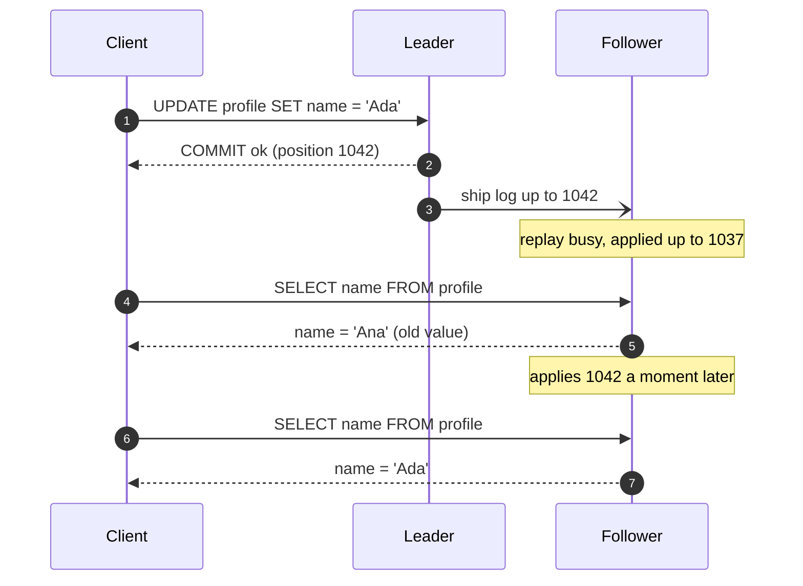
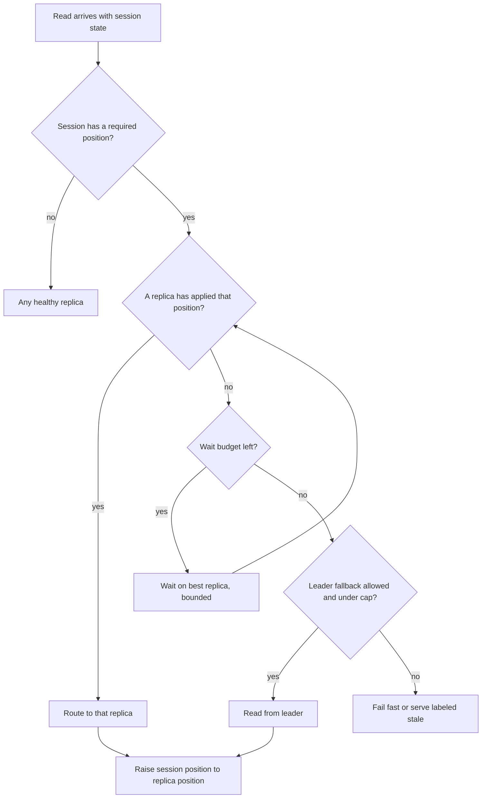
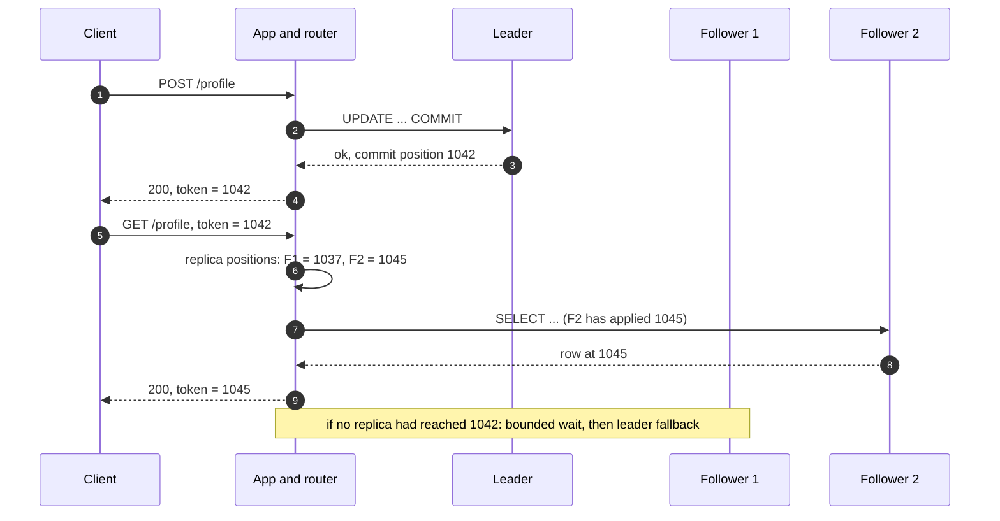
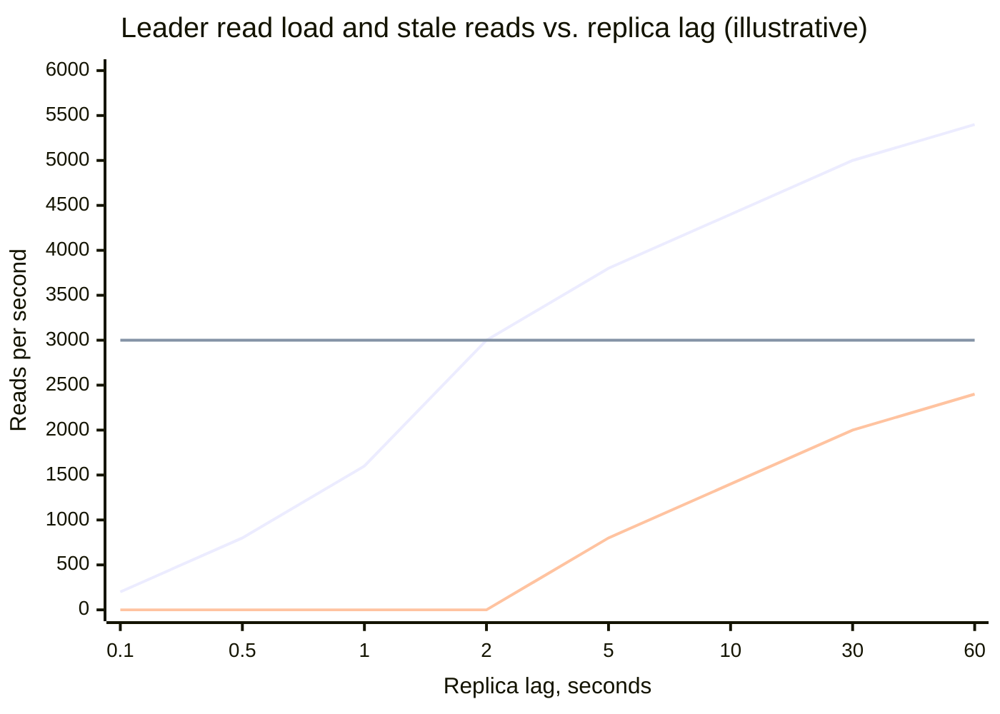
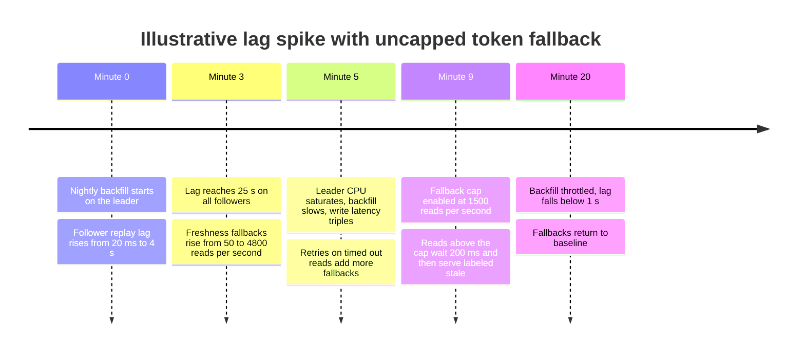
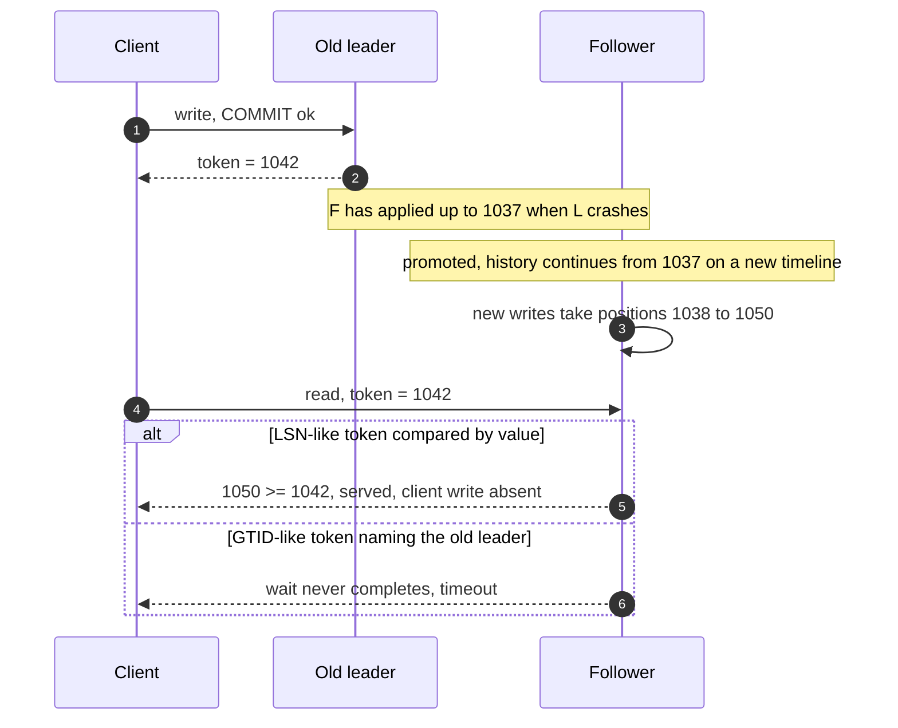

Replikasyon gecikmesi (replication lag), bir yazmanın leader'da commit edildiği an ile aynı yazmanın bir follower'daki okumalara görünür hâle geldiği an arasındaki süredir. Asenkron replikasyonda bu süre hiçbir zaman sıfır değildir ve bir üst sınırı yoktur: follower yetiştiği sürece birkaç milisaniyedir; toplu bir yükleme, uzun süren bir replay çakışması ya da ağdaki bir bozulma sırasında dakikalara çıkar. Yazmaları leader'a, okumaları follower'lara gönderen bir uygulama, veritabanını yaşını bilmediği geçmiş bir anda görür. Okumaların çoğu buna katlanır. Bazıları katlanmaz: profilini kaydedip sayfayı yenileyen kullanıcı değişikliği görmeyi bekler; sayfayı iki kez yenileyen kullanıcı ise bir yorumun önce görünüp sonra kaybolmasını beklemez.

Bu sayfa, gecikmenin tek bir istemci için ürettiği anomalileri ve bunları follower okumalarından vazgeçmeden ortadan kaldıran mekanizmaları ele alır. Merkezdeki garanti kendi yazını okumadır (read-your-own-writes; read-your-writes ya da read-after-write tutarlılığı olarak da anılır): bir istemcinin kendi yazmasından sonra yaptığı okuma o yazmayı ya da daha yenisini döndürür. Aynı mekanizmadan iki eş garanti daha çıkar: monoton okumalar (monotonic reads; istemci daha önce gördüğü durumdan daha eski bir durumu asla görmez) ve tutarlı önek okumaları (consistent prefix reads; istemci yazmaları nedensel sıralarına uyan bir sırayla görür). Hiçbiri başka istemcilerin yazmaları hakkında bir şey söylemez; oturum başına tanımlı garantilerdir ve bilerek [linearizability](/distributed-systems/tr/data-management/consistency-models/linearizability/)'den çok daha zayıftır.

Asıl denge, taze bir okumanın bedelini kimin ödeyeceğidir. Okuma leader'a geri yönlendirilebilir; bu leader kapasitesine mal olur ve replikaların var olma nedenini ortadan kaldırır. Okuma, follower istemcinin yazmalarını uygulayana kadar o follower üzerinde bekleyebilir; bu okuma gecikmesine mal olur ve gecikme büyüdüğünde timeout'a dönüşür. Ya da yazma, onaylanmadan önce follower'ların onu uygulamasını bekleyebilir; bu da yazma gecikmesine ve yazma erişilebilirliğine mal olur. Mühendislik problemi, bedeli yalnızca buna ihtiyaç duyan okumalar için ödemek ve gecikme büyüdüğünde bu bedeli görünür kılmaktır; çünkü ucuz mekanizmalar tam da gecikmenin en büyük olduğu anda sessizce başarısız olur.

Follower'ların neden geride kaldığı, gecikmenin bayt ve zaman cinsinden nasıl ölçüldüğü ve bir yazmanın onay noktasının nerede durduğu [Lider Tabanlı Replikasyon](/distributed-systems/tr/data-management/replication/leader-based-replication/) sayfasında ele alınır. Oturum garantilerinin biçimsel modeli ve nedensel tutarlılıkla ilişkisi [Nedensel Tutarlılık ve Oturum Garantileri](/distributed-systems/tr/data-management/consistency-models/causal-consistency-session-guarantees/) sayfasının konusudur. Bu sayfanın sahip olduğu alan mühendisliktir: bayatlığın gerçek bir istek yolunda nerede ortaya çıktığı, her önlemin nasıl çalıştığı, neye mal olduğu ve nasıl başarısız olduğu.

## Geride Kalan Bir Follower'ın Ürettiği Üç Anomali

En basit anomali dört mesajla oluşur. İstemci leader'a yazar, leader kendi commit'inden sonra onay verir ve istemcinin bir sonraki isteği, yazmayı henüz replay etmemiş bir follower'a yük dengelenir.


*Kendi yazını okuma ihlali. Follower'ın durumu leader log'unun doğru bir önekidir; yalnızca istemcinin kendi geçmişinden daha eskidir.*

Diyagramdaki hiçbir şey veritabanında bir hata değildir. Adım 5'teki follower, 1037 konumunda doğru olan bir değeri döndürür ve döndürdüğü her satır o konumla tutarlıdır. İhlal, tek bir istemcinin iki işlemi arasındaki ilişkidedir: adım 2 istemciye 1042 konumunun commit edildiğini söylemiştir, adım 5 ise ondan önceki bir konumdan yanıt vermiştir. İstemci "yazmam kayboldu" ile "geçmişi okuyorum" durumlarını birbirinden ayıramaz ve kullanıcılar ikisine de aynı tepkiyi verir: yazmayı tekrarlar, destek talebi açar ya da kaydet düğmesinin bozuk olduğuna karar verir. Tehlikeli olan tekrar etmektir; idempotent olmayan bir retry mükerrer bir sipariş yaratır. Kendi yazını okuma sorunlarının çoğu zaman önce [idempotency](/distributed-systems/tr/communication/api-gateway/idempotency/) sorunu olarak yüzeye çıkmasının nedeni budur.

İkinci anomali, yani monoton okuma ihlali, istemcinin hiç yazmasını gerektirmez. İki follower farklı miktarlarda geridedir. İstemci bir yorum dizisini 50 ms geride olan follower A'dan okur ve yeni bir yorum görür; bir sonraki isteği 3 saniye geride olan follower B'ye gider ve yorum ortadan kalkmıştır. Her yanıt log'un doğru bir önekidir, ama istemci iki yanıt arasında zamanda geriye gitmiştir. Replikalar arasında round-robin yük dengeleme bu anomaliyi replikalar arasındaki gecikme farkıyla orantılı bir oranda üretir; yani anomali tam olarak replikalardan biri sağlıksızken ortaya çıkar.

Üçüncü anomali, yani tutarlı önek ihlali, nedensel olarak ilişkili yazmalar farklı replikasyon akışlarından geçtiğinde görülür. Tek bir leader-follower grubunda log tamamen sıralıdır ve her follower durumu onun bir önekidir; bu yüzden nedensel sıra bedavaya korunur. Partition'lanmış bir veritabanında ise her partition'ın kendi leader'ı ve kendi log'u vardır ve farklı partition'ların follower'ları birbirinden bağımsız olarak geride kalır. Bir soru partition 1'e, cevabı ise partition 2'ye yazılırsa, bir okuyucu cevabı partition 2'nin güncel bir follower'ından görüp soruyu partition 1'in geride kalmış bir follower'ında kaçırabilir. Aynı şey servisler arasında da olur: sipariş veritabanına yazılan bir sipariş ve bununla ilgili, kendi replikasından okuyan bir kargo servisi tarafından tüketilen bir olay.

### Garantilerin Vaat Ettiği ve Etmediği

Kendi yazını okuma, bir istemcinin okumasının o istemcinin onay almış her yazmasını yansıtacağını vaat eder. Monoton okumalar, istemcinin gözlemlediği durumlar dizisinin asla geriye gitmeyeceğini vaat eder. Tutarlı önek, B yazması A yazmasına bağlıysa kimsenin B'yi A olmadan görmeyeceğini vaat eder. Üçünün de kapsamı bir oturumdur ve "oturum"un tanımı ilk tasarım kararıdır: bir tarayıcı sekmesi, birden fazla cihazda oturum açmış bir kullanıcı, servisler boyunca süren bir istek zinciri ya da bir olayı işleyen bir arka plan işi. Kapsam ne kadar darsa mekanizma o kadar ucuzdur; production hatalarının çoğu, garantiyi ürünün gerektirdiğinden daha dar bir kapsam için uygulamaktan doğar; örneğin kullanıcının bir telefonu ve bir dizüstü bilgisayarı varken garantiyi bağlantı başına uygulamak.

Bu garantilerin hiçbiri bir istemcinin yazmasını başka bir istemciye belirli bir zamanda görünür kılmaz. Alice paylaşılan bir dokümanın izinlerini değiştirir ve Bob geride kalan bir follower'dan okursa, Bob'un erişimi hâlâ sürebilir: bunu hiçbir oturum garantisi kapsamaz ve buna ihtiyaç duyan bir sistemin o yolda linearizable okumalara ihtiyacı vardır. Garantiler okumaları kalıcı da kılmaz: istemci kendi yazmasını leader'dan okuyabilir, leader yazma bir follower'a ulaşmadan çökebilir ve terfi ettirilen follower'da o yazma bulunmaz. Bu bir kalıcılık sorusudur; commit noktası tarafından belirlenir ve [Failover ve Lider Seçimi](/distributed-systems/tr/data-management/replication/failover-leader-election/) sayfasında ele alınır. Aşağıdaki hata modları bölümü bunun token'larla nasıl etkileştiğini gösterir.

:::note[Biçimsel model nerede]
Kendi yazını okuma, monoton okumalar, monoton yazmalar ve okumayı izleyen yazmalar (writes-follow-reads), Bayou sistemi için Terry ve arkadaşları tarafından oturum garantileri olarak birlikte tanımlandı. Bu tanımlar ve dördünün nedensel tutarlılıkta nasıl birleştiği [Nedensel Tutarlılık ve Oturum Garantileri](/distributed-systems/tr/data-management/consistency-models/causal-consistency-session-guarantees/) sayfasındadır. Bu sayfa garantileri kullanır ve leader-follower sistemlerinin bunları nasıl uyguladığına odaklanır.
:::

## Mekanizmalar: Yönlendirme Kurallarından Konum Token'larına

Her önlem, okuma başına tek bir soruyu yanıtlar: bu replikanın durumu, bu oturumun gerektirdiği kadar yeni mi? Mekanizmalar, "bu oturumun gerektirdiği"ni nasıl yaklaşık olarak hesapladıkları ve "bu replikanın ne kadar yeni olduğunu" nasıl öğrendikleri bakımından ayrışır. Kaba yaklaşımları kurmak daha ucuzdur ve daha sessiz başarısız olurlar.


*Konumdan haberdar bir router'ın okuma yolu. Daha kaba mekanizmalar bu grafiğin parçalarını daraltır: zaman pencereleri replika kontrolünün yerine bir saat koyar, leader'a sabitleme ise kontrolü tamamen kaldırır.*

Grafiğin üç çıkışı vardır ve bu bölümdeki her mekanizma, hangi çıkışların var olduğuna ve her karar noktasında kararın nasıl verildiğine dair bir seçimdir. Replika çıkışı ucuz olanıdır. Bekleme çıkışı bayatlığı gecikmeye çevirir. Leader çıkışı bayatlığı leader yüküne çevirir. Son çıkış, yani başarısız olmak ya da bayat veriyi açıkça sunmak, yalnızca leader'ın her fallback'i karşılayamayacağını kabul eden tasarımlarda bulunur; uygulamaların çoğu onu atlar ve ihtiyacı bir olay sırasında keşfeder. Son kutu, yani oturum konumunu replikanın uyguladığı konuma yükseltmek, bir kendi yazını okuma mekanizmasını aynı zamanda bir monoton okuma mekanizmasına dönüştüren adımdır.

### İstemcinin Değiştirebildiği Veri İçin Leader Okumaları

En eski sezgisel yöntem, kullanıcının düzenleyebildiği verinin okumalarını leader'a, geri kalan her şeyi follower'lara yönlendirir: kullanıcının kendi profili, ayarları ve taslakları leader'dan gelir; diğer kullanıcıların profilleri ve herkese açık akış follower'lardan gelir. Hiçbir altyapı gerektirmez ve kapsadığı veri için doğrudur, çünkü leader onaylanmış her yazmayı her zaman tutar.

Zayıflığı, "kullanıcının değiştirebildiği veri"nin veritabanının bildiği bir özellik olmamasıdır. Bu, uygulama kodundaki bir sınıflandırmadır ve zamanla kayar: kullanıcının kendi içeriğini genel bir sorguyla gösteren yeni bir sayfa, kullanıcının kendi gönderisini içeren bir arama sonucu, kullanıcının okunmamış mesajlarının sayacı. Her kayma, kimsenin tasarlamadığı bir bayat okumadır. Yöntem etkileşimle de kötü ölçeklenir. Bir dashboard ya da gelen kutusunda olduğu gibi bir sayfadaki trafiğin çoğu kullanıcının kendi içeriğine bakmasıysa, okumaların çoğunu leader karşılar ve follower'lar kapasiteye pek katkı yapmaz.

### Zaman Penceresiyle Sabitleme

Sonraki iyileştirme, bir oturumun son yazma zamanını kaydeder ve ardından gelen sabit bir pencere boyunca okumalarını leader'a sabitler. Rails'in otomatik rol değiştirme özelliği bunu istek oturumunda saklanan bir zaman damgası ve varsayılan 2 saniyelik bir pencereyle yapar; GitLab'ın veritabanı yük dengelemesi ise bir yazmadan sonra kullanıcının okumalarını 30 saniyeye kadar primary'ye yönlendirir ve replikalar yetiştiğinde daha erken onlara döner. Pencere, mekanizmanın tüm doğruluk argümanıdır: replikasyon gecikmesi pencereden kısaysa okuma tazedir. Gecikme pencereyi aştığında, pencereden sonraki okumalar yazmaya henüz sahip olmayan bir follower tarafından karşılanır ve sistemde hiçbir şey bunu fark etmez.

Bu yüzden pencere, gecikmenin ortalamasına göre değil dağılımına göre seçilmelidir ve bu bir tuzak yaratır. Gecikme sıçramalarını (toplu yüklemeler sırasında saniyelerden dakikalara) karşılayacak kadar uzun bir pencere, replikalar milisaniyeler geride olduğunda bile okumaların büyük bir payını her zaman leader'da tutar. Leader'ı boşta tutacak kadar kısa bir pencere ise yalnızca olağan gecikmeyi karşılar, fazlasını değil. Aşağıdaki sayısal örnek bunu ölçer. Zaman pencereleri ince bir noktada yanlış saati de ölçer: pencere, uygulama sunucusunun yazmayı kaydettiği anda, yani commit'ten sonra başlar; gecikme ise leader'ın commit'inden itibaren ölçülür. Yavaş bir uygulama yanıt yolu, etkin pencereyi kendi süresi kadar kısaltır.

:::caution[Sabit pencere, kimsenin izlemediği bir gecikme SLO'sudur]
2 saniyelik bir read-after-write penceresi, replika gecikmesinin 2 saniyenin altında kalacağına dair örtük bir sözdür. Replay gecikmesi için pencerenin altındaki bir eşikte alarm yoksa, ihlalin ilk işareti bir kullanıcı şikâyetidir. Follower replay gecikmesi için bayt cinsinden değil zaman cinsinden, pencerenin altındaki bir değerde alarm kurun ve bu değerin aşılmasını yalnızca bir replikasyon olayı olarak değil, tutarlılık garantisinde bir olay olarak ele alın.
:::

### Konum Token'ları: Oturum Filigranı Olarak Log Konumu

Kesin mekanizma saatin yerine replikasyon log'unun kendisini koyar. Lider tabanlı bir veritabanı commit edilen her transaction'a log'unda bir konum atar: PostgreSQL'de log sıra numarası (log sequence number, LSN), MySQL'de global transaction tanımlayıcısı (global transaction identifier, GTID) kümesi, MongoDB'de operation time. `p` konumunu uygulamış bir follower, konumu en fazla `p` olan her transaction'ı içerir, çünkü follower'lar log'u kesinlikle sırayla uygular; bu, [Lider Tabanlı Replikasyon](/distributed-systems/tr/data-management/replication/leader-based-replication/) sayfasındaki önek değişmezidir (prefix invariant). Oturumun yalnızca bağımlı olduğu en yüksek konumu hatırlaması yeterlidir; okuma, uygulanmış konumu en az bu değer olan bir replikada çalışıyorsa tazedir.

Protokol dört adımdan oluşur. Bir yazma commit edildikten sonra uygulama commit konumunu yakalar. Konumu oturumda bir token olarak saklar: bir cookie, bir istek header'ı, sunucu tarafındaki bir oturum deposunda bir alan ya da bir mesajdaki bir alan. Sonraki bir okumada router token'ı her replikanın uygulanmış konumuyla karşılaştırır (bunu yoklayarak ya da replikasyon metadata'sından öğrenir) ve yetişmiş bir replikayı seçer. Hiçbiri yetişmemişse, ilk yetişmesi en olası replikada bir bütçeye kadar bekler ya da okumayı leader'a gönderir. Her okumadan sonra oturum, token'ını okumayı karşılayan replikanın uygulanmış konumuna yükseltir; bu da sonraki okumaları monoton kılar.


*Konum token'ıyla bir okuma. Router okumayı token'ı uygulamış follower'dan karşılar ve yükseltilmiş bir token döndürür; böylece sonraki okuma geriye gidemez.*

Adım 6, maliyetin leader'dan kayıt tutmaya taşındığı yerdir. Router'ın her replikanın uygulanmış konumuna dair makul ölçüde güncel bir görüşe ihtiyacı vardır; bu görüş 1 saniye eskiyse, aslında yetişmiş bir replika geride görünür ve router gereksiz yere bekler ya da fallback yapar; ama asla bayat bir okuma sunmaz, çünkü bir replikanın konumu yalnızca artar. Eskimiş bir görüş tazelik yönünde hata yapar. Ters hata, yani bir replikayı olduğundan ileride sanmak, monoton gözlemlerle imkânsızdır; konumları yavaş yoklayan router'ların bile güvenli olmasının nedeni budur. Adım 9, 1042'yi değil 1045'i döndürür: istemci artık 1045'teki durumu görmüştür ve 1043'teki bir replikada yapılacak sonraki bir okuma, kendi yazını okumayı sağlasa bile bir monoton okuma ihlali olur.

Doğruluk argümanı iki parçalıdır. Birincisi, token commit onaylandıktan sonra alınır; dolayısıyla istemcinin yazmasının konumu token'dan yüksek değildir. Token'ı commit'ten önce ya da farklı bir bağlantıdan yakalamak bu sınırı bozar. İkincisi, token'a ulaşmış ya da onu geçmiş bir replika, istemcinin yazması da dahil olmak üzere token'a kadarki her log kaydını sırayla uygulamıştır; PostgreSQL ve MySQL'de bir transaction, commit kaydı replay edildiğinde replikada görünür hâle gelir. Bu ikisi birlikte, oturumun kaydettiği her yazma için kendi yazını okumayı sağlar; okumalardan sonra token'ı yükseltmek de monoton okumaları sağlar. Argüman yalnızca tüm konumlar tek bir log geçmişine ait olduğu sürece geçerlidir ve bir failover tam olarak bunu bozabilir.

PostgreSQL'de token bir LSN'dir. Uygulama commit'ten sonra leader'ın güncel WAL konumunu okur; replika tarafı ise token'ı kendi replay konumuyla karşılaştırır ya da PostgreSQL 19'dan itibaren, replay onu geçene kadar `WAIT FOR LSN` komutunda bekler.

```sql
-- On the leader, in the same session, right after COMMIT:
SELECT pg_current_wal_lsn();            -- e.g. 0/3A1F2C8, store as the token

-- On a replica, any version: is it fresh enough?
SELECT pg_last_wal_replay_lsn() >= '0/3A1F2C8'::pg_lsn AS fresh;

-- On a replica, PostgreSQL 19 and later: wait for replay, bounded
WAIT FOR LSN '0/3A1F2C8' WITH (TIMEOUT '50ms', NO_THROW);
-- returns success | timeout | not in recovery (promoted meanwhile)
```

`pg_current_wal_lsn()`, oturumun commit kaydında ya da ondan sonraki bir konumu döndürür; bu da token'ı, arada diğer oturumların yazdıkları kadar fazladan tahmin eder. Bu güvenlidir ve en fazla biraz daha uzun bir beklemeye mal olur. `WAIT FOR LSN` varsayılan olarak replay'i bekler, kalıcılık odaklı beklemeler için write ve flush modlarına sahiptir ve replika beklerken terfi ettirilirse `not in recovery` döndürür; çünkü dokümantasyonunun belirttiği gibi LSN eski timeline'ın WAL'ına ait olabilir. MySQL'de token bir GTID kümesidir: `session_track_gtids` açıkken sunucu, oturumun transaction'larının GTID'lerini OK paketiyle döndürür; replikada ise `WAIT_FOR_EXECUTED_GTID_SET(gtid_set, timeout)`, küme `gtid_executed`'in bir alt kümesi olana kadar bekler, başarıda 0, timeout'ta 1 döndürür ve timeout saniye cinsindendir.

### Token Olmadan Monoton Okumalar

Yalnızca monoton okumalara giden daha ucuz bir yol replika yakınlığıdır (replica affinity): oturum ya da kullanıcı kimliğini tek bir replikaya hash'lemek; böylece oturumun tüm okumaları monoton biçimde ilerleyen tek bir geçmiş görür. Token gerektirmez, ama garantisi replikayla birlikte biter. Seçilen replika çıkarıldığında ya da çöktüğünde oturum daha geride olabilecek başka bir replikaya geçer ve zamanın bir kez geriye gittiğini görür. Yakınlık [çarpıklığı](/distributed-systems/tr/data-management/data-partitioning/skew-hot-spots/) da miras alır: yoğun bir kullanıcı, yükünden bağımsız olarak tek bir replikaya sabitlenir. Replika değişimlerinde ara sıra yaşanan ihlallerin kabul edilebilir olduğu durumlarda monoton okumalar için makul bir varsayılandır; kendi yazını okumanın yerini ise tutmaz, çünkü sabitlenen replika hâlâ leader'ın gerisinde olabilir.

### Log'lar Arasında Tutarlı Önek

Token'lar partition'lanmış veriye de genişler, ama token bir vektöre dönüşür: oturumun yazdığı her partition için bir konum, çünkü farklı log'lardaki konumlar karşılaştırılamaz. Partition 1 ve 2'ye yazmış bir oturum iki konumu da taşır ve partition 2'deki bir okuma yalnızca kendi bileşenini kontrol eder. Bu, oturumun kendi yazmalarının nedensel sırasını korur. Oturumlar arasında nedensel sırayı korumak, örneğin Alice'in yazdığı soru ile Bob'un yazdığı cevap arasında, Bob'un token'ının cevabı yazarken okuduklarını içermesini gerektirir; bu, okumayı izleyen yazmalar garantisidir. Diğer yol, tüm partition'ları sıralayan tek bir zaman damgasıdır. Global zaman damgası olan veritabanları ikincisini yapar: bir zaman damgasındaki okuma her partition'ı o zaman damgasındaki hâliyle görür; Spanner ve CockroachDB'deki bounded-staleness [follower okumaları](/distributed-systems/tr/case-studies/distributed-sql/follower-reads-bounded-staleness/) partition başına token olmadan tutarlı öneki bu şekilde sağlar. Global zaman damgası mekanizmaları [Hibrit Mantıksal Saatler](/distributed-systems/tr/foundations/time-and-ordering/hybrid-logical-clocks/) ve [TrueTime](/distributed-systems/tr/foundations/time-and-ordering/truetime-spanner/) sayfalarında ele alınır.

### Bunun Yerine Yazmayı Bekletmek

Şimdiye kadarki tüm mekanizmalar bedeli okumaya ödetir. Alternatif, yazmanın onayını follower'lar onu uygulayana kadar geciktirmektir; böylece o follower'lardaki sonraki her okuma token olmadan tazedir. PostgreSQL'in `synchronous_commit = remote_apply` ayarı senkron standby'larda replay'i bekler; MySQL Group Replication'ın `AFTER` tutarlılık seviyesi ise bir okuma-yazma transaction'ının, değişiklikleri diğer tüm üyelerde uygulanana kadar beklemesini sağlar; böylece herhangi bir üyedeki sonraki her transaction yazılan değeri ya da daha yenisini okur. Bedeli, her yazmanın gerekli en yavaş replikanın replay süresini ödemesidir; bu süre çoğu zaman o replikanın ağ round trip'inden çok daha büyüktür ve yazma erişilebilirliği o replikalara bağımlı hâle gelir. Group Replication'ın `BEFORE` seviyesi yönü tersine çevirir: okuma, grupta kendisinden önce gelen tüm transaction'lar yerelde uygulanana kadar bekler; bu, okuma gecikmesi pahasına herhangi bir üyede taze bir okuma verir. Aurora MySQL'in write forwarding özelliği aynı seçimi `aurora_replica_read_consistency` ile açıkça sunar: `SESSION`, okuyucunun oturumun yönlendirilmiş yazmalarını beklemesini sağlar; `GLOBAL` ise sorgunun başladığı ana kadar cluster genelinde commit edilmiş tüm yazmaları bekler.

## Sayısal Örnek: Taze Okumaların Bedeli

Bir leader ve dört follower'lı bir servis varsayalım. Bu bölümdeki tüm sayılar örnek amaçlıdır. Tepe okuma trafiği saniyede 20.000 okumadır ve her node, gecikme bozulmadan önce saniyede yaklaşık 8.000 okuma karşılayabilir. Hiçbir kendi yazını okuma mekanizması olmadan her follower saniyede 5.000 okuma taşır, leader ise yalnızca yazmaları.

Trafiğin her şeyi belirleyen bir şekli vardır: okumaların ne kadarının aynı kullanıcının son yazmasından kısa süre sonra geldiği. Erişim log'larından ölçüldüğü varsayılarak okumaların %1'i kullanıcının son yazmasından sonraki 0,1 s içinde, %4'ü 0,5 s, %8'i 1 s, %15'i 2 s, %19'u 5 s, %22'si 10 s, %25'i 30 s ve %27'si 60 s içinde gelsin. Bu eğriye `g(t)` diyelim. Dik yükselir, çünkü kullanıcılar az önce yaptıkları şeye bakma ve sonra devam etme eğilimindedir.

2 saniyelik bir zaman penceresiyle, gerçek gecikme ne olursa olsun penceredeki her okuma leader'a gider: her zaman leader'da saniyede `0.15 * 20,000 = 3,000` okuma ve follower başına 4.250 okuma. Gecikme 2 saniyenin altında kaldığı sürece bayat okuma yoktur. Gecikme pencerenin üstünde `L` saniyeye çıktığında, bir yazmadan 2 s ile `L` arasında gelen okumalar yazmaya henüz sahip olmayan bir follower'a gider: saniyede `20,000 * (g(L) - g(2))` bayat okuma; 5 s gecikmede saniyede 800, 30 s gecikmede saniyede 2.000. Kimseye haber verilmez.

Konum token'larıyla ve beklemeden, bir okuma yalnızca hiçbir follower oturumun token'ına yetişmemişse leader'a gider; bu da okuma, yazmanın güncel gecikmesi içinde geldiğinde olur. Leader okuma yükü `20,000 * g(L)`'dir: 0,1 s gecikmede saniyede 200 okuma, 2 s'de 3.000, 30 s'de 5.000. Bayat okuma her gecikmede sıfırdır.


*Yükselen çizgi: konum token'larıyla leader okumaları. Düz çizgi: 2 saniyelik pencereyle leader okumaları. Sıfırdan başlayan çizgi: 2 saniyelik pencereyle saniye başına bayat okumalar. Varsayılan g(t) ve saniyede 20.000 okumadan türetilmiştir.*

Grafik iki mekanizmanın ters yönlerde başarısız olduğunu gösterir. Pencere, çoğunlukla ihtiyaç duymadığı tazelik için sabit bir saniyede 3.000 okuma öder (0,1 s'lik tipik gecikmede yalnızca 200 okumanın leader'a ihtiyacı vardır) ve gecikme 2 saniyeyi geçtiğinde hiçbir sinyal vermeden tazelik sağlamayı bırakır. Token'lar gerçek gecikmeyle orantılı ödeme yapar; bu, normal işleyişte ucuzdur ve asla bayat veri sunmaz; ama leader yükleri gecikmeyle birlikte sınırsızca artar. 60 s gecikmede leader, yazma yüküne ek olarak saniyede 5.400 okuma karşılar. Örnek amaçlı 8.000'lik kapasiteyle bu sığar; tepe trafiğin 1,5 katında ise saniyede 8.100 okumadır ve leader, replikasyon hattı zaten sorun yaşarken doyar; çoğu zaman da gecikmeye yol açan toplu iş leader'ın kendisini meşgul ettiği için.

Sınırlı bir bekleme eğrinin sol tarafını değiştirir. 50 ms'lik bir bekleme bütçesiyle, token'ına 50 ms içinde ulaşılan okumalar follower'larda kalır. Olağan gecikme zamanın %99'unda 50 ms'nin altındaysa, normal işleyişteki leader fallback oranı 200'den neredeyse sıfıra düşer; bunun bedeli, gecikme içinde gelen yaklaşık %1'lik okumalar için p99'da 50 ms'ye kadar ek gecikmedir. Bekleme eğrinin sağ tarafı için hiçbir şey yapmaz: 30 s gecikmede bekleyen her okuma 50 ms sonra timeout'a düşer ve yine de fallback yapar; saniyede 5.000 okumaya 50 ms ekler. Tasarım sonucu şudur: bir token sisteminin leader fallback'leri için bir üst sınıra ve sınırın üstündeki okumalara ne olacağına dair bir karara ihtiyacı vardır.

## Production'da Stratejiler

Mekanizmalar birleştirilebilir: production sistemleri tipik olarak yazmış oturumlar için token'ları, monotonluk için yakınlık ya da token yükseltmeyi ve bozulmuş bir modla birlikte leader fallback üst sınırını kullanır. Tablo, onları en önemli boyutta, yani gecikme sıçradığındaki davranışlarına göre karşılaştırır.

| Strateji | Sağlanan garanti | Normal işleyişteki maliyet | Gecikme sıçradığında | Ne zaman tercih edilmeli |
|---|---|---|---|---|
| Tüm okumalar leader'da | Tek bir leader üzerinde linearizable benzeri okumalar | Okuma ölçeklemesi yok | Etkilenmez | Leader'ın okuma payı var; replikalar yalnızca failover için |
| Kullanıcının düzenleyebildiği veri için leader | Yalnızca sınıflandırılmış veri için kendi yazını okuma | Leader yükü kendi içeriğine bakma trafiğiyle büyür | Sınıflandırılmamış yollar sessizce bayatlar | Sahip olunan veri sınırı net küçük uygulamalar |
| Zaman penceresi (ör. 2 s) | Gecikme pencerenin altında kaldıkça kendi yazını okuma | Sabit leader payı `g(window)` | Bayat okumalar, sinyal yok | Gecikme sıkı biçimde sınırlı ve pencerenin altında izleniyor |
| Replika seçimli konum token'ı | Oturum başına kendi yazını okuma ve monoton okumalar | Router replika konumlarını izler | Leader fallback gecikmeyle büyür | Gecikmesi değişken, okuma ağırlıklı servisler |
| Token artı sınırlı bekleme | Aynısı, daha az fallback ile | Bekleme bütçesine kadar ek gecikme | Önce bekleme, sonra fallback | Gecikme genellikle birkaç on ms'nin altında |
| Replika yakınlığı | Replika değişene kadar monoton okumalar | Yok | Sabitlenmiş oturumlar o replikanın gecikmesini görür | Kendi yazını okumanın gerekmediği akışlar ve zaman tüneli |
| Yazma uygulamayı bekler (`remote_apply`, GR `AFTER`) | Beklenen replikalarda her okuyucu için kendi yazını okuma | Her yazma replay süresini öder | Yazmalar yavaşlar ya da durur | Az yazma, tüm replikalarda sıkı tazelik |

### Gerçek Uygulamalar ve Farklılıkları

**PostgreSQL** tüm yapı taşlarını sunar ama yerleşik bir router'ı yoktur. Commit'ten sonra leader'ın LSN'i token'dır; `pg_last_wal_replay_lsn()` bir standby'ın replay ettiği konumu verir; PostgreSQL 19, replay, write ve flush modlarına, bir timeout'a ve hata fırlatmak yerine durum döndüren `NO_THROW` seçeneğine sahip `WAIT FOR LSN` komutunu ekler. 19 sürümünden önce bekleme, uygulamada ya da bir proxy'de bir yoklama döngüsüdür. LSN'e göre yönlendirme sürücülere, pooler'lara ya da uygulama koduna bırakılmıştır; GitLab'ın kendi yük dengeleyicisini yazmasının nedeni budur: her replikanın replikasyon durumunu kontrol eder, yapılandırılabilir bayt ve zaman eşiklerinin ötesinde geride kalan replikaları atlar (varsayılan olarak 8 MB ve 60 saniye, en fazla 60 saniyede bir yeniden kontrol edilir), bir yazmadan sonra replikalar yetişene kadar kullanıcıyı primary'de tutar ve arka plan işlerinin okumadan önce replikaların kuyruğa ekleyen yazmaya yetişmesini beklemesini sağlar.

**MySQL**'in GTID'leri vardır; bu, token'ları kaynaklar arasında birleştirilebilir kılar ama aynı zamanda büyütür: bir GTID kümesi, kaynak sunucu başına aralıklardan oluşan bir kümedir. `session_track_gtids` ile sunucu oturumun GTID'lerini döndürür; ProxySQL 2.0 bunu, her sunucuda çalışan ve uygulanmış GTID'leri proxy'ye akıtan bir binlog okuyucu süreciyle birlikte kullanır. Böylece proxy hangi replikanın oturumun son GTID'ini uyguladığını bilir ve nedensel bir okumayı oraya, hiçbir replika ona sahip değilse primary'ye yönlendirir. Özellik GTID modunu, satır tabanlı binary log'u ve MySQL 5.7.5 ya da sonrasını gerektirir ve `session_track_gtids` desteği olmayan MariaDB ile çalışmaz. Group Replication, yukarıda anlatılan yazma ve okuma taraflı beklemeleri oturum başına ayarlanabilen `group_replication_consistency` ile sunar; bu da uygulamanın tazelik bedelini yalnızca ihtiyaç duyan transaction'larda ödemesine izin verir.

**MongoDB** token'ları sürücüye yerleştirir. MongoDB 3.6'dan beri mevcut olan nedensel tutarlı bir oturum (causally consistent session), oturumun `operationTime` değerini ve cluster'ın mantıksal zamanını izler; oturumdaki okumalar `afterClusterTime` taşır ve bir secondary, o zamana kadar replike edene dek okumayı bekletir. Garantiler hatalar boyunca yalnızca `majority` write concern ve `majority` read concern ile geçerlidir; daha zayıf concern'lerle, bir primary tarafından onaylanıp sonra rollback edilen bir yazma oturum tarafından "okunabilir" ve sonradan kaybolabilir. Oturumlar, cluster time ve operation time yeni bir oturuma aktarılarak süreçler arasında zincirlenebilir; bu, token'ın açıkça aktarılmasıdır.

**Aurora MySQL** replikaları paylaşılan depolamanın üzerine yerleştirir; bu yüzden gecikme bir veri aktarımı değil, redo'nun replika cache'lerine replay edilmesidir ve genellikle küçüktür, ama sıfır değildir. Write forwarding özelliği tazelik seçimini oturum başına `aurora_replica_read_consistency` ile açık hâle getirir: `EVENTUAL` hiçbir garanti vermez, `SESSION` oturumun kendi yönlendirilmiş yazmalarını bekler, `GLOBAL` ise sorgunun başladığı andaki tüm commit edilmiş veriyi bekler.

**Facebook'un memcache dağıtımı**, Nishtala ve arkadaşlarının anlattığı gibi aynı problemle bir katman yukarıda karşılaştı: master olmayan bir bölgedeki kullanıcı master bölgenin veritabanına yazar, yerel cache'i geçersiz kılar, ardından cache'i ıskalayıp yazmayı henüz almamış yerel bir replikadan okur. Uzak işaret (remote marker) mekanizmaları, yazmadan önce yerel bölgede anahtar için bir işaret koyar, işaretin geçersiz kılınmasını replike edilen transaction'a dahil eder ve bir cache ıskalamasında işaret hâlâ duruyorsa master bölgeden okur. Makale bunu, cache ıskalamasında ek gecikme karşılığında bayat veri okuma olasılığını azaltmak olarak tanımlar. Bu, anahtar başına tek bir bite indirgenmiş ve replikasyon akışının kendisi tarafından temizlenen bir konum token'ıdır.

### Token'ı Sınırların Ötesine Taşımak

Bir token yalnızca onu gören okumaları korur. Tek bir istek içinde token bellekte yaşar; tek bir tarayıcıdan gelen istekler arasında bir cookie'de ya da istemci tarafı bir depoda yaşar; cihazlar arasında ise sunucu tarafında, kullanıcıya göre anahtarlanmış olarak yaşamalıdır, çünkü telefonda dizüstü bilgisayarın yazmasından gelen bir cookie yoktur. Servisler arasında istek metadata'sında, asenkron geçişlerde ise mesajın içinde taşınır: bir yazmadan sonra kuyruğa eklenen bir iş, yazmanın konumunu taşır ve tüketici okumadan önce o konumu bekler ya da ona göre yönlendirir; GitLab'ın arka plan işlerine uyguladığı desen budur. Mesaj [outbox deseninden](/distributed-systems/tr/coordination/distributed-transactions/outbox-pattern/) ya da [değişiklik verisi yakalamadan](/distributed-systems/tr/data-processing/hybrid-architectures/change-data-capture/) geliyorsa olay zaten kaynak log konumunu taşır ve kaynağın bir replikasından geri okuyan tüketici bu konumu doğrudan token olarak kullanabilir.

:::tip[Sunulan konumu bir yanıt header'ında döndürün]
Okuma yolunun hangi konumdan sunduğunu, yazma yolunun da commit konumunu bir header'da döndürmesini sağlayın. Böylece istemciler ve testler tazeliği doğrudan doğrulayabilir, destek mühendisleri tek bir yanıttan "kaybolan" bir yazmanın bayat mı yoksa kayıp mı olduğunu görebilir ve header, onu ileten istemciler için token işlevi de görür. Aynı değerler istek başına log'landığında, zaman tabanlı gecikme metriklerinin veremediği bir bayat okuma oranı verir.
:::

## Hata Modları

Kendi yazını okuma mekanizmalarının her hata modu ya kimsenin fark etmediği bir bayat okumadır ya da en kötü anda yüke veya gecikmeye dönüşen bir tazelik garantisidir. Birinci tür, konumları karşılaştıran bir enstrümantasyon gerektirir; çünkü yalnızca gecikme dashboard'ları hangi okumaların etkilendiğini göstermez.

### Gecikme Sıçraması Sırasında Leader Fallback Fırtınası

Tetikleyici: replika gecikmesi milisaniyelerden onlarca saniyeye sıçrar; bunun tipik nedeni toplu bir yazma, bir follower'da replay'i bloklayan uzun süreli bir sorgu ya da bir index inşasıdır. Son `L` saniyede yazmış her oturumun artık hiçbir follower'ın karşılamadığı bir token'ı vardır ve fallback üst sınırı olmayan bir token router'ı tüm okumalarını leader'a gönderir. Belirtiler: leader CPU'su ve bağlantıları replika gecikmesiyle aynı anda yükselir; okuma gecikmesi servisin tamamında artar, hiç yazmamış oturumlar dahil, çünkü leader'ın yazma yolunu paylaşırlar; gecikmeye yol açan toplu yazma da leader'da çalışıyorsa ikisi yarışır. Tespit: tazelik nedeniyle leader'a yönlendirilen okumaların oranı (olağan leader okumalarından ayrı bir metrik olarak); follower başına saniye cinsinden replay gecikmesi; leader bağlantı sayısı.


*Replikasyon gecikmesi ile token fallback'i arasındaki geri beslemeyi gösteren varsayımsal bir olay; gerçek bir olay değildir.*

Zaman çizelgesi bu hatanın neden kendini beslediğini gösterir. Gecikmeye yol açan backfill leader'da çalışır, fallback trafiği leader'a düşer ve yavaşlayan leader backfill'i, dolayısıyla gecikmeyi uzatır. Timeout'a düşen okumaların retry'ları, her [metastabil hatada](/distributed-systems/tr/resilience/flow-control/retry-storms-metastable-failures/) olduğu gibi yük ekler. Önlem: tazelik fallback'lerini leader'ın yazma tepesiyle birlikte karşılayabileceği bir oranda sınırlayın ve sınırın üstündeki okumaların ne yapacağına önceden karar verin: daha uzun beklemek, yeniden denenebilir bir hatayla başarısız olmak ya da kullanıcı arayüzünün "değişikliğiniz kaydediliyor" diyebilmesi için muhtemelen bayat olarak işaretlenmiş veri döndürmek. Toplu yazmaları yalnızca leader yüküne göre değil, replay gecikmesine göre de yavaşlatın. Kurtarma: gecikme düştüğünde fallback'ler kendiliğinden durur; kalıcı çözüm, üst sınırı ve bozulmuş davranışı tasarımın bir parçası yapmaktır.

### Pencereyle Sabitlemenin Sessizce Bayat Veri Sunması

Tetikleyici: gecikme sabitleme penceresini aşar; yukarıdaki nedenlerle ya da bölgeler arası bir follower pencerenin boyutlandırıldığından daha yavaş olduğu için. Belirtiler: gecikme dışında altyapı dashboard'larında hiçbir şey yoktur; "kaydedilmeyen" ve sonra beliren düzenlemelere dair kullanıcı şikâyetleri; retry yapan kullanıcılardan gelen mükerrer gönderimler. Tespit: follower başına saniye cinsinden replay gecikmesini pencereyle karşılaştırın; daha iyisi, bir işaret yazıp onu pencerenin kenarında production okuma yolundan geri okuyan sentetik bir prob çalıştırın ve başarısızlıkları sayın. Önlem: pencereyi geçici olarak büyütmek ya da leader'ın kapasitesi varsa gecikme pencereyi aştığı sürece tüm okumaları leader'a yönlendirmek. Kurtarma veri onarımı gerektirmez, çünkü veri hiçbir zaman yanlış değildi, yalnızca eskiydi; ancak retry yapan kullanıcıların oluşturduğu mükerrer, idempotent olmayan yazmalar temizlik gerektirir ve bu, kullanıcıya dönük her yazmada idempotency anahtarı kullanmanın gerekçesidir.

### Failover Boyunca Token'lar

Tetikleyici: follower'lar gerideyken leader çöker ve bir follower terfi ettirilir. Konumların nasıl temsil edildiğine bağlı olarak iki farklı şey ters gider.


*Asenkron bir failover'dan sonra aynı kayıp yazmanın iki farklı token tasarımından görünüşü. Hiçbiri yazmayı kurtaramaz; fark, kaybın görünür olup olmamasıdır.*

PostgreSQL LSN'i gibi skaler bir konumda, yeni leader'ın geçmişi, eski timeline'da artık kaybolmuş yazmalara ait olan konum değerlerini yeniden kullanır. Adım 5'te 1042'lik bir token, geçmişi istemcinin yazmasını içermeyen 1050'deki bir node tarafından karşılanır: okuma sunulur, yazma sessizce yoktur ve istemcinin bunu anlamasının hiçbir yolu yoktur. PostgreSQL 19'un `WAIT FOR LSN` komutu, replika bekleme sırasında terfi ettirilirse tam bu nedenle `not in recovery` döndürür; ancak terfiden sonra sayısal bir konuma karşı yapılan bir karşılaştırma timeline değişimini fark edemez. GTID token'ında ise kayıp transaction, eski leader'ın sunucu kimliğini ve yeni geçmişin asla üretmeyeceği bir sıra numarasını taşır; bu yüzden `WAIT_FOR_EXECUTED_GTID_SET` asla başarılı olmaz: okuma timeout'a düşer; bu görünür ve doğrudur, ancak böyle bir token tutan her oturum, token atılana kadar takılı kalır. Majority write ve read concern'leriyle MongoDB, onaylanmış yazmalar için iki durumdan da kaçınır, çünkü majority tarafından onaylanmış bir yazma bir seçimle rollback edilemez.

:::danger[Karşılanmış bir token, yazmanın var olduğunu kanıtlamaz]
Asenkron bir failover'dan sonra sayısal bir log konumuna, verildiği yazmayı içermeyen yeni bir timeline'da yeniden ulaşılabilir. Token'lar konumla birlikte timeline'ı ya da leader epoch'unu taşımalıdır; router da daha eski bir epoch'a ait token'ı karşılanamaz kabul etmeli, okumayı yeni leader'a yönlendirmeli ve oturumu etkilenmiş olarak raporlamalıdır. Aksi hâlde kendi yazını okuma, sessizce "yeterince ileride olan farklı bir geçmişi okuma"ya dönüşür.
:::

Tespit: epoch'u güncel leader'ınkinden eski olan token'ları sayın; epoch'lar arası bir token'a karşı sunulan her okumada alarm verin. Önlem: epoch'u token'a dahil etmek, kaybı kabul edilemez olan yazmalar için senkron ya da majority commit kullanmak ve failover'ı bekleyen token'ları geçersiz kılan bir olay olarak ele almak. Kayıp yazmaların kendisinin kurtarılması bir failover problemidir ve [Failover ve Lider Seçimi](/distributed-systems/tr/data-management/replication/failover-leader-election/) sayfasında ele alınır.

### Cache'ler ve Türetilmiş Depolar Bayatlığı Geri Getirir

Tetikleyici: okuma yolu, bir follower'dan doldurulan bir cache, arama index'i ya da materialized view içerir. Kullanıcı yazar; cache kaydı geçersiz kılınır; eşzamanlı bir okuma ıskalar, eski değeri geride kalan bir follower'dan okur ve cache'i onunla yeniden doldurur. Veritabanı okumasındaki token mekanizması atlanmış olur ve bayat değer artık cache'in time to live süresi boyunca gecikmeden daha uzun yaşar. Belirtiler: replika gecikmesi milisaniyeler düzeyindeyken dakikalarca süren bayat okumalar. Tespit: örneklenmiş okumalarda cache kaydının versiyonunu ya da konumunu kaynağın commit konumuyla karşılaştırın. Önlem: cache'leri leader'dan ya da yazanın token'ına karşı kontrol edilmiş bir replikadan doldurmak, kaynak konumunu cache'teki değerle birlikte saklayıp son geçersiz kılmadan daha eski dolumları reddetmek ya da dolum için bir lease kullanmak; genel problem [Önbellek Geçersizleştirme](/distributed-systems/tr/data-management/distributed-caching/cache-invalidation/) sayfasındadır. Arama index'leri ve [materialized view'lar](/distributed-systems/tr/microservice-patterns/data-management-patterns/materialized-view/) kendi gecikmesi olan replikalardır ve kendi token'larına, tipik olarak tükettikleri kaynak log konumuna ihtiyaç duyarlar.

### Token Okuyucuya Hiç Ulaşmaz

Tetikleyici: yazma bir bileşende, okuma ise token'ı almayan başka bir bileşende gerçekleşir: web'den yapılan bir yazmadan sonra okuyan bir mobil uygulama, kendisini kuyruğa ekleyen isteğin yazdığını okuyan bir arka plan işi, bir olay aldıktan sonra kendi replikasını okuyan bir downstream servis. Belirtiler: kendi yazını okuma tarayıcıda çalışır, işlerde ya da diğer cihazlarda başarısız olur; retry'da başarılı olan "kayıt bulunamadı" hatalı işler. Tespit: okumaları token bulunup bulunmadığına göre etiketleyin; not-found ile başarısız olup retry'da başarılı olan işler bunun imzasıdır. Önlem: konumu iş yüklerinde ve olay metadata'sında taşımak, cihazlar arası oturumlar için kullanıcı başına bir token'ı sunucu tarafında saklamak ve tüketicilerin onu beklemesini sağlamak. Bir yük dengeleyici tek bir oturumu replikalara yaydığında ve router oturumun token'ını hiç yükseltmediğinde monoton okumalar da aynı şekilde başarısız olur; imzası, tekrarlanan yenilemelerde içeriğin görünüp kaybolmasıdır.

## Kendi Yazını Okuma Stratejisi Seçmek

Önce replikaların okuma karşılamasının gerekip gerekmediğini sorun. Leader'ın okuma yükü için payı varsa, leader'dan okumak bu sayfadaki tüm anomalileri hiçbir mühendislik maliyeti olmadan ortadan kaldırır; replikalar da failover, yedekleme ve analitik için kullanılabilir. Okuma ölçeklemesi gecikmeyi kabul etmenin nedenidir; varsayılan olarak benimsenmemeli, ölçülmüş leader doygunluğuyla gerekçelendirilmelidir.

Replikalar kullanıcıya dönük okumaları karşılıyorsa, gecikme milisaniyelerden saniyelere değişiyorsa ve kullanıcılar kendi yakın tarihli yazmalarına göre hareket ediyorsa konum token'larını kullanın. Bunları tipik gecikmeye göre boyutlandırılmış sınırlı bir bekleme, monotonluk için her okumadan sonra yükseltilen bir token, token'da bir epoch ve tanımlı bir bozulmuş davranışla birlikte leader fallback'leri için bir üst sınırla eşleştirin. Zaman penceresiyle sabitlemeyi yalnızca gecikme sıkı biçimde sınırlı olduğunda ve pencerenin altında alarmlandığında kullanın (toplu işi olmayan, tek zone'lu bir replika kümesinde olduğu gibi); bölgeler arası replikalar için asla kullanmayın, çünkü onların gecikmesinin bir pencerenin karşılayabileceği bir sınırı yoktur. Yalnızca monoton okumalar önemliyse replika yakınlığını kullanın; örneğin kişinin kendi gönderisini bir saniye sonra görmesinin kabul edilebilir olduğu, ama içeriğin kaybolmasının kabul edilemez olduğu bir akış.

Yazmalar seyrekse, tüm okuyucuların onları her replikada görmesi gerekiyorsa ve replikalar yakınsa yazmayı `remote_apply`, Group Replication `AFTER` ya da bir eşdeğeriyle bekletin: her replikadan okunan yapılandırma verisi buna iyi bir örnektir. Yüksek yazma oranları ya da uzak replikalar için kullanmayın; çünkü o zaman her yazma en yavaş replikanın replay süresini öder ve o replika takıldığında erişilebilirliğini kaybeder.

Gereksinim, bir yazmanın diğer kullanıcılar tarafından hemen görülmesiyse bu mekanizmaların hiçbirini kullanmayın: izin iptali, bir benzersizlik kontrolü ya da bir borçlandırmadan önce yapılan bakiye okuması gibi. Oturum garantileri diğer oturumlar hakkında hiçbir şey söylemez; bu yollar leader okumalarına ya da [linearizable](/distributed-systems/tr/data-management/consistency-models/linearizability/) okumalara, partition'lanmış sistemlerde ise [Follower Reads ve Bounded Staleness](/distributed-systems/tr/case-studies/distributed-sql/follower-reads-bounded-staleness/) sayfasında ele alınan zaman damgası tabanlı okumalara ihtiyaç duyar. Bunları kalıcılık açıklarını gizlemek için de kullanmayın: kişinin kendi yazmasını leader'dan okuyabilmesi, o yazmanın bir failover'dan sağ çıkıp çıkmayacağı hakkında hiçbir şey kanıtlamaz.

## İleri Okuma

- Douglas B. Terry, Alan J. Demers, Karin Petersen, Mike J. Spreitzer, Marvin M. Theimer, Brent B. Welch, *Session Guarantees for Weakly Consistent Replicated Data*, Proceedings of the 3rd International Conference on Parallel and Distributed Information Systems (PDIS), 1994.
- Martin Kleppmann, *Designing Data-Intensive Applications*, O'Reilly Media, 2017, 5. bölüm ("Problems with Replication Lag").
- Rajesh Nishtala et al., *Scaling Memcache at Facebook*, 10th USENIX Symposium on Networked Systems Design and Implementation (NSDI), 2013.
- PostgreSQL Global Development Group, *WAIT FOR*, PostgreSQL 19 Documentation, 2026. https://www.postgresql.org/docs/19/sql-wait.html
- MySQL, *Configuring Transaction Consistency Guarantees* (Group Replication), MySQL 8.0 Reference Manual. https://dev.mysql.com/doc/refman/8.0/en/group-replication-configuring-consistency-guarantees.html
- MongoDB, *Causal Consistency and Read and Write Concerns*, MongoDB Manual.
