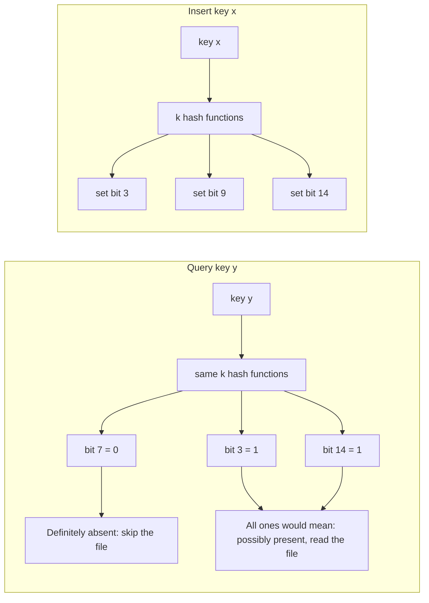
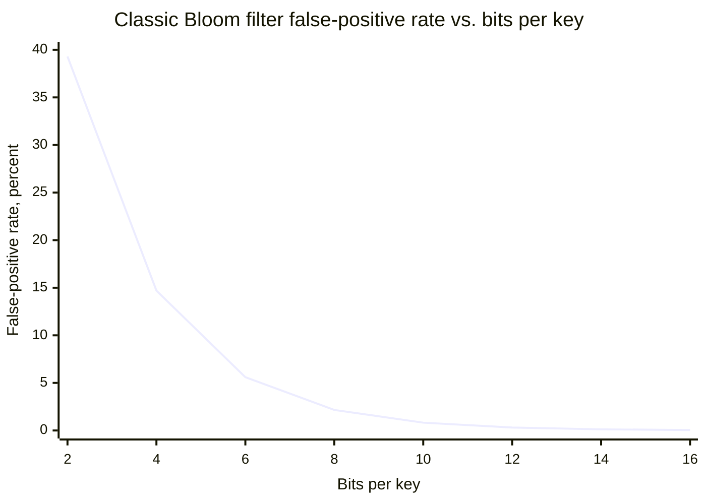
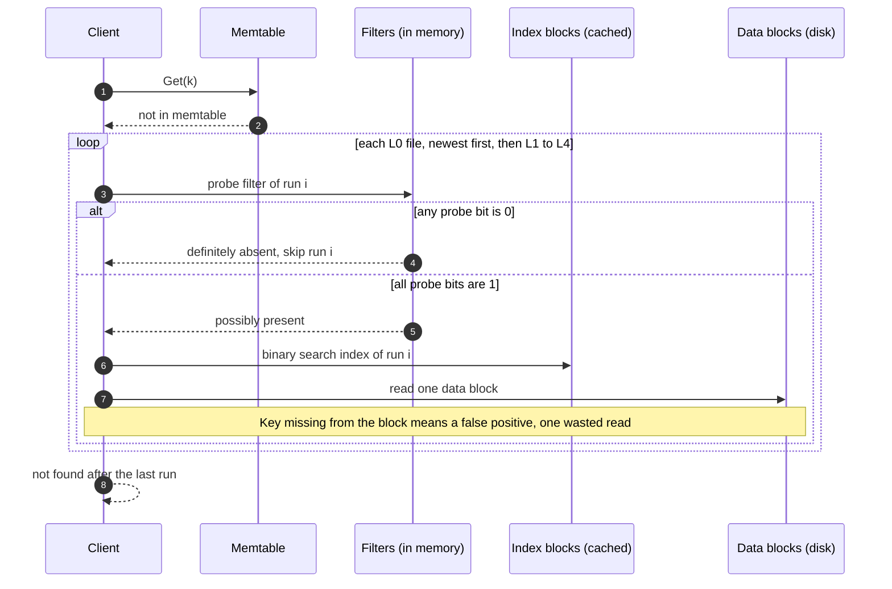
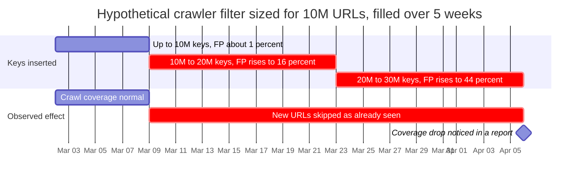
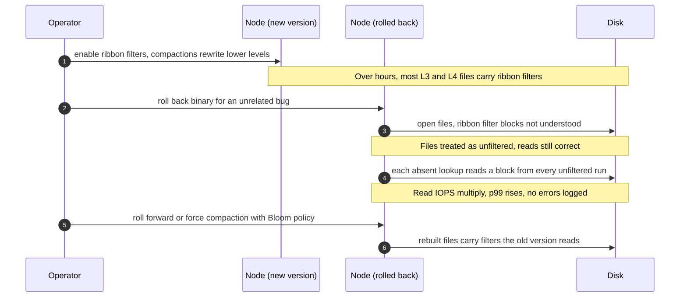

Bloom filtresi, bir bit dizisi ve sabit sayıda hash fonksiyonundan oluşan, bir anahtar kümesi hakkında tek bir soruyu yanıtlayan yapıdır: "bu anahtar kümede olabilir mi, yoksa kesinlikle yok mu?" "Kesinlikle yok" yanıtı her zaman doğrudur. "Olabilir" yanıtı ise belli bir olasılıkla yanlıştır; bu olasılık, yani false positive (yanlış pozitif) oranı, tasarımcının bellek harcayarak önceden seçtiği bir değerdir. Burton Bloom bu yapıyı 1970'te, depolama motorlarında bugün hâlâ çözdüğü problem için tanımladı: yavaş depolamadaki büyük bir tablo, çoğunlukla içinde olmayan anahtarlar için sorgulanır ve bu sorguların çoğunu reddeden küçük, bellekte duran bir özet, yavaş okumaların çoğunu ortadan kaldırır.

Problem en keskin hâlini log-structured merge tree'de (LSM-tree) alır. Bir anahtar memtable'da, birkaç level-0 dosyasından herhangi birinde ya da alt seviyelerden herhangi birinde bulunabilir; bir okuma, anahtarı bulana ya da bakacak yer kalmayana kadar her sıralı run'ı en yeniden başlayarak kontrol etmek zorundadır. Filtre yoksa, var olmayan bir anahtarın okunması her run'dan bir data block okur: hiçbir şey öğrenmemek için sekiz run, sekiz rastgele okuma. Insert-if-absent kontrolleri, tekilleştirme (deduplication), yabancı anahtar varlık kontrolleri ve yakın zamanda silinmiş anahtarların okunması hep bu yoldan geçer. Her run için bir filtre, bu sekiz okumayı sekiz bellek yoklamasına ve ortalamada tek bir okumanın küçük bir kesrine kadar boşa giden I/O'ya indirir.

Temel denge, anahtar başına bellek ile boşa harcanan I/O arasındadır ve hiç kıpırdamayan bir tabanı vardır. Klasik bir Bloom filtresinde false positive oranını her yarıya indirmek, anahtar başına sabit sayıda, yaklaşık 1,44 ek bit gerektirir; %1 için anahtar başına yaklaşık 9,6 bit, %0,1 için yaklaşık 14,4 bit gerekir. Dolayısıyla filtrenin belleği anahtarların boyutuyla değil sayısıyla büyür ve veri önbelleğiyle aynı RAM için yarışır. Filtrenin yapamadıkları da aynı ölçüde sabittir: aralık sorgularını yanıtlayamaz, anahtar silemez, içeriğini listeleyemez ve "olabilir" dediği bir anahtar hakkında hiçbir bilgi vermez. Filtrelere başvuran LSM okuma yolu [LSM-Tree ve B-Tree](/distributed-systems/tr/data-management/storage-engines/lsm-tree-vs-b-tree/) sayfasında, filtreleri saklayan SSTable bloğu ise [SSTables, Memtable ve Compaction Stratejileri](/distributed-systems/tr/data-management/storage-engines/sstables-memtable-compaction/) sayfasında ele alınır. Bu sayfa filtrenin kendisini anlatır: yanıtlarının neden tek yönlü hata içerdiğini, nasıl boyutlandırıldığını, gerçek motorların onu nasıl yerleştirdiğini ve nasıl bozulduğunu.

## Bit Dizisi, k Yoklama ve Tek Yönlü Hata

`n` anahtar için bir Bloom filtresi, başlangıçta tamamı sıfır olan `m` bitlik bir dizi ve her biri bir anahtarı dizideki bir konuma eşleyen `k` hash fonksiyonudur. Bir anahtarı eklemek, onun `k` konumunu hesaplayıp bu bitleri bire çevirmektir. Bir anahtarı sorgulamak, aynı `k` konumu hesaplayıp kontrol etmektir: herhangi biri sıfırsa anahtar hiç eklenmemiştir; hepsi birse anahtar eklenmiş olabilir ya da bu `k` bitin hepsini başka anahtarlar bire çevirmiş olabilir.


*Ekleme `k` bit set eder; `k` bitinden birinde sıfır bulan sorgu, anahtarın hiç eklenmediğini kanıtlar. Konumlar ve `k = 3` temsilidir.*

Sağdaki sorgu 7. bitte başarısız olur ve durur; tek bir sıfır yeterlidir. 3., 7. ve 14. bitlerin hepsi bir olsaydı filtre "olabilir" diyecek ve çağıran taraf, filtrenin önlemek için var olduğu okumayı yapacaktı. 3. ve 14. bitleri `y`'nin değil `x`'in set ettiğine dikkat edin. False positive'lerin tek kaynağı bu örtüşmedir: farklı anahtarlar bitleri paylaşır ve bir sorgu hangi biti hangi anahtarın set ettiğini bilemez. Bir anahtarın silinememesinin nedeni de aynı paylaşımdır. `x`'in bitlerini temizlemek, başka anahtarların dayandığı bitleri de temizler ve o anahtarlar hâlâ kümedeyken "kesinlikle yok" yanıtı almaya başlar.

### Negatif Yanıt Neden Her Zaman Doğrudur

Garanti iki olgudan çıkar. Bitler yalnızca sıfırdan bire değişir ve `y` anahtarı için yapılan sorgu, `y`'nin eklenmesinin set edeceği konumların tam olarak aynısını okur. `y` eklendiyse ekleme işlemi tüm konumlarını bire çevirmiştir ve sonradan hiçbir şey onları temizleyemez; dolayısıyla sorgu hepsini bir bulur. Ters yönden söylersek, bir sıfır bulmak `y`'nin eklenmediğini kanıtlar. İşin içinde olasılık yoktur; false negative (yanlış negatif) oranı tam olarak sıfırdır.

Bu kanıtın önkoşulları vardır ve production'da görülen her false negative bunlardan birinin ihlalinden doğar. Ekleme ve sorgu aynı baytları hash'lemelidir: yazan taraf tam anahtar üzerinden filtre kurup okuyan taraf normalize edilmiş bir anahtarla (küçük harfe çevrilmiş, kırpılmış ya da farklı bir prefix'le) yoklama yaparsa konumlar farklılaşır ve var olan anahtarlar kaybolur. Hash fonksiyonları ve dizi boyutu iki tarafta da aynı olmalıdır; bu yüzden bir sürümün kurduğu ve başka bir sürümün okuduğu bir filtre, parametrelerini yanında taşımalıdır. Ve eklemeden sonra hiçbir bit temizlenmemelidir; bu da silmeyi, yerinde kısaltmayı ve bellek bozulmasını dışarıda bırakır. Depolama motorları bu koşulları, her filtreyi değişmez bir dosyadaki tam anahtarlardan bir kez kurarak ve filtrenin parametrelerini o dosyanın içinde saklayarak karşılar. Yine de bir uyumsuzluk olursa belirti yavaş bir okuma değil yanlış bir okumadır: var olan bir anahtar yok olarak raporlanır.

### False Positive Oranının Türetilmesi

`m` bite, her biri `k` yoklamayla `n` anahtar eklendikten sonra belirli bir bitin hâlâ sıfır olma olasılığı `(1 - 1/m)` ifadesinin `kn`'inci kuvvetidir; büyük `m` için bu, `e^(-kn/m)` değerine çok yakındır. Olmayan bir anahtar için yapılan sorgu, ancak `k` yoklamanın hepsi bire denk gelirse false positive olur; dolayısıyla false positive oranı yaklaşık olarak `p = (1 - e^(-kn/m))^k` olur. Türetme `k` yoklamayı bağımsız kabul eder ve bu biraz iyimserdir; Bose ve çalışma arkadaşları 2008'de gerçek oranın çok az daha yüksek olduğunu gösterdi. Bu fark küçük filtrelerde önemlidir, depolama motorlarının kullandığı boyutlarda ise ihmal edilebilir.

Önemli olan tek tasarım değişkeni `m/n` oranı, yani anahtar başına bit sayısıdır; mutlak boyutun önemi yoktur. Sabit bir `m/n` için oranı en aza indiren değer `k = (m/n) * ln 2`'dir, yani bütçedeki her bit için yaklaşık 0,69 yoklama; bu değer diziyi yarı yarıya birlerle doldurur. Bu `k` yerine konduğunda `p = 0.6185^(m/n)` ya da eşdeğer olarak `m/n = -ln p / (ln 2)^2` elde edilir; bu da anahtar başına yaklaşık `1.44 * log2(1/p)` bittir. `p` oranında false positive'e izin veren her üyelik yapısı anahtar başına en az `log2(1/p)` bite ihtiyaç duyar; dolayısıyla klasik Bloom filtresi teorik alt sınırdan %44 fazla bellek harcar. Aşağıda ele alınan ardılların üzerinde yarıştığı açık, işte bu %44'tür.

| Anahtar başına bit | Optimal k | False positive oranı | 8 run üzerinde, olmayan anahtar başına beklenen boşa okuma |
|---|---|---|---|
| 2 | 1 | %39,3 | 3,15 |
| 4 | 3 | %14,7 | 1,18 |
| 6 | 4 | %5,6 | 0,45 |
| 8 | 6 | %2,2 | 0,17 |
| 10 | 7 | %0,82 | 0,066 |
| 12 | 8 | %0,31 | 0,025 |
| 14 | 10 | %0,12 | 0,0096 |
| 16 | 11 | %0,046 | 0,0037 |

Tablo, yukarıdaki formülü en yakın tamsayıya yuvarlanmış `k` ile kullanır; son sütun yalnızca oranın sekiz katıdır. Tablo, her boyutlandırma kararını yönlendiren biçimi gösterir: anahtar başına her ek bit oranı yaklaşık 1,6 kat sabit bir çarpanla düşürür; bu nedenle kazançlar alt uçta diktir ve mutlak değer olarak hızla önemsizleşir.


*Oran geometrik olarak, eklenen her bit için yaklaşık 1,6 kat düşer. Değerler optimal tamsayı `k` için `(1 - e^(-k/b))^k` formülünden hesaplanmıştır.*

Eğrinin anahtar başına 8 ile 10 bit civarında belirgin bir dirseği vardır. 4 bitten 8 bite çıkmak boşa okumaların yaklaşık 12,5 yüzde puanını ortadan kaldırır; 10 bitten 14 bite çıkmak ise %40 daha fazla belleğe mal olurken yalnızca 0,7 puan kazandırır. Dirseğin ötesinde ek bitler, olmayan anahtar sorgusu başına neredeyse hiçbir şey kazandırmaz ve var olan anahtarların sorgularına hiçbir şey kazandırmaz; çünkü onlar gerçek okumalarının bedelini zaten öder. Anahtar başına 10 bitin, yaklaşık %1'in, LevelDB, RocksDB ve Cassandra'da yaygın varsayılan hâline gelmesinin ve oranı daha da düşürmenin yalnızca olmayan anahtar sorgularının baskın olduğu ve filtre belleğinin, kurtardığı I/O'ya göre ucuz kaldığı yerlerde karşılığını vermesinin nedeni budur.

### k Yoklamayı İki Hash'ten Üretmek

Anahtar başına yedi bağımsız hash fonksiyonu hesaplamak pahalıdır. Kirsch ve Mitzenmacher 2006'da iki hash değerinin yeterli olduğunu gösterdi: `i` 0'dan `k - 1`'e kadar olmak üzere `g_i = h1 + i * h2 (mod m)` yoklamaları, `k` bağımsız hash ile asimptotik olarak aynı false positive oranını verir. Production filtreleri bunu uygular; genellikle tek bir 64 bitlik hash'i iki 32 bitlik yarıya bölerek.

Temeldeki hash'in boyutu ayrı ve kolayca gözden kaçan bir sınırdır. Tam hash değerinde çakışan iki farklı anahtar aynı yoklama dizisini üretir; dolayısıyla filtrenin oranı hiçbir zaman hash çakışma oranının altına inemez. 32 bitlik bir hash ve tek bir filtrede on milyonlarca anahtarla bu çakışmalar, tüm false positive'lerin ölçülebilir bir payına dönüşür. RocksDB'nin `bloom_impl.h` dosyasındaki yorumlar, anahtar başına 10 bit için dönüm noktasını yaklaşık 40 milyon anahtar olarak verir ve RocksDB'nin kendi wiki'si, eski full filter'ın bu nedenle "tek bir filtrede milyonlarca anahtar" olduğunda bozulan oranlar gösterdiğini belirtir. Block-based table `format_version` 5 ile (RocksDB 6.6'da gelen) etkinleşen yeni uygulama anahtarları 64 bite hash'ler.

### Cache-Local Filtreler: Anahtar Başına Tek Cache Line

Klasik bir filtre, bir anahtarın `k` yoklamasını dizinin tamamına dağıtır; bu yüzden CPU önbelleklerinden büyük bir filtrede tek bir sorgu, tipik bir sunucuda her biri 100 ns civarında olan `k` adede kadar cache miss'e mal olur. Sorgu başına sekiz filtre kontrol eden ve saniyede yüz binlerce sorgu işleyen bir motor için filtrenin kendisi bir CPU ve bellek bant genişliği maliyetine dönüşür. Putze, Sanders ve Singler 2007'de blocked Bloom filtresini önerdi: ilk hash, cache line büyüklüğünde bir blok seçer ve `k` yoklamanın hepsi o bloğun içine düşer. Böylece bir sorgu tek bir cache miss'e mal olur.

Bedeli, aynı bellekte biraz daha yüksek bir false positive oranıdır; çünkü anahtarlar bloklara kusursuz eşitlikte dağılmaz ve bazı bloklar ortalamadan fazla anahtar alıp daha çok dolar. RocksDB'nin `format_version` 5 filtresi 512 bitlik bloklar (64 baytlık tek bir cache line) kullanır. Kaynak kodu, anahtar başına 10 bit ve 6 yoklama için teorik en iyi değeri %0,9535 olarak verir; aynı bellekte bloksuz klasik bir filtre ise yaklaşık %0,82'dir ve uygulamanın gerçekleştirdiği değer yaklaşık %0,957'dir. Başka bir deyişle motor, filtre bellek trafiğini yedi cache miss'ten bire indirmek için yaklaşık %15 daha fazla false positive'i kabul eder ve fark önemliyse onu anahtar başına yarım bitten azıyla geri kazanır. Column chunk'larda kullanılan Parquet split-block Bloom filtreleri de aynı fikri SIMD dostu 256 bitlik bloklarla uygular; kolon odaklı formatlar [Kolonsal Depolama](/distributed-systems/tr/data-management/storage-engines/columnar-storage/) sayfasında ele alınır.

:::note[Pozitif bir yanıt size ne söyler]
"Olabilir" yanıtı, anahtarın var olma olasılığı hakkında hiçbir bilgi taşımaz. Sorguların %99'u olmayan anahtarlar içinse ve oran %1 ise, her 100 sorgudan yaklaşık biri false positive, biri true positive olur: tüm pozitiflerin yarısı yanlıştır. Pozitifler arasındaki boşa okuma payı yalnızca filtreye değil, iş yükündeki olmayan ve var olan anahtar sorgularının oranına bağlıdır; aşağıdaki RocksDB istatistiklerinin gözlenen false positive oranını negatiflere göre hesaplamasının nedeni budur.
:::

## LSM Okuma Yolunda Filtreler

Bir LSM motoru, her SSTable için filtreyi o dosyayı yazarken, yani bir flush ya da compaction sırasında kurar. O anda motor dosyanın tam olarak hangi anahtarları ve kaç anahtar içerdiğini bilir; bu yüzden diziyi yapılandırılmış anahtar başına bit değerine göre tam olarak boyutlandırabilir. Bir SSTable filtresi hiçbir zaman aşırı dolmaz. Filtre dosyanın içindeki bir filter block'ta saklanır ve dosya açıldığında ya da ilk kullanımda belleğe yüklenir. Dosyalar değişmez olduğu için filtrenin güncellenmesi gerekmez; her compaction çıktı dosyalarının filtrelerini sıfırdan kurduğu için de silinmiş ya da üzerine yazılmış bir anahtar, eski sürümünü tutan dosya compaction ile ortadan kalktığında filtrelerden de kaybolur.


*Hiçbir yerde bulunmayan bir anahtar için point lookup. Her run bir bellek yoklamasına mal olur; yalnızca filtre pozitifleri disk okumasına mal olur.*

Faydanın tamamı döngüdedir. Olmayan bir anahtar için istemci her run'ın filtresini sırayla yoklar (3. adımdan itibaren) ve neredeyse her run, index'e ya da diske dokunmadan "kesinlikle yok" yanıtı verir. Filtresi "olabilir" diyen bir run, index blokları önbellekteyse bellekte yapılan bir index araması ve false positive durumunda anahtarı içermeyen bir blok döndüren tek bir data block okumasına mal olur. Sorgunun beklenen disk maliyeti, yoklanan tüm run'ların false positive oranlarının toplamıdır. Son seviyede var olan bir anahtar için maliyet, gerçek okuma artı üstündeki her run'ın false positive'leridir. Her iki durumda da filtreler range scan'lere hiçbir katkı sağlamaz: bir scan iki sınır arasındaki her anahtarı ister, filtre ise yalnızca belirli anahtarlar hakkında yanıt verir.

### Tam Anahtar Filtreleri, Prefix Filtreleri ve Memtable Filtresi

Filtreye neyin girdiği, hangi sorgulara yardım edebileceğini belirler. RocksDB varsayılan olarak her tam anahtarın hash'ini ekler (`whole_key_filtering`); bu, point lookup'lara hizmet eder. Column family'de bir `prefix_extractor` varsa her anahtarın prefix'inin hash'i de eklenir ve tek bir prefix içinde seek yapan bir iterator, o prefix'e sahip hiçbir anahtar içermeyen dosyaları atlayabilir. Scan'leri başka türlü filtreleyemeyen bir motorda "kullanıcı 42'nin tüm olayları" scan'lerini ucuz kılan şey prefix filtreleridir; ancak yalnızca her sorgunun prefix'i, filtreleri kuran extractor tarafından üretiliyorsa çalışırlar. RocksDB, bir prefix extractor ayarlıyken seek hedefinin prefix'i dışındaki iterasyonun sıralı olmadığını belgeler; bu nedenle prefix'ler arasında geçen bir scan, total-order seek'i açıkça istemelidir. Memtable kendi filtresini de taşıyabilir: boyutu `memtable_prefix_bloom_size_ratio` ile write buffer'ın bir kesri olarak verilir, tam anahtarları kapsamak için `memtable_whole_key_filtering` kullanılır. Bu filtre I/O değil, bellekteki skip list aramasında CPU kazandırır.

Cassandra her SSTable için yalnızca partition key'ler üzerinden bir filtre kurar. Bir partition içindeki clustering kolonlarının yeri partition index ile bulunur; dolayısıyla var olan bir partition'daki belirli bir satır için yapılan sorgu filtreden yardım almaz, var olmayan bir partition için yapılan sorgu ise bellekte yanıtlanır. HBase her column family için bir seçenek sunar: `ROW` (satır anahtarı, varsayılan), `ROWCOL` (satır artı kolon niteleyicisi; geniş satırların belirli kolonlarını adlandıran sorgulara yardım eder ama filtreyi hücre sayısıyla büyütür), 2.x'te `ROWPREFIX_FIXED_LENGTH` ve `NONE`.

### Filtre Baytları Nerede Durur

Filtreler yalnızca bellekteyken işe yarar ve büyük bir depoda büyüktürler. RocksDB varsayılan olarak her açık dosyanın filter ve index bloklarını block cache dışında, table reader belleğinde tutar; bu da belleği hesaba katılmayan ve önbellek boyutuyla sınırlanmayan hâle getirir. `cache_index_and_filter_blocks` ayarı onları block cache'e yerleştirir; orada sınırlı olurlar ve dışarı atılabilirler. `pin_l0_filter_and_index_blocks_in_cache` ise her sorgu level-0 filtrelerini kontrol ettiği için onları bellekte sabit tutar. 256 MB'lık bir SSTable için tek bir full filter onlarca megabayt olabilir ve tek bir sorguya hizmet etmek için onu önbelleğe yüklemek, soğuk bir dosya için en kötü durumdur. Partitioned filter'lar filtreyi anahtar aralığına göre bloklara ve küçük bir üst seviye index'e böler; böylece önbellek yalnızca son sorguların dokunduğu partition'ları tutar.

Cassandra filtreleri Java heap'i dışında saklar. Dokümantasyonu, operatörlerin heap boyutlandırırken filtreleri hesaba katmaması gerektiğini ve belleğin hassasiyetle doğrusal olmayan biçimde büyüdüğünü belirtir: `bloom_filter_fp_chance = 0.01` ayarlı bir tablo, `0.1` ayarlı aynı tablonun yaklaşık üç katı filtre belleğine ihtiyaç duyar. Bu formülle örtüşür: anahtar başına 9,6 bite karşı 4,8 bit.

### Çalışılmış Örnek: 2 Milyar Anahtarlı Bir Tekilleştirme Deposu

Bir ingestion servisinin olay ID'lerini leveled compaction kullanan RocksDB tabanlı bir depoda sakladığını ve her gelen olayı kabul etmeden önce bu depoya karşı kontrol ettiğini varsayın. Depoda yaklaşık 2 milyar anahtar vardır: her biri 0,5 milyon anahtarlı dört level-0 dosyası, ardından 1,8 milyonla L1, 18 milyonla L2, 180 milyonla L3 ve 1,8 milyarla L4; fan-out 10'dur. Dolayısıyla olmayan bir anahtar için yapılan sorgu sekiz sıralı run'ı yoklar. Servis saniyede 50.000 sorgu yapar: anahtarı olmayan yeni olaylar için 40.000, anahtarı L4'te bulunan yeniden denenmiş olaylar için 10.000. Index blokları önbellektedir. Tüm sayılar temsilidir.

Filtre yokken olmayan anahtar sorgularının her biri sekiz run'ın her birinden bir data block okur, saniyede 320.000 okuma; var olan anahtar sorgularının her biri anahtarını L4'te bulana kadar sekiz bloğa kadar okur, bu da 80.000 okuma daha eder. Depo saniyede 400.000 rastgele okumaya ihtiyaç duyar; bu, bu büyüklükte bir iş yükü için tek bir node'un sürücü bütçesinin ötesindedir ve compaction'a yer bırakmaz.

Tekdüze anahtar başına 10 bitle filtreler `2 billion * 10 bits`, yani 2,5 GB gerektirir. Olmayan anahtar sorgularının her biri `8 * 0.0082`, yani 0,066 okuma harcar; dolayısıyla 40.000 olmayan anahtar sorgusu saniyede yaklaşık 2.600 okumaya mal olur. Var olan anahtar sorgularının her biri L4 bloğunu artı üstteki run'lardan `7 * 0.0082` boşa okumayı, toplam 1,057 okumayı yapar; bu da saniyede yaklaşık 10.600 eder. Toplam 400.000'den saniyede yaklaşık 13.200 okumaya düşer: 2,5 GB RAM karşılığında 30 kat azalma. Var olan anahtar sorguları artık olmayanlardan dört kat fazla I/O tüketir, çünkü tek gerçek okumaları filtreyle ortadan kaldırılamaz.

Filtreleri anahtar başına 5 bite indirmek 1,25 GB kazandırır ama oranı %9,2'ye çıkarır. O durumda olmayan anahtar sorgularının her biri `8 * 0.092`, yani 0,73 okuma harcar, saniyede yaklaşık 29.400; var olan anahtar sorguları 1,64 okumaya, yaklaşık 16.400'e mal olur. Toplam saniyede yaklaşık 45.800 okumaya, 10 bitlik değerin 3,5 katına çıkar. Kazanılan 1,25 GB'ın başa baş noktası için saniyede 32.000'den fazla okumayı önbellek isabetine çevirmesi gerekir; bu büyüklükte bir veri kümesinde bunu yapamaz.

Aynı 2,5 GB'ı eşitsiz dağıtmak daha iyi sonuç verir. Dayan, Athanassoulis ve Idreos, Monkey makalesinde (SIGMOD 2017), olmayan bir anahtar sorgusunun ödediği bedel olan run'lar arası false positive oranları toplamının, her run'ın oranı anahtar sayısıyla orantılı olduğunda en aza indiğini gösterdi. Son seviye anahtarların %90'ını tuttuğu için anahtar başına en az biti o almalı, küçük üst seviyeler ise en fazlasını almalıdır. Bu depo için bu dağılım çözüldüğünde L4 anahtar başına yaklaşık 9,5 bit (oran yaklaşık %1,07), L3 yaklaşık 14,3, L2 yaklaşık 19, L1 yaklaşık 24 ve level-0 dosyaları yaklaşık 26 bit alır. Oranların toplamı 0,066'dan 0,012'ye düşer; böylece olmayan anahtar sorguları 2.600 yerine saniyede yaklaşık 470 okumaya mal olur ve toplam, hiç ek bellek harcamadan yaklaşık 13.200'den yaklaşık 10.500'e iner. Ders yapısaldır: küçük seviyelere harcanan bitler neredeyse bedavadır, çünkü onların bedelini az sayıda anahtar öder ve yoklanan her run, olmayan anahtar sorgularının her birine oranının tamamını ekler.

Ters iş yükü sonucu tersine çevirir. RocksDB'nin `optimize_filters_for_hits` seçeneği, var olan bir anahtar için yapılan sorgunun son seviyeyi zaten okuyacağı gerekçesiyle son seviyenin filtrelerini atlar. Bu depoda filtre belleğinin %90'ı olan 2,25 GB'ı kazandırır, ama artık olmayan anahtar sorgularının her biri bir L4 bloğu okur ve toplam I/O saniyede yaklaşık 52.900 okumaya çıkar. Bu seçenek, hemen her sorgunun var olan bir anahtar için yapıldığı bir depoda, örneğin her zaman bilinen ID'lerle çekilen nesnelerin önbelleğinde doğrudur; tekilleştirme, varlık kontrolleri ya da olmayan anahtarların baskın olduğu herhangi bir iş yükü içinse yanlıştır.

## Bloom ve Ardılları: Filtre Yapısını Seçmek

Klasik Bloom filtresi ne en küçük ne de en hızlı yaklaşık üyelik yapısıdır ve alternatiflerin var olma nedeni onun üç sınırlamasıdır: bilgi kuramsal sınırın %44 üzerindeki alan maliyeti, silme desteğinin olmaması ve dağınık bellek erişimi. Her alternatif bunlardan bazılarını başka bir yerde bedel ödeyerek giderir.

Fan, Cao, Almeida ve Broder'in Summary Cache protokolü için önerdiği counting Bloom filtresi, her biti genellikle 4 bitlik küçük bir sayaçla değiştirir; böylece silme işlemi bitleri temizlemek yerine sayaçları azaltır. Silmeyi dört kat bellekle destekler ve bir sayaç taştığında ya da hiç eklenmemiş bir anahtar silindiğinde bozulur. Fan, Andersen, Kaminsky ve Mitzenmacher'in 2014'te önerdiği cuckoo filtresi, her anahtarın kısa bir parmak izini (fingerprint) bir cuckoo hash tablosunun iki aday bucket'ından birinde saklar. Sorgular en fazla iki bucket okur, silme bir parmak izini kaldırır ve yaklaşık %3'ün altındaki false positive oranlarında alan için optimize edilmiş varyantı Bloom filtresinden küçüktür; ancak tablo dolduğunda ekleme başarısız olabilir ve hiç eklenmemiş bir anahtarın silinmesi, başka bir anahtarın eşleşen parmak izini kaldırabilir. Xor filtreleri (Graf ve Lemire, 2020) ve ribbon filtreleri (Dillinger ve Walzer, 2021) statiktir: bilinen bir anahtar kümesinden bir denklem sistemi çözülerek bir kez kurulurlar ve bilgi kuramsal sınıra çok daha fazla yaklaşırlar. Bu da onları, anahtar kümesi kurulum anında bilinen değişmez SSTable'lar için doğal bir seçenek yapar.

| Yapı | %1'de yaklaşık anahtar başına bit | Silme | Kurulum | Sorgu başına bellek erişimi | Ne zaman tercih edilir |
|---|---|---|---|---|---|
| Klasik Bloom | 9,6 | Yok | Artımlı, herhangi bir sırada | `k` adede kadar dağınık | Küçük filtreler, sadelik, OR ile küme birleşimi |
| Blocked (cache-local) Bloom | Yaklaşık 9,9 | Yok | Artımlı | Tek cache line | Yüksek sorgu hızlı LSM filtreleri; modern RocksDB'de varsayılan |
| Counting Bloom | Bloom boyutunun yaklaşık 4 katı | Var | Artımlı | `k` adede kadar dağınık | Silinenlerin kesinlikle eklenmiş anahtarlar olduğu değişken kümeler |
| Cuckoo filtresi | Yaklaşık 10, düşük oranlarda daha az | Var | Artımlı, dolunca başarısız olabilir | İki bucket | Silme gerektiren değişken kümeler, yaklaşık %3'ün altındaki oranlar |
| Xor filtresi | 8 bitlik parmak iziyle yaklaşık 9,8 (oran %0,39) | Yok | Statik, tüm anahtar kümesi bir kerede | Üç | Belleğin baskın olduğu değişmez kümeler |
| Ribbon filtresi | RocksDB'de %1 için yaklaşık 7 | Yok | Statik, Bloom'un 3-4 katı CPU | Az ve bitişik | Alt seviyelerdeki uzun ömürlü LSM dosyaları |

Tablodaki değerler yaklaşık ve uygulamaya bağlıdır: cuckoo değeri makaledeki %95 tablo doluluğunu varsayar, blocked Bloom değeri 512 bitlik bloklar içindir ve RocksDB'nin yaklaşık %1 için önerdiği anahtar başına 9,9 bitle örtüşür, ribbon değeri ise RocksDB'nin, anahtar başına 9,9 Bloom bitine eşdeğer yapılandırılmış bir ribbon filtresinin "anahtar başına yalnızca 7 bit civarında" kullandığı yönündeki ifadesidir. Tabloyu sütun sütun okumak işe yarar: anahtarların silinmesi gerekiyorsa yalnızca counting Bloom ve cuckoo uygundur; anahtar kümesi kurulum anında biliniyorsa statik yapılar belleğin %20-30'unu kurtarır; sorgu verimi baskınsa, boyutu ne olursa olsun tek bir cache line'a dokunan filtre kazanır.

RocksDB bu seçimi doğrudan sunar. Ribbon filtreleri 6.15'ten beri mevcuttur ve RocksDB'nin 2021 tarihli yazısı, çoğu kurulum sırasında olmak üzere 3-4 kat CPU karşılığında yaklaşık %30 alan tasarrufu ve Bloom için yaklaşık 75 bite karşı anahtar başına yaklaşık 230 bitlik geçici kurulum belleği bildirir. 6.24'ten beri `NewRibbonFilterPolicy`, altında Bloom filtresi kurduğu bir seviye eşiği kabul eder; böylece kısa ömürlü olan ve yazma yolunda kurulan flush'lar ve level-0 dosyaları ucuz Bloom filtreleri, büyük ve uzun ömürlü alt seviyeler ise ribbon filtreleri alır. Aynı yazı, ribbon'ın bellek tasarrufunun kurulum maliyetini aştığı başa baş filtre ömrünü bir saat civarında tahmin eder.

## Production Uygulamaları ve Ayarları

Önemli parametreler azdır ve her biri belleği, I/O'yu ya da doğruluğu değiştirir. RocksDB'de filtre politikası ve anahtar başına bit, block-based table factory üzerinde ayarlanır; yaklaşık %1 için belgelenmiş seçim `NewBloomFilterPolicy(9.9)`'dur ve `format_version` 5'ten itibaren anahtar başına bit kesirli olabilir. Motorun kendi istatistikleri filtre etkinliğini raporlar; aşağıdaki parça, seçenekleri OPTIONS dosyası biçiminde ve izlenmesi gereken ticker'larla birlikte gösterir.

```text
[TableOptions/BlockBasedTable "default"]
  filter_policy=bloomfilter:10:false     # 10 bits per key, full (not block-based) filter
  format_version=5                       # 64-bit hash, cache-local Bloom
  cache_index_and_filter_blocks=true     # account filters in the block cache
  pin_l0_filter_and_index_blocks_in_cache=true
  partition_filters=true                 # requires the two-level index type

# Statistics tickers (DB statistics):
#   rocksdb.bloom.filter.useful             negatives, reads avoided
#   rocksdb.bloom.filter.full.positive      filter said possibly present
#   rocksdb.bloom.filter.full.true.positive key was really there
# observed FP = (positive - true_positive) / (positive - true_positive + useful)
```

En alttaki formül, RocksDB'nin gözlenen oran için belgelediği formüldür ve yapılandırılmış oranla karşılaştırılması gereken sayıdır. Büyük bir fark, filtrenin yapılandırmasının söylediğini yapmadığı anlamına gelir: anahtarlar farklı biçimde normalize ediliyordur, iş yüküne filtrenin yanıtlayamadığı prefix ya da aralık işlemleri hâkimdir ya da farklı bir yapılandırmayla kurulmuş eski dosyalar hâlâ ağaçtadır.

Cassandra oranı tablo başına `bloom_filter_fp_chance` ile ayarlar. Dokümantasyonu varsayılanı `LeveledCompactionStrategy` kullananlar dışındaki tüm tablolar için 0.01, bunlar için 0.1 olarak verir; çünkü leveled compaction bir okumanın kontrol etmesi gereken SSTable sayısını düşük tutar ve bu nedenle dosya başına daha zayıf bir filtreyi kaldırabilir. Değiştirilen değer yalnızca sonradan yazılan SSTable'lara uygulanır; mevcut dosyalar, compaction onları yeniden yazana ya da bir operatör yeniden yazmayı zorlayana kadar filtrelerini korur.

```sql
-- Takes effect for new SSTables only; existing files keep their filters
ALTER TABLE events.by_id WITH bloom_filter_fp_chance = 0.001;
-- Then rewrite existing SSTables (shell): nodetool upgradesstables -a events by_id
-- Watch in nodetool tablestats: Bloom filter false ratio, Bloom filter space used,
-- Bloom filter off heap memory used
```

Yeniden yazma, her node'da compaction büyüklüğünde tam bir I/O işidir ve 0.001 için yeni filtreler 0.01'deki filtrelerin yaklaşık 1,5 katı belleğe ihtiyaç duyar. Her iki maliyet de keşfedilmeden önce planlanmalıdır: büyük bir tabloda oranı düşürmek, yeniden yazma sırasında node'ları off-heap bellek baskısına itebilir.

LevelDB `NewBloomFilterPolicy(10)` ile gelir ama uygulama bir filtre ayarlamadıkça hiçbir filtre kullanmaz; dolayısıyla bu seçenek olmadan yapılmış, olmayan anahtar sorgularını ölçen bir LevelDB benchmark'ı, hiç filtresi olmayan bir motoru ölçer. HBase `ROW` filtrelerini varsayılan olarak etkinleştirir, onları HFile'ların içinde saklar ve filter blok'larını ihtiyaç anında block cache'e yükler.

Depolama motorları dışında aynı yapı, kümenin değişken ve son boyutunun bilinmediği uygulama seviyesi üyelik kontrollerine hizmet eder: "bu URL'yi taradık mı", "bu kullanıcı adı alınmış olabilir mi", "bu olay ID'si görüldü mü". Bu filtreler bilinen bir anahtar kümesinden yeniden kurulmaz; bir kapasite tahminiyle oluşturulur ve zamanla doldurulurlar, bu da SSTable filtrelerini güvenli kılan garantiyi ortadan kaldırır. RedisBloom'un `BF.RESERVE` komutu bir hata oranı ve kapasite alır ve varsayılan olarak kapasiteye ulaşıldığında ek alt filtreler yığarak büyür; genel oranı sınırlı tutar, ama daha fazla bellek ve sorgu başına daha fazla yoklama pahasına. Tasarım kapasitesinin ötesinde doldurulan sabit boyutlu bir filtre, aşağıdaki hata modlarının gösterdiği gibi sessizce bozulur. İçerik dağıtım ağları (CDN), büyük bir katalogdaki nesnelerin çoğu yalnızca bir kez istendiği için nesneleri ilk isteklerinde önbelleğe almamak üzere Bloom filtreleri kullanmıştır; Maggs ve Sitaraman bunu Akamai örneğinde anlatır. Dağıtık sorgu motorları, join'in bir tarafının anahtarlarından oluşan Bloom filtrelerini diğer tarafın scan'lerine iter; böylece eşleşemeyecek satırlar ağı geçmeden elenir. Join yerleşiminin kendisi [Colocated Joins](/distributed-systems/tr/data-management/data-partitioning/colocated-joins/) sayfasında ele alınır.

:::tip[Filtreleri anahtar sayısına göre değil, olmayan anahtar sorgularına göre boyutlandırın]
Filtrenin faydası, bir run'da bulunmayan anahtarlar için yapılan sorgu sayısıyla, maliyeti ise o run'daki anahtar sayısıyla orantılıdır. Anahtar başına biti artırmadan önce olmayan ve var olan anahtar sorgularının oranını ölçün. Anahtarlarını neredeyse her zaman bulan bir iş yükü %1'in ötesindeki hassasiyetten pek bir şey kazanmaz; son seviye filtrelerini kaldırıp belleği veri önbelleğine harcamak ona daha fazla fayda sağlayabilir.
:::

## Hata Modları: Filtreler I/O Harcadığında ya da Anahtar Kaybettiğinde

Filtre hataları iki gruba ayrılır. Birincisi I/O harcar: filtre gerektiğinden daha sık "olabilir" der ya da gerektiğinde bellekte değildir ve point lookup gecikmesi hiçbir hata olmadan yükselir. İkincisi anahtar kaybeder: filtre var olan bir anahtar için "kesinlikle yok" der ve okumalar yanlış sonuç döndürür. Birinci grup yaygındır ve gecikmede görünür; ikincisi nadirdir ve yalnızca veride görünür.

### Block Cache'ten Atılan Filter Blokları

Tetikleyici, filtre ve index belleğinin block cache'te tutabileceği paydan büyümesidir; tipik olarak veri büyümesinden, false positive oranını düşürmekten ya da filtreleri `cache_index_and_filter_blocks` ile önbelleği büyütmeden önbelleğe taşımaktan sonra olur. Bu durumda filtreler data blokları ile yarışır ve filtresi önbellekten atılmış bir dosyaya dokunan her sorgu önce filter bloğunu diskten okumak zorunda kalır. Büyük bir dosyanın full filter'ı megabaytlar tutar; tek bir sorguyu yanıtlamak için onu okumak, hiç filtre olmamasından daha kötüdür. Belirtiler yükselen point lookup p99'u, düşen block cache isabet oranı ve sorgu hızının açıklayabileceğinin çok üstünde cihaz okuma trafiğidir. RocksDB'de sinyaller block cache filter ticker'ları (`rocksdb.block.cache.filter.hit`'e karşı `rocksdb.block.cache.filter.miss`) ve filter blokları için önbelleğe eklenen baytlardır. Çözüm partitioned filter'lar, level-0 filtrelerini sabitlemek, önbelleği büyütmek ya da filtre belleğinin çoğunu tutan son seviyede anahtar başına biti azaltmaktır. Filtre partition'larının çalışma kümesi sığdığı anda toparlanma anlıktır.

### Kapasitesinin Ötesinde Doldurulan Uygulama Filtresi

Sabit boyutlu bir filtre beklenen bir `n` için bir kez boyutlandırılır. Tetikleyici, kümenin bu tahmini aşmasıdır: trafik büyümesi, bir backfill ya da hiç sıfırlanmak üzere tasarlanmamış bir filtre. Bit dizisi büyüyemediği için birlerin oranı tırmanır ve hata oranı dik biçimde yükselir. 10 milyon anahtar için %1'e göre boyutlandırılmış bir filtre (yaklaşık 96 milyon bit, 7 yoklama) 15 milyon anahtarda %5,8'e, 20 milyonda %15,8'e, 30 milyonda %43,6'ya ve 50 milyonda %83'e ulaşır. Hiçbir şey hata vermez; filtre yalnızca filtrelemeyi bırakır.


*Varsayımsal bir zaman çizelgesi. Filtre daha önce taranmış URL'leri atlamak için kullanılır; dolayısıyla her false positive, hiç çekilmeyen yeni bir URL'dir.*

Zaman çizelgesi, filtrenin pozitifleri ek bir kontrol yerine bir eyleme yol açtığında bu hatanın neden tehlikeli olduğunu gösterir. Bir depolama motorunda false positive bir boşa okumaya mal olur. Tarayıcıda ise false positive, bir URL'nin daha önce taranmış sayılıp hiç çekilmemesi demektir; beşinci haftaya gelindiğinde yeni URL'lerin kabaca onda dördü düşürülür ve tarayıcının hata metriklerinin hiçbiri bunu yansıtmaz. Tespit, filtrenin doluluğunu izlemeyi gerektirir: tasarım kapasitesine karşı eklenen anahtar sayısı ya da optimal boyutlandırılmış bir filtrede yarı civarında kalması gereken set edilmiş bit oranı. Çözüm, dolduğunda alt filtreler ekleyen ölçeklenebilir bir filtre, yetkili kümeden periyodik yeniden kurulum ya da zaman dilimli filtrelerin rotasyonudur. Toparlanma, filtreyi doğruluk kaynağından yeniden kurmak ve yanlışlıkla atlanan işi yeniden oynatmak demektir; bu da yalnızca atlanan öğeler log'landıysa mümkündür.

:::caution[Bloom filtresi bir tekilleştirme otoritesi değildir]
Bir filtrenin "olabilir" yanıtını bir mesajı düşürmek, bir yazmayı atlamak ya da bir ID'yi reddetmek için kullanmak, false positive oranını bir veri kaybı oranına çevirir. %1 oranda ve saniyede 40.000 yeni olayla bu, saniyede 400 olayın atılması demektir. Filtre yalnızca "kesinlikle yeni" durumunu kısa devre yapabilir; her "görülmüş olabilir" yanıtı, [Inbox Deseni ve Idempotent Consumer'lar](/distributed-systems/tr/coordination/distributed-transactions/inbox-pattern-idempotent-consumers/) sayfasında anlatılan işlenmiş mesaj tablosu gibi kesin bir depoya karşı doğrulanmalıdır.
:::

### Uyumsuz Anahtar Tanımlarından Doğan False Negative'ler

Tetikleyici, kurulum anında ve sorgu anında hash'lenen baytlar arasındaki herhangi bir farktır. RocksDB'de bazı anahtar baytlarını önemsiz sayan özel bir comparator (sondaki boşluklar, büyük-küçük harf duyarsız karşılaştırma, gömülü bir zaman damgası), iki anahtarı okuma açısından eşit kılarken filtrede farklı hash'lenmelerine yol açar; RocksDB'nin header dosyası böyle bir comparator'ın aynı baytları yok sayan bir filtre politikasıyla eşleştirilmesi gerektiği konusunda açıkça uyarır. Değiştirilen bir prefix extractor, anahtarları yazandan farklı normalize eden bir istemci ya da hatalı bir özel filtre politikası aynı etkiyi yaratır. Belirti, var olan ama aralıklı olarak yokmuş gibi okunan anahtarlardır; çoğu zaman yalnızca bir yapılandırma değişikliğinden sonra kurulan dosyalarda görülür ve çoğu zaman filtreyi tutarlı biçimde yeniden kuran bir compaction ile "düzelir". Tespit, normal yoldan bulunamayan ama filtreler devre dışıyken başarılı olan bir okuma ya da varlık konusunda anlaşamayan replikalar arası bir tutarlılık kontrolüdür. Çözüm, anahtarın bayt tanımını, comparator'ı, prefix extractor'ı ve filtre politikasını tek bir sürümlü sözleşme olarak ele almaktır.

:::danger[False negative, okuma yolunda sessiz veri kaybıdır]
Bir Bloom filtresi kendiliğinden false negative döndüremez; dolayısıyla bir false negative her zaman filtre ile okuyucunun anahtarın ne olduğu konusunda anlaşamadığı anlamına gelir. Motor dosyayı atlar ve diskte duran veri için "bulunamadı" döndürür. Insert-if-absent mantığı bu durumda bir kopya oluşturur, bir silme kontrolü de hâlâ var olan bir satır için geçer. Mevcut bir depoda comparator'ı, prefix extractor'ı ya da anahtar normalizasyonunu asla yerinde değiştirmeyin; veriyi yeniden yazarak taşıyın.
:::

### Downgrade ya da Format Değişikliğiyle Düşen Filtreler

Filtreler bir format sürümünde yazılır ve bir formatı anlamayan okuyucu, dosyayı filtresi yokmuş gibi ele alır. RocksDB'nin header dosyası bunu ribbon filtreleri için açıkça belirtir: bunlar "RocksDB'nin önceki sürümleri tarafından hiç filtre kullanılmamış gibi yok sayılır." Tetikleyici, dosyalar daha yeni bir filtre formatıyla yazıldıktan sonra veritabanı binary'sinin geri alınmasıdır. Okumalar doğru kalır ve hatayı fark etmeyi zorlaştıran da budur; ama olmayan her anahtar sorgusu artık filtresi yok sayılan her run'dan bir data block okur.


*Varsayımsal bir geri alma. Filtre kaybı, downgrade'den önce yeni formatta yeniden yazılan dosya sayısıyla orantılıdır.*

Birinci adım ve ardından gelen not tehlikeli penceredir: yeni format, compaction'lar dosyaları yeniden yazdıkça yavaş yavaş yayılır; bu yüzden 2. adımdaki geri alma anında verinin çoğu eski binary'nin filtreleyemediği dosyalarda olabilir. 4. adım belirtidir ve temel özelliği, veritabanının kat kat fazla I/O yaparken doğru çalışmasıdır. Yukarıdaki çalışılmış örnekte L3 ve L4 filtrelerini kaybetmek, olmayan her anahtar sorgusuna iki okuma, yani saniyede 80.000 okuma ekler. Tespit, sorgu hızı değişmezken bazı dosyalar için filter-useful ticker'ının sıfıra doğru düşmesi ve trafik artışı olmadan cihaz okuma IOPS'unun yükselmesidir. Çözüm, bir filtre format değişikliğini diğer tüm disk üstü format değişiklikleri gibi ele almaktır: onu yazan sürümün kalıcı olacağı kesinleşmeden benimsememek ve etkinleştirmeden önce bir önceki sürümün onu okuyabilmesini sağlamak. Aynısı SSTable ya da HFile formatını değiştiren Cassandra veya HBase yükseltmeleri için de geçerlidir.

### Hiç Devreye Girmeyen Hassasiyet Değişiklikleri

Tetikleyici, bir operatörün Cassandra'da `bloom_filter_fp_chance`'i düşürmesi ya da RocksDB'de anahtar başına biti değiştirmesi ve anında iyileşme beklemesidir. İki motor da yeni ayarı yalnızca sonradan yazılan dosyalara uygular. Az yazma trafiği alan bir tabloda eski dosyalar eski filtrelerini haftalarca koruyabilir. Belirti, `nodetool tablestats` çıktısındaki `Bloom filter false ratio` değerinin kıpırdamamasıdır. Çözüm, büyük bir compaction gibi boyutlandırılıp zamanlanan ve yeni filtrelerin belleği önceden kontrol edilen bilinçli bir yeniden yazmadır.

| Hata | Belirti | Tespit | Çözüm |
|---|---|---|---|
| Atılan filter blokları | Point lookup p99'u yükselir, cihaz okumaları sorgu hızını aşar | Block cache filter miss ticker'ı, önbellek isabet oranı | Partitioned filter'lar, L0'ı sabitleme, daha büyük önbellek, son seviyede daha az bit |
| Aşırı dolan uygulama filtresi | İş, görülmüş sayılıp sessizce atlanır | Kapasiteye karşı eklenen sayı, set edilmiş bit oranı | Ölçeklenebilir ya da dönüşümlü filtreler, pozitiflerin kesin doğrulanması |
| Uyumsuz anahtar tanımı | Var olan anahtarlar aralıklı olarak bulunamaz | Filtreler devre dışıyken başarılı olan okuma, replika anlaşmazlığı | Comparator, extractor ve politikayı birlikte sürümlemek, yeniden yazarak taşımak |
| Downgrade filtre formatını yok sayar | Okuma IOPS'u katlanır, okumalar doğrudur | Filter-useful ticker'ı düşer, trafik değişmeden IOPS artar | Yeni formatları yalnızca geri alma penceresinden sonra etkinleştirmek |
| Uygulanmayan hassasiyet değişikliği | Yapılandırma değişikliğinden sonra false ratio değişmez | Tablo başına false ratio, kullanılan filtre alanı | Belleği önceden planlanmış zorunlu yeniden yazma |

## Filtre Kendi Bedelini Ne Zaman Öder, Ne Zaman Ödemez

Bir filtre, üç koşul birlikte sağlandığında belleğine değer. Sorgular belirli anahtarları adlandırmalıdır, çünkü filtre aralıkları ya da koşulları yanıtlayamaz. Bu sorguların anlamlı bir payı, filtrelenen yapıda bulunmayan anahtarlar için olmalıdır; anahtar ya hiç yoktur ya da başka bir run'dadır. Ve kaçınılan maliyet, yani SSD'den ya da diskten rastgele bir okuma veya bir ağ gidiş-dönüşü, bir bellek yoklamasına göre büyük olmalıdır. LSM point lookup'ları, eklemeden önceki varlık kontrolleri, silinmiş anahtarların sorguları ve join tarafının budanması bu koşulların hepsini karşılar. Bunlar için anahtar başına 10 bit sağlam bir başlangıç noktasıdır; küçük üst seviyelere daha fazla bit ve bellek darsa son seviyeye daha az bit verilir.

Filtre, açıkça tanımlanmış birkaç durumda yanlış araçtır. Range scan'lerden oluşan bir iş yüküne hiçbir katkı sağlamaz ve prefix filtresi yalnızca her scan tek bir çıkarılmış prefix içinde kalıyorsa yardım eder. Anahtarları neredeyse her zaman var olan bir iş yüküne çok az şey katar; özellikle son seviye filtresi orada kaldırılabilir. Veri belleğe sığıyorsa hiçbir şey kazandırmaz, çünkü kaçınılacak yavaş bir okuma yoktur. Bir false positive'in bir olayı düşürmek, bir kullanıcı adını reddetmek ya da bir işi atlamak gibi bir eyleme yol açtığı yerlerde, her pozitif kesin bir kaynağa karşı doğrulanmadıkça karar veren kontrol olmamalıdır. Silme içeren değişken bir küme için yanlış yapıdır; orada bir cuckoo ya da counting filtresi daha uygundur. Son boyutu bilinmeyen bir küme için de, içeriğiyle büyüyen ölçeklenebilir bir filtre değilse yanlış yapıdır. Ve anahtarların nasıl karşılaştırıldığını değiştirebilen her sisteme bir doğruluk bağımlılığı ekler; bu da anahtar tanımlarını bir deponun ömrü boyunca sabit tutmak için bir nedendir.

Bitişik birkaç yapı Bloom filtreleriyle sık sık karıştırılır. Merkle ağacı da bir anahtar kümesini özetler, ama tek bir anahtarın var olup olmadığını değil, iki replikanın aynı veriyi tutup tutmadığını ve nerede ayrıştıklarını yanıtlar; [Anti-Entropy: Okuma Onarımı ve Merkle Ağaçları](/distributed-systems/tr/data-management/replication/anti-entropy-merkle/) sayfasında ele alınır. HyperLogLog bir kümenin kaç farklı anahtar içerdiğini tahmin eder ve üyeliği hiç yanıtlayamaz. Count-min sketch her anahtarın ne sıklıkla geçtiğini tahmin eder; bu bir üyelik değil frekans sorusudur. PostgreSQL'in `bloom` eklentisi, çok sayıda kolon üzerindeki sorguları filtrelemek için satır başına Bloom tarzı bir imza saklayan bir index erişim yöntemidir; aynı fikrin farklı bir kullanımıdır ve her zaman tabloyu yeniden kontrol eder. "Bu anahtar bulunamadı" bilgisini bir süre önbellekte tutan negative cache, tuttuğu anahtarlar için kesindir ve yalnızca daha önce sorgulanmış anahtarları kapsar; filtre ise tüm anahtarları sabit bir hatayla kapsar. Önbellekleme stratejileri [Önbellek Stratejileri](/distributed-systems/tr/data-management/distributed-caching/cache-strategies/) sayfasında ele alınır.

## İleri Okuma

- Burton H. Bloom, *Space/Time Trade-offs in Hash Coding with Allowable Errors*, Communications of the ACM, 1970.
- Adam Kirsch and Michael Mitzenmacher, *Less Hashing, Same Performance: Building a Better Bloom Filter*, ESA, 2006.
- Felix Putze, Peter Sanders, and Johannes Singler, *Cache-, Hash- and Space-Efficient Bloom Filters*, WEA, 2007.
- Bin Fan, David G. Andersen, Michael Kaminsky, and Michael D. Mitzenmacher, *Cuckoo Filter: Practically Better Than Bloom*, CoNEXT, 2014.
- Niv Dayan, Manos Athanassoulis, and Stratos Idreos, *Monkey: Optimal Navigable Key-Value Store*, SIGMOD, 2017.
- Peter C. Dillinger and Stefan Walzer, *Ribbon Filter: Practically Smaller Than Bloom and Xor*, arXiv:2103.02515, 2021.
