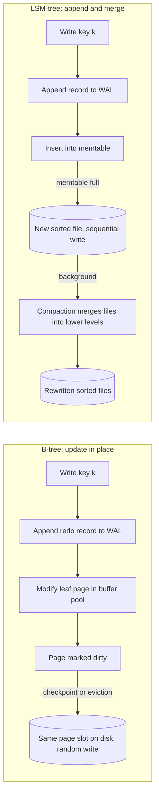
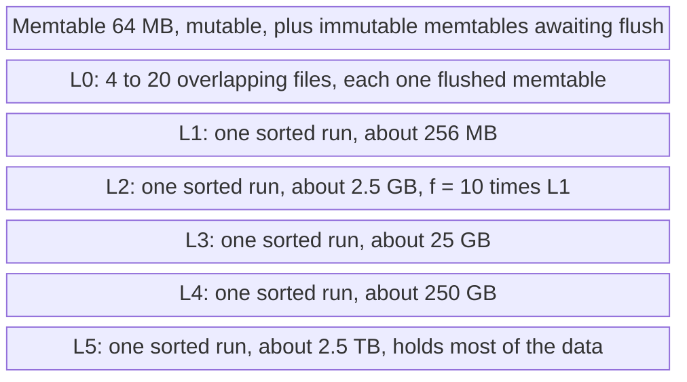
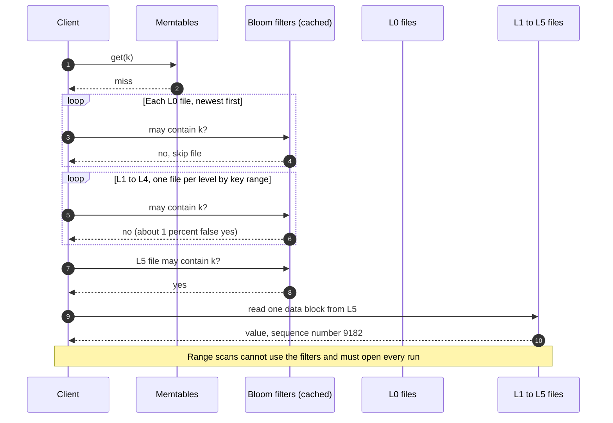
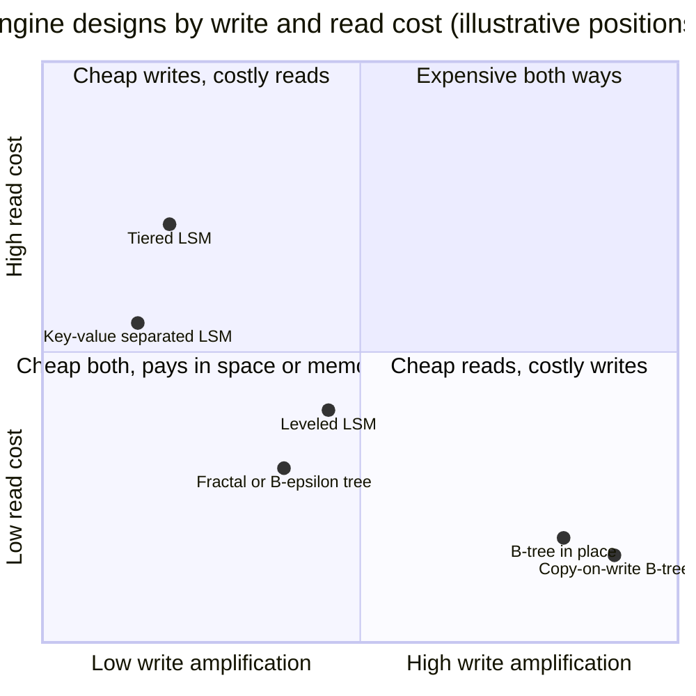

B-tree ve log-structured merge tree (LSM-tree), tek bir probleme verilmiş iki cevaptır: küçük rastgele yazmaların pahalı olduğu ve okumaların her anahtarı sınırlı sayıda I/O ile bulması gereken bir cihaz üzerinde sıralı ve dayanıklı bir anahtar dizini tutmak. B-tree her anahtarın tam olarak bir kopyasını sabit bir konumda, bir leaf sayfasındaki bir slotta tutar ve o sayfayı yerinde günceller. LSM-tree ise hiçbir zaman yerinde güncelleme yapmaz: yazmaları bellekte biriktirir, değişmez (immutable) sıralı dosyalar olarak diske yazar ve bu dosyaları arka planda birleştirir. Bir tarafta PostgreSQL veya InnoDB, diğer tarafta RocksDB, Cassandra veya ScyllaDB arasındaki operasyonel farkların neredeyse tamamı bu tek tercihten doğar.

Asıl denge, motorun veriyi sıralı tutmanın bedelini ne zaman ödediğidir. B-tree bedeli yazma anında öder: 200 baytlık bir satırı değiştirmek, tipik olarak 8 veya 16 KB'lık bir sayfanın tamamını kirletir ve bu sayfa er ya da geç geri yazılmak zorundadır; dolayısıyla her rastgele güncelleme bir sayfa yazmasına mal olur, okumalar ise tek bir yolu inerek her anahtarı bulur. LSM-tree bedeli sonradan ve okuma anında öder: bir yazma tek bir sıralı log eklemesi ve bir bellek eklemesi kadar ucuzdur, ama aynı anahtar artık birkaç dosyada bulunabilir; bu yüzden okuma her aday dosyayı kontrol etmek zorundadır ve dosyalar birleştikçe arka plandaki compaction her baytı birkaç kez yeniden yazar. Hiçbir motor bu maliyetten kaçamaz; yalnızca onu ön plandaki yazma yolu, ön plandaki okuma yolu ve arka plan I/O'su arasında taşır.

Bunu konuşmanın kullanışlı dili amplifikasyondur. Yazma amplifikasyonu, uygulamanın yazdığı her bayt başına cihaza yazılan bayttır. Okuma amplifikasyonu, mantıksal okuma başına I/O (veya okunan bayt) sayısıdır. Alan amplifikasyonu ise canlı verinin her baytı başına diskte tutulan bayttır. Athanassoulis ve arkadaşlarının RUM varsayımı (RUM conjecture) kısıtı gayriresmî biçimde ifade eder: bir erişim yöntemi okuma maliyeti, güncelleme maliyeti ve bellek ya da alan maliyetinden ikisini sınırlayabilir ve bunun bedelini üçüncüsünde öder. Bu sayfa her motorun amplifikasyonunu nerede harcadığını, somut bir iş yükü için bunun nasıl hesaplanacağını ve bütçe tükendiğinde her birinin nasıl çöktüğünü açıklar. LSM yazma yolunun iç yapısı ve compaction stratejileri [SSTables, Memtable ve Compaction Stratejileri](/distributed-systems/tr/data-management/storage-engines/sstables-memtable-compaction/) sayfasında, LSM nokta okumalarını ucuz tutan filtreler [Bloom Filtreleri](/distributed-systems/tr/data-management/storage-engines/bloom-filters/) sayfasında, iki motorun da dayanıklılık için güvendiği log ise [Write-Ahead Log](/distributed-systems/tr/data-management/storage-engines/write-ahead-log/) sayfasında ele alınır.


*İki yazma yolu. İkisi de dayanıklılık için önce log'a yazar; ayrıldıkları nokta, verinin ardından başına gelenlerdir.*

İki yol da aynı biçimde başlar: yazma bir write-ahead log'a (WAL) eklenir ve log dayanıklı hâle geldiğinde onaylanır. Ayrışma ikinci yarıdadır. B-tree'nin kirli sayfası geldiği slota geri döner; bu yüzden cihaz, dosyanın tamamına dağılmış, değişen her sayfa için bir sayfalık yazmalar görür. LSM-tree'nin memtable'ı ise tek büyük sıralı bir dosya olarak diske çıkar ve maliyet compaction okunda yeniden ortaya çıkar: aynı veri seviyeler boyunca aşağı indikçe tekrar tekrar yazılır. B-tree'nin rastgele yazmaları checkpoint aralığı başına sayfa başına bir kez ödenir; LSM-tree'nin sıralı yazmaları ise seviye başına bir kez.

## İki Yazma Yolu: Yerinde Güncelleme ve Ekle-Birleştir

### B-Tree: Her Anahtar İçin Tek Bir Ev

Neredeyse her veritabanının kullandığı varyant olan B+tree, tüm kayıtları (ya da kayıt işaretçilerini) soldan sağa bağlı leaf sayfalarında saklar; iç sayfalarda yalnızca ayırıcı anahtarlar (separator) ve alt düğüm işaretçileri bulunur. Sayfa, I/O'nun ve önbelleklemenin birimidir: PostgreSQL'de 8 KB, InnoDB'de varsayılan olarak 16 KB, SQLite'ta varsayılan olarak 4 KB. Fan-out, bir iç sayfanın tuttuğu alt düğüm sayısıdır ve kısa anahtarlarla yüzlere ulaşır; bu yüzden ağaç sığdır. Bir nokta araması kökü okur, ayırıcılar üzerinde ikili arama yaparak iç sayfalardan aşağı iner ve tek bir leaf okur. İç sayfalar ağacın küçük bir kesridir ve buffer pool'da kalır; dolayısıyla büyük bir tabloda arama yaklaşık bir rastgele okumaya, yani leaf'e mal olur.

Bir insert veya update hedef leaf'i aynı yolla bulur ve onu bellekte değiştirir. Leaf'te yer yoksa bölünür (split): kayıtlarının yarısı yeni bir sayfaya taşınır ve yeni sayfa için bir ayırıcı ebeveyn sayfaya eklenir; ebeveyn de sırayla bölünebilir. Bölünmeler her leaf'i en az yaklaşık yarı dolu ve ağacı dengeli tutar, böylece her anahtar kökten aynı sayıda seviye uzaktadır. Silmeler kayıtları işaretler veya kaldırır; motorların çoğu yetersiz dolu sayfaları tembelce birleştirir ya da hiç birleştirmez ve bu, parçalanmanın (fragmentation) kaynaklarından biridir.

Değiştirilen sayfa hemen diske yazılmaz. Motor WAL'a bir redo kaydı yazar, sayfayı buffer pool'da kirli olarak işaretler ve onu daha sonra bir arka plan yazıcısının veya bir checkpoint'in diske boşaltmasına bırakır. Her sayfa, onu değiştiren son kaydın log sıra numarasını (log sequence number, LSN) taşır ve bunu doğru kılan da budur: bir çöküşten sonra kurtarma, log'u son checkpoint'ten itibaren yeniden oynatır ve bir kaydı yalnızca LSN'i o kayıttan eski olan sayfalara uygular. Diskteki sayfa istenildiği kadar eski olabilir, ama log ile sayfa birlikte her zaman commit edilmiş durumu yeniden kurar. Geriye bir açık kalır: 4 KB atomik yazma garantisi olan bir cihaza yazılan 16 KB'lık bir sayfa yarıda yırtılabilir (torn page) ve ne eski ne de yeni log kayıtlarının onaramayacağı bir sayfa bırakabilir. PostgreSQL bunu her checkpoint'ten sonraki ilk değişiklikte sayfanın tam görüntüsünü log'a yazarak kapatır; InnoDB ise her sayfayı önce bir doublewrite buffer'a, sonra asıl yerine yazar. İkisi de WAL sayfasında açıklanır; bu karşılaştırma için önemli olan, kirlenen her sayfa başına bir sayfa boyutunda yazma daha eklemeleridir.

B-tree'de eşzamanlılık, latch adı verilen kısa süreli sayfa kilitleriyle ilgilidir. Bir yazıcı bir leaf'i değiştirirken onun üzerinde latch tutar ve bir bölünme ebeveyni de latch'lemek zorundadır. Lehman ve Yao'nun B-link tree'si her sayfaya bir sağ kardeş işaretçisi ve bir üst anahtar (high key) ekler; böylece bir bölünmeyle yarışan okuyucu, yol boyunca latch tutmak yerine kardeş bağlantısını izleyebilir. PostgreSQL'in B-tree uygulamasında okuyucuların yazıcılar yüzünden nadiren bloklanmasının sebebi budur. Monoton artan anahtarlarda en sağdaki leaf üzerinde ve bölünmeler sırasında kök üzerinde oluşan latch çekişmesi, B-tree'nin hot spot karşılığıdır.

B-tree'nin değişmezi güçlü ve basittir: her anahtar tam olarak bir leaf'te, tek bir konumda bulunur ve leaf zinciri anahtar sırasındadır. Aralık taramaları zinciri izler ve çoğunlukla işe yarar kayıtlarla dolu sayfalar okur. Bedeli, sayfa boyutuna ve sayfa diske boşaltılmadan önce kaç değişikliğin o sayfayı paylaştığına bağlı bir yazma amplifikasyonudur. 16 KB'lık bir sayfa diske yazıldığında yalnızca 200 baytlık tek bir değişiklik taşıyorsa, cihaz mantıksal verinin 80 katını yazar; buna WAL ve yırtık sayfa koruması dahil değildir.

### LSM-Tree: Arka Planda Birleştirilen Çok Sayıda Sıralı Run

1996'da O'Neil, Cheng, Gawlick ve O'Neil tarafından ortaya konan ve Bigtable, LevelDB ve RocksDB ile pratik hâle gelen LSM-tree değişmezi değiştirir: bir anahtar birden fazla yerde bulunabilir ve en yeni sürüm kazanır. Bir yazma WAL'a eklenir ve bellekteki sıralı bir yapı olan memtable'a (RocksDB'de bir skip list) konur. Memtable boyut sınırına ulaştığında immutable hâle gelir, yeni yazmaları taze bir memtable alır ve bir arka plan thread'i immutable olanı diske bir sorted string table (SSTable) olarak yazar: sıralı key-value bloklarından, bir index'ten ve genellikle bir Bloom filtresinden oluşan bir dosya. Bu memtable'ı kapsayan WAL segmenti bundan sonra atılabilir.

Diske boşaltılan dosyalar seviye 0'da (L0) birikir; burada anahtar aralıkları örtüşür, çünkü her dosya tek bir memtable'ın ömrü boyunca gelen anahtarları tutar. Compaction dosyaları birleştirerek sıralar (merge-sort) ve bir alt seviyeye taşır. Leveled compaction'da L0'ın altındaki her seviye, örtüşmeyen dosyalara bölünmüş tek bir sıralı run'dır ve her seviye bir üstündekinin sabit bir katı, yani fan-out `f` kadar büyüktür (RocksDB'de varsayılan `f = 10`). Cassandra'nın size-tiered stratejisinde ve RocksDB'nin universal compaction'ında kullanılan tiered compaction'da ise her seviye birden fazla örtüşen run tutabilir ve benzer boyuttaki run'lar yeterince biriktiğinde birlikte birleştirilir. Bu politikalar [compaction sayfasının](/distributed-systems/tr/data-management/storage-engines/sstables-memtable-compaction/) konusudur; burada yalnızca amplifikasyonları önemlidir.


*RocksDB benzeri boyutlandırmayla leveled bir LSM-tree'nin şekli. Boyutlar örnek amaçlıdır; dinamik seviye boyutlandırmada üst seviyelerin hedeflerini son seviyenin gerçek boyutu belirler.*

Diyagram, bir LSM-tree'nin I/O'sunda compaction'ın neden baskın olduğunu gösterir. Verinin yaklaşık %90'ı son seviyededir; dolayısıyla anahtarını bulan okumaların çoğu onu, üstteki seviyeleri kontrol ettikten sonra orada bulur. Yazılan her bayt en üstten girer ve oraya ulaşmak için her seviyeden aşağı doğru birleştirilmek zorundadır; `i` seviyesinden `i+1` seviyesine her birleştirme, `i+1` seviyesinin örtüşen kısmını da yeniden yazar. Seviyeleri büyütmek (`f`'yi artırmak) seviye sayısını ve dolayısıyla bir okumanın kontrol etmesi gereken yer sayısını azaltır, ama her birleştirmenin daha fazla veri yeniden yazmasına yol açar. Bu tek parametre motoru okuma-yazma dengesi boyunca hareket ettirir.

Doğruluk sıra numaralarına dayanır. Her yazma monoton artan bir sıra numarası alır ve her dosya bilinen bir sıra aralığını kapsar. Bir nokta okuması önce memtable'ı, sonra immutable memtable'ları, ardından L0 dosyalarını yeniden eskiye doğru, sonra da her alt seviyede bir dosyayı arar ve bulduğu ilk sürümde durur, çünkü daha sonra bulunacak her şey daha eskidir. Bir silme immutable bir dosyadaki veriyi kaldıramaz; bu yüzden kendi sıra numarası olan ve okumalar sırasında eski sürümleri gölgeleyen bir işaret, yani tombstone olarak yazılır. Compaction, görünür en yeni sürümün kazandığı değişmezini korur: dosyaları birleştirirken her anahtarın en yeni sürümünü (ve açık bir snapshot'a hâlâ görünen eski sürümleri) tutar, gölgelenen sürümleri atar ve bir tombstone'u yalnızca kendi anahtar aralığı için en alt seviyeye ulaştığında, yani altında daha eski bir sürüm kalamayacağı yerde atar. Onu daha önce atmak, gölgelediği değeri geri diriltirdi.


*Anahtarını son seviyede bulan bir nokta okuması. Filtreler ve index blokları önbellekteyken maliyeti bir veri bloğu okuması artı yanlış pozitiflerdir.*

LSM-tree'nin çoklu kopyalarının pahalılaştığı yer okuma yoludur ve nokta okumalarını katlanılabilir kılan filtrelerdir. Filtreler bellekteyken 3 ile 6. adımlar hiç I/O gerektirmez: her filtre, anahtarı içermeyen dosyaların çoğu için "kesinlikle yok" cevabını verir. Boşa harcanan bir blok okumasına yalnızca yanlış pozitif mal olur; filtre başına kabaca %1 yanlış pozitif ve dokuz aday dosyayla beklenen kayıp bir okumanın onda birinin altındadır. Alttaki not asıl sınırlamadır. Bir aralık taraması "a ile b arasında hangi anahtarlar var" diye sorar ve hiçbir Bloom filtresi buna cevap veremez; bu yüzden motor her memtable, her L0 dosyası ve her seviye üzerinde bir iterator açar ve bunları bir heap ile birleştirir. Her iterator en az bir seek gerektirir; kısa bir aralık taraması, B-tree'nin toplamda tek seek ödediği yerde sıralı run başına bir seek'e mal olur.

## Amplifikasyon: Her Motor Bütçesini Nerede Harcar

### Yazma Amplifikasyonu

B-tree için güncelleme başına yazma amplifikasyonu yaklaşık olarak sayfa boyutunun, sayfa diske boşaltıldığında taşıdığı değişiklik baytına bölümüdür; buna WAL kaydı ve yırtık sayfa koruması eklenir. Bir sayfayı kaç değişikliğin paylaştığı yerelliğe bağlıdır: sıralı büyüyen bir anahtar, bir sayfa bir kez yazılmadan önce onu düzinelerce insert ile doldurur; buffer pool'dan çok daha büyük bir tabloda düzgün dağılımlı rastgele güncellemeler ise her sayfayı boşaltma başına yaklaşık bir değişiklikle bırakır. Checkpoint aralığını uzatmak sıcak sayfalarda daha fazla değişikliğin birleşmesini sağlar; bedeli daha uzun bir çöküş kurtarması ve daha büyük bir WAL'dır.

Leveled bir LSM-tree'de her bayt bir kez WAL'a, bir kez memtable diske boşaltılırken ve ardından compaction onu aşağı taşıdıkça seviye başına bir kez yazılır; bu, örtüşme ile çarpılır: `i` seviyesinden bir dosyayı `i+1` seviyesine birleştirmek, `i+1` seviyesinde anahtar aralığıyla örtüşen tüm dosyaları yeniden yazar ve fan-out `f` ile bu, dosyanın kendi boyutunun yaklaşık `f` katına kadar çıkabilir. L0'ın altındaki `L` seviye için en kötü durum kabaca `2 + L * (f + 1)`'dir. Ölçülen değerler daha düşüktür, çünkü kısmi örtüşmeler, seviyelerin dinamik boyutlandırılması ve yeni verinin çoğu zaman eski veriyi daha dibe ulaşmadan geçersiz kılması yeniden yazmayı azaltır. Tiered compaction her baytı kabaca tier başına bir kez yeniden yazar; bu yüzden yazma amplifikasyonu yaklaşık tier sayısı kadardır, çoğu zaman leveled'ın yarısından azdır; bedeli okunacak daha fazla run ve daha fazla geçici alandır.

İki motor cihaza da farklı yazar. LSM flush'ları ve compaction'ları tüm dosyaları büyük sıralı yazmalarla yazar; bir katı hal sürücüsü (SSD) bunları az iç maliyetle karşılayabilir, çünkü flash translation layer'ı (FTL; mantıksal blokları flash sayfalarına eşleyen firmware), dosya silindiğinde birlikte boşalan blokları bütün hâlinde siler. B-tree'nin dağınık sayfa yazmaları ise flash sayfalarını birer birer geçersiz kılar; FTL bir bloğu silebilmek için hâlâ geçerli sayfaları taşımak zorunda kalır ve bu, motorunkinin üzerine cihaz içi bir yazma amplifikasyonu ekler. Motor düzeyindeki hesap, dolu bir SSD'de B-tree'nin gerçek maliyetini olduğundan düşük gösterir.

### Okuma Amplifikasyonu

Bir B-tree nokta okuması ağaç yüksekliği kadar sayfa erişimine mal olur; leaf dışındakilerin hepsi genellikle önbellektedir, dolayısıyla pratik maliyet, leaf önbellekte değilse bir rastgele okumadır. Bir aralık taraması bir iniş artı sıralı leaf okumalarına mal olur ve okunan her sayfa çoğunlukla işe yarar veridir.

Bir LSM nokta okuması en kötü durumda sıralı run başına bir yoklamaya mal olur. Bloom filtreleri ve index blokları önbellekteyken, var olan bir anahtar için beklenen maliyet yaklaşık bir veri bloğu okuması artı kontrol edilen filtrelerin yanlış pozitif oranlarının toplamıdır. Var olmayan bir anahtar için yalnızca yanlış pozitifler kalır; filtreleri belleğe sığdığı anda LSM motorlarının "yoksa ekle" kontrollerinde mükemmel olmasının nedeni budur. Zayıf nokta aralık taramalarıdır: run başına bir seek ve her run'ın iterator'ı karşılaştığı tombstone'ları ve gölgelenmiş sürümleri de atlamak zorundadır.

### Alan Amplifikasyonu

B-tree sayfalarının boş kısmını israf eder. Rastgele ekleme, leaf'leri ortalama yaklaşık %69 dolu bırakır; bu sonuç ve etkileri [Dağıtık ID Üretimi](/distributed-systems/tr/foundations/time-and-ordering/distributed-id-generation/) sayfasında ele alınır. Dolayısıyla dosya canlı verinin yaklaşık 1.45 katıdır; yüksek bir fill factor ile sıralı ekleme bunu 1.1'e yaklaştırır. Sıkıştırma beklenenden az işe yarar, çünkü 16 KB'tan 5 KB'a sıkıştırılmış bir sayfa yine de tam sayıda tahsis birimi kaplamak zorundadır ve InnoDB'nin sıkıştırılmış sayfaları yapılandırılmış sabit bir boyuttadır. MVCC bunun üzerine eski satır sürümlerini ekler; PostgreSQL'de heap'te, InnoDB'de undo log'larda. Bu konu [Zayıf İzolasyon ve MVCC](/distributed-systems/tr/data-management/consistency-models/weak-isolation-mvcc/) sayfasında işlenir.

Leveled bir LSM-tree alanı yalnızca henüz compaction ile temizlenmemiş eski sürümler ve tombstone'lar için harcar. Son seviyenin üstündeki her seviye, altındakinin en fazla `1 / f`'i kadar veri tuttuğundan, üst seviyelerin toplamı son seviyenin en fazla yaklaşık `1 / (f - 1)`'i kadardır; bunların tamamı son seviyedeki anahtarların eski sürümleri olsa bile, `f = 10` için alan amplifikasyonu yaklaşık 1.11 olur. Facebook'tan Dong ve arkadaşları bu sınırı *Optimizing Space Amplification in RocksDB* çalışmasında analiz eder. Dosyalar bir kez yazılır, blok blok sıkıştırılır ve gelecekteki insert'ler için boş alan ayrılmaz; bu yüzden LSM motorları aynı veri için genellikle B-tree'lerden daha az disk kullanır. İstisna tiered compaction'dır: büyük bir birleştirme bitene kadar eski ve yeni run'lar birlikte durur; dolayısıyla tam bir birleştirme, geçici olarak birleştirdiği veri kadar boş alana daha ihtiyaç duyabilir.


*Konumlar niteldir ve iş yüküne, önbellek boyutuna ve ayara bağlıdır; ölçülmüş değerleri değil, her tasarımın hangi yöne kaydığını gösterir.*

Grafik bir sıralama değil, tasarım tercihlerinin haritasıdır. Yerinde güncelleyen B-tree ve copy-on-write B-tree (yerinde güncellemek yerine leaf'ten köke kadar yoldaki her sayfayı yeniden yazan LMDB) sağ altta durur: en yüksek yazma maliyetine karşılık en ucuz okumalar. Leveled ve tiered LSM-tree'ler köşegen boyunca takas yapar; tiered, okunacak daha fazla run karşılığında daha ucuz yazmalar satın alır. WiscKey makalesiyle ortaya konan ve RocksDB'de BlobDB, TiKV'de Titan olarak sunulan key-value ayrımı, büyük değerleri ayrı bir log'da saklar ve LSM-tree'de yalnızca anahtarları ve işaretçileri tutar; böylece compaction küçük girdileri taşır ve büyük değerler için yazma amplifikasyonu keskin biçimde düşer, ama aralık taramaları değer başına bir rastgele okuma öder ve değer log'unun kendi çöp toplamasına ihtiyacı olur. Eski TokuDB motorunun kullandığı fractal tree'ler ve B-epsilon tree'ler B-tree şeklini korur ama her iç düğüme bir mesaj tamponu ekler ve değişiklikleri toplu olarak aşağı iter; bu, ağaç yapısının içinde LSM benzeri bir toplulaştırmadır. RUM'un üçüncü boyutunda, yani bellek veya alanda bedel ödemeden sol alt köşeye yerleşen bir tasarım yoktur.

### Örnek Hesap: 2 TB Üzerinde Rastgele Güncellemeler

Her biri 200 bayt olan 10 milyar kayıtlık, 2 TB mantıksal veriye sahip, düzgün dağılımlı anahtarlarla saniyede 5,000 rastgele güncelleme alan bir tablo ve 128 GB önbellekli bir sunucu varsayalım. Bu örnekteki tüm sayılar örnek amaçlıdır ve karşılaştırma yapıyla ilgili kalsın diye iki tarafta da sıkıştırma yok sayılmıştır.

Ortalama %69 doluluktaki 16 KB'lık sayfalarla bir B-tree'de her leaf yaklaşık 11.3 KB kayıt tutar; tablo yaklaşık 177 milyon leaf'e, diskte 2.9 TB'a ihtiyaç duyar. Yüzlerce mertebesindeki fan-out ile iç seviyelerin toplamı birkaç gigabayttır ve önbellekte kalır; ağaç dört seviye derinliğindedir ve bir arama tek bir leaf erişimine mal olur. Önbellek leaf'lerin yaklaşık %4.4'ünü tutar; dolayısıyla güncellemelerin yaklaşık %95.6'sı önce bir rastgele okuma gerektirir: yalnızca güncellenecek satırları bulmak için saniyede yaklaşık 4,800 rastgele okuma. Kirli sayfaların yaklaşık beş dakika içinde diske boşaltıldığını varsayalım. Bu pencerede 1.5 milyon güncelleme 177 milyon leaf'e düşer; neredeyse her güncelleme ayrı bir sayfayı kirletir ve diske boşaltılan her sayfa tek bir değişiklik taşır. Her güncelleme böylece 16 KB'lık bir sayfa yazması ve 16 KB'lık bir doublewrite, artı birkaç yüz baytlık bir redo kaydına mal olur: değişen 200 bayt başına yaklaşık 32.3 KB yazma, yani yaklaşık 165'lik bir yazma amplifikasyonu. Saniyede 5,000 güncellemede cihaz yaklaşık 165 MB/s, günde kabaca 14 TB yazar.

RocksDB benzeri boyutlandırmaya (64 MB memtable'lar, 256 MB'lık ilk seviye, `f = 10`) sahip leveled bir LSM-tree'de 2 TB, L0'ın altında beş seviye kaplar ve verinin çoğu son seviyededir. Seviye başına ortalama yeniden yazma katsayısının 5 olduğunu varsayalım; bu, 1'e yakın en iyi durum ile `f + 1`'e yakın en kötü durum arasındadır. Yazma amplifikasyonu bu durumda WAL için yaklaşık 1, flush için 1 ve compaction için `5 * 5 = 25`, toplamda 27 olur. Cihaz saniyede `5,000 * 200 * 27` bayt, yaklaşık 27 MB/s veya günde 2.3 TB yazar; bu, B-tree'nin altıda biridir ve neredeyse tamamı sıralıdır. Disk kullanımı, B-tree'nin 2.9 TB'ına karşılık yaklaşık `2 TB * 1.11 = 2.2 TB`'tır.

Cihaz dayanıklılığı (endurance) bunu donanıma çevirir. Günde bir sürücü yazması (drive writes per day, DWPD) için derecelendirilmiş 3.84 TB'lık bir SSD, günde yaklaşık 3.84 TB yazmayı kaldırır. B-tree'nin günlük 14 TB'ı 3.7 DWPD eder; FTL'in rastgele yazmalardaki kendi amplifikasyonu sayılmadan bile sürücünün derecelendirmesinin çok üstündedir ve yazma yoğun bir sürücü sınıfına ya da yükü paylaşan birkaç sürücüye ihtiyaç duyar. LSM-tree'nin 2.3 TB'ı ise 0.6 DWPD'dir.

Okumalar tabloyu değiştirir. Var olan bir anahtarın nokta okuması B-tree'ye yaklaşık 0.96 rastgele okumaya mal olur (zamanın %4.4'ünde leaf önbellektedir). Anahtar başına 10 bitlik filtrelerle LSM-tree, 10 milyar anahtar için yaklaşık 12.5 GB filtre belleğine ihtiyaç duyar; bu, veri önbelleğiyle yarışır ama sığar. Ardından isabet için yaklaşık bir veri bloğu artı beş seviye boyunca yaklaşık 0.05 yanlış pozitif okuma, toplamda yaklaşık 1.05 okuma yapar. Nokta okumalarında iki motor denktir. Ardışık 100 kaydın, yani 20 KB'ın taranması B-tree'ye bir iniş ve iki komşu leaf'e mal olur. LSM-tree ise beş seviyenin her birinde ve mevcut her L0 dosyasında seek yapmak zorundadır; dört L0 dosyası varsayarsak dokuz seek eder ve L1 ile L4 birlikte yaklaşık 285 GB tuttuğu için üst seviyeler yalnızca kısmen önbellektedir. Tarama LSM-tree'ye birkaç kat daha fazla rastgele I/O'ya mal olur ve L0 biriktikçe fark büyür.

Örnek, kararın şeklini gösterir: bellekten çok daha büyük veri üzerinde rastgele güncellemelerde LSM-tree altı kat daha az yazar ve %25 daha az disk kullanır, iki motor nokta okumalarında berabere kalır ve B-tree kısa aralık taramalarını katlarca kazanır. Aynı tablo zaman sıralı bir anahtarla sıralı insert'ler alsaydı, B-tree'nin sayfaları diske boşaltılmadan önce dolar ve yazma amplifikasyonu 2 ile 3 mertebesine düşerdi; LSM-tree'nin lehindeki gerekçe de yazmalara değil, sıkıştırmaya ve alana dayanırdı.

:::caution[LSM motorunu kararlı durumda (steady state) ölçün]
Boş bir veritabanına yeni yüklenmiş bir LSM-tree hızlıdır, çünkü compaction henüz yetişmemiştir: az seviye vardır ve benchmark'ın hiç ödemediği bir borç birikmektedir. Yazma benchmark'larını, veritabanı tam boyutuna ulaşacak ve bekleyen compaction baytları sabitlenecek kadar uzun koşturun; throughput'u ve tail latency'yi ondan sonra ölçün. Kısa LSM benchmark'ları sürdürülebilir yazma throughput'unu, bazen birkaç kat, olduğundan yüksek gösterir.
:::

## Gerçek Motorlar Nasıl Uygular ve Nerede Sapar

Üretimdeki motorlar ders kitabındaki ayrımı bulanıklaştırır ve bu bulanıklık, ayar düğmelerinin çoğunu açıklar. Tablo aileleri özetler; paragraflar ise operasyonel olarak önemli sapmaları açıklar.

| Motor | Yapı | Yazma yolu | Baskın maliyet | Ne zaman tercih edilmeli |
|---|---|---|---|---|
| InnoDB (MySQL) | Clustered B+tree, 16 KB sayfalar | Redo log, buffer pool, doublewrite, arka planda flush | Rastgele sayfa yazmaları; secondary index bakımı | Nokta ve aralık okumalı, satır kilitlemeli OLTP |
| PostgreSQL | Sırasız heap ve B-tree index'ler, 8 KB sayfalar | Tam sayfa görüntülü WAL, her update'te yeni tuple sürümü | Update başına index yazmaları; ölü tuple'ların vacuum'u | Genel OLTP, zengin indexleme, aynı sayfada kalabilen update'ler |
| WiredTiger (MongoDB) | Bellek içi sayfa görüntülü B-tree | Journal, bellekte zincirlenen update'ler, reconciliation'da yeni bloklara yazılan sayfalar | Önbellek baskısı ve eviction | Çalışma kümesi büyük ölçüde önbelleğe sığan doküman iş yükleri |
| LMDB | Copy-on-write B+tree, memory-mapped | WAL yok; leaf'ten köke yeni sayfalar, tek yazıcı | Commit başına yazma amplifikasyonu | Kurtarma gerektirmeden çöküş güvenliği isteyen, çoğunlukla okunan gömülü depolar |
| RocksDB, Pebble | Varsayılan olarak leveled LSM; isteğe bağlı universal (tiered) | WAL, memtable, flush, compaction | Compaction I/O'su ve CPU'su; aralık taramasında birleştirme maliyeti | Yazma ağırlıklı veya alan kısıtlı gömülü motorlar, dağıtık depoların yapı taşları |
| Cassandra, ScyllaDB | Tablo başına seçilebilir compaction stratejili LSM | Commit log, memtable, flush, compaction | Compaction stratejisinin uyumu; tombstone'lar | Yüksek veri alımlı wide-column veri, time-window compaction'lı zaman serileri |

InnoDB tablonun kendisini primary key'e göre kümelenmiş (clustered) bir B+tree'de saklar; bu yüzden primary key araması satıra leaf'te ulaşır ve her secondary index girdisi primary key'i taşıdığından secondary arama iki inişe mal olur. Change buffer, InnoDB'nin LSM benzeri optimizasyonuydu: buffer pool'da olmayan secondary index sayfalarına yapılan değişiklikler ayrı bir yapıda kaydedilir ve sayfa bir sonraki okunduğunda birleştirilirdi; böylece rastgele index yazmaları ertelenmiş toplu yazmalara dönüşürdü. MySQL 8.4, `innodb_change_buffering` varsayılanını `none` olarak değiştirdi, çünkü SSD'lerde tamponlanmış birleştirmeler çoğu zaman kazandırdığından fazlasına mal oluyordu. 8.0.30'dan beri `innodb_redo_log_capacity` ile ayarlanan redo log kapasitesi, kirli sayfaların ne kadar bekleyebileceğini ve dolayısıyla sayfa yazması başına kaç değişikliğin birleşeceğini sınırlar.

PostgreSQL'in heap'i bir B-tree değildir. Satırlar heap sayfalarında sırasız durur, her index heap tuple'larına işaret eden ayrı bir B-tree'dir ve bir update yeni bir tuple sürümü yazar. Ek bir yardım olmasa bu, her update'te her index'e bir yazma demek olurdu. Heap-only tuple (HOT) update'leri, index'li hiçbir kolon değişmediğinde ve yeni sürüm aynı heap sayfasına sığdığında bunu önler; tabloda 100'ün altındaki bir fill factor tam olarak bunun için yer ayırır. PostgreSQL 13, B-tree leaf'lerinde eşit anahtarların tekilleştirilmesini (deduplication) ekledi ve bu, unique olmayan index'lerin boyutunu küçültür. PostgreSQL'in compaction yerine ödediği bedel, MVCC sayfasında ele alınan vacuum'dur: ölü tuple'lar bir arka plan süreci tarafından geri kazanılmalıdır ve bu süreç geride kaldığında tablolar ve index'ler şişer (bloat); bu, yerinde güncelleyen motorun alan amplifikasyonu biçimidir.

MongoDB'nin varsayılan motoru WiredTiger, bellek içi sayfaları diskteki biçimlerinden farklı olan bir B-tree'dir: update'ler bellekteki sayfaya bağlı zincirler olarak tutulur ve bir sayfa eviction veya checkpoint için reconcile edildiğinde, eski görüntünün üzerine yazmak yerine yeni bir konuma yeni bir disk görüntüsü yazılır. Bu, checkpoint'leri doublewrite buffer olmadan tutarlı kılar ve motorun baskısını rastgele üzerine yazmalardan önbellek boyutuna ve eviction'a kaydırır. LMDB copy-on-write'ı sonuna kadar götürür: bir commit, değişen leaf'lerden köke kadar yoldaki her sayfanın yeni kopyalarını yazar ve ardından bir meta sayfadaki kök işaretçisini atomik olarak değiştirir; böylece okuyucular kilitsiz olarak tutarlı bir snapshot görür ve bir çöküşten sonra kurtarılacak hiçbir şey yoktur. Bedeli, her commit için ağaç yüksekliğiyle orantılı yazma amplifikasyonu ve aynı anda tek bir yazıcıdır.

RocksDB, Google'ın Bigtable'ın tablet depolamasından türettiği LevelDB'nin soyundandır. Varsayılan olarak leveled'dır, yazma ağırlıklı durumlar için universal compaction sunar, bir WAL'ı paylaşan ama bağımsız compact edilen column family'leri destekler ve key-value ayrımı için BlobDB sunar. Yazma yolunda açık bir akış kontrolü vardır: compaction geride kaldığında önce ön plandaki yazmaları yavaşlatır, sonra durdurur; aşağıdaki write stall hata modunun arkasındaki mekanizma budur. CockroachDB, RocksDB'nin yerine RocksDB uyumlu formata sahip bir Go motoru olan Pebble'ı koydu; TiKV ise her region'ın Raft log'unun altında RocksDB çalıştırır. RocksDB'yi bir MySQL depolama motoru olarak kullanan Facebook'un MyRocks'ı, iki aile arasındaki en iyi belgelenmiş geçiştir: Matsunobu, Dong ve Lee, VLDB 2020'de MyRocks'ın Facebook'un kullanıcı veritabanının (UDB) instance boyutunu sıkıştırılmış InnoDB'ye göre %62.3 azalttığını ve flash'a yazılan baytları %75 düşürdüğünü raporlar; bu sayede UDB veritabanı sunucularının sayısı yarının altına inmiştir.

Cassandra ve ScyllaDB, compaction stratejisinin tablo başına bir tercih olduğu LSM motorlarıdır: uzun süredir varsayılan olan size-tiered, okuma ağırlıklı tablolar için leveled, TTL'li zaman serileri için time-window ve Cassandra 5.0 ile eklenen unified compaction stratejisi. Tombstone'lar bu sistemlerde gömülü bir motora göre daha önemlidir, çünkü bir tombstone'un her replica'ya ulaşacak kadar uzun yaşaması gerekir ve bu, yerel compaction'ı küme onarımına bağlar; bu etkileşim [Lidersiz Replikasyon](/distributed-systems/tr/data-management/replication/leaderless-replication/) ve [Anti-Entropy](/distributed-systems/tr/data-management/replication/anti-entropy-merkle/) sayfalarında ele alınır.

:::note[Bir commit log, LSM-tree değildir]
Kafka partition'ları, veritabanı WAL'ları ve event store'lar yalnızca ekleme yapılan (append-only) log'lardır ve çoğu zaman log-structured olarak anılırlar. LSM-tree değildirler: anahtara göre değil geliş sırasına göre sıralanırlar, offset'e göre sıralı okunurlar ve sıralı seviyelere birleştirme yapmazlar. Kafka'nın disk tasarımı [Disk Tabanlı Kalıcılık ve Sıfır Kopyalama](/distributed-systems/tr/case-studies/apache-kafka/disk-persistence-zero-copy/) sayfasında, log'ların anahtara göre saklanması ise LSM compaction'ı ile yalnızca adını paylaşan [Log Compaction](/distributed-systems/tr/data-processing/hybrid-architectures/log-compaction/) sayfasında ele alınır.
:::

## Bir Motoru Denge Boyunca Kaydıran Parametreler

İki aile de, motorun okuma-yazma-alan üçgeninde nerede duracağını belirleyen az sayıda parametre sunar. Ayar hatalarının çoğu, birini hangi amplifikasyonu hangisiyle takas ettiğini anlamadan değiştirmekten doğar.

| Parametre (aile) | Artırıldığında etkisi | Bedeli | Ayar önerisi |
|---|---|---|---|
| Buffer pool veya önbellek boyutu (ikisi de) | Daha fazla okuma ve yazma bellekten karşılanır; B-tree sayfası başına daha çok değişiklik birleşir | Bellek | Sıcak çalışma kümesine göre boyutlandırın; rastgele update'li B-tree'lerde ilk kaldıraç budur |
| Sayfa boyutu (B-tree) | Daha az seviye, daha iyi aralık taraması | Küçük değişiklik başına daha yüksek yazma amplifikasyonu | Satırlar büyük değilse veya taramalar baskın değilse motor varsayılanında bırakın |
| Fill factor (B-tree, PostgreSQL heap) | Sayfa içi update'ler ve HOT için yer | Alan amplifikasyonu | Update ağırlıklı tablolarda düşürün, yalnızca ekleme yapılanlarda yüksek tutun |
| Redo veya WAL kapasitesi, checkpoint aralığı (B-tree) | Daha fazla birleştirme, daha düzgün flush | Daha uzun çöküş kurtarması, diskte daha fazla log | Checkpoint kaynaklı flush gecikme sıçramalarına yol açıyorsa artırın |
| Memtable boyutu ve sayısı (LSM) | Daha büyük ve daha az L0 dosyası; ani yükleri emer | Bellek, daha uzun flush ve kurtarma | Dalgalı veri alımında artırın; sayı, flush bekleyebilecek memtable miktarını sınırlar |
| Seviye fan-out'u `f` (leveled LSM) | Daha az seviye, daha ucuz okumalar | Seviye başına daha yüksek yazma amplifikasyonu | Varsayılan 10 çoğu duruma uyar; yalnızca ölçülmüş yazma baskısında düşürün |
| Compaction stili (LSM) | Tiered: daha az yazma amplifikasyonu | Daha fazla okuma maliyeti, geçici 2 kat alan | Veri alımı ağır, nadiren okunan veri için tiered; diğer durumlarda leveled |
| Anahtar başına Bloom filtresi biti (LSM) | Daha az boşa giden nokta okuması | Filtre belleği | Yaklaşık 10 bit, yaklaşık %1 yanlış pozitif verir; yalnızca taranan veride filtreyi atlayın |
| Compaction thread'leri ve hız sınırı (LSM) | Borcun daha hızlı ödenmesi | Ön plandan alınan I/O ve CPU | Okumaları korumak için hızı sınırlayın, ama sürekli veri alımının üstünde pay bırakın |

Aşağıdaki RocksDB seçenekleri, compaction borcunu ve onun akış kontrolünü yöneten seçeneklerdir. Belirtilen yerlerde değerler belgelenmiş varsayılanlardır; asıl mesele hangi düğmelerin birlikte ele alınması gerektiğidir.

```text
[CFOptions "default"]
  write_buffer_size=67108864                 # 64 MB memtable
  max_write_buffer_number=2                  # memtables allowed before writes stall
  level0_file_num_compaction_trigger=4       # L0 files that start L0->L1 compaction
  level0_slowdown_writes_trigger=20          # default: writes delayed beyond this
  level0_stop_writes_trigger=36              # default: writes stopped beyond this
  max_bytes_for_level_base=268435456         # 256 MB target for L1
  max_bytes_for_level_multiplier=10          # fan-out f
  soft_pending_compaction_bytes_limit=68719476736   # 64 GB: start delaying
  hard_pending_compaction_bytes_limit=274877906944  # 256 GB: stop writes
```

Üç grup, üç stall koşuluna karşılık gelir: flush bekleyen çok fazla memtable, compaction bekleyen çok fazla L0 dosyası ve herhangi bir yerde compaction bekleyen tahmini olarak çok fazla bayt. Compaction throughput'unu artırmadan bir durdurma tetikleyicisini yükseltmek, yalnızca durmadan önce borcun daha da büyümesine izin verir; bu da arada okumaları yavaşlatır ve sonunda gelen stall'ı uzatır.

## Hata Modları ve Dışarıdan Görünüşleri

İki aile farklı biçimlerde çöker. B-tree'ler önbellek üzerinden bozulur: çalışma kümesi belleğe sığmayı bıraktığında veya flush geride kaldığında işlem başına maliyetleri sıçrar. LSM-tree'ler borç üzerinden bozulur: erteledikleri arka plan işi vadesini doldurur ve motor kendini ön planı yavaşlatarak korur.

### Compaction Borcundan Kaynaklanan LSM Write Stall

Tetikleyici: compaction'ın birleştirebileceğinden hızlı süren veri alımı, toplu bir yüklemenin ardından gelen yazma patlaması, başka bir iş yükü tarafından I/O'dan mahrum bırakılan compaction thread'leri veya L0'dan L1'e ilerlemeyi bloklayan tek bir dev compaction. Belirtiler: yazma gecikmesi normaldir, sonra basamak basamak yükselir, throughput testere dişi biçimini alır ve en kötü durumda yazmalar saniyelerden dakikalara kadar tamamen durur; L0'da yoklanacak daha fazla örtüşen dosya olduğu için okumalar da yavaşlar.

```mermaid
sequenceDiagram
    autonumber
    participant A as Application
    participant E as Engine write path
    participant FL as Flush thread
    participant CP as Compaction threads
    A->>E: 80 MB/s sustained ingest
    E->>FL: memtables flushed to L0
    FL->>CP: L0 files arrive faster than L0 to L1 merges finish
    Note over CP: pending compaction bytes grow past the soft limit
    E-->>A: writes delayed to delayed_write_rate
    A->>A: request queues grow, clients retry
    rect rgb(70, 40, 40)
    Note over E,CP: L0 reaches level0_stop_writes_trigger
    E-->>A: all writes blocked
    CP->>CP: compaction continues at full I/O
    end
    CP-->>E: L0 below threshold
    E-->>A: writes resume, retried backlog arrives at once
```


*Compaction borcunun yol açtığı bir write stall. Hızlar örnek amaçlıdır; tetikleyiciler RocksDB'ninkilerdir.*

Hata, kimse fark etmeden dakikalar ya da saatler önce 3. ve 4. adımlarda başlar: motor yazmaları bedellerini ödeyebileceğinden hızlı kabul etmektedir ve görünür tek sinyal büyüyen bir borç metriğidir. 5. adım motorun backpressure'ıdır ve doğru davranıştır: L0, okumaları kullanılamaz kılacak kadar büyümeden önce ön planı yavaşlatır. 6. adım, istemciler yavaşlamak yerine yeniden denediğinde backpressure'ı bir olaya (incident) dönüştürür; 10. adım da kurtarmanın neden sarsıntılı olduğunu gösterir: yeniden denenen birikim aynı anda gelir ve motoru yeniden stall'a itebilir. Bu örüntü, [Geri Baskı](/distributed-systems/tr/resilience/flow-control/backpressure/) sayfasında ele alınan aşırı yük davranışının depolama düzeyindeki karşılığıdır.

Tespit: RocksDB'de `rocksdb.estimate-pending-compaction-bytes` ve `rocksdb.num-files-at-level0` özellikleri ile `STALL_MICROS` istatistiği; Cassandra'da `PendingCompactions` metriği ve `nodetool compactionstats`, ayrıca her okumanın kaç SSTable'a dokunduğunu gösteren `nodetool tablehistograms`. Alarmı stall'lara değil, bekleyen compaction baytlarının eğilimine kurun. Önlem: veri alımını uygulamada kısın, I/O'da pay varsa compaction thread'i ekleyin, ani yükleri emmek için memtable boyutunu artırın, yazma ağırlıklı tabloları tiered compaction'a geçirin veya her node daha az veri alsın diye node ekleyin. Kurtarma: borç eriyene kadar veri alımını compaction throughput'unun altında tutun; olay sırasında yapılan tam bir manuel compaction, doymuş bir cihaza I/O ekler ve genellikle durumu kötüleştirir.

### Okuma Yollarında Tombstone Birikmesi

Tetikleyici: bir LSM motorunda silme ağırlıklı bir erişim örüntüsü; tipik olarak tüketicilerin en eski girdileri okuyup sildiği, kuyruk olarak kullanılan bir tablo. Her silme bir tombstone yazar; tombstone'lar yalnızca en alt seviyede, Cassandra'da da ancak `gc_grace_seconds` dolduktan sonra atılır. Belirtiler: kuyruğun başındaki okumalar saatler içinde yavaşlar, çünkü her okuma canlı bir satır bulmadan önce binlerce tombstone'un üzerinden geçmek zorundadır; okuma başına CPU ve bellek tırmanır. Tespit: Cassandra, bir sorgu `tombstone_warn_threshold` değerinden (varsayılan 1,000) fazla tombstone okuduğunda uyarı log'lar ve `tombstone_failure_threshold` (varsayılan 100,000) aşıldığında sorguyu `TombstoneOverwhelmingException` ile iptal eder; RocksDB iterator başına atlanan iç anahtar sayılarını sunar. Önlem: kuyrukları silme ağırlıklı LSM tabloları olarak modellemeyin; bütün hâlinde düşürülen zaman kovalı partition'lar, time-window compaction ile TTL'ler veya kuyruk için tasarlanmış bir sistem kullanın. B-tree'de bu hata aynı biçimde görülmez, çünkü bir silme girdiyi sayfasından kaldırır; yine de MVCC'nin ölü tuple'ları, vacuum çalışana kadar bunun daha zayıf bir sürümünü üretir.

### B-Tree Önbellek Uçurumu

Tetikleyici: bir B-tree index'inin sıcak kısmının veri büyümesi, rastgele bir anahtar üzerinde yeni bir index veya önbelleğe aç bir sorgu yüzünden buffer pool'u aşması. Belirtiler: yazma ve okuma gecikmesi birlikte, çoğu zaman ani biçimde yükselir, çünkü önceden bellekten karşılanan her işlem artık önce bir rastgele okumaya ihtiyaç duyar; throughput sabit kalırken IOPS cihaz sınırına tırmanır. Tespit: buffer pool isabet oranı ve saniyedeki okumalar (InnoDB'de `Innodb_buffer_pool_reads` ile `Innodb_buffer_pool_read_requests`, PostgreSQL'de `blks_read` ile `blks_hit`), index boyutlarına karşı çizilir. Önlem: daha fazla bellek, rastgele yerine zaman sıralı anahtarlar, kullanılmayan index'leri kaldırmak veya partition'lama. Rastgele ID'ler için uçurumun hesabı [ID üretimi sayfasında](/distributed-systems/tr/foundations/time-and-ordering/distributed-id-generation/) adım adım yapılır.

### Checkpoint ve Flush Fırtınaları

Tetikleyici: B-tree'nin redo log'u veya WAL'ı, arka plan yazıcısının kirli sayfaları boşaltabileceğinden hızlı dolar ve motor bir checkpoint'i zorlamak zorunda kalır. Belirtiler: periyodik gecikme sıçramaları; InnoDB'de checkpoint yaşı log kapasitesine yaklaştığında flush agresifleşir, PostgreSQL'de ise checkpoint'lerde I/O patlamaları ve hemen ardından WAL'da tam sayfa görüntülerinde bir dalga görülür. Tespit: InnoDB'de `SHOW ENGINE INNODB STATUS` çıktısında checkpoint yaşının redo kapasitesine oranı; PostgreSQL'in checkpointer istatistiklerinde (sürüm 17'den itibaren `pg_stat_checkpointer`, öncesinde `pg_stat_bgwriter`) istenen ve zamanlanmış checkpoint'lerin karşılaştırması; checkpoint döngüsü boyunca saniyedeki WAL baytları. Önlem: daha büyük redo kapasitesi veya `max_wal_size`, yazmaları aralığa yayan bir checkpoint tamamlama hedefi ve yukarıdaki örnek hesabın bulduğu kararlı durum sayfa boşaltma hızına yetecek cihaz yazma bant genişliği.

### Compaction veya Vacuum Sırasında Alanın Tükenmesi

Tetikleyici: girdilerini silmeden önce birleştirilmiş bir run yazmak zorunda olan bir tiered compaction'ın o kadar boş alanı olmayan bir diskte çalışması; ya da yerinde güncelleyen tarafta vacuum'un geride kalıp şişmenin diski doldurması. Belirtiler: büyük compaction'lar sırasında disk kullanımı basamak basamak artar, compaction'lar alan yetersizliği hatasıyla başarısız olur ve LSM motorlarında başarısız compaction'lar, ardından stall'a yol açan bir borç bırakır. Tespit: bekleyen en büyük compaction'ın boyutuna karşı boş alan; B-tree motorları için ölü tuple sayıları veya undo history uzunluğu. Önlem: compaction stratejisiyle orantılı pay bırakın (tiered stratejiler leveled'dan çok daha fazla boş alana ihtiyaç duyar) veya büyüyen tabloları leveled compaction'a taşıyın.

| Hata | Motor | Belirti | Tespit sinyali | Önlem |
|---|---|---|---|---|
| Write stall | LSM | Yazma gecikmesinde basamaklar, ardından bloklanan yazmalar | Bekleyen compaction baytları, L0 dosya sayısı, stall süresi | Veri alımını kısmak, compaction kapasitesi, tiered stil |
| Tombstone taramaları | LSM | Kuyruğun başında yavaşlayan okumalar | Tombstone uyarıları, okuma başına atlanan anahtarlar | Zaman kovalı partition'lar, time-window compaction ile TTL |
| Aralık taraması yavaşlaması | LSM | Taramalar, nokta okumalarının düşündürdüğünden yavaş | Okuma başına SSTable, L0 dosya sayısı | Leveled compaction, daha az L0 dosyası, prefix filtreler |
| Önbellek uçurumu | B-tree | Okumalar ve yazmalar birlikte yavaşlar | Buffer pool isabet oranı, sınıra yakın IOPS | Bellek, sıralı anahtarlar, daha az index |
| Checkpoint fırtınası | B-tree | Periyodik gecikme sıçramaları | Checkpoint yaşı, zorlanan checkpoint'ler, WAL hızı | Daha büyük log, yayılmış checkpoint'ler |
| Alanın tükenmesi | İkisi de | Compaction veya şişme sırasında dolan disk | Bekleyen işe karşı boş alan, ölü tuple'lar | Pay bırakmak, leveled compaction, vacuum ayarı |

:::danger[Alan açmak için WAL veya SSTable dosyalarını elle silmeyin]
İki motorda da diskteki dosyalar ancak manifest'leri veya kontrol dosyaları ve log'larıyla birlikte tutarlı bir veritabanı oluşturur. Bir olay sırasında alan açmak için "eski" bir WAL segmentini, büyük bir SSTable'ı veya kullanılmıyor gibi görünen bir log dosyasını silmek, veritabanını kurtarılamaz hâle getirebilir ya da onaylanmış yazmaları sessizce kaybettirebilir. Alanı motor üzerinden veri düşürerek, kapasite ekleyerek veya bir replica'dan geri yükleyerek açın.
:::

## İkisi Arasında Seçim Yapmak

Seçim, iş yükünün üç özelliğinden çıkar: yazmaların okumalara oranı, okumaların nokta aramaları mı yoksa aralık taramaları mı olduğu ve veri boyutunun bellekle kıyası.

Yazmalar baskınsa ve anahtarlar rastgele sırayla geliyorsa, veri bellekten çok daha büyükse ve kısıt yazma bant genişliği ya da SSD dayanıklılığıysa, disk alanı veya sıkıştırma önemliyse (MyRocks sonucu bunun en güçlü kamuya açık kanıtıdır) ya da motor, yazmaları zaten bir log üzerinden sıraya koyan replike bir deponun altında bir yapı taşıysa (TiKV, CockroachDB ve Cassandra'da olduğu gibi) bir LSM motoru seçin. Süresi dolan zaman serileri özellikle iyi uyar, çünkü time-window compaction süresi dolan dosyaları bütün hâlinde düşürebilir.

Sıkı tail latency hedefli kısa aralık taramalarının baskın olduğu iş yüklerinde, tarama maliyeti kararlı durumda ölçülmedikçe; başında yoğun silme olan kuyruk benzeri örüntülerde; operatörler compaction borcunu izleyip ona göre davranamıyorsa veya yazma hacmi B-tree'nin yazma amplifikasyonunun önemli hiçbir şeye mal olmayacağı kadar düşükse bir LSM motoru seçmeyin.

Okumalar, özellikle aralık taramaları ve secondary index aramaları baskınsa, öngörülebilir gecikme tepe yazma throughput'undan önemliyse, çalışma kümesi belleğe sığıyorsa (bu durumda sayfalar diske boşaltılmadan önce çok sayıda değişikliği birleştirdiği için yazma amplifikasyonu argümanı büyük ölçüde ortadan kalkar) veya insert'ler sayfaları sırayla dolduran zaman sıralı bir anahtarı izliyorsa bir B-tree motoru seçin. Genel OLTP veritabanlarının çoğu buraya uyar; PostgreSQL, MySQL ve SQL Server'ın varsayılanlarının B-tree olmasının nedeni budur.

Bellekten çok daha büyük bir veri kümesine sürekli rastgele anahtarlı veri alımı için bir B-tree motoru seçmeyin: her yazma bir rastgele okuma artı bir sayfa yazmasına dönüşür ve tavanı CPU değil cihaz belirler. Hiçbir motoru da üne göre seçmeyin: bir iş yükünde yazma amplifikasyonunda altı kat fark eden iki motor, başka bir iş yükünde ayırt edilemez olabilir.

:::tip[Gerçekte ödediğiniz amplifikasyonu ölçün]
Aynı saat içinde cihaza yazılan baytları (`iostat`'tan veya sürücünün SMART sayaçlarından) uygulamanın yazdığı baytlara bölün. Kararlı durumda ölçülen bu tek oran, sorunun motorun yazma amplifikasyonu mu yoksa iş yükü mü olduğunu söyler; SSD dayanıklılığını ve değişim maliyetini belirleyen sayı da budur.
:::

Bu konuyla sıkça karıştırılan iki komşu konu vardır. Kolonsal depolama, analitik taramalar için dosyaların içindeki veri düzenini değiştirir ve her iki motor ailesinin üzerinde de durabilir; [Kolonsal Depolama](/distributed-systems/tr/data-management/storage-engines/columnar-storage/) sayfasında ele alınır. MVCC ise bir satırın kaç sürümünün bulunduğuna ve bunları kimin temizlediğine karar verir; iki motorun alan amplifikasyonuyla etkileşir ama bir eşzamanlılık kontrolü sorusudur ve [Zayıf İzolasyon ve MVCC](/distributed-systems/tr/data-management/consistency-models/weak-isolation-mvcc/) sayfasında işlenir.

## İleri Okuma

- Patrick O'Neil, Edward Cheng, Dieter Gawlick, and Elizabeth O'Neil, *The Log-Structured Merge-Tree (LSM-Tree)*, Acta Informatica, 1996.
- Rudolf Bayer and Edward McCreight, *Organization and Maintenance of Large Ordered Indexes*, Acta Informatica, 1972.
- Manos Athanassoulis, Michael S. Kester, Lukas M. Maas, Radu Stoica, Stratos Idreos, Anastasia Ailamaki, and Mark Callaghan, *Designing Access Methods: The RUM Conjecture*, EDBT, 2016.
- Lanyue Lu, Thanumalayan Sankaranarayana Pillai, Andrea C. Arpaci-Dusseau, and Remzi H. Arpaci-Dusseau, *WiscKey: Separating Keys from Values in SSD-Conscious Storage*, USENIX FAST, 2016.
- Siying Dong, Mark Callaghan, Leonidas Galanis, Dhruba Borthakur, Tony Savor, and Michael Strum, *Optimizing Space Amplification in RocksDB*, CIDR, 2017.
- Yoshinori Matsunobu, Siying Dong, and Herman Lee, *MyRocks: LSM-Tree Database Storage Engine Serving Facebook's Social Graph*, PVLDB 13(12), 2020.
