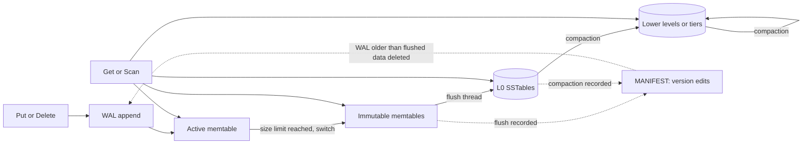
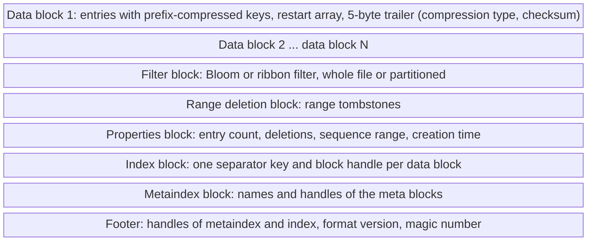
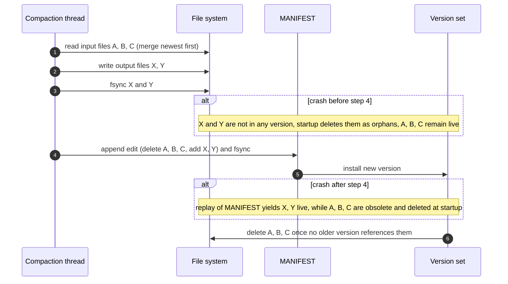
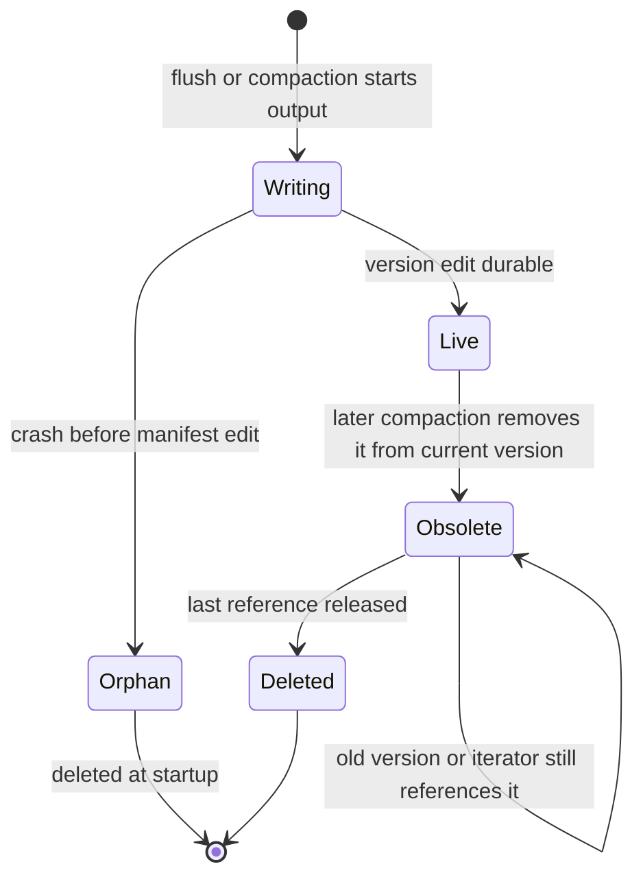
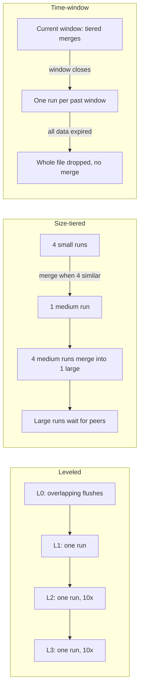
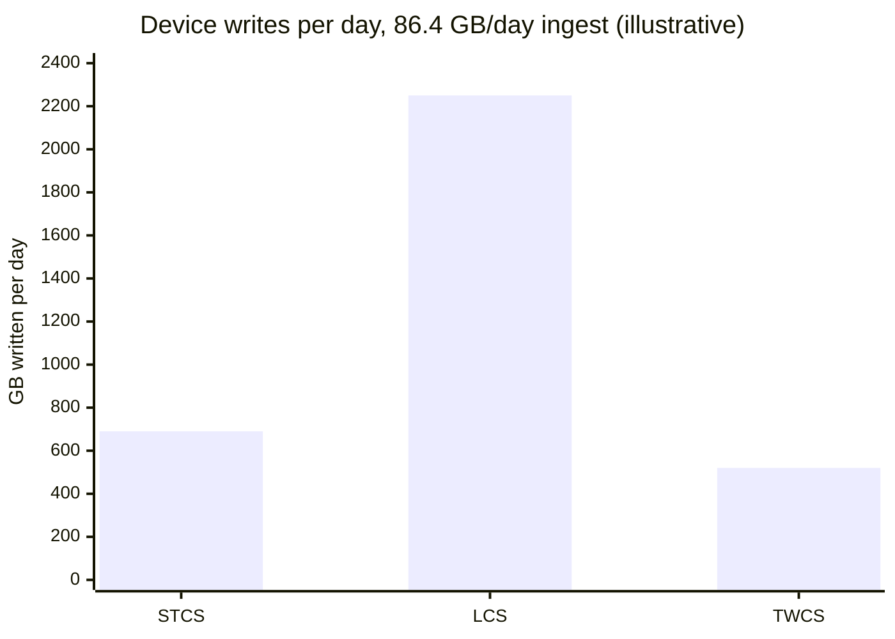
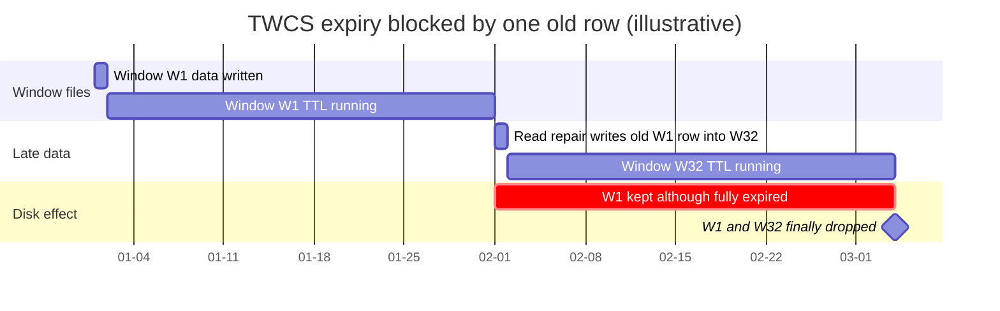

Bir LSM depolama motoru, birbirine karşı çalışan üç bileşenden oluşur. Memtable, her yazmayı karşılayan, bellekteki sıralı bir tampondur. SSTable (sorted string table, sıralı dizgi tablosu), dolan bir memtable'ın dönüştüğü değişmez (immutable) disk dosyasıdır. Compaction ise SSTable'ları daha az sayıda ve daha büyük dosyalarda birleştiren, bu sırada üzerine yazılmış değerleri ve silinmiş anahtarları atan arka plan işlemidir. Bir yazma yalnızca log'a ve memtable'a dokunur; bundan sonraki her şey ertelenmiş iştir ve motor, bu işi geri ödeyebildiği ölçüde sağlıklıdır.

Asıl denge compaction'dadır ve motorun kaç tane sıralı run'ın var olmasına izin verdiğiyle ilgili bir tercihtir. Sıralı run, her anahtarı anahtar sırasında en fazla bir kez tutan bir dosya kümesidir. Her run, bir okumanın bakması gereken bir yer ve eski bir sürümün saklanabileceği bir yerdir; dolayısıyla daha az run, daha ucuz okuma ve daha az boşa harcanan alan demektir. Ama run sayısını düşük tutmak, yeni veriyi mevcut run'lara sık sık birleştirmeyi ve aynı baytları defalarca yeniden yazmayı gerektirir. Leveled compaction seviye başına yaklaşık bir run tutar ve bedelini yazma amplifikasyonuyla öder; size-tiered compaction run'ların birikmesine izin verir ve bedelini okuma maliyeti ve geçici disk alanıyla öder; time-window compaction ise birleştirmenin büyük kısmından tamamen kaçınır ve bunun bedelini yalnızca veri zaman sırasıyla geldiğinde ve güncellenmek yerine süresi dolarak silindiğinde çalışabilmekle öder.

LSM-tree'nin bir bütün olarak yerinde güncelleme yapan B-tree ile karşılaştırması, amplifikasyon formülleri ve write stall mekanizması dahil, [LSM-Tree ve B-Tree](/distributed-systems/tr/data-management/storage-engines/lsm-tree-vs-b-tree/) sayfasında ele alınır. Bu sayfa LSM motorunun içine girer: memtable'ın nasıl kurulduğu ve ne zaman değiştirildiği, bir SSTable'ın bayt bayt neler içerdiği, flush ve compaction sonuçlarının herhangi bir anda yaşanan çöküşün tutarlı bir veritabanı bırakacağı biçimde nasıl kurulduğu, her compaction stratejisinin girdilerini nasıl seçtiği ve her birinin nasıl çöktüğü. Memtable'dan önce gelen dayanıklılık log'u [Write-Ahead Log](/distributed-systems/tr/data-management/storage-engines/write-ahead-log/) sayfasının, her SSTable içinde saklanan filtreler ise [Bloom Filtreleri](/distributed-systems/tr/data-management/storage-engines/bloom-filters/) sayfasının konusudur.


*Bir LSM motorunun bileşenleri. Düz oklar veriyi taşır; noktalı oklar hangi dosyaların canlı olduğunu kaydeder.*

Verinin yalnızca tek yönde aktığına dikkat edin: log'dan belleğe, oradan dosyalara ve seviyeler boyunca aşağıya. Düz yol üzerindeki hiçbir şey yazıldıktan sonra değiştirilmez. Bunu güvenli kılan noktalı oklardır: canlı dosya kümesindeki her değişiklik önce kendine ait küçük bir log'a, manifest'e kaydedilir ve motorun flush edilen memtable'ı koruyan WAL'ı ya da bir compaction'ın yerini aldığı dosyaları atmasına yalnızca bu kayıt izin verir. Sağdaki okumalar, anahtarın bir sürümünü tutabilecek her bileşene bakmak zorundadır; bu yüzden her stratejinin memtable'ın altındaki dosya sayısına etkisi, o stratejinin okuma maliyetini belirler.

## Memtable: Bellekte Sıralı ve Yalnızca Eklemeli Bir Tampon

Memtable'ın var olma sebebi, bir SSTable'ın anahtar sırasıyla yazılması gerekirken yazmaların rastgele sırayla gelmesidir. Bir şeyin bu yazmaları ucuz biçimde sıralaması gerekir; üstelik bu sırada okunabilir de olmalıdırlar, çünkü bir mikrosaniye önce onaylanan bir yazma bir sonraki okumada görünmelidir. Bir hash tablosu hızlı nokta aramaları sağlar ama sıra vermez; onu flush etmek tam bir sıralama gerektirir ve flush edilmemiş veri üzerinde aralık taraması imkânsız olur. Dengeli bir ağaç sıra sağlar ama kilit altında yeniden dengeleme ister. Motorların çoğu skip list kullanır: her düğümün bir üst şeride yarım (bazı uygulamalarda dörtte bir) olasılıkla terfi ettiği, ek hızlı şeritlere sahip bir bağlı liste. Bu yapı hiç yeniden dengeleme yapmadan beklenen logaritmik arama ve ekleme sağlar. Bir ekleme yalnızca yeni bir düğümü her şeride bağladığı için compare-and-swap komutlarıyla yapılabilir; böylece eşzamanlı yazıcılar kilit almaz ve okuyucular hiç bloklanmaz. RocksDB'nin varsayılan memtable'ı böyle kilitsiz bir skip list'tir ve varsayılan olarak eşzamanlı memtable yazmalarına izin verir (`allow_concurrent_memtable_write`); Cassandra'nın varsayılan memtable'ı ise eşzamanlı bir skip-list map üzerine kuruludur.

### Anahtarlar, Sıra Numaraları ve Memtable'ın Neden Yerinde Güncelleme Yapmadığı

Memtable hiçbir kaydın üzerine yazmaz. Bir güncelleme aynı kullanıcı anahtarı için yeni bir kayıt ekler; bir silme ise bir tombstone, yani "bu anahtar bu noktadan itibaren silinmiştir" diyen bir kayıt ekler. Bu kayıtlar arasındaki sıra, motorun yazma yolunun sıralaması altında her yazmaya monoton biçimde atadığı bir sıra numarasından (sequence number) gelir. RocksDB her kaydı bir dahili anahtar (internal key) altında saklar: kullanıcı anahtarı ve ardından 56 bitlik bir sıra numarasını ve 8 bitlik bir değer tipini (put, delete, single delete, merge operand, range deletion ve diğerleri) paketleyen sekiz bayt. Dahili anahtarlar önce kullanıcı anahtarına göre artan, sonra sıra numarasına göre azalan biçimde sıralanır; böylece her anahtarın en yeni sürümü, bir aramanın karşılaştığı ilk sürüm olur.

Okumaların doğruluk argümanı bu tek sıralama kuralıdır. En güncel durumda `k` anahtarı için yapılan bir nokta okuması, kullanıcı anahtarı `k` olan ilk dahili anahtara konumlanır ve onu döndürür; bu bir tombstone ise "bulunamadı" döner. Sıra numarası `S` olan bir snapshot'ta yapılan okuma `(k, S)` noktasına konumlanır ve görmemesi gereken daha yeni sürümleri atlayarak `S`'ye eşit veya ondan küçük ilk kaydı döndürür. Kayıtlar daha sonra dosyalara dağıldığında da aynı kural değişmeden geçerlidir: her bileşen yeniden eskiye doğru arandığı ve okumanın sıra numarasına eşit veya ondan küçük ilk sürüm kazandığı sürece sonuç, tüm yazmalar sıra numarası sırasıyla tek bir map'e uygulanmış gibi olur.

Bellek bir arena'dan ayrılır: düğüm boyutunda parçalara bölünen ve memtable flush sonrası atıldığında topluca serbest bırakılan büyük bloklar. Bu, kayıt başına bellek ayırmayı ve parçalanmayı önler ve motora memtable boyutunun kesin bir ölçüsünü, yani arena'dan ayrılan baytları verir; boyut sınırı bu değere göre kontrol edilir. Bedeli, memtable yaşadığı sürece geçersizleşen kayıtların hiç geri kazanılmamasıdır; aynı anahtarı saniyede binlerce kez güncelleyen bir iş yükü, memtable'ı tek bir anahtarın sürümleriyle doldurur.

Motorlar belirli erişim desenleri için alternatifler sunar. RocksDB'de, yalnızca bir prefix içinde tarama yapan iş yükleri için anahtarları prefix'e göre gruplayan hash indeksli memtable'lar ve sırasız eklemeleri kabul edip flush anında bir kez sıralayan bir vector memtable bulunur; ikincisi, flush edilene kadar okunmayan toplu yüklemeler için kullanışlıdır. Cassandra 5.0, isteğe bağlı bir uygulama olarak trie tabanlı bir memtable ekledi; `cassandra.yaml` içinde ve tablo bazında etkinleştirilir. Geliştiricileri onu, varsayılan skip list'e göre bellekte daha kompakt ve garbage collector üzerinde çok daha hafif olarak tanımlar; bu da aynı bellek bütçesinin daha fazla veri tutmasını ve dolayısıyla daha az sayıda, daha büyük flush üretmesini sağlar.

### Değiştirme ve Flush

Aktif memtable yapılandırılmış boyutuna ulaştığında (`write_buffer_size`, RocksDB'de varsayılan 64 MB) motor değiştirme (switch) yapar: memtable'ı immutable olarak işaretler, yeni bir WAL dosyası başlatır ve yeni yazmaları taze bir memtable'a yönlendirir. Immutable memtable, bir flush thread'i onu sırayla dolaşıp yeni bir SSTable'a yazarken okunabilir kalır. RocksDB toplamda `max_write_buffer_number` kadar memtable'a izin verir (varsayılan 2: biri aktif, biri flush ediliyor); flush yetişemezse ve bu sınıra ulaşılırsa, bir flush tamamlanana kadar yazmalar durur (stall). `min_write_buffer_number_to_merge` değerini 1'in üzerine çıkarmak, motorun birkaç immutable memtable beklemesine ve onları tek bir flush'ta birleştirmesine yol açar; bu, memtable'lar arasında üzerine yazılmış sürümleri atar, ama bedeli daha uzun kurtarma süresi ve daha fazla bellektir.

Immutable memtable'ı kapsayan WAL dosyası, flush SSTable'ını yazmayı bitirdiğinde silinemez. Ancak yeni dosya canlı olarak kaydedildikten sonra silinebilir hâle gelir; bu, bir sonraki bölümün konusudur. Tek bir WAL'ı paylaşan birden fazla column family varsa, küçük ve nadiren yazılan bir column family eski bir WAL dosyasını süresiz olarak hayatta tutabilir, çünkü WAL, içinde verisi olan her column family flush edilene kadar gereklidir. RocksDB bunu `max_total_wal_size` ile sınırlar (varsayılan olarak column family'ler genelindeki toplam memtable bütçesinin dört katı): bu sınırın üzerinde motor, en eski WAL'ı hayatta tutan column family'lerin flush edilmesini zorlar. Zorlanan bu flush'lar küçük dosyalar üretir; aşağıdaki ilk hata modu budur.

## SSTable Anatomisi: Aranabilir Hâle Getirilmiş Bir Sıralı Run

Bir SSTable tek bir kısıt etrafında tasarlanır: bir kez yazıldıktan sonra hiç değiştirilmez ve metadata'sı önbellekteyken bir nokta aramasını en fazla bir veri bloğu okumasıyla cevaplamalıdır. Formatı Bigtable ortaya koydu, LevelDB onun temiz bir açık kaynak sürümünü yayımladı ve RocksDB'nin block-based table'ı LevelDB'nin yerleşimini genişletir. Aşağıdaki yerleşim RocksDB'ye aittir; Cassandra'nınki adlandırmada ve partition'ların nasıl indekslendiğinde farklıdır ama aynı ilkeyi izler.


*RocksDB block-based SSTable'ının dosyanın başından sonuna fiziksel yerleşimi.*

Dosya tek bir sıralı geçişte baştan sona yazılır; dizininin sonda olmasının sebebi budur: yazıcı, son veri bloğu çıkana kadar index'in nerede başlayacağını bilmez. Okuyucu dosyayı diğer uçtan açar. Formatı tanımlayan bir magic number'ı ve index ile metaindex bloklarının handle'larını (offset ve boyut) taşıyan sabit boyutlu footer'ı okur; metaindex'ten filtre, properties ve range-deletion bloklarını bulur. Bu metadata blokları normalde block cache'te tutulur ya da belleğe sabitlenir (pin); böylece bir dosyadaki nokta araması bellekte bir filtre sorgusuna, bellekte index üzerinde bir ikili aramaya ve index'in gösterdiği tek veri bloğunun okunmasına mal olur.

### Veri Blokları, Prefix Sıkıştırması ve Restart Noktaları

Bir veri bloğu ardışık kayıtlardan oluşan bir dizi tutar; varsayılan olarak sıkıştırma öncesi yaklaşık 4 KB (`block_size`). Sıralı düzende komşu anahtarlar çoğu zaman uzun prefix'ler paylaşır; bu yüzden her kayıt yalnızca önceki anahtarla paylaştığı bayt sayısını, paylaşılmayan son eki ve değeri saklar. Bu sıkıştırma kayıtları tek başına okunamaz hâle getirir; bu nedenle varsayılan olarak her on altıncı kayıt (`block_restart_interval`) tam anahtarını saklayan bir restart noktasıdır ve blok, restart noktası offset'lerinden oluşan bir diziyle biter. Bir arama restart dizisinde ikili arama yapar, ardından en fazla on altı kayıt boyunca ileri doğru tarar. Blok daha sonra bir bütün olarak sıkıştırılır ve beş baytlık bir trailer, sıkıştırma tipini ve saklanan baytların checksum'ını kaydeder; böylece bozulma sessizce veri olarak döndürülmek yerine her okumada tespit edilir.

Index bloğu her veri bloğu için bir kayıt içerir: bloktaki her anahtardan büyük veya eşit, bir sonraki bloktaki her anahtardan küçük, mümkün olduğunca kısa seçilmiş bir ayırıcı anahtar (separator key) ve bloğun handle'ı. Her bloğun index kaydı kısa bir anahtar artı birkaç bayt tuttuğu için index blok sayısıyla, filtre ise anahtar sayısıyla büyür. Çok büyük dosyalar için RocksDB ikisini de iki seviyeli bir yapıya bölebilir: bellekte kalan küçük bir üst seviye index ve ihtiyaç duyuldukça önbelleğe yüklenen bölümler. Böylece bir dosyanın metadata'sının tamamının bellekte durması gerekmez.

### Değişmezliğin Kazandırdıkları

Motorun geri kalanını basit kılan, değişmezliktir. Okuyucuların bir dosya üzerinde kilide ihtiyacı yoktur. Bir blok, dosya numarası ve offset'i altında sonsuza kadar önbellekte tutulabilir, çünkü içeriği hiç değişmez. Yazma anında hesaplanan bir checksum dosyanın ömrü boyunca geçerli kalır. Dosyalar hard link ile veritabanları arasında paylaşılabilir; RocksDB checkpoint'leri ve yedekleri veriyi kopyalamadan böyle çalışır. Dışarıda üretilmiş dosyalar, çakışmadıkları bir seviyeye yerleştirilerek canlı bir veritabanına alınabilir (ingestion). Cassandra'da SSTable'lar replica'lar arasında bütün olarak stream edilebilir; 4.0 sürümünden beri dosyanın tamamı alıcı node'a aitse serileştirmesi çözülmeden. Cassandra 5.0, eski primary index'i ve onun bellekteki özetini diskteki bir trie ile değiştiren trie indeksli (BTI) SSTable formatını bir seçenek olarak ekledi.

### Hesaplı Örnek: Bir Node'un Metadata Maliyeti

100 baytlık (anahtar ve değer) kayıtlarla 2 TB veri, yani 20 milyar kayıt tutan bir node varsayalım; veri blokları 4 KB, filtreler anahtar başına 10 bit olsun. Tüm sayılar örnek amaçlıdır. Node'da `2 TB / 4 KB`, yaklaşık 500 milyon veri bloğu vardır. Yaklaşık 30 baytlık bir index kaydıyla (yaklaşık 20 baytlık bir ayırıcı anahtar ve varint ile kodlanmış bir handle) index'ler toplam yaklaşık 15 GB tutar. Filtreler `20 milyar * 10 bit`, yani 25 GB ister. Metadata dolayısıyla yaklaşık 40 GB, verinin %2'sidir ve bir nokta okumasının tek bir I/O'ya mal olması için iki parçanın da bellekte olması gerekir.

Blok boyutunu 8 KB'a çıkarmak index'i yaklaşık 7,5 GB'a indirir, ama artık her nokta okuması 100 bayt döndürmek için 8 KB aktarır ve açar. Filtreyi anahtar başına 5 bite indirmek 12,5 GB kazandırır, ama filtre başına false positive oranını yaklaşık %1'den yaklaşık %10'a çıkarır; bu da beş seviyeli bir ağaçta, olmayan bir anahtarın her nokta okumasına yaklaşık yarım I/O ekler. Bunlar dosya başına belleği okuma maliyetiyle takas eden iki kaldıraçtır ve örnek, 64 GB belleği ve 2 TB verisi olan bir node'un önbelleğinin büyük bir kısmını neden yalnızca metadata'ya harcadığını gösterir. Bölümlenmiş (partitioned) index'ler ve filtreler bu toplamı küçültmez; yalnızca soğuk kısmının sabit tutulmak yerine önbellekten çıkarılabilmesini sağlar.

## Version'lar ve Manifest: Arka Plan İşini Çökmeye Dayanıklı Kılmak

Flush'lar ve compaction'lar okumalarla eşzamanlı çalışır ve herhangi bir anda bir çöküşle kesilebilir. Doğruluk iki özellik ister. Birincisi, her anda canlı dosya kümesi WAL ile birlikte tam olarak onaylanmış yazmaları tanımlamalıdır: içeriği henüz tamamlanmamış hiçbir dosya görünür olmamalı, verisi başka hiçbir yerde bulunmayan hiçbir dosya silinmemelidir. İkincisi, bir compaction'dan önce başlamış bir okuyucu, compaction onları değiştirmekte olsa bile başladığı dosyalarla işini bitirebilmelidir.

RocksDB ve LevelDB ikisini de version'larla çözer. Bir version, her seviyedeki canlı dosyaların değişmez bir listesidir. Ona yapılan her değişiklik, ister bir L0 dosyası ekleyen bir flush ister girdilerini kaldırıp çıktılarını ekleyen bir compaction olsun, bir version edit ile tanımlanır ve version edit'lerden oluşan bir log dosyası olan manifest'e eklenir; manifest'in güncel adı `CURRENT` adlı küçük bir dosyada saklanır. Bir version edit ayrıca hâlâ gereken en eski WAL'ın numarasını ve dosyaların kapsadığı son sıra numarasını kaydeder. Açılışta motor, güncel version'ı yeniden kurmak için manifest'i yeniden oynatır, ardından yalnızca manifest'in hâlâ gerekli dediği WAL dosyalarını yeniden oynatır.


*Bir compaction sonucunun kurulması. 4. adımdaki manifest kaydının fsync'i tek commit noktasıdır.*

2. ile 4. adımlar arasındaki sıra, doğruluk argümanının kendisidir. Çıktılar, herhangi bir yerde anılmadan önce tamamen yazılır ve dayanıklı hâle getirilir; bu yüzden 4. adımdan önceki bir çöküş yalnızca referanssız dosyalar bırakır ve motor bunları tanıyıp siler. 4. adımdaki manifest kaydı, kendi checksum'ı olan tek bir log kaydı olarak atomik biçimde yazılır; dolayısıyla bir çöküşten sonra ya tamamen vardır ya da yırtık bir kuyruk olarak atılır. Var olduğu andan itibaren girdiler artık güncel version'ın parçası değildir, ama 6. adım yine bekler: 5. adımdan önce önceki version'ı almış bir okuyucu A, B ve C'yi okumaya devam eder ve dosyalar ancak o version'a yapılan son referans bırakıldığında silinir. Hiçbir compaction'ın geri alınması gerekmez, çünkü 4. adıma kadar hiçbir şey değişmemiştir, sonrasında da başka bir şeyin değişmesine gerek yoktur.

Flush'lar aynı protokolü izler; edit'te bir alan fazladır: verinin artık dosyalarda olduğu WAL numarası. Flush edilen memtable'ı kapsayan WAL'ın nihayet silinmesine izin veren bu alandır. Manifest yazması başarısız olursa motor neyin dayanıklı olduğundan emin olamaz ve RocksDB tahmin yürütmek yerine salt okunur bir arka plan hata durumuna geçer.

Cassandra aynı garantilere farklı bir mekanizmayla ulaşır. SSTable'ları kendini tanımlayan bileşen dosyalarından oluşur ve 3.0 sürümünden beri her compaction veya flush ilerlemesini verinin yanındaki bir transaction log dosyasına kaydeder; açılışta tamamlanmamış işlemler yeni dosyaları silinerek geri alınır, tamamlanmış olanlar eski dosyaları silinerek bitirilir. Leveled compaction'ın her SSTable'a atadığı seviye, merkezi bir manifest yerine SSTable'ın kendi metadata'sında saklanır.


*Tek bir SSTable dosyasının yaşam döngüsü. Disk alanı yalnızca Deleted durumuna geçişte serbest kalır.*

Operatörlerin fark ettiği durum Obsolete'tir. Bu durumdaki bir dosya artık güncel veritabanının parçası değildir ama silinemez, çünkü açık bir iterator, devam eden bir tarama ya da uzun bir sorgunun tuttuğu eski bir version ona hâlâ ihtiyaç duyar. Bu durumda motorun canlı dosya metrikleriyle raporladığı disk kullanımı, dosya sisteminin gösterdiğinden farklıdır ve aradaki fark, hâlâ sabitlenmiş eski dosyaların boyutudur. Snapshot'ların compaction'ın içinde benzer bir etkisi vardır: bir compaction bir anahtarın sürümlerini birleştirirken eski bir sürümü ancak o sürüm ile bir sonraki daha yeni sürüm arasına düşen açık bir snapshot sıra numarası yoksa atabilir. Bir saat boyunca tutulan bir snapshot, bir saat önce güncel olan her sürümü, compaction hangi dosyaları yazarsa yazsın, korur.

## Compaction Stratejileri: Kaç Sıralı Run Tutulacağını Seçmek

Her compaction aynı çekirdek işlemi yapar. Her girdi dosyası üzerinde bir iterator açar, bunları dahili anahtara göre sıralanmış bir heap üzerinden birleştirir ve her kullanıcı anahtarı için en yeni sürümü ve bir snapshot'a hâlâ görünen sürümleri çıkarır. Gölgelenmiş sürümleri, yaşam süresi (time-to-live, TTL) dolmuş değerleri atar; bir tombstone'u ise yalnızca compaction dışındaki hiçbir dosya anahtarının daha eski bir sürümünü içeremiyorsa atar, aksi hâlde tombstone'u kaldırmak o eski sürümü yeniden görünür kılardı. Çıktı hedef boyutta dosyalara bölünür. Birleştirme sıralı I/O'dur ve CPU'yu açma, karşılaştırma ve yeniden sıkıştırmaya harcar. Stratejileri birbirinden ayıran, hangi dosyaları ne zaman seçtikleri ve dolayısıyla kararlı durumda kaç run bulunduğudur.


*Üç strateji ailesinin kararlı durumdaki şekli. Gösterilen fan-out ve eşikler yaygın varsayılanlardır.*

Şekiller maliyetleri öngörür. Leveled sütununda bir bayt, her seviye aşağı indiğinde ve yukarıdan bir dosya onu içeren aralığa her birleştiğinde yeniden yazılır, ama bir okuma seviye başına en fazla bir dosyaya bakar. Size-tiered sütununda bir bayt tier başına bir kez yeniden yazılır, ama her boyuttan birkaç run bir arada bulunur; bu yüzden zaman içinde güncellenen bir anahtar bunların birçoğunda olabilir. Time-window sütununda veri yalnızca penceresi açıkken birleştirilir, ardından bütün bir dosya olarak silinebilene kadar kendi hâline bırakılır. Bu mümkün olan en ucuz yaşam döngüsüdür ve yalnızca penceresi kapandıktan sonra hiç güncellenmeyen veriye açıktır.

### Leveled Compaction

Leveled compaction'da L0'ın altındaki her seviye, hedef boyutta ve anahtar aralıkları ayrık dosyalara bölünmüş tek bir sıralı run'dır ve her seviyenin, bir üst seviyenin katı (fan-out) olan bir boyut hedefi vardır. RocksDB her seviye için bir skor hesaplar: seviyenin boyutunun hedefine oranı (L0 için dosya sayısının `level0_file_num_compaction_trigger` değerine, varsayılan 4, oranı) ve skoru 1'in üzerindeki en yüksek seviyeyi compact eder. O seviye içinde bir dosya seçer ve onu bir alt seviyede anahtar aralığı çakışan her dosyayla birleştirir. Hangi dosyanın seçildiği önemlidir: varsayılan `compaction_pri` politikası olan `kMinOverlappingRatio`, alt seviyedeki çakışan baytları kendi boyutuna göre en küçük olan dosyayı tercih eder; bu, aşağı taşınan bayt başına yeniden yazılan baytı en aza indirir. Bir dosya alttaki hiçbir şeyle çakışmıyorsa compaction bir trivial move yapar: dosyayı yeniden yazmadan yalnızca manifest'teki seviyesini değiştirir. Sıralı anahtarlı veri alımının leveled compaction altında çok düşük yazma amplifikasyonuna sahip olmasının sebebi budur.

L0 özel durumdur. Dosyaları birbiriyle ve genellikle L1'in tüm anahtar aralığıyla çakışır; bu yüzden bir L0'dan L1'e compaction tüm L0 dosyalarını ve L1'in büyük kısmını almak zorundadır ve aynı anda yalnızca bir tane çalışabilir. Bu, yoğun veri alımında leveled compaction'ın throughput darboğazıdır. RocksDB bunu, tek bir compaction'ı anahtar aralığına göre thread'lere bölen subcompaction'larla (`max_subcompactions`) hafifletir. RocksDB 8.4'ten beri `level_compaction_dynamic_level_bytes` varsayılan olarak açıktır: seviye hedefleri son seviyenin gerçek boyutundan yukarı doğru hesaplanır; böylece son seviye her zaman verinin yaklaşık fan-out payını tutar ve leveled tasarımın alan amplifikasyonu sınırı her veritabanı boyutunda geçerli olur. Eski statik hedeflerle, son seviyesi hedefinden küçük olan bir veritabanında verinin çoğu üst seviyelerde kalabilir ve alan amplifikasyonu çok daha kötü olur.

Cassandra'nın leveled compaction stratejisi (LCS) LevelDB'yi izler: `sstable_size_in_mb` boyutunda (varsayılan 160) SSTable'lar ve 10'luk bir `fanout_size`; bir okumanın L0'ın üzerindeki seviye başına en fazla bir SSTable'da partition arayacağı garantisiyle. L0 geride kaldığında LCS, okumaların yüzlerce çakışan dosyaya bakmak zorunda kalmaması için L0 32'den fazla SSTable tuttuğunda L0 içinde size-tiered compaction'lar çalıştırır; dokümantasyonun kendi tavsiyesi, sürekli bu duruma düşen bir tablonun muhtemelen LCS'e uygun olmadığıdır.

### Size-Tiered ve Universal Compaction

Cassandra'nın uzun süredir varsayılanı olan size-tiered compaction (STCS), SSTable'ları benzer boyutlu kovalara (bucket) gruplar ve bir kova yeterince dosya tuttuğunda onu birleştirir. Bir dosya, boyutu kovanın ortalamasının `bucket_low` (0,5) ile `bucket_high` (1,5) katı arasındaysa o kovaya aittir; `min_sstable_size` (50 MB) değerinden küçük dosyaların hepsi tek bir kovayı paylaşır; bir kova `min_threshold` (4) dosya tuttuğunda compact edilir ve bir seferde en fazla `max_threshold` (32) dosya birleştirilir. Dört flush dört kat büyük bir dosyaya, bunlardan dördü on altı kat büyük bir dosyaya dönüşür ve bu böyle sürer. Bir bayt tier başına bir kez yeniden yazılır ve tier sayısı, veri boyutunun flush boyutuna oranının 4 tabanında logaritmasıdır; dolayısıyla yazma amplifikasyonu düşüktür. Bedeli, her an her tier'da üçe kadar run bulunabilmesidir; bu yüzden uzun bir dönem boyunca yazılan bir partition birçok dosyaya dağılır. Ayrıca en büyük birleştirme, girdilerinin boyutu kadar boş disk alanı ister, çünkü girdiler ancak çıktı kurulduktan sonra silinir.

RocksDB'nin universal compaction'ı aynı ailedendir ama tetikleyicisi farklıdır. Sıralı run'ları yaş sırasıyla ele alır ve boyutları birbirinin `size_ratio` yüzdesi (varsayılan 1) içinde kalan ardışık run'ları, bir seferde en az `min_merge_width` (2) tane olacak şekilde birleştirir. Ayırt edici güvencesi `max_size_amplification_percent`'tir (varsayılan 200): RocksDB alan amplifikasyonunu, en eski dışındaki tüm run'ların boyutunun en eski run'a oranı olarak tahmin eder ve bu sınır aşıldığında her şeyi tek bir run'a compact eder. 200'lük varsayılan, veritabanının geçici olarak canlı verisinin üç katı yer kaplayabileceği anlamına gelir.

### Time-Window Compaction ve FIFO

Time-window compaction (TWCS), zaman sırasıyla yazılan, hiç güncellenmeyen ve TTL ile kaldırılan veri için tasarlanmıştır. Her SSTable'ı içerdiği en yeni zaman damgasına göre bir pencereye atar; pencereler `compaction_window_unit` biriminden `compaction_window_size` kadardır (varsayılan bir gün). Güncel pencerenin içinde flush'lar üzerinde size-tiered compaction çalıştırır; pencere kapandığında o pencerenin dosyalarını tek bir dosyada birleştirir ve o dosya bir daha asla compact edilmez. Bir penceredeki dosyanın her hücresinin süresi dolduğunda dosya okunmadan bütün olarak silinir. Dokümantasyon, pencerenin TTL'in yaklaşık 20 ila 30 pencereyi kapsayacağı şekilde seçilmesini önerir. Tasarım zaman sırasına dayanır: eski zaman damgalarıyla yazılan veri, `USING TIMESTAMP` ile yazılan satırlar ya da read repair ile güncel bir memtable'a çekilen eski veri, penceresi yanlış olan bir dosyaya düşer; bu da dosyanın süresinin dolmasını geciktirir ya da başkalarınınkini engeller. Hata modları bölümü bunu gösterir.

RocksDB'nin FIFO compaction'ı daha da ileri gider ve varsayılan olarak hiç birleştirme yapmaz: dosyaların toplam boyutu `max_table_files_size` değerini (varsayılan 1 GB) aştığında ya da dosyalar TTL'i aştığında en eski dosyaları siler. En eski verinin kaybının amaçlanan davranış olduğu önbelleklere, metrik tamponlarına ve log'lara uygundur; geri kalan her şey için yanlıştır.

### Cassandra 5.0'da Unified Compaction

Cassandra 5.0, dokümantasyonun yeni tablolar için önerdiği unified compaction stratejisini (UCS) ekledi; yine de hiçbir strateji belirtilmediğinde varsayılan STCS olmaya devam eder. UCS, leveled'dan tiered'a uzanan yelpazeyi tek bir ölçekleme parametresi `w` ile ifade eder. Negatif değerler fan-out'u `f = 2 - w` ve tetikleyicisi iki çakışan SSTable olan leveled davranış verir; `L` ve ardından fan-out ile yazılır (`w = -8` için `L10`). Pozitif değerler `f = t = 2 + w` ile tiered davranış verir; `w = 2` için `T4` yazılır. Sıfır ise orta nokta olan `N`'dir. UCS ayrıca her seviyeyi token aralığına göre shard'lara böler; temel shard sayısı ve hedef SSTable boyutu (varsayılan 1 GiB) yapılandırılabilir. Böylece compaction'lar daha küçük olur ve paralel çalışır. Girdileri ham dosya boyutu yerine veri yoğunluğuna göre seçer. Pratik sonucu, bir tablonun tek bir parametreyi değiştirerek okuma için optimize edilmiş ve yazma için optimize edilmiş davranış arasında geçebilmesi ve farklı seviyelere farklı değerler verilebilmesidir.

### Çöp Temizlemek İçin Var Olan Compaction'lar

Boyut ve skor tabanlı tetikleyiciler yalnızca dosyalar biriktiğinde devreye girer; bu yüzden bir kez yazılıp sonra silinen veri, hiçbir tetikleyicinin seçmeyeceği bir dosyada kalabilir. Motorlar bu durum için ek tetikleyiciler sunar. Cassandra, bir SSTable'ın silinebilir tombstone'larının tahmini oranı `tombstone_threshold` (0,2) değerini aştığında ve dosya `tombstone_compaction_interval` (bir gün) süresinden eskiyse tek SSTable'lık bir tombstone compaction'ı çalıştırır; varsayılan olarak önce çakışan SSTable'ların tombstone'ların atılmasını engellemeyeceğini kontrol eder, `unchecked_tombstone_compaction` ise bu ön kontrolü atlar. RocksDB, limitten eski her dosyayı compaction filtreleri ve TTL onu görsün diye yeniden yazan periodic compaction'ı (`periodic_compaction_seconds`) sunar; RocksDB 6.x kaynak kodunda otomatik varsayılan, bunu yalnızca bir compaction filtresi yapılandırılmışsa 30 günde açar, ayrı `ttl` seçeneği ise block-based tablolarda leveled compaction için varsayılan olarak 30 gündür. RocksDB ayrıca, kayan bir kayıt penceresi içinde çok sayıda silme içeren dosyaları compaction için işaretleyen bir table-properties collector ile gelir.

| Strateji | Bir nokta okumasının bakabileceği run'lar | Yazma amplifikasyonu | Alan ve geçici alan | Güncelleme ve silmeleri ele alışı | Ne zaman tercih edilmeli |
|---|---|---|---|---|---|
| Leveled (RocksDB, LCS) | L0 dosyaları artı seviye başına bir | Yüksek: seviye başına yaklaşık fan-out + 1'e kadar | Düşük, dinamik seviyelerle yaklaşık 1,1x; küçük compaction'lar | İyi: eski sürümler seviye seviye kaldırılır | Okuma ağırlıklı, güncelleme ağırlıklı veya alanı kısıtlı tablolar |
| Size-tiered (STCS) | Tier başına yaklaşık 3'e kadar, çoğu zaman çok sayıda | Düşük: tier başına yaklaşık 1 | Üzerine yazmalarda yüksek; en büyük birleştirme girdileri kadar boş alan ister | Kötü: eski sürümler tier'ın dolmasını bekler | Anahtar başına az okuması olan, yazma ağırlıklı, çoğunlukla insert edilen veri |
| Universal (RocksDB) | Tüm sıralı run'lar | Düşük | `max_size_amplification_percent` ile sınırlı, varsayılanla 3x'e kadar | Periyodik tam birleştirmelerle | Boş diski olan, yazma ağırlıklı gömülü kullanım |
| Time-window (TWCS) | Sorgunun kapsadığı pencerelerin dosyaları | Çok düşük: tek pencere içinde tiered, sonra hiç | TTL'in ötesinde yaklaşık 1 pencere | Hiç: güncelleme ve silmeler onu bozar | TTL'li, zaman sırasıyla yazılan, hiç güncellenmeyen zaman serileri |
| FIFO (RocksDB) | Tüm dosyalar | Yaklaşık 1 | Boyut veya TTL ile sınırlı | Hiç: veri yaşa göre atılır | En eski verinin gözden çıkarılabildiği önbellekler ve tamponlar |
| Unified (UCS) | `w` ile belirlenir | `w` ile belirlenir | Küçük, shard'lanmış compaction'lar | `w`'ye bağlı | Tek bir ayarlanabilir stratejiye ihtiyaç duyan yeni Cassandra 5.0 tabloları |

### Hesaplı Örnek: 30 Günlük TTL'li Bir Zaman Serisi Tablosu

Bir node'un saniyede 1 MB, yani günde yaklaşık 86,4 GB yeni örnek aldığını, her satırın 30 günlük bir TTL'i olduğunu ve hiç güncelleme ya da silme olmadığını varsayalım; bu durumda node'un kararlı durumdaki canlı verisi yaklaşık 2,6 TB'tır. Memtable'lar 128 MB'ta, yaklaşık her iki dakikada bir flush edilir. Tüm rakamlar örnek amaçlıdır, sıkıştırma yok sayılmıştır ve yazma amplifikasyonu commit log'u değil, flush ve compaction yazmalarını sayar.

Eşiği 4 olan STCS altında veri 128 MB, 512 MB, 2 GB, 8 GB, 32 GB, 128 GB, 512 GB ve 2 TB'lık tier'lardan geçer: `log4(2.6 TB / 128 MB)` yaklaşık 7,2'dir; dolayısıyla bir bayt flush dahil yaklaşık 8 kez yazılır. Bu da günde yaklaşık 690 GB cihaz yazması demektir. Sorun süre dolumudur: süresi dolmuş bir hücre ancak SSTable'ı compact edildiğinde kaldırılır ve en eski veri, benzer boyutta eş en geç bulan en büyük SSTable'larda yaşar. İki haftalık ve beş haftalık satırların karışımını içeren 500 GB'lık bir SSTable, süresi dolanları birleştirilene kadar tutar ve bu birleştirme 500 GB boş alan daha ister. Alan kullanımı öngörülemezdir ve 2,6 TB'lık canlı verinin epey üzerine çıkabilir.

160 MB'lık dosyalar ve 10'luk fan-out ile LCS altında seviyeler 1,6 GB, 16 GB, 160 GB ve 1,6 TB tutar ve 2,6 TB beşinci bir seviye gerektirir. Her baytın seviye başına yaklaşık 5 kez yeniden yazıldığını varsayalım; bu, trivial move'un en iyi durumu ile 11'lik en kötü durum arasındadır. Yazma amplifikasyonu yaklaşık `1 + 5 * 5 = 26`, günde yaklaşık 2,2 TB yazma, yani STCS'in üç katıdır. Alan sıkıdır, canlı verinin yaklaşık 1,1 katı; ama compaction çabasının çoğunu, birkaç hafta sonra süresi dolacak veriyi seviyeler boyunca aşağı taşımaya harcar.

Bir günlük pencerelerle TWCS altında 30 pencere TTL'i kapsar; bu, 20 ila 30 önerisiyle uyumludur. Bir gün içinde 128 MB'lık flush'lar yaklaşık 32 GB'a kadar tier'lardan geçerek dört kez yeniden yazılır ve pencerenin son compaction'ı bir yazma daha ekler: flush dahil bayt başına yaklaşık 6 yazma, günde yaklaşık 520 GB. Her pencerenin dosyası, en yeni satırı 30 günlük olduğunda bütün olarak atılır; dolayısıyla bir satır en fazla 31 gün yaşar, alan canlı verinin yaklaşık `31 / 30` katı artı açık pencere kadardır ve en büyük compaction bir günlük veri, yani node'un yaklaşık %3'üdür. Son bir saati soran bir sorgu yalnızca güncel pencerenin birkaç dosyasını okur.


*Hesaplı örnekteki üç strateji için günlük flush ve compaction yazmaları. Değerler metindeki varsayımlara dayanır.*

Grafik farkı olduğundan küçük gösterir, çünkü STCS'in bu iş yüküne zarar verdiği yer yazma hacmi değildir. Maliyeti alandır: büyük SSTable'larda hapsolan süresi dolmuş veri ve en büyük birleştirme için ayrılan boş alan; bu da pratikte diskleri yarı boş tutmak demektir. LCS, zaman sıralı sorgu deseninin ihtiyaç duymadığı bir anahtar sırasını korumak için TWCS'in üç katı yazma öder. TWCS üç boyutun hepsinde kazanır, ama yalnızca varsayımlar geçerli olduğu için: güncelleme yok, silme yok, geç gelen veri yok. Tek bir varsayımı değiştirin, örneğin satırların %1'i bir hafta geç gelsin; her günün pencere dosyası bir haftalık satırlar içerir ve bu, hata modları bölümündeki zaman çizelgesinin gösterdiği biçimde süre dolumuyla etkileşir.

## Compaction Davranışını Belirleyen Yapılandırma

Compaction ayarının büyük kısmı bir avuç parametreden oluşur ve her biri belirli bir maliyeti hareket ettirir. Aşağıdaki varsayılanlar güncel RocksDB ve Cassandra 5.0 dokümantasyonuna aittir; birçoğu sürümler arasında değiştiği için kullanılan sürüme göre doğrulayın.

| Parametre | Motor | Varsayılan | Etki | Ayar rehberi |
|---|---|---|---|---|
| `write_buffer_size` | RocksDB | 64 MB | Memtable boyutu, dolayısıyla L0 dosya boyutu ve flush sıklığı | Dalgalı veri alımı için artırın; büyük memtable'lar WAL replay'ini uzatır |
| `max_write_buffer_number` | RocksDB | 2 | Yazmalar durmadan önce izin verilen memtable sayısı | Flush'lar veri alımından kısa süreli yavaş kalıyorsa 3 ila 4'e çıkarın |
| `level0_file_num_compaction_trigger` | RocksDB | 4 | L0'ı compaction hedefi yapan L0 dosya sayısı | Düşürmek, okuma başına daha az dosya için yazma amplifikasyonundan verir |
| `target_file_size_base` | RocksDB | 64 MB | L1'deki çıktı dosya boyutu | Büyük dosyalar daha az dosya ama daha büyük compaction demektir |
| `level_compaction_dynamic_level_bytes` | RocksDB | 8.4'ten beri true | Seviye hedefleri son seviyeden hesaplanır | Açık tutun; alan amplifikasyonunu sınırlar |
| `max_background_jobs`, `max_subcompactions` | RocksDB | 2, 1 | Flush ve compaction paralelliği | Hızlı SSD'li çok çekirdekli node'larda ikisini de artırın |
| `block_size`, `block_restart_interval` | RocksDB | 4 KB, 16 | Index boyutu ile arama başına okunan bayt dengesi | Tarama ağırlıklı veride blok boyutunu artırın |
| `min_threshold`, `max_threshold` | Cassandra STCS | 4, 32 | Birleştirme öncesi tier başına ve birleştirme başına dosya | Değiştirmeye nadiren değer; bunun yerine başka strateji seçin |
| `sstable_size_in_mb`, `fanout_size` | Cassandra LCS | 160, 10 | Dosya boyutu ve seviye oranı | Varsayılanlar çoğu tabloya uyar |
| `compaction_window_unit`, `compaction_window_size` | Cassandra TWCS | days, 1 | Bir zaman penceresinin genişliği | TTL 20 ila 30 pencereyi kapsayacak şekilde seçin |
| `tombstone_threshold`, `tombstone_compaction_interval` | Cassandra (tümü) | 0,2, 1 gün | Tek bir SSTable'ın tombstone'ları için ne zaman compact edileceği | Aralığı yalnızca silme ağırlıklı tablolarda ve çakışmayı kontrol ettikten sonra düşürün |

Hesaplı örnekteki TWCS tablosu şöyle tanımlanır; TTL ve pencere birlikte pencere sayısını belirler.

```sql
ALTER TABLE metrics.samples WITH
  default_time_to_live = 2592000            -- 30 days, in seconds
  AND compaction = {
    'class': 'TimeWindowCompactionStrategy',
    'compaction_window_unit': 'DAYS',
    'compaction_window_size': 1              -- 30 windows over the TTL
  };
```

:::tip[Yalnızca toplamları değil, compaction istatistiklerini okuyun]
RocksDB, seviye başına bir compaction istatistikleri tablosunu info log'una yazar ve `rocksdb.stats` property'si üzerinden sunar; tabloda okunan ve yazılan baytlar ile her seviyenin yazma amplifikasyonu bulunur. Toplam yazma amplifikasyonu yüksek olduğunda bu tablo, kaynağın L0'dan L1'e geçiş mi (memtable'lar çok küçük ya da L0 tetikleyicisi çok düşük), orta seviyeler mi (fan-out), yoksa son seviye mi (TTL veya bir compaction filtresiyle daha önce atılabilecek verinin yeniden yazılması) olduğunu gösterir.
:::

## Hata Modları ve Nasıl Göründükleri

Compaction borcunun yol açtığı genel write stall, tetikleyicileri ve tespiti [LSM-Tree ve B-Tree](/distributed-systems/tr/data-management/storage-engines/lsm-tree-vs-b-tree/) sayfasında ele alınır. Aşağıdaki hatalar bu sayfadaki bileşenlere aittir: memtable ile WAL etkileşimi, dosya yaşam döngüsü ve her stratejinin yaptığı tercihler.

### Zorlanan Flush'lardan Doğan Küçük Dosya Seli

Tetikleyici: birçok column family bir WAL'ı paylaşır, yazmaların çoğunu bunlardan biri alır ve `max_total_wal_size` defalarca aşılır; bu yüzden motor, verisi en eski WAL'ı hayatta tutan, nadiren yazılan column family'lerin flush edilmesini zorlar. Belirtiler: bu column family'ler yüzlerce küçük L0 dosyası biriktirir, okumaları yavaşlar ve compaction CPU'su birkaç kilobaytlık dosyaları birleştirmeye harcanır. Tespit: RocksDB info log'unda her flush için kaydedilen flush sebebi, column family başına `rocksdb.num-files-at-level0` property'si ve yeni dosyaların boyut dağılımı. Azaltma: WAL sınırını gerçek memtable bütçesine göre boyutlandırın, toplam memtable belleğini WAL boyutuyla değil paylaşılan bir write buffer manager ile sınırlayın ya da yüksek ve düşük hacimli veriyi farklı veritabanı örneklerine ayırın.

### Sabitlenmiş Eski Dosyalar ve Version'lar

Tetikleyici: uzun süre çalışan bir iterator, sınırsız bir tarama, bir version tutan bir yedek ya da eski bir snapshot. Belirtiler: compaction yetişiyor olmasına rağmen disk kullanımı artmaya devam eder ve alan compaction'lar bittikten sonra serbest kalmaz; uzun bir snapshot ile anahtar başına sürüm sayısı artar ve okumalar daha fazla kayıt atlar. Tespit: `rocksdb.total-sst-files-size` ile `rocksdb.live-sst-files-size` değerlerini karşılaştırın; fark, hâlâ referans verilen eski dosyalardır. `rocksdb.num-snapshots` ve `rocksdb.oldest-snapshot-time` değerlerini izleyin. Azaltma: iterator ömürlerini sınırlayın, uzun yaşayan iterator'ları yenileyin ve snapshot'ları hemen bırakın. Cassandra'da eşdeğer sürpriz genellikle `nodetool snapshot` ile ya da truncate ve tablo silme öncesinde otomatik olarak oluşturulan snapshot'lardır; bunlar temizlenene kadar SSTable'lara hard link tutar ve `nodetool listsnapshots` onları gösterir.

### TWCS Altında Atılamayan Süresi Dolmuş Veri

Tetikleyici: eski zaman damgalı satırlar, geç yazmalar, `USING TIMESTAMP` ya da eski verinin read repair'i yoluyla güncel pencereye gelir. Cassandra süresi tamamen dolmuş bir SSTable'ı ancak bu işlem veriyi diriltemeyecekse atabilir: süresi dolmuş bir dosya, çakışan ve daha eski zaman damgalı bir dosyadaki veriyi gölgeleyen bir tombstone veya hücre tutmamalıdır. Tek bir eski satır içeren güncel pencere dosyası bu yüzden zaman olarak eski pencerelerle çakışır ve çakıştığı süresi dolmuş dosyalar, kendi süresi de dolana kadar atılamaz.


*Eski bir pencereden onarılan tek bir satır, süresi tamamen dolmuş bir pencerenin ömrünü bir TTL süresi kadar uzatır.*

Zaman çizelgesindeki her adım doğru davranıştır. W1'in süresi planlandığı gibi dolar. Read repair, W32'nin açık olduğu gün eski bir satırı özgün zaman damgasıyla memtable'a yazar ve bu satır W32'nin dosyasına düşer. W32'nin dosyası artık zaman damgası aralığında W1 ile çakışır; dolayısıyla W1'i atmak, W32'nin verisinin gölgelemesi gereken bir sürümü açığa çıkarabilir ve Cassandra, W32'nin de süresi dolana kadar W1'i tutar. Sürekli read repair ya da damla damla gelen geç veriyle etki katlanır: her günün dosyası öncekileri sabitler ve disk kullanımı, hiçbir hata loglanmadan TTL'e denk gelen verinin katlarına çıkar. Dokümantasyonun tavsiyesi, TWCS tablolarında `USING TIMESTAMP` kullanmaktan kaçınmak ve veriyi pencereleri karıştırmayacak biçimde stream eden düzenli repair çalıştırmaktır; böylece read repair'in düzelteceği az şey kalır.

Tespit, Cassandra ile gelen çevrimdışı araçlarla yapılır:

```shell
nodetool tablestats metrics.samples     # SSTable count and space used, trending up
sstableexpiredblockers metrics samples  # lists SSTables blocking fully expired ones
sstablemetadata nb-1234-big-Data.db     # min/max timestamps, droppable tombstones
```

Azaltma: önce eski zaman damgalarının kaynağını durdurun, ardından süresi dolmuş dosyaları çakışma kontrolü yapmadan atan `unsafe_aggressive_sstable_expiration` seçeneğini değerlendirin.

:::danger[Agresif süre dolumu silinmiş veriyi diriltebilir]
`unsafe_aggressive_sstable_expiration` (ayrıca bir JVM bayrağı da gerektirir), süresi dolmuş SSTable'ları başka dosyalardaki veriyi gölgeleyip gölgelemediklerini kontrol etmeden atar. Süresi dolmuş bir dosya, eski değeri başka bir dosyada duran bir satırın tombstone'unu tutuyorsa, onu atmak silinmiş değeri yeniden görünür kılar. Bu seçeneği yalnızca hiç silme ve açık zaman damgasıyla üzerine yazma olmayan tablolarda etkinleştirin ve kararı bir ayar değişikliği olarak değil, veri doğruluğu değişikliği olarak ele alın.
:::

### Grace Süresini Aşan Tombstone'lar

Tetikleyici: STCS altında ya da bir major compaction sonrasında, `gc_grace_seconds` süresinden eski tombstone'lar büyük bir SSTable'da dururken aynı partition'ların eski sürümleri, onunla hiçbir compaction'a girmeyen başka SSTable'larda durur. Tombstone atılamaz, çünkü birleştirme o eski sürümleri görmez ve var olduklarını varsaymak zorundadır. Belirtiler: okuma gecikmesi ve tombstone uyarıları silmelerden çok sonra bile yüksek kalır ve disk alanı geri kazanılmaz. Tespit: `sstablemetadata` içinde SSTable başına tahmini silinebilir tombstone'lar, log'lardaki tombstone uyarıları ve `nodetool tablehistograms` ile okuma başına SSTable sayısı. Azaltma: silme ağırlıklı tabloları LCS veya UCS'e taşıyın ki bir anahtarın sürümleri sınırlı sayıda dosyada bulunsun, ya da çakışmanın zararsız olduğu biliniyorsa çakışma ön kontrolü kapatılmış tek SSTable'lık tombstone compaction'lara güvenin. Grace süresinin replica repair'iyle ilişkisi [Anti-Entropy: Read Repair ve Merkle Tree'ler](/distributed-systems/tr/data-management/replication/anti-entropy-merkle/) sayfasında ele alınır.

:::caution[STCS'te major compaction bir daha compact edilmeyen bir dosya yaratır]
Size-tiered bir tabloda `nodetool compact` her şeyi tek bir SSTable'da birleştirir. STCS'in bundan sonra onun için benzer boyutta eşi yoktur; bu yüzden aynı boyutta üç tane daha oluşana kadar, belki de hiçbir zaman, yeniden compact edilmez. Sonradan ona düşen üzerine yazılmış değerler ve tombstone'lar orada kalır. Major compaction kaçınılmazsa, sürüm destekliyorsa çıktıyı bölen seçeneği kullanın ya da bunun yerine strateji değiştirin.
:::

### Checksum Hataları ve Bozuk SSTable'lar

Tetikleyici: bir cihaz veya dosya sistemi arızası bir SSTable'daki baytları bozar. Dosyalar değişmez olduğu ve her blok bir checksum taşıdığı için bozulma, blok bir sonraki okunduğunda, bir sorgu ya da compaction tarafından tespit edilir; veri olarak döndürülmez. Belirtiler: etkilenen aralığa dokunan sorgular bozulma hatalarıyla başarısız olur ve dosyayı içeren compaction'lar tekrar tekrar başarısız olur; bu da o aralıktaki borcun ödenmesini durdurur. Tespit: RocksDB info log'unda ya da Cassandra'nın system log'unda bozulma hataları, başarısız compaction sayaçları ve Cassandra'nın `nodetool verify` komutu. Replike bir sistemde azaltma: dosyayı yerinde onarmak yerine node'u veya etkilenen aralığı servisten çıkarın ve veriyi replica'lardan yeniden kurun. Cassandra'nın scrub araçları bir SSTable'ı okunamayan satırları atlayarak yeniden yazar; bu okunabilirliği geri getirir ama o satırları yerelde atar, dolayısıyla bir scrub'ın ardından replica'lardan repair yapılmalıdır.

| Hata | Strateji | Belirti | Tespit sinyali | Azaltma |
|---|---|---|---|---|
| Küçük dosya seli | Herhangi, çok column family'li RocksDB | Küçük L0 dosyaları, soğuk column family'lerde yavaş okumalar | Flush sebepleri, L0 dosya sayısı | WAL sınırı ve write buffer manager boyutlandırması |
| Sabitlenmiş eski dosyalar | Herhangi | Compaction yetişse de disk büyür | Toplam ve canlı SST boyutu, snapshot yaşı | Iterator ve snapshot'ları sınırlayın |
| Engellenen süre dolumu | TWCS | Disk TTL'e denk gelen verinin ötesine büyür | `sstableexpiredblockers`, zaman damgası aralıkları | Eski zaman damgalı yazmaları kaldırın, düzenli repair |
| Hayatta kalan tombstone'lar | STCS, major compaction sonrası | Tombstone uyarıları, geri kazanılmayan alan | Silinebilir tombstone tahmini, okuma başına SSTable | LCS veya UCS, tombstone compaction'ları |
| Bozulma | Herhangi | Tek bir aralıkta okuma ve compaction hataları | Checksum hataları, verify | Replica'lardan yeniden kurma, scrub ardından repair |

## Bir Strateji Seçmek

Seçim tablonun dört özelliğinden çıkar: anahtarların yazıldıktan sonra güncellenip güncellenmediği veya silinip silinmediği, verinin yaşa göre süresinin dolup dolmadığı, okumaların nokta aramaları mı yoksa zaman boyunca taramalar mı olduğu ve node'un ne kadar disk payı ve yazma bant genişliği olduğu.

Anahtarlar güncellendiğinde veya silindiğinde, okumalar baskın olduğunda, okumaların sınırlı sayıda dosyaya dokunması gerektiğinde ya da disk alanı kısıtlı olduğunda leveled compaction'ı (veya negatif `w` ile UCS'i) seçin. Bir veritabanının altındaki gömülü RocksDB motorları, kullanıcı ve varlık tabloları ve bir gecikme hedefiyle primary key üzerinden okunan her şey için doğru varsayılandır. Nadiren okunan, yüksek hacimli, yalnızca insert edilen veri için seçmeyin: fazladan yeniden yazmaları, iş yükünün hiç kullanmadığı bir okuma verimliliği satın alır ve L0'dan L1'e throughput veri alımının tavanı olur.

Yazmalar baskın olduğunda, satırlar güncellenmek yerine çoğunlukla insert edildiğinde, anahtar başına okumalar nadir olduğunda ve node'un kapasitesinin yaklaşık yarısı kadar disk payı olduğunda size-tiered veya universal compaction'ı seçin. Sık üzerine yazma veya silme olan tablolar, sıkı tail latency ile okunan tablolar ya da en büyük birleştirme için gereken boş alanın garanti edilemediği node'lar için seçmeyin.

Time-window compaction'ı yalnızca şu koşulların hepsi sağlandığında seçin: veri kabaca zaman sırasıyla gelir, hiçbir zaman tek tek güncellenmez veya silinmez, tüm tablo için aynı olan bir TTL ile kaldırılır ve sorgular genellikle yakın pencereleri hedefler. TTL'ler satırlar arasında değiştiğinde, geç gelen veri veya geriye dönük doldurmalar (backfill) yaygın olduğunda ya da uygulama satır sildiğinde seçmeyin; bunların her biri onu haklı kılan bütün dosya süre dolumunu bozar. FIFO compaction'ı yalnızca en eski kısmı sonuçsuz biçimde atılabilecek veri için seçin.

Compaction kelimesi ilgisiz bir mekanizmayı da adlandırır. Kafka'nın log compaction'ı, offset'e göre sıralı, yalnızca eklemeli bir log'da anahtar başına en son kaydı tutar; sıralı seviyeleri ve anahtar aralıklarının birleştirilmesini içermez; [Log Compaction](/distributed-systems/tr/data-processing/hybrid-architectures/log-compaction/) sayfasında ele alınır. Bir nokta okumasının bir stratejinin run'larından kaçını gerçekten açacağını belirleyen filtreler [Bloom Filtreleri](/distributed-systems/tr/data-management/storage-engines/bloom-filters/) sayfasında, tombstone'ların replica sapmasından neden daha uzun yaşaması gerektiği ise [Leaderless Replication](/distributed-systems/tr/data-management/replication/leaderless-replication/) sayfasında ele alınır.

:::note[Strateji değişikliği tabloyu yeniden yazar]
Bir tablonun compaction stratejisini değiştirmek bir metadata değişikliği değildir. Cassandra mevcut SSTable'ları yeni yapıya göre yeniden düzenlemek zorundadır; leveled compaction'a geçişte bu, tüm tablonun seviyeler boyunca compact edilmesi demektir ve TWCS mevcut dosyaları pencerelere bölemez. Strateji değişikliğini, tam bir yeniden yazmanın gerektirdiği I/O ve boş alanla, node node ilerleyen bir veri migrasyonu olarak planlayın.
:::

## İleri Okuma

- Fay Chang, Jeffrey Dean, Sanjay Ghemawat, Wilson C. Hsieh, Deborah A. Wallach, Mike Burrows, Tushar Chandra, Andrew Fikes, and Robert E. Gruber, *Bigtable: A Distributed Storage System for Structured Data*, USENIX OSDI, 2006.
- William Pugh, *Skip Lists: A Probabilistic Alternative to Balanced Trees*, Communications of the ACM, 1990.
- Chen Luo and Michael J. Carey, *LSM-based Storage Techniques: A Survey*, The VLDB Journal, 2020.
- Subhadeep Sarkar, Dimitris Staratzis, Zichen Zhu, and Manos Athanassoulis, *Constructing and Analyzing the LSM Compaction Design Space*, PVLDB 14, 2021.
- Siying Dong, Andrew Kryczka, Yanqin Jin, and Michael Stumm, *RocksDB: Evolution of Development Priorities in a Key-value Store Serving Large-scale Applications*, ACM Transactions on Storage, 2021.
- Branimir Lambov, *Trie Memtables in Cassandra*, PVLDB 15, 2022.
