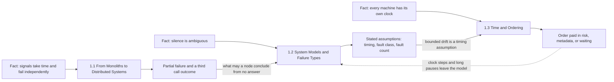
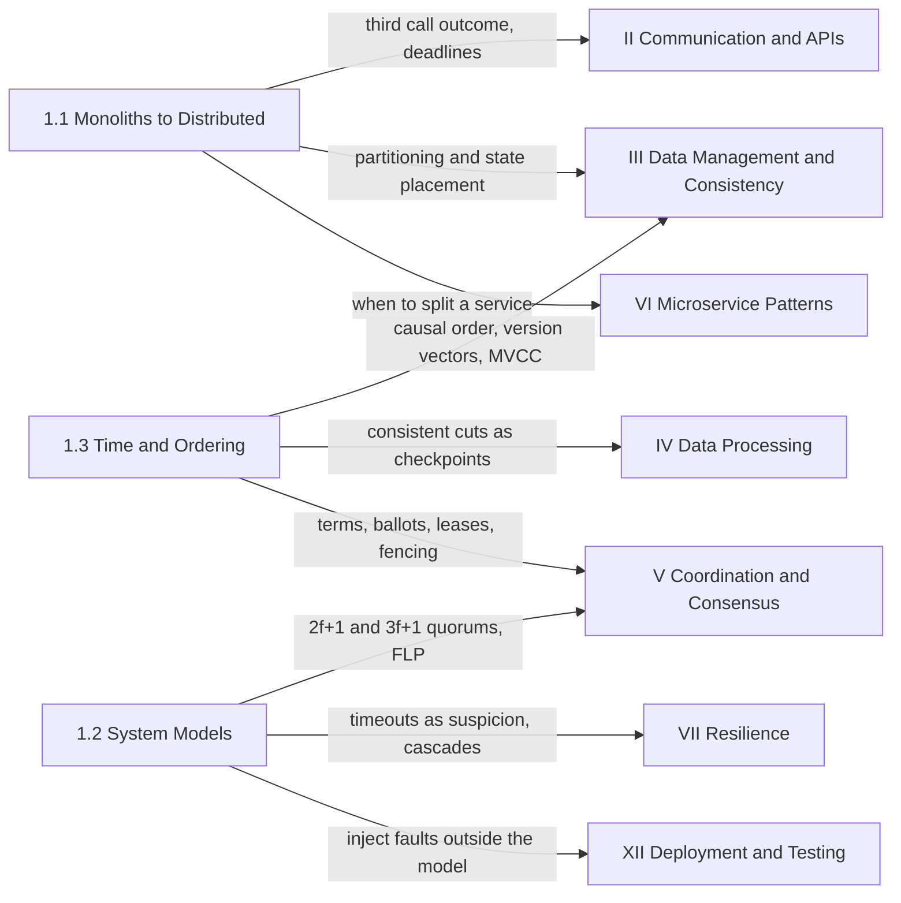

Bu el kitabının geri kalanındaki her mekanizma, bir replikasyon protokolünden bir retry bütçesine kadar, hiçbir ürünün ortadan kaldıramayacağı üç olgu yüzünden vardır. Makineler arasındaki sinyaller zaman alır ve bu sürenin fiziksel bir alt sınırı vardır: ışık fiberde milisaniyede yaklaşık 200 km yol alır, dolayısıyla bir okyanusu aşan bir round trip, daha hiçbir yazılım çalışmadan onlarca milisaniyeye mal olur. Makineler birbirinden bağımsız olarak çöker; bu yüzden bir istek durmuş bir bileşene ulaşabilirken sistemin geri kalanı çalışmaya ve karar vermeye devam eder. Ve her makinenin kendi saati vardır: bu saat kayar, adımlarla (step) ve yavaş düzeltmelerle (slew) ayarlanır ve başka bir yerdeki saatle hiçbir zaman tam olarak karşılaştırılamaz. Kitabın bu kısmı bu üç olguyu ortamın yasaları olarak ele alır, onları ölçer ve sonraki her sayfada bedellerini tartışmak için kullanılan kavram dağarcığını kurar.

Bu kısım en başta yer alır, çünkü hiçbir sistemi anlatmaz. Bir ekibin kuracağı bir veritabanı, broker ya da protokol içermez. Bunların hepsinin dayanmak üzere tasarlandığı koşulları anlatır ve bu koşulları, sonraki bir sayfanın "bu protokol crash-recovery hataları ve kısmi senkronluk altında güvenlidir" diyebileceği ve bunun doğrulanabilir bir anlam taşıyacağı kesinlikte tanımlar. Bu kısmı atlayan bir okuyucu sonraki kısımları yine takip edebilir; ancak her timeout'u, her quorum boyutunu ve her version vector'ü bu olgulardan biri için ödenmiş bir bedel olarak değil, bir gelenek olarak okur.

Kısmın tamamından geçen gerilim, tek bir makinenin kimse tasarlamadan sunduğu garantilerle, iş makinelere dağıtıldıktan sonra bu garantileri geri satın almanın bedeli arasındadır. Tek makinede bellek paylaşılır, bir çağrı ya çalışır ya da çağıranı da beraberinde çökertir, hata topyekûndur ve dolayısıyla belirgindir, her thread de aynı saati okur. Dağıtım, kapasitenin ve servisin dayanabileceği hata sayısının tavanını yükseltir; ama bu dört garantinin dördünü birden geri alır. Onları geri satın almanın bedeli gecikme, replika, metadata ve beklemedir; yanlış çıkan bir varsayıma dayanarak geri satın almanın bedeli ise doğruluktur ve genellikle sessizce ödenir. Kısım, hangi garantilerin hangi varsayımlar üzerinde satın almaya değer olduğuna karar vermek için gereken ölçümleri verir.

## Üç Kısıt, Üç Bölüm

Her bölüm üç olgudan birini alır ve onu bir tasarımın karşısında sınanabileceği bir şeye dönüştürür. İlk bölüm tek bir makineden ayrılma kararını ve bu kararla birlikte gelenleri ele alır: kısmi hata, donanımdan yazılıma taşınan koordinasyon ve paketleri kaybeden, geciktiren ve yeniden sıralayan bir ağ. İkinci bölüm "işler ters gidebilir" gibi belirsiz bir ifadeyi bir sistem modeline, yani bir algoritmanın zamanlama, hata davranışı ve hata sayısı hakkında neyi varsaydığının açık bir beyanına dönüştürür. Üçüncü bölüm ise her dağıtık tasarımın en çok yaslandığı varsayımı, zamanın makineler arasında karşılaştırılabileceği varsayımını ele alır ve onun yerine gerçekten gözlemlenebilen sıralamaları koyar.

*Kısmın üç bölümü, her birinin yola çıktığı fiziksel olgu ve her birinin bir sonrakine devrettiği sonuç. Etiketli düz oklar bir bölümden diğerine devir noktalarıdır; kesikli ok, saat hatalarının ayrı bir hata sınıfı değil, sistem modelinin ihlali olduğunu gösterir.*

Diyagramı soldan sağa tek bir zincir olarak okuyun: her olgu onu ölçen bölümde zincire girer, her bölümün vardığı sonuç da bir sonraki bölümün girdisi olur. İlk bölüm, ikinci bölümün başlangıç sorusuna dönüşen bir gözlemle biter: uzak bir çağrı başarılı olabilir, başarısız olabilir ya da hiç cevap üretmeyebilir; cevapsızlık ise yavaş bir cevaptan ayırt edilemez. İkinci bölüm, bir node'un bu sessizlikten ne sonuç çıkarabileceğini yanıtlar; bu da tasarımın mesaj gecikmesi, bileşenlerin nasıl hatalı davrandığı ve kaç tanesinin aynı anda hatalı davrandığı hakkında neyi varsaydığına bağlıdır. Zamanlama varsayımlarından biri saatlerin sınırlı bir hızla kaydığıdır; üçüncü bölüm bu tek cümleyi ölçülmüş bir hataya, iki tür saate ve üç sıralama mekanizması ailesine dönüştürür. Kesikli ok, kısmın tamamının operasyonel dersidir: geriye doğru adım atan bir saat, lease süresinden uzun duraklayan bir process ya da onaylanmış yazmaları unutmuş halde yeniden başlayan bir node, ortamın modelin dışına çıkmasının örnekleridir ve okuyucu tam olarak bunu aramayı ikinci bölümde öğrenir.

## Her Bölümün Ortaya Koyduğu

[Monolitlerden Dağıtık Sistemlere](/distributed-systems/tr/foundations/monoliths-to-distributed/), tek bir makineden ayrılmanın ne zaman doğru hamle olduğunu ve bu hamlenin bedelini yanıtlar. Beş konusu, bir iş yükünün çarpabileceği iki farklı duvarı belirler: tek makine içinde serileşme ve coherence, çok makinede ise partition'lar arası iş. Ardından birim faydalı işin maliyetini node boyutuna göre, tepe throughput'ta değil gecikme hedefinde fiyatlar; state'in process içinde mi yoksa process'in çağırdığı bir depoda mı yaşayacağına karar verir; yerel bir çağrının taşıdığı ve ağ çağrısının sessizce düşürdüğü garantileri sıralar; kayıp, bant genişliği sınırları ve yol değişikliklerini paketlere ve transport zamanlayıcılarına kadar takip eder. Bölüm dağıtımı savunmaz. Büyük bir makine üzerindeki bir monolit pek çok iş yükü için doğru cevaptır; bölümün sayıları, bir ekibin bunun ne zaman doğru cevap olmaktan çıktığını anlamasının yoludur.

[Sistem Modelleri ve Hata Türleri](/distributed-systems/tr/foundations/system-models/), bir doğruluk iddiasının neye koşullu olduğunu yanıtlar. Beş konusu şunları tanımlar: senkrondan asenkrona uzanan ve arada kısmi senkronluğun yer aldığı zamanlama ekseni; crash-stop, crash-recovery ve omission gibi zararsız (benign) hata sınıfları ve her birinin bir implementasyonu neyi kalıcı hale getirmeye ya da yeniden denemeye zorladığı; bir node'un yanlış ya da tutarsız mesajlar gönderebildiği Bizans hataları; bir eşiğin tolere ettiğinden fazla bileşenin aynı anda çökme olasılığı; ve bir hatanın bir sonrakinin olasılığını artırdığı geri besleme yolları. Bölümün tekrar tekrar ulaştığı tasarım kuralı, üretimdeki koordinasyonun çoğunun izlediği kuraldır: güvenliği (safety) karşılanabilecek en zayıf model altında koru, daha güçlü varsayımları yalnızca canlılık (liveness) ve performans için kullan; böylece ihlal edilen bir varsayım sistemi yanlış değil, yalnızca yavaş yapar.

[Zaman ve Sıralama](/distributed-systems/tr/foundations/time-and-ordering/), her saatin kullanım anında kimsenin ölçmediği bir miktar kadar yanlış olduğu koşullarda olayların makineler arasında nasıl sıralanacağını yanıtlar. Dokuz konusu, bir saat okumasının nasıl üretildiğinden ve bir timeout'ta hangi saatin kullanılması gerektiğinden başlar; happened-before ilişkisi ve onun iki mantıksal kodlaması olan Lamport zaman damgaları ile vektör saatlerden geçer; çalışan bir sistemin tutarlı global anlık görüntülerine, hibrit mantıksal saatlere, Spanner'ın ölçülmüş belirsizliğine ve commit wait'e ve zamana göre sıralı tanımlayıcılara uzanır. Bölümdeki her mekanizma sıralamanın bedelini tek bir para birimiyle öder: saat hatası penceresi içindeki bir doğruluk riski, aktör sayısıyla büyüyen metadata ya da bir sınırın geçmesini beklemekle harcanan gecikme.

| Bölüm | Kesinleştirdiği kısıt | Sonraki bölümlerin ondan aldığı | Ne zaman açılmalı |
|---|---|---|---|
| [1.1 Monolitlerden Dağıtık Sistemlere](/distributed-systems/tr/foundations/monoliths-to-distributed/) | Kapasite, koordinasyon maliyeti ve kısmi hata karşılığında satın alınır | Ne zaman shard'lanacağı ya da replike edileceği, state'in nerede yaşayacağı, her uzak çağrının neden bir deadline'a ihtiyaç duyduğu | Dikey ölçekleme, yatay ölçekleme ya da bir servisi bölme arasında karar verirken |
| [1.2 Sistem Modelleri ve Hata Türleri](/distributed-systems/tr/foundations/system-models/) | Doğruluk yalnızca belirtilen zamanlama, hata sınıfı ve hata sayısı varsayımları içinde geçerlidir | Quorum boyutları, seçim ve lease timeout'ları, kalıcılık yükümlülükleri, failure detector sözleşmeleri | Bir protokolün güvenlik argümanını ya da bir replikasyon faktörünü incelerken |
| [1.3 Zaman ve Sıralama](/distributed-systems/tr/foundations/time-and-ordering/) | Paylaşılan bir saat yoktur; her sıralama risk, metadata ya da bekleme ile ödenir | Çakışma tespiti, MVCC zaman damgaları, lease güvenliği, checkpoint'ler, anahtar formatları | Makineler arasında zaman damgası karşılaştırırken ya da herhangi bir kontrol için saat seçerken |

## Kısmı Okumak

İlk okumada bölümleri sırayla okuyun, çünkü her biri bir öncekinin vardığı sonucu kabul ederek başlar. Sistem modelleri bölümü, ilk bölümdeki üçüncü çağrı sonucunu veri olarak alır ve yeniden türetmez; zaman bölümü sınırlı kaymayı ikinci bölümün tanımladığı anlamda bir zamanlama varsayımı olarak ele alır ve onu yeniden açıklamak yerine geriye bağlantı verir. Her bölümün içinde, Konuya Genel Bakış sayfası bir okuma sırası ve belirli görevler için daha kısa yollar sunar.

Kısım boyunca üç kısa rota makuldür. Bir monoliti servislere bölmek üzere olan bir mühendis ilk bölümü, özellikle ölçekleme, state ve yanılgılar sayfalarını okumalı ve orada durmalıdır; bölmenin kendini amorti edip etmeyeceğine bu sayfalar karar verir. etcd, ZooKeeper ya da Raft ile replike edilen bir veritabanı gibi consensus tabanlı bir depoyu yapılandıran ya da işleten bir mühendis, ikinci bölümden ağ modellerini ve hata modellerini, ardından üçüncü bölümden fiziksel saatleri ve monotonic saatleri okumalıdır; çünkü seçim timeout'ları, lease'ler ve kalıcı flush'lar tam olarak bu varsayımlar üzerine kuruludur. Replike bir depo için çakışma yönetimi seçen ya da dağıtık bir SQL veritabanını değerlendiren bir mühendis ise üçüncü bölümdeki happened-before sayfasından başlamalı, soru yeniden başlatmada onaylanmış yazmalara ne olduğuna geldiğinde ikinci bölümün hata modellerine dönmelidir.

Kısmın el kitabı içinde bir ön koşulu yoktur. Bilgisayar bilimi temellerini varsayar: process'ler, thread'ler ve paylaşılan bellek; TCP'nin bir uygulamaya ne sağladığı; ve bağımsız hata oranlarını çarpmaya ve korelasyonlu hataların bu çarpımı neden bozduğunu görmeye yetecek kadar olasılık bilgisi.

## Temellerin Sonradan Harcandığı Yerler

El kitabının geri kalanı büyük ölçüde, bu kısımdaki bedellerden birini bilerek ödeyen mekanizmaların bir kataloğudur. Diyagram, her bölümün vardığı sonuçların sonraki kısımlarda nerede kullanıldığını kısım düzeyinde gösterir.

*Kısmın üç bölümünün sonraki kısımlarda kullanıldığı yerler. Her ok, hedef kısmın devraldığı sonucu adlandırır; gösterilmeyen kısımlar (gözlemlenebilirlik, platform, güvenlik, vaka çalışmaları) bu sonuçları gösterilen kısımlar üzerinden dolaylı olarak kullanır.*

En yoğun oklar veri ve koordinasyon kısımlarına iner ve bu, yerleşimin bir tesadüfü değildir. [Veri Yönetimi & Tutarlılık](/distributed-systems/tr/data-management/), partitioning ve replikasyonun ilk bölümün kapasite argümanını ve ikinci bölümün hata modellerini alıp somut protokollere dönüştürdüğü yerdir; [Tutarlılık Modelleri](/distributed-systems/tr/data-management/consistency-models/) bölümü ise happened-before ilişkisinin ve gerçek zaman sırasının istemcilere birer sözleşme olarak sunulmuş halidir. [Koordinasyon & Mutabakat](/distributed-systems/tr/coordination/), protokollerini burada tanımlanan sistem modellerine karşı ispatlar; işe ağ modelleri sayfasının ifade ettiği imkânsızlık sonucundan başlar. [Dağıtık Kilitleme](/distributed-systems/tr/coordination/distributed-locking/) bölümü de bir lease'in duraklamış bir process ve adım atmış bir saatle karşılaştığı yerdir. [Veri İşleme Mimarileri](/distributed-systems/tr/data-processing/), tutarlı kesitleri stream processor checkpoint'leri olarak uygular.

Kalan oklar üçüncü çağrı sonucuyla ve ondan yayılan hatalarla ilgilidir. [İletişim Protokolleri & API Tasarımı](/distributed-systems/tr/communication/), deadline'ları, idempotent işlemleri ve teslim garantilerini cevap üretmeyebilen bir ağın üzerine kurar. [Mikroservis Mimari Desenleri](/distributed-systems/tr/microservice-patterns/), servis sınırlarının nereye ait olduğuna, ilk bölümün process içi çağrıları uzak çağrılara dönüştürmenin bedeli hakkındaki sonuçlarıyla karar verir. [Dayanıklılık & Üretim Mühendisliği](/distributed-systems/tr/resilience/), "timeout bir şüphedir" sonucunu failure detector'lere, kaskad analizini ise akış kontrolüne, backpressure'a ve retry bütçelerine dönüştürür. [Dağıtım Stratejileri & Operasyonlar](/distributed-systems/tr/deployment/), [Dağıtık Sistemlerde Test](/distributed-systems/tr/deployment/distributed-testing/) bölümünde döngüyü kapatır: bu bölüm tam olarak bu kısmın tanımladığı duraklamaları, partition'ları, saat sıçramalarını ve kayıp yazmaları enjekte eder, çünkü bir model ancak implementasyonun onun içinde kaldığına dair kanıt kadar güvenilirdir. [Ünlü Kesintilerin Anatomisi](/distributed-systems/tr/case-studies/famous-outages/) bölümünde incelenen kamuya açık olaylar en iyi bu kısım el altındayken okunur: çoğu, ortamın bir tasarımın modelinin "yapmaz" dediği bir şeyi yapmasından ibarettir.
