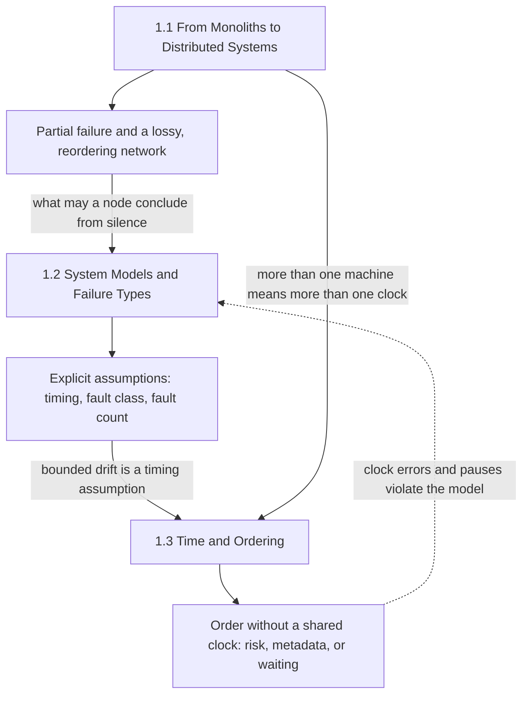
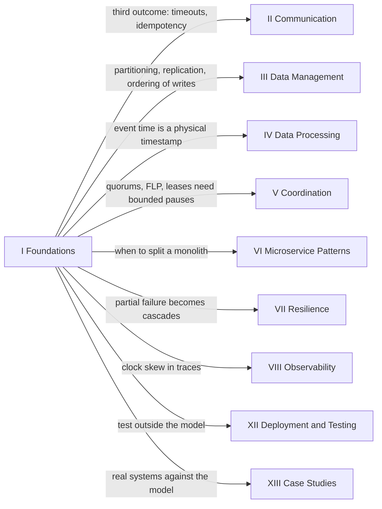

Dağıtık sistem, doğruluğu hiçbir tek makinenin kontrol etmediği şeylere bağlı olan bir programdır: bir sinyalin ağı ne kadar sürede geçtiği, sessiz kalan bir eşin ölü mü yoksa yalnızca yavaş mı olduğu ve başka bir yerde saatin kaç olduğu. El kitabının bu bölümü bu bağımlılıkları konu alır. Bir veritabanını, bir broker'ı ya da bir protokolü anlatmaz; sonraki bölümlerdeki her veritabanının, broker'ın ve protokolün atlatmak üzere tasarlandığı koşulları anlatır ve bu tasarımların neden oldukları gibi göründüklerinin sebebi de budur.

Başlık mecaz değildir. Işığın fiber içinde bir veri merkezini geçmesi ölçülebilir bir süre alır, bir okyanusu geçmesi ise çok daha uzun sürer; dolayısıyla makineler arası koordinasyonun hiçbir yazılımın kaldıramayacağı bir alt sınırı vardır. Bileşenler birbirinden bağımsız olarak çöker; bu yüzden bir istek, sistemin geri kalanı çalışmaya ve karar vermeye devam ederken çökmüş bir makineye ulaşabilir. Osilatörler kayar ve senkronizasyon, offset'i yalnızca tek yönlü gecikmesini ölçemediği bir ağ üzerinden tahmin edebilir; bu nedenle hiçbir iki makine tam olarak aynı "şimdi"yi paylaşmaz. Bunların hiçbiri daha iyi bir ürünle düzeltilecek bir kusur değildir; her biri ortamın bir özelliğidir ve kitabın ilerleyen kısımlarındaki her mekanizma bunlardan birinin bedelini ödemenin bir yoludur.

Bölümün tamamından geçen gerilim, tek bir makinenin bedavaya verdiği ile dağıtık bir tasarımın geri satın alması gereken arasındadır. Tek makinede bellek ortaktır, bir çağrı ya çalışır ya da process'i kendisiyle birlikte çökertir, hata tamdır ve bu yüzden apaçıktır, saat de her thread için aynı saattir. İşi makinelere yaymak, kapasitenin ve servisin atlatabileceği hata sayısının tavanını yükseltir; ama bu garantilerin hepsini aynı anda geri çeker. Onları geri almanın bedeli gecikme, replika, metadata ve beklemedir; yanlış çıkan bir varsayıma dayanarak geri almanın bedeli ise doğruluktur. Üç alt bölüm, hangi garantilerin, hangi fiyata ve hangi varsayımlarla geri alınacağına karar vermek için gereken ölçümleri ve kavram dağarcığını verir.

## Üç Alt Bölüm, Tek Bir Argüman

Bölüm tek bir argüman olarak sıralanmıştır. İlk alt bölüm, bir sistemin tek makineden neden ve ne zaman ayrıldığını ve bunu yaptığında neyi miras aldığını ortaya koyar: kısmi hata (partial failure), paketleri kaybeden ve yeniden sıralayan bir ağ ve donanımdan yazılıma taşınan koordinasyon. İkinci alt bölüm bu gözlemleri, bir algoritmanın doğruluğunun kanıtlanabileceği açık varsayımlara, yani bir sistem modeline dönüştürür. Üçüncü alt bölüm ise her dağıtık tasarımın en çok yaslandığı varsayımı, zamanı ele alır ve hiçbir saatin bir diğeriyle uyuşacağına güvenilemezken olayların nasıl sıralanacağını gösterir.

*Bölümdeki üç alt bölümün birbirinin üzerine nasıl kurulduğu. Her alt bölüm, bir sonrakinin başlangıç noktası olarak aldığı bir sonuç (numarasız üç kutu) üretir; kesikli ok, saat hatalarının kendilerinin de sistem modelinin ihlali olduğunu gösterir.*

Diyagramı bir devir teslim zinciri olarak okumak faydalıdır. İlk alt bölüm, uzak bir çağrının başarı ve hatanın yanında üçüncü bir sonucu olduğu gözlemiyle biter: cevap gelmemesi; bu da yavaş bir cevaptan ayırt edilemez. İkinci alt bölüm tam buradan başlar ve bir node'un bu sessizlikten ne sonuç çıkarmasına izin verildiğini sorar; bunun cevabı, tasarımın mesaj gecikmesi, bileşenlerin nasıl çöktüğü ve aynı anda kaç tanesinin çöktüğü hakkında ne varsaydığına bağlıdır. Bu varsayımlardan biri saatlerin sınırlı bir hızla kaydığıdır; üçüncü alt bölüm bu cümleyi sayılara, hata modlarına ve üç mekanizma ailesine dönüştürür. Kesikli ok döngüyü kapatır: geriye alınan bir saat, bir lease'ten daha uzun duraklayan bir process ya da bir sayacı yeniden kullanan, yeniden başlatılmış bir node ayrı türden hatalar değildir; ortamın sistem modelinin dışına çıktığı durumlardır ve ikinci alt bölüm okuyucuya tam olarak bunu aramayı öğretir.

## Her Alt Bölümün Ortaya Koyduğu

[Monolitlerden Dağıtık Sistemlere](/distributed-systems/tr/foundations/monoliths-to-distributed/), tek makineden ayrılmanın ne zaman doğru adım olduğunu ve bu adımın neye mal olduğunu ortaya koyar. Beş konusu; tek bir makinenin nerede ölçeklenmeyi bıraktığını ve makine eklemenin nerede kâr getirmeyi bıraktığını ölçer, kapasiteyi node boyutuna göre tepe throughput'ta değil gecikme hedefinde fiyatlandırır, state'in nerede yaşaması gerektiğine karar verir ve yerel bir çağrının taşıyıp ağ çağrısının sessizce bıraktığı varsayımları paketlere, yeniden iletim zamanlayıcılarına ve yönlendirme değişikliklerine kadar inerek adlandırır. Alt bölüm bilinçli olarak dağıtıklığı savunmaz: büyük bir makinedeki monolit pek çok iş yükü için doğru cevaptır ve alt bölüm, bunun ne zaman doğru cevap olmaktan çıktığını söylemek için gereken sayıları verir.

[Sistem Modelleri ve Hata Türleri](/distributed-systems/tr/foundations/system-models/), her doğruluk iddiasının bir modele bağlı olduğunu ortaya koyar ve bu modeli açık hale getirir. Beş konusu; zamanlama eksenini (sessizliğin neyi kanıtlayabileceğini), zararsız (benign) hata sınıflarını ve her birinin bir implementasyona neyi kalıcı hale getirme ya da yeniden deneme yükümlülüğü yüklediğini, bir node'un yanlış şeyler söyleyebildiği Bizans durumunu, tolere edilen sayıdan fazla bileşenin birlikte çökme olasılığını ve bir hatanın bir sonrakini daha olası kılan yolları tanımlar. Tekrar tekrar varılan sonuç, üretimdeki koordinasyonun çoğunun izlediği tasarım kuralıdır: güvenliği (safety) karşılanabilecek en zayıf model altında kanıtla, daha güçlü varsayımları yalnızca canlılık (liveness) ve performans için kullan; çünkü orada yanılmak sistemi yanlış değil yavaş yapar.

[Zaman ve Sıralama](/distributed-systems/tr/foundations/time-and-ordering/), ortak bir saat olmadan olayların makineler arasında nasıl sıralanacağını ve ortaya çıkan her sıranın neyi ifade edip neyi etmediğini ortaya koyar. Sekiz konusu, bir saat okumasının nasıl üretildiğinden ve süreler için hangi saatin okunacağından başlayıp happened-before ilişkisine ve onun mantıksal kodlamalarına, oradan hibrit saatlere, Spanner'ın ölçülmüş belirsizliğine ve zamana göre sıralı tanımlayıcılara uzanır. Her mekanizma sıranın bedelini tek bir para birimiyle öder: saat hatası penceresi içinde bir doğruluk riski, aktör sayısıyla büyüyen metadata ya da bir sınırın dolmasını beklerken harcanan gecikme.

| Alt bölüm | Tanımladığı kısıt | Sonraki bölümlerin ondan devraldığı |
|---|---|---|
| [1.1 Monolitlerden Dağıtık Sistemlere](/distributed-systems/tr/foundations/monoliths-to-distributed/) | Kapasite, koordinasyon maliyeti ve kısmi hata karşılığında satın alınır | Ne zaman partition'lanacağı ve replike edileceği, state'in nerede yaşadığı, her uzak çağrının neden bir timeout'a ve retry politikasına ihtiyaç duyduğu |
| [1.2 Sistem Modelleri ve Hata Türleri](/distributed-systems/tr/foundations/system-models/) | Doğruluk yalnızca zamanlama, hata sınıfı ve hata sayısı hakkındaki belirtilmiş varsayımlar içinde geçerlidir | Quorum boyutları, seçim ve lease timeout'ları, kalıcılık yükümlülükleri, hata dedektörü sözleşmesi |
| [1.3 Zaman ve Sıralama](/distributed-systems/tr/foundations/time-and-ordering/) | Ortak saat yoktur; her sıranın bedeli risk, metadata ya da beklemedir | Çakışma tespiti, MVCC zaman damgaları, tutarlılık garantileri, lease güvenliği, anahtar formatları |

## Bölümün Varsaydıkları ve Fikirlerinin Geri Döndüğü Yerler

Bu bölüm el kitabının giriş noktasıdır ve yalnızca bilgisayar bilimi temellerini varsayar: process'lerin, thread'lerin ve belleğin nasıl çalıştığı, TCP'nin bir uygulamaya ne sağladığı, bir diskin veriyi nasıl kalıcı hale getirdiği ve bağımsız ile korelasyonlu olaylar hakkında akıl yürütmeye yetecek kadar olasılık. Üretimde bir servis işletmiş bir okuyucu hata modlarının çoğunu tanıyacaktır; bölümün katkısı, onları kesin olarak adlandırmak ve her birini ihlal ettiği varsayıma bağlamaktır.

Sonraki her bölüm, bu bölümün tanımladığını harcar. Aşağıdaki harita başlıca tüketicileri gösterir; eksiksiz değildir, çünkü kitaptaki neredeyse her sayfa er ya da geç buraya bağlantı verir.

*Bölümün kısıtlarının ileride nerede tüketildiği. Her ok, hedef bölümün temellerden neyi devraldığını adlandırır.*

En ağır iki tüketici veri yönetimi ve koordinasyondur. [Veri Yönetimi & Tutarlılık](/distributed-systems/tr/data-management/), ölçekleme kararını alıp [Veri Bölümleme / Sharding](/distributed-systems/tr/data-management/data-partitioning/) ve [Replikasyon Stratejileri](/distributed-systems/tr/data-management/replication/) haline getirir; [Tutarlılık Modelleri](/distributed-systems/tr/data-management/consistency-models/) alt bölümü ise bir deponun istemcilerine zaman alt bölümündeki sıralardan hangisini vaat ettiğinin bir kataloğudur: linearizability için gerçek zaman sırası, causal consistency için happened-before. [Koordinasyon & Mutabakat](/distributed-systems/tr/coordination/) doğrudan sistem modeli alt bölümünün üzerine kuruludur: [Mutabakat Algoritmaları](/distributed-systems/tr/coordination/consensus-algorithms/) onun quorum eşiklerini ve kısmi senkronluk argümanını kullanır; [Dağıtık Kilitleme](/distributed-systems/tr/coordination/distributed-locking/) ise sınırlı duraklamaların ve saat okuma kurallarının bir lease'in güvenli olup olmadığına karar verdiği yerdir.

[İletişim Protokolleri & API Tasarımı](/distributed-systems/tr/communication/), uzak bir çağrının üçüncü sonucunun bir sözleşmeye dönüştüğü yerdir: deadline'lar, teslim semantiği ve idempotent işlemler, çağıranın kaybolan bir isteği kaybolan bir cevaptan ayırt edememesi yüzünden vardır. [Dayanıklılık & Üretim Mühendisliği](/distributed-systems/tr/resilience/), kaskad hata analizini alıp savunmalarını kurar: timeout'ları kalibre edilmiş bir şüpheye dönüştüren [Hata Tespiti ve Üyelik Protokolleri](/distributed-systems/tr/resilience/failure-detection/)'nden, bir sistemi tetikleyicisi ortadan kalktıktan sonra da çökük tutan geri besleme döngülerini kıran [Akış Kontrolü ve Aşırı Yük Yönetimi](/distributed-systems/tr/resilience/flow-control/)'ne kadar. [Veri İşleme Mimarileri](/distributed-systems/tr/data-processing/), fiziksel saat hatasıyla event time ile processing time arasındaki fark olarak yeniden karşılaşır; [Mikroservis Mimari Desenleri](/distributed-systems/tr/microservice-patterns/) ise ilk alt bölümün sorusunu servis sınırları düzeyinde yeniden ele alır.

İki bölüm döngüyü diğer taraftan kapatır. [Dağıtım Stratejileri & Operasyonlar](/distributed-systems/tr/deployment/), sistem modeli alt bölümünün tanımladığı partition'ları, duraklamaları, saat sıçramalarını ve kaybolan yazmaları birebir enjekte eden [Dağıtık Sistemlerde Test](/distributed-systems/tr/deployment/distributed-testing/) alt bölümünü içerir; çünkü bir model, implementasyonun onun içinde kaldığına dair kanıt kadar iyidir. [Vaka Çalışmaları](/distributed-systems/tr/case-studies/), gerçek sistemlerin bu bölümün trade-off'larını açıkça yaptığını gösterir: [Dağıtık SQL: Spanner & CockroachDB](/distributed-systems/tr/case-studies/distributed-sql/) clock-offset sınırına verilmiş iki cevaptır; [Ünlü Kesintilerin Anatomisi](/distributed-systems/tr/case-studies/famous-outages/) ise kamuya açık postmortem'leri aynı mercekle inceler: ortam hangi varsayımı bozdu ve bozduğunda sistem nasıl tepki verdi.

## Bölüm Nasıl Okunmalı

İlk okumada üç alt bölümü sırasıyla okuyun. Her biri öncekini yeniden türetmek yerine ona bağlantı verir: sistem modeli alt bölümü, okuyucunun uzak bir çağrının sessizlikle bitebileceğini kabul ettiğini varsayar; zaman alt bölümü ise saat kaymasını sistem modeli alt bölümünün tanıttığı zamanlama varsayımı olarak ele alır. Her alt bölümün içinde, alt bölüme genel bakış sayfası bir okuma sırası ve belirli roller için kestirmeler verir.

Bölüm içinden geçen üç yol yaygın durumlara uyar. Bir monoliti bölmeye, replika eklemeye ya da shard'lamaya karar veren bir mühendis ilk alt bölümün tamamını, ardından ikinci alt bölümden hata modelleri ve kaskad hata konularını okumalıdır; çünkü bu karardaki en pahalı hatalar, kısmi hatayı nasıl yayılacağını planlamadan benimsemekten gelir. Consensus tabanlı bir depoyu ya da dağıtık bir SQL veritabanını işletmek üzere olan bir mühendis ağ modelleri ve hata modelleri konularını, ardından fiziksel saatler, hibrit mantıksal saatler ve TrueTime konularını okumalıdır; çünkü seçim timeout'larının, lease'lerin, kalıcı flush'ların ve clock-offset sınırlarının ardındaki varsayımlar bu sayfalardadır. Bir olayın ortasındaki mühendis, belirtisi eşleşen sayfanın hata modu bölümlerine gitmelidir: gecikme sıçramaları ve kısmi partition'lar için ağ güvenilirliği, tetikleyicisi kaldırıldıktan sonra da süren bir kesinti için kaskad hata, bir saat oynadığında davranışı değişen her şey için fiziksel saatler.

Kitabın geri kalanının işe yaraması için bu bölümün bitirilmesi gerekmez. Ancak sonraki bölümlerde "varsayalım ki" ile başlayan herhangi bir argümana güvenmeden önce okunması gerekir; çünkü temellerin harcandığı yer tam olarak o kelimedir.
