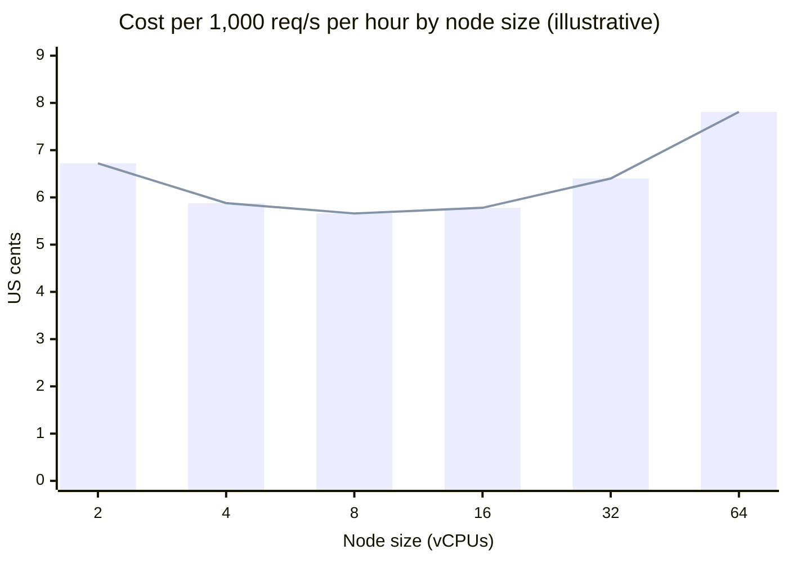
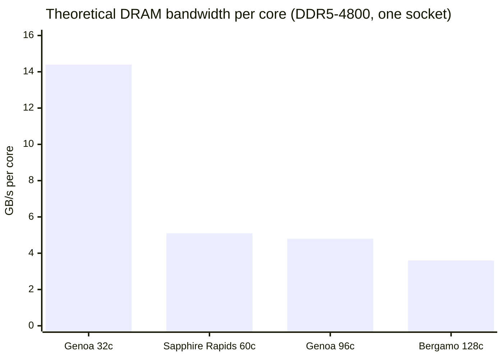
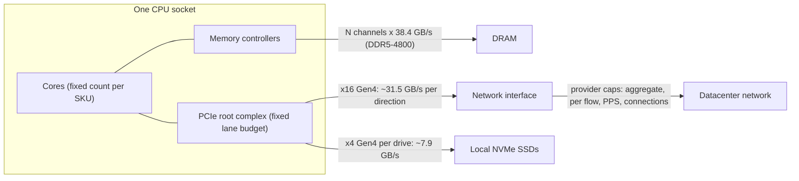
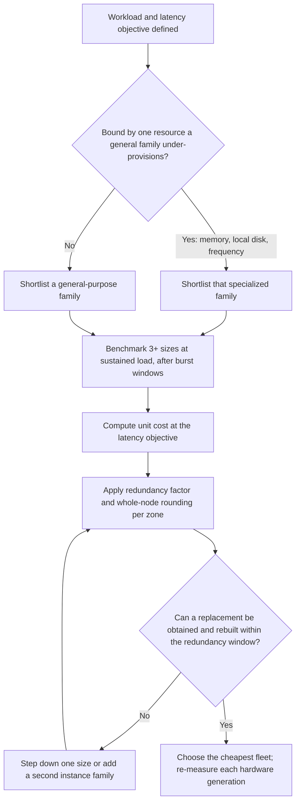

Maliyet-performans eğrisi, bir birim faydalı işin (gecikme hedefi içinde sunulan saniyedeki istek, saniyede taranan gigabayt, saniyede commit edilen yazma) fiyatını, o işi sağlayan donanımın boyutuna göre çizer. Önemli olan ne bir makinenin fiyatı ne de en yüksek benchmark skorudur; ikisinin, servisin gerçekte çalıştığı işletim noktasında ölçülen oranıdır. Bu oran neredeyse hiçbir zaman sabit değildir: sabit node başı maliyetlerin ve burst bütçelerinin baskın olduğu küçük uçta yükselir, tek bir sunucu içindeki paylaşılan fiziksel kaynakların core sayısıyla birlikte büyümeyi bıraktığı büyük uçta yeniden yükselir.

Temel denge bu şekilden çıkar. Büyük node'lar sabit yükleri amorti eder ve makineler arası koordinasyonu azaltır; ancak kapasiteyi giderek kötüleşen bir oranla satın alır, filonun daha büyük bir kısmını her bir hataya bağlar ve hızlı yerine konmaları daha zordur. Küçük node'lar her kapasite birimini ucuz ve her hatayı küçük tutar; ancak node başına sabit bir vergi öder ve çoğu zaman yalnızca sürekli yük altında ortaya çıkan throttle'ların arkasında durur. En ucuz filo genellikle orta boy node'lardan kurulur ve gerçek minimumu bulmak bir fiyat listesi değil, bir benchmark gerektirir.

Bu sayfa eğrinin neden büküldüğünü açıklar: fiyat modelleri, tek bir sunucuyu sınırlayan fiziksel limitler ve yedeklilik ile yuvarlamanın filo düzeyindeki etkileri. Yazılımın tek makinede doğrusalın altında ölçeklenmesine yol açan contention ve coherency yasalarının kanonik sayfası [Ölçekleme İkilemi](/distributed-systems/tr/foundations/monoliths-to-distributed/scaling-dilemma/) sayfasıdır; bu sayfa o sonuçları yeniden türetmeden kullanır.

## Doğrusal Fiyatlar, Bükülen Kapasite

Bulut sağlayıcıları genel amaçlı instance'ları bir aile içinde doğrusal fiyatlandırır. Bu yazının yazıldığı tarihte AWS, us-east-1 bölgesinde `m7i` ailesi için `m7i.large` (2 vCPU) başına saatte $0.1008, `m7i.48xlarge` (192 vCPU) başına saatte $9.6768 listeler: bare-metal varyantlar dahil her boyutta vCPU-saat başına tam olarak $0.0504. Fiyatlar değişir ve bölgeye göre farklılaşır; ancak aile içindeki doğrusallık fiyat listesinin bilinçli bir özelliğidir ve yaygın bir yanlış okumanın kaynağıdır: instance'ı iki katına çıkarmak fiyatı iki katına çıkarıyorsa, kapasiteyi de iki katına çıkardığını varsaymak cazip gelir.

Sahip olunan donanım ise fiyat açısından bile doğrusal değildir. Bir işlemci nesli içinde en yüksek core sayısına ve en yüksek frekansa sahip SKU'lar, aralığın ortasındakilere göre core başına daha pahalıdır; en yüksek kapasiteli bellek modülleri genellikle orta kapasitelilere göre gigabayt başına daha pahalıdır ve tüm slotları doldurmak belleği daha düşük bir transfer hızında çalışmaya zorlayabilir; dört ve sekiz soketli sunucular ise core başına iki soketlilerden çok daha pahalıdır. Güç, soğutma ve alan da bir pay ekler; Barroso, Hölzle ve Ranganathan *The Datacenter as a Computer* kitabında bu payın toplam sahip olma maliyetinin büyük bir kısmı olduğunu gösterir. Bulut bunların hepsini doğrusal bir saatlik fiyatın içine katar. Ticari veritabanları gibi core başına lisanslanan yazılımlar ise donanım maliyetini aşabilen, doğrusal ya da daha kötü bir terim daha ekler ve alıcıları çok sayıda yavaş core yerine daha az sayıda hızlı core'a yöneltir.

Kapasite ise her platformda bükülür. Paylaşılan kilitlerdeki contention ve core'lar arasındaki coherence trafiği, throughput'un core sayısından daha yavaş büyümesine, bir tepe noktasından sonra da düşmesine yol açar; [Ölçekleme İkilemi](/distributed-systems/tr/foundations/monoliths-to-distributed/scaling-dilemma/) bunu Amdahl Yasası ve Evrensel Ölçeklenebilirlik Yasası ile nicel olarak ortaya koyar. Yazılımın altında donanımın kendisi de katkı yapar: bellek bant genişliği, son seviye cache (last-level cache) ve I/O hatları soket başına sabittir; bu yüzden bir sunucudan alınan dilim tüm host'a yaklaştıkça, core başına bunların her birinden orantısal olarak daha azını alır. Doğrusal bir fiyatı bükülmüş bir kapasiteye bölmek, büyük uçta yükselen bir birim maliyet verir.

Küçük uç farklı bir nedenle bükülür. Her node, boyutundan bağımsız sabit bir maliyet taşır: işletim sistemi, container runtime ve node agent'ı, log ve metrik toplayıcılar, güvenlik agent'ları, mesh sidecar'ları ve yönetilen bir runtime'ın temel heap'i. 2 vCPU'luk bir node'da yarım vCPU'luk sabit yük makinenin dörtte biridir; 32 vCPU'luk bir node'da ise %2'nin altındadır. Küçük boyutlar ayrıca aşağıda ele alınan burst tabanlı sınırlar taşır ve bu sınırlar sürekli kapasiteyi kâğıt üzerindeki değerlerin altına çeker. Kubernetes sabit kısmı node allocatable kaynaklarıyla, yani sistem ve kubelet rezervasyonlarından sonra kalan kapasiteyle açık hâle getirir; bu rezervasyonların pod request'leriyle nasıl etkileştiği [Kaynak Yönetimi ve QoS](/distributed-systems/tr/kubernetes/runtime-and-operations/resource-management-qos/) sayfasında ele alınır.

### Hesaplamalı Örnek: Bir Servisin Birim Maliyet Eğrisi

Gecikme hedefi p99 içinde saniyede 60.000 isteklik bir tepe yükü karşılaması gereken stateless bir API servisi varsayalım. Bu örnekteki tüm performans değerleri temsilîdir; fiyatlar yukarıda verilen `m7i` liste fiyatlarıdır. Bir yük testi servisi altı instance boyutunda, her birinde tam ve sürekli yük altında çalıştırır ve her node'un gecikme hedefini tutturmaya devam ederken sağladığı throughput'u kaydeder. Temsilî sonuçların arkasındaki model basittir: her node 0.5 vCPU'yu sabit yüke kaptırır, kalan her vCPU küçük boyutlarda saniyede 1.000 istek sağlar; bellek bant genişliği ve coherence maliyetleri arttıkça verim 4 vCPU'da %98'e, 8'de %95'e, 16'da %90'a, 32'de %80'e ve 64'te %65'e düşer.

| vCPU | Saatlik fiyat | SLO'da throughput (istek/sn) | Saatte 1.000 istek/sn başına maliyet | 3 zone için node sayısı | Saatlik filo maliyeti |
|---|---|---|---|---|---|
| 2 | $0.1008 | 1.500 | 6.72 sent | 60 | $6.05 |
| 4 | $0.2016 | 3.430 | 5.88 sent | 27 | $5.44 |
| 8 | $0.4032 | 7.125 | 5.66 sent | 15 | $6.05 |
| 16 | $0.8064 | 13.950 | 5.78 sent | 9 | $7.26 |
| 32 | $1.6128 | 25.200 | 6.40 sent | 6 | $9.68 |
| 64 | $3.2256 | 41.275 | 7.81 sent | 3 | $9.68 |

Dördüncü sütun birim maliyet eğrisidir. Sabit yük amorti edildikçe 2'den 8 vCPU'ya kadar düşer, 8'de dibe vurur, ardından verim azaldıkça tırmanır ve 64 vCPU'da minimumun %38 üzerine çıkar.


*Yukarıdaki tablodan birim maliyet. Minimum aralığın ortasındadır; iki uç da farklı nedenlerle daha pahalıdır.*

Eğri minimumun çevresinde düzdür: 4, 8 ve 16 vCPU birbirinin %4'ü içindedir. Bu düzlük tipiktir ve önemlidir, çünkü son iki sütundaki filo düzeyindeki etkiler eğrinin dibindeki farklardan daha büyüktür. Servis üç availability zone'dan birinin kaybına dayanmak zorundadır; bu yüzden her zone tepe yükün yarısını, yani saniyede 30.000 isteği tek başına taşıyabilmeli ve filo toplamda 90.000 için hazırlanmalıdır. `n` eşit hata alanı (failure domain) olduğunda ve birinin kaybına izin verildiğinde fazladan kapasite çarpanı `n / (n - 1)` olur: iki zone için 2.0, üç zone için 1.5, dört zone için 1.33. Bu çarpan her boyuta eşit uygulanır; farkı yaratan yuvarlamadır.

Node'lar tam sayı birimlerle gelir ve zone başına node sayısı, 30.000'in node başı throughput'a bölümünün yukarı yuvarlanmasıdır. 8 vCPU'da bu `ceil(4.21) = 5` node eder; zone'un ihtiyacından %19 fazla kapasite, yalnızca 4.21 yukarı yuvarlandığı için hazırlanmış olur. 4 vCPU'da `ceil(8.75) = 9` eder ve ihtiyacın yalnızca %3 üzerindedir. Bu yüzden 8 vCPU en düşük birim maliyete sahip olsa da en ucuz filo saatte $5.44 ile 4 vCPU'luk filodur. Büyük uçta etki aşırıdır: zone başına tek bir 64 vCPU'luk node, 30.000'lik ihtiyaca karşı saniyede 41.275 istek sağlar ve filo 4 vCPU'luk filodan %78 daha pahalıya gelir. Kaba taneciklilik otomatik ölçeklemeye de zarar verir, çünkü her ölçekleme adımı büyük ve sabit bir artım ekler; node boyutu seçiminin bin packing ile etkileşimi [Cluster Otomatik Ölçekleme](/distributed-systems/tr/kubernetes/runtime-and-operations/cluster-autoscaling/) sayfasında ele alınır.

:::caution[Doğrusal fiyat listesi doğrusal kapasite demek değildir]
Boyutlar arasında vCPU başına eşit maliyet, donanımın değil fiyat listesinin bir özelliğidir. Boyutları, gecikme hedefinde ve sürekli yük altında ölçülen iş birimi başına maliyetle karşılaştırın. Tek bir boyuttan hangi yönde olursa olsun ekstrapolasyon yapmak, kapasite planlarının fiyat listesinin gizlediği bir çarpanla yanılmasının en yaygın yoludur.
:::

## Tek Bir Sunucunun İçindeki Fiziksel Sınırlar

Eğrinin büyük ucu, bir sunucunun bazı kaynakları core eklendiğinde büyümediği için bükülür. Bunların hangileri olduğunu bilmek, bir ailedeki en büyük instance'ın neden bir servis için kötü, bir başkası için doğru bir tercih olabildiğini açıklar.

### Frekans Ölçeklenmeyi Bıraktı, Core Sayısı Bırakmadı

Onlarca yıl boyunca transistörleri küçültmek onları hem daha hızlı hem de güç açısından daha verimli yaptı, çünkü besleme gerilimi transistör boyutuyla birlikte düşürülebiliyordu. Dennard ve arkadaşları bu ölçeklemeyi 1974'te tanımladı: frekans artarken güç yoğunluğu kabaca sabit kalıyordu. 2000'lerin ortasına gelindiğinde kaçak akım gerilimi daha fazla düşürmeyi pratik olmaktan çıkardı. Dinamik güç kapasitans çarpı gerilimin karesi çarpı frekansla orantılı olduğundan, gerilimi düşürmeden frekansı artırmak güç yoğunluğunu bir çipin dağıtabileceğinin ötesine taşıdı. Saat hızları tırmanmayı bıraktı ve işlemci üreticileri her yeni transistör bütçesini bunun yerine daha fazla core'a, daha büyük cache'lere ve daha geniş vektör birimlerine harcadı.

Core başına performans her nesilde hâlâ artıyor, ancak yavaşça; soket başına core sayısı ise çok daha hızlı büyüdü. Tek bir hot key, tek thread'li bir event loop ya da bir partition'ın log'a ekleme işlemi gibi paralelleştirilemeyen iş, bu yüzden paranın neredeyse hiç kıpırdatamadığı bir kaynakla sınırlıdır: daha büyük bir sunucu, seri kısmın kullanamayacağı core'lar ekler.

Frekans yüke de bağlıdır. Bir işlemci core'ların çoğu boştayken birkaç core'u en yüksek boost frekansında çalıştırır, daha fazla core aktifleştikçe güç ve ısı sınırları içinde kalmak için tüm core'ların frekansını düşürür. Dolayısıyla birkaç meşgul thread'le yapılan bir benchmark, her core'u production'daki tam yükte çalışacağından daha hızlı ölçer.

### Bellek Duvarı: Core Başına Bant Genişliği Düşüyor

Wulf ve McKee 1995'te "bellek duvarı" (memory wall) kavramını adlandırdı: işlemci hızı DRAM gecikmesinden çok daha hızlı iyileşiyordu, dolayısıyla çalışma süresinin giderek büyüyen bir kısmı bellek beklemekle geçecekti. Ana bellek gecikmesi onlarca yıldır 100 nanosaniye mertebesinde kaldı. Bant genişliği iyileşti, ancak core başına değil soket başına sağlanır.

Hesap bellek standardından ve kanal sayısından çıkar. Bir DDR5-4800 kanalı, 64 bitlik (8 baytlık) bir veri yolu üzerinden saniyede 4.800 milyon transfer yapar; teorik tepe değeri 38.4 GB/s'dir. AMD'nin EPYC 9004 (Genoa) işlemcileri soket başına bu kanallardan 12 tane içerir, toplam 460.8 GB/s; Intel'in 4. nesil Xeon Scalable (Sapphire Rapids) işlemcileri ise 8 kanala, 307.2 GB/s'ye sahiptir. Bunun core'lar arasında nasıl bölündüğü tamamen sokete hangi SKU'nun takıldığına bağlıdır.


*Tepe kanal bant genişliğinin core sayısına bölümü. Sürekli bant genişliği daha düşüktür; önemli olan konfigürasyonlar arasındaki orandır.*

Grafik, aynı platforma takılabilen SKU'lar arasında dört katlık bir fark gösterir. 32 core'lu bir Genoa parçası her core'a 14.4 GB/s teorik bant genişliği verir; 96 core'lu parça 4.8 GB/s verir; aynı 12 kanallı sokette daha yoğun core'larla inşa edilmiş 128 core'lu Bergamo parçası ise 3.6 GB/s verir. Hesaplamaya bağlı işler (istek ayrıştırma, sıkıştırma, verisi cache'te olan kriptografi) için yoğun parça core başına mükemmel bir değerdir. Belleğe bağlı işler (taramalar, hash join'ler, bellek içi analitik, rastgele erişimli büyük hash tabloları) için ise değildir: tüm core'ların toplam talebi soketin sürekli bant genişliğine ulaştığında, ek core'lar yalnızca bellek denetleyicilerinde kuyruğa girer. Tam hızda çalışmak için core başına 3 GB/s bellek trafiğine ihtiyaç duyan bir tarama ve teorik tepenin yaklaşık %75'ini, Genoa'da yaklaşık 345 GB/s'yi sürdürebilen bir soket varsayalım: soket yaklaşık 115 aktif core'da doyar; dolayısıyla 128 core'lu bir Bergamo parçası 115 core'lu bir parçadan daha fazla tarama throughput'u sağlamaz ve bu noktanın ötesindeki core'lar parası ödenmiş ama boşta bekleyen core'lardır.

Bulut instance'ları bunu miras alır. Kesirli bir instance, hiçbir instance boyutunun rezerve etmediği son seviye cache ve bellek bant genişliği için komşularıyla yarışır. En büyük boyut genellikle tüm host'u kaplar; bu komşuları ortadan kaldırır ama çoğu zaman iki sokete ve dolayısıyla iki NUMA node'una yayılır; bunun coherence maliyeti [Ölçekleme İkilemi](/distributed-systems/tr/foundations/monoliths-to-distributed/scaling-dilemma/) sayfasında incelenir. Bellek kapasitesinin de bir tavanı vardır: kanal sayısı çarpı kanal başına slot çarpı en büyük modül; kanal başına ikinci bir modül takmak da desteklenen transfer hızını çoğunlukla düşürür.

### I/O Hatları, Ağ Arayüzleri ve Depolama

Bir sunucunun dış dünyayla alışverişi PCI Express (PCIe) hatları üzerinden geçer ve soket başına hat bütçesini işlemci belirler. Bir PCIe 4.0 hattı 128b/130b kodlamayla saniyede 16 gigatransfer taşır, yön başına yaklaşık 1.97 GB/s; dolayısıyla bir x16 slot yaklaşık 31.5 GB/s, kabaca 252 Gb/s taşır. Bu 200 Gb/s'lik bir ağ arayüzü için yeterlidir, ancak yön başına yaklaşık 63 GB/s ile PCIe 5.0 x16 gerektiren 400 Gb/s'lik bir arayüz için yeterli değildir. Bir NVMe sürücüsü genellikle dört hat kullanır, PCIe 4.0'da yön başına yaklaşık 7.9 GB/s; o neslin üst düzey sürücülerinin ardışık okumada bu değerin biraz altında tavan yapmasının nedeni budur.


*Core sayısıyla büyümeyen, soket başına sabit bütçeler. Bulutta, ağ yolundaki sağlayıcı kaynaklı instance başına sınırlar genellikle donanımdan önce devreye girer.*

Her ok, platform tarafından belirlenen ve soketteki tüm core'ların paylaştığı bir bütçedir; bu yüzden kanal ya da hat eklemeden core eklemek, bellek grafiğinin gösterdiği etkinin aynısıyla bu bütçeleri daha ince dilimlere böler. En sağdaki okun bulutta fazladan bir katmanı vardır: genellikle fiziksel arayüzden daha düşük olan ve instance boyutuyla ölçeklenen instance başına sınırlar.

AWS bu sınırların birkaçını belgeler. 16 veya daha az vCPU'lu instance'lar bant genişliklerini genellikle "up to" (en fazla) bir değer olarak listeler: daha düşük bir taban (baseline) bant genişlikleri vardır ve ağ I/O kredileriyle bunun üzerine çıkarlar; AWS bu süreyi boyuta bağlı olarak tipik olarak 5 ila 60 dakika olarak tanımlar ve burst, kredi kalmış olsa bile best effort'tur. Bir cluster placement group dışındaki instance'lar arasında tek bir akış (flow), instance boyutundan bağımsız olarak 5 Gbps ile sınırlıdır. Ayrı allowance'lar toplam bant genişliğini, saniyedeki paket sayısını ve izlenen bağlantı sayısını sınırlar. Toplam bant genişliğine göre boyutlandırılmış bir servis, bu yüzden arayüzü meşgul olmadan çok önce tek bir replikasyon akışı ya da bağlantı sayısı tarafından sınırlanabilir. Bant genişliği, topoloji ve ağ hatalarının geniş kapsamlı ele alınışı [Ağ Güvenilirliği, Bant Genişliği Sınırları ve Topoloji Değişiklikleri](/distributed-systems/tr/foundations/monoliths-to-distributed/network-reliability/) sayfasına aittir.

Depolama bir gecikme merdiveni ekler: mertebe olarak, yerel bir NVMe okuması onlarca ila yaklaşık yüz mikrosaniye sürer, ağa bağlı blok depolama bir ağ round trip'i ekler (milisaniye altından düşük milisaniyelere) ve nesne depolama onlarca milisaniye sürer. Ağa bağlı volume'ların instance boyutuyla ölçeklenen, instance başına throughput ve IOPS tavanları vardır. Yerel NVMe mevcut en ucuz IOPS'tur, ancak verisi instance'ın kaybından sağ çıkmaz; bu da maliyeti replikasyon ve yeniden inşa trafiğine kaydırır.

## Node Sınıflarını Karşılaştırmak

Seçim nadiren rastgele boyutlar arasındadır; eğri üzerindeki konumu ve gizli sınırları farklı olan birkaç sınıf arasındadır.

| Node sınıfı | Birim maliyet | Gizli sınırlar | Hata tanecikliği | Ne zaman tercih edilmeli |
|---|---|---|---|---|
| Burstable küçük (kredi tabanlı CPU) | En düşük liste fiyatı, sürekli yükte en yüksek | CPU tabanı, ağ ve depolama burst bütçeleri | Çok küçük | Ani sıçramalı, çoğunlukla boşta duran iş yükleri: geliştirme, düşük trafikli dahili araçlar |
| Küçük sabit performanslı (2-4 vCPU) | Sabit yükün payı yüksek | Ağ ve depolamada "up to" bant genişliği | Küçük | Çok sayıda bağımsız replika, sıkı tenant izolasyonu, ince otomatik ölçekleme adımları |
| Orta boy (8-32 vCPU) | Genellikle minimuma yakın | En az; komşularla paylaşılan host kaynakları | Orta | Stateless katmanlar ve çoğu stateful partition için varsayılan |
| En büyük veya tüm host | Yükselen: bellek bant genişliği, NUMA, coherence | Yedeğin bulunabilirliği, uzun yeniden inşalar | Büyük | Tek bir bellekte yaşaması gereken state, core başına lisanslama, gürültülü komşuyu ortadan kaldırma |
| Özelleşmiş (yüksek bellekli, depolama yoğun, yüksek frekanslı) | Maksimize ettiği tek kaynak için düşük | Sınırlı kapasite havuzları, daha az bölge | Büyük | Genel bir ailenin yetersiz sağladığı tek bir kaynağa bağlı iş yükleri |

Buradaki "birim maliyet", sürekli yük altında faydalı iş birimi başına maliyettir, yani hesaplamalı örneğin dördüncü sütunu. "Hata tanecikliği", tek bir node'la filonun ne kadarının kaybolduğudur ve yuvarlama israfını ve etki alanını (blast radius) belirler. Özelleşmiş bir aile, bir iş yükünün bağlı olduğu tek kaynağı satın almanın en ucuz yolu olabilir; aynı zamanda yerine yenisi gerektiğinde bulunamama olasılığı en yüksek sınıftır.

:::tip[Burst penceresinden sonra, sürekli yük altında benchmark yapın]
Her aday boyutu, en uzun burst penceresinden daha uzun süre tam yükte, tüm core'lar meşgulken ve production'daki sidecar ve agent karışımı kuruluyken çalıştırın. Yeni açılmış bir instance üzerinde on dakikalık bir test kredileri, boost frekansını ve boş bir cache'i ölçer; tepe trafiğin üçüncü saatinde bunların hiçbiri yoktur. Tepe throughput'u değil, gecikme hedefindeki throughput'u kaydedin.
:::

## Bir Node'un Sınırlarına Nerede Çarptığını Ölçmek

Bir node sağlayıcısı, bellek sistemi ya da kendi yazılımı tarafından sınırlanabilir ve her biri ayırt edici bir iz bırakır. Sağlayıcı sınırları gözden kaçırılması en kolay olanlardır, çünkü misafir işletim sistemi içindeki kullanım metrikleri normal görünürken paketler dışarıda kuyruğa alınır ya da düşürülür. AWS'de Elastic Network Adapter (ENA) sürücüsü her allowance için kümülatif sayaçlar sunar:

```shell
# Packets queued or dropped because an instance allowance was exceeded.
# Any steadily increasing value means the provider cap, not the app, is the limit.
ethtool -S eth0 | grep -E 'allowance_exceeded|allowance_available'
# bw_in/bw_out: aggregate bandwidth; pps: packets per second;
# conntrack: tracked-connection limit; linklocal: DNS/metadata/time services
```

Sayaçlar ENA sürücüsünün 2.2.10 veya daha yeni bir sürümünü gerektirir. Bunları metrik olarak dışa aktarmak görünmez bir throttle'ı alarm kurulabilir hâle getirir. Burstable CPU instance'larında CloudWatch metriği `CPUCreditBalance`, bir instance'ın tabanına ne kadar yaklaştığını gösterir; misafir işletim sistemi içinde ise kredisi tükenip throttle edilen bir instance, kendi kullanımı tavanda görünürken genellikle artan steal time gösterir. Burst tabanlı blok volume'lar da aynı şekilde düşen bir burst balance metriği yayınlar.

Belleğe bağlı doygunluk, CPU kullanımı artmaya devam ederken throughput'un düzleşmesi olarak görünür: core'lar meşguldür ama beklemekle meşguldür. Donanım sayaçları düşen cycle başına komut (IPC) ve artan son seviye cache miss'leri gösterir; Intel Performance Counter Monitor ve AMD uProf gibi üretici araçları soket başına bellek bant genişliğini doğrudan raporlar. Hızlı bir test, sürece core'ların yarısını vermektir: throughput neredeyse hiç düşmüyorsa sınır bellek sistemidir. Yük testi prosedürü ve kapasite doğrulama [Yük ve Performans Testi](/distributed-systems/tr/deployment/distributed-testing/load-performance-testing/) sayfasında ele alınır.

## Eğri Boyunca Hata Modları

Buradaki hatalar, gizli bir çarpanla yanılan kapasite planlarıdır ve daha sonra, sürekli yük altında ya da kurtarma sırasında ortaya çıkar.

### Burst Uçurumu

Tetikleyici: CPU, ağ ya da depolama kapasitesi bir kredi bakiyesine bağlı olan bir node sınıfına göre boyutlandırılmış bir servis ve ardından tabanın üzerinde sürekli talep. Belirtiler: performans dakikalarca ya da saatlerce normaldir, sonra iş yükü değişmediği hâlde aniden tabana düşer. Gecikme nedeni görmeyi zorlaştırır, çünkü uçurum yük başladıktan çok sonra gelir. Kurtarma olayları sık bir tetikleyicidir, çünkü bir hatadan sonraki yeniden inşa ya da yetişme (catch-up), burst bütçelerinin tasarlanmadığı türden uzun ve sürekli bir transferdir.

```mermaid
sequenceDiagram
    autonumber
    participant L as Leader replica (4xlarge, burst bandwidth)
    participant N as Replacement replica
    participant C as Clients
    participant M as Monitoring
    Note over L,N: T+0: replica lost, rebuild starts at burst bandwidth
    L->>N: Stream snapshot and log at burst rate
    C->>L: Normal read and write traffic
    Note over L: T+20m: outbound network I/O credits exhausted
    L->>N: Stream continues at baseline only
    rect rgb(70, 40, 40)
    C->>L: Requests arrive, replies queue behind the rebuild stream
    L-->>C: p99 latency several times baseline
    M->>M: bw_out_allowance_exceeded rising, guest NIC metrics normal
    end
    Note over L,N: Rebuild takes several times the planned duration
    Note over L: Redundancy is reduced for the whole extended window
```


*Replika yeniden inşası sırasında burst'ün tükenmesi. Süreler temsilîdir.*

1. ve 3. adımlar aynı yeniden inşayı farklı hızlarda taşır ve ikisi arasında uygulamada hiçbir şey değişmemiştir. 4. ile 6. adımlar görünen olaydır: istemci trafiği ve yeniden inşa trafiği artık taban bant genişliğini paylaşır, gecikme yükselir ve kuyruklanma sağlayıcının denetim katmanında gerçekleştiği için misafir içindeki arayüz kullanımı sıradan görünür. Uzun vadeli maliyet son nottadır: dakikalar sürmesi planlanan bir yeniden inşa artık saatler sürer ve replika kümesi bu sürenin tamamında azalmış yedeklilikle çalışır. Tespit: allowance sayaçları, kredi bakiyesi metrikleri ve zaman içinde çizilen yeniden inşa throughput'u. Önlem: yeniden inşa trafiği taşıyan node'ları burst değerlerine değil taban değerlerine göre boyutlandırın; istemci trafiğinin ayrılmış bir payı kalması için yeniden inşaları açıkça throttle edin; kurtarma yolu toplu veri taşıyan her node için sabit performanslı aileler kullanın. Yavaş replikalar ardından retry edilir ya da trafik başka yere yönlendirilirse, ek yük [Hata Yayılımı: Kaskad Hata Analizi](/distributed-systems/tr/foundations/system-models/cascading-failure/) sayfasında anlatıldığı gibi zincirleme yayılabilir.

### Boyutlar Arasında Ekstrapolasyon

Tetikleyici: tek bir boyutta benchmark yapıp çarparak planlanan kapasite. Belirtiler: daha büyük node'lara geçiş düşük trafikte iyi görünürken tepe yükte planlanandan çok daha az kazanç sağlar ya da daha küçük node'lara geçiş, sabit yük büyük node'larda görünmez olduğu için planlanandan fazla kapasite kaybettirir. Tespit: boyutlar arasında karşılaştırılan, gecikme hedefindeki node başı throughput ve IPC. Önlem: sürekli yük altında en az üç boyutta benchmark yapın ve yenisi tam bir tepe dönemini atlatana kadar önceki boyutu deploy edilebilir durumda tutun.

### Paylaşılan Host'larda Gürültülü Komşular

Tetikleyici: aynı host'taki başka bir tenant'ın paylaşılan son seviye cache'i ya da bellek bant genişliğini doyurması. Belirtiler: özdeş node'lar kendi yükleri değişmeden farklı gecikmeler gösterir. Tespit: filo genelinde node başı gecikme dağılımları, steal time ve cache miss sayaçları. Önlem: sürekli yavaş kalan node'ları değiştirin, gecikmeye duyarlı katmanları tüm host boyutlarına ya da dedicated host'lara taşıyın; aynı node üzerindeki kendi iş yükleriniz arasındaki izolasyon [bulkhead](/distributed-systems/tr/resilience/protection-patterns/bulkhead-pattern/) ilkesini izler.

### Yedek İçin Kapasite Bulunamaması

Tetikleyici: tek bir büyük ya da özelleşmiş instance tipine dayanan bir tasarım ve ardından belirli bir zone'da yerine yenisini gerektiren bir hata. Belirtiler: yedek instance'ın başlatılması `InsufficientInstanceCapacity` hatasıyla başarısız olur ve kesinti ya da azalmış yedeklilik dönemi kapasite açılana kadar sürer. Tip ne kadar büyük ve özelleşmişse çekildiği havuz o kadar küçüktür. Tespit: otomatik ölçekleme ve provisioning log'larındaki başlatma hataları ve izlenen bir metrik olarak yerine koyma süresi. Önlem: her rol için birkaç instance ailesine ve boyutuna izin verin, yerine başkası kullanılamayan roller için kapasite rezerve edin (örneğin AWS On-Demand Capacity Reservations) ve kaybı beklemeye gelmeyen node'lar için sıcak standby'lar tutun.

:::note[Bu sayfanın kapsamadıkları]
Satın alma ve taahhüt stratejisi (rezerve kapasite, savings plan'ler, spot instance'lar) ile harcamayı izleme ve azaltma pratiği [Maliyet Optimizasyonu](/distributed-systems/tr/deployment/platform-engineering/cost-optimization/) sayfasına aittir. Bu sayfa, o kararların uygulandığı eğrinin şeklini ele alır.
:::

## Eğri Üzerinde Bir Nokta Seçmek

Kararın üç girdisi vardır: ölçülmüş birim maliyet eğrisi, yedeklilik kuralı ve bir node'u yerine koymanın süresi. Sıra önemlidir, çünkü filo etkileri minimumun çevresindeki farklardan büyüktür.


*Node boyutu seçimi. Birim maliyet eğrinin bölgesini seçer; yuvarlama, yedeklilik ve yerine koyma süresi ise noktayı.*

Alttaki döngü çoğu ekibin atladığı adımdır. Kâğıt üzerinde en ucuz olan büyük node, çoğu zaman tipi kıt olduğu ya da verisinin yeniden inşası çok uzun sürdüğü için yedeklilik planının varsaydığı süre içinde yerine konamayan node'dur. Bir boyut aşağı inmek, eğrinin düz dibinde az maliyetlidir ve her iki süreyi de kısaltır.

Varsayılan olarak orta boy node'ları seçin: minimum birim maliyete yakın dururlar, yuvarlama israfını ölçülü tutarlar ve en derin kapasite havuzlarından gelirler. State'in tek bir bellek alanında yaşaması gerektiğinde ve [stateful tasarım](/distributed-systems/tr/foundations/monoliths-to-distributed/stateful-vs-stateless/) onu daha fazla bölemediğinde, yazılım core başına lisanslandığı için daha az sayıda hızlı core toplamda daha ucuz olduğunda ya da gürültülü komşu dalgalanması gecikme hedefini ihlal ettiğinde büyük ya da tüm host node'ları seçin. Seri bir bölümün baskın olduğu işler için yüksek frekanslı, daha az core'lu işlemcileri; belleğe bağlı işler için core başına yüksek bant genişlikli konfigürasyonları seçin. Filo, yuvarlamanın baskın olacağı kadar küçük olduğunda ya da tenant izolasyonu node başına bir tenant gerektirdiğinde küçük node'ları seçin.

Tabanın üzerinde sürekli yükü olan ya da kurtarma yolu toplu transfer içeren hiçbir iş yükü için burstable sınıfları kullanmayın. Bir ailedeki en büyük boyutu, vCPU başına birim fiyatı küçük boyutlarla aynı olduğu için seçmeyin; vCPU başına kapasite aynı değildir. Belleğe bağlı iş yükleri için yoğun core'lu işlemcileri core sayılarının gücüne bakarak seçmeyin. Bir filoyu tepe benchmark throughput'una göre değil, [Kuyruk Teorisi Temelleri](/distributed-systems/tr/resilience/flow-control/queueing-theory-littles-law/) sayfasında anlatılan kullanım-gecikme eğrisini de yansıtan, gecikme hedefindeki throughput'a göre boyutlandırın. Her işlemci nesli eğriyi kaydırır; bu yüzden bir seçimi olduğu gibi taşımak yerine yeniden benchmark yapın.

## İleri Okuma

- Robert H. Dennard, Fritz H. Gaensslen, Hwa-Nien Yu, V. Leo Rideout, Ernest Bassous, and Andre R. LeBlanc, *Design of Ion-Implanted MOSFET's with Very Small Physical Dimensions*, IEEE Journal of Solid-State Circuits, 1974.
- Wm. A. Wulf and Sally A. McKee, *Hitting the Memory Wall: Implications of the Obvious*, ACM SIGARCH Computer Architecture News, 1995.
- Hadi Esmaeilzadeh, Emily Blem, Renée St. Amant, Karthikeyan Sankaralingam, and Doug Burger, *Dark Silicon and the End of Multicore Scaling*, ISCA, 2011.
- John L. Hennessy and David A. Patterson, *A New Golden Age for Computer Architecture*, Communications of the ACM, 2019.
- Luiz André Barroso, Urs Hölzle, and Parthasarathy Ranganathan, *The Datacenter as a Computer: Designing Warehouse-Scale Machines*, 3rd edition, Morgan & Claypool, 2018.
- Amazon Web Services, *Amazon EC2 instance network bandwidth*, Amazon EC2 User Guide, https://docs.aws.amazon.com/AWSEC2/latest/UserGuide/ec2-instance-network-bandwidth.html
