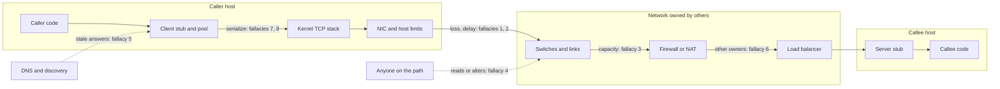
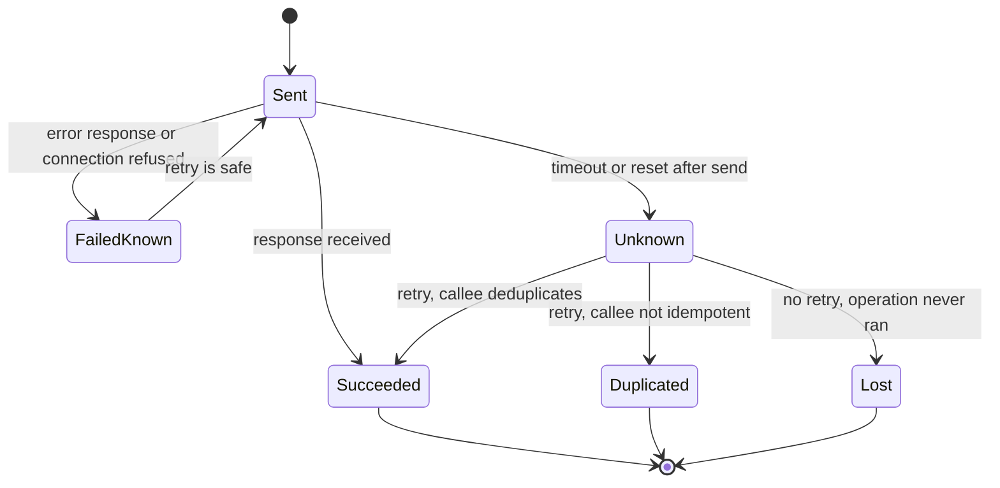
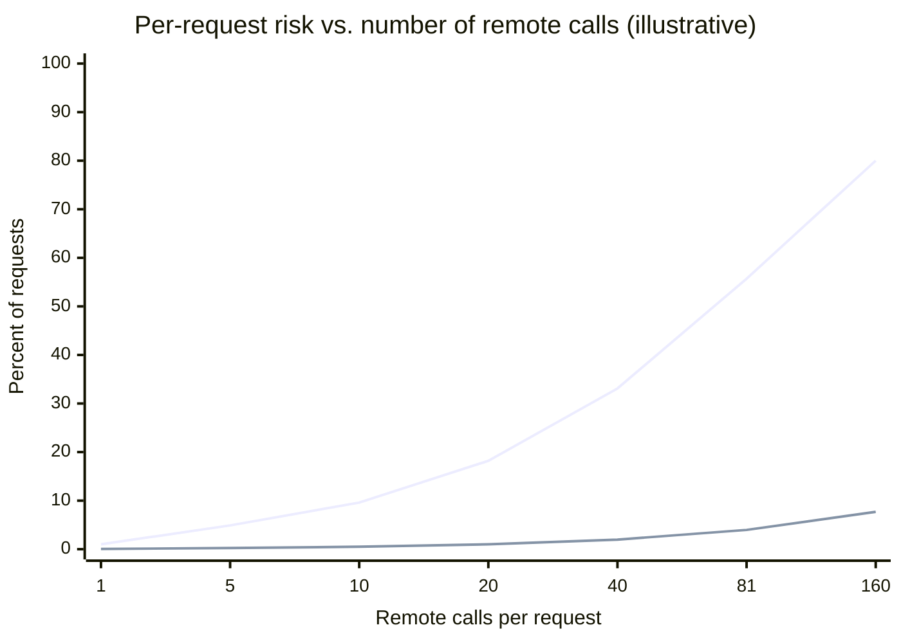
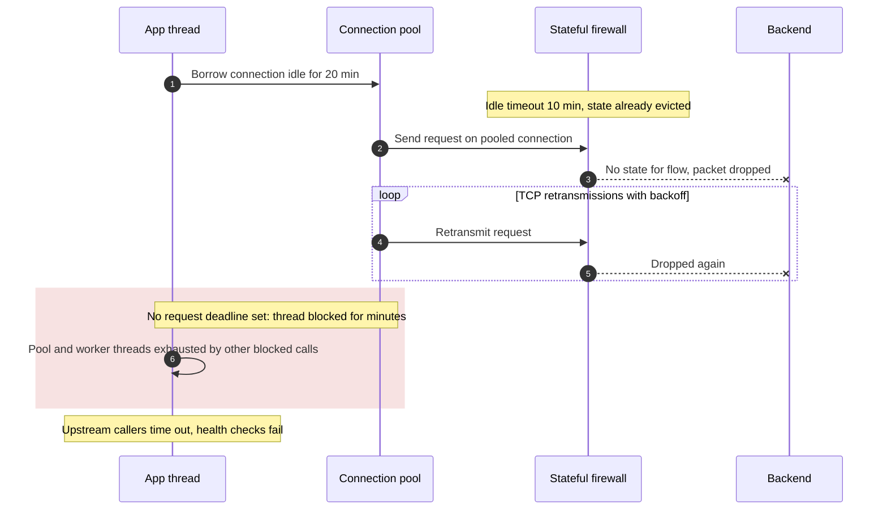
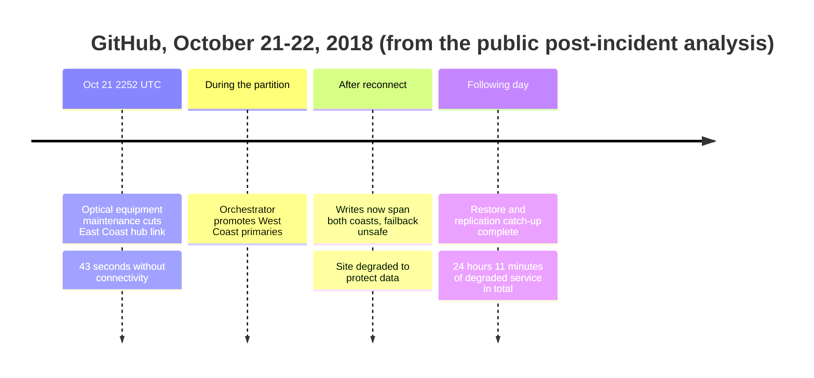

Dağıtık hesaplamanın yanılgıları, ağ üzerinden çalışan sistemlerle yeni tanışan mühendislerin yapmaya meyilli olduğu ve production'da er ya da geç çöken sekiz varsayımdır: ağ güvenilirdir, gecikme sıfırdır, bant genişliği sonsuzdur, ağ güvenlidir, topoloji değişmez, tek bir yönetici vardır, taşıma maliyeti sıfırdır ve ağ homojendir. L. Peter Deutsch bunların yedisini 1994'te Sun Microsystems'te bir araya getirdi; Bill Joy ve Sun'daki bir çalışma arkadaşının daha önce "ağ üzerinde hesaplamanın yanılgıları" olarak dolaştırdığı dört maddeyi temel aldı. Sekizincisini James Gosling 1997 civarında ekledi. Liste bir teori ya da protokol değildir. Tek bir process içindeki fonksiyon çağrısının kimse istemeden sağladığı ve ağ üzerinden yapılan bir çağrının sessizce geri aldığı özelliklerin kontrol listesidir.

Bu bakış, yanılgıların otuz yıl sonra hâlâ neden tekrar ortaya çıktığını açıklar. Kimse ağın kusursuz olduğuna inanarak kod yazmaz; varsayımlar, uzak bir çağrıyı yerel gibi gösteren soyutlamalar üzerinden içeri sızar: yerel bir metodun imzasını taşıyan, otomatik üretilmiş bir client stub; bir alan okunduğunda ilişkili satırı ağ üzerinden getiren bir object-relational mapper (ORM); varsayılan timeout'u sonsuz olan bir HTTP client; bir DNS yanıtını process'in ömrü boyunca önbellekte tutan bir runtime. Her soyutlama ağı gizlediği için faydalıdır ve aynı nedenle tehlikelidir.

Asıl denge, şeffaflık ile kontrol arasındadır. Ağı gizlemek, dağıtık kodu yerel kod kadar kolay yazılır kılar; ancak hata altındaki davranışı belirleyen kararları da gizler: ne kadar beklenecek, yeniden denenecek mi, ne kadar veri taşınacak, kime güvenilecek ve çağrılan taraf şu an nerede yaşıyor. Ağı görünür kılmak ise her çağrı noktasını bu kararları vermeye zorlar; bu da geliştirme süresine mal olur ve arayüzleri daha kaba taneli hâle getirir. Bu sayfadaki her düzeltme, bu kararlardan birini gizli bir varsayılandan çıkarıp açık ve gözden geçirilmiş bir seçime dönüştürür. Paket kaybı, bant genişliği sınırları ve topoloji değişikliğinin ayrıntılı ele alınışı [Ağ Güvenilirliği, Bant Genişliği Sınırları ve Topoloji Değişiklikleri](/distributed-systems/tr/foundations/monoliths-to-distributed/network-reliability/) sayfasına aittir; bu sayfa varsayımların kendisini ve bunların nasıl hataya dönüştüğünü konu alır.

## Yerel Bir Çağrının İstenmeden Verdiği Garantiler

Jim Waldo ve Sun'daki çalışma arkadaşları temel argümanı yine 1994'te *A Note on Distributed Computing* makalesinde ortaya koydu: yerel ve uzak hesaplama gecikme, bellek erişimi, kısmi hata (partial failure) ve eşzamanlılık bakımından farklıdır ve bu farkları gizleyen bir arayüz iki ortamda birden doğru olamaz. Yerel bir çağrının, hiç bozulmadığı için kimsenin yazıya dökmediği bir sözleşmesi vardır: çağrılan taraf tam olarak bir kez çalışır ya da process onunla birlikte ölür, çağrı nanosaniyeler sürer, büyük bir argüman pointer olarak geçer, aradaki hiç kimse onu okuyamaz ya da değiştiremez, çağrılan tarafın adresi link aşamasında sabitlenir, yolun tamamı tek bir ekibe aittir, çağrının hiçbir maliyeti yoktur ve iki taraf da aynı bellek düzenini ve her tipin aynı sürümünü paylaşır.

Uzak bir çağrı bu garantilerin her birini, kendi başına davranabilen bir bileşenle değiştirir. Tek bir isteği çağıranın kodundan çağrılan tarafa kadar izlemek, her yanılgının nerede yaşadığını gösterir.


*Tek bir uzak çağrının izlediği yol ve her yanılgının bu yola girdiği yer. Yerel bir çağrıda yalnızca ilk ve son kutu bulunur.*

`Caller code` ile `Callee code` arasındaki her kutunun kendi durumu, kapasitesi, sahibi ve hata davranışı vardır. Firewall'un bağlantı tablosunun idle timeout'unu başka bir ekip belirler, load balancer'ın yapılandırması kendi takvimiyle yayına çıkar, DNS ise önbelleğe alındığı anda doğru olan bir yanıt döndürür. NIC (network interface card) ve altındaki hypervisor, [Maliyet-Performans Eğrileri ve Donanım Sınırları](/distributed-systems/tr/foundations/monoliths-to-distributed/cost-performance-curves/) sayfasında anlatıldığı gibi bant genişliği ve paket hızı kotaları uygular. Bunların hiçbiri durumunu çağırana bildirmez; çağıran onları yalnızca belirtiler üzerinden öğrenir: yavaş bir çağrı, bir reset, bir askıda kalma. Her yanılgı, bu kutulardan birinin orada olmadığını varsaymaktır.

### Üçüncü Sonuç: Kısmi Hata Neden Her Şeyi Değiştirir

İlk iki yanılgı en büyük hasarı verir, çünkü birlikte yerel kodun dayandığı bir özelliği ortadan kaldırırlar: her çağrı biter ve sonucu bilinir. Uzak bir çağrının iki değil üç sonucu vardır. Başarılı olabilir, çağıranın aldığı bir hatayla başarısız olabilir ya da çağıranın, çağrılan tarafın işlemi yürütüp yürütmediğini bilmediği bir durumda sona erebilir.


*Tek bir uzak çağrının çağıranın gözünden olası sonuçları. `Unknown` durumunun yerel çağrıda karşılığı yoktur.*

Timeout, isteğin başarısız olduğu anlamına gelmez; çağıranın beklemeyi bıraktığı anlamına gelir. İstek gidişte kaybolmuş, yürütülüp yanıtı dönüşte kaybolmuş ya da çağıran vazgeçtikten sonra onu yürütecek bir sunucuda hâlâ kuyrukta bekliyor olabilir. Çağıran bu durumları birbirinden ayırt edemez; diyagramda üç çıkışı olan tek bir `Unknown` durumunun bulunmasının nedeni budur. İstek yazılmadan önce reddedilen bir bağlantı bilinen bir hatadır ve yeniden denenmesi güvenlidir; istek yazıldıktan sonra gelen bir reset ise bilinmeyen sonuçtur.

İnsan müdahalesi olmadan `Unknown` durumundan çıkmanın tek genel yolu, yeniden denemeleri zararsız kılmaktır. Çağrılan taraf idempotent ise ya da her istek kimliğini kaydedip tekrarlanan bir kimlik için saklanan sonucu döndürüyorsa, yanıt gelene kadar yeniden denemek at-least-once teslimatı exactly-once etkiye dönüştürür. Ağ isteği istediği kadar teslim edebilir; ama durum yalnızca ilk teslimatta değişir ve sonraki her teslimat aynı yanıtı alır. Bu yalnızca tekrar engelleme (deduplication) kaydı, client'ın yeniden deneyebileceği en uzun pencereden daha uzun yaşıyorsa ve kimlik her denemede değil, çağıran tarafından bir kez üretiliyorsa geçerlidir. Mekanizmanın ayrıntıları [Idempotency ve Güvenli HTTP Metotları](/distributed-systems/tr/communication/api-gateway/idempotency/) ile [En Az Bir Kez, En Fazla Bir Kez ve Tam Olarak Bir Kez Semantiği](/distributed-systems/tr/communication/async-messaging/delivery-semantics/) sayfalarında anlatılır. Mesajları sınırsız geciktirebilen bir ağın biçimsel ele alınışı [Ağ Modelleri](/distributed-systems/tr/foundations/system-models/network-models/) sayfasındadır.

:::caution[Bir yazma işleminde timeout, hata demek değildir]
Ödeme, sipariş ya da muhasebe kaydı çağrısından gelen bir timeout'u yakalayıp kullanıcıya "işlem başarısız oldu" diyen ya da idempotency anahtarı olmadan yeniden deneyen kod iki yönde de yanlıştır: kullanıcı bir kez ücretlendirilip başarısız olduğunu duyabilir ya da iki kez ücretlendirilebilir. Timeout'a uğramış bir yazma işlemini `Unknown` olarak ele alın, yalnızca orijinal istek kimliğiyle yeniden deneyin ve denemeler tükendiğinde çağrılan tarafın kaydıyla mutabakat yapın.
:::

## Sekiz Varsayım ve Koda Nasıl Girdikleri

Yanılgılar, yerel çağrının hangi garantisini ortadan kaldırdıklarına göre gruplanır ve her grubun tek bir düzeltme türü vardır.

### Güvenilirlik ve Gecikme

"Ağ güvenilirdir" varsayımı, timeout'u ve `Unknown` sonucu için planı olmayan her çağrıda koda girer. Pek çok client varsayılan olarak sonsuza kadar bekler: örneğin gRPC, varsayılan olarak deadline koymadığını belgeler; yani çağıran bir deadline belirlemedikçe bir RPC (remote procedure call) süresiz bekler. Takılan bir çağrılan taraf ya da yol, çağıranın thread'ini veya bağlantısını tutar ve tek bir yavaş bağımlılık bütün bir pool'u tüketebilir. Düzeltme, her çağrıya çağıranın gecikme bütçesinden türetilmiş ve aşağı akışa yayılan bir deadline koymaktır; böylece çağrılan taraf, çağıranın çoktan vazgeçtiği işi durdurur. Bu konu [Zaman Aşımları](/distributed-systems/tr/resilience/protection-patterns/timeouts/) sayfasında ele alınır. Bailis ve Kingsbury'nin *The Network is Reliable* derlemesi, partition'ların, bağlantı arızalarının ve cihaz hatalarının tek bir veri merkezi dahil her ortamda yaşandığına dair yayımlanmış kanıtları bir araya getirir.

"Gecikme sıfırdır" varsayımı, çağrılar bedavaymış gibi tasarlanmış arayüzler üzerinden girer: her eleman için uzak bir metot çağıran bir döngü, lazy-load edilen bir ORM ilişkisi, bir isteği doğrulamak için sırayla üç başka servisi çağıran bir servis. Gecikmenin fiziksel bir tabanı vardır. Işık optik fiberde saniyede yaklaşık 200.000 km, yani kilometre başına yaklaşık 5 mikrosaniye ilerler; dolayısıyla 100 km fiber, hiçbir switch, kuyruk ya da yazılım devreye girmeden yaklaşık bir milisaniyelik round-trip time (RTT) ekler. Tek bir veri merkezi içinde bir RPC, serileştirme, kernel işi ve kuyruklama ile birlikte tipik olarak yüzlerce mikrosaniye sürer; kıtalar arasında ise onlarca ila yüzlerce milisaniye. Geveze (chatty) bir arayüz bu maliyeti sıralı çağrı sayısıyla, bir fan-out ise yavaş bir çağrıya denk gelme olasılığını çarpar; Dean ve Barroso'nun tarif ettiği bu kuyruk (tail) etkisi [Ölçekleme İkilemi](/distributed-systems/tr/foundations/monoliths-to-distributed/scaling-dilemma/) sayfasında sayısal olarak incelenir.

### Bant Genişliği ve Taşıma Maliyeti

"Bant genişliği sonsuzdur" varsayımı, bir tasarım birkaç alana ihtiyaç duyduğu yerde bütün nesneleri taşıdığında, delta'lar yeterken tüm durumu replike ettiğinde ya da kullanıcı trafiğine hizmet eden bağlantılar üzerinden bir backfill çalıştırdığında girer. Bant genişliği host, akış (flow), bağlantı ve sağlayıcı kotası başına sınırlıdır ve bağlayıcı olan sınır çoğu zaman NIC'in etiket hızı değildir. Bir bağlantı doyduğunda paketler switch buffer'larında kuyruğa girer ve herhangi bir kayıp görünmeden önce gecikme artar; bu yüzden bir bant genişliği problemi genellikle önce bir gecikme problemi olarak ortaya çıkar. Akış başına sınırlar, incast ve aşırı abone edilmiş (oversubscribed) topolojiler [Ağ Güvenilirliği, Bant Genişliği Sınırları ve Topoloji Değişiklikleri](/distributed-systems/tr/foundations/monoliths-to-distributed/network-reliability/) sayfasında ele alınır.

"Taşıma maliyeti sıfırdır" varsayımının iki boyutu vardır. Birincisi hesaplamadır: her çağrı payload'unu serileştirir, şifreler, kernel üzerinden kopyalar, şifresini çözer ve deserileştirir; küçük çağrılar etrafında kurulmuş servislerde bu, CPU'nun büyük bir kısmını tüketebilir. İkincisi paradır: bulut sağlayıcıları availability zone'lar arası, bölgeler arası ve internete giden veri transferini faturalar; yerleşime bakılmadan kurulmuş bir çağrı grafiğinin, taşıdığı byte'larla orantılı, tekrarlayan bir maliyeti olur. Bu maliyetlerin hiçbiri kutu ve oklardan oluşan bir diyagramda görünmez. Ölçülmeleri ve dağıtılmaları [Maliyet Optimizasyonu](/distributed-systems/tr/deployment/platform-engineering/cost-optimization/) sayfasında anlatılır.

### Güvenlik

"Ağ güvenlidir" varsayımı, bir servisin bir isteğe nereden geldiği için güvendiği her yerde girer: "firewall'un arkasında" olduğu için kimlik doğrulaması olmayan dahili bir endpoint, bağlantılar özel olduğu için servisler arasında şifresiz trafik, kimliğin yerine geçen bir IP adresi allowlist'i. Bu durumda çevre (perimeter) içindeki ele geçirilmiş herhangi bir iş yükü, meşru bir iş yüküyle aynı erişime sahip olur; container platformları IP adreslerini saniyeler içinde yeniden atadığı için de bir adres uzun süre hiçbir şeyi tanımlamaz. Düzeltme, her çağrıda iş yükü kimliğine (workload identity) göre kimlik doğrulama ve yetkilendirme yapmak ve aktarım sırasında şifrelemektir; bu, [mTLS](/distributed-systems/tr/service-mesh/network-policies-mtls/mtls/) (mutual Transport Layer Security) ve [Asla Güvenme, Her Zaman Doğrula](/distributed-systems/tr/security/zero-trust/never-trust-always-verify/) sayfalarının konusudur.

### Topoloji ve Yönetim

"Topoloji değişmez" varsayımı, bir adresi bir kez çözümleyip saklayan her şey üzerinden girer. Java'da JDK, başarılı DNS sorgularını varsayılan olarak 30 saniye, bir security manager kuruluysa ise `networkaddress.cache.ttl` security property'si ayarlanmadıkça sonsuza kadar önbellekte tutar; bu yüzden uzun süre çalışan bir process, saatler önce devreden çıkarılmış bir adresi çağırmaya devam edebilir. Uzun ömürlü HTTP/2 ve gRPC bağlantıları bir katman yukarıda aynı etkiyi yaratır: üç backend'e bağlanmış bir client, servis 10 instance'a ölçeklendikten sonra da yalnızca o üçünü kullanmaya devam eder. Düzeltmeler; kısa ve gerçekten uygulanan DNS TTL'leri (time to live), üyelik değişikliklerini push eden ve [DNS Tabanlı Keşif](/distributed-systems/tr/microservice-patterns/service-discovery/dns-based-discovery/) sayfasında anlatılan keşif mekanizmaları ve client'ları periyodik olarak yeniden bağlanıp yük dengelemeye zorlayan, sunucu tarafında bir maksimum bağlantı ömrüdür.

"Tek bir yönetici vardır" varsayımı, bir tasarım başkasına ait ayarlara bağımlı olduğunda girer. Firewall'un idle timeout'u, NAT (network address translation) gateway'in bağlantı tablosu, sağlayıcının bakım penceresi, platform ekibinin sertifika rotasyonu ve başka bir ekibin security group değişiklikleri; hepsi bir çağrının davranışını kodunda hiçbir değişiklik olmadan değiştirir. Örneğin AWS, NAT gateway'inin 350 saniye boşta kalan bağlantıları zaman aşımına uğrattığını ve böyle bir bağlantıdan gelen sonraki pakete TCP reset ile yanıt verdiğini belgeler; bağlantıları bundan daha uzun boşta tutan bir pool, her sessiz dönemin ardından reset görür. Düzeltme, bu tür sınırları keşfetmek, uygulamayı bu sınırların içinde kalacak şekilde yapılandırmak ve diğer ekiplerin yapılandırmasını kendi değişiklik süreci olan harici bir bağımlılık olarak ele almaktır.

### Homojenlik

"Ağ homojendir" varsayımı, bir tasarım her hop'un, client'ın ve karşı tarafın aynı şekilde davrandığını varsaydığında girer. Paket düzeyinde, maximum transmission unit (MTU) yoldan yola değişir: VXLAN encapsulation kullanan bir overlay ağı 50 byte başlık ekler, dolayısıyla bir host'tan çıkan 1.500 byte'lık bir paket overlay'e sığmayabilir. Path MTU discovery, bir paketin fazla büyük olduğunu bildiren ICMP (Internet Control Message Protocol) mesajlarına dayanır; bir firewall bunları filtrelediğinde küçük istekler başarılı olurken büyük yanıtlar kaybolur ve bağlantılar yalnızca belirli payload'larda askıda kalır. Uygulama düzeyinde ise karşı taraf, rolling deploy sırasında başka bir şema sürümü, başka bir TLS kütüphanesi ya da farklı varsayılanlara sahip başka bir runtime çalıştırıyor olabilir. Düzeltmeler; [Şema Evrimi ve Schema Registry](/distributed-systems/tr/communication/async-messaging/schema-evolution-registry/) sayfasında anlatılan açık wire-format uyumluluk kuralları ve production'ın gerçekte çalıştırdığı karışıma karşı yapılan testlerdir.

:::note[Liste eksiksiz değildir]
Sekiz yanılgı ağ hakkındadır. Dağıtık sistemler benzer sonuçlar doğuran başka yanlış varsayımlar da yapar: farklı makinelerdeki saatlerin uyuştuğu ([Fiziksel Saatler](/distributed-systems/tr/foundations/time-and-ordering/physical-clocks/)), yanıt vermeyi bırakan bir node'un duraklamadığı, çöktüğü ([Hata Modelleri](/distributed-systems/tr/foundations/system-models/failure-models/)) ve bir failure detector'ın bu ikisini ayırt edebileceği ([Heartbeats ve Zaman Aşımı Yapılandırması](/distributed-systems/tr/resilience/failure-detection/heartbeats-timeouts/)). Listeyi eksiksiz bir tehdit modeli olarak değil, gözden geçirme için bir başlangıç noktası olarak kullanın.
:::

## Çalışılmış Örnek: N+1 Döngüsünün Arkasındaki Kataloğu Ayırmak

Bir monolitin sipariş detay sayfasını, önce siparişi yükleyip ardından 40 satır kaleminin her biri için `getProduct(id)` ve `getInventory(id)` çağırarak oluşturduğunu varsayalım. Process içinde 81 çağrı yerel bir önbelleğe gider ve toplamda bir milisaniyenin çok altında kalır; bu yüzden kimse döngüyü fark etmemiştir. Ekip kataloğu ve stok bilgisini, üretilen stub'ları aynı imzaları koruyan servislere ayırır; döngü değişmeden yaşamaya devam eder. Aşağıdaki tüm sayılar örnek amaçlıdır.

Önce gecikme. Tek bir availability zone (AZ) içinde bir RPC uçtan uca 0,5 ms sürüyorsa, 81 sıralı çağrı 40,5 ms sürer. Instance'lar zone'lara dağıtılmışsa ve zone'lar arası bir çağrı 1,5 ms sürüyorsa, sayfa yaklaşık 122 ms'ye çıkar. Sonradan yapılan bir felaket kurtarma (disaster recovery) değişikliği katalog çağrılarını 70 ms uzaktaki başka bir bölgeye yönlendirirse, sayfa 81 kere 70 ms, yani yaklaşık 5,7 saniye sürer. Değişen yalnızca yerleşimdir.

Sonra güvenilirlik. Her çağrı bağımsız olarak %99,95 oranında başarılıysa, sayfanın başarılı olma olasılığı `0.9995^81`, yani yaklaşık %96,0'dır: her servis %99,95 hedefini tutturduğu hâlde her yüz sayfa yüklemesinden dördü başarısız olur. Kuyruk daha da kötüdür. Her çağrının p99 gecikmesi 5 ms ise, 81 çağrıdan en az birinin en yavaş %1'lik dilime düşme olasılığı `1 - 0.99^81`, yaklaşık %55,7'dir. Sayfa yüklemelerinin yarısından fazlası artık bağımlılıkların medyanında değil, kuyruğunda çalışır.


*Üst çizgi: en az bir çağrının kendi p99 değerinden yavaş olma olasılığı. Alt çizgi: her çağrı %99,95 oranında başarılıyken en az bir çağrının başarısız olma olasılığı. Çağrıların bağımsız olduğu varsayılmıştır.*

Mühendislik kararlarını değiştiren üst eğridir: her bağımlılığın sahipleri kendi p99 değerini savunur, ama düzinelerce çağrı yapan bir istek, hiçbirinin raporladığından çok daha kötü bir yüzdelik dilim yaşar. Bağımsızlık varsayımı iyimserdir; aşırı yüklenmiş tek bir bağımlılığa yapılan çağrılar birbiriyle ilişkilidir, dolayısıyla olay anlarında eğri daha hızlı yükselir.

Son olarak bant genişliği ve maliyet. Her ürün yanıtı 8 KB JSON ise, sayfa katalog ve stok servislerinden 640 KB taşır. Saniyede 500 sayfa yüklemesinde bu, sürekli olarak 320 MB/s, yani yaklaşık 2,6 Gbps eder. 30 günlük bir ayda bu yaklaşık 829.000 GB'tır. Instance'lar üç zone'a eşit dağıtılmış ve çağrılar zone'a bakılmadan yük dengeleniyorsa, çağrıların yaklaşık üçte ikisi bir zone sınırını geçer. Zone'lar arası transferin her iki tarafında GB başına 0,01 dolar ücret alındığını varsayalım; bu, AWS'nin çoğu bölge için uzun süredir yayımladığı bir fiyattır (güncel fiyatı kontrol edin). 829.000 GB'ın üçte ikisi, GB başına 0,02 dolardan ayda yaklaşık 11.000 dolar eder; üstelik monolitin içinde oluşturulması hiçbir şeye mal olmayan bir sayfa için.

Çözüm ağı değil, arayüzü değiştirmektir. Toplu bir `getProducts(ids)` metodu ve stok tarafındaki karşılığı sayfayı üç çağrıya indirir; iki toplu çağrı sipariş yüklendikten sonra paralel çalışabildiği için sayfa iki sıralı round trip'e ihtiyaç duyar: zone içinde yaklaşık 1 ms, bölgeler arasında bile yaklaşık 140 ms. Başarı olasılığı `0.9995^3`, yaklaşık %99,85'e yükselir. Toplu yanıt ayrıca yalnızca sayfanın gösterdiği 1,5 KB'lık alanları döndürürse, transfer sayfa başına 120 KB'a ve zone'lar arası fatura ayda kabaca 2.000 dolara düşer. Arayüz gecikmenin, bant genişliğinin ve taşımanın bedava olduğunu varsaymayı bıraktığında her sayı iyileşti.

## Tasarım Yanıtları ve Bedelleri

Her düzeltmenin bir bedeli vardır ve aralarından seçim yapmak asıl mühendislik kararıdır.

| Yanılgı | Ortadan kalkan yerel garanti | Tipik hata | Yanıt | Yanıtın bedeli |
|---|---|---|---|---|
| Ağ güvenilirdir | Çağrı, sonucu bilinen bir şekilde biter | Askıda kalma, kaybolan ya da çiftlenen yazmalar | Deadline'lar, idempotency anahtarları, sınırlı retry | Her yazma yolu bir tekrar engelleme kaydı gerektirir |
| Gecikme sıfırdır | Çağrı nanosaniyeler sürer | Geveze arayüzler, sıralı fan-out | Kaba taneli ve toplu API'ler, paralel çağrılar | Daha az yeniden kullanılabilir arayüzler, daha büyük payload'lar |
| Bant genişliği sonsuzdur | Argümanlar referansla geçer | Doymuş bağlantılar, kuyruklanmadan gelen gecikme | Projeksiyonlar, sıkıştırma, ayrı toplu veri yolları | Daha fazla API yüzeyi, sıkıştırma için CPU |
| Ağ güvenlidir | Çağıranla çağrılan arasında kimse yoktur | Tek bir ele geçirmeden sonra yanal hareket | mTLS, çağrı başına yetkilendirme | Sertifika yaşam döngüsü, handshake gecikmesi |
| Topoloji değişmez | Çağrılan tarafın adresi link aşamasında sabittir | Bayat ya da kaldırılmış instance'lara trafik | Kısa TTL'ler, push tabanlı keşif, maksimum bağlantı ömrü | Daha fazla yeniden bağlanma ve sorgu |
| Tek bir yönetici vardır | Yolun tamamının tek bir sahibi vardır | Kod değişmeden davranışın değişmesi | Açık sınırlar, yol timeout'larının altında keepalive | Ekipler arası koordinasyon ve dokümantasyon |
| Taşıma maliyeti sıfırdır | Çağrılar bedavadır | CPU ve transfer faturalarının trafikle büyümesi | Zone farkındalıklı yönlendirme, birlikte yerleşim, toplu çağrı | Zone'lar arasında dengesiz yük, yerleşim kısıtları |
| Ağ homojendir | Tek bellek düzeni ve tek sürüm | Sürüm uyumsuzluğu, MTU kara delikleri | Uyumluluk kuralları, contract testleri, MTU kontrolleri | Daha yavaş şema evrimi, test matrisi |

Bir ekibin seçtiği arayüz stili, ağın ne kadarını görünür kılacağını belirler.

| Arayüz stili | Ağın görünürlüğü | Ana risk | Ne zaman tercih edilmeli |
|---|---|---|---|
| İnce taneli senkron RPC | Gizli; yerel çağrı gibi görünür | N+1 döngüleri, fan-out kuyrukları, zincirleme askıda kalmalar | İstek başına az çağrı, gecikmeye toleranslı dahili araçlar |
| Kaba taneli ya da toplu senkron RPC | API'nin şeklinde görünür | Daha büyük payload'lar, daha geniş sözleşmeler | Çok sayıda ilişkili sorgu içeren kullanıcıya dönük yollar |
| Asenkron mesajlaşma | Açık; çağıran beklemez | Sıralama, tekrarlar, eventual consistency | Kullanıcının isteği içinde tamamlanması gerekmeyen işler |
| Uzak verinin yerel önbelleği ya da replikası | Okumalar için ortadan kalkar | Bayatlık ve invalidation | Bayatlığın tolere edilebildiği, okuma ağırlıklı veriler |
| Servisleri birleştirmek | Tamamen ortadan kalkar | Daha büyük deploy birimi, ortak yayın temposu | Birbiri olmadan işe yarar bir şey yapamayan servisler |

Son satır ağırlığı hak eder: neredeyse her istekte birbirini çağıran ve bağımsız deploy edilemeyen iki servis, her yanılgının bedelini öder ve dağıtıklıktan hiçbir şey kazanmaz; bu desen [Dağıtık Monolit](/distributed-systems/tr/microservice-patterns/service-decomposition/distributed-monolith/) sayfasında anlatılır. Geveze etkileşimleri tek bir process içinde tutan sınırları seçmek [Servis Granülaritesi](/distributed-systems/tr/microservice-patterns/service-decomposition/service-granularity/) sayfasının konusudur.

### Yanılgıları Kodlayan Varsayılan Değerler

Pek çok yanılgı, kimsenin seçmediği varsayılan değerlerde yaşar. Linux'ta onaylanmamış veri taşıyan bir TCP bağlantısından ancak `tcp_retries2` kadar yeniden iletimden sonra vazgeçilir; kernel dokümantasyonu varsayılan 15 değerinin yaklaşık 924,6 saniyelik varsayımsal bir zaman aşımına karşılık geldiğini belirtir. Boştaki bağlantılarda ölü karşı tarafları tespit eden TCP keepalive, uygulama socket üzerinde etkinleştirmedikçe kapalıdır ve varsayılan ilk probe iki saatlik boşluktan sonra gelir; bu, çoğu firewall ve NAT cihazının idle timeout'undan çok daha uzundur.

```shell
# Linux defaults on most distributions; inspect before relying on them
sysctl net.ipv4.tcp_retries2         # 15: data on a dead path waits about 15 min
sysctl net.ipv4.tcp_keepalive_time   # 7200 s idle before the first keepalive probe
sysctl net.ipv4.tcp_keepalive_intvl  # 75 s between probes
sysctl net.ipv4.tcp_keepalive_probes # 9 failed probes before the connection is dropped
# JDK DNS cache: 30 s by default, forever under a security manager.
# Set explicitly in $JAVA_HOME/conf/security/java.security:
#   networkaddress.cache.ttl=30
```

Amaç bu değerleri global olarak değiştirmek değil, onlara güvenmeyi bırakmaktır: client tarafındaki bir deadline çağrıyı saniyelerle sınırlar, yoldaki en kısa ara kutu (middlebox) idle timeout'unun altında tutulan pool idle eviction bayat bağlantıları önler ve keepalive'lar uzun ömürlü boştaki bağlantılar için yedek görevi görür. Bu ayarlar yerindeyken kernel varsayılanları nadiren önemlidir; yokken kesintiyi varsayılanlar tanımlar.

:::tip[Yalnızca timeout'u değil, deadline'ı yayın]
Hop başına sabit bir timeout, kullanıcıya dönük bütçesini çoktan aşmış bir isteğin aşağı akışta kapasite tüketmeye devam etmesine izin verir. Kalan deadline'ı her çağrıyla birlikte iletin ki her servis, çağıranı çoktan vazgeçmiş işi reddedebilsin. gRPC, otomatik deadline yayılımının Java ve Go'da varsayılan olarak açık, C++'ta ise isteğe bağlı olduğunu belgeler; HTTP'de deadline bir header ile taşınmalı ve açıkça dikkate alınmalıdır.
:::

## Hata Modları ve Nasıl Göründükleri

Aşağıdaki her hata, en kolay imzasından tanınır.

### Bir Ara Kutunun Arkasındaki Bayat Bağlantılar

Tetikleyici: pool'daki bağlantılar, yoldaki bir firewall ya da NAT cihazının idle timeout'undan daha uzun süre boşta kalır ve cihaz bu bağlantıların durumunu siler. Belirtiler: sessiz bir dönemin ardından gelen ilk istekler başarısız olur ya da askıda kalır, sonra servis toparlanır; bu her gece ya da hafta sonlarından sonra tekrarlanır. Reset gönderen bir cihaz anında `connection reset` hataları üretir; paketleri sessizce düşüren bir cihaz ise yalnızca client'ın deadline'ıyla ya da deadline yoksa TCP yeniden iletimiyle sınırlanan askıda kalmalara yol açar.


*Paketleri sessizce düşüren bir firewall ve deadline'ı olmayan bir client. Timeout değerleri örnek amaçlıdır.*

2. ve 3. adımlarda bağlantı client'a sağlıklı görünür, çünkü ona aksini söyleyen hiçbir şey olmamıştır. 4. ve 5. adımlar, TCP'nin üstel geri çekilme (exponential backoff) ile yeniden iletim yapmasıdır; uygulama düzeyinde bir deadline olmadığında thread, yeniden iletim bütçesinin tamamını bekler. 6. adım bayat bağlantıları bir kesintiye dönüştürür, çünkü bunlardan birini ödünç alan her istek bir worker'ı bloke eder. Tespit: boşta kalma dönemlerinin sonuyla ilişkili hata ya da gecikme sıçramaları, client loglarındaki `connection reset` sayıları, yeniden iletim sayaçları (`netstat -s`, `nstat`) ve AWS NAT gateway'lerinde `IdleTimeoutCount` CloudWatch metriği. Önlem: istek deadline'ları, yoldaki en kısa idle timeout'un altında pool idle eviction ve uzun ömürlü bağlantılarda keepalive ya da uygulama düzeyinde ping.

### Kısmi Hata Altında Retry Amplifikasyonu

Tetikleyici: bir bağımlılık yavaşlar ve çağrı grafiğinin her katmanı bağımsız olarak timeout'a düşüp yeniden dener. Belirtiler: bağımlılığın sağlığı bozuldukça üzerindeki yük artar; her biri üç deneme yapan üç katman, istek başına 27 denemeye kadar çıkabilir. Tespit: farklı istek başına deneme sayısı, katman bazında retry sayaçları. Önlem: tek bir katmanda, backoff, jitter ve retry bütçesiyle, bir [circuit breaker](/distributed-systems/tr/resilience/protection-patterns/circuit-breaker/) arkasında yeniden denemek. Dinamikler [Retry Fırtınaları ve Metastabil Hatalar](/distributed-systems/tr/resilience/flow-control/retry-storms-metastable-failures/) ile [Üstel Geri Çekilme ve Jitter ile Yeniden Deneme](/distributed-systems/tr/resilience/protection-patterns/retry-exponential-backoff/) sayfalarında ele alınır.

### Kısa Partition'lar, Uzun Sonuçlar

Saniyeler süren bir partition, uzun arızalar için tasarlanmış otomasyonu tetikleyebilir. 21 Ekim 2018'de optik ekipman bakımı, GitHub'ın ABD Doğu Yakası ağ merkezini birincil Doğu Yakası veri merkezinden 43 saniyeliğine kopardı. Bu pencerede Orchestrator cluster yöneticisi veritabanı primary'lerini Batı Yakası'nda terfi ettirdi; bağlantı geri geldiğinde her site diğerinde olmayan yazmalara sahipti ve GitHub, veri kaybetmeden tutarlılığı geri kazanırken 24 saat 11 dakika boyunca kısıtlı hizmet verdi. Olay [GitHub 2018](/distributed-systems/tr/case-studies/famous-outages/github-2018-split-brain/) sayfasında incelenir.


*Olayların sırası GitHub'ın yayımladığı analizden alınmıştır; ilki dışındaki zamanlar kesin değil, özetlenmiştir.*

Zaman çizelgesi, güvenilirlik yanılgısının gizlediği asimetriyi gösterir: ağ arızası kısa sürdü ve kendiliğinden düzeldi, kurtarma ise manuel ve uzun oldu; çünkü uzun bir partition için doğru olan bir karar kısa bir partition'a uygulandı. Failover otomasyonunun yalnızca bir partition'ın başladığını fark eden bir dedektöre değil, partition'ların ne kadar sürdüğüne ve hangi yazmaların yolda olabileceğine dair bir modele de ihtiyacı vardır.

### Veri Yolunu Paylaşan Kontrol Düzlemleri

4 Ekim 2021'de Facebook'un backbone kapasitesini değerlendirmek için verilen bir bakım komutu tüm veri merkezlerinin bağlantısını kopardı ve denetim aracındaki bir hata komutu durduramadı. Veri merkezlerine ulaşamadıklarında BGP (Border Gateway Protocol) rotalarını geri çekecek şekilde tasarlanmış DNS sunucuları, hâlâ çalışırken internetten kayboldu; kurtarma araçları da aynı ağa bağımlı olduğu için mühendisler sahada çalışmak zorunda kaldı. Vaka [Meta 2021](/distributed-systems/tr/case-studies/famous-outages/meta-2021-bgp-dns/) sayfasında incelenir: topolojiyi kendi yöneticileriniz de değiştirir ve onarım yolu, onarılan ağa bağımlı olmamalıdır.

### Hata İmzalarının Özeti

| Hata | İlgili yanılgılar | Dışarıdan görünen belirti | Tespit sinyali | Önlem |
|---|---|---|---|---|
| Askıda kalan çağrılar, pool tükenmesi | 1, 6 | Bloke thread'ler, loglanan hata yok | Thread dump'ları, uçuştaki istek göstergeleri | Her çağrıda deadline, bulkhead'ler |
| Çiftlenen ya da kaybolan yazmalar | 1 | Çift ücretlendirme, eksik kayıtlar | Mutabakat uyuşmazlıkları | Idempotency anahtarları, tekrar engelleme deposu |
| Kuyruğun belirlediği gecikme | 2 | p99, her bağımlılığın p99'unun çok üstünde | İstek başına trace span sayısı | Toplu çağrı, paralel çağrılar, daha az hop |
| Bayat endpoint'ler | 5 | Ölçekleme ya da deploy sonrası hatalar | Kaldırılmış IP'lere bağlantılar | Kısa DNS TTL'leri, maksimum bağlantı ömrü |
| Boştaki bağlantı reset'leri | 5, 6 | Sessiz dönemlerden sonra hatalar | Reset sayıları, NAT idle timeout metrikleri | Pool eviction, keepalive'lar |
| Boyuta bağlı askıda kalmalar | 8 | Büyük yanıtlar askıda kalır, küçükler başarılı olur | Tam boyutlu segment'lerin yeniden iletildiğini gösteren paket yakalamaları | Doğru MTU, ICMP fragmentation-needed mesajlarına izin |
| Transfer maliyetinin büyümesi | 3, 7 | Fatura trafikten hızlı büyür | Servis başına zone'lar arası byte | Zone farkındalıklı yönlendirme, projeksiyonlar |

[Dağıtık izleme](/distributed-systems/tr/observability/logs-metrics-traces/distributed-tracing/), ilk üç satır için en faydalı tespit aracıdır; çünkü kodun gizlediği yerde istek başına uzak çağrıların sayısını ve sırasını görünür kılar.

## Yanılgıları Tasarım İncelemesinde Kullanmak

Liste en iyi bir inceleme prosedürü olarak işe yarar: bir tasarımdaki her ok için, okun sekiz garantiden hangisini varsaydığını sorun. Çağrının bir deadline'ı var mı ve `Unknown` sonucunda ne oluyor? Kullanıcı isteği başına kaç kez yapılıyor, sırayla mı paralel mi? Hangi sınırdan kaç byte geçiyor ve bedelini kim ödüyor? İki taraf birbirinin kimliğini nasıl doğruluyor? Çağıran, çağrılan tarafın taşındığını nasıl öğreniyor? Yolda kimin yapılandırması var? İki taraf farklı sürümler çalıştırdığında ne oluyor? Yanıtı olmayan bir ok, trafiği bekleyen bir hatadır.

İncelemeyi bir çağrı process sınırını her geçtiğinde, özellikle de ayrıştırma (decomposition) sırasında process içi bir çağrı bu sınırın arkasına taşındığında uygulayın; çünkü yerel çağrı varsayımları tam orada değişmeden hayatta kalır. DNS, keşif, yapılandırma servisleri ve sertifika otoriteleri de uzak çağrılardır ve çoğu zaman başlangıç yolundadır. Yanıtlara güvenmek yerine onları gecikme, kayıp ve partition'ların [hata enjeksiyonu](/distributed-systems/tr/resilience/chaos-engineering/fault-injection/) ile test edin.

Yanılgıları dağıtıklığa karşı bir argüman olarak kullanmayın; bilinçli olarak ödenecek maliyetleri tarif ederler ve kararın kendisi [Ölçekleme İkilemi](/distributed-systems/tr/foundations/monoliths-to-distributed/scaling-dilemma/) sayfasındaki gerekçelere dayanır. Her düzeltmeyi her çağrıya uygulamayın: tek bir zone içindeki gecelik bir batch işinin zone farkındalıklı yönlendirmeye ihtiyacı yoktur, kritik olmayan dahili bir okuma da bir timeout ile ve retry olmadan yaşayabilir. Listeyi bir hata modeli yerine koymayın; tehlikeleri adlandırır ama bir bileşenin hangi hatalara dayanması gerektiğini söylemez, bu [Hata Modelleri](/distributed-systems/tr/foundations/system-models/failure-models/) sayfasının işidir. Ve güvenilirlik yanılgısını, bir partition sırasında hangi tutarlılık garantisinin korunabileceğine dair kesin bir önerme olan [CAP Teoremi](/distributed-systems/tr/data-management/consistency-models/cap-theorem/) ile karıştırmayın; yanılgı, partition için hiç plan yapmamak gibi daha geniş bir hatadır.

## İleri Okuma

- Jim Waldo, Geoff Wyant, Ann Wollrath, and Samuel Kendall, *A Note on Distributed Computing*, Sun Microsystems Laboratories Technical Report SMLI TR-94-29, 1994.
- Peter Bailis and Kyle Kingsbury, *The Network is Reliable*, ACM Queue, 2014.
- Jeffrey Dean and Luiz André Barroso, *The Tail at Scale*, Communications of the ACM, 2013.
- GitHub, *October 21 post-incident analysis*, GitHub Blog, 2018. https://github.blog/2018/10/30/oct21-post-incident-analysis/
- Santosh Janardhan, *More details about the October 4 outage*, Engineering at Meta, 2021. https://engineering.fb.com/2021/10/05/networking-traffic/outage-details/
